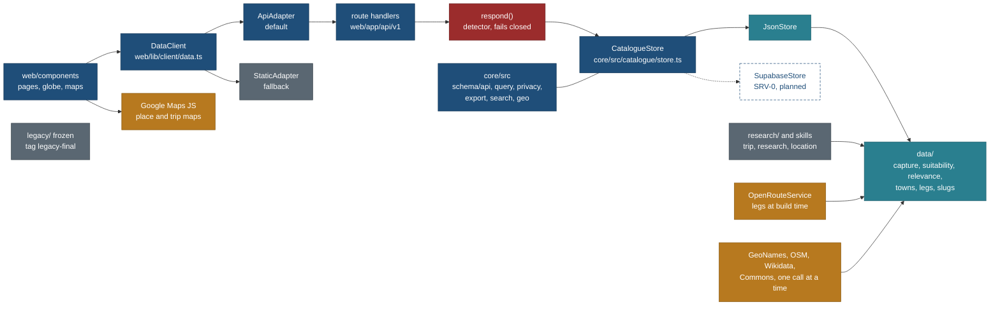
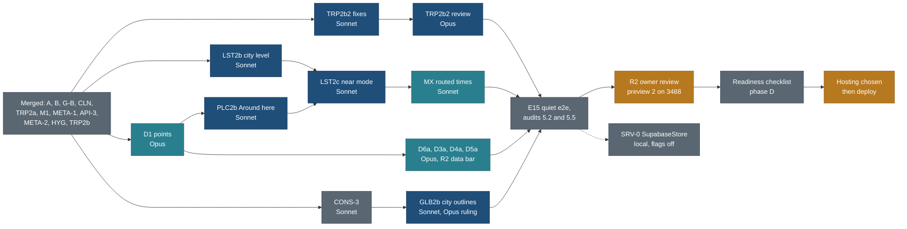

# Handover: start here

## Current handover: 25 Oct 2026, Neon foundation merged into main

**This section is the one current handover. It replaces the 24 Oct checkpoint.
Everything below the line is dated history; verify it against `git log` first.**

### Where things are

- **Code:** the Neon foundation, the R-60 documentation reconciliation, the R-61
  hosting decision and the 25 Oct origin-guard fix were committed on branch
  `nitin27may-phase-e-remaining-plan` and merged into `main` on GitHub (PR from
  that branch, 25 Oct). The branch also carried TRP2b2 (`da3760a`) and closure
  docs (`972f9bb`), which are now on `main` as well. New work branches from
  `origin/main`.
- **Local `main` checkout** (`/Users/nks/workspace/travel`) was left untouched: it
  is 2 commits ahead of `origin/main` (Dolomites research) and has uncommitted
  research files. Its owner must `git pull` (merge) before pushing.
- **Live site:** unchanged. Nothing was deployed. No Vercel project exists yet.
- **Neon:** project `damp-queen-64719841`, production branch
  `br-soft-glade-b4mkqyvd` (aws-us-east-2), child `srv-migrate-verify` /
  `br-damp-breeze-b41mtvn5`. Postgres, Managed Better Auth and Realtime are
  provisioned; migrations 0001-0010 applied, none pending.
- **Secrets:** root `.env.local` (ignored, mode 600) holds production Neon
  database, auth, Realtime and cookie values. Never print, commit or reuse it as
  `TEST_DATABASE_URL`. `.neon` is ignored. `npm run dev`/`build`/`start` load it
  through `web/scripts/with-root-env.mjs`; use `http://localhost:3000` or
  `http://127.0.0.1:3000` (the configured trusted origins).

### Done (with evidence)

| Item | Evidence |
|---|---|
| Neon provisioning, 10 migrations, RLS on 86 app tables + ledger, non-bypass `travel_app` role with transaction-local `app.user_id` | [NEON-MIGRATIONS.md](docs/v2/build/public-site/NEON-MIGRATIONS.md), [NEON-VERIFICATION.md](docs/v2/build/public-site/NEON-VERIFICATION.md) |
| Email sign-up/in/out (Managed Better Auth), private account drafts CRUD, live insert/rename/delete via Realtime signal table, cross-user isolation | Real-service E2E 14/14 (24 Oct) |
| Account page phone layout (no overflow, 44 px sign-out) | 12 browser checks, design review approved |
| Same-origin guard: Origin must equal `Host`; HTTP only for localhost/127.0.0.1/[::1] in dev/test; no trust in `request.url` or forwarded headers | Route tests 73/73, runtime probe 16/16, independent review |
| R-60: Supabase to Neon reconciliation across about 44 docs | Link check and `git diff --check` clean |
| R-61 recorded: Vercel selected as frontend host | PLAN R-61, BACKLOG 15.50, EXECUTION-PLAN 13.2 |
| Pre-merge checks (25 Oct) | web `tsc` clean; account suites 121/121; earlier full check-all OK (web 1811) |

### Not done (in detail)

1. **Child-branch DB integration tests: DONE (25 Oct).** `core/test/db` passed 29/29 with 0 skipped against `srv-migrate-verify`. Repeat with `TEST_DATABASE_URL="$(neon connection-string br-damp-breeze-b41mtvn5 --project-id damp-queen-64719841)" pnpm --dir core exec vitest run test/db` (the `neon` CLI is signed in on this Mac).
2. **Real-service Neon E2E not rerun after the origin fix.** The 14/14 run predates
   `web/lib/server/same-origin.ts`. Rerun `web/scripts/neon-e2e.mjs` against a
   configured build.
3. **R-61 Vercel (BACKLOG 15.50): not started.** Create the project (root
   directory `web`, pnpm workspace, Node >= 22), owner enters encrypted env vars
   (`DATABASE_URL`, `NEON_AUTH_BASE_URL`, `NEON_AUTH_COOKIE_SECRET`,
   `NEON_REALTIME_URL`, `NEON_REALTIME_SECRET`, `NEXT_PUBLIC_SIGN_IN`,
   `SITE_ORIGIN`, Google Maps keys and map families), add the Vercel domain to the
   Neon Auth and Realtime trusted origins, deploy a preview, verify sign-in,
   drafts and live updates, then production only after owner approval of a named
   commit (Q43). Plan: [EXECUTION-PLAN 13.2](docs/v2/build/public-site/EXECUTION-PLAN.md).
4. **Data layer not cut over.** The public catalogue still serves from `JsonStore`.
   No `PostgresStore`, catalogue loader run, parity tests or cutover.
5. **Owner security decision pending.** `planner_draft_signal` (migration 0010) is
   the single non-RLS, content-free table; approved by the coordinator only.
6. **Closure queue:** API/HYG loose ends, LST2b, CONS-3
   ([REMAINING-CLOSURE-PLAN.md](docs/v2/build/public-site/REMAINING-CLOSURE-PLAN.md)).
7. **R-59 trip navigation (BACKLOG 15.48):** planned only
   ([TRIP-NAVIGATION-PLAN.md](docs/v2/build/public-site/TRIP-NAVIGATION-PLAN.md)).
8. **Not built:** full trip/vacation planner, collaboration, storage, functions,
   jobs; custom domain, edge protection and rate limits.
9. **Open owner questions:** Q66 to Q69 (other sign-in methods, admission, guest
   planning, household RLS) in [06-questions.md](docs/v2/06-questions.md).
10. **Risks and debt:** configured place HTML has only 19 bytes of headroom under
    the 1.25 cap; 5 build-tracing warnings and 19 lint warnings (no errors); the
    configured (sign-in on) build is not part of check-all.

### Next, in order

1. Close item 2 above (item 1 is done).
2. R-61 Vercel setup and preview deploy (item 3); production waits for the owner.
3. Closure queue, then R-59, then the data-layer cutover.

Owner rules: one item at a time; plan first; tests and regression checks for
each change; report failures promptly; nothing goes live without owner approval
of a named commit.

---

Written 23 Oct 2026 (evening) at `main` 2d6e4b5. This is the first file a person or a fresh Claude session reads. It says what the product is, how to run it on this Mac, the rules, the traps, what is running, what comes next and what the owner still has to decide. The long tables (every trap with its fix, the lane plan with owned files, the readiness checklist, the SRV-0 parity list, the index of every document) are in [docs/v2/HANDOVER-DETAIL-2026-10-23.md](docs/v2/HANDOVER-DETAIL-2026-10-23.md).

**Update after this handover was written:** FIXDOC merged at `47bf9ab`, restoring A29 to A40 with a guard test and syncing plan progress. On the current session branch, the owner approved finishing half-done work sequentially. Start from [REMAINING-CLOSURE-PLAN.md](docs/v2/build/public-site/REMAINING-CLOSURE-PLAN.md) for that queue and TRP2b2's preview-versus-go-live boundary. Those session changes are not yet integrated into main. The dated counts, service state and calendar below remain historical; verify live state before acting.

## 1. Current state and historical notes (updated 24 Oct 2026)

**Owner-directed backend status:** Neon Postgres, Managed Better Auth and
Realtime are provisioned in the owner's existing project. Ten migrations are
applied: 86 RLS-protected application tables, an RLS-protected migration
ledger, and one intentionally non-RLS content-free change-signal table. The
signal triggers an authenticated RLS-scoped reload; it never streams draft
content and has no app-role grants. This exception was approved by the
coordinator, not an explicit owner security decision. The private account
integration was independently verified on this uncommitted session branch:
real Neon E2E 14/14 in the prior run and final public `check-all` passed.
Child-branch DB integration remains blocked because `TEST_DATABASE_URL` is
unavailable. No frontend deployment occurred. Public catalogue reads still
use `JsonStore`; the loader, proposed `PostgresStore`, parity and cutover are
not implemented. See [NEON-SETUP.md](docs/v2/build/public-site/NEON-SETUP.md),
[NEON-VERIFICATION.md](docs/v2/build/public-site/NEON-VERIFICATION.md), PLAN
R-58/R-60 and BACKLOG 15.47/15.49.

The product and platform notes below were written on 23 Oct. Historical
provider-specific diagrams and choices do not override PLAN R-58/R-60.

**The product.** A public, read-only travel site with no login: trips, places of every kind, a full-screen globe and search. Next.js 16 in `web/`, schemas and engines in `core/`, the system of record in `data/`, research method and notes in `research/`, plans and specs in `docs/v2/`. The old hand-built HTML site is frozen under `legacy/` and preserved as the tag `legacy-final` (74b97ad). **Nothing from this work is deployed.** https://nks-travel.pages.dev/ still serves the old site. Vercel is selected; project setup/deployment waits until merge-ready under R-61.

**Historical API architecture (23 Oct).** API over JSON. Components read only through `DataClient` (`web/lib/client/data.ts`, principle P9). The default `ApiAdapter` calls `/api/v1/*` route handlers (`web/app/api/v1/`). Each handler goes through `respond()` (`web/lib/server/respond.ts`), which runs the privacy detector on every body and fails closed. Then it calls a `CatalogueStore` (`core/src/catalogue/store.ts`, decisions A1 to A40). Today that store is `JsonStore` over `data/`. A `StaticAdapter` (prerendered JSON, `NEXT_PUBLIC_DATA_ADAPTER=static`) is the fallback. Contracts are Zod in `core/src/schema/api/`, and OpenAPI 3.1 is generated to `data/schema/generated/openapi.json`. The old plan to add `SupabaseStore` is superseded by the proposed Neon `PostgresStore` (lane SRV-0, not built); either store must pass the same contract kit.



**Phases done.**

| Phase | State |
|---|---|
| A (UI fixes) | Merged. The owner's review R1 on preview 1 is still formally open |
| B (API over JSON, foundations) | Done. Gate G-B passed at 653407f |
| Cleanup | CLN-1 to CLN-5 and CLN-7 done. CLN-6 is pending, together with BACKLOG 7.11 (legacy removal) |
| E (features and data on the API), merged | REF1 and PRIV1 (opaque `place/<slug>` refs, no wishlist saves in public output); TRP2-N, TRP2a and TRP2a2 (Google trip map; the owner accepted it as M1, "map is ok"); META-1 (point join); API-3 and API-3c (contract changes, towns exactly as the public gazetteer); FIXE; META-2 (towns layer, dbbdeae); HYG (one free-text rule, one BM25 module, 1c38641); TRP2b (routed legs and Export trip, 6d319c4) |
| E, in progress | TRP2b2, the fix round from [review-trp2b-2026-10-23.md](docs/v2/design/trip-page/review-trp2b-2026-10-23.md) (8 must, 10 should). Worktree `travel-wt/v2-TRP2b2`, four commits ahead of `main`, not merged. A second Opus design review follows it |
| E, remaining | LST2b (Where at city level), PLC2b (Around here, E9), LST2c (near mode), GLB2b (city outlines), MX (routed times), CONS-3, the data lanes D1, D3a, D4a, D5a, D6a, then E15 and R2. TD-1 to TD-3 (trip pages from data) wait on Q80 |
| After E | R2 (owner review), the readiness checklist (phase D), SRV-0, then hosting |

**Numbers, checked today.**

| Measure | Value |
|---|---|
| `main` | 2d6e4b5, pushed (`origin/main` is the same commit) |
| Commits on `main` | 957 |
| Tracked files | 4,344 |
| Archive tags (`archive/*`) | 10 |
| `check-all` on the TRP2b merge | CHECK-ALL OK: python 265 passed, 3 skipped; core 1,967 passed, 21 todo; web 1,659 passed, 1 skipped, 23 todo |
| Full e2e on the TRP2b merge (one worker, Chromium plus WebKit desktop and iPhone) | 797 tests: 770 passed, 27 skipped, 0 failed, in 40.8 minutes |

## 2. Set up a machine

Versions on this Mac (Apple M1 Pro): node 22.23.1, pnpm 12.4.1 (pinned in the root `package.json`), Python 3.14.6, git 2.47.0, uv 0.8.15, cloudflared, Playwright with Chromium 1248 and WebKit 2370. `flock` is not installed.

```bash
git clone https://github.com/nitin27may/travel.git && cd travel     # private repo
pnpm install --frozen-lockfile                                      # root: a pnpm workspace of core and web
pnpm --dir web exec playwright install chromium webkit              # Firefox cannot launch on this Mac; opt in with PW_FIREFOX=1
uv venv <dir> && uv pip install --python <dir>/bin/python pytest    # outside the repo; macOS system python refuses pip
```

On this Mac the venv is `/private/tmp/claude-501/-Users-nks-workspace-travel/6ecdf19c-bdc2-4d26-a05a-b168e5a5515a/scratchpad/venv`. It is session scratch space, so on any other machine create your own with the line above. `check-all` calls `python3 -m pytest`, so put `<dir>/bin` first on `PATH`.

**Secrets: `web/.env.local`.** Mode 600 and git-ignored. Write down the names only; never print, paste or commit a value. The names are `NEXT_PUBLIC_GOOGLE_MAPS_KEY`, `NEXT_PUBLIC_GOOGLE_MAP_ID`, `NEXT_PUBLIC_PLACE_MAP_FAMILY=google-js` and `ORS_API_KEY`. The file here also holds the unused `NEXT_PUBLIC_GOOGLE_MAPS_MAPID`, which is removed at readiness. The values were copied from the root `.env`, which is mode 644 on this Mac (run `chmod 600 .env`). The Google key is unrestricted today and **must be restricted before go-live** (Q-D). Restyling the Map ID (POIs off, no green parks) is the owner's console task (Q-A, Q89).

**Caches.** These are git-ignored, so a new clone or worktree does not have them.

| Cache | Size here | What happens without it |
|---|---|---|
| `web/.og-cache/` (Commons photos) | 56 MB | The build fetches each photo again from Commons, one at a time. That takes minutes and risks a 429. `tools/tree_check.py` also fails rule 10, because three files name this folder. Copy it in: `cp -R /Users/nks/workspace/travel/web/.og-cache <worktree>/web/` |
| `tools/.cache/` | 16 KB here: only `legs-ors/` | The GeoNames dump and the raw globe downloads are **not** on this Mac. `towns.py --check` then verifies against the manifest hashes only, and says so. `towns.py build` downloads two GeoNames files. A globe rebuild downloads the boundaries again (about 443 MB on the first machine). `tools/handover-cache.sh` expects `../travel-caches/`, which does not exist here |

**The commands.**

| What | Command (from the repo root) |
|---|---|
| Full gate | `mv web/.env.local <aside> && PATH=<venv>/bin:$PATH bash tools/check-all.sh; mv <aside> web/.env.local`. It must end `CHECK-ALL OK`. It takes about 5 minutes and stops at the first failure |
| Full e2e | `PATH=<venv>/bin:$PATH pnpm --dir web e2e`, with the env file aside. About 41 minutes. Run it only on a quiet machine. Add `SKIP_WEB_BUILD=1` right after a check-all to reuse its build |
| One spec | `pnpm --dir web exec playwright test tests/e2e/<name>.spec.ts --project=chromium` (or `webkit-desktop`, `webkit-iphone`) |
| Unit tests | `pnpm --dir core test`, `pnpm --dir web test`; typecheck with `pnpm --dir <core or web> typecheck`; lint with `pnpm --dir web lint` |
| Dev server | `pnpm --dir web dev -p <port>` |
| Production preview | `pnpm --dir web build`, then `cd web && pnpm exec next start -p <port> -H 127.0.0.1`. Build with the env file in place for Google maps; record the PID |
| Python tools | `PATH=<venv>/bin:$PATH python3 -m pytest tools/tests -q`; `python3 tools/tree_check.py --check`; `python3 tools/relink.py check` |

The generators (never hand-edit their output) and the gate's 30-odd steps are in the detail file, section 1.

## 3. The rules that carry over

Each rule has a reason. When a rule seems to block you, read the reason before you look for a way around it.

**Product.**

| Rule | Why |
|---|---|
| No green anywhere, status colours and maps included. Colour lives only in `web/app/themes.css` (generated by `python3 tools/theme_tokens.py`) | Owner, 18 Oct, Trailhead direction. The Google basemap's green is removed in the Map ID style (Q-A), not in code |
| No household data in public output: no party, ages, dates, home town as "home", personal status, stay ideas or booking state. Public text says who a plan suits, never who travelled | The owner's family uses the site's plans. Enforced at the dataset builder and again by the detector in `respond()` |
| Towns are shown exactly as the public GeoNames and OSM data has them. Nothing is moved, dropped or flagged. The detector accepts a point only when it equals the gazetteer point for that town id (A33, A39, A40) | Owner ruling, 23 Oct, final. A moved or missing town was itself an oracle for the home point |
| The home point lives only in `core/src/privacy/home.ts`. Never print it, log it or copy it into a fixture | It is the one household coordinate, a listed exception while the repo is private |
| No private saves in public output (`sourceTypes` and `added` removed, PRIV1). Refs are opaque `place/<slug>` (A24). The `loc:` to slug link lives only in `data/locations/page-keys.json` | A ref or a field must not reveal which places came from the owner's wishlist |
| A place without details reads "No details available". A section that is empty but expected reads "Not checked yet". A gap is never a yes | Owner ruling, 23 Oct; honesty markers (T5) |
| Trips are dateless templates: Day 1 to N, a length, a season window | The 90% reader copies a plan onto their own dates (P7) |
| P8: no bulk files, light list rows, exports per item, caps inside the store methods. P9: one data boundary, no new client-side bulk loads | Protects the catalogue, and keeps the Supabase switch to one store (`docs/v2/design/foundation/principles.md`) |
| AllTrails, Google, Tripadvisor and Komoot are links only, never data. Coordinates never come from Google | Their terms, and the project's provenance rule |
| OSM, Overpass, Wikidata, Commons and ORS: one call at a time, one runner per service, user agent `travel-relevance-signals/1.0 (+https://nks-travel.pages.dev/about/)`, never an email | A shared IP took a 25-minute Commons 429 on 12 Oct |
| Credits: ODbL for OSM-derived lines and tracks, GeoNames CC BY 4.0, OpenRouteService, Commons per photo, shown on `/about/data/` and on the map when a routed leg is drawn | Licence terms; the TRP2b review checked them |
| Trips are data, with no new HTML: `data/trips/<id>/trip.json` written through `node core/bin/ops.ts`, plus a schedule and `capture/1` records. A page change is a `web/` change. `legacy/**` is frozen (guard: `tools/legacy-freeze.json`, 112 files pinned) | Owner, 21 Oct, final ([docs/v2/SKILLS-AND-DATA-ONLY.md](docs/v2/SKILLS-AND-DATA-ONLY.md)) |

**Engineering.**

| Rule | Where, and why |
|---|---|
| Hard-coding ratchet (CONS-1): the count of literal colours, slugs, hosts, user agents, thresholds and env names may only fall | `python3 tools/cons/hardcode_scan.py --check` against `tools/cons/baseline.json`. New values go in `web/lib/config/product.ts` or `core/src/config/` |
| Folder contract: 11 rules, including research in one home, skills only in `.claude/skills/`, no duplicates, no dead paths, the legacy freeze | `python3 tools/tree_check.py --check` (`tools/tree_contract.json`). Do not add a baseline entry to hide a new break |
| Place-size budget: median and largest place HTML at most +25% over `web/tests/data/place-html-baseline.json` | `web/tests/data/place-size.test.ts`. META-1 held back 4 point joins to stay under it, so the headroom is small. New place sections are lazy (D-E8) until the owner rules (Q88) |
| Start JS budget: 200 KB gzipped for every page (`web/tests/budget.test.ts`). The trip page is the closest to the limit: 198.84 KB after TRP2b by the coordinator's measure, which no tracked file records | Map code stays in its dynamic chunk; the export menu loads on open (D-E9) |
| Generated files are never hand-edited. Regenerate them and commit the result | `check-all` diffs each one. The list is in the detail file, section 1 |
| Slug registry: `data/catalogue/slugs.json` is pinned and first-come. A slug never changes silently: `node core/bin/slugs.ts rename\|alias\|merge\|withdraw` | URLs are public, and a rename answers 308 |
| Gap budget (`data/capture/gap-budget.json`) may only fall. On a rebase, take the lower count | `capture.ts gaps --budget --check`. A rise means data got worse |
| Migration ledger (`data/capture/migration-ledger.json`) pins every pre-migration leaf. `capture.ts migrate` refuses to run twice | It proves that the 61-record split lost nothing |
| Contract kit (`core/test/catalogue/contract/*.cases.ts`) runs on the targets stub, JsonStore on real data (`web/tests/api/contract-store.test.ts`) and the handlers (`web/tests/api/contract.test.ts`). A case marked `pending` is an `it.todo` with a reason (near and nearbyForPlace until LST2c and PLC2b). A case marked `awaits` must fail until its step lands, then turns red until you remove the marker | Every store method has one written behaviour, and SupabaseStore must pass the same cases. R2 needs 0 pending cases |
| One contract author: in phase E only an API-3 lane (Opus) edits `store.ts`, `core/src/schema/api/**`, the codec, OpenAPI and `core/src/privacy/**` | D-E2. A shared contract with one author and one review |

**Delegation.**

- **Model by complexity:** Haiku for mechanical work (scans, counts, renames), Sonnet for well-specified work inside owned files, Opus for anything ambiguous (shared contracts, privacy rules, research that needs judgement, design taste, gates, audits). **Never Fable** (owner). An audit never runs on a smaller model than the work it audits.
- **Agents** live in `.claude/agents/`: `travel-planner`, `travel-researcher` and `travel-design-reviewer` on Opus; `travel-builder` and `travel-verifier` on Sonnet. **Skills** live in `.claude/skills/`: `trip`, `research` and `location`, each a thin wrapper into `research/README.md`.
- **Two lanes at a time**, with disjoint file ownership.
- **Every UI round ends with the design review, then the verifier.** Never run a design review while an e2e runs: Playwright empties `web/test-results/` at the start of every run, and that is how the TRP2b screenshots were lost. Save screenshots outside `web/test-results/`.
- **Run the full e2e only on a quiet machine.** Builders run only their own specs.
- **Push after each verified merge.** Confirm every deletion with the owner, and tag before removing (`archive/<name>`). Kill servers by PID, never by name.

**Process.**

```bash
git -C /Users/nks/workspace/travel worktree add /Users/nks/workspace/travel-wt/v2-<lane> -b public/<lane> main
cd /Users/nks/workspace/travel-wt/v2-<lane> && pnpm install --frozen-lockfile && cp -R /Users/nks/workspace/travel/web/.og-cache web/
git -C /Users/nks/workspace/travel-wt/v2-<lane> add <owned paths>        # never -A; message ends with the Co-Authored-By trailer
```

A lane never pushes and never merges. Its hand-back lists the commits, the model used per part, the checks run with their results, and anything it could not verify or needs from another lane. The coordinator merges in the main checkout with a merge commit (`git merge --no-ff public/<lane>`), runs the gate, then pushes `main` on a line of its own.

## 4. Traps

The ones that cost the most time. All of them, each with its symptom and fix, are in the detail file, section 2.

- **Two hooks act on Bash commands.** The user-level `~/.claude/hooks/bash-guard.sh` denies any line where `git push` is followed by `--force` or ` -f` and that also contains `main` or `master`. So `git push origin main && git worktree remove --force x` is blocked. Run a push on its own line. The repo hook `tools/hooks/prepublish.sh` runs the whole check-all before any command whose text names the publish script, `tools/publish.py` or a Pages deploy, and blocks when check-all fails. The match is a substring, so naming the hook's own file in a command triggers it too. Never type those words in a shell command; read those files with the Read and Grep tools.
- **macOS `sed -i` needs a suffix argument.** Edit with python or the Edit tool instead.
- **Next rewrites `web/tsconfig.json`** on each fixture build (`.fixture-*` dist dirs). Commit its `include` lines and add the dist dir to `exclude` (2d6e4b5 did this for `.fixture-trip-routes`).
- **The e2e builds once, then runs `next start`.** There is no static export any more. `web/out/` in the main checkout is the frozen phase A export that preview 1 serves. Do not delete it while R1 is open.
- **`check-all` stops at the first failure**, so the stages after it have not run. Read the last `==` line before you believe anything else.
- **Data edits have follow-on commands.** After a `location` skill run or any locations edit, run `node core/bin/suitability.ts migrate --write`, because the migration reads the store's `updated` date. After data adds points in a new area, run `python3 tools/towns.py build`, then `node core/bin/capture.ts derive-near --write`.
- **Decisions A29 to A40 lost their text in `store.ts`.** HYG commit 48dca1d deleted them while rewriting A16 and A28, but the file still cites A30, A33, A34, A36 and A39. The full text is at `git show dbbdeae:core/src/catalogue/store.ts`, from line 151. Restoring it is a small API-3 follow-up and needs no ruling.

## 5. Services on this Mac now

Everything here is machine-local and dies with a reboot. Find a port's process with `lsof -nP -iTCP:<port> -sTCP:LISTEN`; stop it with `kill <pid>`.

| Service | State on 23 Oct, evening | Recreate |
|---|---|---|
| Preview 1 (the phase A build, R1) | `127.0.0.1:3440`, PID 44885. It is a threaded static file server over `/Users/nks/workspace/travel/web/out`, built at 92d74d1 per PLAN 4.4 | `python3 -m http.server 3440 --bind 127.0.0.1 --directory /Users/nks/workspace/travel/web/out` |
| Quick tunnel to preview 1 | PID 3084, started with the owner's go on 23 Oct. The URL changes on every start and is printed in its log | `cloudflared tunnel --no-autoupdate --url http://127.0.0.1:3440`. Each start needs the owner's go |
| M1 trip-map preview | **Not running.** Port 3476 is free and PID 4796 is gone. Its source is the worktree `travel-wt/v2-M1` (branch `public/M1` at 988fe49, env file in place) | After TRP2b2 merges, run the steps in the detail file, section 3. That rebuilds M1 from `main` with routed legs |
| Other Next servers (port 3100, `meal-plan`) | Another project | Leave them alone |

Worktrees (`git worktree list`): the main checkout (`main`); `travel-wt/v2-HANDOVER` (this docs lane); `travel-wt/v2-M1` (the M1 preview source); `travel-wt/v2-TRP2b2` (the fix round, in progress). About 50 merged `public/*` branches remain locally. Delete them only as one listed batch with the owner's go (R-44).

## 6. The plan forward

The lane-by-lane table (model, owned files, dependencies, effort) and the dated calendar are in the detail file, section 4. The authority is [PHASE-E-START.md](docs/v2/build/public-site/PHASE-E-START.md). Phase E is running about two days ahead of it.



**Order and blockers.**

1. **Sat 24 Oct, Sonnet only** (the allowance is nearly spent): verify and merge TRP2b2; restore A29 to A40; start LST2b; then CONS-3. CONS-3 must merge before GLB2b starts, because both edit the globe files (collision E19).
2. **From Sun 25 Oct, after the reset:** the second TRP2b2 design review (Opus, with a fresh screenshot set first), then D1 (Opus), PLC2b, LST2c, MX, and the data batches D6a, D3a, D4a, D5a. D5a runs Commons calls one at a time with no other agent on Commons.
3. **GLB2b is blocked on the owner** approving the home globe mock (`docs/v2/design/globe/mock/index.html`, R1 item 7). Without that approval it builds city outlines only. It is the first lane cut if the allowance runs short (Q91).
4. **E15**: everything merged, a quiet full e2e, the stage 5 run, and the Opus audits 5.2 (outputs) and 5.5 (diff). Then preview 2 on `127.0.0.1:3488` with the env file. **R2 opens about Tue 3 Nov.** Thu 5 Nov stays the committed date; the two days between are slack for R1 or M1 fix rounds.
5. **After R2:** the readiness checklist (hosting-agnostic; detail file, section 5), D2 and the rest of D3 to D6, TD-1 to TD-4 and TD-6, CLN-6 with 7.11, and SRV-0 (local Supabase, RLS first, the parity list in detail section 6). Hosting, domain and deployment come last.

**Blocked on the owner:** the mock approval (GLB2b), the Google console steps (Q-A, Q89, Q-D), Q80, the R2 rulings (Q88, Q90, then Q43 approval of a named commit), the 7.11 deletion list, the feedback repo, and the hosting choice.

## 7. Open owner decisions

The current ids and statuses are in BACKLOG's "Owner questions open" table, rows 15.20 to 15.42. This list has been checked against both.

| ID | Decision | Recommendation | Trade-off |
|---|---|---|---|
| Q80 | TD-1 to TD-3 (trip pages rendered from `data/trips/`) inside E or after R2 | **After R2** | A trip written as data before R2 has a list row and no page. None is queued |
| (new) | Accent folding in list search. A16 matches words without folding accents ("geneve" does not find "Genève"); typeahead and card search do fold | **Fold accents in A16 too**, as an API-3 follow-up with K28 updated | Counts change for accented queries, and SupabaseStore needs `unaccent` |
| Q-A, Q89 | Restyle the Map ID: POIs off, parks and forests in the warm neutral, park labels grey; add the preview ports to the key's referrers | **Yes, now** (console steps are in `google-map-note.md` 2.2) | Until then the trip map is about half green and shows Google's POIs |
| Q-B, Q-C | Keep Google's highway shields; load the trip map on view, with a quota of 300 loads a day | **Yes to both** | A green maple-leaf shield stays; map loads count against the free quota |
| Q-D (15.25) | Restrict the browser key to named referrers and to the Maps JavaScript API | **Yes, before any preview leaves this Mac**, and certainly before go-live | Each new preview port must be added in the console |
| Q88 (15.30) | Place-size budget at R2 | **Keep +25%, lazy sections** | One request when a section opens, and fewer crawlable links |
| Q90 | R2 on the minimum viable data set | **Yes** | Fewer photos and facts at R2, all honest. Saves about 24 h of Opus |
| Q91 | GLB2b inside E or after R2 | **Inside E**, unless weekly use passes 70% before it starts | After R2 drops R2 check 5 |
| Q92 | A tunnel for M1 | **Moot.** M1 was accepted on the Mac; preview 1's tunnel ran with the owner's go. Preview 2 at R2 needs a fresh go | none |
| Q70 follow-up | Create `nitin27may/travel-feedback` (issues only, form `report.yml`), then set `reportUrl` in `web/lib/config/product.ts` (a one-line switch) | **Yes, as the last readiness step** | It is a public repo that carries the owner's GitHub handle, and reporters need a GitHub account |
| (new) | "by Nitin" on every trip cover (`web/components/trips/TripCover.tsx:55`) | **Keep**, and move the literal into `product.ts` | Together with the feedback URL it names the owner. It is authorship, not household data |
| 15.26 | Offset of the home-radius circle (two decimal places) | **Keep as is** | It can be off centre by a few hundred metres |
| Q65 to Q69 | Backend location, sign-in, who may sign in, guest planning, household RLS | Historical 20 Oct answers superseded in part by R-58; only Neon Postgres, Managed Better Auth and Realtime are selected, and Q66 email/password is implemented | Other admission/planner decisions remain open |
| Q71 and EXECUTION-PLAN 13.2 | Hosting and domain | Vercel selected 24 Oct; setup/deployment deferred until merge-ready (R-61). Custom domain remains undecided | Lighthouse numbers stay tunnel numbers until then |
| 7.11 and CLN-6 | The list of legacy paths to delete | **After go-live**, tag `archive/legacy-pages` first, the owner confirms the list | `legacy/` stays in the tree until then |
| 15.31 | `sideEffects: false` on core (about 11 KB) | **Only if a lane breaks the 200 KB budget**, with a full quiet e2e | Saves bytes, but risks a dropped side-effect import |
| Q79, Q81, Q82 | O-1 (HTML planning moved into the skills as data rules), O-3 (import the two HTML-only trips at TD-4), O-6 (rename the skill to `trip`) | **Record as yes.** O-1 and O-6 are already how the repo works | none |

## 8. Usage

The owner's weekly allowance stood at 82 to 83% used on 21 Oct. It resets on **Sunday 25 Oct at about 06:00 America/Toronto**, and again on 1 Nov. Only the owner can see it: he runs `/usage` and tells the coordinator. Agents cannot read it.

The expensive work is on Opus: contract lanes like API-3, data research (D1, D3a to D6a, about 20 h before R2), design reviews (about 1 h each) and the audits. Sonnet builds and verifies are cheap.

The cheapest order is the one in section 6. Sonnet lanes run until the reset; Opus starts after it. Before each Opus lane, ask for the usage figure. Above 70% weekly use, pause the Opus data lanes and keep the Sonnet lanes going. If the plan has to be cut, cut in this order: D5a, then D4a down to the R2 sample, then GLB2b to after R2, then D3a down to the five R2 trails, then MX.

## 9. First hour in a new session

1. Read this file, then [docs/v2/PLAN.md](docs/v2/PLAN.md) sections 1 and 5, then [PHASE-E-START.md](docs/v2/build/public-site/PHASE-E-START.md) sections 2, 5 and 8, then the detail file.
2. Run `git -C /Users/nks/workspace/travel log --oneline -15` and `git worktree list`. If `main` has moved past 2d6e4b5, read the merge messages first.
3. Run `lsof -nP -iTCP -sTCP:LISTEN | grep -E ':34[0-9]{2}'` to see which previews are up, and compare with section 5.
4. Read `docs/v2/TODO.md` (Open) and BACKLOG 15.20 onward. Remember that both lag `main` (see the top of this file).
5. Check that the venv exists and that `web/.env.local` has the four names. Do not print the values.
6. Ask the owner for the usage figure before you start any Opus lane.
7. Do not start work until the coordinator or the owner says go. A useful opening message: "Read HANDOVER.md and the detail file; tell me the state, the next three actions and the decisions you need from me."

**Where detail lives (short form; the full index is detail section 7).**

| Question | Document |
|---|---|
| What we build, the rules, the open decisions | [docs/v2/PLAN.md](docs/v2/PLAN.md) |
| Phase E order, models, collisions, preconditions, calendar | [docs/v2/build/public-site/PHASE-E-START.md](docs/v2/build/public-site/PHASE-E-START.md) |
| API shape, gates, readiness, switch-over runbook | [docs/v2/build/public-site/EXECUTION-PLAN.md](docs/v2/build/public-site/EXECUTION-PLAN.md) |
| Every finding and owner question, with its status | [docs/v2/build/public-site/BACKLOG.md](docs/v2/build/public-site/BACKLOG.md) |
| Owner requests | [docs/v2/TODO.md](docs/v2/TODO.md) |
| Store decisions A1 to A40 | `core/src/catalogue/store.ts` (A29 to A40: see section 4) |
| Research method, skills, data contract | [research/README.md](research/README.md), [data/trips/README.md](data/trips/README.md) |
| Lane briefs | `docs/v2/build/public-site/briefs/` |

## Gotchas

- The plan pages lag `main` (see the top of this file). Never trust a "main at" line without checking `git log`.
- M1 is down. Anyone who "opens the M1 link" gets nothing until it is rebuilt.
- `tools/tree_check.py --check` warns about a stale baseline entry (`core/src/capture/placementBlock.ts::data/reference/towns`, which no longer fires). It still passes. Remove the entry in a hygiene lane.
- Preview 1 serves a phase A build. It shows neither the Google trip map nor anything from phase E.
- `NEXT_PUBLIC_*` values are inlined at build time. A build made with the env file and one made without it differ on purpose; never compare them pixel for pixel.

## Change log

| Date | Change |
|---|---|
| 2026-10-25 | One current handover at the top: Neon foundation merged into main, detailed not-done list |
| 2026-10-23 (evening) | Rewritten at `main` 2d6e4b5: state, setup on macOS, rules with reasons, traps, services, the plan forward, open decisions, usage and the first hour. Long tables moved to `docs/v2/HANDOVER-DETAIL-2026-10-23.md` |
| 2026-10-21 | `docs/v2/PLAN.md` is the first thing to read; L7 closed; old remote branches archived as `archive/*` tags; reviews at R1 and R2, not stage 6 |
| 2026-10-20 | Rewritten for the owner's later decisions: UI fixes first, API over JSON, deployment out of scope, SRV-0; COVERAGE.md added |
| 2026-10-20 | Execution plan for phases A, B, E and D written and linked |
| 2026-10-20 | First version |
