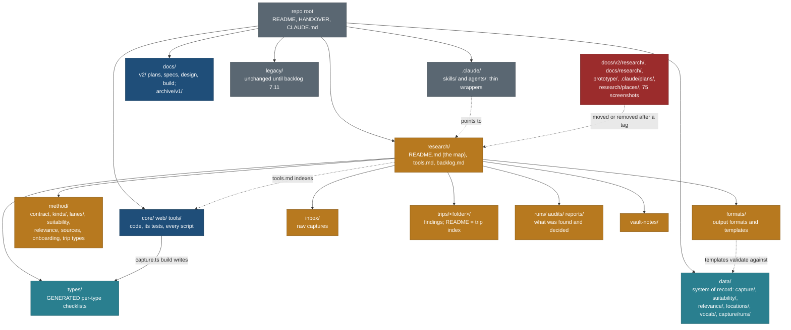

# Repo cleanup: one home for each kind of file, and one research home (21 Oct 2026)

Owner requests, 21 Oct 2026:
1. "Add one plan to clean up obsolete paths, structure our research folder, maybe at root? then remove from docs folder etc. Think and plan a cleanup so we don't have duplicate folders or files."
2. (Later the same day, deciding the first version.) "Go with all recommendations D1-D10 except D7. We have two research folders, one in docs and one in root; keep them at one place, together with the skills: skills are in .claude, research in research/. It should have all details: the skill, the scripts it uses, the inbox for raw output, what location/trip it is planning, the schema output format, and what details we need for the relevant type while doing research."

Written by travel-planner (Opus). **Revision 2 (21 Oct 2026, evening). Status: plan approved by the owner; nothing has been moved yet.** Tracked in [TODO.md](TODO.md) and in BACKLOG rows 15.10 and 15.11. Scheduled in [PLAN.md](PLAN.md) section 3, row "Cleanup". Every count, size and reference below was measured on `main` at 6e82404 on 21 Oct 2026 with `git ls-files`, `git grep`, `du` and `shasum`. The lane collisions were measured in the seven `../travel-wt/v2-*` worktrees.

**Recommendation.** Make the root `research/` the only research home. Everything under `docs/v2/research/` moves there, along with `docs/research/` and `docs/GLOBE-RESEARCH.md`. Inside `research/` there is one folder per question:
- `method/`: how research is done
- `types/`: what a type needs (generated)
- `formats/`: what a record looks like
- `inbox/`: raw captures
- `trips/`: what each trip is planning
- `runs/`, `audits/`, `reports/`: what was found

`research/README.md` is the map. `research/tools.md` indexes every script by its real path. Code stays where its package, its tests and check-all expect it (`tools/`, `core/bin/`, `web/scripts/`). Skills and the researcher agent stay in `.claude/`, because Claude Code only loads them from there. Each becomes a thin wrapper that points to `research/README.md`, so the method is written once. The root wins over `docs/` because the code already treats it as the research home. `core/src/store/index.ts` `checkRefPath()` refuses any reference file outside `research/`. `core/src/ops/catalogue.ts` requires `research/inbox/` for screenshots. The validator's `E_RESEARCH_PATH` and 6 data citations name `research/trips/...`.

**Trade-off.** It costs about 10 more hours than the first version's option B (about 27 h in total against 17 h). It rewrites about 270 path strings and 67 relative links, and the capture generator writes to a new folder. In return there is one research tree, the method is written once, and the folder guard can say "research lives in `research/`" without exceptions. The moves are mechanical and provable. A link rewriter does the edits, and three checks prove them: the generated files are byte-identical, the check-all stages are unchanged and green, and no new broken relative link appears. No running phase A lane owns or cites any file that moves (section 4).

**Supersedes.**
- The first version of this page (option B, decision D7 as "B").
- The CLAUDE.md sections "Folder contract (layout since 17 Oct 2026)", "Destinations: the laundry list", "Photo galleries", "Current trips" and "Queued". Each is replaced by a short pointer (section 5.1). The trip summaries move only on D17.
- The `README.md` layout table, and its `docs/briefs/` paragraph at lines 13-18 and 83.
- The line in `research/vault-notes/README.md` that says those notes "move under `research/`" (they are already there).
- `docs/v2/research/skills-and-prompts.md` section 2, where it says lane contracts "are read from `docs/v2/research/lanes/`".

These are applied in CLN-1, and each superseded page gets a banner.

## 1. Inventory

### 1.1 Top level (tracked files only; caches and build output are gitignored and not counted)

| Path | Kind | Tracked files | Tracked size | Last commit | Read by code? | Verdict |
|---|---|---|---|---|---|---|
| `core/` | code: schema, validator, ops, MCP, CLIs | 454 | 3.9 MB | 2026-10-20 | itself | keep |
| `web/` | code: the Next.js product | 1,173 | 29.4 MB (24 MB is `public/globe`) | 2026-10-20 | itself | keep |
| `tools/` | code: Python tools, hooks, check-all | 39 | 0.6 MB | 2026-10-20 | itself | keep; add `relink.py` (CLN-1) and `tree_check.py` (CLN-5) |
| `data/` | system of record + generated schema | 151 | 8.7 MB | 2026-10-20 | core, web, tools | keep; add `seed/` (CLN-3) |
| `research/` | authored findings | 147 | 5.9 MB | 2026-10-19 | core (`checkRefPath`, `research_refs`, inbox), tools, skills | **the one research home**; restructured (CLN-1, CLN-R) |
| `docs/` | plans, specs, design, mocks, screenshots | 563 | 78.1 MB (64 MB images) | 2026-10-21 | core, web, data cite `docs/v2/research/**` | keep for decisions; research leaves; archive v1; prune screenshots |
| `legacy/` | old trip pages, their PLAN.md and builders, old globe and list page | 554 | 28.5 MB (24 MB is `globe/`) | 2026-10-20 | publish.py, hub.py, core suitability refs, web adapter | keep until backlog 7.11 |
| `prototype/` | old Vite planner prototype | 77 | 2.7 MB | 2026-10-18 | **yes**: web snapshot script and a web test (1.6) | retire in CLN-3 |
| `.claude/` | agents, skills, settings, old plans | 11 | 68 KB | 2026-10-20 | Claude Code | keep; drop `plans/`; thin research wrappers |
| root files | README, HANDOVER, CLAUDE.md, package and workspace files, `publish.sh`, `.mcp.json` | 9 | - | - | - | keep |

The `.git` pack is 94.5 MB. Removing files from the tree does not shrink it. This plan does not rewrite history (D10).

### 1.2 Where research lives today (the scatter the owner named)

| Path | What it is | Files | Read or written by code | Verdict |
|---|---|---|---|---|
| `research/trips/<folder>/` (13) | per-trip lane findings, `notes/`, `archive/` | 105 | `core/src/store/index.ts` `checkRefPath`, `core/src/validate/trip.ts` and `core/src/ops/rows.ts` (`E_RESEARCH_PATH`), 6 `url`/`source` values in `data/suitability`, `data/relevance`, `data/schedules`, `data/sources/registry.json` | keep in place; folder names stay |
| `research/inbox/` | capture screenshots and batch files | 6 | `tools/locations.py`, `core/src/validate/locations.ts`, `core/src/ops/catalogue.ts` (`startsWith("research/inbox/")`), location skill, `data/locations/locations.json`, 4 tests | keep, code-bound |
| `research/vault-notes/` | imported Obsidian notes, the vault's skill copy, Travel Finder docs | 34 | none | keep; household notes (`Plan.md`), private repo only |
| `research/places/PRIORITIES.md` | 16 Oct short list | 1 | none | remove (D3) |
| `research/sun-audit-2026-10-18.md` | loose audit | 1 | comment in `core/bin/sun.ts` | to `research/audits/` |
| `docs/v2/research/` (method) | capture contract, suitability, applicability, relevance, sources and licences, skills and prompts, onboarding, trip types, operator questions, README | 10 | comments in 10 core files; `data/schema/difficulty-map.json` (121 `source` values), `data/vocab/types.json`, `data/suitability/kind-map.json`, 3 data READMEs | to `research/method/` (CLN-1; the 5 lines inside TRP1's folders wait for CLN-R) |
| `docs/v2/research/kinds/` | 15 kind profiles + README | 16 | comments in `web/components/ui/Icon.tsx`, `web/lib/public/completeness.ts`; researcher agent | to `research/method/kinds/` |
| `docs/v2/research/lanes/` | 17 lane contracts + README | 18 | researcher agent; `prototype/src/data/trails.ts` comment | to `research/method/lanes/` |
| `docs/v2/research/lanes/CS7*.md` | 9 run notes (findings) | 9 | `data/tracks/inputs.json` (4 `source` strings) | to `research/runs/` |
| `docs/v2/research/capture/` | **generated** per-domain checklists | 15 | written by `core/src/capture/generate.ts` (`DOCS_DIR`), checked by `generate.test.ts` and check-all stage "capture contract: generated files match data/vocab/types.json" | to `research/types/` (CLN-R) |
| `docs/v2/research/capture-research-backlog.md` | gap-filling work queue | 1 | read by `core/test/capture/placement.test.ts:125` | to `research/backlog.md` (CLN-R) |
| `docs/v2/research/trip-tag-conflicts.md` | **generated** report | 1 | written and compared by `web/tests/data/tag-conflicts.test.ts:9` (`WRITE_TAG_REPORT=1`) | to `research/reports/` (CLN-R) |
| `docs/v2/research/{map-stack-2026-10-18, smart-search-spike, globe-adm2-audit, schema-diff-2026-10}.md`, `map-stack/` (12 jpg) | decision reports | 16 | none | to `research/reports/` (D13) |
| `docs/research/trails-and-media-2026-10-18.md` | decision report | 1 | `prototype/src/data/trails.ts` comment | to `research/reports/` |
| `docs/GLOBE-RESEARCH.md` | globe sources and licences | 1 | `tools/globe_data.py:18` (GLB2a owns it in phase A) | to `research/reports/globe-research-2026-10-16.md` (CLN-2) |
| `.claude/skills/trip-planner/SKILL.md` | research fan-out **and** the legacy HTML house format, 17 KB | 1 | Claude Code | thin wrapper (CLN-1c); HTML half to `legacy/_system/TRIP-PAGE.md` (D18) |
| `.claude/skills/location/SKILL.md` | capture procedure, 5.6 KB | 1 | Claude Code | keep the procedure; three pointer edits (CLN-1c) |
| `.claude/agents/travel-researcher.md` | the researcher's prompt, with the method rules inline | 1 | Claude Code | thin wrapper (CLN-1c) |
| `tools/locations.py`, `tools/gallery/*`, `core/bin/{capture,suitability,relevance,sources,sun,validate,ops,schedule,mcp}.ts`, `web/scripts/{tracks-osm,legs-ors,commons-cache,fetch-photo-credits,globe-cities,globe-images}.mjs` | the scripts research uses | about 20 | check-all, hooks, tests, `package.json` scripts | stay; indexed in `research/tools.md` (D14) |
| `legacy/canadian-rockies-sept-2029/check_links.py`, `legacy/*/sun-times.py` | per-trip scripts | 3 | none | not indexed as tools: the sun scripts are wrong (sun audit), and the link checker is trip-specific. `tools.md` records "no general link checker" as a gap |
| `data/capture/runs/*.json` (7) | `capture-run/1` records | 7 | `capture.ts run --check`, `gaps` | stay in `data/` (system of record); `research/runs/<id>.md` is the prose companion |
| `CLAUDE.md` "Current trips" and "Queued" | about 90 lines of per-trip summaries | - | loaded every session | move to `research/trips/README.md` (D17) |

### 1.3 `docs/` (the non-research rows of the first version, unchanged in substance)

| Path | Kind | Files | Size | Referenced by (outside v1 docs) | Verdict |
|---|---|---|---|---|---|
| `docs/PLAN-platform.md` | v1 platform plan | 1 | 316 KB | `CLAUDE.md`, `README.md` 18 and 83, `data/schema/difficulty-map.json` (19 values `docs/PLAN-platform.md#3A`), `tools/migrate_locations_v3.py` 7, 4 v2 docs, `research/vault-notes/README.md` | archive (CLN-2) |
| `docs/REVIEW-platform-plan.md`, `docs/BLUEPRINT.md`, `docs/AUDIT-2026-10-16.md` | pre-v2 reviews and audit | 3 | 120 KB | `docs/v2/README.md`, `CLAUDE.md` 36 and 45 | archive (CLN-1) |
| `docs/PLAN-locations-g5.md` | locations v2 plan (done) | 1 | 44 KB | `tools/migrate_locations_v2.py` 8, `web/tests/e2e/places-parity.spec.ts` 7 (comments; TST owns the spec) | archive (CLN-2) |
| `docs/briefs/` | 17 pre-v2 briefs | 17 | 244 KB | `README.md` 15 and 83 | archive (CLN-1) |
| `docs/v2/**` except `research/` | the plan, specs, design, build | about 470 | 76 MB | - | keep; prune the 75 uncited screenshots (D4) |
| `docs/v2/research/README.md` | after CLN-1: a stub with the old-to-new table | 1 | 2 KB | old links in records | stub until CLN-6 (D19) |

`docs/v2/design/` holds 219 images. **75 of them (26.6 MB) are named by no document, by file or by folder**: 59 in `design/globe/shots/`, 6 in `design/redesign/shots/`, 6 in `design/scenario-check/`, 4 in `design/foundation/shots/`.

### 1.4 Other second-level paths (unchanged from the first version)

| Path | What it is | Verdict |
|---|---|---|
| `legacy/globe/assets/` (441 files, 24 MB) | the old globe's data; `web/lib/public/globe.ts:31` still reads its gazetteer | freeze now; one writer in CLN-4; remove at 7.11 (CLN-6) |
| `legacy/<trip>/PLAN.md` (12) | trip narratives parsed by legacy builders | move to `research/trips/<folder>/PLAN.md` at 7.11 (CLN-6) |
| `data/catalog/` | P4 layout, wired into the validator, MCP, ops and 3 tests | keep until SRV-0 decides the store layout |
| `web/data-snapshots/prototype.json` | snapshot of the prototype's Dolomites data | keep at this path; CLN-3 keeps it byte-identical |
| `web/scripts/embed-spike/` | L9 spike | keep (L9 parked) |
| `.claude/plans/` | handover for the deleted branch, with a `v2` symlink | remove (D2) |

### 1.5 Duplicates (same blob hash in `git ls-files -s`)

| Duplicate | Copies | Size | Verdict |
|---|---|---|---|
| `legacy/globe/assets/{admin,data}` and `web/public/globe/{admin,data}` | 403 identical, 3 diverged | about 22 MB twice | one writer (CLN-4); legacy removed at 7.11 |
| `docs/v2/design/redesign/fonts/*` and `web/public/fonts/*` | 10 | 183 KB | keep both (mocks must render alone); allowlisted |
| `design/globe/shots/live-italy-1440.jpg` = `live-state-1440.jpg` | 2 | 596 KB | correct `design/globe/review.md` line 23 (one picture, two names) |
| two `sun-times.py`, two `anchor_check.py` in `legacy/` | 2 + 2 | 7 KB | remove at 7.11 |
| `core/test/fixtures/**` pairs | 2 + 2 | 5 KB | intentional; allowlisted |

Near-duplicates that this revision resolves:

| Pair | Relation | Verdict |
|---|---|---|
| `docs/v2/research/` and `research/` | the method and the findings, in two trees | **one tree** (D11) |
| `docs/v2/research/README.md` (the research loop) and the planned `research/README.md` (the map) | different jobs | the loop becomes `research/method/README.md`; the map is new |
| `.claude/skills/trip-planner/SKILL.md` Phase 1 and `research/method/lanes/*.md` | the same rules written twice ("rule zero", gaps as gaps, AllTrails never alone, hard limits, parking fill, light computed, no parallel Commons) | rules live in the lane contracts and `research/README.md` section 9; the skill points there (CLN-1c) |
| `.claude/agents/travel-researcher.md` "Hard rules" and `research/method/kinds/README.md`, `sources-and-licences.md` | duplicated rules | one-line safety rules stay in the agent, each with a pointer; the method is in `research/` (2.6) |
| CLAUDE.md "Current trips" and `research/trips/` | trip summaries away from their research | `research/trips/README.md` is the index (D17) |
| `research/trips/<folder>` and `data/capture/<trip-id>` | named differently (`dolomites-july-2027` against `dolomites-2027`) | keep both names; the trips index maps them; new trips use the trip id for both |
| `research/vault-notes/vault-trip-planner-skill/` and `.claude/skills/trip-planner/` | different skills; the vault copy is reference only | keep |

### 1.6 What the measurements corrected

| Assumed | Measured | Effect |
|---|---|---|
| `docs/v2/research/` must stay because data cites it 121 times | 115 data citations name `capture-contract.md` and 9 name `suitability.md`, all as plain `source` or `note` strings; no code resolves them. Only 3 places treat a path as a path: `DOCS_DIR`, `placement.test.ts` and the tag-conflicts test | the move is a scripted string rewrite plus 3 constants (CLN-1, CLN-R) |
| Renaming `research/trips/<folder>` breaks sha-pinned `research_refs` | No `data/trips/*` trip file carries `research_refs` today; only the core fixtures do, under `research/trips/patagonia-fixture/`. The 6 real citations are `url`/`source` strings | folder names still stay (6 citations, `E_RESEARCH_PATH` examples, habit); editing a lane file's text is safe |
| The generated checklists can sit next to an authored README | `checkDrift()` marks any `.md` or `.json` in `DOCS_DIR` that it did not write as `stale`, and `capture.ts build` **deletes** it | `research/types/` is generator-only; its explanation lives in `research/README.md` section 4 |
| Skills could live in `research/skills/` | Claude Code 2.1.306 loads project skills from `.claude/skills/<name>/SKILL.md`. Nested `<subdir>/.claude/skills/` folders load only dynamically, once the session touches files in that subdirectory. Symlinked skill folders and a non-regular `SKILL.md` are refused ("unsafe or symlinked skill folder", "Its SKILL.md is not a regular file (a symlink?)"), per the strings in the installed binary | skills stay in `.claude/skills/` as regular files (2.6) |
| `prototype/` is imported by no code | `web/tests/data/public-privacy.test.ts` and `web/scripts/snapshot-prototype.mjs` read it; its `node_modules` is absent here | CLN-3 as in the first version |
| `CLAUDE.md` is accurate on folders | it lists `legacy/peru/` (absent), names `prototype/` in the agents table, and points builders at a Linux Chromium path | fix in CLN-1 |
| Two-dot `git diff --name-only main` shows what a lane touched | every lane worktree is based on 4946b37, so the two-dot diff also lists the 5 docs `main` changed since (CLAUDE.md, this page, PLAN, TODO, the schema diff) | use `main...HEAD` plus `git status` (section 4) |
| 19 relative Markdown links are broken today | measured over every tracked `.md` | the rewriter's baseline: CLN-1 may not add one |

## 2. Target structure

### 2.1 The rule: what belongs where

| Kind of file | Home | Examples |
|---|---|---|
| Code, its tests and every script | `core/`, `web/`, `tools/` | `core/bin/capture.ts`, `tools/locations.py`, `web/scripts/tracks-osm.mjs` |
| System of record: authored JSON the product reads | `data/` | `data/capture/`, `data/suitability/`, `data/relevance/`, `data/locations/`, `data/vocab/`, `data/capture/runs/`, `data/seed/prototype/` |
| Generated output | wherever its tool writes it, marked "Generated ... Do not edit"; never moved for tidiness except by changing the tool | `data/schema/**` (except `difficulty-map.json`, `freshness.json`), `research/types/**`, `research/reports/trip-tag-conflicts.md`, `data/sources/registry.json`, `web/redirects.json`, `data/suitability/scope.json`, `data/locations/WISHLIST.md` |
| **Research: method, per-type requirements, formats, raw captures, findings, run notes, audits, research reports** | **`research/`** | section 2.2 |
| Decisions about the product: plan, specs, design, build briefs, reviews | `docs/v2/` | PLAN, TODO, features, ux, design, build |
| Superseded documents kept for their ideas | `docs/archive/v1/` (nothing live links in) | PLAN-platform, BLUEPRINT, briefs |
| Skills and agent prompts | `.claude/skills/<name>/SKILL.md`, `.claude/agents/<name>.md`, thin, pointing into `research/` | trip-planner, location, travel-researcher |
| Removed things | an annotated tag `archive/cleanup-<phase>-<date>`, never a folder | `prototype/`, `.claude/plans/` |
| Published trip pages and their builders | `legacy/` until backlog 7.11 | - |

The test for "research or docs": if it tells a researcher how to collect, what to collect or what was found, it is research. If it tells a builder what to build or records a product decision taken from research, it is docs. A research report that drove a decision (map stack, schema diff) stays in `research/reports/`, and the decision itself is a row in PLAN.md or BACKLOG that links to it.

### 2.2 The research tree

| Path | Holds | Authored or generated | Written by | Read by |
|---|---|---|---|---|
| `research/README.md` | the map of the whole research system (2.7) | authored | planner | every researcher, both skills, the researcher agent |
| `research/tools.md` | every script research uses, by its real path, with when and how (2.8) | authored | planner, then whoever adds a script | researchers, skills |
| `research/backlog.md` | the research work queue: missing records and relations, per trip and type | authored | research runs | `placement.test.ts`; the next run |
| `research/method/` | `README.md` (the loop, trust, freshness, coverage), `capture-contract.md`, `suitability.md`, `suitability-applicability.md`, `relevance.md`, `sources-and-licences.md`, `onboarding-and-refresh.md`, `skills-and-prompts.md`, `trip-types.md`, `operator-questions-2026-10-18.md` | authored | planner | researchers; cited by core comments and data notes |
| `research/method/kinds/` | 15 kind profiles + README: the human guide per kind (sources in order, traps, Draft, Usable and Complete checks) | authored | planner | researchers |
| `research/method/lanes/` | 17 lane contracts + README | authored | planner | researchers; the MCP `lane://` resource (later) |
| `research/types/` | one checklist per domain (15): R, R?, A per type, sources in order, gap wording, links | **generated** by `node core/bin/capture.ts build`; nothing else may live here | the generator | researchers; check-all |
| `research/formats/` | `README.md`: every output format with its schema string, path, validator and an example; `templates/*.json`, `*.md` | authored; templates validated by a test (CLN-R) | planner, builder | researchers |
| `research/inbox/` | raw captures: screenshots, batch files, `<date>-<slug>.<ext>` | authored | location skill | `tools/locations.py`, validator |
| `research/trips/README.md` | the trip index: folder, trip id, data paths, legacy page, state, dates window, what is open | authored | planner | everyone |
| `research/trips/<folder>/` | lane findings `<lane>.md`, `notes/`, `archive/` | authored | trip-planner skill, researcher | the planner, `research_refs` |
| `research/runs/<run-id>.md` | prose notes of one run: scope, what was found, gaps, questions. The JSON record is `data/capture/runs/<run-id>.json` | authored | researcher | next run, planner |
| `research/audits/` | audits of published claims | authored | auditor | planner |
| `research/reports/` | research that fed a product decision, with its images | authored, plus one generated report | planner, researcher | docs that cite them |
| `research/vault-notes/` | imported notes, kept as written | imported | - | planner |

Nothing else goes at the `research/` root. The guard (CLN-5) enforces the list.

### 2.3 Options

| Option | What moves | Cost | Collisions | Verdict |
|---|---|---|---|---|
| A. Prune only | Removals (D1-D4) and the v1 archive | about 4 h | none | Rejected: the scatter stays |
| B. Findings at root, method in docs (the first version) | A, plus run notes and the audit to `research/`, the rest of `docs/v2/research/` stays | about 17 h | none | **Rejected by the owner, 21 Oct** (D7) |
| **C'. One research home at the root (recommended, approved)** | B, plus all of `docs/v2/research/`, `docs/research/` and `GLOBE-RESEARCH.md` into `research/`; the generator writes `research/types/`; `research/README.md`, `tools.md`, `formats/`, `trips/README.md`; thin skills and agent | about 27 h over 7 phases; about 10 h more than B | none with running lanes (section 4); 5 lines wait for TRP1 to merge; `globe_data.py` waits for GLB2a | **Recommended.** It matches the code's own notion of the research root (`checkRefPath`) |
| C. One home under `docs/research/` | as C', into `docs/` | C' + changing `checkRefPath`, the inbox rule in ops, `E_RESEARCH_PATH`, `locations.py`, 6 data citations, 4 tests, every fixture with `research_refs` (about 40 files) | collides with the core schema and fixtures | Rejected: it fights the code |

### 2.4 Decision per path, with the cost of each move

"Strings" are plain mentions of the old path. "Links" are relative Markdown links. Both are rewritten by `tools/relink.py` (CLN-1b) from one move map.

| Old path | Action | New path | Strings to rewrite (where) | Links | Tests or code that resolve the path | Method | Proof | Phase |
|---|---|---|---|---|---|---|---|---|
| `docs/v2/research/capture-contract.md` | move | `research/method/capture-contract.md` | 125: `data/schema/difficulty-map.json` 113, `data/vocab/types.json` 1, `data/capture/README.md` 1, core comments 4, docs 4, HANDOVER 1, records 1 | in rewriter scope | none | `git mv` + relink | "validate every data file", "core tests", "capture contract: generated files match", JSON parses | CLN-1 (core comments in CLN-R) |
| `docs/v2/research/suitability.md` | move | `research/method/suitability.md` | 17: difficulty-map 8, `data/suitability/README.md` 1, core comments 5, `core/test/sources/build.test.ts:110` 1 (a `notesFor()` string; any repo path gives "allowed"), `core/test/suitability/map.test.ts` 1, `tools/suitability-scope/dump-scope.test.ts` 1 | yes | none | as above | as above, plus "suitability scope manifest" | CLN-1; the 4 lines in `data/suitability/`, `core/test/suitability/`, `tools/suitability-scope/` wait for CLN-R |
| `docs/v2/research/suitability-applicability.md` | move | `research/method/` | 8: `data/suitability/kind-map.json` note 1, core 5 (one is a fixture `note`), `research/trips/*` 2 | yes | none | as above | "suitability sidecars" | CLN-1; `kind-map.json` and `core/src/suitability/applicability.ts` in CLN-R |
| `docs/v2/research/relevance.md` | move | `research/method/` | 6: core 2, `data/relevance/README.md` 2, research 2 | yes | none | as above | "relevance sidecars" | CLN-1 |
| `docs/v2/research/{sources-and-licences, skills-and-prompts, onboarding-and-refresh, trip-types, operator-questions-2026-10-18}.md`, `README.md` | move (README becomes `method/README.md`; a stub replaces it) | `research/method/` | 8 (agent 1, docs 6, research 1) | yes | none | as above | link scan | CLN-1 |
| `docs/v2/research/kinds/` (16) | move | `research/method/kinds/` | 13: agent 2, docs 7, web comments 2 (`Icon.tsx`, `completeness.ts`) | yes | none | as above | link scan | CLN-1; web comments in CLN-R |
| `docs/v2/research/lanes/` (18, without CS7) | move | `research/method/lanes/` | 15: agent 2, docs 10, `prototype/src/data/trails.ts` 1 | yes | none | as above | link scan | CLN-1; prototype comment in CLN-R |
| `docs/v2/research/lanes/CS7*.md` (9) | move | `research/runs/` | 9: `data/tracks/inputs.json` 4, docs 5 | yes | none | as above | inputs.json parses; "validate every data file" | CLN-1 |
| `docs/v2/research/{map-stack-2026-10-18.md, map-stack/, smart-search-spike.md, globe-adm2-audit.md, schema-diff-2026-10.md}` | move | `research/reports/` | 17 (docs) | yes | none | as above | link scan; images keep their relative links | CLN-1 |
| `docs/research/trails-and-media-2026-10-18.md` | move | `research/reports/` | 1 (+ `prototype/src/data/trails.ts` comment) | yes | none | as above | link scan | CLN-1 (prototype comment CLN-R) |
| `research/sun-audit-2026-10-18.md` | move | `research/audits/` | 4 (`CLAUDE.md`, `core/bin/sun.ts` comment, 2 docs) | yes | none | as above | link scan | CLN-1 (sun.ts comment CLN-R) |
| `docs/v2/research/capture/` (15, generated) | move by changing the generator | `research/types/` | 16: `CLAUDE.md`, `HANDOVER.md`, `data/capture/README.md`, docs 8, `capture.ts` help, generate.ts comment | yes | `DOCS_DIR` in `core/src/capture/generate.ts:21`; `generate.test.ts:26` | change the constant, `git mv`, run `capture.ts build` | the 15 files are **byte-identical** (`shasum` before and after: their text has no paths); `build --check` clean; `git status` shows 15 renames at 100% | CLN-R |
| `docs/v2/research/capture-research-backlog.md` | move | `research/backlog.md` | 7 (docs 6, test 1) | yes | `core/test/capture/placement.test.ts:125` | `git mv` + test path | "core tests" | CLN-R |
| `docs/v2/research/trip-tag-conflicts.md` (generated) | move by changing the test | `research/reports/trip-tag-conflicts.md` | 4 (docs 2, `web/lib/public/tags.ts` comment, test) | yes | `web/tests/data/tag-conflicts.test.ts:9` (compares the file to `report()`) | change `FILE`, `git mv` | byte-identical; "web test" | CLN-R (after TRP1, whose change to `web/lib/public/trips.ts` can change the report) |
| `docs/GLOBE-RESEARCH.md` | move | `research/reports/globe-research-2026-10-16.md` | 2 docs + `tools/globe_data.py:18` | yes | none | `git mv` + relink | "python tests" | CLN-2 (GLB2a owns `globe_data.py`) |
| `docs/v2/research/README.md` (new stub) | keep a stub | same | - | - | - | write | the stub's table resolves | CLN-1; removed at CLN-6 |
| `research/trips/`, `research/inbox/`, `research/vault-notes/` | keep | same | - | - | code-bound | none | - | - |
| `data/capture/runs/` | keep | same | - | - | `capture.ts run`, `gaps` | none | - | - |
| scripts in `tools/`, `core/bin/`, `web/scripts/` | keep, index | listed in `research/tools.md` | - | - | packages, tests, check-all, hooks | none | - | CLN-1c |
| `.claude/skills/*`, `.claude/agents/travel-researcher.md` | keep, thin | same | 4 (agent) | - | Claude Code discovery | edit | the skill resolves its pointers | CLN-1c |

Totals: about 270 path strings in about 70 files; 55 inbound relative links in 20 docs files; 12 outbound links from moved files. The 234 links between moved files stay valid, because the layout under `research/method/` mirrors the old one (only the carve-outs `runs/`, `reports/`, `types/` and `backlog.md` need rewriting). Records keep their plain-text paths as history: `docs/archive/**`, `docs/v2/build/handover/memory/**`, `docs/v2/build/public-site/STAGE4-plan.md`, `briefs/CS7d.md`. Their relative links are still rewritten, so they stay clickable.

**What must stay where it is, whatever the tidiness.**
- `data/` is the system of record. No record, sidecar, run record, point file or registry moves into `research/`.
- Generated files move only by changing the tool that writes them, in the same commit, with a byte-identical proof. These are the checklists (`DOCS_DIR`) and the tag report (`FILE`).
- Paths that code resolves stay put unless the code changes with them: `research/inbox/`, `research/trips/<folder>/`, the 15 checklists, `backlog.md` and the tag report.
- Skill and agent files stay under `.claude/`.

### 2.5 Per-type requirements: where a researcher finds "what to collect for this type"

| Need | Source of truth | How to read it |
|---|---|---|
| Which type a place is | `data/vocab/types.json` (the one authored file: 15 domains, 59 categories in the nodes, 324 type ids) | `node core/bin/capture.ts types --tree`; `capture.ts fields --kind <old kind> [--subkind S]` resolves old names |
| The exact checklist for a type | generated from `types.json` and `core/src/schema/capture/properties.ts` | `node core/bin/capture.ts fields --type <id>` (the machine checklist, `--format json` for crawlers); `research/types/<domain>.md` (the same, for a person) |
| What a record still lacks | the record plus its type | `capture.ts fields --ref <ref>`; `capture.ts gaps --trip <trip-id> [--level usable|complete]` |
| Where a mark comes from | the node or an ancestor | `capture.ts explain <type>` |
| Sources in order, traps, what never to guess, Draft, Usable and Complete in prose | `research/method/kinds/<kind>.md` | read it before the first record of that kind |
| How a lane runs and what it produces | `research/method/lanes/<lane>.md` | read the lane for the job |
| Who-it-suits fields and their applicability | `research/method/suitability.md`, `suitability-applicability.md` | `node core/bin/suitability.ts` |

The human-readable per-type guide is `research/types/<domain>.md` (generated, one table per type), read together with the kind profile. `research/README.md` section 4 explains the pair. Gotcha: never add a file to `research/types/`, because `capture.ts build` deletes it.

### 2.6 Skills and the researcher agent

**Verified (21 Oct, Claude Code 2.1.306 on this Mac, from the installed binary's strings; no network).** Claude Code loads project skills from `.claude/skills/<name>/SKILL.md`. It also loads personal skills (`~/.claude/skills/`), plugin skills and skills in directories added with `--add-dir`. Nested `<subdir>/.claude/skills/` folders load only dynamically, after the session touches files under that subdirectory, so they are unreliable as a starting point. Symlinked skill folders and a `SKILL.md` that is not a regular file are refused, and a `SKILL.md` over 128 KB is skipped. `${CLAUDE_SKILL_DIR}` expands to the skill's own folder. So skills cannot live in `research/`, and a symlink from `.claude/skills/` into `research/` will not work.

**Design (D15).** A skill is a thin wrapper. It carries the frontmatter (name, a description that triggers it), one paragraph on when to use it, the ordered steps as one line each, and a link for every step to the section of `research/README.md` or `research/tools.md` that holds the method. It carries no rule, field list or command flag set that also appears in `research/`. Scripts are called by their real repository path (`python3 tools/locations.py`, `node core/bin/capture.ts`), not copied into the skill folder. Agent prompts keep only one-line safety rules that must hold even when the agent skips reading, each ending with a pointer to the full rule.

| File | Today | Change (CLN-1c) | Size target |
|---|---|---|---|
| `.claude/skills/trip-planner/SKILL.md` | 17 KB: folder layout, rule zero, a 6-lane fan-out with every field, gaps rules, conditions routine, the HTML house format, links, Commons commands, gallery, screenshots, publish, writing style | Keep the name and the trigger. Body: (1) read `research/README.md`; (2) register or update the trip in `research/trips/README.md`; (3) run the lanes for the trip type per `research/README.md` section 3b (the fan-out rules move to `research/method/lanes/README.md` "Running a fan-out"; rule zero and the gaps rules move to `research/README.md` section 9); (4) write findings to `research/trips/<folder>/<lane>.md` and records to `data/capture/<trip-id>/` per `research/formats/`; (5) run the validators in section 6; (6) conditions routine: `research/method/onboarding-and-refresh.md` section 4; (7) only to revise an existing legacy page: `legacy/_system/TRIP-PAGE.md` (the HTML house format, links, photos, gallery, screenshot and publish steps, moved verbatim; D18). The writing-style rules stay in the skill, because they are about the reply, not the method | under 5 KB |
| `.claude/skills/location/SKILL.md` | 5.6 KB: capture steps that are the `locations.py` CLI usage | Keep the procedure (it is the tool's usage, written once). Fix "schema v2" to v3. Point the batch format to `research/formats/README.md` "Inbox batch". Add one line: research happens when a trip adopts the place, through `research/README.md` section 3a. "Resolution rules" stay (they describe the tool's behaviour) | about 5.5 KB |
| `.claude/agents/travel-researcher.md` | reads 3 paths under `docs/v2/research/`; 17 lines of hard rules duplicating the kind README and the sources page | Description: "...to `research/README.md` (method, per-type checklists, formats)". "Before you start": `research/README.md`, then the type checklist (`capture.ts fields --type`), the kind profile, the lane contract, `research/method/sources-and-licences.md`. Output: records in `data/capture/<trip-id>/`, the run record in `data/capture/runs/`, the run note in `research/runs/<run-id>.md`, lane prose in `research/trips/<folder>/`. Keep six one-line safety rules with pointers: no Google coordinates; no invented URLs; limits only from official or operator sources; conflicts recorded, never picked; Overpass and Commons one request at a time, never parallel; nothing in the Obsidian vault. Commit only own paths | under 2.5 KB |
| `.claude/agents/travel-builder.md`, `travel-design-reviewer.md` | Playwright from `prototype/node_modules`, Linux Chromium path | D6 as in the first version: `pnpm --dir web exec playwright`, browsers from the Playwright cache on this OS | - |
| `.claude/agents/travel-planner.md`, `travel-verifier.md` | read `docs/v2/research/` in their lists | path only | - |

Future skills from `research/method/skills-and-prompts.md` (research-lane, find-media, check-links, conditions-check) follow the same pattern: one folder in `.claude/skills/`, one section in `research/README.md`.

### 2.7 `research/README.md`: the outline (a spec for CLN-1c)

Written for a researcher who has never seen the repo. Under 400 lines. Every section ends in links, not copies.

1. **What this folder is.** One paragraph: research collects facts with sources. Records go to `data/`, prose and method stay here, and code stays in `core/`, `web/` and `tools/`. Followed by the folder table of section 2.2.
2. **The flow (Mermaid).** Request (add a place, plan a trip, fill gaps, refresh, conditions check) -> scope (trip index row, type ids) -> raw capture in `research/inbox/` -> research by lane and type (`types/`, `method/kinds/`, `method/lanes/`) -> records in `capture/1` plus the suitability and relevance sidecars in `data/`, a run record, a run note -> validators -> gaps (`capture.ts gaps`, `backlog.md`) -> merge (branch, own paths, coordinator). House colours.
3. **Start here, by job.** One numbered recipe per job, each 5 to 8 lines, each naming its skill, its commands (by link to `tools.md`) and its outputs:
   - 3a: add a place (location skill; `locations.py add`; inbox naming; `locations.py build --check`)
   - 3b: plan or research a trip (trip-planner skill; the trip index row; lanes by trip type from `method/trip-types.md`; fan-out and Commons rules; lane files; records)
   - 3c: fill the gaps of a trip (`capture.ts gaps --trip`; `backlog.md`; the run record)
   - 3d: refresh stale facts (`method/README.md` freshness; `data/schema/freshness.json`)
   - 3e: photos (one sequential runner; `tools/gallery/*`, `web/scripts/commons-cache.mjs`)
   - 3f: the pre-trip conditions check (`method/onboarding-and-refresh.md` section 4)
4. **What to collect for a type.** Section 2.5 of this plan as a table, with a worked example (`water.river.tubing`: `fields --type`, then the kind profile, then the lane). The "never add files to `types/`" warning.
5. **Output formats.** One table: format, schema string, path, validator command, template. Covers `capture/1` records, the `suitability/1` and `relevance/1` sidecars, `capture-points/1`, `capture-run/1`, the source rows and registry (generated; never hand-edit), the inbox batch, the lane Markdown file (headings, `GAP:`, `GAP CLOSED <date>`, the sources list), and the run note. Detail is in `formats/README.md`.
6. **Validators and gates.** `node core/bin/validate.ts`, `capture.ts run --check`, `capture.ts build --check`, `suitability.ts`, `relevance.ts`, `sources.ts build`, `locations.py validate`, and `bash tools/check-all.sh` with the stage names that cover research data.
7. **Gaps, conflicts and the backlog.** `searched_none` against `gap` against `blocked`; conflicts recorded with both values; `backlog.md` rows; how a later run closes a gap.
8. **Merge.** Branch and worktree, stage own paths with `git -C <abs> add <paths>`, the commit message prefix `research(<trip or lane>): ...`, the trailer, the coordinator merges. BACKLOG and TODO rows. The future changeset path through the MCP (`method/skills-and-prompts.md`).
9. **Rules that do not bend.** The single home of: rule zero (do not take the draft at face value); gaps as gaps; official source first and AllTrails never a fact; hard limits only from official or operator sources; conflicts as ranges; parking capacity and fill time order the day; light and sun computed with `core/bin/sun.ts`, longitude positive east; coordinates never from Google; Overpass and Commons one request at a time, never from parallel agents, with the no-email user agent; nothing in the Obsidian vault; household data never in public fields.
10. **Scripts.** One line pointing to `tools.md`.
11. **Trips.** One line pointing to `trips/README.md`.
12. **Gotchas.** Including: the folder names of `trips/` against the trip ids; `types/` is generated; run records are in `data/`, not here; 2026 data used as a pattern for later years.

### 2.8 The other new files (specs for CLN-1c)

| File | Content |
|---|---|
| `research/tools.md` | One table: script (real path), job, when to use it, input, output, external hosts and rate rule, which check covers it. Rows: `tools/locations.py` (add, edit, visit, import, build, validate, tag), `tools/gallery/{gallery_find,gallery_pick,gallery}.py`, `node core/bin/capture.ts` (fields, explain, types, build, gaps, run), `core/bin/suitability.ts`, `core/bin/relevance.ts`, `core/bin/sources.ts`, `core/bin/sun.ts`, `core/bin/validate.ts`, `core/bin/ops.ts`, `core/bin/schedule.ts`, `core/bin/mcp.ts` (read-only MCP), `web/scripts/tracks-osm.mjs`, `legs-ors.mjs`, `commons-cache.mjs`, `fetch-photo-credits.mjs`, `globe-cities.mjs`, `globe-images.mjs`, `tools/globe_data.py`. A "Known gaps" list: no general link checker (only `legacy/canadian-rockies-sept-2029/check_links.py`); the `legacy/*/sun-times.py` scripts are wrong (sun audit) and must not be used |
| `research/formats/README.md` and `templates/` | Per format: purpose, path pattern, schema string, the Zod file that defines it (`core/src/schema/capture/records.ts`, `suitability.ts`, `relevance.ts`), the validator command, a minimal valid example. Templates: `capture-record.json` (one place and one offer with `Val` states), `suitability.json`, `relevance.json`, `capture-run.json`, `inbox-batch.json`, `lane-notes.md`, `run-note.md`. CLN-R adds a test that validates every JSON template, so a schema change that breaks a template fails check-all |
| `research/trips/README.md` | One row per `research/trips/<folder>`: folder, trip id (`data/capture/<id>`, `data/suitability/<id>`), legacy page, public slug, state (researched, built, published, idea), season window, the 1 to 3 open items. Then (D17) the per-trip summaries now in CLAUDE.md, moved verbatim under one heading per trip. Rule: a new trip gets its row before its first lane file |
| `docs/README.md` | Two lines: `docs/` holds decisions (`v2/`) and superseded documents (`archive/v1/`); research lives in `/research/README.md` |
| `docs/v2/research/README.md` (stub) | "Moved to `/research/` on <date> (CLEANUP-PLAN CLN-1)", plus the old-to-new table of section 2.4. Removed at CLN-6 |
| `legacy/_system/TRIP-PAGE.md` | The HTML house format half of the trip-planner skill, moved verbatim, with a banner: "Legacy page format, frozen until backlog 7.11" (D18) |

## 3. Phases

Order: docs and research first, then the code-bound research paths, then the v1 documents that code cites, then the code retirements, then the guard. Each phase is one commit, or two when a removal needs its own tag. Each runs as a single agent with no other edit in flight on the same paths.

| Phase | When | Why then | Executor and model | Effort |
|---|---|---|---|---|
| CLN-1a | **now** | a read-only scan | `explorer` or `travel-verifier`, **Haiku** | 0.5 h |
| CLN-1b | **now**, after 1a | touches no lane-owned or lane-touched file (section 4) | `travel-builder`, **Sonnet** (scripted moves) | 3 h |
| CLN-1c | after 1b | authoring with judgement: the map, the deduplicated skills, the CLAUDE.md contract | `travel-planner`, **Opus** | 3 h |
| CLN-1d | after 1c | independent proof | `travel-verifier`, **Sonnet** | 0.5 h |
| CLN-R | **after TRP1 merges, before B6 META-0 starts** (it edits the contract and `types.json`) | TRP1 has touched `core/src/suitability/`, `core/test/suitability/`, `data/suitability/` and the inputs of the tag report | `travel-builder`, **Sonnet**; verifier Sonnet | 2.5 h + 0.5 h |
| CLN-2 | at **R1 entry**, after A11 merges | `tools/globe_data.py` (GLB2a) and `places-parity.spec.ts` (TST) are lane-owned until then | `travel-builder`, **Sonnet** | 1 h |
| CLN-3 | phase B, after B1 merges, before E2 | as in the first version | `travel-builder`, **Sonnet**; verifier | 6 h + 1 h |
| CLN-4 | phase B, after A11 | as in the first version | `travel-builder`, **Sonnet**; verifier | 3 h + 1 h |
| CLN-5 | phase B, after B4 merges, before G-B | both add a check-all line; G-B audits the guard | `travel-builder`, **Sonnet**; G-B audit Opus | 5 h |
| CLN-6 | with backlog 7.11 | legacy stays until go-live approval | the 7.11 lane | in 7.11 |

Total: about 27 h. About 10 h of it is new for the one research home: 1b's rewriter, CLN-R, 1c's new files, and one extra hour on the guard.

### CLN-1: docs and research (now)

| # | Old path | New path | Method | Notes |
|---|---|---|---|---|
| 1.1 | `docs/BLUEPRINT.md`, `docs/REVIEW-platform-plan.md`, `docs/AUDIT-2026-10-16.md` | `docs/archive/v1/` | `git mv` | as the first version |
| 1.2 | `docs/briefs/` (17) | `docs/archive/v1/briefs/` | `git mv` | as the first version |
| 1.3 | `docs/research/trails-and-media-2026-10-18.md` | `research/reports/` | `git mv` | `docs/research/` disappears |
| 1.4 | `research/sun-audit-2026-10-18.md` | `research/audits/` | `git mv` | |
| 1.5 | `docs/v2/research/lanes/CS7*.md` (9) | `research/runs/` | `git mv` | |
| 1.6 | `docs/v2/research/{map-stack-2026-10-18.md, map-stack/, smart-search-spike.md, globe-adm2-audit.md, schema-diff-2026-10.md}` | `research/reports/` | `git mv` | |
| 1.7 | `docs/v2/research/{README, capture-contract, suitability, suitability-applicability, relevance, sources-and-licences, skills-and-prompts, onboarding-and-refresh, trip-types, operator-questions-2026-10-18}.md`, `kinds/`, `lanes/` (rest) | `research/method/` (same names, same sub-layout) | `git mv` | the old README becomes `method/README.md` |
| 1.8 | - | `docs/v2/research/README.md` (stub) | write | lists what is still there until CLN-R: `capture/`, `capture-research-backlog.md`, `trip-tag-conflicts.md` |
| 1.9 | `research/places/PRIORITIES.md` | removed | tag, then `git rm` (D3) | |
| 1.10 | `.claude/plans/` | removed | tag, then `git rm -r` (D2) | |
| 1.11 | 75 uncited screenshots | removed | list, tag, `git rm` (D4) | |
| 1.12 | - | - | relink | every string and link in the files of the "CLN-1 rewrite scope" below |
| 1.13 | - | new files of 2.8, `research/README.md`, `tools.md`, the thin skills and agents, `legacy/_system/TRIP-PAGE.md` | write (1c) | |
| 1.14 | - | - | edit (D5, D17) | `CLAUDE.md` (5.1 contract, the research pointer, `legacy/peru/` fixed, `prototype/` out of the agents table, the trip summaries moved on D17), `README.md` layout, `research/vault-notes/README.md` (the "move under research/" line and "the real list is `locations/`", which is now `data/locations/`), `docs/v2/design/globe/review.md` line 23 |

**CLN-1 rewrite scope** (files 1b may edit, all measured free of lane ownership on 21 Oct):
- Markdown: `docs/**`, `research/**`, `.claude/**`, `CLAUDE.md`, `README.md`, `HANDOVER.md`, `legacy/_system/` (new file only).
- Data strings: `data/schema/difficulty-map.json`, `data/tracks/inputs.json`, `data/vocab/types.json` (the `note` only), `data/capture/README.md`, `data/relevance/README.md`.

**Out of scope until CLN-R:**
- Every `.ts`, `.tsx`, `.mjs` and `.py` file.
- Everything under `data/suitability/`, `core/src/suitability/`, `core/test/suitability/` and `tools/suitability-scope/`.
- `prototype/**`.

Steps:
1. Tag: `git -C /Users/nks/workspace/travel tag -a archive/cleanup-cln1-2026-10-<dd> -m "before CLN-1 removals" HEAD`.
2. Moves 1.1 to 1.7 with `git mv`, then removals 1.9 to 1.11.
3. `python3 tools/relink.py --map <move map> --scope <CLN-1 scope> --write`, then `--check`.
4. 1c writes the new files and edits.
5. Dead-path scan: `git -C /Users/nks/workspace/travel grep -n -E 'docs/v2/research/(kinds|lanes|README|capture-contract|suitability|relevance|sources-and|skills-and|onboarding|trip-types|operator-q|map-stack|smart-search|globe-adm2|schema-diff)|docs/research/|docs/(BLUEPRINT|REVIEW-platform-plan|AUDIT-2026-10-16)\.md|docs/briefs|research/sun-audit|research/places/|\.claude/plans' -- . ':!docs/archive' ':!docs/v2/build/handover/memory' ':!docs/v2/build/public-site/STAGE4-plan.md' ':!docs/v2/build/public-site/briefs/CS7d.md' ':!docs/v2/research/README.md' ':!docs/v2/CLEANUP-PLAN.md'` prints only lines in files that are out of CLN-1 scope. Each of those is listed in the hand-back for CLN-R.

Rollback: `git revert <commit>`. One file comes back with `git -C <repo> checkout archive/cleanup-cln1-2026-10-<dd> -- <path>`.

**Brief CLN-1a (Haiku, read-only).**
- **Goal.** Produce the inputs 1b needs, measured on the current `main`.
- **Owns.** Nothing in the repo. It writes `move-map.tsv`, `scope.txt`, `screenshots.txt` and `baseline.txt` to the session scratchpad and returns their absolute paths.
- **Do not touch.** Any tracked file.
- **Steps.**
  1. Write `move-map.tsv` (old path, new path) for rows 1.1 to 1.7.
  2. List every tracked file that contains an old path, split into "CLN-1 scope" and "CLN-R scope" by the rules above.
  3. List the uncited images (the rule of the first version: keep an image if a tracked text file under `docs/` names its basename or its `<parent>/<folder>/` pair). The expected count is 75.
  4. Count the broken relative Markdown links repo-wide. The expected count is 19.
  5. For each `../travel-wt/v2-*` worktree, record `git diff --name-only main...HEAD`, `git status --short`, and any changed file that matches `docs/v2/research|research/`.
- **Acceptance.** Counts within 5% of this page (about 270 strings, 55 inbound links, 75 images, 19 broken links), or each difference is explained.
- **Verification.** No build; re-run any count on request.
- **Commit rules.** No commit.

**Brief CLN-1b (Sonnet, scripted moves).**
- **Goal.** Move the research documents into `research/` and rewrite every reference in scope, with no behaviour change and no new broken link.
- **Read first.** This page, sections 2.2, 2.4 and 3; the 1a outputs.
- **Files you own.**
  - The moves of rows 1.1 to 1.7 and the removals 1.9 to 1.11.
  - `tools/relink.py` (new) and `tools/tests/test_relink.py` (new).
  - Edits limited to the CLN-1 rewrite scope.
- **Do not touch.**
  - Any `.ts`, `.tsx`, `.mjs` or `.py` file other than the two new tools files.
  - `data/suitability/**`, `core/**`, `web/**`, `prototype/**`, `legacy/**`.
  - `docs/v2/research/capture/**`, `capture-research-backlog.md`, `trip-tag-conflicts.md`.
  - The content of any lane contract or kind profile beyond paths.
  - The 1c files.
- **Steps.**
  1. Write `tools/relink.py`. Its input is a move map (TSV) and a list of files. For each file it:
     - rewrites plain path strings by the longest matching old prefix;
     - resolves every relative Markdown link against the file's old location, maps the target through the move map, and recomputes it from the file's new location;
     - leaves `http(s):` links, anchors-only links and code fences alone;
     - with `--check`, reports broken relative links and exits 1 if any are new against a baseline file.

     The test covers prefix order (`lanes/CS7` before `lanes/`), a link out of a moved file, a link into a moved file, a link between two moved files, an anchor, and a code fence.
  2. Record `shasum` of every file under `docs/v2/research/capture/` and of `data/schema/capture/*`.
  3. Tag (step 1 of CLN-1), `git mv` rows 1.1 to 1.7, remove rows 1.9 to 1.11.
  4. Run relink on the CLN-1 scope, then `--check` against the 19-link baseline.
  5. Run the dead-path scan.
- **Acceptance.**
  - (a) `relink.py --check` reports no new broken link.
  - (b) The dead-path scan prints only out-of-scope files, all listed in the hand-back.
  - (c) The hashes from step 2 are unchanged.
  - (d) `git status` shows the moves as renames at 100% similarity, except the files whose links changed.
  - (e) `data/schema/difficulty-map.json` and `data/tracks/inputs.json` parse, and their only diffs are path strings.
- **Verification.**
  - `python3 -m pytest tools/tests -q`.
  - `pnpm --dir core test` and `pnpm --dir core typecheck`. Nothing in core changes, but the data files it validates do.
  - `bash tools/check-all.sh`, with `web/.env.local` moved aside (mode 600) and restored. Stages to name in the hand-back: "python tests", "core tests", "capture contract: generated files match data/vocab/types.json", "validate every data file", "suitability sidecars", "relevance sidecars".
  - No UI change and no web file is touched, so no Playwright screenshots are needed. Say so in the hand-back.
- **Commit rules.**
  - Worktree `/Users/nks/workspace/travel-wt/v2-CLN1`, branch `public/CLN1` from `main`.
  - `git -C <worktree> add <each owned path>`, never `-A`.
  - Message `docs(cleanup/CLN-1): one research home, moves and relink`, ending with the Co-Authored-By trailer.
  - Do not push. The coordinator merges and pushes the tag.

**Brief CLN-1c (Opus, authoring).**
- **Goal.** Write the research map and the supporting files, and cut the skills and the agent to thin wrappers, so the method exists once.
- **Read first.** Sections 2.5 to 2.8 and 5.1 of this page; both skills; all five agents; `research/method/README.md`, `kinds/README.md`, `lanes/README.md`, `skills-and-prompts.md`, `capture-contract.md` 5 and 9; `node core/bin/capture.ts` help; `data/capture/README.md`, `data/locations/README.md`.
- **Files you own.**
  - New: `research/README.md`, `research/tools.md`, `research/formats/README.md`, `research/formats/templates/*`, `research/trips/README.md`, `docs/README.md`, `docs/v2/research/README.md` (stub), `legacy/_system/TRIP-PAGE.md`.
  - Edits: `.claude/skills/trip-planner/SKILL.md`, `.claude/skills/location/SKILL.md`, `.claude/agents/*.md`, the "Running a fan-out" section of `research/method/lanes/README.md`, `CLAUDE.md` (sections named in 5.1), `README.md` (layout), `research/vault-notes/README.md`, `docs/v2/design/globe/review.md` line 23, superseded-by banners on `research/method/skills-and-prompts.md` section 2.
- **Do not touch.** Code, data, the moved files' content beyond banners and the one new lane README section, and the 1b files.
- **Steps.**
  1. Write `research/README.md` to the outline in 2.7.
  2. Write `tools.md`, `formats/` and `trips/README.md` to 2.8. Each JSON template must pass `node core/bin/validate.ts <file>` or the matching `run --check`; record the command in the hand-back.
  3. Move the trip-planner skill's research rules into `research/README.md` section 9 and `lanes/README.md`, and its HTML half into `TRIP-PAGE.md` verbatim. Then cut the skill to 2.6.
  4. Edit the agents per 2.6.
  5. Write the CLAUDE.md replacement of 5.1. Move the trip summaries only if D17 is answered yes. Otherwise leave them and record that in the hand-back.
- **Acceptance.**
  - (a) No rule sentence appears in both a skill or agent file and a `research/` file, except the six one-line safety rules (spot-check with `grep -F` on 10 rule phrases).
  - (b) `trip-planner/SKILL.md` is under 5 KB, and `travel-researcher.md` is under 2.5 KB.
  - (c) Every link in the new files resolves (`relink.py --check`).
  - (d) Every JSON template validates.
  - (e) `research/trips/README.md` has one row per `research/trips/*` folder (13).
- **Verification.** `relink.py --check`; the template commands. No UI.
- **Commit rules.** The same worktree and branch as 1b, a second commit `docs(cleanup/CLN-1): research map, formats, trip index, thin skills`, own paths only, with the trailer.

**Brief CLN-1d (Sonnet, verifier).**
- **Goal.** An independent check of CLN-1 before merge.
- **Steps.**
  1. Re-run the dead-path scan and `relink.py --check`.
  2. Confirm the generated hashes are unchanged.
  3. Open `research/README.md` and follow 3a and 4 by hand: run `node core/bin/capture.ts fields --type water.river.tubing`, and confirm every linked file exists.
  4. Confirm that the trip-planner skill still loads. In a fresh session, `/skills` lists `trip-planner` and `location`.
  5. Run check-all as in 1b.
- **Acceptance.** All green, or a list of failures by stage name.
- **Commit rules.** No commit.

### CLN-R: the code-bound research paths (after TRP1 merges, before B6 META-0)

| # | Change | Files |
|---|---|---|
| R.1 | The generator writes `research/types/` | `core/src/capture/generate.ts` (`DOCS_DIR`, header comment), `core/test/capture/generate.test.ts:26`, `core/bin/capture.ts` (header and help), then `git mv docs/v2/research/capture research/types` |
| R.2 | The backlog moves | `git mv docs/v2/research/capture-research-backlog.md research/backlog.md`; `core/test/capture/placement.test.ts:125` |
| R.3 | The tag report moves | `web/tests/data/tag-conflicts.test.ts:9` (`FILE`), the comment in `web/lib/public/tags.ts:327`; `git mv` to `research/reports/trip-tag-conflicts.md` |
| R.4 | Comments and notes deferred from CLN-1 | core comments (`core/src/schema/{capture/records,difficultyMap,enums,relevance,suitability,suitabilityApplicability}.ts`, `core/src/validate/codes.ts`, `core/src/suitability/applicability.ts`, `core/bin/sun.ts`), test comments and strings (`core/test/suitability/{map,applicability}.test.ts`, `core/test/sources/build.test.ts:110`, the fixture `note` in `core/test/fixtures/suitability/broken/E_SUIT_PROFILE_MAP.json`), `tools/suitability-scope/dump-scope.test.ts` (comment), `data/suitability/README.md`, `data/suitability/kind-map.json` (`note`), `web/components/ui/Icon.tsx`, `web/lib/public/completeness.ts` (comments), `prototype/src/data/trails.ts` (comments) |
| R.5 | Templates are tested | `core/test/research/templates.test.ts` (new): every `research/formats/templates/*.json` validates with `validateDoc` against its schema string, `capture-run.json` passes the `run --check` function, and `inbox-batch.json` has only keys that `locations.py import` accepts (read the key list from `tools/locations.py` with a Python one-liner in `tools/tests/test_inbox_template.py`, new) |
| R.6 | The stub shrinks | `docs/v2/research/README.md`: the "still here" list becomes empty |

**Brief CLN-R (Sonnet).**
- **Goal.** Finish the one research home. Generated files move by changing their writers, and every code reference follows, with byte-identical outputs.
- **Read first.** This section; 2.4; P9 in `docs/v2/design/foundation/principles.md` (no new client-side load: the tag report and checklists are build-time files, never read by the browser).
- **Files you own.** The R.1 to R.5 files and the R.6 stub, and nothing else.
- **Do not touch.**
  - Any logic in `generate.ts` other than the constant.
  - The checklist renderer.
  - `report()` in the tag test.
  - Any data value other than the `note` and README strings named in R.4.
  - `data/vocab/types.json`.
  - `research/types/**` by hand.
- **Steps.**
  1. Record `shasum` of the 15 checklists and the tag report.
  2. Change the constants, then `git mv` R.1 to R.3.
  3. Run `node core/bin/capture.ts build`, then `build --check`.
  4. Run `pnpm --dir web tag-conflicts`.
  5. Compare the hashes.
  6. Run relink on the R.4 files with the same move map, then the dead-path scan of CLN-1 without the scope exclusions. It must print only records.
  7. Write the template tests.
- **Acceptance.**
  - (a) The 16 hashes are unchanged.
  - (b) `git status` shows 17 renames at 100%.
  - (c) `git grep -n 'docs/v2/research' -- core web tools data prototype .claude CLAUDE.md HANDOVER.md` prints nothing.
  - (d) The template tests fail when a required key is removed from a template; show the failing run in the hand-back.
- **Verification.**
  - `pnpm --dir core typecheck` and `pnpm --dir core test`.
  - `pnpm --dir web typecheck`, `pnpm --dir web lint`, `pnpm --dir web test`.
  - `python3 -m pytest tools/tests -q`.
  - `bash tools/check-all.sh` with `web/.env.local` aside. Name the stages "capture contract: generated files match data/vocab/types.json", "core tests", "web test", "python tests", "validate every data file", "suitability scope manifest matches the public adapter", "suitability sidecars".
  - Web files change only in comments and a test path. Take Playwright screenshots of `/places/` and `/trips/canadian-rockies-2029/` at 1440 x 900 and 390 x 844, light and dark, set through the site's theme control, before and after, into `web/test-results/shots/CLNR/`. Read tall pages in tiles. They must match.
- **Commit rules.**
  - Worktree `/Users/nks/workspace/travel-wt/v2-CLNR`, branch `public/CLNR` from `main`.
  - `git -C <worktree> add <owned paths>`, never `-A`.
  - Message `chore(cleanup/CLN-R): generator and tests write research/, template tests`, with the Co-Authored-By trailer.
  - Do not push.

### CLN-2: v1 documents that code or data cite (at R1 entry)

| # | Old path | New path | Files to change | Proof | Collision if run early |
|---|---|---|---|---|---|
| 2.1 | `docs/PLAN-platform.md` | `docs/archive/v1/PLAN-platform.md` | `data/schema/difficulty-map.json` (19 values), `tools/migrate_locations_v3.py` 7, `CLAUDE.md`, `README.md`, 4 v2 docs, `research/vault-notes/README.md` | "core tests", "validate every data file", "suitability sidecars", "relevance derived files are current" | none |
| 2.2 | `docs/PLAN-locations-g5.md` | `docs/archive/v1/` | `tools/migrate_locations_v2.py` 8, `web/tests/e2e/places-parity.spec.ts` 7 (comments) | "python tests", "web lint" | TST owns the spec |
| 2.3 | `docs/GLOBE-RESEARCH.md` | `research/reports/globe-research-2026-10-16.md` | `tools/globe_data.py` 18, 2 docs | "python tests" | GLB2a owns `globe_data.py` |

**Brief CLN-2 (Sonnet).**
- **Goal.** Archive the two v1 plans and move the globe research, with the same rewriter.
- **Owns.** The three moves and the files in the table.
- **Do not touch.** Anything else.
- **Steps.** `git mv`; `relink.py` with a three-row map; the dead-path scan for `docs/PLAN-platform|docs/PLAN-locations-g5|docs/GLOBE-RESEARCH`, excluding records.
- **Acceptance.** The scan is clean, and `relink.py --check` reports no new breaks.
- **Verification.** `python3 -m pytest tools/tests -q`, `pnpm --dir core test`, `pnpm --dir web lint`, check-all. No UI change, so no screenshots.
- **Commit rules.** Worktree `v2-CLN2`; message `docs(cleanup/CLN-2): archive v1 plans, globe research to research/reports`; own paths; trailer.

### CLN-3: retire `prototype/` (phase B, after B1)

Unchanged from the first version, with one addition: `prototype/src/data/trails.ts` carries the comment edits of CLN-R before it moves to `data/seed/prototype/`.

- **Goal.** Remove the old Vite prototype without changing a byte of what the site reads. Make the snapshot and the redirect map regenerable on any machine with no `prototype/node_modules`.
- **Read first.** P8 and P9; `web/scripts/snapshot-prototype.mjs`; `tools/suitability-scope/` (the vitest dump-and-check pattern).
- **Files you own.**
  - `data/seed/prototype/**` (by `git mv`).
  - The snapshot script, or its replacement under `web/scripts/snapshot/`.
  - In `web/package.json`, the `snapshot` and `snapshot:check` scripts.
  - The source-path line of `web/tests/data/public-privacy.test.ts`.
  - The import line of `web/tests/data/allowlist.ts`.
  - The comment lines of `core/src/schedule/legs.ts` and `core/test/schedule/rules.test.ts`.
  - The two Iceland `R4.json` `url` values.
  - `data/sources/registry.json`, through `node core/bin/sources.ts build` only.
  - One check-all line, "snapshot is current".
  - The regeneration row of `HANDOVER.md`.
  - The banner on `docs/v2/design/prototype.md`.
  - The docstring of `docs/v2/design/redesign/build/data.py`.
  - The TODO spec link for "Trail data for a person to confirm".
  - The removal of `prototype/`.
- **Do not touch.** `web/data-snapshots/**` and `web/redirects.json` by hand, `web/lib/public/**`, any component, `core/src/catalogue/**`, `core/src/privacy/**`, the allow-list rules (move them, do not change them), any other check-all line.
- **Steps.**
  1. Record the hashes of `web/data-snapshots/prototype.json`, `snapshot-report.json` and `web/redirects.json`.
  2. `git mv` the four data files.
  3. Drop the React store hook at the end of `trails.ts`.
  4. Replace rolldown with a vitest dump run (`CHECK=1` compares).
  5. Point the package scripts at it and add the check-all step.
  6. Update the references and regenerate the registry.
  7. Run `pnpm --dir web snapshot` and confirm the hashes.
  8. Tag `archive/prototype-2026-10-<dd>`, then `git rm -r prototype`.
- **Acceptance.**
  - The three hashes are unchanged.
  - `snapshot:check` passes with no `prototype/`.
  - `git grep -n 'prototype/' -- core web tools data .claude CLAUDE.md` prints only the snapshot file name, the script name and the tag lines.
  - The privacy test still finds 0 household strings.
- **Verification.** `pnpm --dir web typecheck`, lint and test; `pnpm --dir core test` and typecheck; check-all with `web/.env.local` aside. Playwright screenshots of `/trips/dolomites-2027/` and one Dolomites place page at 1440 x 900 and 390 x 844, light and dark, set through the theme control, before and after, into `web/test-results/shots/CLN3/`, read in tiles. They must match.
- **Commit rules.** Worktree `v2-CLN3`, branch `public/CLN3`; own paths; message `chore(cleanup/CLN-3): retire prototype/, seed data to data/seed/prototype`; trailer; no push.

### CLN-4: one globe writer (phase B)

Unchanged from the first version.

- **Goal.** `web/lib/public/globe.ts:31` reads `web/public/globe/data/gazetteer.json` through `GLOBE_PUBLIC()`. `tools/globe_data.py` writes ADM1, ADM2, `countries.json`, `gazetteer.json` and `admin/index.json` to `web/public/globe/` only. The legacy-only outputs stop being written.
- **Read first.** P9: `globe.ts` stays the only server reader.
- **Owns.**
  - In `web/lib/public/globe.ts`, line 31 and the read helper only (CONS-3 owns the trip-to-country table).
  - `tools/globe_data.py`.
  - `tools/tests/test_globe_data.py`.
  - One new unit test under `web/tests/globe/`.
  - `CLAUDE.md` line 17.
  - The GLB2 brief's owned list.
- **Do not touch.** `legacy/**`; `web/public/globe/**`, except through `globe_data.py`; `tools/publish.py`; `tools/location_views.py`; components.
- **Steps.**
  1. Record the hashes.
  2. Change the read path and move the writers.
  3. Run only the subcommands whose output must not change. `globe_data.py` has no `--check`, so name each one in the hand-back.
  4. Update the tests.
- **Acceptance.**
  - `git grep -n "legacy.*globe" -- web/lib tools/globe_data.py` prints nothing.
  - The hash of `web/public/globe/data/gazetteer.json` is unchanged.
  - The pin test passes: a trip with no positioned base resolves to the same point before and after.
- **Verification.**
  - `pnpm --dir web typecheck`, lint and test.
  - `python3 -m pytest tools/tests -q`.
  - The globe e2e specs only.
  - Playwright screenshots of `/globe/` and that trip's page at 1440 and 390, light and dark, on a real GPU. Read them in tiles.
- **Commit rules.** Worktree `v2-CLN4`; message `chore(cleanup/CLN-4): one globe writer, app reads its own gazetteer`; own paths; trailer; no push.

### CLN-5: the folder-contract guard (phase B, after B4)

- **Goal.** A check-all stage that fails when a file lands in the wrong place, when a file is duplicated, or when a path is dead. It works like CONS-1's ratchet: today's exceptions sit in a baseline, and new ones fail.
- **Owns.** `tools/tree_check.py`, `tools/tree_contract.json` (the allowlists and the baseline), `tools/tests/test_tree_check.py`, and one line in `tools/check-all.sh` ("folder contract"). It reuses `tools/relink.py`'s link resolver.
- **Do not touch.** Anything it reports. It reports; it never moves or deletes.
- **Rules (tracked files only, from `git ls-files -s`).**
  1. Top-level folders are exactly `.claude core data docs legacy research tools web`, plus `prototype` until CLN-3.
  2. `research/` root holds only `README.md`, `backlog.md`, `tools.md` and the folders `method types formats inbox trips runs audits reports vault-notes`.
  3. `docs/` holds only `README.md`, `v2/` and `archive/`. `docs/v2/research/` holds only `README.md` (the stub) until CLN-6, then must not exist. No file under `docs/` may be named `*research*`, except the stub and files under `docs/archive/`.
  4. Every file in `research/types/` starts with the generator's header line. (`capture.ts build --check` already fails on strays; this rule names the folder in the message.)
  5. Every folder in `research/trips/` has a row in `research/trips/README.md`.
  6. `.claude/skills/trip-planner/SKILL.md` and `location/SKILL.md` link `research/README.md`; `trip-planner/SKILL.md` is under 6 KB; `.claude/agents/travel-researcher.md` links `research/README.md`.
  7. No two tracked paths share a blob hash, except the allowlist: `.gitkeep`, `core/test/fixtures/**`, the fonts pair, and `legacy/**` until CLN-6.
  8. Every image under `docs/` and `research/reports/` is named by a tracked text file in the same tree, and none is over 1.5 MB. The 4 larger images (`suitability-display/mock/shots`) go into the baseline.
  9. No live file links into `docs/archive/`. Live files are all files except those under `docs/archive/` and `docs/v2/build/handover/memory/`.
  10. Dead paths. Repo-relative paths that start with `core/`, `data/`, `docs/`, `research/`, `tools/`, `web/`, `legacy/` or `prototype/`, in `core/`, `web/`, `tools/`, `data/`, `.claude/`, `research/`, `CLAUDE.md`, `README.md` or `HANDOVER.md`, must exist, and relative Markdown links must resolve. Placeholders (`<slug>`, `*`, `{a,b}`) are skipped. Today's misses (19 links and any path strings) go into the baseline.
- **Acceptance.** Green on `main` with the baseline; each rule has a failing fixture; runtime under 2 s.
- **Verification.** `python3 -m pytest tools/tests -q`, then `bash tools/check-all.sh`. No UI.
- **Commit rules.** Worktree `v2-CLN5`; message `tools(cleanup/CLN-5): folder contract guard`; own paths; trailer.

### CLN-6: legacy hand-off (with backlog 7.11)

| Item | Action |
|---|---|
| `legacy/<folder>/PLAN.md` (12) | `git mv` to `research/trips/<folder>/PLAN.md` before the builders go, so `git log --follow` keeps their history |
| `legacy/<folder>/*.py`, `gallery/`, `index.html`, `assets/` | tag `archive/legacy-pages-<date>`, then remove |
| `legacy/globe/`, `legacy/locations/index.html`, `legacy/_system/` (with `TRIP-PAGE.md`) | remove with the legacy outputs of `tools/location_views.py` and their tests; `places.json` going also serves P8 |
| `legacy/MANIFEST.json`, `tools/publish.py`, `tools/hub.py` | per 7.11 steps 6-7 |
| `docs/v2/research/README.md` (stub) | remove; the guard's rule 3 flips to "must not exist" |
| trip-planner skill step 7 | removed with `TRIP-PAGE.md` |
| CLN-5 baseline | drop the `legacy/**` exemptions |

## 4. Collision map (measured 21 Oct 2026 in the lane worktrees)

Measured with `git -C ../travel-wt/v2-<lane> diff --name-only main...HEAD` plus `git status --short` (uncommitted and untracked). Every worktree is based on 4946b37. TRP1 has one commit (42e9757); the rest have uncommitted work only.

| Lane | Files it has touched | Touches or cites a research path? | Effect on the cleanup |
|---|---|---|---|
| A14 TST | 7 files in `web/tests/e2e/` (incl. `places-parity.spec.ts`, `fixtures.ts`) | no | CLN-2 item 2.2 waits |
| A1 FIXF | `web/components/search/GlobalSearch.tsx`, `search-panel.spec.ts` (new) | no | none |
| A2 SHL2 | `web/components/shell/*`, `web/app/about/page.tsx`, `web/lib/client/data.ts`, `web/lib/capabilities.ts`, `web/lib/config/` (new), 2 tests | no | none |
| A4 GLB2a | `tools/globe_data.py`, `web/components/globe/*`, `web/lib/globe/*`, `web/lib/client/data.ts`, `web/public/globe/data/gazetteer.json`, `data/reference/globe/landform-audit.json` (new), `web/public/globe/line/` (new), tests | no | CLN-2 item 2.3 and CLN-4 wait |
| A13 TRP1 | `core/src/suitability/{migrate,refs}.ts`, `core/test/suitability/{cli,kind-map,migrate}.test.ts`, `data/suitability/canadian-rockies-2029/{migrated,migrated-offplan}.json`, `data/suitability/scope.json`, `web/components/trips/*`, `web/lib/public/{suitability,trips}.ts`, `web/styles/timeline.css`, tests | no, but it works in the folders that hold 5 deferred citation lines, and its adapter changes feed the generated tag report | CLN-R waits for TRP1's merge |
| A7 LST2a | `web/components/entity/*`, `web/lib/entities/*`, `web/styles/filters.css`, specs, new files | no | none |
| A8 PLC2a | `web/components/places/PlacePage.tsx`, `sections/*`, `web/lib/map/links.ts`, tests | no | none |
| A10 SRV-D | `docs/v2/research/schema-diff-2026-10.md` | it is a research file | done and committed (6e82404); free to move in CLN-1 |

Later owners:

| File or folder | Phase B owner | Phase E owner | Cleanup slot |
|---|---|---|---|
| `research/method/capture-contract.md` (moved in CLN-1) | B6 META-0 edits it | META-1, META-2 | CLN-1 moves it first; the META brief's paths are rewritten in CLN-1 |
| `data/vocab/types.json` and the generated checklists | B6 META-0 | META-1 | CLN-R must merge before B6 starts |
| `research/runs/DATA-*.md` | - | E3-E7 DATA write run notes | CLN-1 rewrites the DATA brief and EXECUTION-PLAN row E3 to `research/runs/` |
| `web/tests/data/public-privacy.test.ts`, the check-all web lines | B1 API-0 | E2 META-2 | CLN-3 after B1 |
| `tools/check-all.sh` (new lines) | B1, B4 | - | CLN-3, CLN-5 after them |
| `tools/globe_data.py`, `web/public/globe/**`, `web/lib/public/globe.ts` | free | E12 GLB2b, E14 CONS-3 | CLN-2, CLN-4 in B |
| `CLAUDE.md`, `README.md`, `HANDOVER.md` | coordinator | coordinator | CLN-1, one writer at a time |

The lanes that are running cite no research path in any file they changed. After CLN-1 merges, each lane rebases onto a `main` that has moved files it never touched, so the rebase has no conflicts. A lane that later wants a moved contract reads it at its new path. The stub at `docs/v2/research/README.md` maps the old paths to the new ones.

## 5. Keeping it clean

### 5.1 CLAUDE.md replacement text

Replace the section "Folder contract (layout since 17 Oct 2026)" with:

> **Folder contract (since the cleanup, Oct 2026).** Code and every script live in `core/`, `web/` and `tools/`. Authored data the product reads lives in `data/` (records, sidecars, run records, locations, vocab). Generated files stay where their tool writes them, carry a "Generated ... Do not edit" line, and are rebuilt, never edited: `data/schema/**` (except `difficulty-map.json` and `freshness.json`), `research/types/**`, `research/reports/trip-tag-conflicts.md`, `data/sources/registry.json`, `data/suitability/scope.json`, `web/redirects.json`, `web/data-snapshots/**`, `data/locations/WISHLIST.md`. **All research lives in `research/`**, and `research/README.md` is its map: the method in `method/` (capture contract, `kinds/`, `lanes/`, suitability, relevance, sources and licences), the per-type checklists in `types/` (generated by `capture.ts build`; never add a file there), output formats and templates in `formats/`, raw captures in `inbox/`, per-trip findings in `trips/<folder>/` (index: `trips/README.md`), run notes in `runs/`, audits in `audits/`, research reports in `reports/`, imported notes in `vault-notes/`, the work queue in `backlog.md`, and the script index in `tools.md`. Nothing else goes at the `research/` root. **Decisions** live in `docs/v2/`: plan, TODO, specs, design, build briefs, reviews. Superseded documents go to `docs/archive/v1/`, and nothing live links into it. Skills (`.claude/skills/`) and agents (`.claude/agents/`) are thin wrappers that point into `research/`; never copy the method into them. Removed things live in `archive/*` tags, never in a folder. Commit a screenshot only when a spec or review names it; verification shots go to `web/test-results/shots/` (gitignored). `legacy/<folder>/` holds the old pages, their `PLAN.md` and builders until backlog 7.11. Check-all's "folder contract" stage enforces this.

Replace "Destinations: the laundry list" with three lines: what `data/locations/locations.json` is, "capture with the `location` skill (`research/README.md` 3a)", and "details in `data/locations/README.md`". Keep the hook and `build --check` sentences, since they are repo mechanics.

Replace "Photo galleries" with two lines: "legacy pages carry galleries (`legacy/_system/TRIP-PAGE.md`); photo research is `research/README.md` 3e; never search Commons from parallel agents."

Replace "Current trips" and "Queued" (D17) with: "Trips: the index, with each trip's state, dates and open items, is `research/trips/README.md`."

In "Capture contract", replace `docs/v2/research/capture/*` with `research/types/*`. The first line of the file ("Start here...") gains: "For research, `research/README.md`."

### 5.2 Where new work goes

| You are writing | Put it in |
|---|---|
| How research is done: a lane contract, a kind profile, a method page | `research/method/lanes/<lane>.md`, `research/method/kinds/<kind>.md`, `research/method/<topic>.md` |
| A new type or a change to what a type needs | `data/vocab/types.json` (then `capture.ts build`); a new property is a registry change in `core/src/schema/capture/properties.ts` |
| What a run found, its gaps and questions | `research/runs/<run-id>.md`, plus the run record `data/capture/runs/<run-id>.json` |
| Structured results | `data/capture/<trip-id>/<lane>.json`, `data/suitability/<trip-id>/<lane>.json`, `data/relevance/<trip-id>/<lane>.json` |
| Per-trip prose research | `research/trips/<folder>/<lane>.md`, after the trip's row in `research/trips/README.md` |
| A place capture, screenshot or batch | `research/inbox/<date>-<slug>.<ext>` (location skill) |
| Research that feeds a product decision | `research/reports/<topic>-YYYY-MM-DD.md`; the decision itself is a row in `docs/v2/PLAN.md` or BACKLOG linking to it |
| An audit of published claims | `research/audits/<topic>-YYYY-MM-DD.md` |
| A new research script | its package (`tools/`, `core/bin/`, `web/scripts/`), plus one row in `research/tools.md` |
| A new research skill | `.claude/skills/<name>/SKILL.md`, thin, plus a recipe section in `research/README.md` |
| A screenshot cited by a spec | beside the spec, `<spec-folder>/shots/`, under 1.5 MB, JPEG or WebP |

### 5.3 Naming

- Folders and new files are lowercase kebab-case. Imported notes in `research/vault-notes/` keep their names.
- Dated documents end in `-YYYY-MM-DD`.
- `research/trips/<folder>` keeps the legacy folder name for the 13 existing trips, because 6 data citations and `E_RESEARCH_PATH` examples name those paths. A new trip uses its trip id for both `research/trips/` and `data/*/`.
- Run ids are the lane id plus a topic: `CS7b-dolomites-tracks`, `DATA-D3-trail-facts`.
- Town ids are `<cc>-<admin1>-<slug>`, for example `ca-on-whitby` (SRV-D 13.4, decided 21 Oct).

## 6. Decisions

These cleanup decisions are a separate list from EXECUTION-PLAN's D1-D10 of 20 Oct (D7 there is "deployment out of scope"). Elsewhere, cite them as "cleanup D<n>".

| ID | Decision | Status | Note |
|---|---|---|---|
| D1 | Remove `prototype/` after its 4 data files move to `data/seed/prototype/`, tagged first (CLN-3) | **DECIDED 21 Oct (owner): yes** | phase B, after B1 |
| D2 | Remove `.claude/plans/` (CLN-1) | **DECIDED 21 Oct (owner): yes** | |
| D3 | Remove `research/places/PRIORITIES.md` (CLN-1) | **DECIDED 21 Oct (owner): yes** | |
| D4 | Remove the 75 uncited screenshots (26.6 MB) after a tag (CLN-1) | **DECIDED 21 Oct (owner): yes** | |
| D5 | Replace the CLAUDE.md folder contract, fix `legacy/peru/`, update the README layout (CLN-1) | **DECIDED 21 Oct (owner): yes**, with the text of 5.1 (revised for D11) | |
| D6 | Update the builder, design-reviewer and researcher agents (CLN-1) | **DECIDED 21 Oct (owner): yes**; the researcher edit is the thin wrapper of 2.6 | |
| D7 | Option B (findings at root, method in docs) | **DECIDED 21 Oct (owner): no. Replaced by D11** | |
| D8 | Add the "folder contract" stage to check-all (CLN-5) | **DECIDED 21 Oct (owner): yes**, extended with the research rules 2-6 | |
| D9 | At 7.11: legacy `PLAN.md` files to `research/trips/<folder>/`, then remove the legacy page files and `legacy/globe/` after a tag (CLN-6) | **DECIDED 21 Oct (owner): yes, at 7.11, not now** | |
| D10 | Rewrite git history | **DECIDED 21 Oct (owner): no** | |
| D11 | One research home: the root `research/`; `docs/v2/research/`, `docs/research/` and `GLOBE-RESEARCH.md` move in; skills and agents point to it | **DECIDED 21 Oct (owner)** | option C' |
| D12 | The layout inside `research/` (2.2) | decided by this plan | follows from D11 |
| D13 | Research reports that fed decisions (map stack, schema diff, smart search spike, ADM2 audit, trails and media, globe research) move to `research/reports/`; the decision stays a row in `docs/` | decided by this plan | cheap to reverse: no code cites them |
| D14 | Scripts stay with their packages; `research/tools.md` indexes them by real path | decided by this plan | moving a `core/bin/*.ts` breaks its relative imports and tsconfig; `tools/*.py` are bound to hooks, tests and `publish.py` |
| D15 | Skills and the researcher agent are thin wrappers in `.claude/`; the method is written once in `research/` | decided by this plan | follows from the owner's request and the discovery check (1.6) |
| D16 | JSON templates in `research/formats/templates/` are validated by a test (CLN-R) | decided by this plan | an untested template rots |
| D17 | Move the CLAUDE.md "Current trips" and "Queued" summaries (about 90 lines) into `research/trips/README.md`, leaving one pointer | **open: owner** | Recommended: yes. Trade-off: a new session no longer sees every trip's summary without opening one file; CLAUDE.md shrinks by about a third and the summaries sit beside their research |
| D18 | Move the trip-planner skill's HTML half (house format, links, photos, gallery, screenshot, publish) to `legacy/_system/TRIP-PAGE.md`. The skill uses it only to revise an existing legacy page; a new trip gets research and data, not a new legacy page | **open: owner** | Recommended: yes. Trade-off: no new hand-built trip page until the planner (phase F) or a v2 trip import exists; an upcoming trip gets its research and records, and appears on the new site through the data |
| D19 | Keep a stub `docs/v2/research/README.md` with the old-to-new table until CLN-6 | decided by this plan | old links in records still lead somewhere |

`data/catalog/` stays until SRV-0 decides the store layout (a new BACKLOG row in the SRV lane).

## 7. Gotchas

- **`capture.ts build` deletes strays.** Any `.md` or `.json` in the generated checklist folder that the generator did not write is marked `stale` and removed. Never put a README or notes in `research/types/`.
- **Skills cannot live in `research/`.** Claude Code loads project skills from `.claude/skills/<name>/SKILL.md`. A symlink is refused, and a nested `research/.claude/skills/` loads only after the session touches `research/`. Keep the wrappers in `.claude/` as regular files.
- **Two-dot diffs lie about lanes.** `git diff --name-only main` in a lane worktree lists every file `main` changed since the lane branched. Use `main...HEAD` plus `git status`.
- **The tag report is generated from the adapter.** A lane that changes `web/lib/public/**` can change `trip-tag-conflicts.md`, and the test fails until `pnpm --dir web tag-conflicts` rewrites it. After CLN-R the file is at `research/reports/`. A lane branched before CLN-R that regenerates it writes the old path. On rebase, git's rename detection carries the change to the new path, but check that `docs/v2/research/` did not regain a file (guard rule 3).
- **`web/redirects.json` cannot be regenerated on this machine until CLN-3.** Its generator needs `prototype/node_modules`, which is not installed here.
- **The server reads the old gazetteer** (`web/lib/public/globe.ts:31`) until CLN-4 merges.
- **`git mv`, not delete-and-add.** History follows a rename, and the relink diff stays readable.
- **Removing files does not shrink `.git`.** The win is per checkout and per worktree.
- **`data/schema/**` is mostly generated, but not all of it.** `difficulty-map.json` and `freshness.json` are authored. CLN-1 rewrites 121 `source` strings in `difficulty-map.json`, and CLN-2 rewrites 19 more. The rewriter does both, and the validator proves them.
- **Decision IDs collide.** EXECUTION-PLAN's D1-D10 (20 Oct) are not this page's D1-D19. Cite these as "cleanup D<n>".
- **Records keep old plain-text paths on purpose.** `docs/archive/**`, the handover memory notes, `STAGE4-plan.md` and `briefs/CS7d.md` are history. Their relative links are still rewritten, so they stay clickable.
- **Tags first, every time.** Create `archive/cleanup-<phase>-<date>` on the commit just before a removal, and push it with the merge.
- **One writer per path.** CLN-1 edits `CLAUDE.md`, `HANDOVER.md` and the build docs. The coordinator commits its own edits first.
- **`research/vault-notes/Plan.md` holds household data.** `research/` is never published, and the repo must stay private while it is there.

## 8. Change log

| Date | Change |
|---|---|
| 2026-10-21 | First version: inventory, options A-C (B recommended), phases CLN-1 to CLN-6, briefs for CLN-3 to CLN-5, the folder contract, decisions D1-D10 |
| 2026-10-21 (evening) | Revision 2 after the owner's decisions: D1-D6 and D8-D10 decided as recommended; D7 replaced by D11, one research home at the root `research/`. New: the research tree (2.2), the per-path cost table (2.4), per-type requirements (2.5), the verified skill-discovery rule and thin wrappers (2.6), the `research/README.md` outline (2.7), `tools.md`, `formats/` and the trip index (2.8), phases CLN-1a-d and CLN-R with a model per phase, the measured lane collision map (4), the guard's research rules, decisions D11-D19 (D17 and D18 open for the owner). Corrected: the claim that `research/trips` paths are sha-pinned in data (only fixtures carry `research_refs`) |
