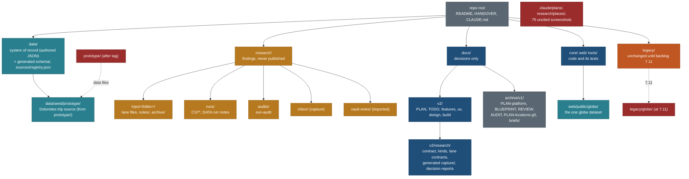

# Repo cleanup: one home for each kind of file (21 Oct 2026)

Owner request, 21 Oct 2026: "Add one plan to clean up obsolete paths, structure our research folder, maybe at root? then remove from docs folder etc. Think and plan a cleanup so we don't have duplicate folders or files."

Written by travel-planner (Opus). Status: **plan, nothing moved yet.** Tracked in [TODO.md](TODO.md) and scheduled in [PLAN.md](PLAN.md) section 3 (row "Cleanup, CLN-1 to CLN-6"). Every count, size and reference below was measured on `main` on 21 Oct 2026 with `git ls-files`, `du`, `git grep` and `shasum`.

**Recommendation.** Keep `research/` at the root as the home for findings: what a research run found, per trip or per run. Keep `docs/` for decisions: plans, specs, contracts, design and decision records. `docs/v2/research/` stays where it is, because it is the research method and the data contract, not findings. 113 rows of authored data, the capture generator and 3 tests point at it. Move only the findings out of `docs/` (the CS7 run notes and one loose file). Archive the pre-v2 documents under `docs/archive/v1/`. Retire `prototype/` once its 4 data files move to `data/seed/prototype/`. Make `web/public/globe/` the only globe dataset that is written to. Remove nothing until the owner confirms it (section 6), and tag every removal first.

**Trade-off.** Under this plan, two folders are still called "research": `research/` holds findings and `docs/v2/research/` holds the method. A single research root (option C) would cost about 8 hours. It would rewrite 113 data citations and the capture generator, and it would collide with three lanes (A10, B6 META-0, E3-E7 DATA). The README in each folder states the split, and the guard in CLN-5 enforces it.

**Supersedes (on approval, applied in CLN-1):** the "Folder contract (layout since 17 Oct 2026)" section of `/CLAUDE.md`; the layout table and the `docs/briefs/` paragraph in `/README.md` (lines 13-18 and 83); the line in `research/vault-notes/README.md` that says those notes "move under `research/`" (they are there already and they stay).

## 1. Inventory

### 1.1 Top level (tracked files only; caches and build output are gitignored and not counted)

| Path | Kind | Tracked files | Tracked size | Last commit | Read by code? | Verdict |
|---|---|---|---|---|---|---|
| `core/` | code: schema, validator, ops, MCP, CLIs | 454 | 3.9 MB | 2026-10-20 | itself | keep |
| `web/` | code: the Next.js product | 1,173 | 29.4 MB (24 MB is `public/globe`) | 2026-10-20 | itself | keep |
| `tools/` | code: Python tools, hooks, check-all | 39 | 0.6 MB | 2026-10-20 | itself | keep |
| `data/` | system of record + generated schema | 151 | 8.7 MB | 2026-10-20 | core, web, tools | keep; add `seed/` (CLN-3) |
| `research/` | authored findings | 147 | 5.9 MB | 2026-10-19 | core (`research_refs`, inbox), tools, skills | keep at root; restructure (CLN-1) |
| `docs/` | plans, specs, design, mocks, screenshots | 563 | 78.1 MB (64 MB images) | 2026-10-21 | core, web, data cite `docs/v2/research/**` | keep; archive v1, prune screenshots |
| `legacy/` | old trip pages, their PLAN.md and builders, old globe and list page | 554 | 28.5 MB (24 MB is `globe/`) | 2026-10-20 | publish.py, hub.py, core suitability refs, web adapter | keep until backlog 7.11 |
| `prototype/` | old Vite planner prototype | 77 | 2.7 MB | 2026-10-18 | **yes**: web snapshot script and a web test (see 1.6) | retire in CLN-3 |
| `.claude/` | agents, skills, settings, old plans | 11 | 68 KB | 2026-10-20 | Claude Code | keep; drop `plans/` |
| root files | README, HANDOVER, CLAUDE.md, package and workspace files, `publish.sh`, `.mcp.json` | 9 | - | - | - | keep |

The `.git` pack is 94.5 MB. Removing files from the tree does not shrink it. This plan does not rewrite history (section 7).

### 1.2 `research/`

| Path | Kind | Files | Size | Last commit | Referenced by | Verdict |
|---|---|---|---|---|---|---|
| `research/trips/<folder>/` (13 folders) | authored per-trip lane findings, `notes/`, `archive/` | 105 | 3.5 MB | 2026-10-18 | trip-planner skill; `core/src/validate/trip.ts`, `core/src/ops/rows.ts` (E_RESEARCH_PATH); `data/schedules/canadian-rockies-2029.json`, `data/sources/registry.json`, 4 sidecars | keep; folder names stay (renaming breaks sha-pinned `research_refs`) |
| `research/inbox/` | capture screenshots and batch files | 6 | 1.7 MB | 2026-10-19 | `tools/locations.py`, `core/src/validate/locations.ts`, `core/src/ops/catalogue.ts`, location skill, `data/locations/locations.json`, 4 tests | keep, code-bound |
| `research/vault-notes/` | imported Obsidian notes, a copy of the vault trip-planner skill, Travel Finder idea docs | 34 | 344 KB | 2026-10-17 | `docs/v2/README.md`, `features/short-trips.md`, `mcp/client-recipes.md`, `migration/inventory.md` (no code) | keep in place; holds household notes (`Plan.md`), so it stays in a private repo |
| `research/places/PRIORITIES.md` | 16 Oct short list, moved from `Location.md` | 1 | 4 KB | 2026-10-17 | only v1 docs and one memory note | remove (D3): all 3 dream trips and the near-term items are already in `locations.json` (Kennecott 5 hits, Provence 7, Lake Como 2, Florence 3) |
| `research/sun-audit-2026-10-18.md` | loose audit file | 1 | 288 KB | 2026-10-17 | `CLAUDE.md` 184, `core/bin/sun.ts` 5 (comment), `docs/v2/migration/inventory.md` 39, `docs/v2/research/lanes/timing-light-and-weather.md` 40 | move to `research/audits/` |

### 1.3 `docs/`

| Path | Kind | Files | Size | Referenced by (outside v1 docs) | Verdict |
|---|---|---|---|---|---|
| `docs/PLAN-platform.md` | v1 platform plan (rev 4), superseded by `docs/v2/` | 1 | 316 KB | `CLAUDE.md` 45, `README.md` 18 and 83, `data/schema/difficulty-map.json` (19 `source` values `docs/PLAN-platform.md#3A`), `tools/migrate_locations_v3.py` 7, `docs/v2/README.md`, `docs/v2/05-roadmap.md`, `docs/v2/migration/legacy-site.md`, `research/vault-notes/README.md` | archive (CLN-2) |
| `docs/REVIEW-platform-plan.md` | review of the v1 plan | 1 | 60 KB | one memory note | archive (CLN-1) |
| `docs/BLUEPRINT.md` | pre-v2 blueprint | 1 | 24 KB | `docs/v2/README.md`, `.claude/plans/HANDOVER.md` | archive (CLN-1) |
| `docs/AUDIT-2026-10-16.md` | 16 Oct repo audit | 1 | 36 KB | `CLAUDE.md` 36 and 45 | archive (CLN-1) |
| `docs/PLAN-locations-g5.md` | locations v2 plan (done) | 1 | 44 KB | `tools/migrate_locations_v2.py` 8, `web/tests/e2e/places-parity.spec.ts` 7 (comments) | archive (CLN-2) |
| `docs/GLOBE-RESEARCH.md` | globe sources and licences, still current | 1 | 20 KB | `tools/globe_data.py` 18 ("See docs/GLOBE-RESEARCH.md for sources and licences") | move to `docs/v2/research/globe-research-2026-10-16.md` (CLN-2) |
| `docs/briefs/` | 17 pre-v2 phase briefs (P1b-P8) | 17 | 244 KB | `README.md` 15 and 83 | archive (CLN-1); P5-P8 hold planner ideas, so keep them in the tree |
| `docs/research/trails-and-media-2026-10-18.md` | trail map and media research (pre-v2, a decision input) | 1 | 48 KB | `prototype/src/data/trails.ts` 2 (comment); `web/components/places/model.ts` rewrites the label "trails-and-media research" (a string, not a path) | move to `docs/v2/research/` (CLN-1); `docs/research/` disappears |
| `docs/v2/*.md` 01-11, `schema.sql`, `README.md` | planner product draft | 14 | 0.2 MB | many docs | keep |
| `docs/v2/PLAN.md`, `TODO.md`, `CLEANUP-PLAN.md` | the plan | 3 | - | - | keep |
| `docs/v2/build/` | execution plan, backlog, briefs, lane records, handover memory | 65 | 0.9 MB | - | keep |
| `docs/v2/features/`, `ux/`, `mcp/`, `migration/` | specs | 67 | 0.75 MB | - | keep |
| `docs/v2/reference/` | 4 Wanderlog screenshots | 4 | 0.8 MB | `.claude/plans/HANDOVER.md` only | keep (they are competitor reference for the planner) |
| `docs/v2/design/` | specs, mocks, reviews, screenshots | 303 | 71 MB | `web/styles/timeline.css` cites `trip-page/` | keep the specs; prune the uncited screenshots (D4) |
| `docs/v2/research/` | capture contract, 15 kind profiles, 17 lane contracts, a lanes README and 9 CS7 run notes, 15 **generated** capture checklists, decision reports (map stack, smart search spike, ADM2 audit, operator questions), 1 **generated** report (`trip-tag-conflicts.md`) | 85 | 1.9 MB | `core/src/capture/generate.ts` (`DOCS_DIR`), `core/test/capture/generate.test.ts`, `core/test/capture/placement.test.ts`, comments in 10 core source files, `data/schema/difficulty-map.json` (113 + 8), `data/vocab/types.json`, 3 data READMEs, `data/suitability/kind-map.json`, `data/tracks/inputs.json`, `web/lib/public/completeness.ts`, `web/components/ui/Icon.tsx`, `web/tests/data/tag-conflicts.test.ts` (writes the report), `.claude/agents/travel-researcher.md` | keep in place; move the 9 CS7 run notes out (CLN-1) |

`docs/v2/design/` breakdown: `globe/` 32 MB (93 jpg), `suitability-display/` 10 MB, `scenario-check/` 9.3 MB, `redesign/` 8.4 MB (fonts, mocks, 52 webp), `trip-page/` 6.6 MB, `live-site/` 1.8 MB, `foundation/` 1.7 MB. Of 219 images under `docs/`, **75 (26.6 MB) are named by no document, by file or by folder**: 59 in `design/globe/shots/`, 6 in `design/redesign/shots/`, 6 in `design/scenario-check/`, 4 in `design/foundation/shots/`. The rest are cited by a spec or a review.

### 1.4 Other second-level paths that matter here

| Path | What it is | Read by | Verdict |
|---|---|---|---|
| `legacy/globe/assets/` (441 files, 24 MB) | the old globe page's data | `web/lib/public/globe.ts:31` (gazetteer), `tools/globe_data.py` (writer), `tools/location_views.py` (writes `places.json`), `tools/tests/test_globe_data.py`, `test_globe_page.py`, `tools/publish.py` (legacy-only mode) | freeze now (CLN-4); remove at 7.11 (CLN-6) |
| `legacy/<trip>/PLAN.md` (12) | trip narrative; parsed by `build_page.py` (Rockies, Patagonia, Chamonix) and `plan_tables.py` | legacy builders, trip-planner skill | stays until 7.11; then moves to `research/trips/<folder>/PLAN.md` (CLN-6) |
| `data/catalog/` (10 `.gitkeep` + `policy.json`) | P4 catalogue layout, empty | `core/src/validate/{index,fk}.ts`, `core/src/mcp/{data,handlers}.ts`, `core/src/checks/context.ts`, `core/src/ops/catalogue.ts`, `core/bin/{validate,suitability}.ts`, `tools/hooks/data_changed.sh`, `core/test/{hooks,reference-files,validate}.test.ts`, `core/test/fixtures/make.ts` | **keep.** It is wired into the validator, the MCP server and the ops catalogue. The capture contract replaces it, but the store layout is decided at SRV-0, so remove it there (new backlog row, section 6 note) |
| `web/data-snapshots/prototype.json` | snapshot of the prototype's Dolomites data | `web/lib/public/sources.ts` (import), `core/src/relevance/points.ts`, `core/src/suitability/migrate.ts`, `web/scripts/{legs-ors,tracks-osm}.mjs`, `web/tests/trips/timeline.test.ts` | keep at this path (CLN-3 keeps it byte-identical) |
| `web/scripts/embed-spike/` (18 files) | L9 embedding spike | `docs/v2/research/smart-search-spike.md` | keep; L9 is parked, not dropped |
| `.claude/plans/` (`HANDOVER.md` of 18 Oct, `README.md`, symlink `v2 -> ../../docs/v2`) | the pre-`main` handover for the deleted branch | `docs/AUDIT-2026-10-16.md` only | remove (D2); `/HANDOVER.md` replaces it |

### 1.5 Duplicates (same blob hash in `git ls-files -s`)

| Duplicate | Copies | Size | Verdict |
|---|---|---|---|
| `legacy/globe/assets/{admin,data}` and `web/public/globe/{admin,data}` | 403 identical files; 3 diverged (`admin/index.json`, `data/countries.json`, `data/gazetteer.json`: the web copies are newer, 19-20 Oct); only in legacy: the 29 whole-country ADM2 files that Q33 dropped from web, `data/places.json` and `vendor/` (5); only in web: 127 per-state admin files and 3 data files | about 22 MB twice | one writer from CLN-4, then legacy removed at 7.11 |
| `docs/v2/design/redesign/fonts/*` and `web/public/fonts/*` | 7 font files plus 3 licence texts | 183 KB | keep both: the mocks must render on their own. The guard allowlists them |
| `docs/v2/design/globe/shots/live-italy-1440.jpg` = `live-state-1440.jpg` | 2 | 596 KB | `design/globe/review.md` line 23 cites them as two states, but they are one picture. Correct the review's evidence; no file action |
| `legacy/norway-summer/sun-times.py` = `legacy/patagonia-feb-mar-2027/sun-times.py`; two identical `anchor_check.py` | 2 + 2 | 7 KB | legacy; tag and remove at 7.11 (the sun scripts are the ones the sun audit found wrong) |
| `core/test/fixtures/**` pairs (2) | 2 + 2 | 5 KB | intentional test fixtures; allowlisted |
| `legacy/globe/assets/vendor/maplibre-gl-shared.mjs` | an empty file (0 bytes, same hash as `.gitkeep`) | 0 | goes with legacy/globe |

Near-duplicate folders, not byte-equal:

| Pair | Relation | Verdict |
|---|---|---|
| `/HANDOVER.md`, `.claude/plans/HANDOVER.md`, `docs/v2/build/handover/` | three handovers; only the root one is current | remove `.claude/plans/` (D2) |
| `docs/PLAN-platform.md` and `docs/v2/PLAN.md` | v1 plan against the current plan | archive v1 |
| `research/vault-notes/vault-trip-planner-skill/` and `.claude/skills/trip-planner/` | different skills; the vault one is kept as reference | keep; its README already says so |
| `docs/v2/research/lanes/<lane>.md` (contracts) and `research/trips/<folder>/<lane>.md` (findings) | method against results, same lane names | by design; the rule in section 5 says which is which |
| `research/trips/<folder>` and `data/capture/<trip-id>` | named differently (`dolomites-july-2027` against `dolomites-2027`); `web/lib/public/slugs.ts` maps them | keep the names; new trips use the trip id for both (section 5) |

### 1.6 What this inventory corrected in the starting brief

| Assumed | Measured | Effect on the plan |
|---|---|---|
| `prototype/` is imported by no code | `web/tests/data/public-privacy.test.ts` reads `prototype/src/data/trip.ts` in the check-all stage "web test". `web/scripts/snapshot-prototype.mjs` builds `web/data-snapshots/prototype.json` **and `web/redirects.json`** from `prototype/src/data/*.ts`, using rolldown from `prototype/node_modules`. That folder is **absent on this machine**, so neither generated file can be regenerated here today, and `snapshot:check` is not in check-all | Removing `prototype/` would break check-all. CLN-3 moves the data first, replaces rolldown, and adds `snapshot:check` to check-all |
| The two globe copies are the same data | `web/lib/public/globe.ts:31` (server side, the trip pin fallback) reads the **legacy** gazetteer (803 KB, 17 Oct). The client reads `web/public/globe/data/gazetteer.json` (898 KB, 20 Oct). `globe_data.py` writes ADM1, ADM2 and countries to legacy and the L2b data to web | A live drift bug: a trip pin can resolve against older names. CLN-4 fixes it |
| `docs/v2/research/` is research to move to the root | It is the data contract and the research method: authored data cites it 121 times, and the generator writes `capture/*` there | It stays (option B) |
| `data/catalog/` is obsolete | 9 code files and 3 tests read it | Keep until SRV-0 |
| The DATA brief's files exist | It names `research/capture-research-backlog.md`, but the file is `docs/v2/research/capture-research-backlog.md` (a test reads it there) | Fix the brief in CLN-1 |
| `CLAUDE.md` is accurate on folders | It lists `legacy/peru/`, which does not exist (Peru is research only, in `research/trips/peru/`). Its agents table still names `prototype/`. The builder and design-reviewer agents run Playwright from `prototype/node_modules` with a Linux Chromium path | Fix in CLN-1 |

## 2. Target structure

### 2.1 The rule: what belongs where

| Kind of file | Home | Examples |
|---|---|---|
| Code and its tests | `core/`, `web/`, `tools/` | - |
| System of record: authored JSON the product reads | `data/` | `data/locations/`, `data/capture/`, `data/suitability/`, `data/vocab/`, `data/seed/prototype/` |
| Generated output | wherever its tool writes it, marked "Generated ... Do not edit" in the file or the folder README. Never moved for tidiness | `data/schema/generated/**`, `data/schema/capture/**`, `docs/v2/research/capture/**`, `docs/v2/research/trip-tag-conflicts.md`, `data/sources/registry.json`, `web/redirects.json`, `data/suitability/scope.json`, `data/locations/WISHLIST.md`, `legacy/locations/index.html` |
| Findings: what research found, with sources | `research/` | per trip: `research/trips/<folder>/<lane>.md`; per run: `research/runs/<run-id>.md`; audits: `research/audits/`; captures: `research/inbox/`; imported notes: `research/vault-notes/` |
| Decisions: plans, specs, contracts, design, decision records, reviews | `docs/v2/` | PLAN, TODO, features, ux, design, build, `research/` (contract, kinds, lane contracts, decision reports) |
| Superseded documents kept for their ideas | `docs/archive/v1/` (no live link may point in; the guard checks this) | PLAN-platform, BLUEPRINT, briefs |
| Things removed | an annotated git tag `archive/cleanup-<phase>-<date>`, never a folder | `prototype/`, `.claude/plans/` |
| Published trip pages and their builders | `legacy/` until backlog 7.11 | - |

A research report that changed a product decision (map stack, smart search spike, ADM2 audit, globe research, trails and media) is a decision record. It lives in `docs/v2/research/` next to the contract. A note on what a run found, which gaps it left and which questions it raised is a finding. It lives in `research/`.

### 2.2 Options

| Option | What moves | Cost | Collisions | Verdict |
|---|---|---|---|---|
| A. Prune only | Removals (D1-D4) and the v1 archive; nothing else | about 4 h | none | Rejected. Findings stay in `docs/v2/research/lanes/`, the loose file stays, and the scatter the owner named stays |
| **B. Findings at root, decisions in docs (recommended)** | A, plus: 9 CS7 run notes to `research/runs/`, the sun audit to `research/audits/`, trails-and-media and globe research into `docs/v2/research/`, the prototype data to `data/seed/`, one globe writer, a guard | about 17 h over 5 phases, about 13 h of it builder time | sequenced around the phase A, B and E owners (section 3) | **Recommended.** Each folder answers one question, and nothing that code or data cites in bulk moves |
| C. All research at root | B, plus `docs/v2/research/**` to `research/method/`, including the generated `capture/` | B + about 8 h: `DOCS_DIR` in `core/src/capture/generate.ts`, `generate.test.ts`, `placement.test.ts`, the `capture.ts` help text, regeneration, 113 + 8 `source` values in `data/schema/difficulty-map.json`, `data/vocab/types.json`, `data/suitability/kind-map.json`, 3 data READMEs, comments in 10 core source files, `web/lib/public/completeness.ts`, `Icon.tsx`, the `tag-conflicts` writer, `travel-researcher.md`, the META, SRV and DATA briefs | A10 SRV-D writes `docs/v2/research/schema-diff-2026-10.md` now; B6 META-0 edits `capture-contract.md`; E3-E7 DATA write lane notes; any pause costs days | Rejected. One folder name is not worth a freeze across three phases |

Option C's cost for the generated checklists alone: a 1-hour change, low risk. The check-all stage "capture contract: generated files match data/vocab/types.json" proves it. The gain is nothing, so the generated output stays where the generator writes it.

## 3. Phased move list

Order: docs-only first, then comment and citation edits, then code. Each phase is one commit, or two when a removal needs its own tag. Each runs as a single agent with no other edit in flight on the same paths.

| Phase | When | Why then | Executor | Effort |
|---|---|---|---|---|
| CLN-1 | **now**, in parallel with phase A, after the coordinator's uncommitted docs edits (CLAUDE.md, HANDOVER.md, TODO, the build docs) are committed | touches only docs, research, `.claude/` and 4 lines in files no phase A lane owns | `travel-planner` (docs), coordinator commits | 3 h |
| CLN-2 | at **R1 entry**, right after A11 merges | `tools/globe_data.py` (GLB2a) and `places-parity.spec.ts` (TST) are lane-owned until then | coordinator | 1 h |
| CLN-3 | **phase B**, after B1 (API-0) merges, before E2 (META-2) | B1 owns the 11 `web/out` tests, `public-privacy.test.ts` among them, and the web lines of check-all; E2 owns `public-privacy.test.ts`; TRP1 owns `core/src/schedule/**` until A merges | `travel-builder` (Sonnet), `travel-verifier` | 6 h + 1 h |
| CLN-4 | **phase B**, any time after A11 | GLB2a owns the globe files in A; GLB2b (E12) and CONS-3 (E14) own them again in E; B leaves them free | `travel-builder`, `travel-verifier` | 3 h + 1 h |
| CLN-5 | **phase B**, after B4 (CONS-1) merges, before G-B | both add one line to `tools/check-all.sh`; G-B then audits the guard | `travel-builder` | 4 h |
| CLN-6 | with backlog **7.11**, after go-live approval | the owner said legacy stays until then | the 7.11 lane | in 7.11 |

### CLN-1: docs and research (now)

| # | Old path | New path | Method | Files to change | Proof | Risk |
|---|---|---|---|---|---|---|
| 1.1 | `docs/BLUEPRINT.md`, `docs/REVIEW-platform-plan.md`, `docs/AUDIT-2026-10-16.md` | `docs/archive/v1/` | `git mv` | `docs/v2/README.md` (BLUEPRINT link), `CLAUDE.md` 36 and 45 (AUDIT) | the dead-path scan below | low |
| 1.2 | `docs/briefs/` (17) | `docs/archive/v1/briefs/` | `git mv` | `README.md` 15 and 83 | scan | low |
| 1.3 | `docs/research/trails-and-media-2026-10-18.md` | `docs/v2/research/trails-and-media-2026-10-18.md` | `git mv` | `prototype/src/data/trails.ts` 2 (comment; no output change), the file's own mentions of `docs/BLUEPRINT.md` and `docs/PLAN-platform.md` | `pnpm --dir web snapshot:check` is not runnable here (1.6), so diff the comment line only | low |
| 1.4 | `research/sun-audit-2026-10-18.md` | `research/audits/sun-audit-2026-10-18.md` | `git mv` | `CLAUDE.md` 184, `core/bin/sun.ts` 5 (comment), `docs/v2/migration/inventory.md` 39, `docs/v2/research/lanes/timing-light-and-weather.md` 40 | check-all "core typecheck" | low |
| 1.5 | `docs/v2/research/lanes/{CS7-canadian-rockies-2029, CS7-chamonix-mont-blanc-2028, CS7-dolomites-2027, CS7-iceland-ring-road-2027, CS7-patagonia-2027, CS7b-dolomites-tracks, CS7b-notes, CS7c-notes, CS7d-notes}.md` | `research/runs/` (same names) | `git mv` | `data/tracks/inputs.json` (4 `source` strings; no lane owns it), `docs/v2/research/capture-research-backlog.md` (3 links; the test reads only place names, which stay), `docs/v2/build/public-site/briefs/DATA.md` (inputs), `EXECUTION-PLAN.md` row E3 (`docs/v2/research/lanes/DATA-notes.md` becomes `research/runs/DATA-notes.md`), the moved files' own relative links (`../capture-contract.md` becomes `../../docs/v2/research/capture-contract.md`). Leave `STAGE4-plan.md` and `briefs/CS7d.md` as records | check-all "core tests" (`placement.test.ts`), "validate every data file"; `node -e "JSON.parse(require('fs').readFileSync('data/tracks/inputs.json','utf8'))"` | low |
| 1.6 | `research/places/PRIORITIES.md` | removed | tag, then `git rm` (D3) | none live (v1 docs and a memory note are records) | scan | none |
| 1.7 | `.claude/plans/` (3 entries, one a symlink) | removed | tag, then `git rm -r` (D2) | none live | scan | none |
| 1.8 | 75 uncited screenshots in `docs/v2/design/` | removed | the listing script in step 3 below, then tag and `git rm` (D4) | none (uncited by definition) | re-run the listing: 0 left | low; the tag keeps them |
| 1.9 | - | `research/README.md`, `docs/README.md` (new) | write | - | - | none |
| 1.10 | - | - | edit | `DATA.md` input `research/capture-research-backlog.md` becomes `docs/v2/research/capture-research-backlog.md` | - | none |
| 1.11 | - | - | edit (D6) | `.claude/agents/travel-builder.md` (description without `prototype/`; Playwright through `pnpm --dir web exec playwright`, browsers from the Playwright cache on this OS), `.claude/agents/travel-design-reviewer.md` (the same Playwright line), `.claude/agents/travel-researcher.md` (run notes go to `research/runs/`) | - | none |
| 1.12 | - | - | edit (D5) | `CLAUDE.md`: replace the folder contract with section 5.1, delete the `legacy/peru/` claim and point to `research/trips/peru/`, drop `prototype/` from the agents table; `README.md` layout table; `research/vault-notes/README.md` "move under research/" line; `docs/v2/design/globe/review.md` line 23 note (one picture, two names) | - | none |

Steps:
1. Confirm D2-D6 with the owner. Moves need no confirmation; removals do.
2. Tag: `git -C /Users/nks/workspace/travel tag -a archive/cleanup-cln1-2026-10-<dd> -m "before CLN-1 removals" HEAD`.
3. Build the screenshot list: for every tracked `png`, `jpg` or `webp` under `docs/`, keep it if any tracked text file under `docs/` names its basename, or names its `<parent>/<folder>/` pair. Write the rest to the commit message body. The expected count is 75.
4. Run the moves and edits, then the dead-path scan: `git -C /Users/nks/workspace/travel grep -n -E 'docs/(BLUEPRINT|REVIEW-platform-plan|AUDIT-2026-10-16)\.md|docs/briefs|docs/research/|research/sun-audit|research/places/|lanes/CS7|\.claude/plans' -- . ':!docs/archive' ':!docs/v2/build/handover/memory' ':!docs/v2/build/public-site/STAGE4-plan.md' ':!docs/v2/build/public-site/briefs/CS7d.md'` must print nothing.
5. Stage only the touched paths: `git -C /Users/nks/workspace/travel add <each path>`, never `-A`. Message `docs(cleanup/CLN-1): ...`, then the Co-Authored-By trailer.

Rollback: `git revert <CLN-1 commit>`. A single file comes back with `git -C <repo> checkout archive/cleanup-cln1-2026-10-<dd> -- <path>`.

### CLN-2: v1 documents that code or data cite (at R1 entry)

| # | Old path | New path | Method | Files to change | Proof | Risk | Collision if run early |
|---|---|---|---|---|---|---|---|
| 2.1 | `docs/PLAN-platform.md` | `docs/archive/v1/PLAN-platform.md` | `git mv` | `data/schema/difficulty-map.json` (19 values `docs/PLAN-platform.md#3A`; the file is authored: no generator writes it, and only `core/src/schema/difficultyMap.ts`, `core/src/suitability/map.ts` and the validator read it), `tools/migrate_locations_v3.py` 7, `CLAUDE.md` 45, `README.md` 18 and 83, `docs/v2/README.md`, `docs/v2/05-roadmap.md`, `docs/v2/migration/legacy-site.md`, `research/vault-notes/README.md` | check-all "core tests" (`reference-files.test.ts`, `suitability/map.test.ts`), "validate every data file", "suitability sidecars", "relevance derived files are current" | low | none in A; B6 META-0 does not own the file |
| 2.2 | `docs/PLAN-locations-g5.md` | `docs/archive/v1/PLAN-locations-g5.md` | `git mv` | `tools/migrate_locations_v2.py` 8, `web/tests/e2e/places-parity.spec.ts` 7 (comments). The legacy template comment names the file without a path; leave it | "python tests", "web lint" | low | TST owns the spec in A |
| 2.3 | `docs/GLOBE-RESEARCH.md` | `docs/v2/research/globe-research-2026-10-16.md` | `git mv` | `tools/globe_data.py` 18 | "python tests" | low | GLB2a owns `globe_data.py` in A |

Rollback: `git revert`. No removals in this phase.

### CLN-3: retire `prototype/` (phase B, after B1)

| Item | Old path | New path | Method |
|---|---|---|---|
| 3.1 | `prototype/src/data/{trip,places,trails,public-trips}.ts` | `data/seed/prototype/` (same names) | `git mv`, so history follows |
| 3.2 | rest of `prototype/` (73 files) | removed | tag `archive/prototype-2026-10-<dd>`, then `git rm -r` (D1) |

Files that must change: `web/scripts/snapshot-prototype.mjs`, `web/package.json` (scripts `snapshot`, `snapshot:check`), `web/tests/data/public-privacy.test.ts` line 10 (the source path), `web/tests/data/allowlist.ts` (import path, if the allow-list functions move), `core/src/schedule/legs.ts` 2 and `core/test/schedule/rules.test.ts` 70 (provenance comments name the tag), `data/relevance/iceland-ring-road-2027/R4.json` 329 and `data/suitability/iceland-ring-road-2027/R4.json` 331 (`url` becomes `data/seed/prototype/public-trips.ts`), `data/sources/registry.json` (regenerated, never edited), `tools/check-all.sh` (one line), `HANDOVER.md` (regeneration row), `CLAUDE.md` (agents table, if CLN-1 did not do it), `docs/v2/design/prototype.md` (a "Retired" banner naming the tag), `docs/v2/design/redesign/build/data.py` docstring, the TODO row "Trail data for a person to confirm" (spec link `prototype/src/data/trails.ts` becomes `data/seed/prototype/trails.ts`).

Proof: `web/data-snapshots/prototype.json` and `web/redirects.json` are **byte-identical** before and after (`shasum`). Check-all "web test" (privacy, allow-list, timeline), "core tests", "source registry is current and valid", "relevance sidecars", "suitability sidecars", and the new "snapshot is current" stage.

Risk: medium. The snapshot carries household data through an allow-list, and a changed bundler could change key order or drop the filter. The byte-identical check catches both. Collisions: B1 (`web/out` tests and the check-all web lines) must merge first; E2 META-2 owns `public-privacy.test.ts` from G-B on; B3 API-2 does not touch these files.

Rollback: `git revert` the commit. If `prototype/` is needed whole: `git -C <repo> checkout archive/prototype-2026-10-<dd> -- prototype`.

**Brief CLN-3 (for `travel-builder`, Sonnet)**

- **Goal.** Remove the old Vite prototype without changing a byte of what the site reads, and make the snapshot and redirect map regenerable on any machine with no `prototype/node_modules`.
- **Read first.** This section; `docs/v2/design/foundation/principles.md` P8 and P9 (the snapshot path and `web/lib/public/sources.ts` stay as they are, so the data boundary does not move); `web/scripts/snapshot-prototype.mjs`; `tools/suitability-scope/` (the pattern to copy: a vitest "dump" run writes a file, and a `--check` mode compares it).
- **Files you own.** `data/seed/prototype/**` (new, by `git mv`), `web/scripts/snapshot-prototype.mjs` (or its replacement under `web/scripts/snapshot/`), `web/package.json` (the two snapshot scripts only), `web/tests/data/public-privacy.test.ts` (the source path line only), `web/tests/data/allowlist.ts` (the import line only), `core/src/schedule/legs.ts` and `core/test/schedule/rules.test.ts` (the comment lines only), the two Iceland `R4.json` `url` values, `data/sources/registry.json` (through `node core/bin/sources.ts build` only), one line in `tools/check-all.sh`, `HANDOVER.md` (the regeneration row), `docs/v2/design/prototype.md` (banner), `docs/v2/design/redesign/build/data.py` (docstring), the removal of `prototype/`.
- **Do not touch.** `web/data-snapshots/**` by hand, `web/redirects.json` by hand, `web/lib/public/**`, any component, `core/src/catalogue/**`, `core/src/privacy/**`, the allow-list rules inside the snapshot code (move them, do not change them), any other check-all line, generated files by hand.
- **Steps.**
  1. Record `shasum web/data-snapshots/prototype.json web/data-snapshots/snapshot-report.json web/redirects.json`.
  2. `git mv` the four data files to `data/seed/prototype/`. Remove the React store hook at the end of `trails.ts` (`useSyncExternalStore`, about line 1060); the prototype UI was its only user. Keep every data export.
  3. Replace the rolldown bundling with a vitest run (config under `web/scripts/snapshot/`, `react` aliased to the existing stub) that imports the seed files and `web/lib/public/cli.ts` and writes the three files; `CHECK=1` compares instead of writing. Keep the exported `snapshotTrip`, `snapshotPlaces`, `snapshotPublicTrips`, `makeNoteFilter` and `DATE_TEXT` importable for `allowlist.ts`.
  4. Point `snapshot` and `snapshot:check` in `web/package.json` at it. Add one check-all step, "snapshot is current", after "web test": `pnpm --dir "$ROOT/web" snapshot:check`.
  5. Update the referencing files listed above. Regenerate the registry with `node core/bin/sources.ts build`.
  6. Run `pnpm --dir web snapshot`, then confirm the three hashes from step 1 are unchanged.
  7. Ask the coordinator for D1. Tag `archive/prototype-2026-10-<dd>` on the commit before removal, then `git rm -r prototype`.
- **Acceptance.** (a) The three hashes are unchanged. (b) `pnpm --dir web snapshot:check` passes with no `prototype/` folder and no `prototype/node_modules`. (c) `git grep -n 'prototype/' -- core web tools data .claude CLAUDE.md` prints only `data-snapshots/prototype.json`, the snapshot script's own name, and lines that name the archive tag. (d) `public-privacy.test.ts` still finds 0 household strings and still reads its secrets from the seed `trip.ts`.
- **Verification.** `pnpm --dir web typecheck`, `pnpm --dir web lint`, `pnpm --dir web test`, `pnpm --dir core test`, `pnpm --dir core typecheck`, then `bash tools/check-all.sh` with `web/.env.local` moved aside (mode 600) and restored. Playwright screenshots of `/trips/dolomites-2027/` and one Dolomites place page at 1440 x 900 and 390 x 844, light and dark, set through the site's theme control, before and after, into `web/test-results/shots/CLN3/`. Read tall pages in tiles. They must match.
- **Commit rules.** Worktree `<repo parent>/travel-wt/v2-CLN3` on branch `public/CLN3` from `main`. `git -C <worktree> add <owned paths>`, never `-A`. Message `chore(cleanup/CLN-3): retire prototype/, seed data to data/seed/prototype`, ending with the Co-Authored-By trailer. Rebase onto `main`; do not push; the coordinator merges and pushes the tag.

### CLN-4: one globe writer (phase B)

| Item | Change | Files |
|---|---|---|
| 4.1 | The app's server side reads the app's gazetteer | `web/lib/public/globe.ts:31`: `legacy/globe/assets/data/gazetteer.json` becomes `web/public/globe/data/gazetteer.json` (through the existing `GLOBE_PUBLIC()` helper) |
| 4.2 | `globe_data.py` writes the app's copy only | `tools/globe_data.py`: `ASSETS` writers for ADM1, ADM2, `countries.json`, `gazetteer.json` and `admin/index.json` move to `WEB`. The legacy-only outputs (`countries-50m.json`, `vendor/`) stop being written; the frozen legacy files stay until CLN-6. The docstring lines 13-16 are updated |
| 4.3 | Tests follow the writer | `tools/tests/test_globe_data.py` (point `ASSETS` at `web/public/globe`; delete the asserts that cover only the legacy page, which move to CLN-6), `tools/tests/test_globe_page.py` (unchanged; it tests the frozen page) |
| 4.4 | Documents | `CLAUDE.md` line 17 (`places.json` stays a legacy output until CLN-6), `docs/v2/build/public-site/briefs/GLB2.md` (GLB2b's owned list loses `legacy/globe`) |

Proof: check-all "python tests", "web test", "web build". `shasum web/public/globe/data/gazetteer.json` is unchanged. A unit test pins that `globe.ts` reads the web copy: the pin of a trip with no positioned base resolves to the same point before and after. Playwright screenshots of `/globe/` and that trip's page at 1440 and 390, light and dark, on the GPU flags.

Risk: low to medium. A `globe_data.py` subcommand that is run later now writes where the app reads, which is the point of the change. Collision: none in B. E12 GLB2b and E14 CONS-3 inherit the single writer.

Rollback: `git revert`. Nothing is removed in this phase.

**Brief CLN-4 (for `travel-builder`, Sonnet).** Goal: as the table above. Read first: P9 (one data boundary: `web/lib/public/globe.ts` stays the only server reader). Owns: `web/lib/public/globe.ts` (line 31 and the read helper only, not the trip-to-country table that CONS-3 owns), `tools/globe_data.py`, `tools/tests/test_globe_data.py`, one new unit test under `web/tests/globe/`, `CLAUDE.md` line 17, the GLB2 brief's owned list. Do not touch: `legacy/**`, `web/public/globe/**` except through `globe_data.py`, `tools/publish.py`, `tools/location_views.py`, components. Steps: record the hashes; change the read path; move the writers; run only the subcommands whose output must not change and confirm identical hashes (`globe_data.py` has no `--check`; name each subcommand run in the hand-back); update the tests. Acceptance: `git grep -n "legacy.*globe" -- web/lib tools/globe_data.py` prints nothing; hashes unchanged; the pin test passes. Verification: `pnpm --dir web typecheck`, lint, test; `python3 -m pytest tools/tests -q`; the globe e2e specs only (`pnpm exec playwright test tests/e2e/globe --project=chromium`); screenshots as above, read in tiles. Commit rules: worktree `travel-wt/v2-CLN4`, branch `public/CLN4`, `git -C <worktree> add <owned paths>`, message `chore(cleanup/CLN-4): one globe writer, app reads its own gazetteer`, Co-Authored-By trailer, no push.

### CLN-5: the folder-contract guard (phase B, after B4)

**Brief CLN-5 (for `travel-builder`, Sonnet).**
- **Goal.** A check-all stage that fails when a file lands in the wrong place or a file is duplicated. It works like CONS-1's ratchet: today's exceptions sit in a baseline, and new ones fail.
- **Owns.** `tools/tree_check.py`, `tools/tree_contract.json` (the allowlists and the baseline), `tools/tests/test_tree_check.py`, one line in `tools/check-all.sh` ("folder contract").
- **Do not touch.** Anything the check reports. It reports; it never moves or deletes.
- **Rules it checks (tracked files only, from `git ls-files -s`).**
  1. Top-level folders are exactly `.claude core data docs legacy research tools web`, plus `prototype` until CLN-3.
  2. `research/` holds only `README.md` and the folders `trips inbox runs audits vault-notes`; `docs/` holds only `README.md`, `v2/` and `archive/`.
  3. No two tracked paths share a blob hash, except the allowlist: the `.gitkeep` files, `core/test/fixtures/**`, `docs/v2/design/redesign/fonts/**` against `web/public/fonts/**`, and `legacy/**` until CLN-6.
  4. Every image under `docs/` is named, by file or by folder, by a tracked text file under `docs/`, and none is over 1.5 MB. The 4 larger images today (the `suitability-display/mock/shots` PNGs, about 2.5 MB each) go into the baseline.
  5. No live file links into `docs/archive/`. Live files are all files except those under `docs/archive/` and `docs/v2/build/handover/memory/`.
  6. Dead paths. Repo-relative paths that start with `core/`, `data/`, `docs/`, `research/`, `tools/`, `web/`, `legacy/` or `prototype/` and appear in `core/`, `web/`, `tools/`, `data/`, `.claude/`, `CLAUDE.md`, `README.md` or `HANDOVER.md` must exist. Placeholders (`<slug>`, `*`, `{a,b}`) are skipped. Today's misses go into the baseline.
- **Acceptance.** Green on `main` with the baseline. Each rule has a failing fixture in the test. Runtime is under 2 s.
- **Verification.** `python3 -m pytest tools/tests -q`, then `bash tools/check-all.sh`. No UI, so no screenshots.
- **Commit rules.** As CLN-4, with message `tools(cleanup/CLN-5): folder contract guard`.

### CLN-6: legacy hand-off (with backlog 7.11, not scheduled here)

7.11 step 5 already moves legacy sources to `data/`. Add these rows to it, each confirmed by the owner when 7.11 runs:

| Item | Action |
|---|---|
| `legacy/<folder>/PLAN.md` (12) | `git mv` to `research/trips/<folder>/PLAN.md`. They are trip narratives with sources, so they are findings. Do this before the builders are removed, so `git log --follow` keeps their history |
| `legacy/<folder>/*.py`, `gallery/`, `index.html`, `assets/` | tag `archive/legacy-pages-<date>`, then remove (the `legacy-final` tag already holds the old site) |
| `legacy/globe/` (442 files, 24 MB), `legacy/locations/index.html`, `legacy/_system/` | remove with the legacy page outputs of `tools/location_views.py` (the list page and `places.json`), `tools/tests/test_globe_page.py`, `test_list_page.py`, and the legacy parts of `test_globe_data.py`. `places.json` is a whole-catalogue public pin file, so retiring it also serves P8 |
| `legacy/MANIFEST.json`, `tools/publish.py`, `tools/hub.py` | per 7.11 steps 6-7 |
| CLN-5 baseline | drop the `legacy/**` exemptions |

## 4. Collision map (who owns what, and when)

| File or folder the cleanup touches | Phase A owner | Phase B owner | Phase E owner | Cleanup slot |
|---|---|---|---|---|
| `docs/**` except the files listed below, `research/**`, `.claude/**` | none (coordinator records) | none | DATA writes run notes | CLN-1 now |
| `docs/v2/research/schema-diff-2026-10.md` | A10 SRV-D (new) | - | - | not touched |
| `docs/v2/research/capture-contract.md` | - | B6 META-0 | - | links only, CLN-1 |
| `tools/globe_data.py`, `web/public/globe/**`, `web/lib/public/globe.ts` | A4 GLB2a | free | E12 GLB2b, E14 CONS-3 | CLN-2, CLN-4 |
| `web/tests/e2e/places-parity.spec.ts` | A14 TST | free | - | CLN-2 |
| `core/src/schedule/**`, `core/test/schedule/**` | A13 TRP1 | free | E11 TRP2 | CLN-3 |
| `web/tests/data/public-privacy.test.ts`, `tools/check-all.sh` web lines | - | B1 API-0 | E2 META-2 | CLN-3 after B1 |
| `tools/check-all.sh` (new lines) | - | B1, B4 | - | CLN-3, CLN-5 after them |
| `data/schema/difficulty-map.json`, `data/tracks/inputs.json`, the Iceland `R4.json` files | none | none | DATA writes new files, not these | CLN-1, CLN-2, CLN-3 |
| `CLAUDE.md`, `README.md`, `HANDOVER.md` | coordinator | coordinator | coordinator | CLN-1 (one writer at a time) |

## 5. Keeping it clean

### 5.1 Folder contract (replaces the CLAUDE.md section "Folder contract (layout since 17 Oct 2026)")

> **Folder contract (since the cleanup, Oct 2026).** Code lives in `core/`, `web/` and `tools/`. Authored data the product reads lives in `data/`. Generated files stay where their tool writes them, carry a "Generated ... Do not edit" line, and are rebuilt, never edited: `data/schema/**` (except `difficulty-map.json` and `freshness.json`, which are authored), `docs/v2/research/capture/**`, `docs/v2/research/trip-tag-conflicts.md`, `data/sources/registry.json`, `data/suitability/scope.json`, `web/redirects.json`, `web/data-snapshots/**`, `data/locations/WISHLIST.md`. **Findings** live in `research/`: per trip in `research/trips/<folder>/<lane>.md` (with `notes/` and `archive/`), per run in `research/runs/<run-id>.md`, audits in `research/audits/`, captures in `research/inbox/`, imported notes in `research/vault-notes/`. Nothing else goes at the `research/` root. **Decisions** live in `docs/v2/`: plans, specs, the capture contract and lane contracts (`docs/v2/research/`), design, reviews and decision reports. Superseded documents go to `docs/archive/v1/`, and nothing live links into it. Removed things live in tags `archive/*`, never in a folder. Commit a screenshot only when a spec or review names it; verification shots go to `web/test-results/shots/` (gitignored). `legacy/<folder>/` holds the old pages, their `PLAN.md` and builders until backlog 7.11. Check-all's "folder contract" stage enforces this.

### 5.2 Where new work goes

| You are writing | Put it in |
|---|---|
| A lane contract or a kind profile (what to collect) | `docs/v2/research/lanes/<lane>.md`, `docs/v2/research/kinds/<kind>.md` |
| What a run found, its gaps and its questions | `research/runs/<run-id>.md`, for example `research/runs/DATA-D3-trail-facts.md` |
| Structured results | `data/capture/<trip-id>/<lane>.json`, `data/suitability/<trip-id>/<lane>.json`, `data/relevance/<trip-id>/<lane>.json` |
| Per-trip prose research (trip-planner skill) | `research/trips/<folder>/<lane>.md` |
| A report that drives a product decision | `docs/v2/research/<topic>-YYYY-MM-DD.md` |
| A place capture, screenshot or batch | `research/inbox/<date>-<slug>.<ext>` (location skill) |
| An audit of published claims | `research/audits/<topic>-YYYY-MM-DD.md` |
| A screenshot cited by a spec | beside the spec, `<spec-folder>/shots/`, under 1.5 MB, JPEG or WebP |

### 5.3 Naming

- Folders and new files are lowercase kebab-case. Imported notes in `research/vault-notes/` keep their names.
- Dated documents end in `-YYYY-MM-DD`.
- `research/trips/<folder>` keeps the legacy folder name for the 13 existing trips, because `research_refs` pin those paths with a sha256. A new trip uses its trip id (the `data/trips/<id>/` name) for both.
- Run ids are the lane id plus a topic: `CS7b-dolomites-tracks`, `DATA-D3-trail-facts`.

## 6. Owner confirmations

| ID | Decision | Recommended answer | Trade-off |
|---|---|---|---|
| D1 | Remove `prototype/` (73 files after the 4 data files move to `data/seed/prototype/`, 2.7 MB), tagged `archive/prototype-2026-10-<dd>` first (CLN-3) | **Yes**, in phase B after B1 | Running the old clickable prototype then means checking out the tag. The planner will be rebuilt in `web/` anyway (PLAN.md R-50) |
| D2 | Remove `.claude/plans/` (`HANDOVER.md` of 18 Oct for the deleted branch, `README.md`, the `v2` symlink) (CLN-1) | **Yes** | None; `/HANDOVER.md` and `docs/v2/PLAN.md` replace it |
| D3 | Remove `research/places/PRIORITIES.md` (CLN-1) | **Yes** | Its ordering ("near term" against "dream") is lost; every place in it is already in `locations.json` |
| D4 | Remove the 75 screenshots (26.6 MB) that no document names, from `design/globe/shots` (59), `redesign/shots` (6), `scenario-check` (6), `foundation/shots` (4); exact list in the CLN-1 commit (CLN-1) | **Yes** | They stay in the tag and in history. Each checkout gets 26.6 MB lighter; there are 8 today (`main` plus 7 phase A worktrees), so about 210 MB of disk. `.git` does not shrink |
| D5 | Replace the CLAUDE.md folder contract with section 5.1, fix the `legacy/peru/` line, and update the README layout (CLN-1) | **Yes** | None |
| D6 | Update the builder, design-reviewer and researcher agent files: no `prototype/node_modules`, no Linux Chromium path, run notes to `research/runs/` (CLN-1) | **Yes** | None; the current lines fail on this Mac |
| D7 | Option B (findings at root, decisions in docs) rather than option C (all research at root) | **B** | Two folders named "research" remain, each with a README that says which is which |
| D8 | Add the "folder contract" stage to check-all (CLN-5) | **Yes** | One more stage, about 2 s; a ratchet baseline means it starts green |
| D9 | At 7.11: move the 12 `legacy/<folder>/PLAN.md` files to `research/trips/<folder>/`, then remove `legacy/globe/` (24 MB) and the other legacy page files after a tag (CLN-6) | **Yes, at 7.11, not now** | Until then the 22 MB globe duplicate stays in the tree, frozen with no writer |
| D10 | Rewrite git history to drop the screenshots and the duplicate globe from the 94.5 MB pack | **No** | A rewrite breaks every worktree, every tag and the remote; the gain is a smaller clone only |

Not asked, recorded for later: `data/catalog/` stays until SRV-0 decides the store layout. Removing it is a code change in the validator, the MCP server, ops and 3 tests, so it belongs to the SRV lane and needs a new BACKLOG row there.

## 7. Gotchas

- **`web/redirects.json` cannot be regenerated on this machine until CLN-3.** Its only generator needs `prototype/node_modules`, which is not installed here. A lane that changes a place slug before CLN-3 must run `pnpm install` in `prototype/` first, or hand the regeneration to the coordinator.
- **The server reads the old gazetteer today** (`web/lib/public/globe.ts:31`). Until CLN-4 merges, a trip pin that falls back to the gazetteer can disagree with the globe search. Do not "fix" it inside a phase A lane; GLB2a owns that file but not this scope.
- **`git mv`, not delete-and-add.** `research_refs` in `data/trips/**` store a sha256 of the file, not of its path, so a move keeps the hash. The validator (E_RESEARCH_PATH) still checks the path. That is why `research/trips/<folder>` names do not change in this plan.
- **Removing files from the tree does not shrink `.git`.** History holds every screenshot and both globe copies. The win is per checkout and per worktree, not per clone.
- **`data/schema/**` is mostly generated, but not all of it.** `difficulty-map.json` and `freshness.json` are authored, with no generator. CLN-2 edits 19 `source` values in `difficulty-map.json` by a scripted replace. "Validate every data file" and the core tests prove the edit.
- **The CLN-1 dead-path scan excludes records on purpose.** `STAGE4-plan.md`, `briefs/CS7d.md`, the handover memory notes and everything in `docs/archive/` keep their old links as history.
- **`docs/v2/research/capture-research-backlog.md` is read by a test** (`placement.test.ts` checks 5 place names). Editing its links is safe; renaming or moving it is not.
- **Tags first, every time.** Create `archive/cleanup-<phase>-<date>` on the commit just before the removal commit, and push it with the merge. Earlier tags do not cover files that changed afterwards.
- **One writer per path.** CLN-1 edits `CLAUDE.md`, `HANDOVER.md` and the build docs. Those files have uncommitted coordinator edits on 21 Oct, so CLN-1 starts after that commit.

## 8. Change log

| Date | Change |
|---|---|
| 2026-10-21 | First version: inventory, options A-C (B recommended), phases CLN-1 to CLN-6 with owners, proofs and rollbacks, briefs for CLN-3, CLN-4 and CLN-5, the folder contract, owner decisions D1-D10 |
