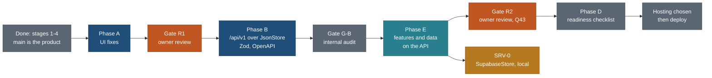

# The plan: one page for the travel product

**We are building Next.js API-over-JSON routes, with the UI fixes first, so the move to Supabase will be fast.** (Owner, 21 Oct 2026)

UI fixes (phase A, review R1) -> Next.js `/api/v1` route handlers over `CatalogueStore` + `JsonStore`, with Zod contracts and OpenAPI (phase B) -> features on the API (phase E) -> Supabase later, as a store swap (SRV-0, local only).

Written 21 Oct 2026 by travel-planner (Opus). This is the single entry point: read it first, then follow the links. It brings together about 25 planning files and drops none of their decisions. The files it replaces in part are listed in section 7, and each carries a banner that points here.

**Authority.** This page decides the requirements, the order, the status, the rules and the open decisions. [EXECUTION-PLAN.md](build/public-site/EXECUTION-PLAN.md) decides task-level detail: owned files, efforts, acceptance checks, the API contract, the gate checklists and the owner scripts. [COVERAGE.md](build/public-site/COVERAGE.md) maps every pending item, and [BACKLOG.md](build/public-site/BACKLOG.md) holds the status of each row. When two documents disagree, this page and EXECUTION-PLAN win over everything older. Fix the losing document the same day.



## 1. Product goal and the rules that do not bend

**Goal.** A public, read-only travel site with no login. Visitors search trips and places of every kind, come in through a full-screen globe, open full detail pages and copy or export them. About 90% of visitors read and copy, and about 10% plan (P7). The signed-in planner is the second product and comes after this one. Year one has fewer than 100 users, so choose free tiers and only note the step to 1,000 users ([product-direction-2026-10-18.md](design/product-direction-2026-10-18.md)).

| Area | Rule | Source |
|---|---|---|
| Colour | No green anywhere, status colours included. Trailhead direction: stone paper, slate ink, a navy header with an amber rule. Colour lives only in generated tokens (`web/app/themes.css`) | owner 18 Oct; Q47 19 Oct; design C 271e014 |
| Privacy | No household data on the public site: no party, no traveller ages, no home town, no dates, no personal status, no stay ideas, no booking state. Public text says who a plan suits, never who travelled. Whitby may appear only in towns-layer rows and near chips (Q50), and a test pins that | STATUS decisions; Q50 |
| Privacy | The household home point lives in one module (`core/src/privacy/home.ts` after CONS-2). It is a listed exception while the repo is private and must move to a secret before any visibility change | EXECUTION-PLAN 5.3 |
| Trips | Public trips are dateless templates: Day 1 to N, a length and a season window. Every trip is public for now (owner, 19 Oct), and the fail-closed visibility code stays | TODO Done 20 Oct; 19 Oct |
| Honesty | A gap is never a yes. An empty place section stays visible as "Not checked yet" | owner 18-19 Oct |
| P8 | Protect the catalogue: no bulk files, light list rows on an allowlist, exports per item, page-size caps and no unscoped near query, all enforced inside the store methods. Exports stay per item and public until sign-in exists (Q46) | principles.md P8 |
| P9 | One data boundary: components read only through `web/lib/client/data.ts` (`DataClient`), and no new client-side bulk loads. Every task names its boundary function, its API contract and what stays the same at the switch | principles.md P9; D6 |
| Server-ready | All 10 server-switch rules in EXECUTION-PLAN 4.3 apply: shared Zod contracts, identical URL keys, pure logic in `core/`, stable ids, versions and provenance carried through | D6, D8 |
| UX | Read P1-P9 and T1-T5 in [principles.md](design/foundation/principles.md) before any design, build or review, and cite them by number. Overlays are non-modal and motion is smooth | owner 18 Oct |
| Maps | MapLibre on the globe. Google Maps JS on place pages and the trip route map (Q51). Never two map families on one page. Directions use Maps URLs; legs come from ORS. Coordinates never come from Google | map-stack 18 Oct; Q51 |
| Sources | AllTrails, Google, Tripadvisor and Komoot are links only, never data. OSM, Overpass, Wikidata and Commons calls run one at a time, one runner per service under `flock /tmp/travel-<service>.lock`, with the no-email user agent `travel-relevance-signals/1.0 (+https://nks-travel.pages.dev/about/)`. Never search Commons from parallel agents | CLAUDE.md; 12 Oct 429 |
| Taxonomy | Complete and extensible: a new type is one entry in `data/vocab/types.json`, and a new property is a registry change. One capture contract tells every researcher what to collect | owner 18 Oct |
| Models | Opus plans, researches, reviews design and audits code (`travel-planner`, `travel-researcher`, `travel-design-reviewer`). Sonnet builds and verifies (`travel-builder`, `travel-verifier`). **Never Fable.** Every UI round ends with the design reviewer, then the verifier | owner 18 Oct |
| Process | Every finding goes into BACKLOG first, with an ID, and is marked done with its commit. Every owner request becomes an Open row in [TODO.md](TODO.md) the same day. Parallel lanes own disjoint files. Builders run only their own specs; the coordinator runs the full e2e on a quiet machine | owner 18 Oct |
| Safety | Confirm every deletion with the owner. Kill servers by PID, never by name. Never print or commit secrets. Stage only owned paths with `git -C <abs> add <paths>`, never `-A`. Nothing about travel goes in the Obsidian notes vault | memory notes |
| Release | Nothing goes live without the owner's approval of a named commit (Q43, at R2 exit). Deployment is out of scope until the hosting is chosen (D7). Never run `./publish.sh` in a mode that deploys | D7; Q43 |

## 2. Every owner requirement

Status: **done** (shipped), **in force** (a standing rule), **next** (a task is defined and can start), **later** (a task exists for after R2 or the planner), **open** (waiting on the owner). "Delivered by" uses the EXECUTION-PLAN task IDs.

| # | Requirement | Source | Delivered by | Status |
|---|---|---|---|---|
| R-1 | The public read-only site comes first, with no login; the planner comes second | product direction 18 Oct | phases A, B, E, D | in force |
| R-2 | Keep what works on the live site: photo cards, filter pills, four views, table tools, honesty markers, the globe's relief, styles and drill-down | keep-from-live-site 18 Oct | built in L1-L5; checked at R1 and R2 | done, re-checked |
| R-3 | No green anywhere, status colours included; Trailhead design | 18 Oct; Q47 | SHL (done); green-pixel check on the trips map at R2 | in force |
| R-4 | Free tiers for under 100 users in year one | 18 Oct | every choice; hosting decision (13.2) | in force |
| R-5 | UI fixes first, with their own review gate | D10, 20 Oct | phase A (A1-A14), gate R1 | next |
| R-6 | Build API-over-JSON now: `/api/v1` handlers over `CatalogueStore` + `JsonStore`, Zod contracts, OpenAPI, the API adapter as default | D8, 20 Oct; headline 21 Oct | B1 (API-0), B2 (API-1), B3 (API-2) | next |
| R-7 | Supabase later as a store swap, not now; run the read-only schema diff first as a risk check | D9 | A10 (SRV-D), SRV-0 | next / later |
| R-8 | Deployment is out of scope until hosting is chosen; no static-export assumption | D7 | B1 removes `output: 'export'`; phase D; 13.2 | in force |
| R-9 | Every item is designed for the server switch | D6 | server-switch column in every task; contract kit (4.6) | in force |
| R-10 | Metadata for every place and activity is the foundation (placement block, a point with its role, the area chain, the nearest town) | D4; 8.3 | B6 (META-0), E1, E2, DATA D1-D6 | next |
| R-11 | Consistency and no hard-coded values | D5 | B4, B5 (CONS-1, CONS-2), E14 (CONS-3) | next |
| R-12 | Phase C as full gates with entry criteria, checklists, roles and owner scripts | D3 | R1 (EXECUTION-PLAN 8), G-B (9), R2 (11) | next |
| R-13 | Research unpaused for all phase E data work | D2; Q58 | DATA D1-D6 (E3-E7b) | next |
| R-14 | Go with all recommendations Q1-Q64 | 19-20 Oct, D1 | recorded in BACKLOG | done |
| R-15 | Home search panel is not clipped; header Search closes on a second tap | 9.1, 3.66a | A1 (FIXF) | next |
| R-16 | Hide Sign in until the planner exists | 11.1, Q64 | A2 (SHL2) | next |
| R-17 | Report a problem on every page goes to a public feedback repo, never to an email | 11.2, Q63, Q70 | A3 (SHL2); the repo must exist first | open (repo) |
| R-18 | Globe: Fly here works, rivers draw lines, a Natural features switch that defaults on | 9.7, 9.4, 9.8, Q52 | A4, A5, A6, A4b (GLB2a) | next |
| R-19 | Globe city outlines and a better home globe (background, water, labels) | 9.3, 9.2 | E12 (GLB2b); mock approved at R1 | later in E |
| R-20 | Where filter: country, then state or province, then city | 8.1, Q54, Q61, Q62 | A7 (N0) in phase A; E8 city level and Trips by province | next |
| R-21 | Nearby places; "near Whitby" includes Oshawa and Ajax; radius 10, 25, 50 or 100 km (cap 100); drive-time bands | 8.2, 8.4, Q50, Q55-Q57 | E2 towns, E9 Around here, E10 near mode, E13 ORS matrices | later in E |
| R-22 | Every record maps to country, state and city and carries a GPS point | 8.3 | B6, E1, E3 | next |
| R-23 | Trail pages show length, gain and the other facts, with "Not checked yet" for gaps | 10.1 | A8 (PLC2a); E5 fills them | next |
| R-24 | Proper trail data | 10.2 | E5 (DATA D3) | later in E |
| R-25 | An AllTrails link on every trail: direct where supplied, otherwise a labelled search link | 10.3, Q53 | A9 (PLC2a) | next |
| R-26 | One or two credited images per trail | 10.4 | E7 (DATA D5) | later in E |
| R-27 | Map points for every trail | 10.5 | E3 (DATA D1) | later in E |
| R-28 | Google Maps on the trip route map | 9.5, Q51 | E11 (TRP2) | later in E |
| R-29 | Export the whole trip (print/PDF, calendar, CSV, KML, GPX) | 9.6, Q46 | E11 (TRP2) | later in E |
| R-30 | Trip page polish and every visible defect from the coverage sweep (84 UI lines, 55 of them in phase A) | REVIEW4; COVERAGE | A2b, A4b, A7b, A8b, A13 (TRP1) | next |
| R-31 | Flaky tests fixed by waiting for settled values; the `/specimen/` axe failure | TODO 18 Oct; 3.63 | A14 (TST); `/specimen` removed in D item 5 | next |
| R-32 | Trip page as a chronological, categorised timeline with a party profile | TODO 18 Oct | L3c b02f4a4 | done (L3d is later, 3.1c) |
| R-33 | Full-screen globe as a major feature | TODO 18 Oct | L2, L2b, GLB, FIXD | done; R-18 and R-19 continue it |
| R-34 | "Who it suits" suitability for every place, and relevance ("worth the journey") | TODO 18 Oct | S0, S0b, R1-R6, S1, RV0, RVC | done |
| R-35 | A capture contract with a complete, extensible taxonomy | 18 Oct | CC eaa5684; META-0 extends it | done; extends in B |
| R-36 | Smart search with no model bill | 3.15, Q34-Q40 | SQ1 phase 1 done; phases 2 and 3 are L9 | done / open (L9) |
| R-37 | Short trips: day trips, overnights and weekends | TODO 18 Oct | 3.1c, 3.13, 3.14 in phase F; the hub matrix is in E13 | later |
| R-38 | Smart trip builder: choose a destination, see what is nearby, pick by distance | 8.5, 8.6, Q59, Q60 | phase F (planner); flags and `/plan/` reserved | later |
| R-39 | Owner reviews only at the gates: R1 and R2, not before | 19 Oct; D10 | R1, R2 | in force |
| R-40 | Approval of a named commit before anything goes live | Q43 | R2 exit | in force |
| R-41 | Legacy pages retired behind redirects: 302 for a week, then 301 | Q25, Q45 | D item 3 (redirect map as data) | later in D |
| R-42 | Google key restricted, daily quota, Map ID with POIs off, the unused Map ID variable removed | 7.2, 7.3, Q48 | D item 7 | later in D |
| R-43 | A custom domain bought through Cloudflare Registrar, name to come | Q44, Q71 | deferred with hosting (13.2) | open (hosting) |
| R-44 | Remove merged worktrees and stale tunnels as one listed batch | Q49 | readiness cleanup (MASTER-PLAN 7, step 39), with confirmation; remote branches done 21 Oct | partly done |
| R-45 | Close PR #7 and delete the old remote branches | L7 | done 21 Oct: PR #7 closed; branches archived as `archive/*` tags | done |
| R-46 | One combined plan with all the latest requirements | owner 21 Oct | this page | done |
| R-47 | A person confirms held trail data (Braies P1, Monte Piana, Fanes, Seceda, Nuvolau, Lago d'Antorno) | TODO 18 Oct; L4 | optional at R2 | open (owner) |
| R-48 | Enforce completeness per kind (validator, badge, skill, MCP) | TODO 18 Oct; L3 | META-0 validator and tiers; badge and skill later | next / later |
| R-49 | Fill the empty place sections (parking, fees, swimming, best time of day) with provenance | L8 | DATA D1-D6 for E's needs; the rest in phase F | later |
| R-50 | Planner items: school year calendar (F03), person-level items, bookings wallet on stored bookings, Explore map labels, redesign applied to the prototype | TODO 18 Oct; L1, L2, L6 | [SERVER-SIDE-LAUNDRY-LIST.md](build/SERVER-SIDE-LAUNDRY-LIST.md) | later (planner) |
| R-51 | Server-side decisions: where the backend lives, sign-in method, who may sign in, guest planning, household privacy under RLS | Q65-Q69 | laundry list section 1; SRV-0 runs locally without them | open (server work) |
| R-52 | Map stack set up by the owner: Google Cloud project, a restricted key with a cap, an ORS key, an R2 bucket | TODO 18 Oct | keys exist on the first machine; restrictions in D item 7; R2 bucket is L5 (planner) | partly done |
| R-53 | Repo cleanup: no duplicate folders or files; v1 docs archived; `prototype/` retired; one globe writer; a folder-contract guard in check-all | owner 21 Oct; cleanup D1-D10 | CLN-1 to CLN-6 ([CLEANUP-PLAN.md](CLEANUP-PLAN.md)) | next (CLN-1 now) |
| R-54 | One research home: the root `research/` holds the method, the per-type checklists, output formats and templates, the inbox, what each trip is planning, run notes, audits and reports. Skills and the researcher agent stay in `.claude/` as thin wrappers pointing to `research/README.md` | owner 21 Oct (cleanup D7 replaced by D11) | CLN-1 (moves, map, thin skills), CLN-R (generator and tests write `research/`), CLN-5 (guard rules) | next (CLN-1 now; CLN-R after TRP1 merges) |
| R-55 | SRV-D schema decisions: two tiers (lossless source docs keyed by `ref`, plus a serving tier written by the same core code as `JsonStore`); `entity.id` is the `ref` verbatim; `locations.json` collections and Instagram saves stay private; town ids are `<cc>-<admin1>-<slug>` (`ca-on-whitby`) | owner 21 Oct (SRV-D 13.1-13.4) | API-1 contract changes (SRV-D 13.1), META-0 (town id in nearby spec 3.1), SRV-0 migrations M1-M15 | decided; feeds B and S |

## 3. Phases, gates and status (21 Oct 2026)

| Step | What | Gate | Status | Detail |
|---|---|---|---|---|
| Stages 1-4 | Foundation, data adapter, maps, home, globe, trips, places, export, timeline, suitability, relevance, capture contract, smart search parser, stage 4 polish, REVIEW4 and its fixes | design review, verifier, quiet e2e (699 passed, 2 fixed) | **done** | STATUS "Merged so far"; BACKLOG stages 0-4 |
| main is the product | v2 fast-forwarded to `main`; old site tagged `legacy-final` (74b97ad); live site unchanged | owner, 20 Oct | **done** | HANDOVER 1 |
| Plan | Execution plan rewritten after D1-D10; COVERAGE (244 lines, 0 unmapped); this page | none | **done** | EXECUTION-PLAN 1, 21 |
| Branch cleanup | Remote branches deleted and archived as tags `archive/*`; PR #7 closed | owner, 21 Oct | **done** | HANDOVER 4 |
| **A** | UI fixes: A1-A14 plus SRV-D (A10); about 75 h | **R1** (owner) | **next: start now** | EXECUTION-PLAN 3, 8 |
| Cleanup, CLN-1 to CLN-6 and CLN-R | Repo cleanup and one research home (owner, 21 Oct). CLN-1 now, beside phase A: `docs/v2/research/`, `docs/research/` and the sun audit move into the root `research/` (`method/`, `runs/`, `reports/`, `audits/`); `research/README.md`, `tools.md`, `formats/`, the trip index; thin skills and agents; v1 docs archived; removals D2-D4. It touches no file a running lane owns or has changed (measured in the 7 worktrees). CLN-1a Haiku scan, 1b Sonnet scripted moves, 1c Opus authoring, 1d Sonnet verify. CLN-R after TRP1 merges and before B6 META-0: the capture generator writes `research/types/`, the backlog and tag report move, template tests (Sonnet). CLN-2 at R1 entry; CLN-3, CLN-4, CLN-5 in the phase B gap; CLN-6 with backlog 7.11. About 27 h | cleanup D1-D19 (D17 and D18 open); G-B audits CLN-5 | **next: CLN-1 can start now** | [CLEANUP-PLAN.md](CLEANUP-PLAN.md) |
| **B** | API-0, API-1, API-2, CONS-1, CONS-2, META-0; about 78 h; starts at R1 entry on the frozen preview (Q72) | **G-B** (internal) | waiting on R1 entry | EXECUTION-PLAN 4, 9 |
| **E** | META-1, META-2, DATA D1-D6, LST2b, LST2c, PLC2b, TRP2, GLB2b, MX, CONS-3; about 161 h | **R2** (owner, Q43) | waiting on G-B (D3, D4 and D6 data may start once META-0 merges) | EXECUTION-PLAN 10, 11 |
| **D** | Readiness checklist, hosting-agnostic | none | waiting on R2 | EXECUTION-PLAN 13 |
| **S** | SRV-0: `SupabaseStore` locally, contract kit green, flags off; off the R2 critical path | contract kit | waiting on E features | EXECUTION-PLAN 4.8 |
| Hosting | Choose a host that runs Next.js route handlers, then deploy, domain, edge rules | owner | not scheduled | EXECUTION-PLAN 13.2 |

Calendar (EXECUTION-PLAN 17): about 23 working days to readiness, about 396 h. Day 1 is the day the phase A lanes start. The 20 Oct estimate of "readiness about 20 Nov" assumed 21 Oct as day 1. This machine still needs its env file and a green check-all first (section 4, task 1), so count from the real start day.

## 4. The first 10 tasks to start now

Every lane works from its brief in [briefs/](build/public-site/briefs/). Tasks 2 to 9 run in parallel on disjoint files. Merge order: TST, FIXF, SHL2, GLB2a, TRP1, LST2a, PLC2a.

| # | Task | Owner (agent) | Model | Files it owns | Acceptance |
|---|---|---|---|---|---|
| 1 | Baseline on this machine: `bash tools/check-all.sh` with no `web/.env.local` present; confirm Playwright WebGL runs on a real GPU on macOS and not on SwiftShader; record the result in STATUS | coordinator, `travel-verifier` | Sonnet | none (STATUS line only) | `CHECK-ALL OK`; WebGL renderer string recorded; no SwiftShader |
| 2 | A14 TST: settled-value waits in the six racy specs | `travel-builder` | Sonnet | `who-it-suits.spec.ts`, `home.spec.ts`, `url-state.spec.ts`, `smart-search.spec.ts`, `trip-day-spy*.spec.ts`, `places-parity.spec.ts` | each passes 3 of 3 under a four-lane load; no assertion loosened |
| 3 | A1 FIXF: search panel clamped to the viewport; header Search toggles | `travel-builder` | Sonnet | `web/components/search/GlobalSearch.tsx`, `web/styles/search.css`, `web/components/home/CoverSearch.tsx`, new `search-panel.spec.ts` | panel rect inside the viewport at 390, 1000, 1100, 1440 and 1920 from both buttons; a second tap closes it |
| 4 | A2, A3, A2b SHL2: Sign in behind the `signIn` flag; Report a problem link (merged with the link off until the repo exists); gallery tile names on WebKit | `travel-builder` | Sonnet | `web/components/shell/**`, `web/app/sign-in/page.tsx`, `web/lib/capabilities.ts`, `SiteFooter.tsx`, `web/lib/config/product.ts`, `reportProblem()` in `data.ts`, `web/components/ui/Gallery.tsx` | no Sign in at 1440 and 390; the link carries `?page=<path>`; privacy test finds no email; axe passes on WebKit |
| 5 | A4, A5, A6, A4b GLB2a: one fit model, Fly here, river lines, the `nf` switch, globe and home polish | `travel-builder`; `travel-design-reviewer` after | Sonnet; Opus review | `web/components/globe/**`, `web/lib/globe/**`, `web/app/globe*/**`, `tools/globe_data.py`, `web/public/globe/**`, `CoverGlobe.tsx` (phase A only) | camera ends inside the box for a river, plain, delta, lake and range; Ganges, Danube and Nile draw lines; `nf=0` survives the link |
| 6 | A13 TRP1: trip page polish | `travel-builder`; design review after | Sonnet; Opus review | `web/app/trips/[slug]/**`, `web/components/trips/**` except the TRP2 exclusions, `timeline.ts`, `prose.ts`, `data/schedules/**`, `web/styles/timeline.css` | each item fixed at 1440, 1024 and 390 in light and dark; Rockies stop count pinned at 206 |
| 7 | A7, A7b LST2a: Where pill (country, province, parks and areas) and list polish | `travel-builder`; design review after | Sonnet; Opus review | `WhereMenu.tsx` (new), `FilterBar.tsx` pill slot, `descriptors/place.tsx`, `web/styles/filters.css`, list specs | nearby spec N0 checks 1-9; each polish item shown fixed or already fixed |
| 8 | A8, A9, A8b PLC2a: trail facts strip, AllTrails on all 122 trails, place page polish | `travel-builder`; design review after | Sonnet; Opus review | `web/components/places/**` except the rows, map, footer and cluster files; `sections.ts`, `contract.ts`; `web/lib/map/links.ts` | Fenland Loop shows every slot; 122 of 122 trails have the link |
| 9 | A10 SRV-D: read-only diff of `schema.sql` against the capture contract | `travel-planner` | Opus | `docs/v2/research/schema-diff-2026-10.md` (new) | every layer, property group, sidecar and locations table is mapped or listed as a gap with a proposal |
| 10 | A11 and R1 entry: merge in order, quiet full e2e, screenshot sweep at 1440, 390 and 844 x 390 in light and dark, output audit, preview 1, the owner hand-over | coordinator, `travel-verifier`, Opus auditor | Sonnet; Opus | `docs/v2/build/public-site/verify-R1.md` | EXECUTION-PLAN 8.1 criteria 1-9 met |

Each builder verifies with `tsc`, the unit tests for its area, and Playwright screenshots at 1440 and 390 in light and dark, read in tiles. Each one commits only its owned paths with the Co-Authored-By trailer.

### 4.1 How every lane runs

| Step | Rule |
|---|---|
| Start | Read this page, the lane's brief and the principles it cites. Create a worktree from `main`: `git -C <repo> worktree add <repo parent>/travel-wt/v2-<lane> -b public/<lane> main`. Use the dev port the brief gives |
| Check first | For "check first" items, take a screenshot before changing anything. An item that is already fixed closes with that screenshot |
| Build | Touch only owned files. If a change is needed in another lane's file, write the request in the hand-back |
| Verify | `pnpm --dir web typecheck`, lint, the lane's unit tests and its own e2e specs, never the full suite. Screenshots at 1440 x 900 and 390 x 844, light and dark, set through the site's theme control; read tall pages in tiles. WebGL checks run on a real GPU |
| Review | UI lanes: `travel-design-reviewer` (Opus), then `travel-verifier` (Sonnet) |
| Commit | `git -C <worktree> add <owned paths>`, never `-A`; messages `web(public/<lane>): ...`; end with the Co-Authored-By trailer; rebase onto `main`; do not push. The coordinator merges with a merge commit and pushes after each verified merge |
| Record | The coordinator marks the BACKLOG row done with the commit, moves the TODO row, and updates the spec page if the build differs from it |

### 4.2 The API at a glance (phase B)

```
component -> DataClient (web/lib/client/data.ts)
               ApiAdapter (default) -> /api/v1/* route handler -> respond() -> CatalogueStore
               StaticAdapter (fallback, prerendered JSON)
CatalogueStore: JsonStore now | StubStore in tests | SupabaseStore in SRV-0
contracts: Zod in core/src/schema/api/ -> OpenAPI 3.1 at /api/v1/openapi.json
```

Phase A components keep calling today's `data.ts` exports with the same names and signatures. API-1 puts the adapter behind those exports, so phase A work is not redone. The store interface, endpoints, error codes, caps and the contract kit are in EXECUTION-PLAN 4.2 to 4.6. The JSON-to-Supabase switch order is in 14.2.

## 5. Open owner decisions (only the open ones)

| ID | Decision | Recommendation | Trade-off |
|---|---|---|---|
| Q70 follow-up | May the coordinator create the public repo `nitin27may/travel-feedback` now with `gh` (issues only, one issue form with the page path prefilled)? | Yes, before A3 turns its link on | A public repo under your name; reporters need a GitHub account until a server form exists |
| ENV | Supply `web/.env.local` on this machine (`NEXT_PUBLIC_GOOGLE_MAPS_KEY`, `NEXT_PUBLIC_GOOGLE_MAP_ID`, `NEXT_PUBLIC_PLACE_MAP_FAMILY`, `ORS_API_KEY`): copy it from the first machine, or issue new keys | Copy it from the first machine (mode 600, never through chat) and restrict the key to localhost meanwhile | Without it, place and trip maps fall back to MapLibre and the MX matrices cannot run; phase A can start, but preview 1 needs the maps key |
| L9 | Free AI features (embedding search, CLIP photo picks, similar places): go now? | Not now; keep them in phase F and revisit near 1,000 places with summaries | the spike measured no gain at today's size |
| Q65-Q69 | Backend location, sign-in method, who may sign in, guest planning, household RLS | Answer when the server work starts; SRV-0 does not need them | none until then |
| Hosting | Which host (it must run Next.js route handlers); then Q71's domain name | Decide after R2 | Lighthouse numbers stay tunnel numbers until then |
| R1 items | Approve the home globe mock; the Mount Robson time-zone marker; the default list order | Answered at R1 | none |
| Cleanup D17 | Move the CLAUDE.md "Current trips" and "Queued" summaries (about 90 lines) into `research/trips/README.md`, leaving one pointer | Yes | A new session must open one file to see every trip; CLAUDE.md shrinks by about a third |
| Cleanup D18 | Move the trip-planner skill's HTML house format to `legacy/_system/TRIP-PAGE.md`, used only to revise an existing legacy page; new trips get research and data, not a new legacy page | Yes | No new hand-built trip page until the planner or a v2 trip import exists |

Decided and no longer open: Q1-Q64, Q70-Q72, D1-D10 (EXECUTION-PLAN), L7 (21 Oct), and these, decided by the owner on 21 Oct:

| Decision | What was decided | Recorded in |
|---|---|---|
| SRV-D 13.1 | Two tiers for SRV-0: a lossless source tier (`dataset_file`, `record_doc` keyed by `ref`, `source_local`, `capture_supersede`) and a serving tier (entity, offer, relation, link, media, area, town, `place_row`, `place_page`) written by the loader running the same core code as `JsonStore` | [schema-diff-2026-10.md](research/schema-diff-2026-10.md) 14 (moves to `research/reports/` in CLN-1) |
| SRV-D 13.2 | `entity.id` is the `ref` verbatim; no ULID surrogate for catalogue rows (ULIDs stay for planner rows a client creates). API-1 adds `ref` to every row and detail | same |
| SRV-D 13.3 | `locations.json` collections (5) and Instagram saves (24) are private household data: RLS on, no policy, not loaded (M14) | same |
| SRV-D 13.4 | Town ids are `<cc>-<admin1>-<slug>` (`ca-on-whitby`). META-0 changes nearby spec 3.1 to match | same; [features/nearby-and-regions.md](features/nearby-and-regions.md) 3.1 (META-0) |
| Cleanup D1-D6, D8-D10 | As recommended: retire `prototype/` after a tag (phase B), remove `.claude/plans/`, `research/places/PRIORITIES.md` and the 75 uncited screenshots after a tag, new folder contract, agent fixes, a check-all folder guard, legacy `PLAN.md` files move at 7.11, no history rewrite | [CLEANUP-PLAN.md](CLEANUP-PLAN.md) 6 |
| Cleanup D7 to D11 | Not option B. One research home at the root `research/`; skills and agents stay in `.claude/` as thin wrappers (D15); scripts stay with their packages and are indexed in `research/tools.md` (D14) | [CLEANUP-PLAN.md](CLEANUP-PLAN.md) 2, 6 |

## 6. Superseded statements

| Statement | Where it was | Now |
|---|---|---|
| The site is a static export for Cloudflare Pages; "Pages caps files at 25 MiB"; `_redirects`/`_headers` as design constraints | build README 1, 5, 8; STAGE4-plan 5-6; GLB2 check 6; BACKLOG Q38 | A server build with route handlers (B1); hosting is chosen later (D7) |
| One owner review at stage 6, then stage 7 go-live on Pages | STAGE4-plan 5-6; REPORT-2026-10-20 5, 6, 9; STATUS "Running now" | R1 after A, R2 after E, phase D readiness, no deploy scheduled |
| E ships after go-live; N1-N3 "week 1 after go-live" | MASTER-PLAN (old), nearby spec 7, OWNER-ROUND1 3 | E before R2 |
| Integration branch `claude/serene-goldberg-wtn3di`, worktree `travel-wt/v2` | STATUS, build README 4.2 and 5, memory notes, CLAUDE.md | Deleted 21 Oct and archived as the tag `archive/claude-serene-goldberg-wtn3di`; all work branches from `main` |
| Fable reviews the design | build README 4 and 6, memory `travel-v2-ui-review-loop`, product direction | Never Fable; `travel-design-reviewer` runs on Opus |
| LST2a and PLC2a in phase B | LST2 and PLC2 brief titles | Phase A (A7, A7b, A8, A8b, A9); briefs corrected 21 Oct |
| Go-live about 16 Nov, then readiness about 20 Nov | REPORT banner, the first EXECUTION-PLAN | No date until hosting is chosen; readiness is about 23 working days from the phase A start |

## 7. Where detail lives

| Document | Still the authority for | State |
|---|---|---|
| [build/public-site/EXECUTION-PLAN.md](build/public-site/EXECUTION-PLAN.md) | Task tables A, B, E; the API shape (4.1-4.8); CONS (5); META tiers and acceptance numbers (6); stage 5 checks (7); gate checklists and owner scripts (8, 9, 11); phase D checklist (13); data order and the switch-over runbook (14); parallelism (15); risks (16); calendar (17) | current |
| [build/public-site/COVERAGE.md](build/public-site/COVERAGE.md) | Every pending item (244 lines) mapped to a task and phase | current; L7 closed 21 Oct |
| [build/public-site/BACKLOG.md](build/public-site/BACKLOG.md) | Row status and commit for every finding; the owner questions Q1-Q72 with decisions | current |
| [build/public-site/briefs/](build/public-site/briefs/) | One self-contained brief per lane: TST, FIXF, SHL2, GLB2, TRP1, LST2, PLC2, SRV, API, CONS, META, DATA, TRP2, MX, GO-LIVE (readiness). SHL, PLC, TRP, GLB, LST and CS7d are stage 4 records | current (worktree paths are from the first machine; see section 8) |
| [build/public-site/STATUS.md](build/public-site/STATUS.md) | The merged-lane record, decisions in force, key specs | partly stale: "Where things are", "Running now" and "Services" are history |
| [build/public-site/MASTER-PLAN.md](build/public-site/MASTER-PLAN.md) | The item list by phase with backlog rows; owner decisions table (section 8) | superseded as the entry point by this page |
| [build/public-site/STAGE4-plan.md](build/public-site/STAGE4-plan.md) | Record of stage 4 lanes, REVIEW4, conflicts C1-C11; the stage 5 pass rules (section 4) still define each check | sections 4-6 superseded |
| [build/public-site/OWNER-ROUND1-plan.md](build/public-site/OWNER-ROUND1-plan.md) | The causes and acceptance checks of the owner's 17 reported items | sections 3 and 4 superseded |
| [build/public-site/REPORT-2026-10-20.md](build/public-site/REPORT-2026-10-20.md) | The design and stage state on 20 Oct, morning | sections 5, 6, 7 and 9 superseded |
| [build/public-site/README.md](build/public-site/README.md) | Wave 1 and 2 build decisions: why `web/`, data adapter, kind to category, photos, maps by surface; gotchas (GPU, WebKit deps, basemaps in e2e) | sections 1 (static export), 4.2, 5, 6 and 7 superseded |
| [features/nearby-and-regions.md](features/nearby-and-regions.md) | Where filter, Nearby, near mode, towns layer, the data rule, the smart trip builder; wireframes and empty states | current except 5.7 mechanics (the fallback adapter) and 7 timing |
| [build/SERVER-SIDE-LAUNDRY-LIST.md](build/SERVER-SIDE-LAUNDRY-LIST.md) | Everything that needs login or a backend; Q65-Q69 | current |
| [design/foundation/principles.md](design/foundation/principles.md) | P1-P9, T1-T5 | current |
| [design/product-direction-2026-10-18.md](design/product-direction-2026-10-18.md), [design/keep-from-live-site.md](design/keep-from-live-site.md), [design/trip-scope-scenarios.md](design/trip-scope-scenarios.md) | Product order, what to keep, scenario rules | current ("Fable-reviewed" there means the 18 Oct foundation; reviews are Opus now) |
| [research/capture-contract.md](research/capture-contract.md) | The one data contract | current; moves to `/research/method/capture-contract.md` in CLN-1 (the rewriter updates this link) |
| [CLEANUP-PLAN.md](CLEANUP-PLAN.md) | The repo layout, the one research home, phases CLN-1 to CLN-6 and CLN-R, the folder contract, cleanup decisions D1-D19 | current (revision 2, 21 Oct) |
| `/research/README.md` (written in CLN-1) | The map of the research system: jobs, per-type checklists, formats, validators, gaps, merge, the rules that do not bend | after CLN-1 |
| [TODO.md](TODO.md) | Owner requests, Open and Done | current |
| [/HANDOVER.md](../../HANDOVER.md) | New-machine setup, commands, what is not in git | current |
| [build/handover/memory/](build/handover/memory/) | Owner decisions and working rules, with reasons | history; this page wins where they differ |
| [README.md](README.md) and 01-11 | The planner product and platform draft | working draft; not the public site's plan |

## 8. Risks and gotchas

| Risk or gotcha | Effect | What to do |
|---|---|---|
| This machine is macOS (`/Users/nks/workspace/travel`); the first machine was Linux (`/home/nitin27may/workspace`, Arc GPU) | Brief worktree paths, `ss -ltnp` and the Arc GPU flags do not apply as written | Use `<repo parent>/travel-wt/v2-<lane>`; find a port's PID with `lsof -iTCP:<port> -sTCP:LISTEN`; check the WebGL renderer string before judging motion |
| `web/.env.local` is missing here | No Google maps, no ORS runs, preview 1 incomplete | Owner decision ENV; check-all runs without it anyway |
| The feedback repo does not exist yet | A3 cannot turn its link on | Merge A3 with the link behind config, off, until the repo exists |
| Dropping `output: 'export'` breaks the harness (11 tests read `web/out`; e2e stages `.site/`) | Red check-all for days | B1 is its own lane and merges only with check-all and the quiet e2e green |
| e2e flakes under load | Wasted rounds | TST first; builders run only their own specs; the full suite runs on a quiet machine |
| Commons 429 on one shared IP | DATA D5 stalls | One runner under the lock; never parallel |
| Privacy in API output | Household strings in JSON the HTML never showed | Scrub and allowlist in `respond()`; audit 5.2 covers the API |
| Google key opened for testing | Abuse | Restrict to localhost and the preview host now; readiness item 7 |
| Schema drift between the JSON and `schema.sql` | SRV-0 finds reshaping late | SRV-D on day 1 feeds the API-1 contracts |
| Old docs still say static export, stage 6, Fable or the old branch | Agents follow stale orders | Banners point here; this page and EXECUTION-PLAN win |
| `nks-travel.pages.dev` still serves the old site, and old deployments' paths persist | Confusion when hosting changes | Decide its fate in 13.2 |
| Phase A grew from 42 h to 75 h | R1 about a day later | Parallel lanes; "check first" items close with a screenshot, not a rebuild |

More risks: EXECUTION-PLAN 16.

## 9. Change log

| Date | Change |
|---|---|
| 2026-10-21 (evening) | Owner decisions recorded: SRV-D 13.1-13.4 (R-55) and cleanup D1-D10 with D7 replaced by one research home (R-53, R-54); the Cleanup row in section 3 rescheduled (CLN-1 now, CLN-R after TRP1); cleanup D17 and D18 added as open owner decisions |
| 2026-10-21 | First version: one entry point combining EXECUTION-PLAN, COVERAGE, STATUS, MASTER-PLAN, BACKLOG, STAGE4-plan, OWNER-ROUND1-plan, REPORT-2026-10-20, the build README, the nearby spec, the laundry list and the owner memory; owner headline; R-1 to R-52; banners on the partly superseded files; L7 closed |
