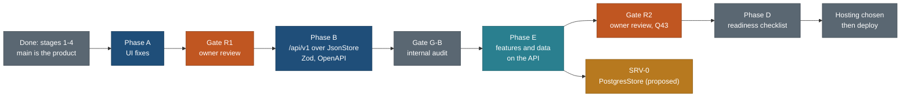

# The plan: one page for the travel product

**Last verified 25 Oct 2026 against main 4230210** by the master-plan audit ([MASTER-PLAN-AUDIT-2026-10-25.md](MASTER-PLAN-AUDIT-2026-10-25.md)). Where an older line below disagrees with the platform paragraph or a status cell updated in that audit, the audit's version is current.

**Newest (27 Oct, Step 2: create and edit):** R-285. The integrated plan for Step 2 is [design/step2/](design/step2/README.md): one trip details page for every trip (`/trips/<slug>/` public, `/t/<id>/` yours, the same components), edit mode as a mode of that page for copies and builder plans alike (delete any stop, add, move, days, notes, undo, warnings, sync), the builder handing its first build to that page, a consistency matrix and one vocabulary across builder, details page, Mine, place and park pages; 23 packages STEP2-* (about 35 agent-sessions) in BACKLOG 15.358 to 15.382; owner questions OQ1 to OQ7. Supersedes EM-3, EM-4, ED, CUS-1, CUS-2, REQ-E UI, EM-5 and the FLOW plan screen.

**Newest (27 Oct, owner feedback on the live site):** R-271 to R-277 (HIGH, build not spec only): sign-in and sign-up redesign, one site name in the sign-in email, the Account page, Favourites thumbnails, editable and synced My trips, and Google ON in production. Branches GSI-UX, GSI-SEC, GSI-WAYS, ACCT-P, MINE-T and TRIP-EDIT-I are in progress.

**Newest (26 Oct, evening, alignment):** R-254 to R-257 and R-270. The plans disagreed: bundle C was quoted at 180.5 h while four specs had each added to it (real size 301.5 h), the program is 1,350.5 h (not 986 h), eighteen new contract tasks had no slot in the one-author order, and most of bundle A had merged while the plans still said "ready". [build/MASTER-ORDER.md](build/MASTER-ORDER.md) is again the one ordering (section 0 bundles, 3.9 the new task rows, 4.3 the contract order, 5.4 the critical path, B1 about 511 h left). New: R-254 (entity graph), R-255 (property matrix and the API-derived MCP), R-256 (this alignment), R-257 (the public trip pages say "Finished plan" from the household's real trip date; fix PRIV-TD in bundle A before its deploy), R-270 (the MCP as a product, bundle H2 if QX2). The consolidated owner questions, ordered by what they block, with the two research-through-MCP tensions first, are [build/alignment-2026-10-26.md](build/alignment-2026-10-26.md) section 9.

**Also new (26 Oct, UX fixes from the owner's live review):** R-260 to R-266; the owner approved the design on 26 Oct (gate G-UXA passed, Q293 to Q307 answered); UXB-N, UXB-C, UXB-W merged, UXB-1 built and reviewed, the rest queued first in bundle C. The trip page gets five tabs (Summary, Days, Stops, Bookings, Photos) with the Summary first (provinces, parks, bases, trail and booking counts, highlights, when to go, the trip's shape); "The trip at a glance" is replaced by the trip's shape; "Plan it for" collapses to one line with an Edit pencil and an age for each child, kept on the device; the best-time section leads with the best time and links out to national weather services; a Table view per day; place pages draw only what is known, with one "Not checked yet" block (13,561 gap phrases on 431 pages measured). All in bundle C, about 67 h; Q293 to Q302. Spec [features/trip-and-places-ux-fixes.md](features/trip-and-places-ux-fixes.md); wireframes [design/trip-page/ux-feedback-wireframes-2026-10-26.md](design/trip-page/ux-feedback-wireframes-2026-10-26.md).

**Also new (26 Oct, MCP rule):** R-252, planned only. MCP tools sit on the same typed store, contracts, operations and route-handler functions as `/api/v1`, never directly on the database: no MCP code imports a database client or runs SQL (a grep test in MCP-C and MCP-1); `respond()` applies to every MCP response; private-MCP writes go through the app's operations so validation and RLS apply identically; the grant, token and quota checks move to the shared server layer. The Postgres cutover is then invisible to MCP ([mcp/README.md](mcp/README.md) 1.1).

**Also new (26 Oct, one data plan):** R-251. [build/DATA-PLAN.md](build/DATA-PLAN.md) is the single plan for all data enhancement and the successor of DATA-ROADMAP for pending work: the state from the 26 Oct coverage report (114 of 498 records at the required tier, 3,731 keys missing, all in the 8 trips with days); every pending research and data task in one order with hours, blockers, owner decisions, bundle and seat (173 h, of which 59 h had no task: the track fetcher TRK-1 and its runs, the D10 splits for the 223 draft records outside other tasks, trail relevance, offers, store gaps, the overview trips' stops, the database cross-check); the load and verify pipeline; a database cross-check after the Neon load (seed and plan again, field-by-field read-back, counts with `seed_commit`, referential integrity, role grants, exposure parity, page parity, on the child and production read-only, with a drift report); the data policy on one page; a scoreboard re-measured at every bundle. Q290 asks a re-baseline rule for research-filled pages.

**Also new (26 Oct, release bundles, owner decision):** R-250. "Merge a few into one; the verification overhead per release is too high." The train is eleven bundles A to K; the v0.x numbers stay as feature labels so no reference breaks. A = v0.2 + v0.3 + v0.4 (the first deploy waits for Mine), B = v0.5 + v0.9 (with CAT-1), C = v0.6 to v0.8, D = v0.10 + v0.11, E = v0.12 to v0.14, F = v0.14.1 to v0.16, G = v0.17 + v0.18, H = v0.19 + v0.20, I = v0.21 (on the Q148 trigger), J = v0.22, K = v1.0 to v1.2. Features are independent and flagged; T1 per feature while built, T2 per stack, T3 once per bundle; a late feature ships dark and does not block; B and H keep their security reviews; rollback per bundle; tags `release/<letter>`; one CHANGELOG entry per bundle; a data readiness line per bundle with every pending research task counted in a bundle (986 h in all with I at 29 h, 173 h of it data). Ten dependency findings fixed (two-step deploys for B, H and K; OVR-Ca one B2 row earlier; data before PHO-R in C). One question, Q290 ([build/RELEASE-PLAN.md](build/RELEASE-PLAN.md) 0a).

**Also new (26 Oct, catalogue in Neon early, owner decision):** R-240. The research catalogue loads into the Neon child, then production, as an Internal milestone CAT-1 in v0.5 (fallback v0.6; no new release number): LOCAL-3, RIS-M (`research_meta`), RIS-L, RIS-T with a new exposure-parity case, LOCAL-5 and a read-only drift job CAT-V, in the data seat (about 30.5 h to the first load). The site keeps serving files; production is synced after every data release and checked weekly. Until the SRV-0 seams (v1.0 to v1.2, now 23 h), Postgres catalogue reads happen only inside requests that already hold a Postgres connection (intake duplicate check and "What we already have", the favourites write, private MCP, the owner's intake CLI) through CAT-Q's router with a file fallback; every anonymous read stays on files. Measured: the reference seed is 13,243 rows and 8.0 MB in Postgres; the whole catalogue about 25 to 30 MB, 7% of Neon Free's 1 GB. Q183 superseded; questions Q280 to Q286 answered 26 Oct, yes as recommended ([build/CATALOGUE-EARLY.md](build/CATALOGUE-EARLY.md)).

**Also new (25 Oct, test strategy):** R-210 to R-214. Agents ran the whole chain after every small change; measured, one check-all is 292.6 s wall, 17.6 CPU-minutes and 665,549 characters of output (92% non-failing `validate --all` warnings), and one web unit file takes 47.5 s because the vitest global setup always builds two fixture apps (0.9 s without it). Planned: tiers T0 (in-edit, seconds), T1 (builder hand-back, suites selected by a checked path-to-suite map with a full fallback on shared contracts), T2 (once per stack of up to four ready branches), T3 (release and nightly: check-all, full e2e, visual sweep, live smoke); `tools/gate.sh` with a 40-line summary and the log in a file; passes cached by tree hash; machine slots and a load guard; retry once and a flake ledger; the verifier's own subset; nightly T3 and an escape sample every fifth stack. Tasks TS-1 to TS-8, about 35 h ([build/TEST-STRATEGY.md](build/TEST-STRATEGY.md)); questions Q250 to Q258; planned only.

**Also new (25 Oct, trip origin and nearest airport):** R-200 to R-207. Where getting there starts when a visitor gives only the destination: one precedence ladder (the visitor's start on a copy or request, then this device's choice, then the account default later, then the trip's researched gateway or, for 0 to 3 nights, its public hub, then the nearest airport with scheduled flights, then none); the nearest airport from OurAirports (public domain, 4,008 scheduled airports with IATA codes), scored by distance plus a class penalty, with two alternates and a per-trip override; open jaw from the first and last night's bases; drive, fly, train or ferry by the road estimate; Day 1, the last day, flight estimate and cost lines switch with the start; no fares; server output never varies by origin and a visitor's town never leaves their device or RLS row. Phase 1 about 28 h, visible in v0.9 with R-59; Q240 to Q249 open ([spec](features/trip-origin-and-nearest-airport.md)).

**Also new (25 Oct, master order):** R-220. Every remaining task in one inventory, deduplicated against `main`, with the files, contracts, migrations and budgets each one touches, a conflict matrix, lanes for two builders, one verifier and one data seat, the joins, and a re-cut release train v0.2 to v0.21 then v1.x (corrections C0 to C14: D2b ships in v0.2; the trip-page go-live fixes and share images in v0.4; the owner's closure queue in v0.6 before R-59; photos in v0.7; request forms, Where to stay and trips from data get releases); the first five briefs; questions Q260 to Q268 ([build/MASTER-ORDER.md](build/MASTER-ORDER.md)); planned only. Production runs `47be5b58` on the rewritten public history (the private id 47be5b5); commit ids quoted below before 25 Oct evening are private-history ids until task H3 rewrites them.

**Also new (25 Oct, audits after release):** R-230 to R-237. After v0.14 is live (gate G-AUD), a field-usefulness audit runs first (every field of the registry, type marks, records, sidecars, the locations store, trip files, tables and forms: fill rate over applicable records, readers by page, check, API, MCP, search and filter, research cost, carrying cost, and a rubric verdict from `node core/bin/fields.ts`), its slimming ships as patch release v0.14.1, then a UI and UX audit of every public and signed-in screen runs once at the end (26 Oct owner decision: after v0.20, gate G-UI, as the new release v0.22 just before v1.0; it was v0.14.2) (six widths, light and dark, axe on Chromium and WebKit, keyboard, targets, copy, P1 to P9 and T1 to T5, live performance, persona walks, analytics) and its fixes ship as v0.22; a narrowed delta pass (AU-D, the MCP field list) runs before MCP; UI issues found during the build go into [build/UI-NOTES.md](build/UI-NOTES.md); a fields ledger and a reader-and-fill-plan rule for every new field start now. A preliminary measurement (not a decision): 43 registry properties have no home, 83 of the 139 applicable suitability paths and 16 of the 42 locations-store place columns hold no value, and "Not checked yet" appears 12,763 times on 355 built place pages ([build/AUDITS-AFTER-RELEASE.md](build/AUDITS-AFTER-RELEASE.md)); questions Q270 to Q279; planned only.

**Also new (25 Oct, request intake fields):** R-190 to R-196. Trip and place requests ask enough for research to start at once without a heavy form: one short required step (place: name and country; trip: countries and length), then optional "Add more detail" steps; states from Natural Earth admin-1 for every country and nearest towns from the gazetteer, shown exactly as it writes them (the towns layer, plus GeoNames towns of 5,000 or more where the layer has none); "Is it one of these?" from our catalogue while typing; social posts described by link and pasted caption, never fetched; kind chips mapped to `types.json` and `locations.py`; months and a year, never dates; coarse party chips; briefs that name the checklist type, trip types, lanes and the exact commands, with a detail score and "missing for research" for the owner. About 30.5 h net ([spec](features/request-intake-fields.md)); questions Q230 to Q239; planned only.

**Also new (25 Oct, release plan):** R-180. Production is live at https://travel-beta-tan.vercel.app, commit 47be5b5, migrations 0001 to 0011 (this supersedes "no production deployment" in the platform paragraph below and in the section 3 Hosting row). One ordered release train from v0.1 (today, tag `release/v0.1`) through v0.17 and the Postgres cutover (v1.0 to v1.2), each feature behind its capability flag and released on its own, with a gate, a live smoke list, rollback, a coordinator checklist, release notes in the root [CHANGELOG.md](../../CHANGELOG.md), and a GitHub Actions plan for a public repository (no deploys, no workflow uses a production secret, and the owner keeps the secrets stored under the compensating rules of RELEASE-PLAN 7.5; the public decision is PUBLIC-AUDIT's) ([build/RELEASE-PLAN.md](build/RELEASE-PLAN.md)); questions Q220 to Q229; planned only.

**Also new (25 Oct, requests and custom places):** R-170 to R-177. A traceability check of the owner's request items A to I against R-62 to R-67, R-70 to R-75, R-90 to R-96, R-150 to R-156 and R-160 to R-164: most exists; added are a fifth intake type "Suggest an improvement", trip requests that answer with what we already have, place suggestions tied to a trip and day, four more copy edits (reorder in a day, add and drop a day, notes, title), custom stops in the signed-in copy with a picker (our catalogue, our towns, then a map search through Google Places with openrouteservice then Photon as fallback per the owner's Q210; Nominatim research-only), opt-in suggestions from custom stops seeded by the Google `place_id` or OSM id, an upgrade offer in the copy, and one owner role for CLI, console and MCP. Day one about 13.5 h; about 64.5 h in all plus 6 h later ([spec](features/requests-and-custom-places.md)); questions Q210 to Q218 (Q210 answered 25 Oct); planned only.

**Also new (25 Oct, navigation and Mine):** R-160 to R-164. One personal hub `/mine/` ("Mine") with tabs My trips (copies and own plans) and Favourites and a one-line account card, so a visitor finds a copied trip or a favourite with no account, on phone and desktop; phone bar Trips · Places · Globe · Search · Mine (replaces the interim ACCT-PH "Sign in" item); no More sheet on the public site; Globe stays a main item; copies as a `copies/1` device envelope merged into the account at sign-in. Found: Copy to my trips writes a copy no page lists. Tasks NAV-F to NAV-3 ([spec](features/navigation-and-mine.md)); questions Q200 to Q207 (all answered 25 Oct, Q203 changed); planned only.

**Also new (25 Oct, MCP access levels):** R-150 to R-156. Each connected chat app gets one named access level (Public catalogue; My plans, read, the default; My plans, propose changes; My plans, change; Research, propose; Review and admin, owner only) plus three add-ons off by default, set on Account, Connected apps and access; write levels need a separate confirmation on our site; the level is checked on every call in the tool's transaction, so a change or revoke applies on the next call although Neon's tokens cannot be revoked; an allow list of client ids, a global pause and an env kill switch; the child's OAuth plugin stays on, production waits for MCP-S. New tasks MCP-G and MCP-U (MCP-P later); remaining MCP work about 51 h before production use ([spec](mcp/auth-and-sign-in.md) section 14); questions Q190 to Q198.

**Also new (25 Oct, local database and seed sync):** R-140 to R-146. Data migration is not blocked by Neon: the schema is applied and the catalogue tables are empty because the loader, `PostgresStore`, parity and cutover are unbuilt and scheduled after E (D9). The JSON in git is the seed of record; one deterministic, idempotent engine (`db:seed`, `db:sync --dry-run`, `db:verify`) serves local Docker, CI, the Neon child and production behind a target guard; Docker Postgres 18 with PostGIS 3.6 and Neon's roles for daily work; a `check-all` drift stage and the first CI workflow; private data never seeded; backups; migration numbers at merge. Tasks LOCAL-1 to LOCAL-5, LOCAL-C, BKP-1, MIG-N ([spec](features/local-database-and-seed-sync.md)); questions Q180 to Q187.

**Also new (25 Oct, research intake and storage):** R-130 to R-136, the keep-or-drop rule for research (store a value only when it changes a decision, a display, a filter, a check or money, or proves or dates a stored value), one `meta jsonb` RowMeta contract on every catalogue and research table that the app role cannot read, JSON normalised before the SRV-0 loader, prose never loaded, proposals and operator questions as data, homes for researched properties with none; tasks RIS-C to RIS-T ([spec](features/catalogue-intake-and-storage.md)); questions Q170 to Q177.

**Also new (25 Oct, MCP sign-in and audit):** R-120 and R-121 record two shipped owner requests (the phone back-to-top button, the family default of a youngest child of 10); R-122 is this audit; R-123 to R-129 are the MCP sign-in design ([spec](mcp/auth-and-sign-in.md)): the local stdio server stays as it is, a public remote MCP with no sign-in, a private remote MCP through Neon Managed Better Auth's OAuth provider plugin (found 25 Oct, disabled, preview) or personal access tokens, capabilities checked over RLS; planned only, questions Q160 to Q167.

**Also new (25 Oct, email sign-in):** R-100 to R-107, passwordless-first sign-in by emailed code now, password sign-up with verification by code required, reset by code, magic link through a confirm page after a mail domain exists, our own email templates sent through Neon webhooks and Resend, auth quotas and Turnstile in the `/api/auth` proxy, the shared mail module ([spec](features/email-sign-in-and-account-emails.md)); no custom domain yet, Apple skipped, one environment; planned only. **Trimmed 25 Oct (owner, about 20 to 30 users):** Phase 1 uses Neon's shared sender for every account email and the Resend sandbox only for owner alerts (about 28.5 h); magic link, notices, custom SMTP, templates, webhooks and guest confirm links are Phase 2, after a verified domain (Q148, Q149).

**Also new (25 Oct, feedback):** R-90 to R-96, the Report or suggest sheet (report a problem on a trail, trip, day, stop, place, stay base or photo; suggest a place or trail; ask for a trip; site feedback), an email required and confirmed by link, signed-in prefill, anti-spam extended for email, a takedown lane, triage into the skills ([spec](features/feedback-and-reports.md)); merges with R-72 to R-75; planned only.

**Also new (25 Oct, sign-in):** R-81 to R-85, Google sign-in and sign-up on Managed Better Auth, the account-linking policy, OAuth environments and owner setup, the privacy page; Sign in with Apple deferred because Neon Managed Auth does not offer it and it costs USD 99 a year ([spec](features/google-and-apple-sign-in.md)); planned only.

**Also new (25 Oct, data roadmap):** R-110 to R-112 (renumbered from `public/DATA-L1`), basics for every location, the DATA batch order and the Rockies bases research; every DATA batch, its state and the open data decisions are tracked in [build/public-site/DATA-ROADMAP.md](build/public-site/DATA-ROADMAP.md).

**Also new (25 Oct, stays):** R-76 to R-80, stay bases and stay optimisation for every trip: the plan's own stays plus 0 to 3 researched ways to stay (fewer moves, lower cost, one base), per-base swaps, message rules, a Where to stay tab, signed-in tweaks ([spec](features/stay-bases-and-optimisation.md)); planned only; research D9-R (Rockies) after the Banff agent hands back.

**Also new (25 Oct):** R-70 to R-75, visitor favourites (on this device first, then synced to the account), place suggestions and trip requests with anti-spam ([spec](features/visitor-suggestions-and-favourites.md)); planned only.

**Newest requirements (25 Oct):** R-62 to R-67, best time to go, the trip overview, thumbnails, customisation and admin photos ([spec](features/trip-overview-and-customisation.md)); planned, queued after the closure queue and R-59.

**Current platform state (verified 25 Oct 2026):** hosting is **Vercel**, project `travel`, public address `https://travel-beta-tan.vercel.app` (no custom domain, owner 25 Oct); previews sit behind Vercel Authentication; a preview deployed READY on 25 Oct; **no production deployment**, which needs the owner's approval of a named commit. Database, auth and realtime are **Neon** (project `damp-queen-64719841`, production branch `br-soft-glade-b4mkqyvd`, child `br-damp-breeze-b41mtvn5`; Free plan, 60,000 monthly active users included): 10 migrations, RLS on 86 tables; Managed Better Auth with email and password (built), email codes (EML-0 done, gate M1 passed), Google with the owner's own client on both branches (UI not built); Apple skipped; one environment. Account mail uses Neon's shared sender (Phase 1); Resend's sandbox carries owner alerts only, with its key in Vercel and GitHub secrets. The Neon foundation (R-58) is merged into `main`; the child-branch DB suite passed 29 of 29; the real-service E2E is blocked until an HTTPS origin exists. `JsonStore` still serves the public catalogue. Supabase is gone (R-58, R-60). Running now: the email Phase 1 build (EML-1) and the data batches D1b, D3a, D4a, D7-R, D9-R. The paragraph that follows is the 24 Oct text; its "uncommitted session branch" and "no deployment / deferred until merge-ready" lines are superseded by this one.

**Platform decisions (24 Oct text):** Neon Postgres, Managed Better Auth and Neon Realtime are provisioned; the owner selected Vercel for frontend hosting on 24 Oct. The 86 application tables and migration ledger have RLS; `plan_draft_signal` is the sole content-free, coordinator-approved exception ([NEON-SETUP.md](build/public-site/NEON-SETUP.md)). The private account integration (email/password sign-in, private draft persistence, live invalidation and cross-user isolation) was independently verified on the uncommitted session branch ([NEON-VERIFICATION.md](build/public-site/NEON-VERIFICATION.md)); child-branch DB integration is blocked (no `TEST_DATABASE_URL`). The public catalogue still serves from `JsonStore`: the catalogue loader, a proposed `PostgresStore`, per-method parity and cutover are not implemented. Vercel project setup, encrypted environment configuration and deployment are deferred until this branch is merge-ready (R-61); no deployment has occurred. Object storage, serverless functions, jobs and full planner/collaboration remain unselected or undelivered. Supabase references in older documents are historical or, where labelled, future alternatives.

**We are building Next.js API-over-JSON routes, with the UI fixes first, so the backend move will be fast.** (Owner, 21 Oct 2026; provider revised to Neon)

UI fixes (phase A, review R1) -> Next.js `/api/v1` route handlers over `CatalogueStore` + `JsonStore`, with Zod contracts and OpenAPI (phase B) -> features on the API (phase E) -> a Postgres-backed store on Neon later, as a parity-gated store swap (SRV-0; proposed `PostgresStore`, not implemented).

Written 21 Oct 2026 by travel-planner (Opus). This is the single entry point: read it first, then follow the links. It brings together about 25 planning files and drops none of their decisions. The files it replaces in part are listed in section 7, and each carries a banner that points here.

**Authority.** This page decides the requirements, the order, the status, the rules and the open decisions. [EXECUTION-PLAN.md](build/public-site/EXECUTION-PLAN.md) decides task-level detail: owned files, efforts, acceptance checks, the API contract, the gate checklists and the owner scripts. [COVERAGE.md](build/public-site/COVERAGE.md) maps every pending item, and [BACKLOG.md](build/public-site/BACKLOG.md) holds the status of each row. When two documents disagree, this page and EXECUTION-PLAN win over everything older. Fix the losing document the same day.



## 1. Product goal and the rules that do not bend

**Goal.** A public, read-only travel site with no login. Visitors search trips and places of every kind, come in through a full-screen globe, open full detail pages and copy or export them. About 90% of visitors read and copy, and about 10% plan (P7). The signed-in planner is the second product and comes after this one. Year one has fewer than 100 users, so choose free tiers and only note the step to 1,000 users ([product-direction-2026-10-18.md](design/product-direction-2026-10-18.md)).

| Area | Rule | Source |
|---|---|---|
| Colour | No green anywhere, status colours included. Trailhead direction: stone paper, slate ink, a navy header with an amber rule. Colour lives only in generated tokens (`web/app/themes.css`) | owner 18 Oct; Q47 19 Oct; design C 5b5f60d |
| Privacy | No household data on the public site: no party, no traveller ages, no home town, no dates, no personal status, no stay ideas, no booking state. Public text says who a plan suits, never who travelled. Whitby may appear only in towns-layer rows and near chips (Q50), and a test pins that | STATUS decisions; Q50 |
| Privacy | The household home point is read in one module (`core/src/privacy/home.ts` after CONS-2) from `HOME_POINT_LAT`/`HOME_POINT_LON` (PUBLIC-SCRUB, 25 Oct 2026: no tracked file holds it; unset, `nearHome()` fails closed) | EXECUTION-PLAN 5.3, `research/audits/public-scrub-2026-10-25.md` |
| Trips | Public trips are dateless templates: Day 1 to N, a length and a season window. Every trip is public for now (owner, 19 Oct), and the fail-closed visibility code stays | TODO Done 20 Oct; 19 Oct |
| Honesty | A gap is never a yes. An empty place section stays visible as "Not checked yet" | owner 18-19 Oct |
| P8 | Protect the catalogue: no bulk files, light list rows on an allowlist, exports per item, page-size caps and no unscoped near query, all enforced inside the store methods. Exports stay per item and public until sign-in exists (Q46) | principles.md P8 |
| P9 | One data boundary: components read only through `web/lib/client/data.ts` (`DataClient`), and no new client-side bulk loads. Every task names its boundary function, its API contract and what stays the same at the switch | principles.md P9; D6 |
| Server-ready | All 10 server-switch rules in EXECUTION-PLAN 4.3 apply: shared Zod contracts, identical URL keys, pure logic in `core/`, stable ids, versions and provenance carried through | D6, D8 |
| UX | Read P1-P9 and T1-T5 in [principles.md](design/foundation/principles.md) before any design, build or review, and cite them by number. Overlays are non-modal and motion is smooth | owner 18 Oct |
| Maps | MapLibre on the globe. Google Maps JS on place pages and the trip route map (Q51). Never two map families on one page. Directions use Maps URLs; legs come from ORS. Coordinates never come from Google | map-stack 18 Oct; Q51 |
| Sources | AllTrails, Google, Tripadvisor and Komoot are links only, never data. OSM, Overpass, Wikidata and Commons calls run one at a time, one runner per service under `flock /tmp/travel-<service>.lock`, with the no-email user agent `travel-relevance-signals/1.0 (+https://nks-travel.pages.dev/about/)`. Never search Commons from parallel agents | CLAUDE.md; 12 Oct 429 |
| Taxonomy | Complete and extensible: a new type is one entry in `data/vocab/types.json`, and a new property is a registry change. One capture contract tells every researcher what to collect | owner 18 Oct |
| Models | Opus plans, researches, reviews design and audits code (`travel-planner`, `travel-researcher`, `travel-design-reviewer`). Sonnet builds and verifies (`travel-builder`, `travel-verifier`). **Never Fable.** Every UI round ends with the design reviewer, then the verifier | owner 18 Oct |
| Process | Every finding goes into BACKLOG first, with an ID, and is marked done with its commit. Every owner request becomes an Open row in [TODO.md](TODO.md) the same day. Parallel lanes own disjoint files. Builders run only their own specs; the coordinator runs the full e2e on a quiet machine | owner 18 Oct |
| Safety | Confirm every deletion with the owner. Kill servers by PID, never by name. Never print or commit secrets. Stage only owned paths with `git -C <abs> add <paths>`, never `-A`. Nothing about travel goes in the Obsidian notes vault | memory notes |
| Release | Nothing goes live without the owner's approval of a named commit (Q43, at R2 exit). Vercel is selected; project setup and deployment wait until this branch is merge-ready (R-61). (25 Oct: the project exists and previews deploy behind Vercel Authentication; a production deployment still needs the owner's approval of a named commit.) Never run `./publish.sh` in a mode that deploys | Q43; R-61 |
| No new HTML | The web app is the only product surface. A request to change how a page looks is a `web/` change. A trip or a fact is data written to the schema (`data/trips/<id>/trip.json` through the ops CLI, schedules, `capture/1` records and sidecars). `legacy/**` is frozen except for moving data out, until backlog 7.11 | owner 21 Oct; [SKILLS-AND-DATA-ONLY.md](SKILLS-AND-DATA-ONLY.md) 6 |
| Skills | Skills live only in `.claude/skills/<name>/SKILL.md`, the one folder Claude Code loads: `trip`, `research` and `location`, each a thin wrapper that points into `research/README.md` | owner 21 Oct; cleanup D20 |

## 2. Every owner requirement

Status: **done** (shipped), **in force** (a standing rule), **next** (a task is defined and can start), **later** (a task exists for after R2 or the planner), **open** (waiting on the owner). "Delivered by" uses the EXECUTION-PLAN task IDs.

| # | Requirement | Source | Delivered by | Status |
|---|---|---|---|---|
| R-1 | The public read-only site comes first, with no login; the planner comes second | product direction 18 Oct | phases A, B, E, D | in force |
| R-2 | Keep what works on the live site: photo cards, filter pills, four views, table tools, honesty markers, the globe's relief, styles and drill-down | keep-from-live-site 18 Oct | built in L1-L5; checked at R1 and R2 | done, re-checked |
| R-3 | No green anywhere, status colours included; Trailhead design | 18 Oct; Q47 | SHL (done); green-pixel check on the trips map at R2 | in force |
| R-4 | Free tiers for under 100 users in year one | 18 Oct | every choice; Vercel/Neon operating-cost review in R-61 | in force |
| R-5 | UI fixes first, with their own review gate | D10, 20 Oct | phase A (A1-A14), gate R1 | next |
| R-6 | Build API-over-JSON now: `/api/v1` handlers over `CatalogueStore` + `JsonStore`, Zod contracts, OpenAPI, the API adapter as default | D8, 20 Oct; headline 21 Oct | B1 (API-0), B2 (API-1), B3 (API-2) | next |
| R-7 | A Postgres store later as a store swap, not now (provider now Neon, R-58; originally Supabase); run the read-only schema diff first as a risk check | D9 | A10 (SRV-D), SRV-0 | next / later |
| R-8 | Deploy the Next.js server build on the owner-selected Vercel host; no static-export assumption | owner, 24 Oct; D7 | B1 removes `output: 'export'`; R-61; phase D | Vercel selected; project `travel` created 25 Oct, preview deployed; production after owner approval |
| R-9 | Every item is designed for the server switch | D6 | server-switch column in every task; contract kit (4.6) | in force |
| R-10 | Metadata for every place and activity is the foundation (placement block, a point with its role, the area chain, the nearest town) | D4; 8.3 | B6 (META-0), E1, E2, DATA D1-D6 | next |
| R-11 | Consistency and no hard-coded values | D5 | B4, B5 (CONS-1, CONS-2), E14 (CONS-3) | next |
| R-12 | Phase C as full gates with entry criteria, checklists, roles and owner scripts | D3 | R1 (EXECUTION-PLAN 8), G-B (9), R2 (11) | next |
| R-13 | Research unpaused for all phase E data work | D2; Q58 | DATA D1-D9 (E3-E7b); [DATA-ROADMAP.md](build/public-site/DATA-ROADMAP.md) | next. Status 25 Oct: D1 merged into `main` (`W_PLACE_POINT` 84 to 6, 41 points `approx`); D1b in progress; D6a merged into `main` (75ee036, audit 25 Oct); worktrees for D3a, D4a, D7-R and D9-R opened at 4230210; the rest not started. One tracked roadmap with state, order and owner decisions: [DATA-ROADMAP.md](build/public-site/DATA-ROADMAP.md) (R-111); **since 26 Oct the pending work is ordered in [build/DATA-PLAN.md](build/DATA-PLAN.md) (R-251)** |
| R-14 | Go with all recommendations Q1-Q64 | 19-20 Oct, D1 | recorded in BACKLOG | done |
| R-15 | Home search panel is not clipped; header Search closes on a second tap | 9.1, 3.66a | A1 (FIXF) | next |
| R-16 | Hide Sign in until the planner exists | 11.1, Q64 | A2 (SHL2) | next |
| R-17 | Report a problem on every page goes to a public feedback repo, never to an email | 11.2, Q63, Q70 | A3 (SHL2); the repo must exist first | open (repo); 25 Oct: proposed to be superseded by R-90 (Q133) |
| R-18 | Globe: Fly here works, rivers draw lines, a Natural features switch that defaults on | 9.7, 9.4, 9.8, Q52 | A4, A5, A6, A4b (GLB2a) | next |
| R-19 | Globe city outlines and a better home globe (background, water, labels) | 9.3, 9.2 | E12 (GLB2b); mock approved at R1 | later in E |
| R-20 | Where filter: country, then state or province, then city | 8.1, Q54, Q61, Q62 | A7 (N0) in phase A; E8 city level and Trips by province | next |
| R-21 | Nearby places; "near Whitby" includes Oshawa and Ajax; radius 10, 25, 50 or 100 km (cap 100); drive-time bands | 8.2, 8.4, Q50, Q55-Q57 | E2 towns, E9 Around here, E10 near mode, E13 ORS matrices | later in E |
| R-22 | Every record maps to country, state and city and carries a GPS point | 8.3 | B6, E1, E3 | next |
| R-23 | Trail pages show length, gain and the other facts, with "Not checked yet" for gaps | 10.1 | A8 (PLC2a); E5 fills them | next |
| R-24 | Proper trail data | 10.2 | E5 (DATA D3) | later in E |
| R-25 | An AllTrails link on every trail: direct where supplied, otherwise a labelled search link | 10.3, Q53 | A9 (PLC2a) | next |
| R-26 | One or two credited images per trail | 10.4 | E7 (DATA D5) | later in E |
| R-27 | Map points for every trail | 10.5 | E3 (DATA D1) | later in E |
| R-28 | Google Maps on the trip route map (re-raised by the owner at R1, 23 Oct) | 9.5, Q51 | E11: TRP2a first in E, shown at M1; routed legs in TRP2b | map done (M1); routed legs merged (d941b4a), fix round TRP2b2 in progress |
| R-29 | Export the whole trip (print/PDF, calendar, CSV, KML, GPX) | 9.6, Q46 | E11: TRP2b, after API-3 | merged (d941b4a); fix round TRP2b2 in progress; MUST-6 booking windows before go-live |
| R-30 | Trip page polish and every visible defect from the coverage sweep (84 UI lines, 55 of them in phase A) | REVIEW4; COVERAGE | A2b, A4b, A7b, A8b, A13 (TRP1) | next |
| R-31 | Flaky tests fixed by waiting for settled values; the `/specimen/` axe failure | TODO 18 Oct; 3.63 | A14 (TST); `/specimen` removed in D item 5 | next |
| R-32 | Trip page as a chronological, categorised timeline with a party profile | TODO 18 Oct | L3c 47a3f17 | done (L3d is later, 3.1c) |
| R-33 | Full-screen globe as a major feature | TODO 18 Oct | L2, L2b, GLB, FIXD | done; R-18 and R-19 continue it |
| R-34 | "Who it suits" suitability for every place, and relevance ("worth the journey") | TODO 18 Oct | S0, S0b, R1-R6, S1, RV0, RVC | done |
| R-35 | A capture contract with a complete, extensible taxonomy | 18 Oct | CC 7272cff; META-0 extends it | done; extends in B |
| R-36 | Smart search with no model bill | 3.15, Q34-Q40 | SQ1 phase 1 done; phases 2 and 3 are L9 | done / open (L9) |
| R-37 | Short trips: day trips, overnights and weekends | TODO 18 Oct | 3.1c, 3.13, 3.14 in phase F; the hub matrix is in E13 | later |
| R-38 | Smart trip builder: choose a destination, see what is nearby, pick by distance. **Now the trip builder** ([features/trip-builder.md](features/trip-builder.md)) and its end-to-end flow ([design/trip-builder/FLOW.md](design/trip-builder/FLOW.md), R-278) | 8.5, 8.6, Q59, Q60; BACKLOG 15.340, 15.353 | FS-1 in D behind `planBuilder` (builder-dependency-map) | planned |
| R-39 | Owner reviews only at the gates: R1 and R2, not before | 19 Oct; D10 | R1, R2 | in force |
| R-40 | Approval of a named commit before anything goes live | Q43 | R2 exit | in force |
| R-41 | Legacy pages retired behind redirects: 302 for a week, then 301 | Q25, Q45 | D item 3 (redirect map as data) | later in D |
| R-42 | Google key restricted, daily quota, Map ID with POIs off, the unused Map ID variable removed | 7.2, 7.3, Q48 | D item 7 | later in D |
| R-43 | A custom domain bought through Cloudflare Registrar, name to come | Q44, Q71 | deferred until after Vercel project setup (R-61) | open (domain name). Owner 25 Oct: no custom domain for now; the site uses `https://travel-beta-tan.vercel.app` (Q148 recommends registering only when mail needs it) |
| R-44 | Remove merged worktrees and stale tunnels as one listed batch | Q49 | readiness cleanup (MASTER-PLAN 7, step 39), with confirmation; remote branches done 21 Oct | partly done |
| R-45 | Close PR #7 and delete the old remote branches | L7 | done 21 Oct: PR #7 closed; branches archived as `archive/*` tags | done |
| R-46 | One combined plan with all the latest requirements | owner 21 Oct | this page | done |
| R-47 | A person confirms held trail data (Braies P1, Monte Piana, Fanes, Seceda, Nuvolau, Lago d'Antorno) | TODO 18 Oct; L4 | optional at R2 | open (owner) |
| R-48 | Enforce completeness per kind (validator, badge, skill, MCP) | TODO 18 Oct; L3 | META-0 validator and tiers; badge and skill later | next / later |
| R-49 | Fill the empty place sections (parking, fees, swimming, best time of day) with provenance | L8 | DATA D1-D6 for E's needs; the rest in phase F | later |
| R-50 | Planner items: school year calendar (F03), person-level items, bookings wallet on stored bookings, Explore map labels, redesign applied to the prototype | TODO 18 Oct; L1, L2, L6 | [SERVER-SIDE-LAUNDRY-LIST.md](build/SERVER-SIDE-LAUNDRY-LIST.md) | later (planner) |
| R-51 | Server-side decisions: where the backend lives, sign-in method, who may sign in, guest planning, household privacy under RLS | Q65-Q69 | laundry list section 1; R-58/R-61 | partly decided: Q65 Neon for Postgres, Managed Better Auth and Realtime; Vercel selected for frontend hosting; object storage/functions unselected. Q66 email/password implemented, other methods not; Q67-Q69 open. 25 Oct: email codes spiked (EML-0, M1 passed) and in build (R-100); Google configured with the owner's own client on both branches, UI not built (R-81); Apple skipped (R-85); MCP sign-in designed (R-123 to R-129); code sign-in creates accounts even with Disable Sign Up, so any admission gate (Q67) is our own server check |
| R-52 | Map stack set up by the owner: Google Cloud project, a restricted key with a cap, an ORS key, an R2 bucket | TODO 18 Oct | keys exist on the first machine; restrictions in D item 7; R2 bucket is L5 (planner) | partly done |
| R-53 | Repo cleanup: no duplicate folders or files; v1 docs archived; `prototype/` retired; one globe writer; a folder-contract guard in check-all | owner 21 Oct; cleanup D1-D10 | CLN-1 to CLN-7 ([CLEANUP-PLAN.md](CLEANUP-PLAN.md)) | CLN-1 done (8c5ac03); CLN-2 to CLN-7 next |
| R-54 | One research home: the root `research/` holds the method, the per-type checklists, output formats and templates, the inbox, what each trip is planning, run notes, audits and reports. Skills and the researcher agent stay in `.claude/` as thin wrappers pointing to `research/README.md` | owner 21 Oct (cleanup D7 replaced by D11) | CLN-1 (moves, map, thin skills), CLN-R (generator and tests write `research/`), CLN-5 (guard rules) | done (CLN-1 8c5ac03, CLN-R aa157db); guard rules in CLN-5 |
| R-55 | SRV-D schema decisions: two tiers (lossless source docs keyed by `ref`, plus a serving tier written by the same core code as `JsonStore`); `entity.id` is the `ref` verbatim; `locations.json` collections and Instagram saves stay private; town ids are `<cc>-<admin1>-<slug>` (`ca-on-whitby`) | owner 21 Oct (SRV-D 13.1-13.4) | API-1 contract changes (SRV-D 13.1), META-0 (town id in nearby spec 3.1), SRV-0 migrations M1-M15 | decided; feeds B and S |
| R-56 | **No new HTML; the web app is the only product; only data is generated, from the schema.** A trip is `data/trips/<id>/trip.json` written through the ops CLI, plus `data/schedules/<id>.json` and the `capture/1` records with their sidecars. A page change is a `web/` change. `legacy/` is frozen except for moving data out. The web app must render a data-only trip (gaps G1-G6) | owner 21 Oct (direction 2) | CLN-7 (the rule); TD-0 (B); TD-1, TD-2, TD-3 (E); TD-4, TD-6 (after R2, with 7.11) ([SKILLS-AND-DATA-ONLY.md](SKILLS-AND-DATA-ONLY.md) 5) | in force; CLN-7 next; TD tasks scheduled |
| R-57 | **All skills in one skills folder**, research and planning included: `.claude/skills/` with `trip` (replaces `trip-planner`), `research` (new) and `location`. Cleanup D18 is superseded: the HTML half of `trip-planner` is retired, not moved | owner 21 Oct (direction 1) | CLN-7a (Sonnet), CLN-7b (Haiku) | next (now, before R1 entry) |

| R-58 | **Neon backend instead of Supabase:** provision Postgres, Managed Better Auth and Realtime in the existing owner-specified project; migrate all application tables; wire real authenticated persistence and live updates; prove build and service flows | owner, this session | [NEON-SETUP.md](build/public-site/NEON-SETUP.md); [NEON-VERIFICATION.md](build/public-site/NEON-VERIFICATION.md); BACKLOG 15.47 | **25 Oct (audit): merged into `main`; child-branch DB suite 29/29 passed; real-service E2E blocked by the origin guard until an HTTPS origin (HANDOVER item 2); catalogue cutover not built.** Earlier text: private account integration independently verified on the uncommitted session branch (final public check-all passed; real Neon E2E 14/14 in the prior independent run; configured sign-in-on place-size budget 1.2497437331, 19 B headroom); not committed, so not done. Child-branch DB integration blocked: `TEST_DATABASE_URL` unavailable, 7 cases skipped, not independently passed. Public catalogue loader, `PostgresStore`, parity and cutover not implemented (`JsonStore` serves) |

| R-59 | **Visible trip navigation and base-aware routes:** trail-provider and per-stop map/directions links in the timeline; complete combined-day navigation; base changes recalculate driving and dependent schedule with explicit conflicts | owner, 24 Oct | [TRIP-NAVIGATION-PLAN.md](build/public-site/TRIP-NAVIGATION-PLAN.md); BACKLOG 15.48 | planned only; after Neon and the existing closure queue |

| R-60 | **Reconcile all live Supabase-specific specifications with Neon Postgres, Managed Better Auth and related service/function architecture.** Update the existing backend/planner plans rather than introducing a competing plan; preserve product requirements, privacy and acceptance; distinguish implemented capabilities from proposals | owner, 24 Oct | TODO; BACKLOG 15.49; [NEON-SETUP.md](build/public-site/NEON-SETUP.md) R-60 | **Done 25 Oct:** reconciliation and consistency audit complete; committed and merged into `main` with the Neon foundation (see HANDOVER) |
| R-61 | **Create and configure a new Vercel project, deploy the merge-ready app and verify the Neon-backed release before continuing the queue** | owner, 24 Oct | TODO; BACKLOG 15.50; EXECUTION-PLAN 13.2 | **25 Oct (audit): project `travel` created and linked; env vars set for Production and Preview (Preview on production values, one environment); preview deployed READY behind Vercel Authentication; photos and share images missing on a Vercel-side build (adapter issue, HANDOVER item 3); `SITE_ORIGIN` not set; no production deployment** |

Owner request of 25 Oct 2026 (Rockies as the example), one effort in three phases; spec [features/trip-overview-and-customisation.md](features/trip-overview-and-customisation.md), brief [briefs/OVR.md](build/public-site/briefs/OVR.md). The public rows (R-62 to R-64) ship first and need no login (R-1 holds). The code queues after the closure queue and R-59 (owner, 23-24 Oct: one item at a time); the research batches (R-67) are data only and can start on the owner's go.

| # | Requirement | Source | Delivered by | Status |
|---|---|---|---|---|
| R-62 | **Best time to go per trip:** 2 to 4 researched windows, each a start week of a month (never a date), with plus and minus points, crowd level, events as rules, items that may be closed; sourced and dated; picking a window re-runs sun times and marks closures. Rockies first as the pattern, then every trip | owner, 25 Oct | DATA D7; OVR-Ca, OVR-Cb, OVR-1 (BACKLOG 15.51) | planned; D7-R can start on the owner's go |
| R-63 | **One overview of everything in a trip:** Trails, Sights, Activities, Bookings (and Stays, Food, Getting around) with counts; scopes in the plan, also researched, nearby within 30 km of a base; filters by kind, effort, duration, suits, booking, day, base, season fit; replaces the By category view; light rows through `DataClient` and `/api/v1`, lazy chunk, start JS net zero | owner, 25 Oct | OVR-N, OVR-Ca, OVR-Cb, OVR-0, OVR-2 (15.52) | planned; after R-59 |
| R-64 | **A credited thumbnail on every trail card** (then every item card), Commons first, NPS public domain for US parks, honest "No licensed photo yet"; Flickr not now (a key appears to need paid Pro; Q93) | owner, 25 Oct | DATA D5b; OVR-3 (15.53) | planned; D5b after D1 |
| R-65 | **Customisation, signed in:** a private copy of a public trip (`plan_draft` delta, migration `custom-draft`, number assigned at merge), add and remove items, nearby suggestions, re-flow with the existing warnings, undo, autosave; nothing reaches public output | owner, 25 Oct | CUS-C, CUS-1, CUS-2 (15.54) | planned; after the phase 1 owner preview, the R-61 HTTPS preview and the `plan_draft_signal` ruling |
| R-66 | **Update photos from the admin console:** pin, pick the thumbnail, reorder, hide, "no suitable photo"; an override research never replaces; audit trail | owner, 25 Oct | PHO-0 now (local pin command); PHO-1 console (15.55) | PHO-0 planned; PHO-1 after SRV-0 cutover and F17 roles (Q97) |
| R-67 | **Capture the missing data for these views:** windows for 14 trips, per-item access season, booking state, durations and effort, thumbnails for all 118 trails | owner, 25 Oct | DATA D7, D8, D5b (15.56) | planned; measured gaps in the spec section 8 |

Owner request of 25 Oct 2026 (visitor favourites, suggestions and trip requests: "less friction, the user gets most of it, and at the same time we avoid spam"); spec [features/visitor-suggestions-and-favourites.md](features/visitor-suggestions-and-favourites.md). Step 1 needs no backend; steps 2 to 4 need the R-61 HTTPS preview and Neon trusted origins. Numbers R-70 up so they cannot collide with R-62 to R-67.

| # | Requirement | Source | Delivered by | Status |
|---|---|---|---|---|
| R-70 | **Favourites on this device, no account:** heart on place and trip pages, badge on cards, `/favourites/` with local filters, one calm first-save note, session-only fallback when storage is blocked; +0 bytes of place HTML, at most 0.15 KB trip start JS; new `resolveRefs` read method for renamed, merged and withdrawn items | owner, 25 Oct | FAV-C, FAV-1, FAV-R, FAV-V (BACKLOG 15.70) | planned; after OVR-0 (Q106) |
| R-71 | **Favourites sync to the account:** private `account_favourite` table under owner-predicate RLS, merge once per device and account (union, account wins, cap 500), sync on focus without Realtime, sign-out clears the cache, export and Remove all | owner, 25 Oct | FAV-D, FAV-2, FAV-2E (15.71) | planned; after the R-61 HTTPS preview and Neon trusted origins |
| R-72 | **Suggest a place, anonymous or signed in:** name, where, kind, one link, a note; public duplicates answered with a link; private duplicates never revealed (PRIV1); never public until researched and added through the `location` skill | owner, 25 Oct | INT-C, INT-1, INT-2, INT-3 (15.72) | planned; after R-71's environment; Q101, Q102 |
| R-73 | **Ask us to plan a trip, signed in:** destination, length, months, party chips, note; 2 open per account; status on `/account/`; published for everyone via the `trip` skill, without the requester's name | owner, 25 Oct | INT-4 (15.73) | planned; Q103 (ties to Q67) |
| R-74 | **Anti-spam and intake security:** strict same-origin, form-age token, honeypot, Turnstile, Postgres quotas (IP, network, account, global), blocks, disposable domains, text and URL rules, PII redaction, no server fetch of submitted links, retention | owner, 25 Oct | INT-C, INT-1, INT-S (15.74) | planned with R-72 |
| R-75 | **Moderation and hand-off:** owner CLI `core/bin/intake.ts` now (list, decide, brief to `research/inbox/`, added, block, stats, purge); console tab in F16 later; stored reports on the same pipeline when `reportForm` turns on | owner, 25 Oct | INT-3 now; INT-5, REP-1 later (15.75) | CLI planned with R-72; console after F17 roles and SRV-0 |

Owner request of 25 Oct 2026 (stay bases, Rockies as the example: "should we just create 3 bases: Jasper, Golden, and then Banff ... Canmore is a good option if you want to save some money ... decrease the number of check-ins and check-outs"; follow-up: "applicable to all trips ... a good way to tweak and show different stay options ... Do not miss it"); spec [features/stay-bases-and-optimisation.md](features/stay-bases-and-optimisation.md). The public rows (R-76 to R-78) need no login. Code queues after the closure queue, R-59 and the OVR contract (STY-Ca after OVR-Ca, STY-1 after OVR-2); the research (R-80) is data only and can start on the owner's go. Numbers R-76 up so they cannot collide with R-62 to R-75.

| # | Requirement | Source | Delivered by | Status |
|---|---|---|---|---|
| R-76 | **Where to stay on the trip page, public:** the plan's stays, check-ins and moves at rest; 0 to 3 researched ways to stay and per-base swaps compared in the overview's Stays tab (phone compact table, map Bases mode); picking one (`st`, `sw`) re-runs the days with chips and the R-59 directions; lazy chunk, trip start JS +0 B, place HTML +0 B | owner, 25 Oct | STY-N, STY-1, STY-Q, STY-R, STY-V (BACKLOG 15.76) | planned; after OVR-2 |
| R-77 | **Stay optimisation messages:** rules M1 to M7 (repeat town, one-night stop, lower cost nearby, fewer check-ins, easier last day, minimum stay, gateway), silence rules S1 to S7, wording rules, at most two at rest, never a banner; no cost claim without comparable sourced bands | owner, 25 Oct | STY-E (`core/src/stays/messages.ts`), STY-1 (15.77) | planned |
| R-78 | **Base-plan data and town base facts:** `trip-base-plans/1` in `data/base-plans/<trip>.json` (validator, `review` gate), a `base` property group on settlement records, one evaluator for counts, drive per day and cost ranges, `tripBasePlans` and `tripBasePlanDays` through `DataClient` and `/api/v1`, routed base legs; no property names, budget or booking state in public output | owner, 25 Oct | STY-P, STY-Ca, STY-E, STY-L, STY-Cb (15.78) | planned; STY-P can run before OVR (Q115) |
| R-79 | **Tweak a base plan, signed in:** keep a way to stay, move a night, merge two bases, undo, in the customised copy (`trip-custom/1` `stays` operations), through the R-59 base-change recomputation | owner, 25 Oct | STY-2C, STY-2, STY-2V (15.79) | planned; after CUS-1 and R-59 part 3 |
| R-80 | **Research the stay bases:** D9-R Rockies (Jasper, Golden, Banff, Lake Louise village, Canmore, Kananaskis Village, Calgary; four ways to stay, three swaps, the Jasper-first day map, the open-jaw note), then Dolomites, Utah, Chamonix, Patagonia, and the silence checks for Iceland, Algonquin, Vermont | owner, 25 Oct | DATA D9-R, D9, D9-H (15.80) | planned; the Banff agent handed back 25 Oct (`base-strategies.md`, R-112), so D9-R can start on the owner's go (Q115); candidates per roadmap DD-2 |

Owner request of 25 Oct 2026 ("add one plan for adding sign-up with Google and Apple too, which should work with Better Auth"); spec [features/google-and-apple-sign-in.md](features/google-and-apple-sign-in.md). Neon Managed Better Auth offers Google, GitHub and Vercel only (CLI 8.11.1), so Google is planned and Apple is deferred (Q117). The spike GSI-0 needs no deploy; the build needs the R-61 HTTPS preview and queues before FAV-2 (Q124). Numbers R-81 up so they cannot collide with R-76 to R-80.

| # | Requirement | Source | Delivered by | Status |
|---|---|---|---|---|
| R-81 | **Continue with Google on sign-in and sign-up:** Google's button rules inside the lazy auth chunk (public start JS +0 B), `callbackURL` always `/account/` with a sanitised `next`, error banners for cancel, missing email, existing unverified account, link conflicts, closed sign-up and service failure; `signInGoogle` flag; email and password unchanged | owner, 25 Oct | GSI-0, GSI-T, GSI-1, GSI-R, GSI-VF (BACKLOG 15.81) | planned; GSI-0 first (no deploy needed); build after the R-61 preview |
| R-82 | **Account linking policy and Ways to sign in:** same verified email links to one account; an unverified email/password account is never linked implicitly (CVE-2026-53516 gate, test L1); Add Google and Remove on `/account/` while one method remains; drafts and favourites keyed by user id, so nothing moves | owner, 25 Oct | GSI-0, GSI-2, GSI-V2 if Q121 (15.82) | planned; L1 is a hard gate |
| R-83 | **OAuth environments and owner setup:** shared Neon Google credentials removed from production (O-0), Google Cloud project with `travel-dev` and `travel-prod` clients registered per Neon branch, exact trusted domains, a stable preview alias, Preview on the child branch, `SITE_ORIGIN` per environment; the client secret only in Neon | owner, 25 Oct | owner O-0 to O-7 (15.83) | O-0 recommended now (Q123); the rest after GSI-0. 25 Oct (audit): O-0 to O-3 done, the shared credentials are gone and the owner's own client is on both branches; production trusts `https://travel-beta-tan.vercel.app` |
| R-84 | **Privacy and security for Google sign-in:** scopes `openid email profile` only, profile photo never read, no `travel_app` grant on `neon_auth.*`, log deny-list, `/privacy/` page, export and delete lines in F17; independent security review and real-service checks on the HTTPS preview (also unblocks `neon-e2e.mjs`, HANDOVER item 2) | owner, 25 Oct | GSI-P, GSI-S, GSI-E (15.84) | planned |
| R-85 | **Sign in with Apple:** not built; re-plan (APL-0) only when Neon offers Apple and the owner accepts USD 99 a year | owner, 25 Oct | APL-0 (15.85) | deferred; Q117 |

Owner request of 25 Oct 2026 (feedback forms: "report something about a selected trail, trip or location, or ask to add a new location, trail or trip ... an email id at least to submit it; if they are already logged in, fill name and email ... avoid actual spam"); spec [features/feedback-and-reports.md](features/feedback-and-reports.md). It merges with and amends R-72 to R-75 (one intake model, one sheet, one route family; email now required, which changes V5, 5.1 and Q104 of the visitor spec). Signed-in reporting needs no domain and can ship first; guest submissions need a registered domain and a mail sender (Q132). Numbers R-90 up so they cannot collide with R-81 to R-85.

| # | Requirement | Source | Delivered by | Status |
|---|---|---|---|---|
| R-90 | **Report or suggest sheet and entry points:** one form shell (modal side sheet on desktop, bottom sheet on phone), steps what, details, email, sent, pre-selected from context; entries in the footer (context-aware), place sections, the lightbox, trip day menus with a stop picker, stay base cards, zero results, 404, About, `/feedback/`; prefill of target ref, section, day, stop and path only (never the query string); place HTML +0 B, trip start JS at most 0.1 KB, sheet chunk at most 18 KB | owner, 25 Oct | FBK-N, FBK-2, FBK-R, FBK-V (BACKLOG 15.90) | planned; after FBK-1 and OVR-0 |
| R-91 | **One intake model:** types report, place (trails included), trip, feedback; target kinds and typed reasons per kind (wrong, closed or changed, price or hours, unsafe, missing, broken link, photo, photo credit, privacy and copyright takedowns, other); `visitor_submission` extended, `intake_contact`, `intake_token`, `intake_event`, `intake_suppression`, `intake_setting`; `/api/v1/submissions*`; `CatalogueStore.report()` and `/api/v1/report` retired | owner, 25 Oct | FBK-C, FBK-1 (15.91) | planned; supersedes INT-C, INT-1, REP-1 |
| R-92 | **Email required, name optional, verified by link:** prefilled from the Neon session when signed in; guests and unverified accounts confirm by a POST from `/confirm/` (token in the fragment; no GET side effects); only confirmed items reach the queue; remembered browser for 180 days; disposable domains refused; minimal retention, never marketing, delete link in every mail; Resend free from `mail.<domain>` with SPF, DKIM, DMARC | owner, 25 Oct | FBK-M, FBK-1, FBK-O (15.92) | planned; guest mail needs the domain (Q71, Q132) |
| R-93 | **Anti-spam extended for email:** kill switch without redeploy, confirm-mail caps against mail bombing, per-email, per-target, open-at-once and takedown buckets, flood and copy-paste detection, reputation tiers, shortener and blocked-pattern rules, owner alerts, degrade to signed-in only or paused | owner, 25 Oct | FBK-C, FBK-1, FBK-S (15.93) | planned with R-91 |
| R-94 | **Triage and closing the loop:** states add unconfirmed, fixed, no_change; CLI list by takedown, cluster and age, decide per cluster, brief, notify, ask, forget, mode; fixes through ops, capture, the `research`, `location` and `trip` skills, PHO-0 and DATA batches; honest response targets; outcome mail; PRIV1 kept | owner, 25 Oct | FBK-3 now; INT-5 console later (15.94) | planned |
| R-95 | **Owner setup for intake:** register the domain, Resend account and DNS, a Turnstile widget with the preview alias and production host, encrypted Vercel variables | owner, 25 Oct | FBK-O (15.95) | waits for the owner (Q132) |
| R-96 | **Research hand-off safety:** visitor text fenced as untrusted data in every brief; links unchecked and opened only from official domains or with the owner's go; no personal data in briefs; the claim is a hypothesis; one pointer line in research README 9 and the three skills | owner, 25 Oct | FBK-3 (15.96) | planned |

Owner request of 25 Oct 2026 ("If someone is doing sign-up, and we have to add magic link sign-up or sign-in, that also we should do ... username/password; if we have to send the account confirmation and everything ... We can design the email templates also"; the Resend key is in the root `.env.local`); spec [features/email-sign-in-and-account-emails.md](features/email-sign-in-and-account-emails.md). Owner decisions with it: no custom domain for now (site on `https://travel-beta-tan.vercel.app`), Apple skipped, one environment (production branch `br-soft-glade-b4mkqyvd`, Vercel on production values). Codes work today through Neon's shared sender; our templates, the magic link and notices wait for a domain verified in Resend, whose sandbox delivers only to the owner. EML-1 and EML-Q queue before GSI-1. **Owner decision, 25 Oct (shared sender first):** Phase 1 (now, no domain) is R-100, R-101, R-105, R-106's minimal mail module (owner alerts through the Resend sandbox) and R-107's no-domain steps; Phase 2 (after a verified domain) is custom SMTP, R-102, R-103 (only if Q149), R-104 and the rest of R-106 and R-107. No production change before EML-0 passes; the CVE-2026-67327 gate and "verification on only after the new card ships" stand. Numbers R-100 up so they cannot collide with R-90 to R-96.

| # | Requirement | Source | Delivered by | Status |
|---|---|---|---|---|
| R-100 | **Passwordless-first sign-in and sign-up by emailed code:** one email field, then a chooser (code, or password); the code signs in or creates the account; code entry with `one-time-code`, paste, auto-submit, 60 s resend cooldown; last method remembered without the address; `/account/?next=` through the sanitised return path; lazy auth chunk, public start JS +0 B | owner, 25 Oct | EML-0, EML-1, EML-R, EML-V (BACKLOG 15.100) | planned, **Phase 1**; gate M1 (CVE-2026-67327 on Neon's server) in EML-0; code sign-in only if U1 and M1 pass, through Neon's shared sender. 25 Oct (audit): EML-0 merged (704f6fd, 4230210); **M1 passed**; codes expire after 5 minutes; Disable Sign Up does not stop code sign-in creating accounts; EML-1 in progress |
| R-101 | **Email and password kept, with verification by code required and reset by code:** sign-up then code then signed in; unverified password sign-in sends a code; `/sign-in/reset/`; Require Verification switched on only after the code step is live (O-E1); `neon-e2e.mjs` adapted; answers Q121 and supersedes GSI-V2 | owner, 25 Oct | EML-1, O-E1 (15.101) | planned, **Phase 1** (shared sender); O-E1 after EML-1 is deployed. 25 Oct (audit): reset by code works but does not revoke earlier sessions (EML-0 U5); open owner decision Q168 |
| R-102 | **Magic link after the domain:** "Email me a link" as the primary passwordless choice with "Send a code instead"; the mail links to `/sign-in/link/#t=` (token in the fragment), and only a button press verifies (mail scanners); 15 minutes, single use, no device binding; fallback through Neon's verify URL if the proxy cannot set the session (U7) | owner, 25 Oct | EML-2, O-E7 (15.102) | planned, **Phase 2**: after a verified domain and custom SMTP (O-E4a), gate M2; the confirm page only if Q149 is yes, otherwise Neon's link with the code as fallback |
| R-103 | **Our own account email templates:** one source in `core/src/mail/templates/` (T1 confirm, T2 sign-in code, T3 magic link, T4 reset or set password, T5 welcome, T6 email changed, T7 security notices), full copy in the product voice, no user text, no tracking, no images, 600 px table layout, colours generated from the tokens (`theme_tokens.py --mail`), light and dark; preview script, snapshot and invariant tests, samples to the owner's inbox through Resend's sandbox, Gmail, Outlook and Apple Mail checks; sent by the Neon `send.otp` and `send.magic_link` webhooks to `/api/hooks/neon-auth/` (signed, idempotent, fail closed) | owner, 25 Oct | EML-TT, EML-T, EML-TR, EML-W (15.103) | planned, **Phase 2**; T1 to T4 and the webhook only if Q149 is yes (recommended: not at first); layout, T5 and T7 for the notices either way (supersedes "built and rehearsed before the domain") |
| R-104 | **Account notices:** welcome once per account; password changed or set; Google added or removed; "you already have an account" on a repeat sign-up; email changed (with change-email, EML-C); no new-device alerts in v1 | owner, 25 Oct | EML-N, EML-C later (15.104) | planned, **Phase 2**: after the domain (Q145) |
| R-105 | **Auth abuse controls in the `/api/auth` proxy:** quotas per address (Phase 1: 1 per 60 s, 4 an hour, 8 a day), IP, global (Phase 1: 10 an hour, 30 a day, under the shared sender's unknown limit), verify and password buckets in Postgres, network bucket in Phase 2; send counters and owner alerts on Neon refusals (no load tests); Turnstile on every mail-sending call and sign-up; identical answers for known and unknown addresses; `callbackURL` stripped and a confirm header required on magic-link verify; log deny-list; no lockout | owner, 25 Oct | EML-Q, EML-S, EML-Q2 (15.105) | planned, **Phase 1** (EML-Q2 and the magic-link rules Phase 2); before EML-1 ships |
| R-106 | **One shared mail module and budget:** `core/src/mail/**` (Mailer, Resend adapter over fetch, outbox for tests, normaliser, budget, headers), `web/lib/server/mailer.ts`, `quota_bucket`, `web/lib/server/turnstile.ts`, later `mail_suppression` and a Resend bounce webhook; daily split auth 30, intake 60, alerts 10 (Q144); FBK-M re-scoped to intake templates on top | owner, 25 Oct | EML-M, EML-Q, EML-M2, EML-B (15.106) | planned, **split**: Phase 1 EML-M minimal module (Resend sandbox to `OWNER_EMAIL` only, owner-only recipient guard, `mail:alert` 20 a day, plain text; no split needed); Phase 2 EML-M2, EML-B and the Q144 split; amends R-92 and FBK-M |
| R-107 | **Owner setup for email:** Application Name "Trip Plans"; Require Verification; one Turnstile widget; Vercel `AUTH_QUOTA_SECRET`, `RESEND_API_KEY`, `SITE_ORIGIN`, `MAIL_FROM`, flags; the mail domain (shared with R-95), Resend domain on `mail.<domain>` with SPF, DKIM, DMARC, a domain-limited send key; the Neon webhook switch and its one-command rollback; magic link in the Neon console | owner, 25 Oct | O-E0 to O-E8, O-E4a (15.107) | **Phase 1**: O-E0 after EML-0 passes, O-E2 any time, O-E3 (adds `OWNER_EMAIL` to Vercel; `RESEND_API_KEY` already set), O-E1 after EML-1; **Phase 2**: O-E4, O-E4a custom SMTP, O-E5 to O-E8; domain per Q148, then Q143 and Q132 |

Data research (owner, 25 Oct 2026, first written on `public/DATA-L1` as R-68, R-69 and R-70 and renumbered on 25 Oct because R-70 was already the favourites row; numbers start at R-110 to stay clear of R-100 to R-109). The tracked roadmap for every DATA batch is [build/public-site/DATA-ROADMAP.md](build/public-site/DATA-ROADMAP.md).

| # | Requirement | Source | Delivered by | Status |
|---|---|---|---|---|
| R-110 | **Every location has the basics, trip or not; photos from every licensed source; easy location adding (owner, 25 Oct).** Basics tier for the 74 stored places (66 tied to no trip): city, state, country, point, parking, trail numbers, booking, links, a licensed image each; Openverse (which indexes Flickr CC, so no Flickr key, Q-LOC-2), Geograph and agency media added after Commons; `quick-add`, `basics --report`, a trip-less `wishlist` capture lane; same shape loads into Neon. AllTrails stays link-only (Q-LOC-1); unlicensed images are not taken | owner, 25 Oct (was R-68 on `public/DATA-L1`) | [DATA-LOC.md](build/public-site/briefs/DATA-LOC.md) L1 to L5; DATA D2b; BACKLOG 15.110 | spec written; L1 to L5 not started; the NC-licence line waits for the owner (roadmap DD-3) |
| R-111 | **DATA batch order after D1, tracked in one roadmap (25 Oct).** D1b points follow-up first (Opus: retry the 6 without a point, replace the 41 approximate points with sourced trailheads and meeting points, the 3 missing destination parts, the Fanes track, D1's 5 operator questions, a final ruling on 3 source conflicts, a 20-point check needing 18 right within 100 m) in its own worktree. D3a, D4a, D7-R, D8-R and D9-R may run beside it on disjoint files; photos (D5a, D5b, DATA-LOC L3) wait for D1b. D1 ran on Sonnet, so an Opus read of its rulings is part of D1b | owner, 25 Oct (was R-69 on `public/DATA-L1`) | [DATA-ROADMAP.md](build/public-site/DATA-ROADMAP.md); DATA-AGENT-PROMPTS.md; DATA.md; BACKLOG 15.111 | D1 merged; D1b in progress; D6a merged (75ee036); D3a, D4a, D7-R, D9-R worktrees opened 25 Oct |
| R-112 | **Rockies bases research, folded into the stay-bases spec (owner, 25 Oct).** Computed (OSRM, free-flow) drive times for 10 base strategies: three bases Jasper, Lake Louise, Banff (or Canmore) cut check-ins from 5 to 3 for about 15 min a day more driving; Golden is off the Icefields Parkway (33.0 h of day-trip driving against 27.4 h); Calgary to Jasper is 364 min, so start or end south; Canmore is a quieter Banff swap whose price gap is blog-only. Area-level only; no hotels, party or booking state. The separate spec `trip-bases-and-stays.md` is now a pointer; the data shape is `trip-base-plans/1` (R-78), not `trip-stays/1` | owner, 25 Oct (was R-70 on `public/DATA-L1`) | [stay-bases-and-optimisation.md](features/stay-bases-and-optimisation.md) 3.6 and 3.7; [base-strategies.md](../../research/trips/canadian-rockies-sept-2029/base-strategies.md); DATA D9-R; BACKLOG 15.112 | research done; D9-R not started; Q114 and Q-BASE-1 open |

Audit of 25 Oct 2026 and the MCP sign-in request ([MASTER-PLAN-AUDIT-2026-10-25.md](MASTER-PLAN-AUDIT-2026-10-25.md); spec [mcp/auth-and-sign-in.md](mcp/auth-and-sign-in.md)). R-120 and R-121 record owner requests that shipped without a row. Numbers start at R-120 to stay clear of R-100 to R-112.

| # | Requirement | Source | Delivered by | Status |
|---|---|---|---|---|
| R-120 | **Phone back-to-top button:** a floating control on long pages on phones, lazy and client-only, hidden under toasts, open overlays and the trip map sheet, no focus line after use | owner, 25 Oct | TOTOP (ba7ac1e and fixes), design review [review-to-top-2026-10-25.md](design/shell/review-to-top-2026-10-25.md); BACKLOG 15.120 | **done** (merged 1317c13) |
| R-121 | **Family default: the youngest child is 10 everywhere** the party profile opens; a plan's stated age stays as written (the "Kids from" tag does not move) | owner, 25 Oct | FAMAGE10 (eed5457); [trip-timeline.md](features/trip-timeline.md); BACKLOG 15.121 | **done** (merged 3a3b8f9) |
| R-122 | **Keep the master plan true:** audit every master-plan document against `main`, fix stale stack, hosting, auth, email, Supabase and status lines, and add a "last verified" line to each document checked | coordinator, 25 Oct | this audit; BACKLOG 15.122 | **done** (this commit); repeat at each gate |
| R-123 | **Local stdio MCP stays owner-only:** `core/bin/mcp.ts` keeps no sign-in, is never deployed, bridged or tunnelled; if it needs Postgres data it calls the private endpoint with a token from the environment, never a database credential | 25 Oct (MCP sign-in request) | [auth-and-sign-in.md](mcp/auth-and-sign-in.md) 1, 4.1; BACKLOG 15.123 | in force |
| R-124 | **Public remote MCP, no sign-in:** `https://travel-beta-tan.vercel.app/mcp/`, stateless, the public tool set over `CatalogueStore` with the `/api/v1` allowlists and privacy detector, P8 caps, per-IP and global quotas, one Vercel WAF rule | 25 Oct | MCP-C, MCP-1; BACKLOG 15.124 | planned; after EML-Q and a production deploy; Q161, Q165 |
| R-125 | **Private remote MCP with OAuth:** `/mcp/private/`; Neon Managed Better Auth's OAuth provider plugin as the authorization server (CIMD on, DCR off), our login continuation and consent pages, JWT verified by JWKS with exact `iss` and `aud`, protected resource metadata; option B (self-managed Better Auth) only if the spike fails | 25 Oct | MCP-0, MCP-2, MCP-O; BACKLOG 15.125 | planned; MCP-0 first (owner step O-M1); Q160, Q162, Q164 |
| R-126 | **Personal access tokens for headless clients:** created on `/account/`, shown once, SHA-256 at rest, capabilities, 30-day default and 90-day maximum, revocable, last used | 25 Oct; F17 item 8 | MCP-T; BACKLOG 15.126 | planned; after EML-1; Q163 |
| R-127 | **MCP security:** capabilities (not OAuth scopes) from role and client grant, every tool in `withUserTransaction` under RLS, quotas on `quota_bucket`, audit log without arguments, untrusted-text fencing, no household data in public tools, origin allowlist and bearer-only auth, independent review | 25 Oct; mcp/security.md | MCP-C, MCP-2, MCP-S; BACKLOG 15.127 | planned; Q167 |
| R-128 | **Research proposals and review over MCP:** `propose_research_changes` into `changeset` with RLS policies, the owner's `review_queue` and `decide`, accepted changes applied through the ops CLI | 25 Oct; F16 | MCP-3; BACKLOG 15.128 | later; after MCP-E and F17 roles |
| R-129 | **MCP client recipes and real-client checks:** Inspector, Claude Code (OAuth and token), claude.ai custom connector, recipes in client-recipes section 0 kept true | 25 Oct | MCP-E; BACKLOG 15.129 | planned; after MCP-S and owner steps O-M2 to O-M4 |

Research intake and storage (owner, 25 Oct 2026: "parse the research for our schema, clean it, and put it in our database schema ... store only what adds value ... metadata as a JSON in the table ... every research, every property, every record"). Spec: [features/catalogue-intake-and-storage.md](features/catalogue-intake-and-storage.md). Numbers start at R-130 to stay clear of R-120 to R-129.

| # | Requirement | Source | Delivered by | Status |
|---|---|---|---|---|
| R-130 | **Keep-or-drop rule for research:** a value is stored only when it serves K1 to K7 (decision, display, filter, check, money, proof, freshness); everything else stays in the research archive, becomes the one-sentence summary, or is dropped; a `keep` list on every registry property, `E_KEEP_UNKNOWN` for keys outside the registry | owner, 25 Oct | the spec (sections 1, 2); RIS-C; BACKLOG 15.130, 15.131 | spec done; RIS-C planned; Q170 |
| R-131 | **One row-metadata contract:** `meta jsonb` (RowMeta v1, strict Zod, `META_KEYS` with versions, 4 KB cap, expression indexes only) on 27 catalogue and research tables; `meta`, `notes_private` and `doc` never granted to `travel_app` (column-list grants); summary at most 160 characters, `Val.note` public at most 280, `notes_private` internal at most 1,000 | owner, 25 Oct | RIS-C, RIS-M; BACKLOG 15.131, 15.136 | planned; Q171 to Q173, Q177 |
| R-132 | **Normalise the JSON before any load:** one basis vocabulary (SUIT_BASIS plus `method`), one value shape, one source-id scheme, structured point provenance (`capture-points/2`), units, currency with year, relative dates, names, pinned slugs, stable refs; `normalise.ts --check` in `check-all` | owner, 25 Oct | RIS-N, RIS-J; BACKLOG 15.132, 15.133 | planned; after RIS-C; RIS-J after D3a and D4a merge |
| R-133 | **Proposals, operator questions and rulings are data:** `capture-changeset/1` into `changeset` and `change`, run outcome `ask` into `research_gap`, losing readings and superseded values as `evidence` rows | owner, 25 Oct | RIS-C, RIS-A, RIS-L; BACKLOG 15.131, 15.135, 15.137 | planned |
| R-134 | **Homes for researched properties that have none:** `closures`, `transit`, `check_in_out`, `groceries`, `last_transport`, `book_url`, `fills_by` (43 of 239 registry properties have `home: none` today); area facts after Q176 | owner, 25 Oct | RIS-H; BACKLOG 15.134 | planned; Q176 |
| R-135 | **Loader contract:** prose never loaded; idempotent loads (a second run writes 0 rows), `load_run` and rollback by run id, history in `evidence` (`superseded_at`), stale detection from freshness classes, the trip-less `catalogue` lane loaded like any lane | owner, 25 Oct | RIS-L, RIS-T, RIS-S inside SRV-0 (adds about 4 h to its 24 h); BACKLOG 15.137 to 15.139 | planned; after RIS-M; **moved to v0.5 with CAT-1 (R-240, 26 Oct)**, no longer the SRV-0 window |
| R-136 | **Promote today's research into records:** D7-R access seasons, D3a patch proposals, D4a operator questions and limits, D1b facts and points, D9-R town facts after STY-P | owner, 25 Oct | RIS-A; BACKLOG 15.135 | planned; after RIS-J and RIS-H; D2b after RIS-C and RIS-N (Q175) |

Local database, seed and sync with Neon (owner, 25 Oct 2026: "Do we have a seed data handy? ... when we run locally we can spin a Postgres database in Docker, and the same thing we can sync to Neon remote also ... let us know what is missing"). Spec: [features/local-database-and-seed-sync.md](features/local-database-and-seed-sync.md). Numbers start at R-140 to stay clear of R-130 to R-136.

| # | Requirement | Source | Delivered by | Status |
|---|---|---|---|---|
| R-140 | **The JSON in git is the seed of record:** catalogue, research and reference rows are a pure function of one commit of `data/**`; one engine (`core/bin/load-catalogue.ts`) builds the seed and syncs any Postgres with the same code path; `db:seed` is a sync into an empty database; deterministic, idempotent (a second sync writes 0 rows), stamped with `load_run` | owner, 25 Oct | LOCAL-C, LOCAL-2, RIS-L; BACKLOG 15.142, 15.143, 15.137 | planned; LOCAL-C and LOCAL-2 can start now (Q180) |
| R-141 | **Local Postgres that matches Neon:** Docker image from `postgres:18` with PostGIS 3.6, port 54329 on loopback, named volume, healthcheck; `neondb_owner` with BYPASSRLS and `travel_app` as on Neon; a `neon_auth` stub (user, session, account) for local tests only; `db:up`, `db:down`, `db:reset`, `db:migrate`, `db:psql` | owner, 25 Oct | LOCAL-1; BACKLOG 15.141 | planned; needs Docker Desktop running (Q181) |
| R-142 | **Drift fails the gate:** a `check-all` stage builds the seed offline and, with a local server, loads it into a throwaway database, verifies counts and hashes and repeats it for 0 rows; the first CI workflow runs the gate with a Postgres container and no secrets | owner, 25 Oct | LOCAL-3, LOCAL-4; BACKLOG 15.144, 15.145 | planned; CI needs a `.github/` folder (Q182) |
| R-143 | **Sync to Neon safely:** `db:sync --dry-run` diffs by table and record id; apply in one transaction; a missing entity is retired, never deleted (`saved_place` cascades); rollback is a sync to an earlier commit; order local, child reset from production, production on a named commit after a green child run of the same commit; ~~production seeded only when the first 14.2 seam is ready to flip~~ (superseded 26 Oct by R-240: production is seeded at CAT-1 in v0.5) | owner, 25 Oct | LOCAL-C, LOCAL-5, RIS-T; BACKLOG 15.142, 15.146, 15.138 | planned; Q183 |
| R-144 | **Private data is never seeded and never in git:** accounts, drafts, favourites, submissions, quotas and household tables stay in their own database; the engine has a table allowlist disjoint from the private list; the owner's list origin is refused | owner, 25 Oct | LOCAL-C; BACKLOG 15.142 | planned; Q187 |
| R-145 | **Neon environments and backups:** no new long-lived dev branch; Docker for daily work and CI; the existing child for Auth, Realtime and rehearsals; a manual Neon snapshot before each production step; an encrypted nightly dump of private tables (BKP-1, a local launchd job on the owner's Mac, changed 25 Oct 2026, Q228) before the first non-owner account | owner, 25 Oct | LOCAL-5, BKP-1; BACKLOG 15.146, 15.147 | planned; Q184, Q185 |
| R-146 | **Migration numbers at merge:** specs name a migration by slug; the number is the next free one when the branch merges (EML-1's `0011_quota.sql` already took 0011, which four specs reserved for CUS-C) | coordinator, 25 Oct | MIG-N; BACKLOG 15.148 | planned; Q186 |

MCP access levels and the Connected apps settings (owner, 25 Oct 2026: "configure how much access we want to give the MCP, how much read and write access, so that it knows what will be there ... Is anything remaining?"). Spec: [mcp/auth-and-sign-in.md](mcp/auth-and-sign-in.md) section 14. Numbers start at R-150 to stay clear of R-140 to R-146.

| # | Requirement | Source | Delivered by | Status |
|---|---|---|---|---|
| R-150 | **Named access levels per connected app:** `catalogue`, `plans_read` (default), `plans_propose`, `plans_write`, `research`, `owner_admin`, each a bundle of the 5.1 capabilities; add-ons `codes`, `people`, `removals` off by default; research never reads plans; per-app and global tool kill lists, deny wins; destructive tools start on the global deny list in production | owner, 25 Oct | MCP-C, MCP-G; BACKLOG 15.151 | planned; Q190, Q195 |
| R-151 | **Grants stored and checked on every call:** `mcp_client_grant` (user, client id, level, add-ons, deny list, created, last used, expires, revoked, Neon consent id), `mcp_token` with the same levels, user and global settings, `mcp_audit` without arguments, `mcp_grant_event`; resolved inside the tool's `withUserTransaction` with `app.mcp_caps` for RLS on sensitive tables; `403`, not `401`, for a good token without access; `tools/list` per grant with `ttlMs: 0`; grants 90 days read, 30 days write | owner, 25 Oct | MCP-G, MCP-2, MCP-T; BACKLOG 15.151 | planned; Q194; migration slug `mcp_access`, number at merge |
| R-152 | **Account, Connected apps and access, and the consent screen:** app list with verified client id, level in plain words, Change access (side sheet, phone screen), last used, Revoke with Neon `delete-consent`, Pause all, default level for new apps, tokens, activity view (tool, time, result); consent offers read levels only; write levels and add-ons behind a separate dialog with fixed wording; supersedes S01's consent wireframe and S23's Connected apps and Tokens | owner, 25 Oct | MCP-O, MCP-U; BACKLOG 15.152 | planned; after MCP-O; Q193 |
| R-153 | **Owner's global rules:** env kill switches `MCP_PRIVATE_ENABLED`, `MCP_PUBLIC_ENABLED`, env ceiling `MCP_MAX_LEVEL` and `MCP_TOOL_DENY`; `mcp_settings` (pause, max level, max level for non-owners, allowed client ids, deny list) written only by the admin role; lifetimes and rate limits in `core/src/config/mcp-limits.ts`; unknown clients refused for everyone | owner, 25 Oct | MCP-G, MCP-U, owner step O-M6; BACKLOG 15.153 | planned; Q191, Q192 |
| R-154 | **OAuth provider switch-on for production:** the child's plugin stays on (localhost only); production only after MCP-S, with the door shut first (`MCP_PRIVATE_ENABLED=0`), then O-M2, O-M6, then MCP-E at `plans_read`; rollback by env switch, global pause, Neon Disable | owner, 25 Oct | O-M3, O-M2, O-M6, MCP-E; BACKLOG 15.154 | child done (MCP-0); production waits; Q197 |
| R-155 | **Tool annotations and the read and write split:** every tool sets `title`, `readOnlyHint`, `destructiveHint`, `idempotentHint`, `openWorldHint`; mixed tools split (`reservations`, `tasks`, `budget`, `household`, `share`, `publish_template`, `coverage`, `backlog`); public `list_trips` and `get_trip` renamed to avoid the planner's names | 25 Oct (best practice) | MCP-C; BACKLOG 15.155 | planned; Q196 |
| R-156 | **Approval on our site for changes that must not come from a chat alone:** `plans_propose` changes, removals without the add-on, and always sharing outside the household, publishing and merging; pending changes keyed to the user, 24-hour expiry, `/account/approve/<id>/` | 25 Oct | MCP-P (later, with the planner's write tools); BACKLOG 15.156 | later; Q198 |

Navigation and the visitor's own things (owner, 25 Oct 2026: "On phones there is no sign-in or create option in the header ... without signing in, when someone copies a trip or anything, they should see My favourites or My trips ... should the phone get a three-dots More menu ... should Globe move into More ... one page or a single page with sections?"). Spec: [features/navigation-and-mine.md](features/navigation-and-mine.md). Phase 1 needs no backend. Numbers start at R-160 to stay clear of R-150 to R-156.

| # | Requirement | Source | Delivered by | Status |
|---|---|---|---|---|
| R-160 | **One personal hub, Mine (`/mine/`):** tabs My trips and Favourites with counts, default the tab with the latest activity, `?show=`; a one-line account card (Sign in and Create an account signed out, email and Account signed in); rows with dates, countdown, party and where it lives; groups Upcoming, No date, Past; empty states; a neutral accent dot on Mine after a save or copy, never a count; `/favourites/` redirects; `/account/` keeps settings only and its draft list moves to Mine | owner, 25 Oct | NAV-1, NAV-2, NAV-3, FAV-1 re-scoped; BACKLOG 15.163 to 15.168 | planned; Q200, Q201 answered 25 Oct |
| R-161 | **Phone bar and desktop header:** phone Trips · Places · Globe · Search · Mine (five at 320 px, each at least 56 px), Mine current on `/mine/`, `/account/`, `/sign-in/`; sign-in on phones lives on Mine and also as a small person icon in the phone header (Q203, owner 25 Oct); desktop tabs Trips · Places · Globe, right cluster Search, Theme, Mine, Sign in or avatar (avatar menu unchanged); Globe stays a main item; no More sheet on the public site; replaces the interim ACCT-PH item in the same slot; place HTML and trip start JS at most +0 B against the ACCT-PH baseline | owner, 25 Oct | NAV-F, NAV-1; BACKLOG 15.161, 15.163 | planned; runs next after ACCT-PH merges (Q206); Q202 and Q203 answered 25 Oct |
| R-162 | **Copies kept without an account:** `copies/1` envelope (id, snapshot, start, party, timeline choices), one per trip with a replace prompt, 20 per device, at most 4 KB each, session-only fallback that leads with the calendar file, the old `travel:v1:copy-drafts` key moved once and deleted only after a good write; the copy sheet's footer, done step ("Open in Mine") and toast; Open restores the profile through the URL codec; Add to calendar, Print, Change dates, Remove with Undo | owner, 25 Oct | NAV-C, NAV-2; BACKLOG 15.162, 15.164 | planned; Q204 answered 25 Oct |
| R-163 | **Signed in: one list and a once-only merge:** device copies merge into `plan_draft` (client ids, account wins on same trip and start, 50 per account) and favourites through FAV-2, on `/account/` and `/mine/` only, with one toast; sign-out clears the account caches; customised copies open at `/t/<id>/`; `trip-custom/1` gains optional `start` and `travellers` | owner, 25 Oct | NAV-D, NAV-3, NAV-E; BACKLOG 15.166, 15.167 | planned; after CUS-C, FAV-2 and the R-61 HTTPS preview |
| R-164 | **The More sheet and Globe's place, later:** at the planner stage the signed-in bar becomes Home · Trips · Places · Mine · More with Globe first in More (a bottom-sheet dialog, focus kept, labelled); the decision is checked against page views per path from the Cloudflare Web Analytics beacon after four weeks | owner, 25 Oct | NAV-M; owner step for the beacon token; BACKLOG 15.169 | later; Q205 and Q207 answered 25 Oct (beacon is an owner action) |

Requests and custom places (owner, 25 Oct 2026, items A to I: request a trip, an enhancement, more detail, a missing place; customise a copy; add a place we do not have through a predictive search; additions to an admin queue; the admin side; other flows). Spec: [features/requests-and-custom-places.md](features/requests-and-custom-places.md), traceability table in section 1. It links to the existing rows and adds only the gaps. Numbers start at R-170 to stay clear of R-160 to R-164.

| # | Requirement | Source | Delivered by | Status |
|---|---|---|---|---|
| R-170 | **Suggest an improvement (items B, C):** a fifth intake type `improve` with reasons per target (a stop to add, a longer or shorter version, another season, more detail, other), a section picker read from the page's headings (+0 B place HTML), clusters by target, reason and section, `intake.ts stats --demand` to feed the DATA batch order | owner, 25 Oct | FBK-C widening, REQ-1, FBK-3 widening; BACKLOG 15.171, 15.172 | planned (day one); after FBK-2 and NAV-1; Q213 |
| R-171 | **Trip requests answer with what we have (item A):** the destination resolves through `/api/v1/parse` to a country for clustering; the sent step lists up to 3 public trips and 3 places for it, or "nothing yet"; no personal advice | owner, 25 Oct | REQ-1; BACKLOG 15.171 | planned (day one); Q217 |
| R-172 | **Place suggestions in a trip context (item D):** optional `for_trip`, `for_day` and `source_ref` (an OSM, GeoNames or Pelias id, never fetched) on the `place` type, with three nullable intake columns and a partial index, added before the intake migration is applied | owner, 25 Oct | FBK-C widening; BACKLOG 15.172 | planned (day one) |
| R-173 | **More edits in the customised copy (item E):** `trip-custom/1` gains `title`, `moved` (reorder in a day), `days` (add a free day, drop a day to Maybe), `notes` (private, 500 characters, 100 per copy); a date chip in the copy writes `start`; pinned entries never move; every step undoes | owner, 25 Oct | CUS-C widening, REQ-E; BACKLOG 15.173 | planned (phase 2); after CUS-1; Q214 |
| R-174 | **Add a place we do not have (item F):** an Add a place picker in the copy only: our catalogue (`search`), our towns (`towns`), then "Search the map" through `POST /api/account/geocode` (signed in; Google Places autocomplete primary with openrouteservice then Photon as the switchable fallback, owner Q210; per-account and global buckets, no query in logs, kill switch); custom stops as the `custom` operation (visitor's own name, a point only from the visitor or OSM, source, time, note; Google gives the `place_id` only), at most 30 per copy; Nominatim research-only | owner, 25 Oct | REQ-P (phase 2), REQ-G0, REQ-G, REQ-S (phase 3); BACKLOG 15.174, 15.175, 15.176 | planned; Q210 answered 25 Oct, Q212 open |
| R-175 | **From a custom stop to the catalogue (item G):** opt-in box ticked for public points of interest, hidden for addresses and lodging; sent as a `place` submission with `source_ref`, `for_trip`, `for_day`; the brief carries the `place_id` or OSM id as a lookup key, never as a value; the requester's copy offers "Use our page" once added; withdraw on delete | owner, 25 Oct | REQ-S, REQ-L, REQ-A; BACKLOG 15.176 to 15.178 | planned (phase 3); Q211, Q215 |
| R-176 | **The admin side (item H):** `intake.ts list --type improve`, `--from custom`, `source_ref` dedupe, cluster close on `added`, fixed reject notes, "You suggested this" to the requester only (Q107 stands); one owner role (MCP-G's verified-email bootstrap, MCP spec 14.2a) for CLI, the INT-5 console and MCP; MCP intake tools later at `owner_admin` without contacts | owner, 25 Oct | FBK-3 widening, REQ-A; REQ-M later; BACKLOG 15.172, 15.178, 15.179 | planned; REQ-M later; Q216, Q218 |
| R-177 | **Other flows (item I):** "Your requests" link and dot on Mine; address warning on custom stops; "me too" kept implicit and private; no public request board; no edit of a sent request; following a trip later | owner, 25 Oct | REQ-1, REQ-S, REQ-L; BACKLOG 15.171, 15.176, 15.177 | planned |

Release train (owner, 25 Oct 2026: "add everything in detail and in proper order; make what is built live; then build feature by feature and release each; keep release notes; make the repo public so GitHub Actions stops being a problem"). Plan: [build/RELEASE-PLAN.md](build/RELEASE-PLAN.md). Numbers start at R-180; R-178 and R-179 stay unused (the parallel REQ-FORM task took R-190 to R-196, below).

| # | Requirement | Source | Delivered by | Status |
|---|---|---|---|---|
| R-180 | **One ordered release train, each feature released on its own, with release notes:** releases v0.1 (production 47be5b5, tagged retroactively) to v0.17, then v1.0 to v1.2 for the Postgres seams; every feature behind its capability flag so `main` stays releasable; one gate (check-all, budgets in both builds, design review, verifier, security review where it applies, child-branch migrations, owner approval of the named commit) and one live smoke list; rollback by Vercel instant rollback (Hobby: the previous deployment only), flags and additive-only migrations; the coordinator's checklist (merge, gate, notes, approval, snapshot and migrate, deploy the named commit, smoke, tag `release/vX.Y`, notes, GitHub Release); root `CHANGELOG.md` in Keep a Changelog style; GitHub Actions `check.yml` (LOCAL-4) and a nightly `e2e.yml`, never a deploy and never using a production secret (the secrets stay stored, Q227), with the public-repository settings of RELEASE-PLAN 7.4 and 7.5 | owner, 25 Oct | the release plan; LOCAL-3, LOCAL-4 (Q182), BKP-1 (Q185, Q228: a local launchd job on the Mac); the coordinator per release | planned; v0.1 shipped; Q220 to Q229 answered 25 Oct |

Request intake fields (owner, 25 Oct 2026: "when someone requests a trip plan (India, 15 days) we should ask for more detail so research is easy ... one place name may exist 100 times, so ask country, state or region, nearby town ... without making the form heavy"). Spec: [features/request-intake-fields.md](features/request-intake-fields.md). It specifies fields only and links to the intake pipeline (R-90 to R-96, R-170 to R-177). Numbers start at R-190 to stay clear of R-170 to R-177.

| # | Requirement | Source | Delivered by | Status |
|---|---|---|---|---|
| R-190 | **Light request forms with progressive detail:** one short required step, then optional detail steps (at most three before Send), Send on every step; a detail word for the visitor (Enough to start, Good, Very helpful) with the next helpful field; drafts kept on the device for 7 days, never the email; place and trip branches as their own lazy chunks (+0 B place HTML and trip start JS, sheet chunk unchanged) | owner, 25 Oct | REQ-F1, REQ-F2; FBK-2 (−3 h); BACKLOG 15.190, 15.192, 15.193 | planned; Q234, Q237, Q238 |
| R-191 | **Place disambiguation:** name and country required; state or region from a reference list; nearest town from the gazetteer, shown exactly as written; our park or area only by pick; a pasted map link or coordinates as a hint only; how to find it; where you saw it (mapped to `locations.py` source types), one post link and the pasted caption, never fetched; what you remember with examples; kind chips mapped to `types.json` and `locations.py --kind` | owner, 25 Oct | REQ-F2; BACKLOG 15.192 | planned; Q230, Q233 |
| R-192 | **Trip request fields:** up to 3 countries and their states; length chips plus exact days; year and months, never dates; places remembered as chips resolved to our places, towns or states; interests from `tags.json`; pace, must do, avoid; who, group size, youngest child (default 10); budget band; getting around; starting city; accessibility chips; already booked (kind, text, day of trip); flexibility | owner, 25 Oct | REQ-F1; BACKLOG 15.193 | planned; Q231, Q236, Q239 |
| R-193 | **Research-ready intake:** `intake-detail/1` per type with validation against countries, regions, towns, areas, refs, tags and the kind table; a detail score and missing codes from one pure core function, owner-only; briefs that print the resolved chain, the `capture.ts fields --type` checklist, the `locations.py add` line, trip types and lanes, matches and demand; `--missing`, demand by area, one fixed follow-up question per missing code; "Add detail" on an open request later | owner, 25 Oct | FBK-C widening (+2.5 h), REQ-FB; BACKLOG 15.190, 15.195 | planned; Q235 |
| R-194 | **Match against what we have:** catalogue matches while typing ("Is it one of these?" switches to More detail), counts per country or region, dedupe at insert by name, country and region (then 25 km), trip clusters by country, region and length, private-store candidates for the owner only, the sent step by region | owner, 25 Oct | REQ-F2, REQ-F1, REQ-FB, FBK-C widening; BACKLOG 15.192, 15.193, 15.195 | planned |
| R-195 | **Regions for every country and towns beyond the towns layer:** a `regions(cc)` store method from Natural Earth admin-1, and the `towns` method falling back to GeoNames towns of 5,000 or more where the towns layer has no part, verbatim, checksummed, through `publicTownLayer` | owner, 25 Oct | REQ-RF-C, REQ-RF; BACKLOG 15.191 | planned; Q232 |
| R-196 | **Small additions to improve, report and custom-stop suggestions:** "what do you want to know" chips, add or cut text, the add_stop Where block; report "when did you see this" and "how do you know"; custom-stop suggestions filled from the stop and the day's base | owner, 25 Oct | REQ-F3; BACKLOG 15.194 | planned |
| R-220 | **One master order before any new build (owner, 25 Oct 2026):** every remaining task in one inventory with its lane, size, model, owned files, spec, status and release; a conflict map (hot-spot files, the trip-custom, intake, copies and favourites contracts, migrations by slug with numbers at merge, the trip start JS and place HTML budgets, the towns layer, `types.json`, service locks, owner actions); lanes that run in parallel on disjoint files with sequence points at T2 stacks and T3 releases (TEST-STRATEGY); a critical path for two builders plus a verifier and a data seat; the release train re-cut in value and dependency order | owner, 25 Oct | [build/MASTER-ORDER.md](build/MASTER-ORDER.md); BACKLOG 15.220 to 15.229 | planned (docs only); Q260 to Q268 |

Trip origin and the nearest airport (owner, 25 Oct 2026: "when planning a trip and only the destination is given, travel starts from the nearest airport to that destination when the visitor gives no source city; if a source city is provided or selected, everything is calculated from there ... find out which plan this belongs to, put it there, and add whatever is missing"). Spec: [features/trip-origin-and-nearest-airport.md](features/trip-origin-and-nearest-airport.md), traceability in section 1. It belonged to no single plan; it extends R-37 (short trips), R-59 (trip navigation), R-62 to R-67 (copy and customise), R-76 to R-80 (gateways), R-160 to R-164 (`copies/1`) and R-192 (Q239 starting city). Numbers start at R-200; R-197 to R-199 stay unused.

| # | Requirement | Source | Delivered by | Status |
|---|---|---|---|---|
| R-200 | **One origin ladder for every surface:** the copy's `from` (or a request's `start`), then this device's choice (`origin/1`), then the account default (later), then the trip's researched gateway or, for 0 to 3 nights, its public hub, then the computed nearest airport, then none; server HTML, OG, sitemap and `/api/v1/trips/{slug}` never vary by origin | owner, 25 Oct | ORG-C (rule), ORG-1 (page); BACKLOG 15.201, 15.204 | planned; Q240, Q241 |
| R-201 | **Nearest airport:** OurAirports reference layer (public domain, verbatim rows, checksum manifest, `--check` in check-all), scheduled service and an IATA code within 600 km, straight-line km plus a class penalty (medium +150, small +250), two alternates ("Closer, fewer flights"), per-trip override; the 27-destination golden table as a unit test | owner, 25 Oct | ORG-C, ORG-D; BACKLOG 15.201, 15.202 | planned; Q242 |
| R-202 | **Gateways for every trip and open jaw:** `trip-gateways/1` for the 13 public trips (researched, sourced), arrival from the night-1 base and departure from the last night's base, "Same airport both ways", strategy-aware, routed gateway legs in the legs store; airports as reference rows `airport:YYC` | owner, 25 Oct | ORG-G, ORG-M; BACKLOG 15.203 | planned; Q244 |
| R-203 | **What switches with the start:** mode by the road estimate (up to 6 h drive, 6 to 10 h both, over 10 h fly, under 50 km "You start nearby"; train and ferry only from the gateway), flight estimate (40 min + km ÷ 800 km/h), Day 1 `land` and the long-flight day cap, Day N domestic or international buffer, cost lines (no fares, search link, fuel ≈ band, one-way hire note) | owner, 25 Oct | ORG-C, ORG-1; BACKLOG 15.201, 15.204 | planned; Q245 |
| R-204 | **Public versus private:** public pages show "Nearest airport, our default" and never the household home; a visitor's start lives in `origin/1`, `copies/1` `from`, `trip-custom/1` `from` and the private brief only; share links carry an airport or hub, never a town; detector keys and the byte-identical HTML test | owner, 25 Oct | ORG-C, ORG-1, ORG-2, NAV-C (+), CUS-C (+); BACKLOG 15.201, 15.204, 15.205 | planned; Q243, Q249 |
| R-205 | **One Starting from picker:** airports and gazetteer towns shown exactly as their files hold them, "Use my location" rounded to 1 decimal place; on the trip page (one trigger, lazy panel), the copy sheet line, the Mine row, the trip request (Q239) and later the trip builder | owner, 25 Oct | ORG-N, ORG-1, ORG-2, FBK-C (+), REQ-F1 (+); BACKLOG 15.204, 15.205 | planned |
| R-206 | **URL, API and MCP, read-only:** `from` and `gw` keys; `GET /api/v1/origins`, `/airports`, `/trips/{slug}/getting-there`; store methods `airports`, `gettingThere`; public MCP `get_trip.origin` and `nearest_airports`; budgets place HTML +0 B, trip start JS at most +200 B, panel at most 8 KB | owner, 25 Oct | ORG-C, ORG-A, ORG-1, ORG-MCP; BACKLOG 15.201, 15.204, 15.207 | planned; ORG-MCP with v0.15 |
| R-207 | **Later:** the account's private default Starting from (migration `account-start`, ORG-H, with v0.12), a lazy "Nearest airport" row on place pages (ORG-P, after Q88), the planner's household home base (F01) as the same level | owner, 25 Oct | ORG-H, ORG-P; BACKLOG 15.208 | later; Q246, Q248 |

Test strategy (owner, 25 Oct 2026: "agentic coding runs the full test chain after every small change; it is slow, loads the machine (timing tests flake under load) and eats tokens. Design a testing approach so that for a feature branch or pull request we know exactly which tests must run, how feature branches can be combined and verified once, and what runs only at release"). Spec: [build/TEST-STRATEGY.md](build/TEST-STRATEGY.md). Numbers start at R-210: R-197 to R-207 and Q240 to Q249 are held by the parallel ORIGIN-PLAN task (with BACKLOG 15.200 to 15.208, EXECUTION-PLAN 10.3 and RELEASE-PLAN I7); R-208, R-209 and BACKLOG 15.209 stay unused.

| # | Requirement | Source | Delivered by | Status |
|---|---|---|---|---|
| R-210 | **Tiered gates with a path-to-suite map as data:** T0 in the edit loop (changed package typecheck, `vitest related`, changed-file lint, the data hooks), T1 at hand-back selected from `git diff main...HEAD` by `tools/gate/map.json`, T2 per stack, T3 at release and nightly; a map check (every test file owned by a suite, every tracked path matched, every check-all step in a suite, every e2e spec attached) in check-all; full fallback on shared contracts, configs, lockfiles, vocab, budgets, test infrastructure and the gate itself; the web vitest config split into `unit`, `built`, `fixture` and `timing` projects | owner, 25 Oct | TS-1, TS-2a, TS-2; BACKLOG 15.210 to 15.213 | planned; Q250 |
| R-211 | **Stacks and caching:** up to four ready branches with disjoint files (planning documents excepted), at most one full-fallback branch, no two that move the same budget, same release row; T2 once on an integration branch, ejection or bisect on red; passes cached by the tree hash of each suite's inputs, shared across worktrees, never failures | owner, 25 Oct | TS-3, TS-7; BACKLOG 15.214, 15.217 | planned; Q251, Q256 |
| R-212 | **Load and flakiness:** wall-clock tests in their own serial project behind a load guard (above 1.5 per core: deferred, never passed); machine slots (two builds, one e2e, the full e2e alone); retry once, a flake ledger, fail on a repeat, quarantine at most 14 days with a BACKLOG row; free ports only | owner, 25 Oct | TS-4; BACKLOG 15.215 | planned; Q253, Q254, Q258 |
| R-213 | **Token discipline and roles:** the gate prints at most 40 lines and writes the full log and `last.json` outside `web/test-results/`; briefs never paste logs; one hand-back block; builders run T0 and T1, the verifier its own selection with the cache off for typecheck, related tests, build, budgets, mapped e2e and the sweep; the coordinator T2 and T3 | owner, 25 Oct | TS-2, TS-5; BACKLOG 15.213, 15.216 | planned; Q257 |
| R-214 | **Guardrails against missed tests:** map changes are reviewed; nightly T3 on `main` (launchd on the Mac; the `e2e.yml` of R-180 once public); a "Gate: full" trailer; an escape audit every fifth stack with an escape record; a selection replay over the last 80 merges as TS-1's acceptance | owner, 25 Oct | TS-1, TS-6, TS-8; BACKLOG 15.211, 15.217, 15.218 | planned; Q252, Q255 |

Audits after the first release round (owner, 25 Oct 2026: "after the first release round is done, run a full UI and UX audit, and a field-usefulness audit ... cross-check which fields are populated, which are displayed, which are used by any check, API, MCP tool, search, filter or page, and which should be removed, merged, made optional, or researched"). Spec: [build/AUDITS-AFTER-RELEASE.md](build/AUDITS-AFTER-RELEASE.md). R-221 to R-229 stay unused.

| # | Requirement | Source | Delivered by | Status |
|---|---|---|---|---|
| R-230 | **Gate and order:** the audits open when v0.14 is live with its smoke green and v0.2 to v0.13 are live (one blocked only on an owner action is listed in the decisions file), on a frozen commit; the field audit's slimming ships as patch release v0.14.1; CUS-C waits for the approved field list. **Amended 26 Oct (owner):** the UI audit is a separate, later gate G-UI (every UI release and the MCP surfaces live, 28 days of beacon data where possible) and ships as the new release v0.22 before v1.0; this supersedes v0.14.2 and the wait of CUS-1 on the UI list | owner, 25 and 26 Oct | AU-G, AU-GU, FA-D, UA-D; MASTER-ORDER 5.3 | planned; Q270, Q271 (answered 26 Oct) |
| R-231 | **Field inventory and measures:** every field of the registry, type marks, capture records (with the points and tracks joins), sidecars, trip-level files, trip files, the locations store, migrations, intake forms, device envelopes and UI sections; fill over applicable and required records, readers by page, check, API, MCP, search, filter and rank (definers excluded, generic registry readers included), rendered evidence and gap bytes from a build, research cost C0 to C4, carrying cost; deterministic, offline, repository data only (`node core/bin/fields.ts`) | owner, 25 Oct | FA-1, FA-2; BACKLOG 15.232, 15.233 | planned |
| R-232 | **Decision rubric and safe removal:** KEEP-FILL, DEFER, MERGE, KEEP, KEEP-OPTIONAL, SHOW-IF-PRESENT, REMOVE-FROM-UI, REMOVE-FROM-CONTRACT, RESEARCH, REVIEW, thresholds 10, 30 and 50 percent; safety and money fields never removed; no removal of a field a check reads without changing the check; data changes by changeset; migration-ledger amendments approved by the owner; deprecate before delete (one step before v0.19, one release of `deprecated` after it, database columns never dropped until one cleanup migration after v1.2) | owner, 25 Oct | FA-2 to FA-7; BACKLOG 15.233 to 15.235 | planned; Q272, Q278 |
| R-233 | **UI and UX audit:** every public and signed-in screen and state at 320, 360, 390, 768, 1024 and 1440 in light and dark; axe on Chromium and WebKit, keyboard, 44 px targets, reading order, overflow, colour only from `themes.css` with no green or purple, copy and units, links, budgets, 10,000 places, reduced motion, navigation depth; P1 to P9 and T1 to T5 score sheets, keep-from-live-site, the trip-scope scenarios where they apply; LCP, CLS and INP on the live site; first-use walks for a phone visitor, a planner and a group member; Globe and Mine usage from the beacon | owner, 25 Oct; timing 26 Oct (v0.22, G-UI) | UA-0 to UA-3, UA-P, UA-W, UA-A; BACKLOG 15.236 to 15.238 | planned; Q275, Q276, Q279 |
| R-234 | **Findings to tasks:** one report with findings (severity Must, Should, Could; screen, state, viewport, principles, evidence screenshot, reach, fix owner, proposed task), score sheets and a before and after set; fix lanes of at most 8 h on disjoint files; owner approval of the Must and Should list; each lane ends with design review and verifier; ship as v0.22 | owner, 25 and 26 Oct | UA-T, UA-D, UA-FX, UA-AF; BACKLOG 15.239 | planned |
| R-235 | **Fields ledger and the rule from now on:** every new field names its reader and fill plan in the spec and gets a row in `docs/v2/build/FIELDS-LEDGER.md` in the same commit; `fields.ts ledger --check` warns from FA-1 and fails after FA-4; proposed CLAUDE.md lines for the owner | owner, 25 Oct | FL-0, FL-1, FA-1; BACKLOG 15.231 | planned; Q274 |
| R-236 | **Record during the build:** ledger rows, a fixed screenshot set per release outside the repository, `budget:report` per release in the CHANGELOG, monthly analytics totals per section, "Deferred to the audit" headings in design reviews, `searched_none` instead of silent gaps in research runs | owner, 25 Oct | REC-1 to REC-6; BACKLOG 15.241 | planned; Q275 |
| R-237 | **Delta pass before MCP (narrowed 26 Oct):** the field tool on the v0.18 commit for the fields MCP-C will publish and the v0.15 and v0.16 tables, before v0.19 (3 h); the sweep and review of the v0.15 to v0.18 screens moved into the v0.22 audit | owner, 25 and 26 Oct | AU-D; BACKLOG 15.240 | planned; Q277 |
| R-266 | **UX quality bar for the owner's 26 Oct review (process):** every ask quoted and traced; the Canadian Rockies as the test case with real data; wireframes at 390 and 1440; owner approval of the design (G-UXA) before any build; a design review and a verifier pass per round | owner, 26 Oct | UXB-N, UXB-R1, UXB-V1, UXB-R2, UXB-V2; [features/trip-and-places-ux-fixes.md](features/trip-and-places-ux-fixes.md) 1, 12; BACKLOG 15.288 | G-UXA passed 26 Oct 2026 (design approved, ANSWERS-6) |
| R-265 | **Place pages show what is known:** sections with no value are not drawn; non-safety gaps go to one "Not checked yet" block, safety gaps stay as rows; no repeated values; a compact template for basics-only pages; type templates; a research-priority order per type (pulls Q273's collapse from FA-6 into bundle C) | owner, 26 Oct | UXB-C, UXB-7; [features/trip-and-places-ux-fixes.md](features/trip-and-places-ux-fixes.md) 8; BACKLOG 15.285 | ready when dependencies merge; bundle C; Q300 answered 26 Oct 2026 |
| R-264 | **Table view of the days:** one real table per day in chronological order (time, what, kind, where, takes, notes and booking), three columns on phones, Stops only equals the CSV, print parity | owner, 26 Oct | UXB-5; [features/trip-and-places-ux-fixes.md](features/trip-and-places-ux-fixes.md) 7; BACKLOG 15.282 | ready when dependencies merge; bundle C; Q299 answered 26 Oct 2026 |
| R-263 | **When to go redesigned:** a Best time hero, a month strip with names and best or also-good months, four equal cards (temperature, rain and snow, daylight, crowds), other weeks, weather links to national services (no weather API call from the page) | owner, 26 Oct | UXB-W, UXB-C, UXB-4; OVR-1 later; [features/trip-and-places-ux-fixes.md](features/trip-and-places-ux-fixes.md) 6; BACKLOG 15.277, 15.281 | ready when dependencies merge; bundle C; Q298 answered 26 Oct 2026 |
| R-262 | **"Plan it for" collapses to one line** ("2 adults · 1 child (7) · Standard") with an Edit pencil; the editor asks adults, children and each child's age; the party is kept on the device, never in a link; the codec's `a` carries 1 to 12 adults; the copy sheet shares the party | owner, 26 Oct | UXB-C, UXB-2; [features/trip-and-places-ux-fixes.md](features/trip-and-places-ux-fixes.md) 5; BACKLOG 15.279 | ready when dependencies merge; bundle C; Q295, Q296 answered 26 Oct 2026 |
| R-261 | **The trip's shape replaces "The trip at a glance":** bases ribbon, a count line (long drives, booking days, highlights, warnings), an expandable per-day table; collapsed by default and remembered per trip | owner, 26 Oct | UXB-3; [features/trip-and-places-ux-fixes.md](features/trip-and-places-ux-fixes.md) 4; BACKLOG 15.280 | ready when dependencies merge; bundle C; Q297 answered 26 Oct 2026 |
| R-260 | **Trip page tabs and a Summary:** Summary (default), Days, Stops, Bookings, Photos; the Summary names provinces and parks, bases, counts of trails, sights, activities and bookings, highlights with photos, when to go, who it suits; the last tab remembered per trip; `view` carries the tab | owner, 26 Oct | UXB-N, UXB-C, UXB-1, UXB-6; OVR-2 fills Stops later; [features/trip-and-places-ux-fixes.md](features/trip-and-places-ux-fixes.md) 3; BACKLOG 15.275, 15.276, 15.278, 15.283 | ready when dependencies merge; bundle C; Q293, Q294, Q302 answered 26 Oct 2026 |
| R-252 | **MCP on the API layer, never on the database:** no MCP tool imports a database client or runs SQL; every tool calls the store method or operation its `/api/v1` route uses; `respond()` on every MCP response; private writes through the app's operations (same validation and RLS); grant, token and quota checks as shared server functions; a grep test in MCP-C and MCP-1; the Postgres cutover needs no MCP change | coordinator for the owner, 26 Oct | [mcp/README.md](mcp/README.md) 1.1, [mcp/security.md](mcp/security.md) T14, [mcp/tools-explore.md](mcp/tools-explore.md); MASTER-ORDER 3.5, 3.8; BACKLOG 15.274 | planned (rule in force for every MCP brief) |
| R-253 | **Protected areas as one standard record (owner, 26 Oct 2026):** every national, provincial or state park anywhere is one `nature.protected.*` place carrying its entry requirements (pass, timed entry, permit, fee, shuttle, campsite and backcountry booking), official links and booking windows; the park is also the hub for its trails, lakes, canoe routes, campgrounds and activities, so day, weekend and multi-day plans derive their bookings from it. Spec [protected-area-entry](features/protected-area-entry.md); backlog 15.290 to 15.294. QP1 to QP6 answered as recommended (system pass once on the operator; membership by explicit link then park areas; four Book ahead row kinds with check rows uncounted; park visits derived from stops and bases; pass-saving line only with the same unit; P1 in bundle C, P2 in E, P3 in G). **27 Oct 2026 (owner, via the coordinator):** one park page template for national, provincial and state parks, and a `/parks` index; designed in [design/park-page/](design/park-page/README.md) (PA-N) and revised after the PA-NR review ([review](reviews/pa-nr-park-page-review-2026-10-27.md)); Q-PN1 to Q-PN9 approved by the owner 27 Oct 2026 as recommended, with the reviewer's amendments; gate **G-PA** open (the owner sees the revised screens before FND-PA, PA-IXC, PA-2, PA-IX); BACKLOG 15.292, 15.292a, 15.293 | owner | open (P1 queued; P2 design revised, waiting for G-PA) |
| R-254 | **One linking schema for every record (owner, 26 Oct 2026):** four record layers (place, route, offer, event) plus operators, areas stay the locations-store index; kinds told apart by one question each; refs opaque and one wrapper deep, top-level records born in the locations store; variants as records with `variant_of`, stages as routes `part_of` a route; one `RELATION_RULES` table read by the validator and a generated, committed per-country index `data/catalogue/graph/`; links stored once on the many side, every reverse derived; inheritance by one `requirementsOf`; a general `within` facet, `PlaceContext`, `TripTouches`; migration `relation_kinds`; parks are one instance | owner, 26 Oct | EG-C, EG-R0, EG-M, EG-FX, EG-I, EG-D, EG-DOC (bundle C, 23 h); EG-N, EG-Q, EG-W, EG-R/V (E, 15 h); [features/entity-graph.md](features/entity-graph.md); BACKLOG 15.295 to 15.299; MASTER-ORDER 3.9 | planned; QG1 to QG5 open |
| R-255 | **Properties first, and the MCP built from the API (owner, 26 Oct 2026):** the property registry carries every property's privacy class and its exposure per surface (page, trip, list and filter, print and CSV, GPX, `/api/v1`, public and private MCP) with derived defaults; `capture.ts build` generates the matrix with twelve checks; the formatter moves to core; a registry-keyed facts read model the MCP, print and CSV read; every remote MCP tool is a projection of one API endpoint through a transport-neutral endpoint table and guard in core | owner, 26 Oct | PM-C, PM-G, PM-F (D); API-P (E); API-G, API-T, API-S (G); [features/property-display-matrix.md](features/property-display-matrix.md); [mcp/tools-v1-from-api.md](mcp/tools-v1-from-api.md); BACKLOG 15.300 to 15.312 | planned; QM1 to QM10 open |
| R-256 | **One ordering for the master list (owner, 26 Oct 2026, evening):** "we are somehow not aligned; double check where this fits properly"; finish planning everything linked to the master list before more building. One bundle table with real hours (1,350.5 h; C 301.5 h), one contract order, one critical path, the seats, one numbering map, one consolidated owner question list | owner, 26 Oct | ALIGN: [build/alignment-2026-10-26.md](build/alignment-2026-10-26.md); MASTER-ORDER 0, 3.9, 4.3, 5.4; RELEASE-PLAN 0a; DATA-PLAN 2; BACKLOG 15.327 | done (docs); Q308, Q309 open |
| R-257 | **No household-derived status on public trips:** the public trip contract and pages carry nothing computed from the household's real trip dates; `isDone` ("Finished plan") is removed from `/api/v1` trip bodies, the pages, the list sort and the trip descriptor, with privacy tests; `days[].zone.home` is the trip's own base zone and stays | ALIGN audit of BACKLOG 15.310, 26 Oct (applies PLAN 1 Privacy) | PRIV-TD (bundle A, before its deploy; brief [alignment](build/alignment-2026-10-26.md) 3.1); BACKLOG 15.328 | next (urgent: production serves it) |
| R-270 | **The MCP as a product (owner, 26 Oct 2026, second direction):** five layers over one set of operations (API read tools; role-scoped writes through the app's routes; method, schemas and examples as resources and prompts; validation and previews; `travel-view/1` payloads with MCP Apps views); roles decide the tools; user copies, plans and private places stay private; catalogue changes are staged batches approved on our site and published by a release; our server never fetches the open web; R-252 kept word for word and extended to these layers. Phases MP1 to MP5 (written M1 to M5 in the MCP pages) | owner, 26 Oct | MP1 (v0.19, H), MP2 (v0.20, H), MP3 (v0.20a, H2), MP4 (v0.20b, H2), MP5 later; [mcp/product.md](mcp/product.md) and `mcp/product-*.md`; BACKLOG 15.313 to 15.326; MASTER-ORDER 3.9 | planned; QX1 to QX12, Q-B1 to Q-B3 open |
| R-271 | **Sign-in and sign-up pages redesigned (HIGH):** a centred card, Continue with Google first, then the other options, Forgot password, and a create-account line; Google sign-in enabled in production. Branches `public/GSI-UX`, `public/GSI-SEC`, `public/GSI-WAYS` in progress | owner, 27 Oct 2026 (live-site feedback) | [google-and-apple-sign-in](features/google-and-apple-sign-in.md), [google-sign-in-copy](design/shell/google-sign-in-copy-2026-10-26.md); reviews [review-gsi-s](design/shell/review-gsi-s-2026-10-27.md), [review-gsi-r](design/shell/review-gsi-r-2026-10-27.md) | Open: owner feedback 27 Oct, build not spec only |
| R-272 | **Sign-in email shows the website name (HIGH):** the email says 'Neon Auth' or 'Travel Planner' while the site header says 'Trip Plans'; one name everywhere. Needs a custom SMTP sender on a domain the owner owns (Neon's shared provider ignores a custom sender name, verified 27 Oct). Blocked on the owner's mail domain; the template wording fix follows | owner, 27 Oct 2026 (live-site feedback) | [email-sign-in-and-account-emails](features/email-sign-in-and-account-emails.md) | Open: owner feedback 27 Oct, build not spec only |
| R-273 | **Account page (HIGH):** a real profile (display name saved), Travellers (adults and children with ages), Ways to sign in, saved trips; remove the draft-title test box and the stuck 'Reconnecting to live updates' banner. Branch `public/ACCT-P` in progress | owner, 27 Oct 2026 (live-site feedback) | spec `features/account-profile-and-travellers.md` (on branch `public/ACCT-P`, not yet on main); [F01-household-and-profiles](features/F01-household-and-profiles.md) | Open: owner feedback 27 Oct, build not spec only; design review fixes shipped on `public/ACCT-PRF` (27 Oct: Saved trips became My trips, read as Mine reads it; BACKLOG 15.348) |
| R-274 | **Mine: thumbnails on Favourites rows (HIGH),** as on My trips. Branch `public/MINE-T` in progress | owner, 27 Oct 2026 (live-site feedback) | Mine pages in [ux/](ux/); spec on branch `public/MINE-T` | Open: owner feedback 27 Oct, build not spec only |
| R-275 | **My trips editable (HIGH):** add, remove and reorder items on a copied trip. Branch `public/TRIP-EDIT-I` in progress | owner, 27 Oct 2026 (live-site feedback) | spec `features/edit-my-trip.md` (on branch `public/TRIP-EDIT-I`, not yet on main); [trip-overview-and-customisation](features/trip-overview-and-customisation.md) | Open: owner feedback 27 Oct, build not spec only |
| R-276 | **My trips sync to the server when signed in (HIGH):** automatic migration of device copies; badge states 'On this device' and 'Saved to your account'. Privacy of the stored party and children's ages is decided in ACCT-P | owner, 27 Oct 2026 (live-site feedback) | same spec as R-275 (`features/edit-my-trip.md`); R-273 | Open: owner feedback 27 Oct, build not spec only |
| R-277 | **Release B+C part 2 (HIGH):** Google ON in production after GSI-SEC, GSI-WAYS and GSI-UX land; the security review's 'must be true before ON' list; full gate; the owner's live Google login test | owner, 27 Oct 2026 (live-site feedback) | [review-gsi-s](design/shell/review-gsi-s-2026-10-27.md) section 4; R-271; [RELEASE-PLAN](build/RELEASE-PLAN.md) | Open: owner feedback 27 Oct, build not spec only |
| R-278 | **Trip builder end to end (owner, 27 Oct 2026):** the builder is building and editing, not a create wizard: kind, source city, country then north or south then regions, towns, places with nearby on each pick, driving per day with more places inside it, an itinerary in time and road order taken as a base and edited fully; copying a trip leads into customising; per-location metadata for the engine | owner, 27 Oct 2026 | [design/trip-builder/FLOW.md](design/trip-builder/FLOW.md); [features/trip-builder-location-metadata.md](features/trip-builder-location-metadata.md); BACKLOG 15.353 | planned (docs only); reviewed (TB-N2, 21229eb1) and revised; owner decided F-Q1 to F-Q6 on 27 Oct (F-Q4: Review shows "In Mine" as a state; primary Add to calendar or Add dates). |
| R-279 | **The builder follows how families plan (owner, 27 Oct 2026):** every planning factor placed on a stage with a default and its effect, added inputs skippable and asked only where they change the output; what waits is listed with a reason | owner, 27 Oct 2026 | [design/trip-builder/FLOW.md](design/trip-builder/FLOW.md) 3 | planned (docs only) |
| R-280 | **The clickable prototypes are a starting point, not the target (owner, 27 Oct 2026):** the parks-app, builder and planner prototypes (kept as throwaway code in `docs/v2/prototypes/`, owner decision 27 Oct 2026; run with `python3 docs/v2/prototypes/serve.py`) are an OK start and not what he is looking for; he will list the gaps, and the next design and prototype round is built from that list. The prototype code is throwaway, lives only in `docs/v2/prototypes/` and never moves into `web/` | owner, 27 Oct 2026 | [design/trip-builder/FLOW.md](design/trip-builder/FLOW.md); [design/park-page/README.md](design/park-page/README.md) | accepted as OK for now (owner, 27 Oct 2026, after the desktop wizard): not pixel perfect, and he sees issues such as the checkboxes; he will list the detailed gaps later, and the next design and prototype round is built from that list |
| R-281 | **Fold TB-N into the flow (coordinator for the owner, 27 Oct 2026):** the trip builder's visual design note and its proposed foundation sections (branch `public/TB-N`, 4fee4a8b, never merged on its own) merged into `design/PLAN-SYNC`; FLOW.md is the source of truth for the step list, the note keeps the visual decisions (focused flow on phones, no drive-time rings, no swipe, Must see in the tray, kids chip first, primary at the right end of the step rail); reviews TB-N2 (M1, M4, S3), TB-N2R (R1, the switch-thumb note) and owner decision F-Q4 applied to the proposals. **`public/TB-N` is superseded by `design/PLAN-SYNC` once that merges; the branch may then be deleted on the owner's word** | coordinator for the owner, 27 Oct 2026 | [design/trip-builder/design-note-TBN.md](design/trip-builder/design-note-TBN.md) 11 and 12; [FLOW.md](design/trip-builder/FLOW.md); components 9, patterns 3.12 (proposed); BACKLOG 15.355 | planned (docs only); Q-TB-N2 and Q-TB-N7 answered yes (owner, 27 Oct 2026, as recommended; section 5); TB-N mock approval still gates TB-W1 |
| R-282 | **Prototype findings and enhancement list recorded (owner, 27 Oct 2026):** bugs found and fixed while testing the three clickable prototypes, the findings that still stand per app, and 29 proposed enhancements in five groups (trustworthy plan, builder, parks, planner, quality) are in `docs/v2/prototypes/FINDINGS-2026-10-27.md`. Enhancement items become backlog rows only after the owner's gap list (R-280) | owner, 27 Oct 2026 | [prototypes/FINDINGS-2026-10-27.md](prototypes/FINDINGS-2026-10-27.md) | fix round done and tested (27 Oct 2026): every finding a prototype can fix is fixed, 304+ prototype specs pass; enhancement groups B to E that need data, a backend or the owner (real drive times, opening hours, coverage, tiles, sign-in, budget, reminders, real phones) remain product work, status per item in the findings page |
| R-283 | **The prototype to-do list (owner, 27 Oct 2026):** "whatever things are not completed or hard-coded in the prototype, add those into a to-do prototype list": every hard-coded value by file and constant, each faked engine against the real one (`builder/engine.js` `drive()` against `core/src/drive`; the greedy itinerary against `core/src/plan` and `scheduleDay`), missing states and flows, accessibility and touch gaps, each with an owner, a size and FS-1 or later; complements FINDINGS (R-282) without repeating it | owner, 27 Oct 2026 | [prototypes/TODO.md](prototypes/TODO.md); BACKLOG 15.356 | planned (docs only); adds no hours; open owner points: party needs field (X-4), map in FS-1 (B-F8), forecast source (P-H4), offline scope (P-F5) |
| R-284 | **Brainstorm: editing a copied trip (owner, 27 Oct 2026):** eight open design questions (public plan versus your copy, day versions, moving stops on a phone, undo and history, dates and party changes, edits that break the plan, what a copy adds to the shared editor, sync and conflicts) with what the prototypes show, what they do not, options and a recommendation each | owner, 27 Oct 2026 | [prototypes/BRAINSTORM-edit-trip.md](prototypes/BRAINSTORM-edit-trip.md); BACKLOG 15.357 | open: owner questions Q-BE1 to Q-BE8; recommendations would amend FLOW 5 and 7.1 and edit-my-trip 5.3 step 6 once answered |
| R-285 | **Step 2 planned as one experience (owner, 27 Oct 2026):** create (the builder, stages 0 to 4) and edit (a mode of the trip details page) over one document, every page consistent: the same details page for our trips and yours, the same edit experience for a copy and a builder plan, the pending trip-page enhancements ruled in or out, the park and place pages fed by the same trip picker; delete any stop and add more on every day | owner, 27 Oct 2026 | [design/step2/](design/step2/README.md); STEP2-PR to STEP2-GO (BACKLOG 15.358 to 15.382) | planned (docs); OQ1 to OQ7 open |
| R-251 | **One data plan (26 Oct 2026):** every pending data and research task in one ordered table with hours, model, blockers, owner decisions, release bundle and data-seat row; the load and verify pipeline; a database cross-check after the Neon load on every target and every data release, and a local one at the end of every research batch once the loader exists; the data policy on one page; a coverage scoreboard re-measured at every bundle by the coordinator | coordinator for the owner, 26 Oct | [build/DATA-PLAN.md](build/DATA-PLAN.md); MASTER-ORDER 3.4 and 5.4; BACKLOG 15.263 to 15.273 | planned (docs only); Q290 open. **28 Oct:** section 2.4 "Gaps found by Step 2" maps DG-01 to DG-13 to tasks (new S2D rows 64 to 71, 18.5 h, bundle D) and orders the next three data batches S2-A to S2-C |
| R-250 | **Release bundles (owner, 26 Oct 2026):** releases are bundles A to K of independent flagged features, the v0.x numbers kept as feature labels; T1 per feature, T2 per stack, T3 once per bundle; a feature not ready ships dark and does not block; security-heavy bundles (B auth, H MCP) keep their reviews; rollback per bundle (Vercel one deploy deep, older by a tag redeploy); tags `release/<letter>`; one CHANGELOG entry per bundle listing its features; each bundle carries a data readiness line and the research it needs, with hours | owner, 26 Oct | [build/RELEASE-PLAN.md](build/RELEASE-PLAN.md) 0a; MASTER-ORDER 0, 5.3, 5.4, C16 to C18; BACKLOG 15.260 to 15.262 | planned (docs only); Q290 open |
| R-240 | **The catalogue in Neon early:** every seed family (the 8 reference tables and the 26 remaining) loads into the Neon child, then production, at CAT-1 in v0.5 (Internal, fallback v0.6), additive only, idempotent, rollback by run id, through the LOCAL-C guard with a green child rehearsal of the named commit; exposure parity (nothing `published` in Postgres that the site does not already serve); production synced after every data release (deploy, smoke, then sync) and compared read-only by CAT-V weekly and per release; Postgres catalogue reads only inside requests that already hold a Postgres connection, through CAT-Q's router with a file fallback, until the SRV-0 seams of v1.0 to v1.2 | owner, 26 Oct | LOCAL-3, RIS-M, RIS-L, RIS-T, LOCAL-5, CAT-V, CAT-1, CAT-Q; BACKLOG 15.250 to 15.256; [build/CATALOGUE-EARLY.md](build/CATALOGUE-EARLY.md) | planned; Q280 to Q286 answered 26 Oct (yes, as recommended) |

## Execution rule reaffirmed by the owner, 24 Oct 2026

Finish one queue item before starting the next. Before implementation, expand the
item's existing specification into a detailed execution plan: current evidence,
scope, dependencies, ordered changes, acceptance criteria and tests. Keep this
document as the single plan index; do not create competing roadmaps.

Every code change requires coverage of its changed behavior and relevant failure
paths. Each item's acceptance matrix must name backend/unit/integration checks,
UI/component checks and end-to-end user flows, identifying genuinely unaffected
layers explicitly rather than claiming coverage that was not run. Include
authorization, privacy and cross-user isolation where data or identity changes.
Run the affected regression checks, typecheck/build and existing applicable CI
checks so breakages are caught promptly. Surface failing checks and blockers
immediately; do not conceal them with skips, weaker assertions or mock-only proof
of an external service. A green build alone is not end-to-end acceptance.

For UI changes, complete design review and independent verification before calling
the item done. Record evidence and residual gaps against the item. If an external
blocker prevents completion, mark it blocked and report it explicitly; do not
silently advance the queue or imply completion.

## 3. Phases, gates and status (23 Oct 2026; Hosting and MCP rows 25 Oct)

| Step | What | Gate | Status | Detail |
|---|---|---|---|---|
| Stages 1-4 | Foundation, data adapter, maps, home, globe, trips, places, export, timeline, suitability, relevance, capture contract, smart search parser, stage 4 polish, REVIEW4 and its fixes | design review, verifier, quiet e2e (699 passed, 2 fixed) | **done** | STATUS "Merged so far"; BACKLOG stages 0-4 |
| main is the product | v2 fast-forwarded to `main`; old site tagged `legacy-final` (bd4ab19); live site unchanged | owner, 20 Oct | **done** | HANDOVER 1 |
| Plan | Execution plan rewritten after D1-D10; COVERAGE (244 lines, 0 unmapped); this page | none | **done** | EXECUTION-PLAN 1, 21 |
| Branch cleanup | Remote branches deleted and archived as tags `archive/*`; PR #7 closed | owner, 21 Oct | **done** | HANDOVER 4 |
| **A** | UI fixes: A1-A14 plus SRV-D (A10); about 75 h | **R1** (owner) | **done (merged); R1 entry done; the owner's review R1 is still open** (preview 1 on :3440; the tunnel is not started and needs the owner's go) | EXECUTION-PLAN 3, 8; [R1-HANDOVER.md](build/public-site/R1-HANDOVER.md) |
| Cleanup, CLN-1 to CLN-6 and CLN-R | Repo cleanup and one research home (owner, 21 Oct). CLN-1 now, beside phase A: `docs/v2/research/`, `docs/research/` and the sun audit move into the root `research/` (`method/`, `runs/`, `reports/`, `audits/`); `research/README.md`, `tools.md`, `formats/`, the trip index; thin skills and agents; v1 docs archived; removals D2-D4. It touches no file a running lane owns or has changed (measured in the 7 worktrees). CLN-1a Haiku scan, 1b Sonnet scripted moves, 1c Opus authoring, 1d Sonnet verify. CLN-R after TRP1 merges and before B6 META-0: the capture generator writes `research/types/`, the backlog and tag report move, template tests (Sonnet). CLN-2 at R1 entry; CLN-3, CLN-4, CLN-5 in the phase B gap; CLN-6 with backlog 7.11. **CLN-7 (revision 3): skills consolidation and the no-HTML rule.** It runs now, beside phase A, and merges before R1 entry, because CLN-2 edits `CLAUDE.md` and `README.md`. It touches no file of a phase A lane, API-0, API-1 or META-0. 7a is `travel-planner` on Sonnet, 7b is `travel-verifier` on Haiku. About 30 h in total | cleanup D1-D22 (D18 superseded, D17 applied); G-B audits CLN-5 | **CLN-1 and CLN-R done (8c5ac03, aa157db); next: CLN-7 now, CLN-2 at R1 entry** | [CLEANUP-PLAN.md](CLEANUP-PLAN.md) |
| Trip data (TD, R-56) | The web app renders trips written as data. TD-0: the trip data contract and template (docs, Opus, 3 h), in phase B beside the B lanes. TD-1: `items.ref`, sub-regions and the cover format in the core trip schema (`travel-builder` on Opus, 6 h). TD-2: trip pages from `data/trips/<id>/trip.json` (Sonnet, 11 h with review). TD-3: galleries and covers move to `data/trips/` (Sonnet, 5 h). TD-1 to TD-3 are one serial E lane: after G-B, because META-0 owns `core/src/validate/codes.ts` in B; TD-2 after B2 and E1, and before CONS-3 edits `sources.ts` and `slugs.ts`. TD-4 (import the 14 old trips, 24 h) and TD-6 (the orientation block, 8 h) come after R2, with 7.11 | TD-2 ends with design review and verifier | TD-0 waits on CLN-7; TD-1 on G-B | [SKILLS-AND-DATA-ONLY.md](SKILLS-AND-DATA-ONLY.md) 5, 9 |
| **B** | API-0, API-1 (1a contract on Opus, 1b implementation on Sonnet), API-2, CONS-1, CONS-2, META-0 (Opus); about 88 h, plus about 20.5 h of cleanup (CLN-2 to CLN-5) and TD-0 in the second seat of each slot. Seven slots of at most two lanes, because the weekly usage allowance is nearly spent: slot 0 API-0 (Sonnet; before the 25 Oct reset only if R1 fixes leave room), then META-0 with CONS-1, API-1a with CLN-4, API-1b with CLN-3, API-2 with CLN-5, CONS-2 with TD-0, then G-B. DATA D3, D4 and D6 move to after G-B. Starts on the owner's go; R1 entry is done (Q72) | **G-B** (internal) | **done 23 Oct 2026; G-B PASSED at main 05c1d4e** (CHECK-ALL OK; full e2e 745 passed, 27 skipped, 0 failed on Chromium; pixel diff against preview 1: 0 unexplained; sitemap 380 URLs, 0 slug changes; static fallback smoke 335 passed with 2 named failures, one expects `/api/v1`, one fixed by GBFIX; API p50 2.5 to 4.7 ms on 359 places; in-process 10,000-place clone: list 21 ms, filtered count about 60 ms, first call 2.9 s). Merged: API-0, META-0, CONS-1, API-1a with its fix round, API-1b, API-1c, API-2, CONS-2, GBFIX; cleanup CLN-1, CLN-R, CLN-2, CLN-3 (`prototype/` retired, tag `archive/prototype-2026-10-22`), CLN-4, CLN-5, CLN-7; TD-0; PRIV1; E2E, E2E2; GLB2d. Audits: [audit-GB-output.md](build/public-site/audit-GB-output.md) (pass with fixes; its one must was fixed in GBFIX), [review-API1a-contract.md](build/public-site/review-API1a-contract.md); verifier [verify-GB.md](build/public-site/verify-GB.md). Deferrals are BACKLOG 15.20 to 15.31 | [PHASE-B-START.md](build/public-site/PHASE-B-START.md) (order, models, collisions, preconditions, rollback); EXECUTION-PLAN 4, 9 |
| **E** | **TRP2 first** (the owner's 23 Oct remark: the trip page still has no Google map, row 9.5). Two seats, never more than two lanes, from the 25 Oct usage reset: seat A TRP2-N (Opus note), TRP2a (Google map), **M1 owner preview on :3476**, META-1, TRP2b (routed legs, Export trip), LST2b, LST2c, GLB2b; seat B API-3 (the contract-change queue: Opus 3a, Sonnet 3b), HYG, META-2, DATA D1, PLC2b, CONS-3, DATA D3a/D4a/D5a/D6a (the R2 data bar), MX; then E15. About 160 h (Opus about 40.5 h). DATA D2 and the rest of D3-D6 (about 24 h Opus) and TD-1 to TD-3 move to after R2 (Q90, Q80) | **M1** (owner, 10 min, Tue 27 Oct); **R2** (owner, Q43, about Thu 5 Nov) | **under way (23 Oct): merged TRP2-N, TRP2a (+TRP2a2), META-1, API-3 (3a, 3b, 3c), FIXE, META-2, HYG, TRP2b; M1 accepted ('map is ok'); main f393d58, e2e 770 passed at 50ba132. In progress: fix round TRP2b2. Next: LST2b, LST2c, GLB2b, DATA D1, PLC2b** (G-B passed; R1 may stay open, R1 fixes win shared files) | [PHASE-E-START.md](build/public-site/PHASE-E-START.md) (order, models, collisions, preconditions, rollback, calendar); EXECUTION-PLAN 10, 11 |
| **D** | Readiness checklist, hosting-agnostic | none | waiting on R2 | EXECUTION-PLAN 13 |
| **S** | SRV-0: proposed `PostgresStore` on Neon Postgres with the catalogue loader, contract kit green per method, privacy checks, rollback, flags off; off the R2 critical path | contract kit | waiting on E features; not implemented (`JsonStore` serves) | EXECUTION-PLAN 4.8 |
| Hosting | Configure a new Vercel project for the Next.js monorepo, secure runtime environment, deploy and verify against Neon | owner, 24 Oct | **project `travel` created 25 Oct; preview READY behind Vercel Authentication; Neon Auth trusts `https://travel-beta-tan.vercel.app` on production; no production deployment** (audit 25 Oct) | R-61; EXECUTION-PLAN 13.2 |
| MCP | Remote MCP sign-in: MCP-0 spike, MCP-C contracts, MCP-1 public, MCP-G grants and levels, MCP-T tokens, MCP-2 private, MCP-O consent flow, MCP-U Connected apps page, MCP-S review, MCP-E real clients; MCP-3 and MCP-P later. 25 Oct: MCP-0 done; remaining about 51 h before production use (Opus 32, Sonnet 19) plus 16 h later | MCP-S (internal); owner approval of the production commit | MCP-0 done 25 Oct (child plugin on); MCP-C can start now; the rest queued after the closure queue, R-59 and email Phase 1 (Q166) | [mcp/auth-and-sign-in.md](mcp/auth-and-sign-in.md) 8, 14.9 |

Calendar (EXECUTION-PLAN 17): about 23 working days to readiness, about 396 h. Day 1 is the day the phase A lanes start. The 20 Oct estimate of "readiness about 20 Nov" assumed 21 Oct as day 1. This machine still needs its env file and a green check-all first (section 4, task 1), so count from the real start day.

## 4. The first 10 tasks (phase A, history) and what is next

What is next (23 Oct 2026): section 4.4. The table below is the phase A start list, all merged.

Every lane works from its brief in [briefs/](build/public-site/briefs/). Tasks 2 to 9 run in parallel on disjoint files. Merge order: TST, FIXF, SHL2, GLB2a, TRP1, LST2a, PLC2a.

| # | Task | Owner (agent) | Model | Files it owns | Acceptance |
|---|---|---|---|---|---|
| 1 | Baseline on this machine: `bash tools/check-all.sh` with no `web/.env.local` present; confirm Playwright WebGL runs on a real GPU on macOS and not on SwiftShader; record the result in STATUS | coordinator, `travel-verifier` | Sonnet | none (STATUS line only) | `CHECK-ALL OK`; WebGL renderer string recorded; no SwiftShader |
| 2 | A14 TST: settled-value waits in the six racy specs | `travel-builder` | Sonnet | `who-it-suits.spec.ts`, `home.spec.ts`, `url-state.spec.ts`, `smart-search.spec.ts`, `trip-day-spy*.spec.ts`, `places-parity.spec.ts` | each passes 3 of 3 under a four-lane load; no assertion loosened |
| 3 | A1 FIXF: search panel clamped to the viewport; header Search toggles | `travel-builder` | Sonnet | `web/components/search/GlobalSearch.tsx`, `web/styles/search.css`, `web/components/home/CoverSearch.tsx`, new `search-panel.spec.ts` | panel rect inside the viewport at 390, 1000, 1100, 1440 and 1920 from both buttons; a second tap closes it |
| 4 | A2, A3, A2b SHL2: Sign in behind the `signIn` flag; Report a problem link (merged with the link off until the repo exists); gallery tile names on WebKit | `travel-builder` | Sonnet | `web/components/shell/**`, `web/app/sign-in/page.tsx`, `web/lib/capabilities.ts`, `SiteFooter.tsx`, `web/lib/config/product.ts`, `reportProblem()` in `data.ts`, `web/components/ui/Gallery.tsx` | no Sign in at 1440 and 390; the link carries `?page=<path>`; privacy test finds no email; axe passes on WebKit |
| 5 | A4, A5, A6, A4b GLB2a: one fit model, Fly here, river lines, the `nf` switch, globe and home polish | `travel-builder`; `travel-design-reviewer` after | Sonnet; Opus review | `web/components/globe/**`, `web/lib/globe/**`, `web/app/globe*/**`, `tools/globe_data.py`, `web/public/globe/**`, `CoverGlobe.tsx` (phase A only) | camera ends inside the box for a river, plain, delta, lake and range; Ganges, Danube and Nile draw lines; `nf=0` survives the link |
| 6 | A13 TRP1: trip page polish | `travel-builder`; design review after | Sonnet; Opus review | `web/app/trips/[slug]/**`, `web/components/trips/**` except the TRP2 exclusions, `timeline.ts`, `prose.ts`, `data/schedules/**`, `web/styles/timeline.css` | each item fixed at 1440, 1024 and 390 in light and dark; Rockies stop count pinned at 206 |
| 7 | A7, A7b LST2a: Where pill (country, province, parks and areas) and list polish | `travel-builder`; design review after | Sonnet; Opus review | `WhereMenu.tsx` (new), `FilterBar.tsx` pill slot, `descriptors/place.tsx`, `web/styles/filters.css`, list specs | nearby spec N0 checks 1-9; each polish item shown fixed or already fixed |
| 8 | A8, A9, A8b PLC2a: trail facts strip, AllTrails on all 122 trails, place page polish | `travel-builder`; design review after | Sonnet; Opus review | `web/components/places/**` except the rows, map, footer and cluster files; `sections.ts`, `contract.ts`; `web/lib/map/links.ts` | Fenland Loop shows every slot; 122 of 122 trails have the link |
| 9 | A10 SRV-D: read-only diff of `schema.sql` against the capture contract | `travel-planner` | Opus | `research/reports/schema-diff-2026-10.md` (new) | every layer, property group, sidecar and locations table is mapped or listed as a gap with a proposal |
| 10 | A11 and R1 entry: merge in order, quiet full e2e, screenshot sweep at 1440, 390 and 844 x 390 in light and dark, output audit, preview 1, the owner hand-over | coordinator, `travel-verifier`, Opus auditor | Sonnet; Opus | `docs/v2/build/public-site/verify-R1.md` | EXECUTION-PLAN 8.1 criteria 1-9 met |

Each builder verifies with `tsc`, the unit tests for its area, and Playwright screenshots at 1440 and 390 in light and dark, read in tiles. Each one commits only its owned paths with the Co-Authored-By trailer.

### 4.1 How every lane runs

| Step | Rule |
|---|---|
| Start | Read this page, the lane's brief and the principles it cites. Create a worktree from `main`: `git -C <repo> worktree add <repo parent>/travel-wt/v2-<lane> -b public/<lane> main`. Use the dev port the brief gives |
| Check first | For "check first" items, take a screenshot before changing anything. An item that is already fixed closes with that screenshot |
| Build | Touch only owned files. If a change is needed in another lane's file, write the request in the hand-back |
| Verify | `pnpm --dir web typecheck`, lint, the lane's unit tests and its own e2e specs, never the full suite. Screenshots at 1440 x 900 and 390 x 844, light and dark, set through the site's theme control; read tall pages in tiles. WebGL checks run on a real GPU |
| Review | UI lanes: `travel-design-reviewer` (Opus), then `travel-verifier` (Sonnet) |
| Commit | `git -C <worktree> add <owned paths>`, never `-A`; messages `web(public/<lane>): ...`; end with the Co-Authored-By trailer; rebase onto `main`; do not push. The coordinator merges with a merge commit and pushes after each verified merge |
| Record | The coordinator marks the BACKLOG row done with the commit, moves the TODO row, and updates the spec page if the build differs from it |

### 4.2 The API at a glance (phase B)

```
component -> DataClient (web/lib/client/data.ts)
               ApiAdapter (default) -> /api/v1/* route handler -> respond() -> CatalogueStore
               StaticAdapter (fallback, prerendered JSON)
CatalogueStore: JsonStore now | StubStore in tests | PostgresStore (proposed) in SRV-0
contracts: Zod in core/src/schema/api/ -> OpenAPI 3.1 at /api/v1/openapi.json
```

Phase A components keep calling today's `data.ts` exports with the same names and signatures. API-1 puts the adapter behind those exports, so phase A work is not redone. The store interface, endpoints, error codes, caps and the contract kit are in EXECUTION-PLAN 4.2 to 4.6. The JSON-to-Postgres switch order is in 14.2.

### 4.3 Phase B start (21 Oct 2026)

Phase A is merged and R1 entry is done, so the first-10 table above is history. Phase B starts from [PHASE-B-START.md](build/public-site/PHASE-B-START.md): the slot order with models, worktrees and ports, the owned-file collisions with CLN-2 to CLN-5 and TD-0 and the rule for each, the hard preconditions, the contract cases K1 to K19, the server-build check-all and e2e harness, rollback per lane, about 108.5 agent-hours, the G-B checks and the go/no-go list. It also decides the slug-stability rule (a pinned slug registry), refs on every row, the canonical `region` value (`alberta`, as shipped), one API provenance schema that emits registry source ids, the sort key and a content revision. The owner decides B-1 to B-4 there.

### 4.4 What is next (23 Oct 2026)

**Owner update, 23 Oct (sequential closure approved):** finish half-done work before
opening the next lane. The current branch's detailed queue and acceptance checks are
in [REMAINING-CLOSURE-PLAN.md](build/public-site/REMAINING-CLOSURE-PLAN.md):
TRP2b2, API/HYG review loose ends, LST2b, then CONS-3. Decisions A29 to A40
are already restored in main (`7d7a018`), not a remaining task. The TRP2b2
re-review approves a preview only; go-live/server gaps remain explicit. The branch
has not been integrated into main.

Phase B is done and G-B passed at `main` 05c1d4e. In order:

| # | Next | Who | Notes |
|---|---|---|---|
| 1 | Owner review R1 on preview 1 (`127.0.0.1:3440`, commit 74b2a14) | owner | The tunnel is not started and needs the owner's go. Pending owner decisions are in section 5 |
| 2 | Before META-2: BACKLOG 15.21 (Q50 home-town rule for the towns layer) | API-3 (Opus contract, 23 Oct) | **Done 23 Oct** (owner ruling, Q87 reopened, final): towns shown exactly as the public gazetteer; API-3c, A33, merged 7ee3032. The D-E3 safe-geometry plan is superseded. META-2 remains (BACKLOG 15.35) |
| 3 | Phase E from [PHASE-E-START.md](build/public-site/PHASE-E-START.md) (section 4.5) | per the start sheet | TRP2a first, M1 preview for the owner on Tue 27 Oct; G-B deferrals 15.21, 15.23, 15.27 to 15.29 are in API-3 and HYG |
| 4 | R2: decide the place-size budget (+25% median) or lazy sections | owner | BACKLOG 15.30; planned as D-E8 (lazy sections now), ruled at R2 (Q88) |
| 5 | Go-live checklist additions | owner | Maps key referrer restriction (15.25), rate limit on `/api/v1/*` (15.22) |

### 4.5 Phase E start (23 Oct 2026)

Phase E starts from [PHASE-E-START.md](build/public-site/PHASE-E-START.md). It supersedes EXECUTION-PLAN 10's order (TRP2 becomes TRP2a first and TRP2b after API-3), 11.1's "6.5 met" (R2 needs the minimum viable data set; 6.5 rows 7 to 10 in full move to readiness), 15 and 17 (two seats from Sun 25 Oct), PHASE-B-START D-B6 (the revision is hashed from inputs) and the 21 Oct recommendation for Q80 (TD-1 to TD-3 after R2). It adds lane API-3 (the one author of phase E contract changes: `json` export, `print` as text, parsed counts, unchecked rows, card search, `tripLegs`, the globe card path, the town guard, `nearTown`, a cheap revision), lane HYG, the owner milestone M1 (the Google trip map on `127.0.0.1:3476`, about Tue 27 Oct), collisions E1 to E21, decisions D-E1 to D-E12, contract cases K20 to K28, about 160 agent-hours and owner decisions Q87 to Q92. EXECUTION-PLAN 10, 11, 15 and 17 and nearby spec 5.2 and 5.6 still carry the old text and need a banner pointing here (outside this change).

## 5. Open owner decisions (only the open ones)

On 26 Oct 2026 the owner answered everything below with a written recommendation; those rows moved to the answered table after it (ANSWERS-5). Still open: `plan_draft_signal` (not in the 26 Oct list) and GB-C-6 (no recommendation written). The values only the owner has are listed in [MASTER-ORDER](build/MASTER-ORDER.md) 7.3.

**Opened 26 Oct 2026 (afternoon and evening), all with a written recommendation:** QG1 to QG5 (entity graph), QM1 to QM10 (property matrix and the API-derived MCP), QX1 to QX12 and Q-B1 to Q-B3 (the MCP product), Q308 (PRIV-TD wording; proceeds unless the owner objects) and Q309 (bundle C cut rule). They are not repeated here: the one consolidated list, de-duplicated, grouped and ordered by what each blocks (bundle A release, bundle C start, later), with the consequence of each option, is [build/alignment-2026-10-26.md](build/alignment-2026-10-26.md) section 9. Blocking bundle C's contract work: QG1, QG3, QG4, QG5 and Q309.

**Opened and answered 27 Oct 2026 (park page):** Q-PN1 to Q-PN9 ([design/park-page/README.md](design/park-page/README.md) 8)
were approved by the owner the same day ("go ahead with recommendations"), with the PA-NR reviewer's amendments. Gate
G-PA (the owner sees the revised screens) is still open and blocks only the park page build (bundle E).

**Opened 27 Oct 2026 (trip builder visuals, TB-N; R-281):** Q-TB-N1 to Q-TB-N10 from the TB-N design note. Eight are
settled by [FLOW.md](design/trip-builder/FLOW.md) (TF1, TF2, TF18, section 7 and the visual decisions it keeps) or
superseded by it; the table is [design-note-TBN.md](design/trip-builder/design-note-TBN.md) 12. Two stay open (rows
below). The TB-N mocks themselves still need the owner's approval before TB-W1.

| ID | Decision | Recommendation | Trade-off |
|---|---|---|---|
| Q-TB-N2 | No "Plan" tab in the public header for P1; entry from Home, Mine's empty state, the copy sheet and the world map | **Answered yes (owner, 27 Oct 2026: take as recommended)**. P7: four tabs at most, the 90% first; trip-builder 15 X7 and X8 already assume it | the builder is harder to find; revisit with usage data |
| Q-TB-N7 | The pick control's Picked state uses the active-filter look (amber well, amber border, the word "Picked" and a check), not an ink checkbox | **Answered yes (owner, 27 Oct 2026: take as recommended)**. Amber already means selected; one control on phone and desktop | the border is 2.52:1 in light, so the word and check carry the state |
| Q308 | PRIV-TD removes "Finished plan" and `isDone` from public trips (household-derived status) | No objection (proceeds under PLAN 1 Privacy) | none; trips all read "Published plan" |
| Q309 | Bundle C (301.5 h): one bundle cut when the UX round, parks P1, the graph and the closure queue are verified, photos, stop links and getting there shipped dark if late | Yes, one bundle with that cut | the alternative is two bundles: sooner, but one more full verification |
| GB-C-6 | The home-point module holds two decimal places, so the 2 km circle is off-centre by up to several hundred metres. Keep or offset? (15.26) | Owner choice | Precision of the privacy circle against how well the home point is hidden |
| `plan_draft_signal` (24 Oct, carried) | The one non-RLS, content-free table was approved by the coordinator, not by the owner (HANDOVER item 5) | Approve as built | none, unless the owner wants RLS-only with polling |

Answered since 21 Oct: Q85 (slugs stay first-come and `region=alberta` stays, unless the owner objects), Q86 (the `prototype/` deletion was confirmed and done in CLN-3), D17 and D18 follow-ups (applied in CLN-1c and CLN-7), the private-saves question (PRIV1, decided 22 Oct: the owner's wishlist saves `sourceTypes` and `added` are removed from all public output). Q79 to Q82 (O-1, O-2, O-3, O-6) have no recorded answer in BACKLOG; the rows above stay open.

**Answered 25 Oct 2026 (owner):**

| ID | Answer |
|---|---|
| Q200 | Yes: the personal hub is called "Mine". |
| Q201 | Yes: one page `/mine/` with two tabs. |
| Q202 | Yes: no More menu now; Globe stays in the phone bar and the desktop header. |
| Q203 | **Changed:** sign-in is on the Mine page **and also** a small person icon in the phone header (the header gains one icon; 320 px fit check and the NAV-1 brief updated). The ACCT-PH interim bottom-bar slot is unaffected. |
| Q204 | Yes: 1 copy per trip, 20 per device, 50 per account. |
| Q205 | Yes: turn on the Cloudflare Web Analytics beacon on production. Owner action (needs the Cloudflare token or a dashboard step; TODO row). |
| Q206 | Yes: NAV phase 1 runs next after ACCT-PH merges. |
| Q207 | Yes: decided at Home time against the analytics numbers. |
| Q210 | **Changed:** Google Places is the primary place search for custom stops (10 to 20 users, free monthly usage); openrouteservice then Photon is the fallback if Google causes trouble. Google terms stay visible in [the spec](features/requests-and-custom-places.md) 4.3: only `place_id` stored, no Google names or coordinates in our data, results not on MapLibre maps, research never takes coordinates from Google, a restricted server-side key with a quota cap and budget alerts, secrets in Vercel. Free allowance quoted there from Google's pricing page dated 2026-10-23 (summary read; REQ-G0 re-verifies). |
| Q211 | Yes, as recommended: custom stops are suggested by default for public points of interest only; the box is always visible, ticked for public places and hidden for addresses and lodging. |
| Q212 | Yes, as recommended: custom stops only in the signed-in copy, not in device copies (Q68 stays open). |
| Q213 | Yes, as recommended: a new request type "Suggest an improvement" (a stop, more detail, a longer or shorter version, another season). |
| Q214 | Yes, as recommended: copy edits beyond CUS-1 (reorder in a day, add and drop a day, notes, title, dates) right after CUS-1, as REQ-E. |
| Q215 | Yes, as recommended: once a suggested place is added, the requester is offered "Use our page"; it is never applied for them. |
| Q216 | Yes, as recommended: the CLI stays the admin tool; MCP intake tools later at `owner_admin` only; one owner role for console and MCP. |
| Q217 | Yes, as recommended: no personal replies to "where should I go"; we show what we already have and count the request. |
| Q218 | Yes, as recommended: no public credit (Q107); "You suggested this" is shown to the requester only. |
| Q220 | Yes, as recommended: releases numbered v0.x with tags `release/vX.Y`; `release/v0.1` tagged retroactively at 47be5b5; the owner approves the notes against the named commit in the same message. |
| Q221 | Yes, as recommended: deploy named commits only, never `main` as it stands; `main` (LOCAL-2 and docs) rides v0.2. |
| Q222 | Yes, as recommended: `/privacy/` (GSI-P) and the Cloudflare beacon in v0.2; the beacon tag is counted outside the place-size ratio. |
| Q223 | Yes, as recommended: OVR-0 pulled into v0.3. |
| Q224 | Yes, as recommended: v0.3 and v0.4 may swap, the number following the deploy order. |
| Q225 | Yes, as recommended: the public MCP ships before the private one, with its own security review slice. |
| Q226 | Yes, as recommended: the Vercel Git integration is disconnected before the repository goes public. |
| Q227 | **Changed:** the owner keeps the production secrets and `OWNER_EMAIL` in GitHub Actions secrets; they are not deleted. Compensating rules (no workflow uses them; pull request and fork workflows never receive them, no `pull_request_target` on pull request code; any workflow that ever needs one runs in a production-deploy environment with the owner as required reviewer; reconsider when the first workflow lands) and the names currently set are in [RELEASE-PLAN 7.5](build/RELEASE-PLAN.md). |
| Q228 | **Changed:** BKP-1 runs from this machine as a local scheduled job (launchd), not from GitHub Actions and not from a private companion repository: `pg_dump` through a read-only role into an encrypted local folder with retention, credentials only from `~/.config/travel-secrets` (mode 600), logs without secrets. Backups run only when the Mac is on; an offsite second copy is a later option ([RELEASE-PLAN 7.6](build/RELEASE-PLAN.md)). |
| Q229 | Yes to both, as recommended: a nightly `e2e.yml` in the repository's own Actions on decoy data with no production secrets, and the invite-only check inside CUS-C. |
| Q230 | Yes, as recommended: country is required for place and trip requests. |
| Q231 | Yes, as recommended: trip requests ask months and a year, never calendar dates. |
| Q232 | Yes, as recommended: states for every country and GeoNames towns of 5,000 people or more beyond the towns layer, served through `towns`. |
| Q233 | Yes, as recommended: map pin-drop later, with the phase 3 map work. |
| Q234 | Yes, as recommended: request drafts autosave on the device for 7 days, never the email. |
| Q235 | Yes, as recommended: "Add detail" on your own open request after verification (empty fields only, no edits), phase 2 of the intake page. |
| Q236 | Yes, as recommended: four accessibility chips and no free-text medical field. |
| Q237 | Yes, as recommended: the visitor sees a detail word (Enough to start, Good, Very helpful), never a number. |
| Q238 | Yes, as recommended: FBK-2 drops the place and trip fields; place and trip requests ship a few days after the report release. |
| Q239 | Yes, as recommended: an optional "Starting from" city on trip requests. |
| Q240 | Yes, as recommended: trips of 0 to 3 nights keep the public hub default; the nearest-airport rule starts at 4 nights. |
| Q241 | Yes, as recommended: a researched gateway beats the computed nearest airport on a public trip; the computed one is an alternate. |
| Q242 | Yes, as recommended: nearest airport means scheduled service and an IATA code within 600 km, class penalty medium +150 km and small +250 km, two alternates, no border penalty. |
| Q243 | Yes, as recommended: share links carry the airport code or public hub, never the visitor's town. |
| Q244 | Yes, as recommended: airports are reference rows (`airport:YYC`), not catalogue places with pages; the Rockies base-plans refs change. |
| Q245 | Yes, as recommended: no fares; "Fares not shown" with a Google Flights search link; fuel as a dated estimate band per country. |
| Q246 | Yes, as recommended: the account default Starting from waits for v0.12; device and copy cover the start until then. |
| Q247 | Yes, as recommended: the visible part ships in v0.9 with R-59. |
| Q248 | Yes, as recommended: a place-page "Nearest airport" row comes later, lazily, after the Q88 ruling. |
| Q249 | Yes, as recommended: "Use my location" rounds to 1 decimal place and stores only the resolved town or airport. |
| Q250 | Yes, as recommended: adopt the test tiers (T0 to T3) after a one-week shadow period. |
| Q251 | Yes, as recommended: stacks of up to four ready branches; the coordinator fast-forwards `main` to a green stack tip. |
| Q252 | Yes, as recommended: nightly T3 as a launchd job on the Mac at 03:00; the owner sets the wake schedule. |
| Q253 | Yes, as recommended: retry once, record, fail on a repeat within 7 days, quarantine at most 14 days with a BACKLOG row. |
| Q254 | Yes, as recommended: defer timing tests under load with a loud notice and require them at T2; no threshold raise. |
| Q255 | Yes, as recommended: escape audit on every fifth stack; sampling doubles after two escapes in four weeks. |
| Q256 | Yes, as recommended: cache passes by tree hash for 7 days; the verifier's own subset is uncached. |
| Q257 | Yes, as recommended: after TS-2 ships, apply the CLAUDE.md and agent-definition edits (TEST-STRATEGY 14). |
| Q258 | Yes, as recommended: two builds and one Playwright run at a time across agents; the full e2e alone. |
| Q260 | Yes, as recommended: the place budget measures catalogue content only, with shell chrome under its own cap; BUD-1 is released to start. |
| Q261 | Yes, as recommended: worktrees source `~/.config/travel-secrets/home-point.env` for `HOME_POINT_LAT` and `HOME_POINT_LON`. |
| Q262 | Yes, as recommended: the renumbered train (MASTER-ORDER 5.3, v0.2 to v0.21, then v1.x) is THE train and the old numbers are legacy; version numbers still follow the deploy order (Q224). |
| Q263 | Yes, as recommended: the photo figure is server-rendered, with one owner-approved re-baseline in v0.7. |
| Q264 | Yes, as recommended: the stale commit ids are rewritten in place from the commit map (H3); approved. |
| Q265 | Yes, as recommended: deleting the merged old-history `public/*` branches is approved, only for the coordinator to carry out (H7). |
| Q266 | Yes, as recommended: the Vercel Git integration stays disconnected (`git.deploymentEnabled: false` if a link is needed); the RELEASE-PLAN 7.4 ruleset stands. |
| Q267 | Yes, as recommended: trips written as data get pages in v0.14 (TD-1 to TD-3), before customise. |
| Q268 | Yes, as recommended: R1 and R2 are closed; per-release approval of a named commit replaces them. |
| Q70 follow-up | Superseded by Q133 (25 Oct): no public `nitin27may/travel-feedback` repo is created; reports go to the private form ([feedback spec](features/feedback-and-reports.md) K11). |
| Hosting | Vercel (owner, 24 Oct); no custom domain for now, the Vercel address (owner, 25 Oct). |
| R1 items | Answered at R1. R1 is no longer a release gate (Q268, 25 Oct). |
| O-2 | Answered by Q267 (25 Oct): TD-1 to TD-3 (trip pages from data) ship in v0.14, before customise. The earlier "in E or after R2" is superseded. |
| Q80 (re-asked 23 Oct) | Answered by Q267 (25 Oct): TD-1 to TD-3 ship in v0.14. The 23 Oct answer "after R2" is superseded. |
| Q83, Q84 | Moot (ANSWERS-4 list, 26 Oct): no decision is needed on slot 0 or on the DATA D3, D4 and D6 timing. |
| Q88 | Owner ruling (25 Oct): option A, re-baseline. Keep +25% with lazy sections (D-E8); the place-size budget is re-baselined to the merged option A. |
| Q90 | Closed by Q268 (25 Oct): R2 is no longer a release gate, so the minimum viable data set does not gate a release. |
| Q92 | Closed by Q268 (25 Oct): R1 and R2 are no longer release gates; the tunnel question for M1 falls with them. |
| Q280 to Q286 (26 Oct, catalogue in Neon early) | Answered 26 Oct 2026 (owner): yes to each, as recommended. CAT-1 as Internal in v0.5, no new number (Q280); Postgres catalogue reads only in requests that already hold a Postgres connection (Q281); the release approval also covers the production sync after a green rehearsal (Q282); deploy, smoke, then sync (Q283); CAT-V weekly and per release on the Mac (Q284); the `towns` method early only as a contingency (Q285); lane S's early half in the data seat (Q286). Q183 superseded. [build/CATALOGUE-EARLY.md](build/CATALOGUE-EARLY.md) 12 |
| Q270 to Q279 (26 Oct, audits after release) | Answered 26 Oct, yes as recommended: Q270, Q272, Q274 to Q278, Q279. Q271 answered by the AUDIT-MOVE decision of the same day (patch release v0.14.1 only; the UI and UX audit is v0.22; CUS-1 does not wait for it). Q273 yes: non-safety "Not checked yet" rows collapse to one line per section; safety facts keep their rows. Detail in [AUDITS-AFTER-RELEASE.md](build/AUDITS-AFTER-RELEASE.md) 10. |
| ANSWERS-5 (26 Oct 2026, owner: "go ahead with all recommended answers") | Every remaining open question below is answered "yes, as recommended" on 26 Oct 2026, using the recommendation beside it. Values only the owner has stay open as rows in [MASTER-ORDER](build/MASTER-ORDER.md) 7.3 "Owner inputs still needed". |
| Q93 to Q100 | As the spec's section 10: no Flickr; weeks; default In this plan; no signed-out removal; admin console after the cutover; invite-only customisation; windows for overview trips; D7-R now. [Spec](features/trip-overview-and-customisation.md) |
| Q101 to Q108 | As the spec's section 17: anonymous suggestions with Turnstile; open sign-up for light features, planner invite-only; no email to submitters in v1 (Q137 adds the outcome email for confirmed guests); retention as written; queue after OVR-0 and R-61; no public credit; places and trips, cap 500. **FAV-1 is no longer gated by these.** [Spec](features/visitor-suggestions-and-favourites.md) |
| Q109 to Q116, DD-6 | As the spec's section 18: no property names; named hut and public campground nights; signed-out tweaks by URL; whole-day reorder; operator-sample price bands labelled Estimate; three-base Rockies plan as an alternative first; D9-R and STY-P now; one line at rest. DD-6: an easy Calgary return is a preference, not a rule. [Spec](features/stay-bases-and-optimisation.md) |
| Q117 to Q124 | As the spec's section 15: no Apple now; stable alias now; personal Google account plus a separate test Gmail; open sign-up for light features; email code verification before Google; unbranded consent screen at first; remove Neon's shared Google credentials now (owner dashboard step); Google before favourites sync. [Spec](features/google-and-apple-sign-in.md) |
| Q130 to Q137 | As the spec's section 14: guest emails by link; name optional; Resend free tier (the domain follows Q148); no public feedback repo; response targets; no photo uploads; owner-only triage; guests may ask for a trip and senders get an outcome email. [Spec](features/feedback-and-reports.md) |
| Q140 to Q149 | As the spec's section 15: passwordless first; verification by code (Q141); Q142 superseded by Q149; Q143 reuse or register when Q148 says; Resend split at the domain step; notices as listed; codes and links may create accounts; spikes from localhost. **Q148: no domain for now**, with the triggers listed; **Q149: custom SMTP only at first.** Registering anything needs a domain name and a price from the owner and is not approved. [Spec](features/email-sign-in-and-account-emails.md) |
| Q160 to Q168 | As the spec's section 12: Neon's OAuth plugin after the MCP-0 spike; two URLs; owner only at first; 30 and 90 day tokens; DCR off; public MCP at 60 calls an hour; timing after the closure queue; 30-day audit log. **Q168: EML-1 revokes other sessions after a code reset.** [Spec](mcp/auth-and-sign-in.md) |
| Q170 to Q177 | Yes to each, Q174 keeps A6. [Spec](features/catalogue-intake-and-storage.md) |
| Q180 to Q187 | Yes to each (Q183 stays superseded by R-240). [Spec](features/local-database-and-seed-sync.md) |
| Q190 to Q198 | Yes to each. [Spec](mcp/auth-and-sign-in.md) 14.13 |
| Q66 to Q69 | Q66: email code now and Google, passkeys, MFA and MCP OAuth later. Q67: invite only at first, enforced by our own allow check, not Neon's flag. Q68: guest planning in memory with a share link. Q69: household data private under RLS. |
| Q89 | Yes, now: Map ID with POIs off and the preview ports in the key's referrers. A Google console step for the owner (owner input needed), not done. |
| Q91 | GLB2b inside E (last); after R2 only above 70% weekly use. |
| Q290 (DATA-PLAN 6.2) | Yes: a page's size baseline is re-measured once, at the merge where a research batch fills it to the required tier; never for a UI change. |
| Q290 (bundle A, same number), Q291, Q292 | Yes, as recommended ([briefs-bundle-A.md](build/briefs-bundle-A.md) 9): bundle A ships as one deploy tagged **`release/A`** (the consolidated plan's tag scheme, RELEASE-PLAN 0a B6, not the first version's `release/v0.4`); the trip heart moves into the Export menu if it cannot keep 256 B of headroom; production and preview builds use only the uploaded photo cache (`IMAGES_OFFLINE=1` in Vercel is an owner or coordinator action, not done). The number Q290 was used twice; both are answered |
| ENV | Copy `web/.env.local` from the first machine (mode 600, never through chat), key restricted to localhost meanwhile. An owner action. |
| L9 | Not now; free AI features stay in phase F and are revisited near 1,000 places with summaries. |
| O-1, O-3, O-5, O-6 | O-1: the HTML page format is retired. O-3: import overview data for the two HTML-only past trips at TD-4. O-5: D17 confirmed. O-6: `trip-planner` is renamed `trip`. |
| GB-B-3 | Yes: opaque `place/<slug>` refs; already built (REF1, 3345ed8, 23 Oct). |
| DD-1 to DD-8 | As the [decisions log](build/public-site/DATA-ROADMAP.md#6-decisions-log): windows in `data/windows/` (DD-1); Rockies three-base with Lake Louise in the middle and Golden as the swap (DD-2, default per Q114); keep the photo-licence allowlist (DD-3); D6a merged (DD-4); ORS for stored legs (DD-5); preference, not a rule (DD-6); R2 bar first, then D7-R and D9-R, then D8-R (DD-7; R2 is no longer a gate, Q268); a neutral id for the trip-less lane (DD-8) |
| D1B-Q 1 to 5 | Lac du Chatelard: drop the stop (no such lake exists in the area; no ref deleted). Cinque Torri, Val Fiscalina and Vallunga: no payoff parts (the routes are attractions; no new place pages). Mount Indefatigable: drop it from the family plan and keep the record retired (decommissioned 2005). Federa: move `place/lago-federa` from `starts_at` to `reaches` on the walk. Grand View Point: record the OSM overlook through a changeset, with a reviewed ledger exception for corrected points. [DATA-PLAN](build/DATA-PLAN.md) 2.3 |
| Q293 | 26 Oct 2026, answered: yes, as recommended: five trip tabs, Summary, Days, Stops, Bookings, Photos; Table inside Days; the map beside the lists. |
| Q294 | 26 Oct 2026, answered: yes, as recommended: Summary is the default tab; the last tab is remembered per trip on the device. |
| Q295 | 26 Oct 2026, answered: yes, as recommended, with "Plan as written" one click away: the device party applies to a trip opened without party settings in its link. |
| Q296 | 26 Oct 2026, answered: yes, as recommended: shared links carry the exact adult count (`a=1` to `a=12`); children's ages never go in a link. |
| Q297 | 26 Oct 2026, answered: yes, as recommended: "The trip's shape" replaces "The trip at a glance", collapsed by default. |
| Q298 | 26 Oct 2026, answered: links only now, as recommended: weather as links to national services only, no weather API call from the page; Open-Meteo numbers later on request. |
| Q299 | 26 Oct 2026, answered: yes, as recommended: Table view on phones as three columns with folded lines, no sideways scroll. |
| Q300 | 26 Oct 2026, answered: yes, as recommended: place pages hide empty sections, safety gaps stay as rows, other gaps in one block, a compact basics template (pulled from FA-6 into bundle C). |
| Q301 | 26 Oct 2026, answered: yes, as recommended: all UX fixes in bundle C (about 67 h), nothing added to bundle A. |
| Q302 | 26 Oct 2026, answered: Stops, as recommended: the category tab is called "Stops". |
| Q303 to Q307 | 26 Oct 2026, answered yes ([uxb-components note](design/trip-page/uxb-components-2026-10-26.md) 13.2): one sticky row on phones; tab counts from 640 px without Days; print adds Bookings; highlights as a 2 x 2 grid on phones; Photos tab only with 6 or more licensed photos. |
| QP1 to QP6 | 26 Oct 2026, answered as recommended ([protected-area-entry](features/protected-area-entry.md) 14). |
| Q-PN1 to Q-PN9 | 27 Oct 2026, answered as recommended with the PA-NR reviewer's amendments ([design/park-page](design/park-page/README.md) 8). G-PA remains open. |

Decided and no longer open: Q1-Q64, Q70-Q72, D1-D10 (EXECUTION-PLAN), L7 (21 Oct), and these, decided by the owner on 21 Oct:

| Decision | What was decided | Recorded in |
|---|---|---|
| SRV-D 13.1 | Two tiers for SRV-0: a lossless source tier (`dataset_file`, `record_doc` keyed by `ref`, `source_local`, `capture_supersede`) and a serving tier (entity, offer, relation, link, media, area, town, `place_row`, `place_page`) written by the loader running the same core code as `JsonStore` | [schema-diff-2026-10.md](../../research/reports/schema-diff-2026-10.md) 14 (moves to `research/reports/` in CLN-1) |
| SRV-D 13.2 | `entity.id` is the `ref` verbatim; no ULID surrogate for catalogue rows (ULIDs stay for planner rows a client creates). API-1 adds `ref` to every row and detail | same |
| SRV-D 13.3 | `locations.json` collections (5) and Instagram saves (24) are private household data: RLS on, no policy, not loaded (M14) | same |
| SRV-D 13.4 | Town ids are `<cc>-<admin1>-<slug>` (`ca-on-whitby`). META-0 changes nearby spec 3.1 to match | same; [features/nearby-and-regions.md](features/nearby-and-regions.md) 3.1 (META-0) |
| Cleanup D1-D6, D8-D10 | As recommended: retire `prototype/` after a tag (phase B), remove `.claude/plans/`, `research/places/PRIORITIES.md` and the 75 uncited screenshots after a tag, new folder contract, agent fixes, a check-all folder guard, legacy `PLAN.md` files move at 7.11, no history rewrite | [CLEANUP-PLAN.md](CLEANUP-PLAN.md) 6 |
| Cleanup D7 to D11 | Not option B. One research home at the root `research/`; skills and agents stay in `.claude/` as thin wrappers (D15); scripts stay with their packages and are indexed in `research/tools.md` (D14) | [CLEANUP-PLAN.md](CLEANUP-PLAN.md) 2, 6 |
| Cleanup D18, D20-D22 (21 Oct, late) | The owner's direction: one skills folder, no new HTML, only data from the schema. D18 is superseded: the HTML half of `trip-planner` is retired, not moved, and `TRIP-PAGE.md` is never written. D20: skills only in `.claude/skills/` (`trip`, `research`, `location`). D21: `legacy/**` frozen; page changes go to `web/`. D22: a trip is data in the core trip format plus a schedule | [SKILLS-AND-DATA-ONLY.md](SKILLS-AND-DATA-ONLY.md) 1; [CLEANUP-PLAN.md](CLEANUP-PLAN.md) 6 |

## 6. Superseded statements

| Statement | Where it was | Now |
|---|---|---|
| TB-N's design note is the trip builder's design and "wins" over the wireframes; eight steps with Bases, Build and Getting there as steps; Review primary "Save to Mine" for a week or longer; a lock switch "Locked to day 2" | branch `public/TB-N` (design-note-TBN 0, 2, 3.4 to 3.6; components 9; patterns 3.12) | [FLOW.md](design/trip-builder/FLOW.md) is the flow; the note keeps the visual decisions; the build lands in the editor; Review shows "In Mine" with Add to calendar or Add dates (F-Q4); one "Keep on Day n" switch (R-281) |
| The trip builder is eight steps (Where, Regions, Discover and pick, Days and pace, Bases, Build, Getting there, Review); "Open in the builder" makes a new draft; signed-in builder plans in their own table beside `planner_draft` | trip-builder 2.1, 2.2, 15.1 ISO-6, 15.5 QI1; edit-my-trip Q-EM11; design README 1 | Nine stages 0 to 8 with bases inside Build and Review after Customise; a copy converts in place; one `plan_draft` table (rename of `planner_draft`) for copies and plans ([FLOW.md](design/trip-builder/FLOW.md), 27 Oct 2026) |
| The trip page shows "In this trip" with a By day / By category segment; "The trip at a glance" is a clock-span chart; "Plan it for" has Who is going and a Youngest stepper; empty place sections stay visible as markers of missing data | patterns 3.4 and 3.6; trip-timeline 3.1 and 3.10; trip-overview 3.3 (toggle and Bookings sub-tab); principles P2 table (18 Oct, amended by Q273) | Planned (not built, waiting for G-UXA): five page tabs with a Summary first, the trip's shape, a collapsed party bar with each child's age, place pages that draw only what is known; [features/trip-and-places-ux-fixes.md](features/trip-and-places-ux-fixes.md) (R-260 to R-266) |
| The site is a static export for Cloudflare Pages; "Pages caps files at 25 MiB"; `_redirects`/`_headers` as design constraints | build README 1, 5, 8; STAGE4-plan 5-6; GLB2 check 6; BACKLOG Q38 | A server build with route handlers (B1); hosting is chosen later (D7) |
| One owner review at stage 6, then stage 7 go-live on Pages | STAGE4-plan 5-6; REPORT-2026-10-20 5, 6, 9; STATUS "Running now" | R1 after A, R2 after E, phase D readiness, no deploy scheduled |
| E ships after go-live; N1-N3 "week 1 after go-live" | MASTER-PLAN (old), nearby spec 7, OWNER-ROUND1 3 | E before R2 |
| Integration branch `claude/serene-goldberg-wtn3di`, worktree `travel-wt/v2` | STATUS, build README 4.2 and 5, memory notes, CLAUDE.md | Deleted 21 Oct and archived as the tag `archive/claude-serene-goldberg-wtn3di`; all work branches from `main` |
| Fable reviews the design | build README 4 and 6, memory `travel-v2-ui-review-loop`, product direction | Never Fable; `travel-design-reviewer` runs on Opus |
| LST2a and PLC2a in phase B | LST2 and PLC2 brief titles | Phase A (A7, A7b, A8, A8b, A9); briefs corrected 21 Oct |
| Go-live about 16 Nov, then readiness about 20 Nov | REPORT banner, the first EXECUTION-PLAN | No date until hosting is chosen; readiness is about 23 working days from the phase A start |
| "Use the `trip-planner` skill for any new or revised trip: the research process, the HTML format and design system, link and photo conventions, and the publish step"; "each trip is one folder `legacy/<slug>/` with `index.html` as the deliverable" | CLAUDE.md lines 5 and 7; `.claude/skills/trip-planner/SKILL.md`; README "Build and publish" | A trip is data; the `trip`, `research` and `location` skills; no new HTML (R-56, R-57); CLN-7 rewrites those lines |
| Cleanup D18: the HTML half of `trip-planner` moves to `legacy/_system/TRIP-PAGE.md` | CLEANUP-PLAN 1.2, 2.6, 2.8, CLN-6; BACKLOG Q78; R1-HANDOVER D18 row | Retired, not moved ([SKILLS-AND-DATA-ONLY.md](SKILLS-AND-DATA-ONLY.md) 3) |
| R-17: "Report a problem on every page goes to a public feedback repo, never to an email"; create `nitin27may/travel-feedback` (Q70 follow-up) | R-17 above; section 5 Q70 follow-up; EXECUTION-PLAN A3 and 18 | Proposed 25 Oct, pending Q133: Report a problem opens the private Report or suggest sheet ([feedback-and-reports.md](features/feedback-and-reports.md)); no public repo; still no email address published on the site |
| Magic link "works for 1 hour, on this device or any" with "Email me a sign-in link" as the primary action; magic link on another device "asks to confirm the device"; "email magic link (with an email sender still to choose)" | [S01](ux/screens/S01-sign-in-and-consent.md); [F17](features/F17-accounts-auth-and-privacy.md) Sign-in 1 and Edge cases | 15 minutes, single use, confirmed by a button on `/sign-in/link/`; "Email me a code" is the primary passwordless action until a mail domain exists ([email-sign-in-and-account-emails.md](features/email-sign-in-and-account-emails.md), R-100, R-102) |
| Preview on the child Neon branch (Google spec 8.2, O-5); Q121 and GSI-V2 (email OTP verification as a Google-spec task) | [google-and-apple-sign-in.md](features/google-and-apple-sign-in.md) 5.2, 8, 9, 13 | Owner, 25 Oct: one environment, Preview and Production on production values, the child branch only for spikes (Q147); verification by code is R-101 (EML-1, O-E1); GSI-V2 superseded |
| FBK-M owns the mail module at `core/src/intake/mail/**`; Neon Auth custom SMTP to Resend later; mail split 70 intake / 10 alerts / 20 Neon Auth | [feedback-and-reports.md](features/feedback-and-reports.md) 5.4, 10.3 | Shared `core/src/mail/**` built by EML-M; Phase 1 Resend carries owner alerts only; Phase 2 custom SMTP first, Neon webhooks only if Q149; split 60 / 10 / 30 auth if Q144 (R-106) |
| Anonymous place suggestions take no email; trip requests need an account; submitters are not emailed (Q104) | [visitor-suggestions-and-favourites.md](features/visitor-suggestions-and-favourites.md) V5, 5.1, 17 | An email confirmed by link is required for every submission; confirmed guests may ask for a trip; outcome mail when asked ([feedback-and-reports.md](features/feedback-and-reports.md) section 11, Q137) |
| SRV-0's loader "loads `data/**` unchanged (stable ids, versions, provenance)" | EXECUTION-PLAN 4.8 | Still true for the source tier, but only for files that pass `normalise.ts --check` and `validate.ts --all`; the JSON is normalised first (R-132) and prose is never loaded (R-135); see [catalogue-intake-and-storage.md](features/catalogue-intake-and-storage.md) 4 |
| "0011 is reserved by CUS-C" (and 0012, 0013 expected for favourites and feedback) | catalogue-intake-and-storage 4.3; feedback-and-reports; visitor-suggestions-and-favourites; trip-overview-and-customisation; briefs/OVR.md; BACKLOG 15.136 | EML-1's `0011_quota.sql` took 0011; numbers are assigned at merge and specs name migrations by slug (R-146, pending Q186) |
| "Seed Neon production only when the first 14.2 seam is ready to flip" (Q183, R-143); RIS-M, RIS-L, RIS-T and LOCAL-5 as v1.0 pre-work "in the SRV-0 window" | local-database 1.4, 8.1, 10; catalogue-intake 5.2; R-135; MASTER-ORDER 3.3, 3.8, 4.4, 5.3; RELEASE-PLAN v1.0, I1, I5; EXECUTION-PLAN 4.8, 14.2 | Owner, 26 Oct (R-240): the load ships in v0.5 as Internal (CAT-1) with no seam flipped; the seams stay v1.0 to v1.2 ([build/CATALOGUE-EARLY.md](build/CATALOGUE-EARLY.md)) |
| Neon Free storage "0.5 GB per project" | catalogue-intake-and-storage 1.1, 9, 10; 04-stack 1.3 | 1 GB per project (Neon plans page and `neon projects get`, 25 Oct); see [local-database-and-seed-sync.md](features/local-database-and-seed-sync.md) 5.2 |
| "Supabase CLI, Docker and generated-types steps removed as historical" | EXECUTION-PLAN banner and change log, 24 Oct | Still true for Supabase; a plain Postgres 18 with PostGIS in Docker is current again for development and CI only (R-141), never for hosting |
| Public phone bar "Trips · Places · Globe · Sign in"; signed-in bar "Home · Trips · Places · Globe · Me"; ACCT-PH's fifth item "Sign in" / "Account" | [components.md](design/foundation/components.md) 1.4; [patterns.md](design/foundation/patterns.md) 1.1; `public/ACCT-PH` | Trips · Places · Globe · Search · Mine (R-161); the signed-in bar of the spec's section 7 at the planner stage (R-164); ACCT-PH is interim |
| `/favourites/` as its own page; the merge started from `AccountNav` on a confirmed session; visitors' copy sheet "Sign in to save it"; the draft list on `/account/` | [visitor-suggestions-and-favourites.md](features/visitor-suggestions-and-favourites.md) 3, 4.4, 7, 15; patterns 3.7; [L5 brief](build/public-site/L5-copy-export-share.md) step 1 | The Favourites tab of `/mine/`; the merge on `/account/` and `/mine/` only; "Open in Mine"; drafts in Mine › My trips ([navigation-and-mine.md](features/navigation-and-mine.md)) |
| "A pasted URL is fetched for title and coordinates (Google Maps links, operator pages, OSM links)" | [F06](features/F06-plan-document-lists-and-days.md) item 4 | No server fetch of a pasted link (visitor spec V9); a map link is parsed by pattern on the client and a Google-derived point stays in the person's own plan only ([requests-and-custom-places.md](features/requests-and-custom-places.md) 4.1) |
| "Find a place by name: our catalog first, then Photon/Nominatim"; "Geocoding: Nominatim" | [design/tech.md](design/tech.md) map stack job 3; [04-stack.md](04-stack.md) | Catalogue, towns, then openrouteservice autocomplete through a signed-in route with Photon as fallback; Nominatim for research only, because its policy forbids type-ahead (R-174) |
| "Only places are added"; "added items use catalogue refs, never names" | [trip-overview-and-customisation.md](features/trip-overview-and-customisation.md) 5.2, 5.6 | Still true for `added`; stops we do not have are a separate `custom` operation in the signed-in copy (R-174) |
| Place suggestion "Where" as free text (0 to 120), nine kinds; trip request destination, length, months, party; FBK-2 builds both; body cap 6 KB | [visitor-suggestions-and-favourites.md](features/visitor-suggestions-and-favourites.md) 5.1, 5.2; [feedback-and-reports.md](features/feedback-and-reports.md) 3.1, 6.1, 10.3 | Structured fields per [request-intake-fields.md](features/request-intake-fields.md) (R-190 to R-196); `trip_shape` replaced by `detail` before the intake migration; REQ-F1 and REQ-F2 build the branches; 8 KB for `place` and `trip` |
| Towns layer served with safe geometry: moved centre, 4.5 km offset, vertex dropping, `approx` flag; or exclude the home town (Q87) | PHASE-E-START D-E3, E3 and API-3 item 6; PLAN Q87 row; BACKLOG Q87 and 15.21; briefs/META.md item 15 | Owner ruling 23 Oct (final): towns shown exactly as the public GeoNames/OSM data; the check accepts a point equal to the gazetteer point for its town id (A33, API-3c, 7ee3032). META-2 writes the towns file only from the GeoNames download, verbatim, with a checksum manifest and a privacy scan |
| "No production deployment"; "a production deployment still needs the owner's approval of a named commit" | platform paragraph (25 Oct); section 1 Release rule; section 3 Hosting row; HANDOVER current section; EXECUTION-PLAN 13.2 | Production is live since 25 Oct at 47be5b5 (migrations 0001 to 0011); every later deploy follows [build/RELEASE-PLAN.md](build/RELEASE-PLAN.md) section 6 and still needs the owner's approval of a named commit (Q43) |
| "Then a builder adds the beacon script to the shell" | TODO row "Owner action: turn on the Cloudflare Web Analytics beacon" | The script is already in `web/app/layout.tsx` behind `NEXT_PUBLIC_CF_BEACON_TOKEN`; only the token and a `/privacy/` line are needed (release v0.2) |
| "`bash tools/check-all.sh` for core/, web/ and data changes" as every builder's per-change step; "every commit" for the unit, schema, contract and research layers | `.claude/agents/travel-builder.md` Verify step 2; HANDOVER section 2 "Full gate"; [11-quality-and-delivery.md](11-quality-and-delivery.md) section 1 | Planned, once TS-2 ships: T0 and T1 per change, T2 per stack, T3 (check-all and the full e2e) at release and nightly ([build/TEST-STRATEGY.md](build/TEST-STRATEGY.md)); the current rule stands until then |
| "The source ('from Toronto') is a hub; signed in, it is the private origin" (smart trip builder, step 2) | [features/nearby-and-regions.md](features/nearby-and-regions.md) 6.1 | The origin ladder of [features/trip-origin-and-nearest-airport.md](features/trip-origin-and-nearest-airport.md) section 3: the visitor's start, then the account default, then the nearest airport to the base; a public hub only for 0 to 3 nights |
| Rockies airports as proposed catalogue records `place/calgary-international-airport` and `place/edmonton-international-airport` | [features/stay-bases-and-optimisation.md](features/stay-bases-and-optimisation.md) 9.2; `data/base-plans/canadian-rockies-2029.json` | Reference rows `airport:YYC` and `airport:YEG` from the OurAirports layer (if Q244 yes) |
| Trip request "Starting from" as free text 0 to 60 | [features/request-intake-fields.md](features/request-intake-fields.md) 3 | The shared origin picker; `start` stored as `{ref, text}` with free text as the fallback |
| Release numbers v0.4 to v0.17 and the seat table; "v0.4: basics for the 74 stored places"; "Retro tag `release/v0.1` at 47be5b5" | [build/RELEASE-PLAN.md](build/RELEASE-PLAN.md) 1 to 3, 5 I6 | [MASTER-ORDER](build/MASTER-ORDER.md) 5.3 numbers (RELEASE-PLAN section 0 maps old to new); D2b ships in v0.2; the tag goes on `47be5b58` |
| DATA-ROADMAP section 1 numbers (394 records, `E_PLACE_AREA` 277, 3,875 keys) and MASTER-ORDER 3.4 as the data task list | DATA-ROADMAP 1; MASTER-ORDER 3.4 | 498, 227, 3,731 (coverage report, 26 Oct); the task list is [build/DATA-PLAN.md](build/DATA-PLAN.md) 2 (R-251) |
| "Each feature behind its capability flag and released on its own" (R-180); release numbers v0.2 to v0.22 and v1.0 to v1.2 as releases (Q262); tags `release/vX.Y` for each | header line (25 Oct, release plan); R-180; RELEASE-PLAN 1 and 3; MASTER-ORDER 5.3 | Bundles A to K (R-250, owner 26 Oct); v0.x are feature labels; tags `release/<letter>`; `release/v0.1` stays ([build/RELEASE-PLAN.md](build/RELEASE-PLAN.md) 0a) |
| OVR-0 "after OVR-Cb"; `pickPhotos` in OVR-3; `0011_plan_draft_doc.sql`; BKP-1 "after LOCAL-4"; FBK-C's migration "after FAV-D's number"; GSI-1 owns `AuthForm.tsx` and a new `return-path.ts` | briefs/OVR.md; local-database 8; feedback 10.3; Google 13 | No dependency (Q223); PHO-C owns `pickPhotos`; migrations by slug; BKP-1 is a local job with its own migration; the intake migration takes the next number; GSI-1 builds on `SignInCard.tsx` ([MASTER-ORDER](build/MASTER-ORDER.md) 5.5) |

## 7. Where detail lives

| Document | Still the authority for | State |
|---|---|---|
| [build/public-site/EXECUTION-PLAN.md](build/public-site/EXECUTION-PLAN.md) | Task tables A, B, E; the API shape (4.1-4.8); CONS (5); META tiers and acceptance numbers (6); stage 5 checks (7); gate checklists and owner scripts (8, 9, 11); phase D checklist (13); data order and the switch-over runbook (14); parallelism (15); risks (16); calendar (17) | current |
| [build/public-site/COVERAGE.md](build/public-site/COVERAGE.md) | Every pending item (244 lines) mapped to a task and phase | current; L7 closed 21 Oct |
| [build/public-site/BACKLOG.md](build/public-site/BACKLOG.md) | Row status and commit for every finding; the owner questions Q1-Q72 with decisions | current |
| [build/public-site/briefs/](build/public-site/briefs/) | One self-contained brief per lane: TST, FIXF, SHL2, GLB2, TRP1, LST2, PLC2, SRV, API, CONS, META, DATA, TRP2, MX, GO-LIVE (readiness). SHL, PLC, TRP, GLB, LST and CS7d are stage 4 records | current (worktree paths are from the first machine; see section 8) |
| [build/public-site/STATUS.md](build/public-site/STATUS.md) | The merged-lane record, decisions in force, key specs | partly stale: "Where things are", "Running now" and "Services" are history |
| [build/public-site/MASTER-PLAN.md](build/public-site/MASTER-PLAN.md) | The item list by phase with backlog rows; owner decisions table (section 8) | superseded as the entry point by this page |
| [build/public-site/STAGE4-plan.md](build/public-site/STAGE4-plan.md) | Record of stage 4 lanes, REVIEW4, conflicts C1-C11; the stage 5 pass rules (section 4) still define each check | sections 4-6 superseded |
| [build/public-site/OWNER-ROUND1-plan.md](build/public-site/OWNER-ROUND1-plan.md) | The causes and acceptance checks of the owner's 17 reported items | sections 3 and 4 superseded |
| [build/public-site/REPORT-2026-10-20.md](build/public-site/REPORT-2026-10-20.md) | The design and stage state on 20 Oct, morning | sections 5, 6, 7 and 9 superseded |
| [build/public-site/README.md](build/public-site/README.md) | Wave 1 and 2 build decisions: why `web/`, data adapter, kind to category, photos, maps by surface; gotchas (GPU, WebKit deps, basemaps in e2e) | sections 1 (static export), 4.2, 5, 6 and 7 superseded |
| [features/nearby-and-regions.md](features/nearby-and-regions.md) | Where filter, Nearby, near mode, towns layer, the data rule, the smart trip builder; wireframes and empty states | current except 5.7 mechanics (the fallback adapter) and 7 timing |
| [build/SERVER-SIDE-LAUNDRY-LIST.md](build/SERVER-SIDE-LAUNDRY-LIST.md) | Everything that needs login or a backend; Q65-Q69 | current |
| [design/foundation/principles.md](design/foundation/principles.md) | P1-P9, T1-T5 | current |
| [design/product-direction-2026-10-18.md](design/product-direction-2026-10-18.md), [design/keep-from-live-site.md](design/keep-from-live-site.md), [design/trip-scope-scenarios.md](design/trip-scope-scenarios.md) | Product order, what to keep, scenario rules | current ("Fable-reviewed" there means the 18 Oct foundation; reviews are Opus now) |
| [research/capture-contract.md](../../research/method/capture-contract.md) | The one data contract | current; moves to `/research/method/capture-contract.md` in CLN-1 (the rewriter updates this link) |
| [CLEANUP-PLAN.md](CLEANUP-PLAN.md) | The repo layout, the one research home, phases CLN-1 to CLN-7 and CLN-R, the folder contract and its guard rules, cleanup decisions D1-D22 | current (revision 3, 21 Oct, late) |
| [SKILLS-AND-DATA-ONLY.md](SKILLS-AND-DATA-ONLY.md) | The skills home and set, with their texts; the `trip-planner` disposition; trip-as-data walkthrough; gaps G1-G8 and tasks TD-0 to TD-6 with briefs; the no-HTML freeze rule; the redundancy inventory and removal order; the proposed CLAUDE.md text; the CLN-7 brief | current (21 Oct, late) |
| [/research/README.md](../../research/README.md) | The map of the research system: jobs, per-type checklists, formats, validators, gaps, merge, the rules that do not bend | current (CLN-1, 8c5ac03) |
| [TODO.md](TODO.md) | Owner requests, Open and Done | current |
| [/HANDOVER.md](../../HANDOVER.md) and [HANDOVER-DETAIL-2026-10-23.md](HANDOVER-DETAIL-2026-10-23.md) | The entry document: current state, setup, rules with reasons, traps, services, the plan forward, open decisions, usage; the detail file holds the gate and generators, every trap, the lane table and calendar, readiness, SRV-0 parity and the document index | current (23 Oct, evening; status here lags it) |
| [build/handover/memory/](build/handover/memory/) | Owner decisions and working rules, with reasons | history; this page wins where they differ |
| [README.md](README.md) and 01-11 | The planner product and platform draft | working draft; not the public site's plan |
| [mcp/](mcp/README.md), with [mcp/auth-and-sign-in.md](mcp/auth-and-sign-in.md) | MCP tools, scopes as capabilities, security, sign-in for the stdio, public and private surfaces, MCP build order | design (25 Oct); nothing remote is built |
| [build/RELEASE-PLAN.md](build/RELEASE-PLAN.md) and [/CHANGELOG.md](../../CHANGELOG.md) | The release bundles A to K and their rules (0a), the feature labels, gate, smoke list, rollback, the coordinator's release checklist, the GitHub Actions plan; the release notes | current (bundles 26 Oct) |
| [build/TEST-STRATEGY.md](build/TEST-STRATEGY.md) | Test tiers T0 to T3, the path-to-suite map, the gate command, caching, stacks, slots and flakes, the hand-back block, the measured cost of today's chain | planned (25 Oct) |
| [build/AUDITS-AFTER-RELEASE.md](build/AUDITS-AFTER-RELEASE.md) | The gate after v0.14, the field-usefulness audit (inventory, measures, rubric, the `fields.ts` tool, guardrails, deprecation), the UI and UX audit (scope, checks, roles, output), their tasks, the fields ledger rule | planned (25 Oct) |
| [build/DATA-PLAN.md](build/DATA-PLAN.md) | Every pending data and research task in order with its bundle; the data seat's schedule; the load and verify pipeline; the database cross-check; the data policy; the coverage scoreboard | current (26 Oct); successor of DATA-ROADMAP for pending work |
| [build/CATALOGUE-EARLY.md](build/CATALOGUE-EARLY.md) | The early catalogue load: sequence S1 to S10, safety rules, the early-reader rule, the shadow period and seam exit criteria, Neon Free headroom, briefs LOCAL-3 to CAT-Q, Q280 to Q286 | planned (26 Oct) |
| [MASTER-PLAN-AUDIT-2026-10-25.md](MASTER-PLAN-AUDIT-2026-10-25.md) | What each master-plan document still says correctly, what was stale and what was fixed on 25 Oct | current (one-off audit; repeat at each gate, R-122) |

## 8. Risks and gotchas

| Risk or gotcha | Effect | What to do |
|---|---|---|
| This machine is macOS (`/Users/nks/workspace/travel`); the first machine was Linux (`/home/nitin27may/workspace`, Arc GPU) | Brief worktree paths, `ss -ltnp` and the Arc GPU flags do not apply as written | Use `<repo parent>/travel-wt/v2-<lane>`; find a port's PID with `lsof -iTCP:<port> -sTCP:LISTEN`; check the WebGL renderer string before judging motion |
| `web/.env.local` is missing here | No Google maps, no ORS runs, preview 1 incomplete | Owner decision ENV; check-all runs without it anyway |
| The feedback repo does not exist yet | A3 cannot turn its link on | Merge A3 with the link behind config, off, until the repo exists |
| Dropping `output: 'export'` breaks the harness (11 tests read `web/out`; e2e stages `.site/`) | Red check-all for days | B1 is its own lane and merges only with check-all and the quiet e2e green |
| e2e flakes under load | Wasted rounds | TST first; builders run only their own specs; the full suite runs on a quiet machine |
| Commons 429 on one shared IP | DATA D5 stalls | One runner under the lock; never parallel |
| Privacy in API output | Household strings in JSON the HTML never showed | Scrub and allowlist in `respond()`; audit 5.2 covers the API |
| Google key opened for testing | Abuse | Restrict to localhost and the preview host now; readiness item 7 |
| Schema drift between the JSON and `schema.sql` | SRV-0 finds reshaping late | SRV-D on day 1 feeds the API-1 contracts |
| Old docs still say static export, stage 6, Fable or the old branch | Agents follow stale orders | Banners point here; this page and EXECUTION-PLAN win |
| `nks-travel.pages.dev` still serves the old site, and old deployments' paths persist | Confusion when hosting changes | Decide its fate in 13.2 |
| Phase A grew from 42 h to 75 h | R1 about a day later | Parallel lanes; "check first" items close with a screenshot, not a rebuild |

More risks: EXECUTION-PLAN 16.

## 9. Change log

| Date | Change |
|---|---|
| 2026-10-27 (TB-N fold) | Branch `public/TB-N` (4fee4a8b) merged into `design/PLAN-SYNC` with no textual conflict; FLOW.md made the source of truth for the step list; review fixes M1, M4, S3, R1, F-Q4 and the switch-thumb note applied to the note and the proposed components 9 and patterns 3.12; R-281; Q-TB-N2 and Q-TB-N7 answered yes (owner, as recommended; section 5); section 6 row; BACKLOG 15.355. `public/TB-N` is superseded once PLAN-SYNC merges |
| 2026-10-27 (F-Q4) | Owner chose option B for the builder's Review primary: state line "In Mine", main button Add to calendar (dated) or Add dates (undated); removed from section 5; R-278 updated |
| 2026-10-27 (TB-FLOW review) | Design review TB-N2 applied to FLOW.md and the wireframes; owner decisions F-Q1, F-Q2, F-Q3, F-Q5, F-Q6 recorded on R-278; F-Q4 added to section 5 as owner choice |
| 2026-10-27 (TB-FLOW) | Owner: the trip builder is building and editing end to end, and must follow how families plan. R-278, R-279 in section 2; R-38 points to the builder; section 6 row for the eight-step flow, Q-EM11 and the second table. [design/trip-builder/FLOW.md](design/trip-builder/FLOW.md), [features/trip-builder-location-metadata.md](features/trip-builder-location-metadata.md); BACKLOG 15.353; TODO rows |
| 2026-10-26 (ALIGN, evening) | Owner: "we are somehow not aligned; double check where this fits." Alignment audit [build/alignment-2026-10-26.md](build/alignment-2026-10-26.md): R-254 (entity graph), R-255 (property matrix, API-derived MCP), R-256 (alignment), R-257 (no household-derived status; PRIV-TD), R-270 (MCP product) added; header banner; the UX line no longer says "waiting for approval"; section 5 lists the questions opened on 26 Oct (QG, QM, QX, Q-B, Q308, Q309) by pointer, Q308 and Q309 rows added, Q303 to Q307 and QP1 to QP6 in the answered table. Owner decisions untouched |
| 2026-10-26 (UX-FEEDBACK-PLAN) | The owner's live review of v0.1 (trip page and place pages) and item 7 (trip page tabs and Summary): R-260 to R-266 in section 2, Q293 to Q302 in section 5, the header line; spec [features/trip-and-places-ux-fixes.md](features/trip-and-places-ux-fixes.md) and wireframes; banners on trip-overview, trip-timeline, place-page-sections, AUDITS-AFTER-RELEASE (FA-6), RELEASE-PLAN, MASTER-ORDER, EXECUTION-PLAN; BACKLOG 15.275 to 15.289. Supersedes: the trip page's "In this trip" By day / By category segment, the clock-span glance, the Who is going and Youngest controls, the 18 Oct "empty place sections stay visible" rule (already amended by Q273). Planned only |
| 2026-10-26 (owner answers, ANSWERS-6) | Owner answered Q293 to Q302 yes as recommended (Q302: Stops). Section 5 rows moved to the answered table; R-260 to R-266 status updated; G-UXA passed (design approved, implementation queued in bundle C). TODO, BACKLOG 15.275 to 15.289, MASTER-ORDER and RELEASE-PLAN bundle C rows updated. Nothing else changed |
| 2026-10-26 (PLAN-CONSOLIDATE job 4) | MCP rule: R-252 in section 2 and the header line; mcp/README 1.1, security.md (banner, T14), tools-explore.md banner, auth-and-sign-in.md banner (MCP-T and MCP-G logic leaves `core/src/mcp/**`); MCP-C, MCP-G, MCP-1 and private MCP rows in MASTER-ORDER; EXECUTION-PLAN banner; BACKLOG 15.274 and notes on 15.124, 15.127. Supersedes the section 8 file locations of MCP-T's token logic in auth-and-sign-in.md |
| 2026-10-26 (PLAN-CONSOLIDATE job 3) | One data plan: R-251 in section 2, the section 7 row, the R-13 status pointer, the header line; [build/DATA-PLAN.md](build/DATA-PLAN.md) new; DATA-ROADMAP becomes history for pending work (banner, section 1 refreshed from the coverage report, Q88 marked answered); MASTER-ORDER 3.4 points to DATA-PLAN; RELEASE-PLAN data rows point to it; BACKLOG 15.263 to 15.273. Supersedes the DATA-ROADMAP section 1 numbers of 25 Oct and the MASTER-ORDER 3.4 task table |
| 2026-10-26 (PLAN-CONSOLIDATE job 2, owner decision) | Releases regrouped into bundles A to K: R-250 in section 2, Q290 in section 5, one superseded statement in section 6 (one release per feature; v0.x as release numbers; `release/vX.Y` tags), the section 7 RELEASE-PLAN row, the header line. RELEASE-PLAN 0a, MASTER-ORDER 0, 5.3, 5.4, C16 to C18, EXECUTION-PLAN banner, BACKLOG 15.260 to 15.262, TODO, CHANGELOG Next. Includes the owner's follow-up of the same day: every pending research task has a bundle and its hours count there |
| 2026-10-26 (PLAN-CONSOLIDATE job 1) | `public/CATALOGUE-EARLY` (a67dc17f) merged onto the newer `main` (FAV-C, NAV-C-FIX, COVERAGE-AUDIT); both sides kept, no textual conflict; numbers checked: R-240, Q280 to Q286 and BACKLOG 15.250 to 15.256 are defined once each. Q280 to Q286 answered 26 Oct (owner: yes, as recommended) and recorded in section 5 (the row was in open-question form; now an answer row), R-240, the header line, CATALOGUE-EARLY 10 and 12, MASTER-ORDER 4.6 and 7.3, RELEASE-PLAN 9, BACKLOG 15.255 and its Q rows, TODO. Q183 stays superseded |
| 2026-10-26 (CATALOGUE-EARLY, owner decision) | The catalogue load moves forward from v1.0 to v0.5 as Internal (CAT-1): R-240 in section 2, R-135 and R-143 status cells, Q280 to Q286 in section 5 (Q183 superseded), one superseded statement in section 6, a section 7 row, the header line; [build/CATALOGUE-EARLY.md](build/CATALOGUE-EARLY.md); BACKLOG 15.250 to 15.256 |
| 2026-10-26 (H-DOCS) | Docs pass on `public/H-DOCS` (MASTER-ORDER H3, H4, H8): commit ids rewritten to public ids from the commit map, ids with no public commit suffixed "(private history)"; status cells of the merged work in BACKLOG and DATA-ROADMAP; section 5: answered rows moved to the answered table (Q70 follow-up by Q133, Hosting, R1 items, O-2 and Q80 by Q267, Q83 and Q84 moot, Q88 option A re-baseline, Q90 and Q92 by Q268, Q270 to Q279 answered 26 Oct); migration numbers read as assigned at merge. Superseded: the open-table rows named here. Nothing else changed |
| 2026-10-26 (AUDIT-MOVE, owner decision) | The UI and UX audit moves from v0.14.2 to a new release v0.22 just before v1.0 (gate G-UI); v0.14.1 stays; AU-D narrowed to the MCP field list; CUS-1 no longer waits for a UI audit; Q271 answered. Supersedes the 25 Oct placement of the UI audit in R-230, R-233, R-234 and R-237; spec [build/AUDITS-AFTER-RELEASE.md](build/AUDITS-AFTER-RELEASE.md) 2.3; running list [build/UI-NOTES.md](build/UI-NOTES.md) |
| 2026-10-25 (audits after release) | Owner request for a UI and UX audit and a field-usefulness audit after the first release round: R-230 to R-237 in section 2, Q270 to Q279 in section 5, a section 7 row, the header line; spec [build/AUDITS-AFTER-RELEASE.md](build/AUDITS-AFTER-RELEASE.md) with a preliminary measurement labelled not a decision. Nothing superseded; the 18 Oct empty-section rule is amended only if Q273 is yes. Planned only |
| 2026-10-25 (master order) | Owner request to order everything remaining before any new build: R-220 in section 2, Q260 to Q268 in section 5, two superseded statements in section 6 (the first release numbering; six brief and spec dependencies); [build/MASTER-ORDER.md](build/MASTER-ORDER.md); header line notes the rewritten history. Planned only |
| 2026-10-25 (owner answers, ANSWERS-4) | Owner decided "go with all recommendations": Q240 to Q249, Q250 to Q258 and Q260 to Q268 recorded as yes, as recommended, with the notes in the table (Q260: BUD-1 released to start; Q261: worktrees source the home-point file; Q262: the v0.2 to v0.21 train is THE train and the old numbers are legacy; Q264 to Q268 as listed). Moved from the open table to the answered table in section 5, one row per question; the Q88 urgency sentence moved to the Q88 row; section 5 keeps only the open ones. Spec question tables (trip origin 16, TEST-STRATEGY 13, MASTER-ORDER 7.2), BACKLOG Q rows (Q260 to Q268 added), TODO references, MASTER-ORDER 7.3 and RELEASE-PLAN 0 updated. Nothing built |
| 2026-10-25 (test strategy) | Owner request on which tests a branch must run, stacking branches and release-only runs: R-210 to R-214 in section 2, Q250 to Q258 in section 5, one superseded statement in section 6 (check-all after every change; "every commit" layers), section 7 row; spec [build/TEST-STRATEGY.md](build/TEST-STRATEGY.md) with measurements; BACKLOG 15.210 to 15.218; EXECUTION-PLAN 10.4; banner on 11-quality-and-delivery; RELEASE-PLAN infra row I8. No owner decision changed |
| 2026-10-25 (public scrub) | Owner decision: the repository goes public, scrub the data. PUBLIC-SCRUB: the sample child is invented, the seed bookings are labelled examples, the household vault notes, third-party images and the screenshots with household data are gone, the home point comes from `HOME_POINT_LAT`/`HOME_POINT_LON`, LICENSE, NOTICE and SECURITY.md added, and a filtered history is prepared locally; the publish steps are the owner's ([research/audits/public-scrub-2026-10-25.md](../../research/audits/public-scrub-2026-10-25.md)) |
| 2026-10-25 (trip origin) | Owner request: getting there starts from the nearest airport when only the destination is given, else from the visitor's city. R-200 to R-207 in section 2, Q240 to Q249 in section 5, three superseded statements in section 6; spec [features/trip-origin-and-nearest-airport.md](features/trip-origin-and-nearest-airport.md); BACKLOG 15.200 to 15.208; EXECUTION-PLAN 10.3; RELEASE-PLAN v0.9 |
| 2026-10-25 (request intake fields) | Owner request on what to ask in trip and place requests: R-190 to R-196, Q230 to Q239 in section 5, one superseded statement in section 6 (the free-text place and trip fields, FBK-2 scope, body cap); spec [features/request-intake-fields.md](features/request-intake-fields.md); banners on the feedback, visitor and requests specs; BACKLOG 15.190 to 15.196; EXECUTION-PLAN 10.2 request-intake block. No owner decision changed |
| 2026-10-25 (release plan) | Owner request: make what is built live, release feature by feature, keep release notes, CI on a public repo. R-180 in section 2, Q220 to Q229 in section 5, two superseded statements in section 6 (no production deployment; the beacon needs a builder), section 7 row; [build/RELEASE-PLAN.md](build/RELEASE-PLAN.md) and the root [CHANGELOG.md](../../CHANGELOG.md) with the v0.1 entry. No owner decision changed |
| 2026-10-25 (requests and custom places) | Owner request items A to I checked against the plan: R-170 to R-177, Q210 to Q218 in section 5, three superseded statements in section 6 (F06's pasted-link fetch, the geocoder lines of tech.md and 04-stack, the overview's "only places are added" refined); spec [features/requests-and-custom-places.md](features/requests-and-custom-places.md) with the traceability table first; banners on the overview, feedback, F06, tech.md and 04-stack pages; BACKLOG 15.170 to 15.179; EXECUTION-PLAN 10.2. No owner decision changed |
| 2026-10-25 (owner answers, ANSWERS-1) | Q200 to Q207 and Q210 recorded: all yes except Q203 (sign-in on Mine and a phone header icon) and Q210 (Google Places primary, ORS then Photon fallback). Q211 to Q218 stay open. Section 5 keeps only the open ones; the answers are in the table under "Answered since 21 Oct". R-161, R-174, the NAV-1 and REQ-G0/REQ-G scopes updated; the Cloudflare beacon is an owner action |
| 2026-10-25 (owner answers, ANSWERS-3) | Q220 to Q229 and Q230 to Q239 recorded. Yes as recommended except Q227 (the production secrets and `OWNER_EMAIL` stay in GitHub, with compensating rules) and Q228 (BKP-1 is a local launchd job on the Mac). Rows moved from the open table to the answered table in section 5; R-145 and R-180 amended. RELEASE-PLAN 7.5, 7.6 and section 9, the local-database spec and BACKLOG 15.147 updated |
| 2026-10-25 (owner answers, ANSWERS-2) | Q211 to Q218 recorded: all yes, as recommended, no changes. Moved from the decided table to the answered table in section 5; the 'stay open' sentence removed. Requests spec section 13 and BACKLOG Q211 to Q218 marked decided |
| 2026-10-25 (navigation and Mine) | Owner questions on phone sign-in, My trips and favourites without an account, a More menu and Globe: R-160 to R-164, Q200 to Q207 in section 5, two superseded statements in section 6 (the foundation's bar items and ACCT-PH; `/favourites/`, the header merge, the copy sheet footer and the account draft list); spec [features/navigation-and-mine.md](features/navigation-and-mine.md); BACKLOG 15.160 to 15.169; EXECUTION-PLAN 10.1. No owner decision changed |
| 2026-10-25 (MCP access levels) | Owner request on configurable MCP access: R-150 to R-156, Q190 to Q198 in section 5, the MCP row of section 3 (MCP-0 done, MCP-G, MCP-U, remaining about 51 h); spec [mcp/auth-and-sign-in.md](mcp/auth-and-sign-in.md) section 14; S01, S23, F17 item 8, mcp/README, security.md, tools-plan.md and client-recipes amended; BACKLOG 15.150 to 15.157. No owner decision changed |
| 2026-10-25 (local database) | Owner question on why migration is blocked and on a seed kept in sync for Docker and Neon: R-140 to R-146, Q180 to Q187 in section 5, three superseded statements in section 6 (the 0011 reservation, Neon Free 0.5 GB, Docker as historical); spec [features/local-database-and-seed-sync.md](features/local-database-and-seed-sync.md); BACKLOG 15.140 to 15.148 |
| 2026-10-25 (research intake) | Owner request on parsing, cleaning and storing research: R-130 to R-136, Q170 to Q177 in section 5, the SRV-0 loader statement refined in section 6; spec [features/catalogue-intake-and-storage.md](features/catalogue-intake-and-storage.md); BACKLOG 15.130 to 15.139 |
| 2026-10-25 (audit and MCP sign-in) | Master-plan audit against main 4230210 ([MASTER-PLAN-AUDIT-2026-10-25.md](MASTER-PLAN-AUDIT-2026-10-25.md)): platform paragraph rewritten (Vercel project, address, preview, no production; Neon Free plan, Google own client, email shared sender, Resend sandbox; R-58 merged); statuses of R-8, R-13, R-43, R-51, R-58, R-61, R-83, R-100, R-101, R-111 and the Hosting row corrected; Hosting decision marked answered; Q168 and the `plan_draft_signal` ruling added to section 5. New R-120 to R-129, BACKLOG 15.120 to 15.129, MCP spec [mcp/auth-and-sign-in.md](mcp/auth-and-sign-in.md), questions Q160 to Q167. No owner decision changed |
| 2026-10-26 (parks) | Owner request: parks as one standard record with entry requirements, links, members and camping plans; spec `features/protected-area-entry.md` (branch PA-SPEC merged), R-253, backlog 15.290 to 15.294; QP1 to QP6 answered as recommended; UX questions Q303 to Q307 answered Yes |
| 2026-10-25 (data roadmap) | Data-research reconciliation on `public/DATA-RECON`: `public/DATA-L1` merged and renumbered (R-68, R-69, R-70 to R-110, R-111, R-112; BACKLOG 3.68, 3.69, 3.70 to 15.110, 15.111, 15.112); the two stay-bases specs unified into [stay-bases-and-optimisation.md](features/stay-bases-and-optimisation.md); best-time windows move to `data/windows/<trip>.json` so they do not collide with D6a's `data/seasons/` (roadmap DD-1); one tracked roadmap [DATA-ROADMAP.md](build/public-site/DATA-ROADMAP.md) |
| 2026-10-25 (email trim) | Owner decision, about 20 to 30 users: shared sender first. Spec gains a Decision section and Phase 1 (shared sender for all account mail, Resend sandbox for owner alerts only, about 28.5 h) versus Phase 2 (after a verified domain: custom SMTP, magic link, notices, templates and webhooks only if Q149; 29 or 42.5 h). R-100 to R-107 statuses phased; Q142 superseded; Q148 and Q149 added; reporting and suggestions require sign-in until the domain (feedback spec banner) |
| 2026-10-25 (email sign-in) | Owner request: magic link, password sign-up with confirmation, email templates, Resend key added; owner decisions no custom domain, Apple skipped, one environment. R-100 to R-107, spec [email-sign-in-and-account-emails.md](features/email-sign-in-and-account-emails.md), BACKLOG 15.100 to 15.107, questions Q140 to Q147. Supersedes S01's 1-hour link and F17's magic-link lines, the Google spec's child-branch preview and GSI-V2 (Q121 answered by Q141), and the feedback spec's FBK-M module location, custom-SMTP line and mail split (section 6); banners on those pages. Found read-only 25 Oct: Neon webhooks `send.otp` and `send.magic_link` replace Neon's mail; magic link plugin disabled; production now trusts `https://travel-beta-tan.vercel.app` and uses an own Google client; the Resend key is send-only |
| 2026-10-25 (feedback) | Owner request: feedback forms for trails, trips and places, add requests, an email to submit, signed-in prefill, no spam. R-90 to R-96, spec [feedback-and-reports.md](features/feedback-and-reports.md), BACKLOG 15.90 to 15.96, questions Q130 to Q137. Amends R-72 to R-75 (visitor spec banner; INT-C, INT-1, INT-S, INT-2, INT-4 UI and REP-1 folded into FBK tasks); proposes superseding R-17's public repo (section 6, Q133); aligned with the sign-in spec's `/privacy/` (GSI-P) and Q121. EXECUTION-PLAN A3, 5.2 and 14.2 row 4 are refined in the spec, to be applied by the coordinator |
| 2026-10-25 (sign-in) | Owner request: sign-up with Google and Apple on Better Auth. R-81 to R-85, spec [google-and-apple-sign-in.md](features/google-and-apple-sign-in.md), BACKLOG 15.81 to 15.85, questions Q117 to Q124. Supersedes F17's edge case "Google with the same email links to the same user" (now only when the existing email is verified). Found read-only on 25 Oct: Neon's shared Google credentials are enabled on both branches; production email/password has Require Verification off. No other decision changed |
| 2026-10-25 (stays) | Owner request: stay bases and stay optimisation (Rockies example, all trips). R-76 to R-80, spec [stay-bases-and-optimisation.md](features/stay-bases-and-optimisation.md), DATA D9, BACKLOG 15.76 to 15.80, questions Q109 to Q116. No existing decision changed. Flagged for the coordinator (spec section 16): a pointer in the overview spec 3.2 (Stays tab becomes Where to stay; property names still never appear), the R-59 relation (authored strategies are read-only and precomputed), and the TD-1/TD-4 allowlist classification of a future `base_plans` table |
| 2026-10-25 (favourites) | Owner request: visitor favourites, place suggestions and trip requests. R-70 to R-75, spec [visitor-suggestions-and-favourites.md](features/visitor-suggestions-and-favourites.md), BACKLOG 15.70 to 15.75, questions Q101 to Q108. No existing decision changed; Q67 to Q69 stay open (Q103 re-asks Q67 for the light account features); EXECUTION-PLAN 14.2 row 4 (reports table) is refined in the spec, to be applied by the coordinator |
| 2026-10-25 (later) | Owner request (Rockies example): R-62 to R-67, spec [trip-overview-and-customisation.md](features/trip-overview-and-customisation.md), brief OVR, DATA D7, D8, D5b, BACKLOG 15.51 to 15.56, questions Q93 to Q100. No existing decision changed; the media report's Flickr "No for now" (its Q8) stands |
| 2026-10-25 | Neon foundation (R-58 implementation, origin-guard fix) and R-60 docs committed and merged into `main`; HANDOVER rewritten with one current state and a detailed not-done list. Child-branch DB integration and the post-fix real-service E2E remain open; R-61 Vercel not started |
| 2026-10-24 | Owner selected Vercel for frontend hosting and directed project configuration/deployment once the branch is merge-ready; recorded as R-61/BACKLOG 15.50. No project created or deployment made |
| 2026-10-24 | R-60 started after final independent Neon verification and reconciled across the existing architecture, roadmap, planner/UX/MCP, and public-site store specs. Relative Markdown links, scoped Supabase-reference classification and diff checks pass. R-58 remains uncommitted; R-60 changes are complete on the uncommitted session branch and remain unshipped because no commit was requested |
| 2026-10-23 (handover) | Plan synced to main f393d58: META-2, HYG and TRP2b merged (section 3 row E, R-28, R-29); fix round TRP2b2 and accent folding (BACKLOG 15.43, 15.44); handover rewritten |
| 2026-10-23 (evening) | Phase E progress and the Q87 ruling: section 3 row E, 4.4 row 2, 4.5, section 5 (Q87 removed, answered), section 6 (safe geometry superseded by A33, API-3c). BACKLOG 15.34 to 15.42 added. Q80 stays open |
| 2026-10-23 (later) | Phase E start sheet: section 3 row E (TRP2 first, two seats, M1, about 160 h), section 4.4 rows 2 to 4, new 4.5, section 5 Q87 to Q92 and Q80 re-asked; [PHASE-E-START.md](build/public-site/PHASE-E-START.md) written; briefs TRP2 (split into TRP2a and TRP2b), META, DATA, LST2, PLC2, GLB2, MX, CONS, SRV revised |
| 2026-10-23 | Phase B done and G-B passed at main 05c1d4e: section 3 (A, B, G-B and E rows), section 4.4 (what is next), section 5 (GB-B-3, GB-C-6, answered decisions). BACKLOG rows 14.2, 14.3, 14.4, 15.1 and the B parts of 13.1, 13.2, 13.4, 13.5 closed; deferrals added as 15.20 to 15.31 |
| 2026-10-21 (late) | The owner's direction "skills in one folder; no new HTML; only data from the schema": rules "No new HTML" and "Skills" in section 1; R-56 and R-57; R-53 and R-54 statuses (CLN-1 and CLN-R merged); the Cleanup row with CLN-7 and a new "Trip data (TD)" row in section 3; D17 and D18 moved out of the open decisions (D17 applied, D18 superseded), with O-1, O-2, O-3, O-5 and O-6 added; two superseded statements; [SKILLS-AND-DATA-ONLY.md](SKILLS-AND-DATA-ONLY.md) added to section 7 |
| 2026-10-21 (evening) | Owner decisions recorded: SRV-D 13.1-13.4 (R-55) and cleanup D1-D10 with D7 replaced by one research home (R-53, R-54); the Cleanup row in section 3 rescheduled (CLN-1 now, CLN-R after TRP1); cleanup D17 and D18 added as open owner decisions |
| 2026-10-21 | First version: one entry point combining EXECUTION-PLAN, COVERAGE, STATUS, MASTER-PLAN, BACKLOG, STAGE4-plan, OWNER-ROUND1-plan, REPORT-2026-10-20, the build README, the nearby spec, the laundry list and the owner memory; owner headline; R-1 to R-52; banners on the partly superseded files; L7 closed |
| 2026-10-27 (PA-N after PA-NR) | Review ddb740da applied to the park page design (6 must-fix, 9 should-fix); Q-PN1 to Q-PN9 recorded as answered by the owner with the reviewer's amendments; R-253 and section 5 updated; FND-PA added, PA-IX 5 h, P2 33 h, all PA 81 h; G-PA still open |
| 2026-10-27 (PA-N) | Park page design for national, provincial and state parks as one template, plus a `/parks` index: R-253 extended, gate G-PA, Q-PN1 to Q-PN9 in section 5; [design/park-page/](design/park-page/README.md); BACKLOG 15.292, 15.292a, 15.293; protected-area-entry 8 and 12 amended |
| 2026-10-27 (PLAN-SYNC) | design/TB-FLOW and design/PA-N merged on `design/PLAN-SYNC`; hours in MASTER-ORDER and RELEASE-PLAN (park work 81 h, Trip Builder lane +22.5 h, program 2,323.5 h); BACKLOG 15.354 (R1 of the park page); five PA-NR2 fixes applied; R-280 added (prototypes are a starting point) |
| 2026-10-27 (FB-ROWS) | Owner feedback 27 Oct 2026 on the live site recorded as R-271 to R-277 in section 2 (sign-in pages, sign-in email name, Account page, Favourites thumbnails, editable My trips, My trips sync, Google ON in production), all HIGH, build not spec only; TODO.md Open rows added |
| 2026-10-27 (prototype findings) | `docs/v2/prototypes/FINDINGS-2026-10-27.md`: bugs fixed, findings that stand, 29 enhancements; R-282 |
| 2026-10-27 (PROTO-TODO) | `docs/v2/prototypes/TODO.md` (what is not real yet, per prototype, with owner, size and FS-1 or later) and `BRAINSTORM-edit-trip.md` (Q-BE1 to Q-BE8); R-283, R-284; BACKLOG 15.356, 15.357 |
| 2026-10-27 (STEP2-PLAN) | Step 2 integrated plan: [design/step2/](design/step2/README.md) (master plan, gap analysis, edit-mode spec, build plan, owner questions OQ1 to OQ7); R-285; BACKLOG 15.358 to 15.382; rulings R1 to R10 (one details page at `/t/<id>/` for your trips, no plan screen in the builder, no bridge on `/trips/`); pointer notes in edit-mode, FLOW and trip-overview pages |
