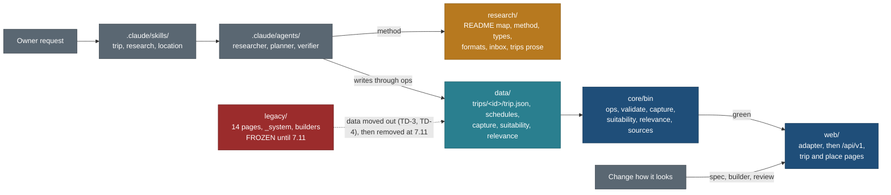

# Skills in one home, trips as data, no new HTML (21 Oct 2026)

Written by travel-planner (Opus) on 21 Oct 2026, on `main` at 64cc6b6. Every path, count and reader below was measured with
`git grep`, `ls` and the installed Claude Code binary on that commit. Tracked in [TODO.md](TODO.md) and BACKLOG 15.13 to
15.16. Scheduled in [PLAN.md](PLAN.md) (R-56, section 3). Status: **decided by the owner's direction; CLN-7 can start now;
the TD tasks wait for their phase.**

## Owner direction (21 Oct 2026, final; his words, lightly cleaned)

1. "All skills should be in a skill folder. Whatever we are doing for trip planning, whether it is software or research:
   we have a research skill and a planning skill; keep them in a proper place so they can be used. Either in `.claude` or
   a skills folder in the root. Put research, planning and all of the HTML planning there. Think about it and put it
   that way."
2. "We are already converting to a web app, so most things are structured. We are not getting new HTML. If any HTML
   change is asked, it will change the web app. Only data will be generated, based on the schema. Think it through before
   doing redundant things and putting everything here and there."

**How the two are read together.** Direction 2 decides what "all of the HTML planning" in direction 1 means: the trip
planning knowledge that sat in the HTML skill moves into the skills folder as data rules, and the HTML page format itself
is retired. The owner confirms this reading at R1 (decision O-1 in section 10).

## Recommendation

- **One skills home: `.claude/skills/<name>/SKILL.md`.** It is the only project folder Claude Code loads skills from
  (section 2.1). A root `skills/` folder would not be loaded.
- **Three skills.**
  - `trip` replaces `trip-planner`: plan or revise a trip as data.
  - `research` is new: facts for one place, route, offer or event, to the capture contract.
  - `location` stays: capture a place to remember.

  Each is a thin wrapper that points into `research/README.md` and calls the CLIs by their real paths.
- **Cleanup D18 is superseded.** The HTML half of `trip-planner` is retired, not moved to `legacy/_system/TRIP-PAGE.md`.
  That file is never written.
- **No new HTML, from today.**
  - `legacy/` is frozen except for moving data out of it.
  - Any request to change how a page looks is a change to `web/`.
  - A trip is data: `data/trips/<id>/trip.json` written through the ops CLI, `data/schedules/<id>.json`, and the
    `capture/1` records with their suitability and relevance sidecars.
- **Close the gaps the web app has with data-only trips:** TD-0 to TD-3 in phase B and E, and TD-4 (importing the 14 old
  trips) with backlog 7.11.

**Trade-off.**
- A trip planned between now and the merge of TD-2 (phase E) has no page anywhere. Its research and data are complete and
  validated, but the web app builds trip pages only from the 14 legacy folders.
- Phase E grows by about 21 hours, about one calendar day, because the TD lane's files are disjoint from the other E
  lanes. The cheaper path is to push TD-1 to TD-3 after R2. That saves the day, but every new trip stays invisible until
  then (O-2).

**Supersedes.**
- Cleanup D18 and its rows in [CLEANUP-PLAN.md](CLEANUP-PLAN.md): 1.2 row `trip-planner`, 2.6 row `trip-planner`, 2.8 row
  `legacy/_system/TRIP-PAGE.md`, CLN-6 row "trip-planner skill step 7", and rule 6 of the CLN-5 guard.
- BACKLOG Q78; PLAN.md section 5 row "Cleanup D18".
- [research/method/skills-and-prompts.md](../../research/method/skills-and-prompts.md) section 2, "What replaces the
  current trip-planner skill", for its Phase 3 line ("page building becomes the app") only; the rest stands.
- The `trip-planner` skill itself, and the CLAUDE.md lines that send work to it.



## 1. Decisions

| ID | Decision | Why | Trade-off |
|---|---|---|---|
| SD-1 | Skills live only in `.claude/skills/<name>/SKILL.md`, as regular files | The only project path Claude Code 2.1.306 loads at session start (2.1) | The folder is hidden (a dot folder); `research/README.md` and CLAUDE.md name it so nobody looks for a root `skills/` |
| SD-2 | Final skill set: `trip`, `research`, `location` | One skill per job a person asks for; everything else is a step of one of them (2.2) | `/trip-planner` stops working; the `trip` description still matches "plan a trip" |
| SD-3 | Cleanup D18 is **superseded and retired**: no `TRIP-PAGE.md`; the HTML format, the design system, the HTML link and photo conventions, the screenshot step and the publish step are retired outright (section 3) | The owner will not get new HTML (direction 2); moving dead instructions keeps them alive | Revising an old page by hand is no longer documented. That is intended: the 14 pages are frozen |
| SD-4 | **No new HTML.** Freeze `legacy/**` except for moving data out; any page change goes to `web/` (section 6) | Direction 2 | A typo on an old page stays until 7.11 |
| SD-5 | **A trip is data** in the existing core trip format, `data/trips/<id>/trip.json` (`core/src/schema/trip.ts`), written only through `node core/bin/ops.ts` (`trip.create`, `base.set`, `day.update`, `item.add`, ...), plus `data/schedules/<id>.json`. There is no new `trip-template` format and no PLAN.md for a new trip | The format, the operations (86 in `node core/bin/ops.ts --list`, every write with an inverse), the validator (`validate.ts`, `trip.validate`) and MCP exposure already exist and are tested. Household columns are already flagged `private` (traveller age, height, weight, fitness, citizenship and notes; booking price paid, confirmation and contact; fare party; insurer phone). Whole planner tables (`editions`, `budget`, `documents`) are not, so TD-0 names the public tables and TD-2 reads only those, as an allowlist | The format predates `capture/1`: items point at old catalogue ids, not capture refs. TD-1 fixes that before anyone relies on it |
| SD-6 | The method stays written once in `research/` (cleanup D15 unchanged). Skills are under 2.5 KB, except `location`, which keeps its CLI usage (about 5.6 KB) | Direction 2: no redundant copies | none |
| SD-7 | The five agents stay as role wrappers with default models; skills name which agent and model run each step (2.5). CLN-7 edits no agent file | Agents are workers with a model; skills are procedures. META-0 (B6) owns a line of `travel-researcher.md` | none |
| SD-8 | No separate `conditions-check`, `find-media`, `check-links` or `web-change` skill now. Conditions and photos are steps of `trip` and `research`; a page change is a `web/` task under PLAN.md 4.1 | Each would duplicate a recipe in `research/README.md` or the CLAUDE.md agents table | Revisit when the MCP research flow exists (skills-and-prompts.md) |
| SD-9 | New trip ids carry no year (`scottish-highlands`, not `scottish-highlands-2027`). The 14 existing slugs keep theirs | Public trips are dateless templates (PLAN.md section 1, "Trips"). Renaming old slugs costs redirects | Two slug styles side by side until someone pays for redirects |
| SD-10 | Cleanup D17 is applied, not open | CLAUDE.md "Trips" already points to `research/trips/README.md`, and that file says the summaries moved on 21 Oct (CLN-1c) | Owner confirms at R1 (O-5) |

## 2. Skills layout

### 2.1 Where Claude Code finds skills (verified, not trusted)

Checked on this Mac on 21 Oct against the installed binary `~/.local/share/claude/versions/2.1.306`
(`claude --version` prints `2.1.306 (Claude Code)`). These are its own strings:
- The help text names two homes: "**This repo** (`.claude/skills/<name>/SKILL.md`)" and "**Personal**
  (`~/.claude/skills/<name>/SKILL.md`)".
- The loader refuses symlinks: `unsafe or symlinked skill folder in ...`, and `Its SKILL.md is not a regular file (a
  symlink?). Copy the skill manually.`

[CLEANUP-PLAN.md](CLEANUP-PLAN.md) 2.6 recorded the rest from the same binary:
- plugin skills and `--add-dir` folders also load;
- nested `<subdir>/.claude/skills/` folders load only after the session touches that subdirectory;
- a `SKILL.md` over 128 KB is skipped.

**What a root `skills/` folder would cost.**

| Option | What is lost | What is duplicated |
|---|---|---|
| Root `skills/` only | Discovery: the skills do not appear in `/skills`, the model cannot pick them from their description, and `/trip` does nothing. Each session would need `--add-dir skills` or a plugin manifest | nothing, but nothing works either |
| Root `skills/` plus a symlink from `.claude/skills/` | The loader refuses the symlink (string above), so the same as above | nothing |
| Root `skills/` copied into `.claude/skills/` | nothing | every skill twice, with a sync step that will drift: the redundancy direction 2 rules out |
| A plugin pointing at root `skills/` | Plain project loading; every machine and session needs the plugin installed or `--plugin-dir` | a plugin manifest to maintain for three files |
| **`.claude/skills/` (chosen)** | nothing | nothing |

`.claude/skills/` is the project's skills folder at the root. It sits beside `.claude/agents/`, and both are committed.

### 2.2 The final skill set

| Skill | What it does | Calls (real paths) | Runs it | Model (CLAUDE.md rubric) |
|---|---|---|---|---|
| `trip` (replaces `trip-planner`) | Plans or revises a trip as data. It covers the trip index row, rule zero, the trip type and lane depth, the fan-out, the lane outputs, validation and gaps, then synthesis into the trip file and schedule, photos and cover, the conditions check and the preview. It writes no HTML | `node core/bin/capture.ts` (fields, gaps, run), `validate.ts`, `suitability.ts`, `relevance.ts`, `sources.ts`, `sun.ts`, `ops.ts`, `schedule.ts`; `tools/gallery/gallery_find.py`, `gallery_pick.py`, `gallery.py verify` and `sheet`; `pnpm --dir web dev`; `bash tools/check-all.sh` | The coordinator session. It fans out `travel-researcher` lanes and hands synthesis to `travel-planner` | Lanes Opus (judgement). Sonnet for a lane that only fills a clear contract. Haiku for link checks and photo finding (one sequential runner). Synthesis Opus. Checks Sonnet (`travel-verifier`) |
| `research` (new) | Facts for one place, route, offer or event, or the gaps of a trip: the per-type checklist, raw capture in `research/inbox/`, `capture/1` records with sidecars, validators, gaps, run record and run note. It also covers refreshing stale facts, photos and link checks | `capture.ts fields`, `explain`, `gaps`, `run --check`; `validate.ts`; `suitability.ts check`; `relevance.ts check` and `freshness`; `sources.ts due`, `build` and `check`; `web/scripts/tracks-osm.mjs`, `fetch-photo-credits.mjs`; `tools/gallery/*` (not `inject`) | `travel-researcher`, or the coordinator for a single record | Opus for judgement; Sonnet to fill a clear contract; Haiku for link checks and photo finding |
| `location` (kept) | Captures a place to remember into `data/locations/locations.json`. Capture only | `python3 tools/locations.py` (add, edit, visit, import, build, validate) | The session itself; no agent | Sonnet (the session default); Haiku for a batch import from a ready inbox file |

Trigger descriptions are in the frontmatter below. They are the text Claude Code matches requests against, so each one names
the jobs in Nitin's words.

### 2.3 The SKILL.md texts (CLN-7 writes them verbatim)

`.claude/skills/trip/SKILL.md`, 2,250 bytes:

```markdown
---
name: trip
description: Plan, research or revise a trip in ~/workspace/travel as DATA - the research fan-out for a destination, capture records and sidecars, the trip file and its schedule, validation and the gap report. Use when Nitin asks to plan a trip, revise or extend one, compare trip shapes, or "start the X trip". The web app renders the result; this skill never writes HTML.
---

# Trip: plan a trip as data

Not this skill: remembering a place (`location`); filling gaps or refreshing facts outside a plan (`research`); changing how a page looks (a `web/` change: `docs/v2/PLAN.md` 4.1). Never edit `legacy/`; it is frozen (`docs/v2/SKILLS-AND-DATA-ONLY.md` 6).

## Steps
1. Read `research/README.md` 3b and 9. Give a new trip its row in `research/trips/README.md` first; its id names `research/trips/<id>/` and `data/*/<id>/`.
2. Treat the draft as a hypothesis (rule zero, `research/README.md` 9).
3. Trip type and lane depth: `research/method/trip-types.md`.
4. Fan-out: `research/method/lanes/README.md` "Running a fan-out". Media is one sequential runner, never parallel.
5. Outputs per lane: `research/formats/README.md`.
6. Validate: `research/README.md` 6, then `node core/bin/capture.ts gaps --trip <id>`.
7. Trip file and schedule: `data/trips/README.md`. Write through `node core/bin/ops.ts` (never by hand); check with `node core/bin/validate.ts data/trips/<id>/trip.json` and `node core/bin/schedule.ts`.
8. Photos and cover: `research/README.md` 3e.
9. Conditions check before departure: `research/README.md` 3f.
10. Review: `pnpm --dir web dev`, open `/trips/<id>/`; `travel-verifier` shoots 1440 and 390, light and dark.
11. Merge: `research/README.md` 8, after `bash tools/check-all.sh`.

## Who runs what
Lanes: `travel-researcher` (Opus; Sonnet for a lane that only fills a clear contract; Haiku for link checks and photo finding). Synthesis, step 7: `travel-planner` (Opus). Checks: `travel-verifier` (Sonnet).

## The reply
Lead with what changed from the draft and why. Give times, distances and capacities, never "arrive early". State physical risks plainly. Put hours gotchas in a table. Mark what you added that was not asked for. End with what is verified, what is a gap, and what to confirm nearer the date.
```

`data/trips/README.md` does not exist yet. TD-0 writes it. Until TD-0 merges, step 7 reads the `trip.create` schema with
`node core/bin/ops.ts --list` and `ops.describe`. Until TD-2 merges, step 10 shows the trip only in the trips list
(section 4.4).

`.claude/skills/research/SKILL.md`, 1,800 bytes:

```markdown
---
name: research
description: Research or refresh facts in ~/workspace/travel for a place, trail, route, activity offer or event, to the capture contract - per-type checklist, raw capture in research/inbox, capture/1 records with suitability and relevance sidecars, validators, gap report and run record. Use to fill a trip's gaps, refresh stale prices or hours, find photos, check links, or research one thing outside a full trip plan.
---

# Research: facts to the capture contract

Not this skill: a whole trip (`trip`); remembering a place (`location`). Everything here is data; no HTML.

## Steps
1. Read `research/README.md` 1-2 and the recipe for the job: 3c gaps, 3d refresh, 3e photos.
2. What the type needs: `node core/bin/capture.ts fields --type <id>`, then the kind profile and lane contract (`research/README.md` 4).
3. Raw captures to `research/inbox/`; records and sidecars to the paths in `research/formats/README.md`.
4. Validate: `research/README.md` 6. Gaps, conflicts and the run record: section 7.
5. Merge: section 8.

## Rules that hold even if you read nothing else
Full text: `research/README.md` 9.
- No coordinate from Google; every point has a `point_source`.
- Never invent a URL; record `searched_none` with the query and date.
- Age, height and weight limits only from official or operator sources.
- Conflicts are recorded with both values, never picked.
- Overpass, Nominatim and Commons: one runner for the machine, never parallel agents.
- AllTrails, Google and Tripadvisor are links only, never a stored value.
- Nothing in the Obsidian vault; no household data in any public field.

## Who runs what
`travel-researcher` (Opus) for judgement; Sonnet to fill a clear contract; Haiku for link checks and photo finding. Scripts by real path: `research/tools.md`.
```

The seven one-line rules are the safety lines that cleanup D15 allows a wrapper to repeat. Each one points to its full text.

### 2.4 `location`: two line edits only

- Line 83: "that is the trip-planner's job" becomes "that is the `research` or `trip` skill's job".
- The intro sentence that lists the generated views adds "(the list page and globe pins are legacy outputs, removed at
  backlog 7.11)".
- The trigger, the procedure and the resolution rules stay. A batch import from a ready inbox file is mechanical and can
  run on Haiku.

### 2.5 Agents

| Agent | Default model | Used by | Change |
|---|---|---|---|
| `travel-researcher` | Opus | `trip` lanes, `research` | none in CLN-7. META-0 (B6) owns one checklist line |
| `travel-planner` | Opus | `trip` step 7 (synthesis into the trip file and schedule); specs | none |
| `travel-verifier` | Sonnet | `trip` step 10; every TD task | none |
| `travel-builder` | Sonnet | TD-1 (on Opus, because it changes a shared contract), TD-2, TD-3; any `web/` change | none |
| `travel-design-reviewer` | Opus | TD-2 and TD-6 (pages render from data); every UI round | none |

No agent names `trip-planner` (measured), so retiring the skill touches no agent file.

### 2.6 Other files that name the old skill (CLN-7 edits them)

| File | Today | After CLN-7 |
|---|---|---|
| `CLAUDE.md` lines 5, 7, 13-16, 18-30, 48-53, 59-68, 70-85, 93 | `legacy/<slug>/` as the deliverable; "use `trip-planner`... the HTML format... the publish step"; the legacy design system; galleries; landing page; legacy gotchas | the text in section 8 |
| `README.md` "Build and publish" | the publish flow as the way to ship | one paragraph: the product is `web/`; `publish.py` is the frozen old-site path, and deployment waits for the hosting decision (PLAN.md R-8) |
| `research/README.md` 3b (last paragraph), 3e (item 2), 9 (last paragraph) | "The `trip-planner` skill wraps this job... waits for D18"; "Legacy trip galleries... `inject`"; "The `trip-planner` skill still carries its own copy..." | 3b: "The `trip` skill wraps this job. Step 7 writes the trip file and schedule (`data/trips/README.md`)". 3e: "Trip galleries are data (find, contact sheet, pick, `gallery.py verify`); `inject` is frozen with the legacy pages". 9: paragraph removed |
| `research/method/lanes/README.md` line 86 | "the fan-out half of the `trip-planner` skill's Phase 1" | "the fan-out step of the `trip` skill" |
| `research/method/skills-and-prompts.md` "What replaces the current trip-planner skill" | target design | a one-line banner pointing here |
| `research/tools.md` (Photos, Known gaps) | `gallery.py inject` listed as current | `inject` marked "frozen: legacy pages only"; known gap kept: the only link checker is `legacy/canadian-rockies-sept-2029/check_links.py` |
| `legacy/_system/README.md` | the design system's guide | one banner line: "Frozen 21 Oct 2026. Do not build or edit pages with this. The product's design system is `web/app/themes.css` and `docs/v2/design/foundation/`." This is the only `legacy/` edit CLN-7 makes |
| `core/test/ops/catalogue.test.ts:115` | `via: "skill:trip-planner"` | unchanged: a free-text actor string in a fixture, not a path |

## 3. The `trip-planner` skill, section by section

| Section of today's SKILL.md (17,434 bytes) | Fate | Where it lives now |
|---|---|---|
| Frontmatter: "single-file index.html ... deployed to nks-travel.pages.dev" | **retired** | the `trip` frontmatter (2.3) |
| Folder table (`legacy/<slug>/index.html`, `PLAN.md`, research files) | **retired** | new trips: `research/trips/<id>/` plus `data/*/<id>/` (`research/README.md` 3b) |
| "Never create a Pages project per trip" | **retired** | hosting is out of scope (PLAN.md R-8) |
| Rule zero, with its four examples | already covered | `research/README.md` 9 |
| Phase 1 fan-out (six lanes and every field) | already covered | `research/method/lanes/README.md` "Running a fan-out", and the lane contracts |
| "Record gaps as gaps", `GAP CLOSED <date>` | already covered | `research/README.md` 7 |
| Coordinates from OSM, never Google | already covered | `research/README.md` 9 "Coordinates" |
| Phase 2, conditions routine | **kept as a step**, already covered | `trip` step 9 links to `research/README.md` 3f |
| Phase 3, order the day by constraints | already covered | `lanes/README.md` "Running a fan-out" item 5 |
| Phase 3, the orientation section (what the place is, why it is famous, what only it has, sub-regions with a photo, the trip in numbers, what to know first) | **kept as data, moved** | trip fields: `orientation_prose`, the new `areas` table (TD-1), `gotchas` for what to know first, the numbers derived by the adapter (TD-2). The rule "every claim in the intro survives the research files" becomes: each `gotchas` and `knowledge` row carries a `src` |
| "The HTML deliverable": single file, no external JS, `legacy/_system/` build, themes, the `.mark` classifier, card anatomy, hero, sticky nav, embedded maps, countdown, `localStorage` checklist, A/B toggle, print sheet, `base.js` | **retired** | the web app's own components and design system (`docs/v2/design/foundation/`). Offline use is a web concern (export and print, L5) |
| Day-of links block | **kept as data** | `days.day_of_links` already exists in the trip format, with `kind` |
| Links: Google Maps `?q=<name>` per stop, `/dir/A/B/C`, embed iframe | **retired** | links are built from our own coordinates at render time (`web/lib/map/links.ts`); a name search is the Google-pin habit the method forbids |
| Links: AllTrails and an official source, never AllTrails alone; report ranges | already covered | `research/README.md` 9 (link-only platforms, official first, conflicts as ranges) |
| Photos: Commons commands, verify the URL resolves, user agent required | **kept, as data rules**, mostly covered | `research/method/lanes/media.md`, `research/README.md` 3e and 9; the `gallery.json` fields (file, author, licence, page URL) are the licence record |
| "Every stop gets an image, including drive legs" | **retired as a rule** | the page shows an honest empty state instead (T3, "Not checked yet") |
| Gallery: mandatory, `gallery.json` plus `gallery.py`; one Haiku runner; look at the contact sheet; reject watermarks and wrong seasons | **kept** (data part), **retired** (`inject`, "rebuilds erase the gallery") | `research/README.md` 3e; gallery as data in TD-3 |
| Phase 4, headless Chrome screenshot of `index.html` | **retired** | `travel-verifier` Playwright sweep of `/trips/<id>/` at 1440 and 390, light and dark |
| Phase 5, `./publish.sh`, wrangler login, tunnel preview | **retired** | PLAN.md R-8 and Release rule: never deploy until hosting is chosen and a named commit is approved |
| Writing style (times and capacities, risks, hours table, mark additions, honest state) | **kept** | `trip` "The reply" (it is about the answer, not the method) |

Nothing in the old skill is lost without a stated reason. The only retired items with any value are the per-stop photo
rule and the offline single-file rule. Both are replaced by product behaviour: an honest empty state, and export and print.

## 4. Walkthrough: "plan a new trip to X"

X is the Scottish Highlands, about 10 nights, a summer window, adults. The trip id is `scottish-highlands` (SD-9). Steps
marked **GAP** do not work end to end today; section 5 closes them.

### 4.1 What happens, in order

| # | Step | Who and model | Files created or edited | Command that proves it |
|---|---|---|---|---|
| 1 | The `trip` skill triggers on "plan a trip to the Scottish Highlands" | coordinator | `research/trips/README.md`: a new row (state "researching", season window, open items) | `git diff` shows one row |
| 2 | Rule zero, trip type (`road-trip` or `hiking-base`) and lane depth | coordinator, Opus | none | - |
| 3 | Fan-out, one wave: trails, adventure, road trips and legs, sights, stays, destination overview, timing and light. Media runs later, alone | `travel-researcher` x N, Opus | `research/trips/scottish-highlands/<lane>.md`; `data/capture/scottish-highlands/<lane>.json`; `data/suitability/scottish-highlands/<lane>.json`; `data/relevance/scottish-highlands/<lane>.json`; `data/capture/runs/<run-id>.json`; `research/runs/<run-id>.md`; new operators in `data/capture/operators.json`; points in `data/capture/points.json` | per lane: `node core/bin/validate.ts data/capture/scottish-highlands/<lane>.json`; `node core/bin/capture.ts run --check data/capture/runs/<run-id>.json` |
| 4 | Sources and sidecars | lane, then coordinator | `data/sources/registry.json` (generated) | `node core/bin/sources.ts build`, then `check`; `node core/bin/suitability.ts check`; `node core/bin/relevance.ts check` and `derive --check` |
| 5 | Gap report | coordinator | `research/backlog.md` rows for the open gaps | `node core/bin/capture.ts gaps --trip scottish-highlands --level usable` |
| 6 | Photos: one sequential runner | Haiku agent; Opus looks at the sheet | **GAP (TD-3):** `data/trips/scottish-highlands/gallery.json`. Today the only gallery home is `legacy/<folder>/gallery/`, which is frozen | `python3 tools/gallery/gallery.py verify <file>`; `gallery.py sheet <file> <out.jpg>`, then read the sheet |
| 7 | Synthesis into the trip file | `travel-planner`, Opus | `data/trips/scottish-highlands/trip.json` through `node core/bin/ops.ts trip.create`, then `base.set`, `day.update`, `item.add`, `track.set`, `gotcha.add`, `knowledge.add`, `hazard.upsert` and `weather_rule.upsert`, each with an `actor` | `node core/bin/validate.ts data/trips/scottish-highlands/trip.json`; `echo '{"slug":"scottish-highlands"}' \| node core/bin/ops.ts trip.validate --input -` |
| 7a | Items name the capture records they visit | same | **GAP (TD-1):** `items` has `place_id` and `trail_id` (old catalogue ids) and no capture `ref` | - |
| 7b | The orientation | same | `trip.orientation_prose`; `gotchas` (what to know first). **GAP (TD-1):** no table for the sub-regions with a photo each | - |
| 7c | Cover | same | `trip.hero_image`. **GAP (TD-1, TD-3):** today the cover comes from the legacy page hero, scraped by `tools/hub.py`, or from `data/trips/covers.json` keyed by legacy folder | - |
| 8 | Timeline overrides | `travel-planner` | `data/schedules/scottish-highlands.json` (`trip-schedule/1`; dateless, no household data) | `node core/bin/schedule.ts --input <scheduleInput.json> --day 3 --profile adults --pace standard` |
| 9 | Road times | coordinator (needs `ORS_API_KEY`) | `data/schedules/legs/scottish-highlands.json` | `node web/scripts/legs-ors.mjs` (fetches the missing pairs; `--check` exits 1 when a pair is missing) |
| 10 | Whole gate | coordinator | none | `bash tools/check-all.sh`. Stages that cover this trip: "validate every data file", "suitability sidecars", "relevance sidecars", "relevance derived files are current", "source registry is current and valid", "web typecheck/lint/test/build" |
| 11 | Render | the web app | none. No HTML is written | `pnpm --dir web dev`, then `/trips/scottish-highlands/`. **GAP (TD-2):** today the app builds trip pages only for the 14 folders in `web/lib/public/slugs.ts` `TRIP_SLUGS`. `web/lib/data/trips.ts` `loadDataTrips` turns `trip.json` into a list row only, and that row links to `/<slug>/`, a legacy-style URL with no page behind it |
| 12 | Owner review | `travel-verifier`, Sonnet; `travel-design-reviewer`, Opus, the first time a data trip renders | screenshots in `web/test-results/shots/` (gitignored) | the page at 1440 x 900 and 390 x 844, light and dark |
| 13 | Merge | coordinator | own paths only | `git -C <worktree> add <paths>`; message `research(scottish-highlands): ...` plus the trailer |

### 4.2 What the owner reviews

- The reply: what changed from the draft, and the verified, gap and to-confirm lists (the `trip` skill's "The reply").
- The page `/trips/scottish-highlands/` at 1440 and 390, light and dark, in the verifier's hand-back. It must show the
  categorised content, the chronological Day 1 to N timeline, the season window and the honesty markers. These are the
  same components every other trip uses, so there is no per-trip design work (P1, P7).
- The gap report from step 5, and the trip index row.
- Nothing goes live: release waits for hosting and a named commit (PLAN.md section 1, "Release").

### 4.3 How the web app renders it with no new HTML (after TD-2)

`data/trips/<id>/trip.json` is read by the data adapter, the one boundary (P9). It is joined to:
- the capture records by `ref` (TD-1);
- the schedule;
- the suitability and relevance sidecars;
- the gallery (TD-3).

The adapter then builds the same `PublicTrip` shape the 14 legacy-backed trips produce today, and `/trips/[slug]/` renders
it. The adapter reads only the public tables that TD-0 names, as an allowlist, so planner tables never leave it:
`travellers`, `editions`, `trip_bookings`, `budget`, `fare_*`, `documents` and `emergency`. Some of their columns carry
the schema's `private` flag; the whole-table rule is TD-2's, and TD-2's privacy test pins it. After API-1 (B2) the same builder sits
behind `JsonStore` and `/api/v1/trips/{slug}`. Lists carry only allowlisted row fields, and exports stay per trip (P8).

### 4.4 Today, before TD-2

Steps 1 to 10 work today. The trip's records and sidecars are validated and pass check-all. The trip shows as a row in the
trips list, from `loadDataTrips`, with a dead link. It has no trip page, and its records reach no place page, because
`web/lib/public/seeds.ts` `captureSeeds` and the trail seeding in `places.ts` skip any record whose trip does not map to a
legacy folder. Until TD-2 merges:
- set `trip.web_published` to `false`, so the row's link falls back to `legacy_url`;
- set `legacy_url` to `null`;
- record the trip as "researched" in the index.

## 5. Gaps and the tasks that close them

The brief assumed some things were missing that already exist:
- a trip-creation operation: `trip.create` is in `core/src/ops/trip.ts`, and check-all pins it;
- a trip validator: `validate.ts` and `trip.validate`;
- cover selection as data: `data/trips/covers.json` exists, but only as an override keyed by legacy folder.

The real gaps:

| Gap | Today | Task | Phase | Agent and model | Effort |
|---|---|---|---|---|---|
| G1. No written contract for a trip as data: which tables a public trip fills, which are private, dateless rules, ids, the template | the schema code only | **TD-0**: `data/trips/README.md`; a "Trip file (`trip.json`)" section in `research/formats/README.md`; `research/formats/templates/trip.json` | B, beside the B lanes (docs only) | `travel-planner`, Opus | 3 h |
| G2. Items cannot name a capture record; no sub-regions; the cover format is undefined | `items.place_id` and `trail_id` point at old catalogue ids; `orientation_prose` is one text field; `hero_image` is free text | **TD-1**: `items.ref` (a capture ref, resolved by the validator, with a new code `E_ITEM_CAPTURE_REF`); an `areas` table (name, why, days, photo); `hero_image` as a Commons file title with a format rule; the template wired into `core/test/research/templates.test.ts` | E, first (after G-B, because META-0 owns `core/src/validate/codes.ts` in B) | `travel-builder` on **Opus** (it changes a shared contract) | 6 h |
| G3. The web app builds trip pages only from legacy folders | `TRIP_SLUGS`, `legacy/MANIFEST.json`, `tools/hub.py` meta scraping, the prototype snapshot, the Rockies files under `legacy/` | **TD-2**: build `PublicTrip` from `data/trips/<id>/trip.json`, with slug and visibility from the file; derive "the trip in numbers"; list rows link to `/trips/<slug>/`; a fixture trip and a privacy test | E, after TD-1 and B2; before CONS-3 (E14) touches `slugs.ts` and `sources.ts` | `travel-builder`, Sonnet; design reviewer, Opus; verifier | 10 h + 1 h |
| G4. Galleries and covers live under `legacy/` | `legacy/<folder>/gallery/gallery.json` (9), read by `web/lib/public/sources.ts`, `photos.ts` and `web/scripts/fetch-photo-credits.mjs`; `covers.json` keyed by folder | **TD-3**: `git mv` each `gallery.json` to `data/trips/<trip-id>/gallery.json` (schema `trip-gallery/1`, the same shape); `covers.json` keyed by trip id; repoint the readers and `tools/gallery/*` defaults; `gallery.py inject` refuses to run | E, after TD-2 (same lane, serial) | `travel-builder`, Sonnet | 5 h |
| G5. The 14 existing trips' content is outside `data/trips` | Rockies `legacy/.../data/*.json`; Dolomites and 6 summary trips in the prototype snapshot; 6 overview trips only in HTML meta tags (Quebec and New Hampshire have no PLAN.md either) | **TD-4**: import each trip into `data/trips/<id>/trip.json` through the ops, per [migration/import-plan.md](migration/import-plan.md) 3.7-3.9. Then `TRIP_SLUGS`, `hub.py` and the snapshot branch go | After R2, with backlog 7.11 (EXECUTION-PLAN marks legacy removal "not needed by E") | `travel-planner`, Opus, for the mapping (4 h); `travel-builder`, Sonnet, per trip (20 h) | 24 h |
| G6. No orientation block on the trip page | the legacy pages had one; the web page shows subtitle, season and day summaries | **TD-6**: an orientation section (what it is, why famous, sub-region cards with a photo, numbers, what to know first) from TD-1 data. UI work, in TRP2's files | after R2 (TRP2 owns `web/components/trips/**` in E) | `travel-planner` spec, Opus; `travel-builder`, Sonnet; design review | 8 h |
| G7. `trip.import` is catalogued but has no implementation | `core/src/ops/catalogue.ts:178`, with no apply function | none: TD-4 uses `trip.create` and the item ops directly. The catalogue entry stays for the MCP flow | - | - | - |
| G8. No general link checker | only `legacy/canadian-rockies-sept-2029/check_links.py` | a `check-links` mode of the `research` skill when the MCP flow arrives (skills-and-prompts.md); not in this plan | later | - | - |

Order: TD-0 (B) -> TD-1 -> TD-2 -> TD-3 (E, one lane, serial) -> R2 -> TD-4 and TD-6 -> 7.11 removals.

### 5.1 Briefs

Every TD brief uses PLAN.md 4.1 for worktrees, ports, verification and commits. Common verification for all of them:
- `pnpm --dir core typecheck` and `pnpm --dir core test`;
- `pnpm --dir web typecheck`, lint and its own tests;
- `python3 -m pytest tools/tests -q` when `tools/` is touched;
- for a task that renders a page, Playwright screenshots at 1440 x 900 and 390 x 844, light and dark, set through the
  theme control and read in tiles;
- `bash tools/check-all.sh` with `web/.env.local` moved aside (mode 600) and restored.

Commit rules for all of them:
- branch `public/<task>` in `<repo parent>/travel-wt/v2-<task>`;
- `git -C <worktree> add <owned paths>`, never `-A`;
- message `<area>(TD-n): ...`, ending with the Co-Authored-By trailer;
- no push; the coordinator merges.

**TD-0: the trip data contract (docs, Opus).**
- **Goal.** One page that tells a planner how to write a public trip as data, and a template that validates.
- **Owns.** `data/trips/README.md` (new); the "Trip file" section of `research/formats/README.md`;
  `research/formats/templates/trip.json` (new).
- **Do not touch.** Code, `data/trips/*.json`, other research pages.
- **Steps.**
  1. Read `core/src/schema/trip.ts`, `core/src/ops/{trip,days,plan}.ts`, `core/src/validate/trip.ts`, `web/lib/data/trips.ts`
     and `web/lib/public/trips.ts`.
  2. List per table: public template, private, or planner-only.
  3. Write the dateless rules (no dates outside `editions`; season as months; relative booking rules).
  4. Write the id rule (SD-9) and the op sequence for a new trip, with a minimal example per op input.
  5. Write the template with `travellers: []` and no `editions`.
- **Acceptance.**
  - `node core/bin/validate.ts research/formats/templates/trip.json` prints no error, or the page records the exact
    errors TD-1 removes (the template uses `items.ref`).
  - Every op named on the page exists in `node core/bin/ops.ts --list`.
- **Verification.** `python3 tools/relink.py --check` (no new broken link). No UI.

**TD-1: the trip format joins the capture contract (core, Opus).**
- **Goal.** A trip item names the capture record it visits; the orientation and the cover are structured.
- **Owns.**
  - `core/src/schema/trip.ts` (`items.ref`, the `areas` table, the `hero_image` rule);
  - `core/src/validate/trip.ts`, `core/src/validate/codes.ts` (append only), `core/src/ops/days.ts` and `plan.ts` (accept
    `ref` in `item.add` and `item.update`);
  - `core/src/ops/catalogue.ts` (input schemas only);
  - `data/schema/generated/**` (regenerated); `core/test/validate/**`, `core/test/ops/**`;
  - `core/test/research/templates.test.ts` (one mapping line).
- **Do not touch.** `web/**`, `data/capture/**`, `core/src/catalogue/**` (B2), `core/src/schema/capture/**` (META).
- **Steps.**
  1. Add `ref` (nullable text) to `items`. `E_ITEM_REF` allows at most one of `ref`, `place_id`, `trail_id`, `activity_id`
     and `eatery_id`. `E_ITEM_CAPTURE_REF` fails when `ref` is not a record ref in `data/capture/<trip>/*.json`.
  2. Add `areas` (id, name, why, days as an int list, `photo` as a Commons file title or null), placed after `bases` in
     `TRIP_TABLES`.
  3. Define `hero_image` as `File:<name>` or null.
  4. Bump nothing that breaks old files: all new fields are nullable or default to empty.
  5. Run `node core/bin/schema.ts generate`.
- **Acceptance.**
  - A fixture trip with a bad `ref` fails with `E_ITEM_CAPTURE_REF`.
  - The TD-0 template validates.
  - check-all stages "generated schema is up to date", "ops CLI lists the catalogue" and "validate every data file" are
    green.
- **Verification.** Core typecheck and tests; check-all. No UI, so no screenshots; say so in the hand-back.

**TD-2: trip pages from data (web, Sonnet; design review Opus).**
- **Goal.** A trip that exists only as `data/trips/<id>/trip.json` gets a full `/trips/<id>/` page, a list row that links
  to it, and no household data in any output.
- **Owns.**
  - `web/lib/public/data-trips.ts` (new: `trip.json` to `PublicTrip`);
  - the data-trip branch in `web/lib/public/trips.ts` (`buildTrips`) and in `sources.ts` (reading `data/trips/*/trip.json`
    through the same `readJson`);
  - the trip-to-folder lookup in `web/lib/public/seeds.ts` (`captureSeeds`) and the trail seeding in `places.ts`, so a data
    trip's records get place pages;
  - `web/lib/data/trips.ts` (`loadDataTrips` href becomes `/trips/<slug>/`);
  - `web/tests/data/data-trips.test.ts` (new); `web/tests/fixtures/data-trip/**` (new);
  - `web/tests/e2e/data-trip-page.spec.ts` (new).
- **Do not touch.** `web/components/**` (TRP2 owns trips components in E), `web/lib/public/slugs.ts` (CONS-3),
  `web/lib/client/**` and `web/app/api/**` (B2), `legacy/**`.
- **Steps.**
  1. Map each public table to `PublicTrip`: days and items through `ref` to the capture pages; bases; categories; season
     from `season_months`; gotchas; `orientation_prose`.
  2. Derive "the trip in numbers" (nights, bases, km driven from legs, highest point, longest hike, total ascent) from the
     joined records. Never author it.
  3. Visibility comes from `trip.visibility`, fail closed.
  4. A data trip with the same slug as a legacy trip wins, as `loadTrips` already does.
  5. The fixture trip runs through every existing trip-page test hook.
- **Acceptance.**
  - The fixture trip renders Day 1 to N in chronological order, with categories and honesty markers.
  - The privacy test finds no traveller, edition, booking or budget string in the built output or the API response.
  - The list row has the allowlisted keys only (P8).
  - The 14 legacy-backed trips are byte-identical in the adapter's dump before and after.
- **Verification.** Common, plus screenshots of the fixture trip page at 1440 and 390, light and dark;
  `travel-design-reviewer`, then `travel-verifier`.

**TD-3: galleries and covers as data (web and tools, Sonnet).**
- **Goal.** No trip photo data lives under `legacy/`.
- **Owns.**
  - `git mv legacy/<folder>/gallery/gallery.json data/trips/<trip-id>/gallery.json` (9);
  - the spec and picks files beside them, with the same move;
  - `data/trips/covers.json` (keys to trip ids);
  - the gallery read in `web/lib/public/sources.ts` and `photos.ts`;
  - `web/scripts/fetch-photo-credits.mjs` (input paths);
  - `tools/gallery/{gallery,gallery_find,gallery_pick}.py` (default paths; `inject` exits 2 with "frozen: galleries are
    data, see docs/v2/SKILLS-AND-DATA-ONLY.md");
  - `tools/tests/` gallery tests.
- **Do not touch.** `legacy/<folder>/index.html` and `build_page.py`. Their old injected galleries stay as they are.
- **Acceptance.**
  - `git status` shows 100% renames.
  - Gallery photo counts per trip are identical in the adapter dump.
  - `web/data-snapshots/photo-credits.json` is unchanged after `fetch-photo-credits.mjs --check` (or the dry-run
    equivalent).
  - `git grep -n "gallery/gallery.json" -- web tools data` prints nothing.
- **Verification.** Common, plus screenshots of the Patagonia and Rockies trip pages (gallery and cover) at 1440 and 390,
  light and dark, before and after. They must match.

TD-4 and TD-6 get full briefs when R2 closes. Their inputs are [migration/import-plan.md](migration/import-plan.md) and
this page.

## 6. No new HTML: the freeze rule (in force from 21 Oct 2026)

1. Nobody edits `legacy/<folder>/index.html`, `legacy/<folder>/build_page.py` or the other per-trip scripts,
   `legacy/_system/**`, `legacy/globe/index.html` or `legacy/locations/index.html` by hand. There are two exceptions:
   - moving data out (TD-3, TD-4), with `git mv` where the bytes do not change;
   - the one banner in `legacy/_system/README.md` (CLN-7).
2. Generated legacy outputs keep regenerating until their generators drop them, because check-all and the locations hook
   depend on them. `locations.py build` writes `legacy/locations/index.html` and the globe pins until CLN-4 and CLN-6.
3. A request such as "change how the trip page looks", "add a section" or "fix this on the Dolomites page" is a `web/`
   change. The spec goes in `docs/v2/` (`travel-planner`), the build is `travel-builder`, then the design review and the
   verifier (PLAN.md 4.1).
4. A request to fix a fact is a data change through the `research` or `trip` skill. The web app shows it; the old page
   does not.
5. No new trip gets a `legacy/` folder, a PLAN.md, a `build_page.py` or a `legacy/MANIFEST.json` entry.
6. `./publish.sh` is never run in a mode that deploys (PLAN.md section 1, "Release"). `python3 tools/publish.py --dry-run`
   stays allowed for the e2e harness until API-0 (B1) replaces it.

CLN-5's guard (phase B) enforces this as its rule 11 ([CLEANUP-PLAN.md](CLEANUP-PLAN.md) CLN-5):
- every tracked file under `legacy/` keeps a pinned blob hash;
- a file may leave `legacy/`, but none may change or appear;
- the generated outputs that still regenerate are exempt.

## 7. Redundancy inventory under "HTML is dead, the web app is the product"

Readers were found with `git grep` on 21 Oct, outside `legacy/` itself. "Freeze" means the rule in section 6. "7.11"
means remove after a tag in the backlog 7.11 cleanup (CLN-6), with the owner's approval of the deletion list.

| # | Artifact | Exists to | Still read by | Verdict | Proof that removal is safe |
|---|---|---|---|---|---|
| 1 | `.claude/skills/trip-planner/` | make HTML pages and publish them | Claude Code; CLAUDE.md line 7 | **remove in CLN-7** (now), after the tag | `/skills` in a fresh session lists `trip`, `research`, `location` and no `trip-planner`; `git grep -n "trip-planner" -- .claude CLAUDE.md README.md research` prints only history lines |
| 2 | CLAUDE.md lines 5, 7, 13-16, 18-30, 48-53, 59-68, 70-85, 93; README "Build and publish" | the HTML workflow | every session | **replace in CLN-7** with section 8 | the text in section 8 is in place; the CLN-5 dead-path rule is green |
| 3 | `legacy/<folder>/index.html` (14) | the old site's pages | `tools/hub.py`: the web app's trip list reads `<meta name="trip-*">` from them through `web/lib/data/trips.ts` (`readLegacyTrips` runs `hub.py --json`), and `fetch-photo-credits.mjs` does too; `tools/publish.py` merges them | freeze now; **migrate first** (TD-4 moves title, subtitle, region, nights, season and cover into `trip.json`); 7.11 | `hub.py` deleted and the trips list still shows 14 trips with the same titles; the redirect map resolves all 461 old URLs (R-41) |
| 4 | `legacy/<folder>/build_page.py` (8) and helpers: `merge_data.py`, `plan_tables.py`, `photos.py`, `fetch_photos.py`, `verify_photos.py`, `verify.py`, `shots.py`, `anchor_check.py` (2) | build or check an HTML page | nothing outside its folder (`gallery.py` names `build_page` in a docstring) | freeze now (dead); 7.11 | `git grep -n "build_page\|merge_data\|plan_tables" -- web core tools data` prints only the docstring |
| 5 | `legacy/canadian-rockies-sept-2029/check_links.py` | the only link checker | nobody; `research/tools.md` lists it as a known gap | freeze; 7.11; G8 replaces it | as row 4 |
| 6 | `legacy/{canadian-rockies-sept-2029,norway-summer,patagonia-feb-mar-2027,iceland-ring-road}/sun-times.py`, `iceland-ring-road/dark-times.py` | sun tables for HTML pages | `tools/tests/test_sun_scripts.py` (check-all "python tests") | freeze; 7.11 together with that test | pytest green with both removed; new work uses `core/bin/sun.ts` only |
| 7 | `legacy/canadian-rockies-sept-2029/data/*.json` (itinerary, bases, trails, sights, adventures, bookings) | the Rockies page's data | `web/lib/public/sources.ts:129` (the Rockies full-depth trip), `core/test/fixtures/suitability/make.ts`, `core/test/suitability/validate.test.ts`; cited as paths in `data/schedules/canadian-rockies-2029.json`, `data/sources/registry.json`, `data/suitability/canadian-rockies-2029/*.json` | **migrate first** (TD-4: into `data/trips/canadian-rockies-2029/` and capture; relink the citations with `tools/relink.py`) | Rockies stop count pinned at 206; adapter dump byte-identical; `git grep -n "canadian-rockies-sept-2029/data" -- web core data` empty |
| 8 | `legacy/<folder>/gallery/` (9: `gallery.json`, spec, picks) | inject galleries into HTML | `web/lib/public/sources.ts:143`, `photos.ts`, `web/scripts/fetch-photo-credits.mjs`, `data/trips/covers.json`, `tools/gallery/*` | **migrate first** (TD-3, phase E) | TD-3 acceptance |
| 9 | `legacy/<folder>/PLAN.md` (12) | the plan as Markdown beside the page | no code (the "PLAN.md" strings in `core/src/suitability/migrate.ts` and `web/lib/public/places.ts` are source labels, not paths) | move to `research/trips/<folder>/PLAN.md` at 7.11 (cleanup D9), never deleted | `git log --follow` keeps the history |
| 10 | `legacy/_system/{base.css,base.js,build.py,layout.html,themes/,README.md}` | the HTML design system | only the 8 `build_page.py` files | freeze now; 7.11 with row 4 | `git grep -n "_system" -- web core tools` shows only row 12's lines |
| 11 | `legacy/_system/{migrate.py,migrate_legacy.py}` | one-off migrations of the hand-written pages | nobody | freeze; 7.11 | as row 10 |
| 12 | `legacy/_system/site/{locations.html,site.css}` | the template of the old list page | `tools/location_views.py:48-49` on **every** write to `locations.json` (PostToolUse hook `tools/hooks/locations_changed.sh` watches both files), and check-all "locations build --check" | **not dead**: the generator must drop the output first (CLN-6) | `locations.py build --check` green with the list-page output removed; `test_list_page.py` removed with it |
| 13 | `legacy/locations/index.html` | the old Places list | generated by row 12; served on the old site | 7.11 with row 12 | `/places/` in `web/` covers it (L4) |
| 14 | `legacy/globe/` (`index.html`, `assets/{admin,data,vendor}`) | the old globe | written by `tools/globe_data.py` (until CLN-4) and `tools/locations.py` (`places.json`); `test_globe_page.py`, `test_globe_data.py`; `web/lib/globe/geometry.ts` and `web/lib/map/maplibre/styles.ts` name it in comments only | CLN-4 (phase B) stops the writers; 7.11 removes it | CLN-4 acceptance; dropping `places.json` also serves P8 |
| 15 | `legacy/MANIFEST.json` | which old pages are served and private | `web/lib/public/sources.ts:111`, `web/lib/data/trips.ts:113`, `web/tests/data/support.ts`, `tools/publish.py`, `tools/hub.py` | **migrate first** (visibility moves to `trip.json`, TD-2 and TD-4); 7.11 | no reader in `git grep` |
| 16 | `tools/hub.py` | the old landing page and the trip list scraped from HTML | `tools/publish.py`, `web/lib/data/trips.ts`, `fetch-photo-credits.mjs` | **migrate first** (TD-4); 7.11 | row 3's proof |
| 17 | `tools/publish.py`, `publish.sh`, `tools/hooks/prepublish.sh` (a PreToolUse hook), `tools/tests/test_publish*.py` (4) | merge `web/out` with the legacy pages and deploy to Pages | `web/tests/e2e/global-setup.ts` stages `.site/` through it until B1 | freeze (never deploy); after B1 it serves only the old site; replace or remove at 7.11 with the hosting decision | B1 green with e2e on `next start`; no check-all stage calls it |
| 18 | `tools/gallery/gallery.py inject` and `--dedupe` | write galleries into HTML | the skill only | **freeze now** (TD-3 makes it refuse) | TD-3 |
| 19 | `tools/gallery/gallery.py verify` and `sheet`, `gallery_find.py`, `gallery_pick.py` | find and check Commons photos | `research` and `trip` skills | **keep** (data tools), repointed in TD-3 | - |
| 20 | `tools/location_views.py` list-page output | the old list page | the hook and check-all | 7.11 (row 12); its `WISHLIST.md` output stays | row 12 |
| 21 | `tools/theme_tokens.py` | write `web/app/themes.css` | the web app; `tools/tests/test_theme_tokens.py` | **keep: not legacy**. It writes no legacy output (measured) | - |
| 22 | `web/lib/public/slugs.ts` `TRIP_SLUGS`, `PUBLIC_TRIP_FOLDER` | map legacy folders to slugs | the adapter | replaced by slugs from data (TD-2 for new trips, TD-4 for the 14); CONS-3 removes the literals | CONS-1 slug-literal scan at its exception baseline |
| 23 | `web/data-snapshots/prototype.json` `publicTrips` (to `data/seed/prototype/` in CLN-3) | the summary content of 8 trips | the adapter | **migrate first** (TD-4) | adapter dump identical for those trips before and after |
| 24 | `docs/v2/migration/legacy-site.md`, `import-plan.md` | the retirement and import plans | planners | **keep** as the inputs of TD-4 and 7.11 | - |
| 25 | Capture refs that start `legacy/canadian-rockies-sept-2029/...` (for example in `web/lib/public/seeds.ts`) | record ids from the first migration | the adapter, the suitability sidecars | **keep forever**: they are ids, not paths (`entity.id` is the ref verbatim, SRV-D 13.2) | - |

### 7.1 Order of removal, each step proved before the next

1. **Now (CLN-7):** rows 1 and 2; the freeze rule; the banner on row 10.
2. **Phase B:**
   - CLN-4 stops the legacy globe writers (row 14).
   - B1 takes `publish.py` out of the e2e path (row 17).
   - CLN-5 adds the freeze rule to the guard.
3. **Phase E:**
   - TD-2 makes data trips render, and makes `trip.json` visibility the rule for data trips (row 15, in part).
   - TD-3 moves galleries and covers (rows 8 and 18).
4. **After R2:** TD-4 imports the 14 trips (rows 3, 7, 15, 16, 22, 23). Each trip is proved by an identical adapter dump.
5. **Backlog 7.11 (CLN-6), owner-approved list:**
   - tag `archive/legacy-pages-<date>`;
   - move the PLAN.md files (row 9);
   - remove rows 4, 5, 6 with its test, 10, 11, 12 and 20 with their tests, 13, 14, 16 and 17;
   - CLAUDE.md drops the last legacy lines.

   Proof: `git grep -n "legacy/" -- web core tools data .claude CLAUDE.md README.md` prints only capture refs (row 25) and
   history, and check-all and the quiet e2e are green.

Nothing in steps 4 and 5 is deleted without the owner approving the list.

## 8. Proposed CLAUDE.md text (CLN-7 applies it; this page does not edit CLAUDE.md)

Replace line 5 ("Each trip is one folder...") and line 7 ("Use the `trip-planner` skill...") with:

> Each trip is **data**:
> - `data/trips/<id>/trip.json`, written only through `node core/bin/ops.ts`;
> - `data/schedules/<id>.json`;
> - records in `data/capture/<id>/`, with sidecars in `data/suitability/<id>/` and `data/relevance/<id>/`;
> - prose research in `research/trips/<id>/`.
>
> The web app (`web/`) renders it. **No new HTML:** a request to change how a page looks is a `web/` change (spec in
> `docs/v2/`, then `travel-builder`, the design review and the verifier). The 14 old pages in `legacy/<folder>/` are frozen
> until backlog 7.11: never edit them except to move data out.
>
> **Skills** live only in `.claude/skills/<name>/SKILL.md`, the one folder Claude Code loads, and point into
> `research/README.md`:
> - `trip`: plan or revise a trip as data;
> - `research`: facts, gaps, refreshes, photos and links for a place, route, offer or event;
> - `location`: capture a place to remember.
>
> Decision record: `docs/v2/SKILLS-AND-DATA-ONLY.md`.

In "Destinations: the laundry list", replace lines 13-16 with:

> `locations.py build` (`build --check` to verify) regenerates `data/locations/WISHLIST.md` and, until backlog 7.11, two
> legacy outputs (`legacy/locations/index.html` and the globe pins `legacy/globe/assets/data/places.json`); never hand-edit
> them. A PostToolUse hook validates the store and rebuilds them on every write.

Replace the section "Shared design system: `legacy/_system/`" (lines 18-30) with:

> ## Design system
> The product's design system is `docs/v2/design/foundation/` (principles P1-P9, tokens, components). Colour lives only in
> `web/app/themes.css`, generated by `python3 tools/theme_tokens.py`. `legacy/_system/` is the frozen system of the old
> pages: do not build or edit pages with it.

In "Folder contract", replace the last two sentences of the paragraph (from "`legacy/<folder>/` holds the old pages...")
and the two "Deploy" lines (52-53) with:

> `legacy/<folder>/` holds the 14 old pages, their `PLAN.md` and builders, frozen until backlog 7.11 (no edits except moving
> data out). Check-all's "folder contract" stage (CLN-5) will enforce this. Deployment is out of scope until the hosting is
> chosen (`docs/v2/PLAN.md` R-8). Never run `./publish.sh` in a mode that deploys; `python3 tools/publish.py --dry-run`
> stages `.site/` for the e2e harness until API-0.

Replace "Photo galleries" (lines 59-62) with:

> ## Photos
> Trip galleries are data, one `gallery.json` per trip: today under `legacy/<folder>/gallery/`, and in
> `data/trips/<id>/gallery.json` after TD-3. The web app renders them. `tools/gallery/` finds, picks and verifies photos;
> `gallery.py inject` is frozen. Photo research is `research/README.md` 3e. Never search Commons from parallel agents.

Replace "Landing page" (lines 64-68) with:

> ## Home page
> The new site's home is `web/app/page.tsx`. The old hub at nks-travel.pages.dev is built by `tools/hub.py` inside
> `publish.py` and is frozen with the old site. `hub.py --json` also feeds the web app's trip list from the old pages' meta
> tags, until TD-4 moves those fields into `data/trips/`.

Replace "Gotchas" (lines 70-85) with:

> ## Gotchas
> - `"private": true` in `legacy/MANIFEST.json` takes a page down on the old site **and** hides the trip from the web app
>   (`web/lib/public/sources.ts` reads it). For a data trip, `trip.visibility` decides (after TD-2).
> - Renaming a trip folder leaves the old path live on Cloudflare Pages (earlier deployments' assets persist).
> - Capture refs that start `legacy/canadian-rockies-sept-2029/...` are record ids, not paths. Never rewrite them.
> - `tools/hooks/prepublish.sh` runs as a PreToolUse hook on Bash commands that mention publishing. A command line that
>   only contains the word can trigger it; use another wording for a grep.

In "Platform", line 93, replace "`tools/publish.py` merges it with the legacy pages (see README.md)" with "`tools/publish.py`
merges it with the frozen legacy pages for the old site only, until backlog 7.11".

"Trips" (lines 55-57) stays as it is (cleanup D17 is applied), with one added sentence: "A new trip is data only: the `trip`
skill."

## 9. Schedule and effort

| Task | Phase and slot | Collides with | Agent and model | Effort |
|---|---|---|---|---|
| CLN-7a: skills and docs | **now**, beside phase A; merge **before R1 entry**, because CLN-2 edits `CLAUDE.md` and `README.md` at R1 entry | no phase A lane owns `.claude/`, `CLAUDE.md`, `README.md` or `research/README.md` (measured: PLAN.md 4 owned files). It touches no file of API-0, API-1 or META-0 | `travel-planner` with the model set to **Sonnet**: the texts are written out in this page, so it is "well specified" in the rubric | 2.5 h |
| CLN-7b: verify | after 7a | none | `travel-verifier`, **Haiku**: mechanical sizes, greps and a skill listing | 0.5 h |
| TD-0 | phase B, any time after CLN-7 merges | none: three docs files | `travel-planner`, Opus | 3 h |
| TD-1 | phase E, first, after G-B | META-0 owns `codes.ts` in B, hence E | `travel-builder` on Opus | 6 h |
| TD-2 | phase E, after TD-1; before CONS-3 (E14) edits `sources.ts` and `slugs.ts` | TRP2 (E11) owns `web/components/trips/**` and `web/tests/trips/**`, so TD-2 uses `web/tests/data/` and a spec name outside `trip-*.spec.ts`; B2 owns `web/lib/client/**` and the API; META-1 (E1) may edit one function in `places.ts`, so TD-2 rebases after E1 | `travel-builder`, Sonnet; design reviewer Opus; verifier Sonnet | 11 h |
| TD-3 | phase E, after TD-2, same lane | DATA D5 (E7) writes `data/capture/<trip>/PH.json` only | `travel-builder`, Sonnet | 5 h |
| TD-4 | after R2, with backlog 7.11 | none once E has merged | Opus 4 h, then Sonnet 20 h | 24 h |
| TD-6 | after R2 | TRP2 has merged by then | Opus spec, Sonnet build, Opus review | 8 h |

Totals:
- now: 3 h;
- phase B: 3 h;
- phase E: 22 h, in one lane parallel to the others, so about one extra calendar day before R2;
- after R2: 32 h, of which 24 h are needed before any legacy file can be removed.

### 9.1 CLN-7 brief (self-contained)

- **Goal.** Skills in one home with the final set (`trip`, `research`, `location`), `trip-planner` retired, the no-HTML
  rule written where every session reads it, and every pointer to the old skill updated.
- **Read first.** This page (sections 2, 3, 6, 8); [CLEANUP-PLAN.md](CLEANUP-PLAN.md) 2.6 and 5; `research/README.md`;
  `.claude/skills/*/SKILL.md`; [principles.md](design/foundation/principles.md) P8 and P9.
- **Files you own.**
  - New: `.claude/skills/trip/SKILL.md`, `.claude/skills/research/SKILL.md` (text from 2.3, verbatim).
  - Removed: `.claude/skills/trip-planner/` (after the tag).
  - Edits:
    - `.claude/skills/location/SKILL.md` (2.4);
    - `CLAUDE.md` (section 8 only) and `README.md` ("Build and publish" only);
    - `research/README.md` (3b, 3e, 9 as in 2.6), `research/method/lanes/README.md` line 86, the banner in
      `research/method/skills-and-prompts.md`;
    - `research/tools.md` (Photos and Known gaps rows);
    - `legacy/_system/README.md` (one banner line).
- **Do not touch.**
  - `.claude/agents/**` (META-0 owns a line in `travel-researcher.md`), `.claude/settings.json`;
  - any code, any data;
  - `legacy/**` except the one banner;
  - `docs/v2/**` (the coordinator owns PLAN, TODO and BACKLOG; this page is the record).
- **Steps.**
  1. In the worktree `<repo parent>/travel-wt/v2-CLN7` on branch `public/CLN7` from `main`, run
     `git -C <worktree> tag -a archive/cleanup-cln7-2026-10-<dd> -m "before CLN-7 removes trip-planner" HEAD`.
  2. Write the two skills; edit `location`.
  3. `git -C <worktree> rm -r .claude/skills/trip-planner`.
  4. Apply section 8 to CLAUDE.md, word for word except for line numbers that have moved.
  5. Apply the 2.6 edits.
- **Acceptance.**
  - (a) `wc -c` is at most 2,560 bytes for `trip` and `research`, and `location` is under 6 KB.
  - (b) Each `SKILL.md` is a regular file in a regular folder: `find .claude/skills -type l` prints nothing.
  - (c) `claude -p "List the names of the project skills you have, one per line, nothing else"` run in the worktree prints
    `trip`, `research` and `location`, and not `trip-planner`.
  - (d) `git grep -n "trip-planner" -- .claude CLAUDE.md README.md research` prints only the banner and history lines.
  - (e) `python3 tools/relink.py --check` reports no new broken link.
  - (f) No rule sentence from `research/README.md` 9 appears in a skill, except the seven one-line safety lines (check
    with `grep -F` on 10 phrases).
- **Verification.**
  - `bash tools/check-all.sh` once, with `web/.env.local` moved aside (mode 600) and restored. Nothing should change; it
    proves no stage reads the removed folder.
  - No UI change, so no `tsc` or Playwright run is needed beyond check-all. Say so in the hand-back.
- **Commit rules.**
  - `git -C <worktree> add <each owned path>`; the removal is staged by `git rm`. Never `-A`.
  - Message `docs(cleanup/CLN-7): trip and research skills, trip-planner retired, no new HTML`, ending with the
    Co-Authored-By trailer.
  - Do not push. The coordinator merges and pushes the tag.

**CLN-7b (Haiku, verifier).**
- **Steps.** Re-run acceptance (a) to (f) on the merged `main`. Open the `trip` skill and follow its step 1 and 6 links;
  every linked file exists.
- **Acceptance.** All green, or a list of failures.
- **Commit rules.** No commit.

## 10. What only the owner can decide

| ID | Decision | Recommendation | Trade-off |
|---|---|---|---|
| O-1 | Confirm the reading of direction 1: "all of the HTML planning" moves into the skills as data rules, and the HTML page format is retired, not kept anywhere | Yes | Nobody can hand-build a page again from documentation; the tag `archive/cleanup-cln7-*` keeps the old skill |
| O-2 | TD-1 to TD-3 in phase E (before R2), or after R2 | **In E** | About one calendar day later R2. If after R2, every trip planned before then has no page |
| O-3 | The two past trips that exist only as HTML (Quebec, New Hampshire stopover, no PLAN.md): import overview data at TD-4, or drop them from the new site | Import overview data (title, region, nights, season, cover): it is what the web app shows for them today | About 1 h of TD-4 for two short past trips |
| O-4 | Approve the 7.11 deletion list when it comes (section 7.1 step 5) | Approve after TD-4's proofs | Until then the repo carries `legacy/` (28 MB by `du`, including the old globe's assets), frozen |
| O-5 | Confirm cleanup D17 as applied (CLAUDE.md "Trips" points to `research/trips/README.md`) | Yes | none |
| O-6 | Rename `trip-planner` to `trip` | Yes | `/trip-planner` stops working; "plan a trip" still triggers `trip` |

## 11. Gotchas

- **A root `skills/` folder is not loaded.** It would sit beside `research/` looking official while Claude Code ignored
  it. A symlink is refused by the loader, not followed.
- **A data trip renders nowhere until TD-2.** Until then, its list row links to `/<slug>/`, which has no page. Keep
  `web_published: false` (4.4).
- **`trip.create` seeds a provisional base and N+1 empty days.** `base.set` and `day.update` must replace them before
  `validate.ts` passes `E_NIGHTS_SUM`.
- **The trip format has planner tables.** `travellers`, `editions`, `trip_bookings`, `budget`, `fare_*`, `documents`
  and `emergency` never go into a public trip. Only some of their columns carry the schema's `private` flag, so the
  protection is TD-2's table allowlist and its privacy test. A public template leaves those tables empty.
- **`hub.py` is in the web app's path.** The trips list reads the old pages' meta tags through it. Deleting `hub.py` or
  an `index.html` before TD-4 empties the list for those trips.
- **`legacy/_system/site/` is live.** `location_views.py` reads it on every `locations.json` write, through the hook. Do
  not remove it with the rest of `_system/` until CLN-6 drops that output.
- **`prepublish.sh` is a PreToolUse hook.** A Bash command that merely mentions publishing can trigger it. One of this
  page's measuring greps did.
- **Galleries move with `git mv`, never rewritten.** TD-3's proof depends on 100% renames.
- **R1-HANDOVER.md still lists D18 as an owner question.** The coordinator updates that row (this page does not own it).
- **Slug styles differ.** New ids have no year (SD-9); `TRIP_SLUGS` keeps the 14 old ones until TD-4 and CONS-3.

## 12. Change log

| Date | Change |
|---|---|
| 2026-10-21 | First version: the owner's two directions; SD-1 to SD-10; the verified skills home; the `trip`, `research` and `location` skills with their texts; the `trip-planner` disposition; the trip-as-data walkthrough; gaps G1-G8 with TD-0 to TD-6; the freeze rule; the 25-row redundancy inventory and its removal order; the proposed CLAUDE.md text; the CLN-7 brief; owner decisions O-1 to O-6 |
