# Audits after the first release round: field usefulness, then UI and UX

Written 25 Oct 2026 by travel-planner (Opus 5.5) on `public/AUDIT-PLAN`, branched from `main` 917e754d. **Amended 26 Oct 2026
(owner decision, task AUDIT-MOVE): the UI and UX audit moves from v0.14.2 to a new release slot v0.22 "UI and UX audit and
fixes", run once at the end of the UI train, just before the v1.0 Postgres cutover. The field-usefulness audit stays after
v0.14 and ships as v0.14.1. This answers Q271 (section 10). Sections 1 to 3, 5, 6, 8, 10 and 11 below carry the change; the
reasoning of the 25 Oct text for putting the UI audit after v0.14 is kept in 2.2 as superseded.** **Planned only:
no audit has been run and no product code changed.** Requirements PLAN R-230 to R-237; BACKLOG 15.230 to 15.241; owner
questions Q270 to Q279 (section 10). Principles are cited by number from
[principles.md](../design/foundation/principles.md) (P1 to P9, T1 to T5).

**The owner's request (25 Oct 2026).** "After the first release round is done ... run (A) a full UI and UX audit, and (B) a
field-usefulness audit: we may have added a hundred fields in the capture contract, the property registry, the schema, the
UI sections and the forms that nobody fills or reads (e.g. location fields); cross-check at the end which fields are
populated, which are displayed, which are used by any check, API, MCP tool, search, filter or page, and which should be
removed, merged, made optional, or researched."

**Amends (does not renumber anything):**
- [MASTER-ORDER.md](MASTER-ORDER.md) 5.3: one patch release after v0.14 (v0.14.1 field slimming), a narrowed delta pass
  (AU-D, the MCP field list) before v0.19, and a new release v0.22 "UI and UX audit and fixes" before v1.0; CUS-C (v0.15)
  waits for the field decisions (FA-D); CUS-1 no longer waits for any UI audit (26 Oct; it said UA-T on 25 Oct).
- [RELEASE-PLAN.md](RELEASE-PLAN.md): patch releases `release/vX.Y.Z` for releases that only remove or fix (Q271: v0.14.1
  only); infra row I9 for the audit tool (FA-1) and the sweep harness (UA-0, now just before v0.22).
- **Proposed, not yet superseded:** the P2 adaptation "empty place sections stay visible as markers of missing data (owner,
  18 Oct)" in principles.md. Q273 asks to collapse the gap rows of non-safety fields; until the owner answers, the 18 Oct
  rule stands.

## 1. Decision in one paragraph

Two audits, two gates (owner, 26 Oct 2026). The **field audit** opens at gate **G-AUD: release v0.14 live in production with
its smoke green**, the first moment the whole public read-only site (P7, the 90%) exists and trip files can be measured, and
before four contracts freeze the field set (the customise draft in v0.15, account copies and favourites in v0.16, MCP tool
outputs in v0.19, the Postgres loader in v1.x). Its slimming ships as patch release **v0.14.1**. A **narrowed delta pass
(AU-D, 3 h)** re-runs the field tool on the v0.18 commit for the fields MCP-C will publish and nothing else. The **UI and UX
audit** waits until everything is built: it opens at gate **G-UI** (every UI release live, the public and private MCP
surfaces that add screens live, 28 days of beacon data where possible) and runs once, on the whole product, as the new
release **v0.22 "UI and UX audit and fixes"**, just before the v1.0 Postgres cutover. Two tools are built early so the
audits are mechanical: `node core/bin/fields.ts` (FA-1, deterministic CSV and markdown from repository data only, before the
gate) and the manifest-driven screenshot and accessibility sweep (UA-0, now just before v0.22). From now on every new field
names its reader and fill plan in a fields ledger, and every UI issue seen during the build goes into the running list
[UI-NOTES.md](UI-NOTES.md) (section 8, REC-7) so the end audit starts from known items. **Trade-off:** the UI audit finds
problems in shared components after the planner screens (v0.15 to v0.18) and the MCP screens have been built on them, so a
fix to a shared component can touch many screens in one release and costs more than fixing it early. The owner chose that over
interrupting the build train twice; UI-NOTES.md and the per-release screenshots (REC-2) are the mitigation. About 112 agent
hours in all.

## 2. The gates

G-AUD (the field audit, 2.1) is unchanged. G-UI (the UI audit, 2.3) is new and replaces the UI half of the 25 Oct
G-AUD.

### 2.1 G-AUD, the field audit gate (all must hold; the coordinator checks them in task AU-G)

| # | Condition | Evidence |
|---|---|---|
| G1 | Release v0.14 (trips written as data get pages) is deployed from its named commit, tagged `release/v0.14`, and the live smoke of RELEASE-PLAN 4.2 passed | tag, the release's CHANGELOG entry, the smoke note |
| G2 | Every release v0.2 to v0.13 is live, except one blocked only on an owner action (for example v0.9 Google waiting on O-1 to O-5); a release left out is listed in the decisions file and its fields are covered by the ledger rule | CHANGELOG |
| G3 | The audited commit is frozen: the v0.14 release commit; the field audit reads data and code, so only `core/`, `data/` and the section renderers are frozen until v0.14.1 (FA-6 owns the renderers) | `git log release/v0.14..main -- core data web/components/places/sections` |
| G4 | The field tool (FA-1) is merged, and `node core/bin/fields.ts audit --check` passes on `main` (UA-0 left this gate on 26 Oct; see G-UI) | check-all stage output |
| G5 | The fields ledger is current: `fields.ts ledger --check` reports no field without a row | same |

### 2.2 Why the field audit is after v0.14 (the UI half of this section is superseded, see 2.3)

*Superseded in part, 26 Oct 2026: the five reasons below still hold for the field audit. The fifth reason (UI fixes land
before the planner screens) no longer applies because the UI audit moved to v0.22.* The owner offered two moments: after v0.14, or when every release from v0.2 to the last UI release before MCP (v0.18) is
live. **After v0.14**, for five reasons read from [MASTER-ORDER.md](MASTER-ORDER.md) 5.3:

| Reason | Evidence |
|---|---|
| v0.14 is the last release that adds public read-only screens. v0.12 (overview, when to go), v0.13 (where to stay) and v0.14 (trips from data) complete the public site; v0.15 to v0.18 are signed-in customisation, sync, edits and map search, the planner's 10% (P7; product direction: public site first) | MASTER-ORDER 5.3 rows v0.12 to v0.18 |
| The trip file fields can be measured only from v0.14. Today no trip lives in `data/trips/<id>/trip.json`; only the template `research/formats/templates/trip.json` exists, and TD-2 makes trip pages read the data in v0.14 | `data/trips/` holds `base-points.json`, `covers.json`, `stop-refs.json` and the README, no trip folder (checked 25 Oct) |
| Four contracts after v0.14 copy or publish the field set: CUS-C's `custom_draft` migration (v0.15) stores a private copy of the trip and its items; NAV-D and FAV-D (v0.16) add account tables; MCP-C (v0.19) publishes tool outputs; RIS-M and SRV-0 (v1.x) load columns. Removing a field before them is a registry and JSON change; after them it is a deprecation cycle or a migration (section 4.6) | MASTER-ORDER 3.5 |
| The research that could raise fill rates has landed by v0.13 (D3, D5c, D7, D8, D9, RIS-A), so a low fill rate at v0.14 is real, not "not researched yet" | MASTER-ORDER 3.4 |
| ~~The UI audit's fixes to shared components should land before the planner screens reuse them (CUS-1 builds on the trip page)~~ superseded 26 Oct: the UI audit waits for the whole build | MASTER-ORDER 3.6 |

**Rejected: after v0.18.** About 150 more B1 hours and three migrations would carry unaudited fields, and the planner
screens would be reviewed before the public components they reuse are fixed. **Rejected: now.** Fill rates would mislead
(windows exist for 1 of 14 trips, base plans for 1), trip files do not exist, and most public screens (Mine, report forms,
overview, stays) are not built. **Trade-off of v0.14 for the field audit:** the fields of v0.15 to v0.18 are not in the main run; AU-D (3 h) covers the ones
MCP-C will publish before v0.19, and the ledger rule (section 9) tags the rest.

### 2.3 G-UI, the UI and UX audit gate (owner decision, 26 Oct 2026; all must hold; task AU-GU, coordinator, 0.5 h)

| # | Condition | Evidence |
|---|---|---|
| U1 | Every UI release is live from its named commit and tagged: v0.2 to v0.18, plus v0.19 (public MCP) and v0.20 (private MCP) because they add screens (connect, consent, token management); v0.21 only if it shipped on its trigger. One release blocked only on an owner action is audited as far as it exists and listed | tags, CHANGELOG, smoke notes |
| U2 | The audited commit is frozen: the last release commit before v0.22, with no merge on a public or signed-in screen until v0.22 ships | `git log release/<last>..main -- web/` |
| U3 | The Cloudflare beacon has 28 days of page views where possible, counted from the day the last UI release went live, and the owner has exported them (O-AU1). If the live site has fewer days, the audit uses what exists, UA-A labels the result thin, and the audit is not delayed for it | the export, section 5.7 |
| U4 | The sweep harness (UA-0) is merged and its proof run passes on `main`; the manifest of 5.1 lists every screen that exists at the frozen commit | the proof run |
| U5 | [UI-NOTES.md](UI-NOTES.md) is current: the coordinator has read it and merged duplicates; UA-T starts from it | the file |

**Why at the end, and what it costs.** One audit sees the finished product once, finds cross-screen inconsistencies that a
mid-train audit would have to repeat after v0.18, and does not stop the build train twice. The cost is stated in section 1.
The tooling does not change: the audit still ends with a before and after set, fix lanes of at most 8 h and the design
review then the verifier on every lane. **Rejected: the 25 Oct plan (UI audit as v0.14.2, CUS-1 waiting for UA-D)** by the
owner. **Rejected: a second, smaller UI audit after v0.14** as a hedge: it would repeat 20 h of evidence and review for a
site that is about to gain four more UI releases; UI-NOTES.md is the cheaper hedge.

## 3. Order, approval points and what it blocks

```mermaid
flowchart LR
  classDef core fill:#1F4E79,stroke:#163A5A,color:#FFFFFF
  classDef data fill:#2A7F8F,stroke:#1E5F6B,color:#FFFFFF
  classDef gate fill:#C05621,stroke:#8C3E17,color:#FFFFFF
  classDef ok fill:#2F6B3A,stroke:#1F4A28,color:#FFFFFF
  classDef infra fill:#5A6772,stroke:#3E4850,color:#FFFFFF

  PRE["Now to v0.14:<br/>FL-0, FL-1 ledger and rule<br/>FA-1 tool<br/>REC-1 to REC-7 recording"]:::infra
  V14["v0.14 live<br/>smoke green"]:::core
  G["Gate G-AUD<br/>(AU-G)"]:::gate
  FA["Field audit<br/>FA-2 run and draft<br/>FA-3 second Opus"]:::data
  FAD["Owner approves<br/>FA-D"]:::gate
  S141["v0.14.1 slimming<br/>FA-4 contract, FA-5 data,<br/>FA-6 UI, FA-7 fill plan"]:::ok
  V15["v0.15 to v0.18<br/>CUS-C on FA-D,<br/>CUS-1 does not wait"]:::core
  DELTA["AU-D narrowed:<br/>MCP field list<br/>before v0.19"]:::gate
  MCP["v0.19 public MCP<br/>v0.20 private MCP<br/>v0.21 if shipped"]:::core
  GU["Gate G-UI<br/>(AU-GU)<br/>UA-0 harness just before"]:::gate
  UA["UI audit on the whole product<br/>UA-1, UA-P, UA-W, UA-A, UA-2, UA-3<br/>reads UI-NOTES.md"]:::core
  UAT["UA-T triage<br/>owner approves UA-D"]:::gate
  S22["v0.22 fixes<br/>UA-FX lanes, UA-AF after set"]:::ok
  V1["v1.0 Postgres cutover"]:::infra

  PRE --> V14 --> G --> FA --> FAD --> S141
  FAD --> V15
  S141 --> V15 --> DELTA --> MCP --> GU --> UA --> UAT --> S22 --> V1
```

| Step | Starts when | Owner approval | Blocks | Frees |
|---|---|---|---|---|
| FL-0, FL-1, REC-1 to REC-7 | Q274 yes (now) | Q274; the CLAUDE.md lines (section 9.3) | nothing | every later audit: fields arrive tagged with their task and reader; UI issues arrive logged |
| FA-1 (tool) | any time before the gate; recommended in B2's gaps around v0.11 to v0.12 | none (internal) | G4 | the field audit becomes a run, not research |
| FA-2, FA-3 | G-AUD open | none | FA-D | the decision list |
| **FA-D** | FA-3 done | **owner** approves the removals, merges and the migration-ledger amendment (one reply, exceptions named) | FA-4 to FA-6, **CUS-C** | v0.15's contract work on the slim field set |
| FA-4, FA-5, FA-6, FA-7 | FA-D | release approval of v0.14.1 (named commit, as every release) | CUS-C's copy of the field set only through FA-D, not through v0.14.1 going live | place HTML headroom (section 4.7), a smaller MCP-C surface, fewer loader columns for SRV-0 |
| AU-D (narrowed) | v0.18 live | owner reads the delta note | **MCP-C** (v0.19) | MCP tools publish only kept fields |
| UA-0 | just before v0.22: after v0.20 (and v0.21 if shipped) is merged | none (internal) | U4 | the UI audit becomes a run |
| UA-1, UA-P, UA-W, UA-A, UA-2, UA-3 | G-UI open | none | UA-T | |
| **UA-T, UA-D** | UA-2 and UA-3 done | **owner** approves the must and should list and the fix lanes | UA-FX | |
| UA-FX, UA-AF | UA-D | release approval of v0.22 | v1.0 (the cutover waits for the fixes, so the audit is not carried into Postgres serving) | |

**Lanes during the audits.** B2 builds the tool before the gate, then FA-4 (contract slimming) and continues CUS-C once FA-D
is approved. B1 runs FA-6 and carries on to CUS-1 without waiting for any UI audit; it appends UI issues it sees to
UI-NOTES.md. At the end, B1 builds UA-0 and runs the UA-FX lanes. The data seat runs FA-5 and the fill-plan batches that
FA-7 opens. The verifier and both reviewers carry the UI audit. With the test-strategy tiers, each of v0.14.1 and v0.22 is
one stack (T2) and one T3 at its release commit.

## 4. Field-usefulness audit (B)

### 4.1 What is inventoried

Every field a record, file, table, form or section can carry, in one list keyed by `store` and `path`:

| Store | Source of truth for its fields | Records today (25 Oct) | Notes for the tool |
|---|---|---|---|
| Property registry | `core/src/schema/capture/properties.ts` (`PROPERTIES`, with `home`, `display`, `filter`, `keep`, `layers`) | 239 properties: 86 base (home capture 30, relevance 12, tracks 1, none 43) and 153 suitability | `home` says where a value lives; follow it |
| Type marks | `data/vocab/types.json` (marks per node), generated `data/schema/capture/*.json` and `data/schema/suitability-applicability.json` | 324 type ids; 34 suitability profiles | a fill rate is computed over records where the mark is not N (applicable), and separately where it is R (required) |
| Capture records | `data/capture/<trip or catalogue>/*.json` (`capture/1`) | 498 records: place 304, route 143, offer 50, event 1 | joins: `data/capture/points.json` (279 rows) for `point`, `data/tracks/` for `geometry`, `operators.json`, `derived-areas.json` |
| Suitability sidecars | `data/suitability/<trip>/*.json` | 605 records | paths from `core/src/suitability/paths.ts` |
| Relevance sidecars | `data/relevance/<trip>/*.json` | 292 `relevance/1` records, plus signal and derived files | derived files are rebuilt, not audited as authored |
| Trip-level files | `data/windows/`, `data/base-plans/`, `data/seasons/`, `data/schedules/`, `data/trips/*.json` | windows 1, base plans 1, seasons 6 | keys checked against the adapters that read them (`W_KEEP_UNREAD` in `normalise.ts --check` already lists unread keys) |
| Trip files | `data/trips/<id>/trip.json` (core trip schema `core/src/schema/trip.ts`) | none until TD-2 (v0.14) | the reason the gate is v0.14 |
| Locations store | `data/locations/locations.json` (schema v3: `places`, `areas`, `regions`, `countries`, `sources`, `visits`, `collections`) | 74 places, 99 source rows, 0 visits | written only by `locations.py` and the `location` skill; owner list fields are private (PRIV1) |
| Postgres | `core/src/db/migrations/*.sql` and the planned tables in feature specs | 0001 to 0011 define 88 tables; catalogue tables are empty until SRV-0 | columns are audited against the JSON field they will load; never dropped (section 4.6) |
| Intake and request forms | FBK-C intake union, `intake-detail/1`, request form specs ([request-intake-fields.md](../features/request-intake-fields.md)) | built in v0.10 and v0.11 | fill rate from the intake table counts if the owner allows a count query (aggregate only, no row content) |
| Device envelopes | `copies/1`, `favourites/1`, `origin/1`, `trip-custom/1` | built from v0.3 | not measurable (on visitors' devices); audited for readers only |
| UI sections | `web/components/places/sections/**`, `web/components/trips/**`, list-row allowlist, search manifest, OpenAPI document, MCP tool schemas | | "displayed" and "used" evidence (4.2) |

### 4.2 Measures per field (the CSV columns)

| Column | Meaning | How it is computed |
|---|---|---|
| `store`, `path`, `layer`, `group` | identity | from the source of truth |
| `owner_task` | the task that added it | the fields ledger (section 9); `unknown` for fields older than the ledger, backfilled by FA-2 from `git log -S` |
| `applicable_n`, `required_n` | records where the mark is not N, and where it is R | type marks and profiles |
| `filled_n`, `answered_n`, `gap_n` | value or `no_limit`; `searched_none` or `not_applicable` (an answer, K6); `gap`, null, empty or absent | per record, following `home` and joins |
| `fill_app`, `fill_req` | `filled_n / applicable_n`, `filled_n / required_n` | percent, one decimal |
| `fill_by_type` | the five types with the most applicable records and their fill | for MERGE and DEFER judgements |
| `basis_mix`, `free_source` | basis counts (official, OSM, Wikidata, GeoNames, our inference, operator); whether every filled value came from a source we can re-read for free (`data/sources/registry.json` licence and host) | |
| `research_cost` | C0 derived by a committed script; C1 free bulk source (OSM, Wikidata, GeoNames, Natural Earth); C2 one official page per item; C3 operator contact (the `ask` outcome); C4 not allowed (link-only platform, OTA, paid) | from `data/capture/runs/*.json` outcomes per field and the source hosts; tries per filled value |
| `definers` | files that declare the field (schema, Zod, migrations, generated outputs) | path rules (4.4) |
| `readers_*` | files that read it, by area: `page` (web components and loaders), `check` (`core/src/checks/**`, validators that read the value, booking-by, day checks), `api` (route handlers, OpenAPI), `mcp` (`core/src/mcp/**`), `search` (search manifest and index builders), `filter` (facets, list-row allowlist), `rank` (relevance, ordering), `tool` (`tools/**`, CLIs), `legacy` (frozen pages, gone at 7.11) | static analysis (4.4) |
| `generic` | read through the registry by a renderer or facet builder (for example `Sections.tsx` renders by `section` and `display`) | registry `display`, `filter`, `section` |
| `displayed_pages`, `gap_pages`, `gap_bytes` | public pages that show a value; pages that show its gap marker; bytes of those markers in HTML and RSC payload | scan of a production build (`--built <dir>`), optional |
| `affects` | `completeness` (mark R counts for Usable), `suitability` (age band, effort), `filter`, `rank`, `safety` (display `rest!` or keep `check`) | registry and checks |
| `keep_claimed`, `keep_verified` | the registry's K1 to K7 list; the reasons proven by a reader | a K2 claim needs a page reader or a generic display; K3 a facet; K4 a check |
| `carry` | schema lines, test files that name it, generated bytes, gap bytes on pages | |
| `verdict`, `reasons` | the rubric's output (4.3) and the codes that drove it | deterministic; FA-2 may override with a written reason |

### 4.3 Decision rubric and thresholds

Fill rates are over applicable records. "Reader" means a non-definer reader in `page`, `check`, `api`, `mcp`, `search`,
`filter`, `rank` or `generic`; a `tool` or `legacy` reader alone does not count. A field is **safety** when its display
includes `rest!` or its keep list includes `check` (P2's safety exception: hard limits, closures, permits, timed slots,
main hazards).

| Verdict | Rule (first match wins, top to bottom) | Action |
|---|---|---|
| KEEP-FILL | safety, or a `check` or `filter` reader, and `fill_app` < 50%, and research cost C0 to C2 | a fill-plan row (FA-7) as a DATA batch with a free source; never removed |
| DEFER | the field belongs to a feature not built at the gate (planner F-series, stays tweaks, short trips) and the ledger names that task | marked `reserved: <task>` in the ledger; excluded from gap markers and completeness until the task ships; no research |
| MERGE | two fields hold the same fact (same unit and meaning) in two stores or under two keys | one survives (the registry one, or the one with more readers); the other's values migrate (FA-5); aliases kept one release |
| KEEP | `fill_app` ≥ 50% and at least one reader | nothing |
| KEEP-OPTIONAL | a reader, `fill_app` < 50%, and `answered_n` ≥ `filled_n` (tried and not found is common) | mark R becomes A (no longer required for Usable); keeps its gap marker only if safety |
| SHOW-IF-PRESENT | displayed (page or generic), not safety, `fill_app` < 30% | the page shows the row only when a value exists; its "Not checked yet" marker goes (needs Q273) |
| REMOVE-FROM-UI | displayed, not safety, K2 is its only verified keep reason, `fill_app` < 10%, research cost C3 or C4 | the section stops rendering it; the field stays in the contract for research |
| REMOVE-FROM-CONTRACT | `fill_app` < 10%, no reader, not safety, not money (K5), no ledger fill plan, and no open task names it | removed from the registry, the type marks and the schema; values (if any) migrate or drop in FA-5; the migration ledger is amended with the owner's approval |
| RESEARCH | anything left with a reader and research cost C0 to C2 | a fill-plan row |
| REVIEW | anything left | FA-2 decides with a written reason |

Thresholds (10%, 30%, 50%) are the owner's to change (Q272). A field with `applicable_n` = 0 at the gate (no record of a
type it applies to) is never REMOVE-FROM-CONTRACT on that ground alone: it is DEFER if a type in `types.json` still needs it,
else REVIEW.

### 4.4 The tool: `node core/bin/fields.ts`

**Recommendation: a new CLI, not a `capture.ts fields-audit` subcommand.** The audit reads seven stores beyond capture, and
`core/bin/capture.ts` is a hot file for B2 (STY-P, RIS-H, RIS-S). Trade-off: one more entry point in `research/tools.md`.

| Command | Output | Use |
|---|---|---|
| `fields.ts audit [--store <s>] [--built <dir>] [--as-of <date>]` | `research/reports/fields-audit.csv` and `research/reports/fields-audit.md` (generated, with the "Generated ... Do not edit" line) | the audit (FA-2) and the delta pass |
| `fields.ts audit --check` | exit 1 when the committed report is stale for the current tree (like `capture.ts build --check`) | check-all stage |
| `fields.ts explain <store>:<path>` | one field's row with every reader file and line | FA-2, researchers |
| `fields.ts ledger --check` | lists fields with no ledger row, rows whose reader no longer reads, and `reserved` rows whose task shipped | check-all warning from FA-1's merge; failing after FA-4 (Q274) |
| `fields.ts sample --per-domain` | the most-filled and least-filled public record of each domain, for the UI sweep's place-page sample | UA-0 manifest |

**Reader resolution, deterministic and offline:**
1. File list from `git ls-files` under `web/app`, `web/components`, `web/lib`, `core/src`, `core/bin`, `tools`; tests,
   `node_modules`, `.og-cache` and generated outputs excluded; `legacy/**` scanned into its own column.
2. Definers by path: `core/src/schema/**`, `data/schema/**`, `core/src/db/migrations/**`, the registry, `paths.ts`.
3. TypeScript readers with the TypeScript compiler API (already a dev dependency): property access `x.key`, element access
   `x["key"]`, destructuring and optional chains, resolved to the store by the variable's declared type where the checker
   can (`CaptureRecord`, `LocationPlace`, `SuitabilityBlock`); otherwise counted as `ambiguous` with the file and line.
4. Python readers with `ast`: subscripts and `.get("key")`.
5. Generic readers from the registry (`display`, `filter`, `section`), the list-row allowlist test's pinned keys, the search
   manifest builder's fields, the OpenAPI document (`/api/v1/openapi.json` generated from Zod) and MCP tool output schemas.
6. Checks: a reader under `core/src/checks/**`, `core/src/bookings/**`, `core/src/capture/engine.ts` (completeness) or a
   validator that branches on the value (not on its shape).
7. Rendered evidence (optional `--built`): per public page in a production build, whether the property's label appears with a
   value or with its gap text, and the gap marker's bytes in HTML and in the RSC payload.

**Rules:** reads only repository files and an optional local build; no network; sorted output; the date comes from
`--as-of` or the newest data `updated` field, never the clock; Zod schemas for its own CSV row; under 30 s on today's data.
**Tests:** planted fixtures (a field with a reader only in a test, one read only through the registry, a same-named key in two
stores, a value reached only through `points.json`, a field in `legacy/` only) each land in the right column.

### 4.5 What the audit and its follow-ups must not do

- Remove or rename a field that a check, validator code (`E_*`), completeness mark R, day check, booking-by rule or safety
  gate reads without changing that reader in the same task, with its test.
- Edit `types.json` marks or the registry without running `node core/bin/capture.ts build` and committing its outputs.
- Delete values from records by hand: every data change goes through a script that writes a changeset
  (`capture-changeset/1`) or through `locations.py` and the `location` skill for the store, so it can be undone.
- Break the migration ledger: `data/capture/migration-ledger.json` pins that every pre-migration leaf still exists with the same
  value. A removal that touches a pinned leaf needs an amendment entry approved by the owner at FA-D, never a silent edit.
- Remove a K5 (money) or K6 (proof) field because the page does not show it; remove a safety field at all (P2).
- Touch `legacy/**` (frozen until 7.11); a legacy-only reader is reported, not fixed.
- Drop a database column or change an applied migration (section 4.6).
- Put a household value, a private-list origin or a saved post in any report (PRIV1): the report holds counts and paths, never
  values of private fields.

### 4.6 Migration impact: deprecate before delete

| Surface | Before v0.19 (no public API consumer but our pages) | After v0.19 (public MCP) | After v1.0 (Postgres serving) |
|---|---|---|---|
| JSON contract and registry | remove in one step in v0.14.1 (FA-4, FA-5) | mark `deprecated: <release>` for one release, remove in the next | same, plus the loader stops mapping it |
| `/api/v1` and OpenAPI | remove the key from the response schema in v0.14.1 (pages are the only consumer) | `deprecated: true` in OpenAPI for one release | same |
| MCP tool outputs | not published yet: AU-D keeps removed fields out of MCP-C | `deprecated` in the tool's annotation for one release | same |
| Postgres | catalogue tables are empty; a removed field is simply not loaded; columns stay | same | **additive only**: a column is marked unused in a `COMMENT`, excluded from the loader and `PostgresStore`, and dropped only in one cleanup migration after v1.2's rollback window, with the owner's approval (Q278) |
| Device envelopes (`copies/1`, `favourites/1`, `trip-custom/1`) | readers tolerate the old key for one envelope version | same | same |

### 4.7 Budget bytes

Place HTML is the binding budget (MASTER-ORDER 4.5: about 0.1% of the median left). The field audit measures, with
`fields.ts audit --built` and BUD-1's `budget:report`, the bytes each SHOW-IF-PRESENT and REMOVE-FROM-UI verdict removes from
place and trip pages, before and after v0.14.1, in both builds (public and sign-in-on). The saving is recorded in the
release's CHANGELOG Internal line and re-baselines the place budget once (owner-approved, like Q263). The preliminary scan
(4.8) suggests the gap markers are the largest removable item.

### 4.8 First measurement now (preliminary, not a decision)

**Preliminary, not a decision.** Measured 25 Oct 2026 by a read-only scratch script (not committed) on `main` 917e754d,
over the repository data and, for page bytes, an existing production build in the main checkout about two hours old. It
exists to show the shape of the output and prove the method. Reader counts are files that mention the key as a quoted
string, a dotted access or an object key in `web/app`, `web/components`, `web/lib`, `core/src`, `core/bin` and `tools`
(tests, generated files and the registry excluded). They **include definers** (for example `core/src/schema/locations.ts`)
and same-named keys of other stores, so a zero is reliable and a non-zero count is an upper bound. FA-1 separates definers,
follows joins and counts generic readers; these numbers will change.

**Totals.**

| Store | Fields | 0% filled | Under 10% | Notes |
|---|---|---|---|---|
| Registry base properties, home `none` | 43 | 43 (by construction: no place to store a value) | 43 | 21 have no mention anywhere outside the registry. Two are held on records anyway: `duration_min` on 13 of 50 offers, `book_url` on 14 of 50 (data present, contract says no home: a drift to fix) |
| Registry base properties stored on capture records (home capture; the one tracks property not measured) | 30 | 4 (`combo_with`, `alternative_to`, `ends_at`, and `point`, which lives in `points.json`: a join the scratch script did not follow) | 16 | `season` 6.4%, `geonames_id` 7.2%, `starts_at` 8.3% are the last three under 10% |
| Capture record keys outside the registry | 7 (`ref`, `layer`, `origin`, `offer_class`, `route_is_attraction`, `attraction_reason`, `aliases`, plus `meta` on 2) | 0 | 3 | known (catalogue-intake 1.1) |
| Suitability paths | 153 | 14 apply to no current record; of the 139 that apply, 83 have no value | 32 more | 35 paths marked R (required) on at least one record have no value |
| Relevance properties | 12 | 0 | 1 (`pairs_with`, 6.8%) | the rest 73% to 100% |
| Locations store `places` columns | 42 | 16 | 16 | 8 of the 16 are limits (`min_age` to `max_weight_kg`) that repeat suitability paths of the same name: a merge candidate, and why their reader counts are inflated |
| Locations store `sources` columns | 9 | 0 | 2 (`screenshot` 3%, `collection_id` 4%) | private (PRIV1) |

**Capture records: the 15 least-filled fields that have a home** (498 records; `n` is the records of the layers the property
allows; readers web, core, tools, of which API or MCP; legacy separately).

| Field | Kind | n | Filled | Fill % | Display | Web | Core | Tools | API/MCP | Legacy | Ambiguous name |
|---|---|---|---|---|---|---|---|---|---|---|---|
| `combo_with` | registry, capture | 498 | 0 | 0.0 | detail | 1 | 4 | 0 | 0 | 0 | |
| `alternative_to` | registry, capture | 498 | 0 | 0.0 | detail | 1 | 4 | 0 | 0 | 0 | |
| `ends_at` | registry, capture | 143 | 0 | 0.0 | detail | 3 | 5 | 0 | 1 | 0 | |
| `point` | registry, capture | 498 | 0 (join not followed) | 0.0 | rest | 29 | 30 | 2 | 3 | 2 | yes |
| `best_window` | registry, capture | 498 | 1 | 0.2 | rest | 0 | 3 | 0 | 0 | 0 | |
| `aliases` | record key | 498 | 2 | 0.4 | | 5 | 15 | 0 | 1 | 0 | |
| `meta` | record key | 498 | 2 | 0.4 | | 9 | 48 | 3 | 2 | 3 | |
| `best_time` | registry, capture | 498 | 6 | 1.2 | rest, filter | 2 | 9 | 0 | 1 | 1 | |
| `names` | registry, capture | 498 | 7 | 1.4 | detail | 5 | 13 | 3 | 0 | 1 | yes |
| `serves` | registry, capture | 304 | 5 | 1.6 | rest | 3 | 7 | 0 | 1 | 0 | yes |
| `part_of` | registry, capture | 498 | 8 | 1.6 | rest | 2 | 11 | 0 | 0 | 0 | |
| `hours` | registry, capture | 498 | 13 | 2.6 | rest, filter | 20 | 12 | 0 | 2 | 4 | yes |
| `passes` | registry, capture | 143 | 4 | 2.8 | rest | 4 | 5 | 0 | 1 | 1 | yes |
| `window` | registry, capture | 498 | 14 | 2.8 | rest!, filter | 12 | 22 | 1 | 0 | 3 | yes |
| `variant_of` | registry, capture | 50 | 2 | 4.0 | detail | 1 | 4 | 0 | 0 | 0 | |

Read with the rubric (illustration only): `best_window`, `best_time` and `window` are three timing fields at 0.2% to 2.8%
while trip-level windows live in `data/windows/` (a MERGE review); `window` is safety (`rest!`), so it is KEEP-FILL, never
removed; `combo_with` and `alternative_to` have readers but no data (KEEP-OPTIONAL or REMOVE-FROM-UI once FA-1 confirms the
readers are real).

**Locations store places: the 15 least-filled columns** (74 places; every one is 0.0%, so the order is by readers; `tools` is
`tools/locations.py` in every row).

| Column | Filled | Web | Core | Tools | API/MCP | Legacy |
|---|---|---|---|---|---|---|
| `cost_ref` | 0 | 0 | 2 | 1 | 0 | 0 |
| `merged_from` | 0 | 0 | 2 | 1 | 0 | 0 |
| `name_lang` | 0 | 0 | 2 | 1 | 0 | 0 |
| `verified_by` | 0 | 1 | 2 | 1 | 0 | 0 |
| `walk_gain_m` | 0 | 0 | 4 | 1 | 0 | 0 |
| `walk_km` | 0 | 0 | 4 | 1 | 0 | 0 |
| `accessibility` | 0 | 0 | 5 | 1 | 0 | 0 |
| `last_verified` | 0 | 1 | 4 | 1 | 0 | 0 |
| `house_grade` | 0 | 0 | 7 | 1 | 0 | 0 |
| `duration_min` | 0 | 2 | 9 | 1 | 0 | 0 |
| `max_age` | 0 | 2 | 9 | 1 | 0 | 0 |
| `max_height_cm` | 0 | 2 | 9 | 1 | 0 | 0 |
| `max_weight_kg` | 0 | 2 | 10 | 1 | 0 | 3 |
| `min_height_cm` | 0 | 2 | 10 | 1 | 0 | 3 |
| `min_weight_kg` | 0 | 2 | 10 | 1 | 0 | 2 |

`min_age` is also at 0% (web 5, core 14). Next above them: `trip` 10.8%, `stats` 12.2%, `kid_fit` 13.5%. The store's 74
places are already moving into capture records in the trip-less `catalogue` lane (DATA-LOC, DD-8), whose suitability
sidecars hold these limits; the likely verdict is MERGE into the sidecar and REMOVE-FROM-CONTRACT for the store column, but
FA-2 decides after FA-1 separates the readers.

**Required suitability paths with no value** (the largest of 35; applicable records, records where the mark is R).

| Path | Applicable | Required on | Answered (searched or not applicable) | Display |
|---|---|---|---|---|
| `ext.trail.navigation` | 212 | 148 | 0 | detail |
| `ext.lift.cabin` | 16 | 16 | 0 | detail |
| `ext.lift.last_up` | 16 | 16 | 0 | rest! |
| `ext.lift.last_down` | 16 | 16 | 0 | rest! |
| `ext.paddle.craft` | 15 | 15 | 0 | detail |
| `ext.drive.vehicle_limits`, `road_surface`, `drive_min` | 13 | 13 | 0 | detail, rest, detail |
| `ext.boat.vessel`, `sea_state` | 10 | 10 | 0 | rest, detail |

A required mark with no value holds every such record below Usable. The lift times are safety (`rest!`) and free on operator
pages (C2): KEEP-FILL. `ext.trail.navigation` on 148 trails is the opposite case: required but never researched; the
audit decides between a fill plan and KEEP-OPTIONAL.

**Gap markers on pages.** In the 358 built place pages, "Not checked yet" occurs 12,763 times on 355 pages (median 34 a
page, at most 72), mostly inside the RSC payload (a sample page: 38 occurrences, 5 in visible HTML); "Not recorded" occurs
400 times on 149 pages. The median place page is 65,369 bytes. FA-1 attributes each marker to its property and measures its
bytes; Q273 decides whether non-safety markers collapse.

## 5. UI and UX audit (A)

### 5.1 Scope: screens and states

The sweep manifest (UA-0) lists each row with its URL, the states to force and the viewports. "Release" is where the screen
appears. Since 26 Oct the manifest is built just before v0.22, so it covers every screen of v0.2 to v0.21; nothing is
deferred to a delta pass.

| Area | Screen (route) | States to capture | Release |
|---|---|---|---|
| Home | `/` | default; slow network; no JS (server HTML) | v0.1 |
| Trips | `/trips/` Cards, List, Table, Map | default; each filter open; four primary filters and More filters; a filtered empty result with the nearest match; group and sort | v0.1, v0.6 |
| Trip | `/trips/<slug>/` by day (timeline), `?view=category`, `#day-N` deep link, the map sheet on phone, a day expanded, a stop opened, the copy sheet (each step and done), export (print preview, ICS, GPX), share | default; party profile set (`?p=`); long trip (Dolomites, 14 days); short trip (0 to 3 nights); a trip with no photos | v0.1 to v0.8 |
| Trip overview | overview tabs (Trails, Sights, Activities, Bookings), when to go, where to stay tab, getting there panel, stop actions and day route | each tab; filters; a trip with one window and one with none; origin set and unset | v0.8, v0.12, v0.13 |
| Trip summary | the print summary and PDF | light only (print) | v0.1, v0.4 |
| Trips from data | a trip page rendered from `data/trips/<id>/trip.json` | the same states as Trip | v0.14 |
| Places | `/places/` Cards, List, Table, Map | four primary filters, a Kind chosen (six pills), More filters, near mode, Where at city level, distance sort, empty result | v0.1, v0.6 |
| Place page by type | `/places/<slug>/`: the most-filled and least-filled public record of each of the 15 domains that has records (`fields.ts sample --per-domain`), plus Moraine Lake and Peyto Lake lookout as fixed references | default; a section opened; photo with credit; directions; nearby; a record with every section empty | v0.1, v0.7 |
| Area | an area view (`/places/` filtered by area; an area page if one exists at the gate) | default; empty | v0.6 |
| Globe | `/globe/`, `/globe/place/<slug>/`, `/globe/trip/<slug>/`, drill-down country to district, selection cards, "What is here" | default; reduced motion; WebGL off (fallback) | v0.1 |
| Search | the `/` overlay, `/search/` | typed query with parsed chips; "Did you mean"; no results; "Not checked yet" group | v0.1 |
| Sign-in | `/sign-in/` (code card, password, Continue with Google), the code step, `/sign-in/reset/`, `/sign-up/` | errors (wrong code, expired, rate limited); Turnstile shown; return path | v0.2, v0.5, v0.9 |
| Account | `/account/` (ways to sign in, sessions), `/account/submissions/` | signed in; empty submissions | v0.5, v0.10 |
| Mine | `/mine/` My trips and Favourites tabs, the account card | device only (signed out), signed in before sync; empty; 20 copies (the cap) | v0.3 |
| Favourites | the heart on place and trip pages | off, on, storage blocked | v0.3 |
| Report and requests | the Report or suggest sheet (desktop side sheet, phone bottom sheet), `/feedback/`, `/confirm/`, trip request and place request forms (each step, detail score) | each reason; validation errors; spam block; success | v0.10, v0.11 |
| Static | `/about/`, `/about/data/`, `/privacy/`, `/terms/` | default | v0.1, v0.2 |
| Errors | 404 (`not-found`), the error boundary, offline after load (airplane mode on a trip page: print and the day list still work, the map says so; T2), a slow or failed map load | each | v0.1 |
| Planner screens | `/t/<id>/` customise, signed-in Mine and sync, more edits and own stops, map search for a stop | each | v0.15 to v0.18 |
| MCP surfaces | the public MCP connection page and the private MCP connect, consent and token management screens (names as built) | each; signed out; revoked token | v0.19, v0.20 |
| Email Phase 2 | any screen it adds, if it shipped | each | v0.21 |

### 5.2 Viewports, themes and sampling

Every row is captured at **320, 360, 390, 768, 1024 and 1440** CSS pixels wide (heights 568, 740, 844, 1024, 768, 900), in
**light and dark** (theme set through the site's control, not by emulation alone). That is about 40 rows, 12 shots each,
about 480 screenshots, plus the forced states at 390 and 1440 only. Shots go to
`/Users/nks/workspace/travel-shots/audit-<date>/<screen>/<state>-<width>-<theme>.png`, never under `web/test-results/`
(Playwright wipes it) and never into git except the evidence set the findings name (5.9). The sweep runs against the local
production build of the audited commit, not against production; only the performance and analytics steps use production.

### 5.3 Mechanical checks (travel-verifier, Sonnet, UA-1)

| Check | Tool | Pass rule |
|---|---|---|
| axe | `@axe-core/playwright` on Chromium and WebKit, every row and state at 390 and 1440, both themes | no serious or critical violation; contrast AA |
| Keyboard | scripted Tab walk per row: focus order, visible focus, skip link, Escape closes sheets and menus, focus returns to the opener | every interactive element reachable; focus never lost or trapped |
| Touch targets | measure `a`, `button`, `[role=button]`, inputs at 320 and 390 | at least 44 by 44 CSS px, or 24 px with the WCAG 2.2 spacing exception recorded (TRP-GL N4 used 44) |
| Reading order | accessibility-tree snapshot (`ariaSnapshot`) against the visual order at 390; heading outline | one `h1`; no skipped heading level; DOM order matches visual order |
| Horizontal overflow and clipping | `scrollWidth` against the viewport at 320 | no horizontal scroll; no clipped label |
| Colour | `python3 tools/cons/hardcode_scan.py` on `web/`; computed colours of every element in the sweep classified by hue | colour only from `web/app/themes.css` tokens; no green (hue 90 to 160) and no purple (hue 260 to 310) outside photos and the map basemap |
| Copy | every visible label, button and heading per screen into one glossary; internal words (`INFERENCE`, `CALC`, lane ids, `TODO`), mixed units, calendar dates on public trips | none of the internal words; units consistent per page; public trips dateless |
| Links | every internal link of the sweep resolves (no 404), external links listed | zero internal dead links |
| Budgets | `budget:report` in both builds | recorded (the baseline for the fix lanes) |
| Large data (P1) | the 10,000 synthetic places fixture on `/places/` and the globe | result counts, grouping and pagination hold; no long task over 200 ms on interaction |
| Reduced motion | `prefers-reduced-motion: reduce` on the trip, places and globe rows | transitions jump and keep context (P5) |
| Navigation depth | clicks from home to: a trip day, a stop's directions, a trail's steepness, a booking window, a place's hazard | at most three (P3) |

### 5.4 Judgement checks (design reviewers, Opus, UA-2 and UA-3)

Each screen gets a score sheet: 0 (breach), 1 (partial), 2 (meets) for each of P1 to P9 and T1 to T5, each 0 or 1 with the
evidence screenshot. On top: the [keep-from-live-site.md](../design/keep-from-live-site.md) checklist (cards with photos,
filter pills, four views, table tools, honesty markers, the globe's relief and drill-down), and the
[trip-scope-scenarios.md](../design/trip-scope-scenarios.md) scenarios S1 to S10 where the screen exists at the gate (most
need the planner; mark them "not applicable yet", not "fail"). The reviewers also judge:
- information hierarchy: does the first view answer the screen's main question and name its primary action (P2, P3, P7);
- the right metadata at the right moment: effort and age on day rows, steepness when the trail opens, booking windows where
  they fall due, safety facts at rest (P2, P6, T1);
- content design and tone: plain labels, no paragraphs where chips belong, honesty markers quiet but present (T3);
- consistency across screens: the same component for the same job (chips, filter bar, sheets, empty states, cards);
- dead ends (a screen with no way forward or back), redundant controls (two controls for one action on one screen), and
  labels that need a manual (P4);
- what the field audit removed: no hole left where a section was slimmed.

### 5.5 Performance on the live site (UA-P, Sonnet)

The `web-perf` skill (Chrome DevTools MCP; it checks for the MCP first and stops if absent, in which case the fallback is the
Lighthouse CLI through `npx`, recorded as such). Pages: home, `/trips/`, the Rockies trip, `/places/`, Moraine Lake,
`/globe/`. Profiles: phone (mid-range CPU throttle, slow 4G) and desktop. Record LCP and its element, CLS and its culprits,
INP from a scripted interaction (open a filter, expand a day, open the copy sheet), TBT, the request chain and caching.
Thresholds are read from web.dev at run time (the skill's rule), not from memory. Field numbers: Cloudflare Web Analytics
reports Core Web Vitals per path; use them where a page group has at least 50 loads, else lab numbers only. At most 30
page loads against production, spaced, outside the owner's working hours.

### 5.6 First-use walks per persona (UA-W)

A walker agent (Sonnet) gets only the production URL and the task, no repository and no prior context (P4: no manual
needed). It records each step, clicks, time and every hesitation; an Opus reviewer judges the transcript.

| Persona | Device | Tasks | Pass |
|---|---|---|---|
| Visitor with a phone | 390, slow 4G, one hand (thumb-zone targets) | find an easy family hike near Banff for September; read whether it suits a 6-year-old; get directions to the trailhead; save it; copy the Rockies trip with own dates and add it to the calendar | each task in at most three taps from the screen before it; no dead end; safety facts seen without asking |
| Planner | 1440, desktop | compare two trips by length and season; read when to go and where to stay for the Rockies; request a trip for a country we do not cover; report a wrong opening time | each done without help text; the request is research-ready (detail word Good or better) |
| Group member | 390, a shared link to day 3 of a trip | open the link; understand the day (times, drives, what to book); open the first stop's directions; print the day | lands on day 3 with the trip named; the way back visible (P3) |

Optional (Q279): the owner runs the same three scripts with one real person each (15 minutes, a phone), and a 30-minute
VoiceOver pass on an iPhone over the visitor tasks; agents cannot drive VoiceOver, so the automated part is the
accessibility tree and axe.

### 5.7 Analytics evidence (UA-A, Haiku)

From the owner's export (O-AU1) of Cloudflare Web Analytics, 28 days where possible (G-UI U3; thin data is labelled): page views and visits per path, grouped
into Home, Trips list, trip pages, Places list, place pages, Globe, Search, Mine, sign-in, account, forms, static, 404; device
split; top entry pages; the 404 paths. Outputs: the share of Globe and Mine (the input Q207 asked for "at Home time"), the
screens that carry 80% of views (they weight the fix order), and every 404 path (each is a finding). No referrers, countries
or anything finer than a path go into the repository (Q275).

### 5.8 Accessibility beyond the sweep

- Screen reader: the reviewer writes the expected VoiceOver reading for the visitor tasks from the accessibility tree
  (landmarks, names, live regions on result counts, the sheet's role and focus); the owner's optional run confirms it.
- Forms: labels, errors announced and tied to fields, the code input, Turnstile reachable by keyboard.
- Maps: every map has a text equivalent (the day list, the stop list); keyboard users can reach every pin's content (T5).

### 5.9 Output format

One report, `docs/v2/build/audits/ui-audit-<date>.md`, with:

| Part | Content |
|---|---|
| Findings table | `ID` (UA-F-001 ...), `Severity`, `Screen`, `State`, `Viewport and theme`, `Principles` (P or T numbers), `Finding` (one sentence), `Evidence` (screenshot path and selector), `Reach` (analytics share), `Fix owner` (B1, B2, data, foundation), `Proposed task` (id, size, model), `Found by` (UA-1, UA-2, UA-3, UA-W, UA-P) |
| Severity | **Must**: blocks one of the persona tasks, hides a safety fact, an axe serious or critical, a WCAG AA failure, wrong data on a page, a dead end on a primary path, a colour rule broken. **Should**: a P or T breach with a workaround, an inconsistency between screens, a target under 44 px, a CLS over 0.1 or LCP over 2.5 s on phone. **Could**: polish |
| Fix backlog | Must and Should findings grouped by owned files into fix lanes of at most 8 h, ordered by severity, then reach, then cost |
| Score sheets | P1 to P9 and T1 to T5 per screen (5.4) |
| Before and after set | for every Must and Should finding, one before shot (from the sweep) and one after shot (from UA-AF), committed as WebP under `docs/v2/build/audits/shots/<date>/` at most 300 KB each (the only shots committed: named by this report) |
| Not checked | what the audit could not check, and why |

The field audit's human output is `docs/v2/build/audits/fields-decisions-<date>.md`: the verdict per field (only rows whose
verdict is not KEEP), the reason, the owner's exceptions at FA-D, the change list for FA-4 to FA-6 and the fill-plan rows.
The tool's CSV and markdown stay generated in `research/reports/`.

### 5.10 Who runs it

| Role | Agent | Model | Independence rule |
|---|---|---|---|
| Mechanical sweep | travel-verifier | Sonnet | runs from the manifest; reports facts, no severities above Should |
| Primary review | travel-design-reviewer | Opus | works from the sweep's evidence and the live walks |
| Second review | a second travel-design-reviewer instance | Opus | starts after UA-1 and does not read UA-2's findings until its own are written; then both are merged by UA-T, and a finding only one pass found keeps its finder's severity unless UA-T writes why |
| Walker | a fresh general agent with Playwright | Sonnet | no repository, no docs |
| Performance | travel-verifier with `web-perf` | Sonnet | |
| Triage | travel-planner | Opus | dedupes, calibrates severities, writes the tasks |

Reviews and audits are never below the model that wrote the work (CLAUDE.md, model by task complexity).

### 5.11 How findings become tasks

1. UA-T writes each Must and Should as a BACKLOG row under 15.239 (15.239.1 ...), with its fix lane, files and size.
2. Fix lanes have disjoint files and at most 8 h; a finding that changes a foundation component goes first to the design
   reviewer as a foundation note (as NAV-F did), then to a builder.
3. The owner approves the list at UA-D (one reply, exceptions named). Coulds go to a "later" list in the report.
4. Each lane ends with the design review, then the verifier, as every UI round; UA-AF takes the after shots and closes the
   report.

## 6. Tasks

Hours are agent hours. "Release" is where the work ships (I is internal, any release).

| Id | Task | Agent, model | h | Owns | Depends on | Release |
|---|---|---|---|---|---|---|
| FL-0 | Create `docs/v2/build/FIELDS-LEDGER.md` from the template of 9.2; empty table plus the rules | travel-planner, Haiku | 0.25 | that file | Q274 | now (docs) |
| FL-1 | Agent definitions name the rule: `travel-builder.md` (a new field adds a ledger row in the same commit), `travel-planner.md` (a spec names reader and fill plan), `travel-researcher.md` (fill plan rows); CLAUDE.md wording handed to the owner (9.3) | travel-planner, Opus | 0.75 | `.claude/agents/travel-builder.md`, `travel-planner.md`, `travel-researcher.md` | Q274 | now (docs) |
| REC-1 to REC-4 | Recording during the build (section 8) | coordinator, verifier | 0.25 a release | the release checklist rows | Q274 | each release |
| FA-1 | `core/bin/fields.ts` (`audit`, `--check`, `explain`, `ledger --check`, `sample`) and its tests; check-all stage (warning for the ledger) | travel-builder, Opus 4 h (reader resolution, store bindings) + Sonnet 6 h | 10 | `core/bin/fields.ts`, `core/src/fields/**`, `core/test/fields/**`, `research/reports/fields-audit.{csv,md}` (generated), one `tools/check-all.sh` stage, one `research/tools.md` row | FL-0 | I (before the gate; B2 around v0.11 to v0.12) |
| UA-0 | Audit sweep harness: manifest of 5.1, matrix of 5.2, the mechanical checks of 5.3 as scripts, outputs outside the repository | travel-builder, Sonnet | 5 | `web/tests/audit/**`, `web/playwright.audit.config.ts`, `web/package.json` (one `audit:sweep` script) | FA-1 (`sample`); v0.20 merged | I (just before v0.22, B1; moved from v0.14 on 26 Oct) |
| AU-G | Gate check G1 to G5 (G-AUD, field audit) | coordinator | 0.5 | none | v0.14 live | gate |
| AU-GU | Gate check U1 to U5 (G-UI, UI audit) | coordinator | 0.5 | none | v0.20 live (v0.21 if shipped), UA-0 | gate |
| FA-2 | Run the tool on the gate commit (with `--built`); backfill `owner_task`; apply the rubric; write the decisions file and the change list | travel-planner, Opus | 6 | `docs/v2/build/audits/fields-decisions-<date>.md`, the ledger backfill | AU-G | v0.14.1 |
| FA-3 | Second, independent check of every REMOVE and MERGE verdict against checks, safety and the migration ledger | travel-planner (second instance), Opus | 2 | review section in the decisions file | FA-2 | v0.14.1 |
| FA-D | Owner approves the list and any migration-ledger amendment | owner | 0.5 | | FA-3 | v0.14.1 |
| FA-4 | Contract slimming: registry, `types.json` marks and profiles, `capture.ts build`, validators and checks that change with a field, OpenAPI response schemas, the ledger | travel-builder, Opus | 6 | `core/src/schema/capture/properties.ts`, `data/vocab/types.json`, generated outputs, the named readers, `core/src/schema/locations.ts` if a column goes, tests | FA-D | v0.14.1 |
| FA-5 | Data migration by script with changesets: merges, dropped keys, the store through `locations.py`; gap budget re-baseline; migration-ledger amendment as approved | travel-builder (data seat), Sonnet | 3 | the data families the list names, `data/capture/changesets/<run>.json`, `data/capture/gap-budget.json`, `data/capture/migration-ledger.json` (amendment entries only) | FA-4 | v0.14.1 |
| FA-6 | UI slimming: SHOW-IF-PRESENT and REMOVE-FROM-UI in the section renderers, the gap-row collapse if Q273; `budget:report` before and after; one place-budget re-baseline | travel-builder, Sonnet 6 h; design review Opus 1.5 h; verifier Sonnet 1.5 h | 9 | `web/components/places/sections/**`, `web/lib/public/sections.ts`, `web/tests/data/place-html-baseline.json` (re-baseline only) | FA-4 | v0.14.1 |
| FA-7 | Fill plan: KEEP-FILL and RESEARCH fields become DATA batches in DATA-ROADMAP with free sources and sizes | travel-planner, Opus | 1 | `docs/v2/build/public-site/DATA-ROADMAP.md` rows | FA-D | v0.14.1 (docs) |
| UA-1 | Mechanical sweep (5.3) on the frozen commit of G-UI | travel-verifier, Sonnet | 4 | the evidence pack outside the repository; `docs/v2/build/audits/ui-audit-<date>.md` part "Mechanical" | G-UI (AU-GU), UA-0 | v0.22 |
| UA-P | Performance on production (5.5) | travel-verifier, Sonnet | 3 | report part "Performance" | G-UI (AU-GU) | v0.22 |
| UA-W | Three persona walks (5.6) | walker Sonnet 3 h; Opus judgement 1.5 h | 4.5 | report part "Walks" | G-UI (AU-GU) | v0.22 |
| UA-A | Analytics read (5.7) | Haiku | 0.5 | report part "Analytics"; `docs/v2/build/audits/analytics.md` monthly totals | O-AU1 | v0.22 |
| UA-2 | Primary design review (5.4) | travel-design-reviewer, Opus | 8 | report part "Review A" | UA-1, UA-W | v0.22 |
| UA-3 | Second independent review | travel-design-reviewer (second instance), Opus | 6 | report part "Review B" | UA-1 | v0.22 |
| UA-T | Triage: dedupe, severities, fix lanes, BACKLOG rows, the before set | travel-planner, Opus | 3 | the report's backlog, BACKLOG 15.239.x | UA-2, UA-3, UA-P, UA-A | v0.22 |
| UA-D | Owner approves the Must and Should list | owner | 0.5 | | UA-T | v0.22 |
| UA-FX | Fix lanes (sized at UA-T; placeholder) | travel-builder, Sonnet | 24 | per lane | UA-D | v0.22 |
| UA-FX-R | Reviews and verifies of the fix lanes | Opus, Sonnet | 10 | notes | UA-FX | v0.22 |
| UA-AF | After set, closing the report | travel-verifier, Sonnet | 2 | report part "After"; `docs/v2/build/audits/shots/<date>/` | UA-FX-R | v0.22 |
| AU-D | Delta pass before v0.19, narrowed 26 Oct to the MCP field list: `fields.ts audit` on the v0.18 commit for the fields MCP-C will publish and the v0.15 to v0.16 tables. The UI sweep and the Opus review of the v0.15 to v0.18 screens left it; they are part of the v0.22 audit | travel-planner Opus | 3 | `docs/v2/build/audits/delta-<date>.md` | v0.18 live | before v0.19 |

**Totals.** Before the gate: FL 1 h, FA-1 10 h. Field audit and slimming (v0.14.1): 27 h. Delta (AU-D): 3 h. UI audit and
fixes (v0.22): UA-0 5 h, AU-GU 0.5 h and 65 h (24 h of it a placeholder sized at UA-T, which may grow because the audit now
covers v0.15 to v0.21 too). About 112 agent hours: Opus about 46, Sonnet about 65, Haiku about 1; owner about 1.5 h (FA-D, UA-D,
O-AU1) plus the optional human checks of Q279. On B1's critical path: FA-6 6 h before CUS-C's neighbours, and at the end UA-0
5 h and UA-FX 24 h, about 35 h, now after v0.20 instead of between v0.14 and v0.15.

## 7. Briefs

**Common to every brief** (as MASTER-ORDER 6): worktree from the current `main`
(`git -C /Users/nks/workspace/travel worktree add /Users/nks/workspace/travel-wt/v2-<TASK> -b public/<TASK> main`), then
`pnpm install --frozen-lockfile` and `cp -R /Users/nks/workspace/travel/web/.og-cache web/`; the home point from
`~/.config/travel-secrets/home-point.env` (Q261), never the root `.env.local`. Read P1 to P9 and T1 to T5 first and cite
them. Stage only owned paths with `git -C <worktree> add <paths>`, never `-A`; message `<area>(<TASK>): ...` ending with the
Co-Authored-By trailer of the model that did the work; do not push or merge. Never touch `legacy/**`, `HANDOVER.md`,
`CLAUDE.md`, `docs/v2/PLAN.md`, `web/app/themes.css`, the root `.env.local`, or another active lane's files; never put
travel material in the Obsidian notes vault; never print a secret or the home point. Record the model used in the
hand-back. Gates: T0 and T1 of the test strategy (until TS-2 ships: both typechecks
`pnpm --dir core exec tsc --noEmit` and `pnpm --dir web exec tsc --noEmit`, the affected vitest suites, the lane's e2e
specs, `python3 tools/tree_check.py --check`, `python3 tools/relink.py check`; UI tasks add Playwright screenshots at
1440x900 and 390x844 in light and dark through the site's theme control, saved outside `web/test-results/`).

### 7.1 FA-1: the field audit tool (B2; Opus 4 h for reader resolution and store bindings, Sonnet 6 h)

- **Goal.** One deterministic command that lists every field of section 4.1 with the measures of 4.2 and the rubric verdict
  of 4.3, from repository data only, so the audit at the gate is a run plus judgement on the REVIEW rows.
- **Owns.** `core/bin/fields.ts` (new), `core/src/fields/**` (new: `inventory.ts`, `fill.ts`, `readers.ts`, `rendered.ts`,
  `rubric.ts`, `ledger.ts`, `report.ts`), `core/test/fields/**` (new, with fixtures), `research/reports/fields-audit.csv`
  and `research/reports/fields-audit.md` (generated), one stage in `tools/check-all.sh` (`fields.ts audit --check` failing;
  `fields.ts ledger --check` warning), one row in `research/tools.md`, `tools/tree_contract.json` only if the generated
  reports need an entry.
- **Must not touch.** `core/src/schema/**` (read only; a gap is a written request to the contract lane), `core/bin/capture.ts`,
  `data/**` (read only), `web/**` (read only), `legacy/**`.
- **Steps.** 1. Inventory loaders per store, reusing the existing loaders (capture, sidecars, points join, tracks, locations
  store, trip files, migrations parsed for `create table` columns). 2. Fill measures over applicable and required records
  from the profiles and type marks. 3. Reader resolution as 4.4 (definers by path, TypeScript compiler API for TS, `ast` for
  Python, generic readers from the registry, the allowlist test, the search builders, OpenAPI and MCP schemas, checks).
  4. Rendered evidence from `--built <dir>` (labels and gap texts per page, marker bytes in HTML and RSC). 5. Rubric with
  thresholds as named constants (Q272). 6. Ledger parse and check against `docs/v2/build/FIELDS-LEDGER.md`. 7. CSV with a
  Zod row schema, markdown summary (totals, the 30 least-filled rows per store, verdict counts), `--check` comparing the
  committed outputs. 8. `sample --per-domain`.
- **Acceptance.** Fixtures: a field read only in a test counts zero readers; one read only through the registry is `generic`;
  a same-named key in two stores binds to the right store or is `ambiguous` with file and line; `point` is filled through
  `points.json`; a `legacy/`-only reader is in `legacy`. On real data: the counts of 4.8 that do not depend on reader
  resolution (records per store, fill per field) match within the data changes since 25 Oct, and every difference is
  explained in the hand-back. Two runs give byte-identical outputs; under 30 s; no network (test with the network blocked).
  Opus review of `readers.ts` by a second Opus agent. T1 gates; no screenshots (no screen).
- **Commit.** `core(FA-1): field usefulness audit command`.

### 7.2 UA-0: the audit sweep harness (B1, Sonnet, 5 h; scheduled just before v0.22, 26 Oct)

- **Goal.** One command, `pnpm --dir web audit:sweep -- --base <url> --out <dir>`, captures the manifest of 5.1 at the
  matrix of 5.2 and runs the mechanical checks of 5.3, so UA-1 is a run and a read.
- **Owns.** `web/tests/audit/manifest.json` (screens, URLs, states, viewports), `web/tests/audit/sweep.spec.ts`,
  `web/tests/audit/checks/*.ts` (targets, reading order, overflow, colour hue, glossary, links, keyboard walk),
  `web/playwright.audit.config.ts`, one `audit:sweep` script in `web/package.json`.
- **Must not touch.** Components, `web/app/**`, the existing e2e config and specs, `web/app/themes.css`, `data/**`.
- **Steps.** 1. Manifest from 5.1, including the planner and MCP rows, with the place sample from `node core/bin/fields.ts sample --per-domain`. 2. Theme through
  the site's control, both themes. 3. The checks as pure functions over the page, each writing one JSON line per screen.
  4. Output tree as in 5.2; refuse an output path under `web/test-results/` or inside the repository. 5. A `--only <screen>`
  filter and a `--states` switch. 6. Never more than one browser context at a time (TEST-STRATEGY slots); a `--base` that is
  production needs `--allow-production` and caps at 30 loads.
- **Acceptance.** A run on a local production build of `main` covers every manifest row at 1440 and 390 in both themes
  without error; a planted 30 px button, a planted green token and a planted skipped heading in a fixture page are each
  reported; the output path guard refuses `web/test-results/`; T1 gates; screenshots of one screen at 1440 and 390, light and
  dark, attached as the proof run (outside the repository); then `travel-design-reviewer` reads the manifest for coverage
  and `travel-verifier` runs it once.
- **Commit.** `test(UA-0): audit sweep harness`.

### 7.3 FA-4, FA-5, FA-6 and UA-FX

Their briefs are completed at FA-D and UA-D from the approved lists (the owned files depend on which fields and findings
are approved). The skeleton is fixed now: FA-4 owns the contract files of section 6 and nothing in `web/`; FA-5 owns only
the data families on the list and writes changesets; FA-6 owns only the section renderers and the one re-baseline. Each
names the `budget:report` before and after in both builds, the ledger rows it changes, and the T1 gates above; FA-6 and
every UA-FX lane add the Playwright screenshots at 1440 and 390 in light and dark and end with the design review then the
verifier.

## 8. Record during the build (makes both audits cheaper)

UI-NOTES.md is created empty by task AUDIT-MOVE (26 Oct). Builders append rows in the commit that finds the issue; they do not fix it unless it is in their task.

| Id | What | Who, when | Where |
|---|---|---|---|
| REC-1 | Every new field gets a ledger row in the commit that adds it (section 9) | the builder or researcher | `docs/v2/build/FIELDS-LEDGER.md` |
| REC-2 | A fixed screenshot set per release: home, `/trips/`, the Rockies trip, `/places/`, Moraine Lake, `/globe/`, `/mine/` at 390 and 1440, light and dark, from the live smoke, plus every screen the release adds. **Kept for every release, not only the last:** the v0.22 audit compares the sets across releases to see drift in shared components | the verifier at RELEASE-PLAN 6 (smoke step) | `/Users/nks/workspace/travel-shots/releases/vX.Y/` (outside the repository) |
| REC-3 | `budget:report` output for both builds, one line per release | the coordinator in the release's CHANGELOG Internal line | CHANGELOG |
| REC-4 | Analytics: the owner exports monthly from the first four weeks; the coordinator records totals per section | owner (O-AU1), Haiku | `docs/v2/build/audits/analytics.md` (totals per section only, Q275) |
| REC-5 | Design reviews put anything out of their scope under a heading "Deferred to the audit", so UA-2 collects them by search | every design review | the review files |
| REC-6 | Research run records keep the per-field outcome and tries (already in `capture-run/1`); a batch that tries a field and finds nothing writes `searched_none`, never leaves a gap | the data seat | `data/capture/runs/*.json` |
| REC-7 | UI issues seen during the build (a misaligned card, a missing state, a copy problem, a target under 44 px) are appended to the running list, one row each, with date, release, screen, note and severity (Must, Should, Could, by the builder's best guess). Reviews and the verifier also append what they defer. UA-T reads the list first and marks each row confirmed, fixed earlier or dropped | every builder, reviewer and the verifier | [UI-NOTES.md](UI-NOTES.md) |

## 9. The rule from now on

### 9.1 Builder and planner rules

1. **Every new field names its reader in the spec**: the page and section, the check, the API route or MCP tool, the
   filter or search that reads it. A field with no reader is not added.
2. **Every new field has a fill plan**: which records get a value, from which free source, by which task, or "derived by"
   a named script. "Later" is not a fill plan; `reserved: <task>` is, when the feature that reads it is planned.
3. **Every new field gets a ledger row** in the commit that adds it, and the row's status changes when its reader or fill
   lands.
4. **A required mark (R) needs a source that can fill it**: no R mark on a field whose research cost is C3 or C4.
5. **No gap marker without a decision value**: a field that is only "nice to show" is displayed when present, not as
   "Not checked yet" (if Q273 is yes).
6. **Removing a field follows section 4.6**, and never touches a safety field.

### 9.2 Proposed `docs/v2/build/FIELDS-LEDGER.md` (FL-0 creates it on Q274)

Columns:

| Field | Store | Owner task | Reader | Fill plan | Status |
|---|---|---|---|---|---|
| `<path>` | registry, capture, suitability, relevance, trip, locations, intake, device, table | the task id that added it | page and section, check, API route, MCP tool, filter, search (at least one) | source, records, task; or `derived by <script>`; or `reserved: <task>` | proposed, read, filling, filled, reserved, deprecated (release), removed (release) |

Rules on the page: one row per field; `fields.ts ledger --check` warns on a field with no row from FA-1's merge, and fails
after FA-4; FA-2 backfills rows for every field older than the ledger with `owner_task` from `git log -S`.

### 9.3 Proposed CLAUDE.md wording (for the owner; this plan does not edit CLAUDE.md)

| Section | Proposed line |
|---|---|
| Platform (after the capture contract paragraph) | "**New fields.** Every new property, column, record key or form field names its reader (page, check, API, MCP tool, filter or search) and its fill plan in the spec, and gets a row in `docs/v2/build/FIELDS-LEDGER.md` in the same commit. `node core/bin/fields.ts ledger --check` runs in check-all. A field with no reader is not added; removing one follows `docs/v2/build/AUDITS-AFTER-RELEASE.md` 4.6." |
| The plan is the source of truth | "After v0.14 the field audit runs before v0.15 and ships as v0.14.1; the UI and UX audit runs once at the end as v0.22, just before v1.0 (`docs/v2/build/AUDITS-AFTER-RELEASE.md`). Append UI issues you see to `docs/v2/build/UI-NOTES.md`." |

## 10. Owner questions (Q270 to Q279)

R-238, R-239 and Q280 onward stay unused by this page.

| ID | Question | Recommendation | Trade-off |
|---|---|---|---|
| Q270 | Open the **field** audit at gate G-AUD (section 2.1): v0.14 live with its smoke green, before v0.15 starts? | **Yes** (ANSWERED 26 Oct 2026: yes, as recommended; unchanged; the UI half of this question is replaced by the 26 Oct decision) | About 1.5 weeks less than planned between v0.14 and v0.15, since only the field audit runs there |
| Q271 | **Answered by the owner decision of 26 Oct 2026, not by a reply.** Patch releases become v0.14.1 only (field slimming; tag `release/v0.14.1`), without renumbering the train; CUS-C starts once you approve the field list (FA-D); CUS-1 does not wait for a UI audit. The UI audit ships as the new release v0.22 (section 2.3) | **Done** (answered by the owner decision of 26 Oct 2026, not by a reply) | One patch convention only; the UI audit's fixes arrive at the end |
| Q272 | Adopt the rubric of 4.3 with thresholds 10% (remove), 30% (show only if present), 50% (fill or make optional), safety and money fields never removed? | **Yes** (ANSWERED 26 Oct 2026: yes, as recommended) | Some fields with a future use leave the contract and need a ledger row to come back |
| Q273 | Collapse the "Not checked yet" rows of non-safety fields into one line per section ("8 more facts not checked yet"), while safety fields keep their own visible gap? This amends the 18 Oct rule that empty sections stay visible as markers of missing data | **Yes** (ANSWERED 26 Oct 2026: yes. Non-safety "Not checked yet" rows collapse to one line per section; safety facts keep their rows) | Missing data is less visible per fact; pages get shorter and lighter (12,763 markers today on 355 place pages) |
| Q274 | Start the fields ledger and the "reader and fill plan for every new field" rule now (FL-0, FL-1), with a check-all warning from FA-1 and a failure after FA-4; and add the two CLAUDE.md lines of 9.3 yourself? | **Yes** (ANSWERED 26 Oct 2026: yes, as recommended) | One extra row per field for builders; specs must say who reads a field before it exists |
| Q275 | Analytics for the audit: you export four weeks of Cloudflare Web Analytics once (O-AU1) and then monthly; agents never get the Cloudflare token; only monthly totals per section go into the public repository? | **Yes** (ANSWERED 26 Oct 2026: yes, as recommended) | You spend about 10 minutes a month; no path-level detail in git |
| Q276 | A second, independent Opus review (UA-3) and a second Opus check of the field removals (FA-3)? | **Yes** (ANSWERED 26 Oct 2026: yes, as recommended) | About 8 h more Opus; fewer missed findings and no unsafe removal |
| Q277 | A narrowed delta pass (AU-D, 3 h) on the v0.18 commit before MCP-C, so MCP tools publish only kept fields? (26 Oct: the planner-screen review moved into the v0.22 audit.) | **Yes** (ANSWERED 26 Oct 2026: yes, as recommended) | 3 h before v0.19 |
| Q278 | Deprecate before delete as in 4.6: one-step removal before v0.19; one release of `deprecated` for the API and MCP after it; database columns never dropped until one cleanup migration after v1.2, with your approval? | **Yes** (ANSWERED 26 Oct 2026: yes, as recommended) | Unused columns sit in Postgres until then (bytes only, never loaded) |
| Q279 | Human checks: you run a 30-minute VoiceOver pass on an iPhone with the visitor script, and, if you can, one real person per persona for 15 minutes each? | **VoiceOver yes; the people walks if available** (ANSWERED 26 Oct 2026: yes, as recommended) | About 1.5 h of your time; agents cannot drive VoiceOver or replace a first-time person |

Owner action **O-AU1**: export Cloudflare Web Analytics page views and visits per path for the last four weeks (CSV from
the dashboard) into your private folder and tell the coordinator its path; repeat monthly. Needed at U3 (G-UI), where 28 days count from the last UI release going live.

## 11. Risks and gotchas

| Risk | Effect | Recommendation |
|---|---|---|
| Grep-style reader counts | a field looks used because a schema or a same-named key mentions it, or unused because a renderer reads it through the registry | FA-1's definer rules, type binding and generic readers; a zero is safe, a count is not until FA-1 |
| The migration ledger test pins every pre-migration leaf | a removal fails check-all | amendment entries approved at FA-D (4.5) |
| A safety field removed with dead ones | a hidden constraint becomes a failed trip (P2) | rubric order puts safety first; FA-3 checks every removal |
| Reviewing a moving target | findings on screens that change before the fixes | G3 and U2 freeze the audited commit; B1 merges nothing on the audited screens until the patch or v0.22 ships |
| The UI audit comes last (26 Oct) | a shared-component fix touches many screens in one release; v0.22 may be larger than the 24 h placeholder | UI-NOTES.md and REC-2 shots per release; UA-T re-sizes the lanes; v1.0 waits for v0.22 |
| UI-NOTES.md is not kept | the end audit starts from nothing | REC-7 is a builder and reviewer duty, and U5 makes the coordinator check it |
| Production load from the audit | rate limit or cost (P8) | the sweep runs on a local build; at most 30 production loads for UA-P |
| Two Opus reviewers converge on the same blind spot | missed findings | UA-3 does not read UA-2 until its own report is written; the walker has no context |
| `web-perf` needs the Chrome DevTools MCP | UA-P cannot start | the coordinator checks the MCP at AU-G; else the Lighthouse fallback, recorded |
| Gap-row collapse (Q273) moves the place budget | a budget test fails or the baseline drifts | one owner-approved re-baseline in FA-6, measured with `budget:report` |
| Number collisions with a parallel planning branch | duplicate R, Q or BACKLOG ids | this page took R-230 to R-237, Q270 to Q279 and BACKLOG 15.230 to 15.241 on `main` 917e754d; a later branch takes the next free ones |

## 12. Not verified

- Reader counts in 4.8 (upper bounds; see the note there). The page-byte scan used a build about two hours older than
  917e754d, not rebuilt for this plan.
- Whether Cloudflare Web Analytics will have enough loads per page group for field Core Web Vitals at G-UI.
- The exact size of UA-FX (a placeholder until UA-T; likely larger now the audit covers v0.15 to v0.21).
- Whether an area page exists at the gate (the scope row says either).

## Change log

| Date | Change |
|---|---|
| 2026-10-25 | First version (travel-planner, Opus 5.5; planned only): gate G-AUD after v0.14 with the reasons and rejected options, field audit first then UI audit, patch releases v0.14.1 and v0.14.2, delta pass AU-D before v0.19; field inventory, measures, rubric, the `core/bin/fields.ts` design, guardrails, deprecation, budget bytes; the preliminary measurement (labelled, not a decision); UI scope, matrix, mechanical and judgement checks, performance, persona walks, analytics, output format, roles, findings to tasks; tasks with sizes and models, briefs FA-1 and UA-0; recording during the build; the fields ledger and the rule from now on with proposed CLAUDE.md lines; Q270 to Q279; PLAN R-230 to R-237; BACKLOG 15.230 to 15.241 |
| 2026-10-26 | AUDIT-MOVE (owner decision): the UI and UX audit moves from v0.14.2 to the new release v0.22, run once at the end before v1.0. G-AUD split: the field gate stays (G4 beacon condition and UA-0 removed, G5 and G6 renumbered G4 and G5); new gate G-UI (U1 to U5, section 2.3) with task AU-GU. AU-D narrowed to the MCP field list (6 h to 3 h). UA-0 scheduled just before v0.22. Q271 answered (patch releases: v0.14.1 only), Q270 and Q277 reworded. CUS-1 no longer waits for the UI audit; CUS-C still waits for FA-D. REC-2 keeps shots per release; new REC-7 and [UI-NOTES.md](UI-NOTES.md). Nothing renumbered |
| 2026-10-26 (answers) | Q270 to Q279 recorded as answered 26 Oct 2026, yes as recommended. Q271 answered by the owner decision of the same day (AUDIT-MOVE). Q273 yes: non-safety "Not checked yet" rows collapse to one line per section; safety facts keep their rows. Recorded in PLAN section 5 too. Nothing else changed |
