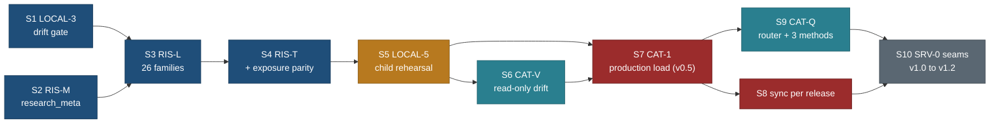

# Catalogue in Neon early: load the research catalogue long before the cutover

Written 26 Oct 2026 by travel-planner (Opus 5.5) on `public/CATALOGUE-EARLY`, branched from `main` 9b556fb. **Planned only:
no product code, data or database setting changed.** Requirement PLAN [R-240](../PLAN.md); BACKLOG 15.250 to 15.256; owner
questions Q280 to Q286 (section 12; **all answered 26 Oct 2026: yes, as recommended**). Principles cited by number from
[principles.md](../design/foundation/principles.md).

**The owner's decision (26 Oct 2026).** Pull the catalogue load into Neon earlier instead of leaving it to the end (v1.0 to
v1.2).

**Supersedes:**
- [local-database-and-seed-sync.md](../features/local-database-and-seed-sync.md) Q183 and R-143's last clause ("seed
  production only when the first 14.2 seam is ready to flip"), its 1.4 row "the first seed of production", and the 8.1 wave
  "SRV-0 window: RIS-L remainder, RIS-T, LOCAL-5". Production is now seeded at CAT-1 (section 4), with no seam flipped.
- [catalogue-intake-and-storage.md](../features/catalogue-intake-and-storage.md) 5.2 item 8 and 6 (RIS-L and RIS-T "inside
  SRV-0, after the E features and the closure queue"), and PLAN R-135's status "after RIS-M and the SRV-0 window".
- [MASTER-ORDER.md](MASTER-ORDER.md) 5.3 row v1.0 (RIS-M, RIS-L, RIS-T, LOCAL-5 as v1.0 pre-work), 3.3 (LOCAL-3 in B2,
  LOCAL-5 in v1.0), 3.8 (RIS-L and RIS-T in v1.0), 4.3 (RIS-M last in the contract order), 4.4 (`research_meta` in v1.0), 5.1
  (lane S in B2 only). Those pages now point here.
- [RELEASE-PLAN.md](RELEASE-PLAN.md) v1.0 "Pre-work (about 68 h)" and infra rows I1 and I5.
- The brief's "Neon Free 0.5 GB per branch": the limit is **1 GB per project** (Neon plans page, read 26 Oct 2026), already
  recorded in PLAN section 6.

## 0. Decision in one paragraph

**Load the whole catalogue into the Neon child, then production, as an Internal milestone CAT-1 that rides v0.5 (fallback:
the next release, v0.6), with no new release number and no seam flipped.** The site keeps serving files; a read-only drift
job compares production with the deployed release's commit after every release and weekly. From v0.10 on, only server code
that already holds a Postgres connection (the intake routes, the favourites write, private MCP, the owner's intake CLI) may
read catalogue rows from Postgres, through the store router with a file fallback; every anonymous read (pages, `/api/v1`
catalogue methods, public MCP, search, nearby, lists, detail, export) stays on `JsonStore` until the SRV-0 seams of v1.0 to
v1.2. **Trade-off:** about 30 agent hours move from after v0.22 to the data seat's idle time around v0.3 to v0.5, plus about
10.5 new hours (drift job, first-load runbook, the first three `PostgresStore` methods, one more test), and every release that
changes data gains a child rehearsal and a production sync (about 20 minutes of coordinator time). In return the cutover
stops being a first-time event: by v1.0 the data has been in production, verified, for months, and v1.0 shrinks from 47 h to
23 h.

## 1. Where we are (measured 26 Oct 2026 on 9b556fb)

| Fact | Evidence |
|---|---|
| Neon production and the child `srv-migrate-verify` hold migrations 0001 to 0011 and no catalogue rows | NEON-MIGRATIONS; coordinator's brief |
| The seed engine (LOCAL-2) loads the 8 reference tables only, into local Docker; `child` and `production` have no connection source yet (`TargetUnavailable`) | local-database spec 13 |
| **The reference seed is now 13,243 rows** (town 11,759, source 587, type_node 398, area 336, tag 81, relevance_class 57, operator 24, catalogue_meta 1), up from 5,542 at LOCAL-2: the towns layer grew | `db:seed` into a throwaway database `catearly_size` made from `travel_template` on the local container, 468 ms to write; the database was dropped afterwards |
| **It adds 8.0 MB in Postgres**: 19.8 MB for the migrated empty database, 27.8 MB after the seed (`pg_database_size`); `town` alone 6.8 MB with indexes | same run, after `vacuum analyze` |
| The 26 remaining seed tables read about 5.6 MB of JSON today (capture 1.65 MB in 50 files, suitability 1.81, relevance 1.84, tracks 0.12, windows, base plans and seasons 0.10, schedule legs 0.07), about 1.4 times the 25 Oct input; about 498 capture records | `wc -c` and a record count over `data/**` |
| Estimated load of those 26 tables: **17 to 22 MB** (the 25 Oct jsonb measure scaled by 1.4, plus 50 to 100% for indexes and typed columns) | local-database spec 5.2 method |
| **Whole catalogue: about 25 to 30 MB.** Production after CAT-1: about 70 to 75 MB of the 1 GB project limit (7%) | 44.5 MB today plus the load |
| RIS-C, RIS-N, RIS-J, LOCAL-1, LOCAL-C, LOCAL-2 are merged; RIS-M, RIS-L, RIS-T, LOCAL-3, LOCAL-5, SRV-0 are not built | BACKLOG 15.131 to 15.146 |
| Q170 to Q177 and Q180 to Q187 are answered yes (Q174 keeps A6); Q177 already approves RIS-M on production after a green child run, on a named commit | PLAN section 5 |

## 2. The sequence

Each step has a gate; nothing later starts until the gate is green. Every target is reached through the LOCAL-C guard
(spec 12.2); production writes need `--approve <HEAD>`, a clean tree and a green child rehearsal file of the same commit.

| # | Step | Target | Gate to pass | Writes to Neon? |
|---|---|---|---|---|
| S1 | **LOCAL-3**: drift stage in `check-all` (offline seed build, throwaway database round trip, second sync writes 0) | local | check-all green; every later data batch must keep it green | no |
| S2 | **RIS-M** (`research_meta`): `meta` on 27 tables, `notes_private`, `track.attrs`, `record_doc.family` widened, `load_run`, evidence and gap columns, column-list grants without `meta`, `notes_private`, `doc` | local, then the child | idempotent `up`; grant test from `information_schema.column_privileges`; RLS on every table; Opus review | child only (migration) |
| S3 | **RIS-L remainder**: the 26 families as builders on the LOCAL-2 engine, `meta` stamping, `load_run`, evidence append-only, run-id rollback, projections last, the public-visibility rule | local | RIS-T green locally | no |
| S4 | **RIS-T**: round trip, idempotency, rollback, privacy, size, **exposure parity** (new, case 7), the six sync cases; parity against `JsonStore` (case 6) waits for SRV-0 | local | all cases green, 0 skipped | no |
| S5 | **LOCAL-5**: `db:rehearse` (child reset from production, delete copied sessions, migrate, dry run, sync, verify, `core/test/db`, RIS-T, one `seed-rehearsal/1` file); the child and production connection strings from the Neon CLI at run time | child | rehearsal file green for the commit | child only |
| S6 | **CAT-V**: read-only drift job (`db:verify --target production` against the commit of the latest `release/*` tag), a launchd agent on the Mac, weekly and after each release | production, read-only | a manual run on the child reports 0 differing tables | no (reads) |
| S7 | **CAT-1, first production load** (coordinator, in the v0.5 release worktree): snapshot, `db-migrate up` (RIS-M and `backup_reader`), `db:sync --dry-run`, `db:sync --approve <sha>`, `db:verify`, record the `load_run` id | production | owner approval of the v0.5 named commit (Q282); green rehearsal of that commit within 72 h | yes |
| S8 | **Each later release with data changes**: deploy, smoke, then rehearse and sync production to the same named commit, then verify (RELEASE-PLAN 6 step 9a) | child, production | as S7 | yes |
| S9 | **CAT-Q** (before FBK-C, v0.10): the per-method store router and the first three `PostgresStore` methods for connected server code only (section 5) | local, child | contract cases green on both stores; anonymous routes pinned to `JsonStore` by a test | no |
| S10 | **SRV-0 seams** v1.0 to v1.2, unchanged in order (EXECUTION-PLAN 14.2), now starting from a loaded, verified production | production | parity per method, 4 weeks of clean CAT-V runs (section 6) | flips reads |

## 3. Safety rules (every load, every target)

| Rule | How it holds | Where it is tested |
|---|---|---|
| Additive only | RIS-M adds columns, a table and grants; it drops nothing; the runner refuses checksum drift and out-of-order files | RIS-M acceptance; runner tests |
| Records only after column grants | the engine refuses a target whose ledger lacks `research_meta` before it writes any family outside the reference set (local-database spec 4.4, "seed after schema") | RIS-L acceptance |
| Idempotent | content hash without stamps; `is distinct from` upserts; a second sync of the same commit writes 0 rows | RIS-T case 2, sync case 4; LOCAL-3 on every check-all |
| Rollback by run id | `evidence` rows of a run are deleted by `rollback --run <id>`; the serving tier returns to an earlier commit by a sync of that commit (checked out, rehearsed, approved); readers have a faster switch (`CATALOGUE_DB_READS=off`, section 5) | RIS-T case 3, sync case 5 |
| Retire, never delete, an entity or offer | `saved_place` cascades on delete | sync case 2 |
| Production guard | LOCAL-C decision table rows 16 to 25: no `psql`, approval equals HEAD, clean tree, green rehearsal under 72 h | LOCAL-C tests |
| Child first, every time | LOCAL-5 resets the child from production, deletes copied sessions, then migrates and syncs the same commit | the rehearsal file |
| Private data never seeded | the allowlist of 34 tables is disjoint from `NOT_SEEDED`; the owner's list origin refused by path | LOCAL-C tests |
| **Exposure parity (new)** | a row the loader marks `published` (entity) or `approved` (media) must be a ref `JsonStore` serves publicly today: same visibility rule as `web/lib/public/sources.ts` (a trip's `private` flag or `trip.visibility`); nothing becomes readable from Postgres that is not already public on the site or `/api/v1` | RIS-T case 7 |
| Approvals | migrations: the owner's standing approval of a named commit (Q177); data: the same named commit after a green rehearsal (Q282) | the guard |

## 4. Release placement and hours

**CAT-1 rides v0.5 as Internal; no new number (Q280).** A new number would either renumber v0.6 onward (against Q262) or be a
patch number (Q271 made v0.14.1 the only one), and the load changes nothing a visitor sees, which is what the Internal track is
for (RELEASE-PLAN 5). v0.5 is already the database release (BKP-1, its `backup_reader` migration, the snapshot regime of
Q185), so one snapshot, one child rehearsal and one production step cover both migrations and the load. If the lane S chain
is not green when v0.5 is cut, CAT-1 rides v0.6 unchanged and v0.5 ships without it: it never blocks a release. **Since
26 Oct (bundles, [RELEASE-PLAN](RELEASE-PLAN.md) 0a):** v0.5 ships in bundle B, so CAT-1 rides B, with bundle C as the
fallback.

**Seat.** The data seat runs the early half of lane S (Q286): in MASTER-ORDER 5.4 its rows 2 to 6 hold 17.5 h of research
against 43.5 h of B1 work, so about 26 h are idle, while B2 is already at or above B1 in rows 3 and 6. RIS-M runs there with
an Opus builder; the rest is Sonnet. AREA-2 and ORG-G, the only data-seat items with near deadlines (v0.6, v0.8), keep their
release.

| Task | h | Model | Seat | 5.4 row | Release |
|---|---|---|---|---|---|
| LOCAL-3 drift stage | 3 | Sonnet | data seat (moved from B2 row 6) | 2 | I (v0.5) |
| RIS-M `research_meta`, plus Opus review 1 h | 7 | Opus | data seat | 3 | v0.5 (migration) |
| RIS-L remainder, plus Opus review 1 h | 8 | Sonnet, Opus review | data seat | 4 | I (v0.5) |
| RIS-T, with exposure parity (+1 h) | 7 | Sonnet, then verifier | data seat | 5 | I (v0.5) |
| LOCAL-5 `db:rehearse`, with Neon CLI connection sources | 2 | Sonnet | data seat; coordinator runs it | 5 | I (v0.5) |
| CAT-V drift job (new) | 2 | Sonnet | data seat | 6 | I (v0.5) |
| CAT-1 first production load (new) | 1.5 | coordinator | | v0.5 release day | v0.5 |
| **To the first production load** | **30.5** | | | | |
| CAT-Q router and three `PostgresStore` methods (new), plus Opus review 1 h | 6 | Opus contract 2 h, Sonnet 3 h | B2, in the contract order before FBK-C | 11 | I (v0.10) |
| Per data release: rehearse, sync, verify | 0.3 each | coordinator | | each release | |

New work: 10.5 h (CAT-V 2, CAT-1 1.5, CAT-Q 6, RIS-T +1). Moved earlier: 26 h (LOCAL-3 3, RIS-M 7, RIS-L 8, RIS-T 6, LOCAL-5
2). v1.0 to v1.2 becomes SRV-0 24 h less the 3 h CAT-Q takes out of it (21 h), plus R-9 2 h: **23 h, was 47 h**.

## 5. What reads Postgres before the cutover, and what stays on files

**The rule (Q281): Postgres catalogue reads only inside requests that already hold a Postgres connection.** Such reads add no
compute wake (P9: one boundary, the store router; no new client load), and their failure falls back to `JsonStore`. Anonymous
reads stay on files, because each one would wake the compute that Neon Free bills at 100 CU-hours a month, and crawlers would
keep it awake (section 8).

| Consumer | Visitor sees it? | Reads from | From | Why |
|---|---|---|---|---|
| Public duplicate check on report, suggest and request forms ("We already have Moraine Lake") | yes, signed-in forms | **Postgres** (`matchNames`, trigram and `unaccent` over public names in the country), fallback `JsonStore` | v0.10 | the intake route writes `visitor_submission` in the same transaction; typo and accent tolerant matching ("Morain lake") |
| "What we already have" in the region after a trip request is sent (R-171) | yes | **Postgres** (`countPlaces` by area path), fallback `JsonStore` | v0.11 | same transaction as the insert |
| "Is it one of these?" while typing (IF5) | yes | `JsonStore` `search` | unchanged | a call per pause; no transaction held |
| Favourite written to the account: the ref must resolve (`account_favourite`) | indirectly (a retired place is refused) | **Postgres** (`resolveRefs`), fallback `JsonStore` | v0.16 | same transaction as the insert |
| `GET /api/v1/resolve` for device favourites and Mine | yes | `JsonStore` | until seam 3 | anonymous |
| Owner intake CLI: queue joined to entity names, areas and clusters | owner | **Postgres** | v0.10 | the queue is in production; one SQL join instead of a file join |
| Private MCP (v0.20): names and places of refs inside a user's drafts | yes, signed-in apps | **Postgres** | v0.20 | the tool runs in the user's transaction |
| Public MCP tools (v0.19) | yes | `JsonStore` | until the seams | anonymous; rate-limited but bot-driven |
| Search and parse, nearby and near mode, list, counts, towns, place and trip detail, export, globe, sitemaps, prerendered pages | yes | files | v1.0 to v1.2 (seams 1 to 3) | anonymous; P7 public site first; parity per method still unbuilt |
| Coverage reports, the stale view (RIS-S part 2), ad-hoc catalogue SQL | owner | local Docker or the child after a rehearsal | after S3 | needs no production read at all; `psql` on production stays refused |
| Towns type-ahead | yes | files | v1.0; **contingency** (Q285): flip the `towns` method early if REQ-RF's world towns would add more than 2 MB to the API function | the `town` table is already loaded by LOCAL-2 |

**Fast rollback for every early reader:** the server env `CATALOGUE_DB_READS` (`off` default, `on` from CAT-Q's release); `off`
plus a redeploy sends every method back to `JsonStore`. Errors and timeouts (500 ms) fall back per call and log
`catalogue_db_fallback` without the query text.

**Freshness rule for early readers.** Postgres must never lead the deployed files: a duplicate answer must not link to a page
that is not deployed yet. So the order on release day is deploy, smoke, then sync (Q283); between the deploy and the sync a
new place is missing from the duplicate check for minutes, which fails safe (at worst one duplicate submission).

## 6. The shadow period (files serve, Postgres is checked)

From CAT-1 until each seam flips, files serve and Postgres is compared, never trusted for anonymous output.

| Layer | What | When | Records |
|---|---|---|---|
| LOCAL-3 | offline seed build and a throwaway local round trip | every `check-all` | the gate result |
| LOCAL-5 | rehearsal on the child: migrate, sync, verify, `core/test/db`, RIS-T | before every production migration or sync | `seed-rehearsal/1` file per commit (gitignored cache) |
| CAT-V | `db:verify --target production` against the commit of the latest `release/*` tag, read-only | after every release (checklist step 9a) and weekly by launchd | `seed-drift/1` JSON per run in `~/Library/Logs/travel/catalogue-drift/` (outside the repository), one line in the release notes' Internal group, a macOS notification on any difference |
| CAT-Q parity | the contract cases of the three early methods on both stores | every `check-all` (local), each rehearsal (child) | test results |
| SRV-0 parity | the contract kit per method on both stores | from SRV-0 | test results |

**Exit criteria for a seam flip (v1.0 to v1.2):** the method's parity cases green on the child and on a production preview;
CAT-V clean for the last 4 weekly runs and the last release; RIS-T green on the child; the owner's approval of the named
commit. A drift result is fixed in the JSON and synced, never by editing a row (local-database spec 2.1 rule 1).

## 7. Migrations (slugs; numbers at merge)

| Slug | Task | Release | Note |
|---|---|---|---|
| `backup_reader` | BKP-1 | v0.5 | unchanged |
| `research_meta` | RIS-M | **v0.5 (was v1.0)** | applied after `backup_reader` if both merge for v0.5; the child first; production under Q177 |
| none | RIS-L, CAT-V, CAT-Q | | `load_run` is in `research_meta`; the router needs no schema; a `pg_trgm` GIN index on `entity` names, if 0003 lacks one, goes into `research_meta` (RIS-M checks) |

## 8. Size, compute and egress on Neon Free

| Limit (Neon plans page, read 26 Oct 2026) | Use after CAT-1 | Headroom | Watch |
|---|---|---|---|
| Storage 1 GB per project (production and the child together; a child is billed on the lower of its changes and its size) | production about 70 to 75 MB; the child after a rehearsal about the same, mostly shared | about 85% | RIS-T size case; CAT-V prints `pg_database_size` |
| At P1 scale (10,000 places, about 20 times today's records) | about 450 MB production; a full rehearsal on top nears 1 GB | none | at 5,000 places: rehearse on a schema-only child plus a sample, or move to Launch (USD 0.35 per GB-month) |
| Compute 100 CU-hours a month per project, autoscaling up to 2 CU, suspend after 5 idle minutes | a rehearsal 0.5 CU-h at most; a production sync and verify 0.2 CU-h; weekly CAT-V 0.1 CU-h; early readers add no wake (Q281) | about 3 CU-h a month of 100 | an anonymous Postgres read path would keep the compute awake: 0.25 CU around the clock is about 180 CU-h, over the limit, and Neon suspends the compute until the next month |
| Public network transfer 5 GB a month per project | a full plan or verify reads every seeded row back, about 20 MB on the wire; about 6 reads a data release plus 4 weekly verifies, about 450 MB a month | about 90% | after RIS-M the plan skips files whose `dataset_file.sha256` is unchanged; if the Neon usage page shows more than 2 GB in a month, CAT-V goes monthly |
| History window 6 hours; 1 manual snapshot | a manual snapshot before CAT-1 and each sync (Q185) | | the catalogue itself is rebuildable from git; the snapshot protects private rows from a bad migration |

## 9. Risks

| Risk | Effect | Mitigation |
|---|---|---|
| A record reaches production before the column grants | `entity.doc`, `meta` or `notes_private` readable by `travel_app` | the engine refuses record families without `research_meta` in the ledger; `doc` written `{}` (Q172) |
| A private-trip record is loaded as `published` | a page-less record readable through an early reader | exposure parity (RIS-T case 7); a fixture private trip |
| Postgres lags or leads the deployed files | wrong duplicate answers | deploy, smoke, then sync (Q283); CAT-V after every release |
| An early reader is added to an anonymous route | compute stays awake, the 100 CU-h run out, Postgres-backed features stop for the month | Q281; CAT-Q's test pins anonymous routes to `JsonStore`; any exception is an owner question |
| Data seat contention | research batches slip by about a week | AREA-2 and ORG-G keep their releases; others move one row; one data task at a time still |
| B2 contract order | CAT-Q touches `core/src/catalogue/store.ts` | it takes a slot in MASTER-ORDER 4.3 before FBK-C, one author |
| Two migrations in v0.5 | number collision | numbers at merge (MIG-N); the runner refuses duplicates |
| The rehearsal resets the child | Auth and Realtime spikes on the child lose their test accounts | rehearse on release day only; spikes use a short-lived branch (Q184) |
| A sync on production fails half way | none: one transaction under the seed advisory lock; a failure rolls back | sync tests; `load_run.status` |
| Egress or compute meters climb | suspension until the next month | section 8 thresholds; CAT-V reports sizes; Launch when strangers rely on it (04-stack 1.3) |
| Neon Data API turned on later | catalogue rows reachable outside our routes | not verified that it is off; CAT-1 runbook step 1 checks it in the console (owner) |
| Retired rows pile up | storage grows slowly | retire is the rule; a yearly review, not a delete |

## 10. Owner actions

| Action | When | Time |
|---|---|---|
| Answer Q280 to Q286 (**done 26 Oct 2026**: yes, as recommended) | before LOCAL-3 starts in the data seat | done |
| Docker Desktop running for the data seat's local loads (Q181) | from S1 | none new |
| Confirm the Neon Data API is off on production (console, Data API tab) | before CAT-1 | 2 min |
| Approve the v0.5 named commit, which now names `research_meta` and CAT-1 in its notes (Q282) | v0.5 | as today |
| Manual snapshot of production before the migrations and CAT-1 (Q185) | v0.5 release day | 2 min |
| Load the CAT-V launchd agent once (`launchctl bootstrap gui/$(id -u) <plist>`) | after CAT-V merges | 2 min |

## 11. Tasks and briefs

**Common to every brief.** Worktree from the current `main`: `git -C /Users/nks/workspace/travel worktree add
/Users/nks/workspace/travel-wt/v2-<TASK> -b public/<TASK> main`, then `pnpm install --frozen-lockfile` and `cp -R
/Users/nks/workspace/travel/web/.og-cache web/`; the home point from `~/.config/travel-secrets/home-point.env` (Q261). Read P1
to P9 and T1 to T5 in [principles.md](../design/foundation/principles.md) and cite them. **Must not touch:** `HANDOVER.md`,
`CLAUDE.md`, `legacy/**`, `web/app/themes.css`, any `data/**` file, `data/catalogue/slugs.json`,
`data/capture/migration-ledger.json`, the applied migrations `0001` to `0011`, the root `.env.local`, `docs/v2/PLAN.md`,
`EXECUTION-PLAN.md`, another active lane's files (`git worktree list`). **Never:** write to Neon production; print or commit a
connection string, password or key; read a production URL except through the target resolver; put travel material in the
Obsidian notes vault. **Verification (T1):** `pnpm --dir core exec tsc --noEmit` and `pnpm --dir web exec tsc --noEmit` clean;
`pnpm --dir core test` with `TEST_DATABASE_URL` set to the local database, 0 skipped; `bash tools/check-all.sh` green;
`python3 tools/tree_check.py --check` and `python3 tools/relink.py check` pass. No task changes a page, so Playwright
screenshots are a regression check only: `/`, `/places/moraine-lake/` and `/trips/canadian-rockies-2029/` at 1440x900 and
390x844 in light and dark (theme set through the site's control), saved outside `web/test-results/` and compared with `main`;
no difference is expected. **Commit rules:** stage only owned paths with `git -C <worktree> add <paths>`, never `-A`; message
`<area>(<TASK>): <what>` ending with the Co-Authored-By trailer of the model that did the work; no push, no merge; the hand-back
names the model and pastes the commands with their exit codes.

### 11.1 LOCAL-3: the drift stage (data seat, Sonnet, 3 h; BACKLOG 15.144)

- **Goal.** A JSON change the database cannot hold fails `check-all` (local-database spec 2.6 rows 1 to 3).
- **Owns.** One stage line in `tools/check-all.sh`; `tools/db/seed-check.mjs` (new); its test under `tools/tests/` or
  `core/test/db/`.
- **Steps.** Offline `buildSeed` over the working tree; with `pg_isready` on 127.0.0.1:54329, create `seed_check_<pid>` from
  `travel_template`, migrate, seed, verify, run the second sync (0 writes), drop it; `CI=true` turns a skip into a failure.
  Today it covers the 8 reference tables; each family RIS-L adds joins it with no change here.
- **Acceptance.** Docker off: `SKIPPED (no local Postgres)` and pass; `CI=true`: fail. Docker on: the database is created and
  dropped; a fixture with a dangling `region_id` fails the offline step; two worktrees running it at once do not collide;
  stage time under 15 s.
- **Commit.** `tools(LOCAL-3): seed drift stage in check-all`.

### 11.2 RIS-M: the `research_meta` migration (data seat, Opus builder, 6 h plus Opus review 1 h; BACKLOG 15.136)

- **Goal.** The database can hold the research contract, and the app role cannot read what it must not, before any record
  reaches production (catalogue-intake spec 4.3 item 1).
- **Owns.** `core/src/db/migrations/<next>_research_meta.sql` (number at merge), `core/src/db/inventory.ts` (classify
  `load_run`), `core/src/seed/contract.ts` (`load_run` in `LOAD_RUN_TABLE`; `NOT_SEEDED` class), `core/test/db/**` new cases,
  the NEON-MIGRATIONS table row.
- **Steps.** As catalogue-intake 4.3 item 1; if 0003 has no trigram index on `entity` names, add `gin (name gin_trgm_ops)` on
  `entity` here (CAT-Q needs it); apply locally, then on the child with `db-migrate` through the target resolver.
- **Acceptance.** `up` twice is idempotent; `travel_app` holds no `meta`, `notes_private` or `doc` column on any public-read
  table (`information_schema.column_privileges`); a 5 KB `meta` is refused; RLS on every table; the seed contract test still
  covers every table. Production waits for the v0.5 release step.
- **Commit.** `db(RIS-M): research_meta migration, column-list grants, load_run`.

### 11.3 RIS-L remainder (data seat, Sonnet, 7 h plus Opus review 1 h; BACKLOG 15.137)

- **Goal.** Every seed family loads through the LOCAL-2 engine, stamped and reversible.
- **Owns.** `core/src/catalogue/postgres/load/**` new builders (`records.ts`, `sidecars.ts`, `evidence.ts`, `research.ts`,
  `projections.ts`), the `load_run` write in `engine.ts`, `core/bin/db-seed.ts` (`rollback --run`), tests under
  `core/test/catalogue/load-*.test.ts`.
- **Steps.** The 26 families of `SEED_TABLES` with `owner === "RIS-L"` in apply order (spec 6.5); `stampSeedMeta` on `META_TABLES`
  rows; `evidence` append-only (`E_SEED_APPEND_ONLY`); projections computed by the same core code as `JsonStore`, written last;
  entity `status` from the public-visibility rule `JsonStore` uses (a ref is `published` only when the site serves it);
  refuse record families on a target whose ledger lacks `research_meta`.
- **Acceptance.** On a migrated local database, `db:seed` writes every family with counts printed per table; a second
  `db:sync` writes 0 rows; `db:verify` exits 0; rollback of a run removes exactly its evidence rows; the plan output matches
  spec 6.4.
- **Commit.** `core(RIS-L): catalogue families on the seed engine, load_run, rollback by run id`.

### 11.4 RIS-T (data seat Sonnet, then travel-verifier, 7 h; BACKLOG 15.138)

- **Goal.** The load is proven before any Neon write.
- **Owns.** `core/test/catalogue/postgres.test.ts` and fixtures under `core/test/catalogue/fixtures/`.
- **Steps.** Catalogue-intake 6 cases 1 to 5, local-database 6.6 sync cases 1 to 6, and **case 7, exposure parity**: the set of
  `published` entity ids and `approved` media equals the refs `JsonStore` serves on `/api/v1/places` and trip pages; a fixture
  trip marked private keeps its records unpublished; case 5 size: the 34 seed tables under 50 MB in total
  (`pg_total_relation_size`), not the database. Case 6 (parity of method bodies) is written as `todo` and joins SRV-0.
- **Acceptance.** All cases pass locally with 0 skipped, then on the child inside LOCAL-5; the verifier reruns them.
- **Commit.** `test(RIS-T): load, idempotency, rollback, privacy, size, exposure parity`.

### 11.5 LOCAL-5: the rehearsal (data seat, Sonnet, 2 h; coordinator runs it; BACKLOG 15.146)

- **Goal.** One command rehearses a production change on the child and writes the evidence the guard reads.
- **Owns.** `tools/db/rehearse.mjs` (new), the `db:rehearse` line in the root `package.json`, the `child` and `production`
  connection sources in `core/src/catalogue/postgres/load/target.ts`.
- **Steps.** Connection strings for both branches come from `neon connection-string <branch> --project-id
  damp-queen-64719841` at run time, held in memory, never printed or written (not from the root `.env.local`, so a release
  worktree works); reset the child from production behind a typed confirmation; delete `neon_auth.session` rows on the child;
  migrate; dry run; sync; verify; `core/test/db` and RIS-T; write `seed-rehearsal/1` through `rehearsalEvidenceText`.
- **Acceptance.** The report names the commit and the child; no connection string in output or file; refuses when the branch id
  resolves to the default branch; the guard accepts the file for the same commit and refuses it after 72 h.
- **Commit.** `tools(LOCAL-5): db:rehearse on the child branch`.

### 11.6 CAT-V: the production drift job (data seat, Sonnet, 2 h; BACKLOG 15.251)

- **Goal.** Know within a week, and on every release, whether production still equals the released commit's seed (P9).
- **Owns.** `tools/db/drift-check.sh` (new), `tools/db/launchd/com.nks.travel.catalogue-drift.plist` (template, new), a test
  under `tools/tests/`.
- **Steps.** Resolve the latest `release/*` tag by creation date (`git for-each-ref --sort=-creatordate --count=1
  refs/tags/release/`; bundle tags are `release/<letter>` since 26 Oct, RELEASE-PLAN 0a B6); in a temporary detached worktree of it, run `db:verify --target production
  --json` (read-only; guard row 17 allows it); write the result to `~/Library/Logs/travel/catalogue-drift/<UTC>.json` with the
  tag, commit, per-table status and `pg_database_size`; `osascript` notification on any difference; remove the worktree; weekly
  `StartCalendarInterval`.
- **Acceptance.** A run against the child (`--target child`) on a rehearsed commit reports 0 differing tables; a manual
  `update town` on the child makes it report one; no connection string in the log (sentinel test); the job refuses to write
  anything to the database (read-only transaction asserted).
- **Commit.** `tools(CAT-V): read-only catalogue drift job`.

### 11.7 CAT-1: the first production load (coordinator, 1.5 h; BACKLOG 15.252; later releases: 15.254)

Runbook, after the owner approves the v0.5 named commit (RELEASE-PLAN 6 step 5). Create the release worktree at the named
commit now rather than at step 8, because the guard reads HEAD, a clean tree and the rehearsal file of that checkout:
1. Owner: confirm the Neon Data API is off; take the manual snapshot of production.
2. `pnpm db:rehearse` (LOCAL-5) for the named commit; it must be green (it migrates and syncs the child).
3. Checklist step 6: `db-migrate up` on production through the target resolver with `--approve <sha>`: `backup_reader`, then
   `research_meta` (numbers as merged).
4. Checklist steps 7 to 9: env, deploy, smoke.
5. Checklist step 9a: `pnpm db:sync --target production --dry-run` (expect only inserts), then `pnpm db:sync --target
   production --approve <sha>`; `pnpm db:verify --target production` exits 0; run CAT-V once by hand.
6. Record the `load_run` id, row totals and `pg_database_size` in the v0.5 notes (Internal) and in BACKLOG 15.252.
Rollback: no reader exists yet, so a bad load harms nothing visible; fix the JSON, rehearse and sync the fixed commit on its
approval. Later releases repeat steps 2, 3 (if migrations), and 5 when `db:sync --dry-run` against production shows a
difference; with no data difference and no migration they skip the rehearsal.

### 11.8 CAT-Q: the store router and the first three Postgres methods (B2, Opus 2 h, Sonnet 3 h, Opus review 1 h; BACKLOG 15.253)

- **Goal.** Server code that already holds a Postgres transaction can read catalogue rows through the one data boundary, with
  `JsonStore` as the fallback; anonymous code cannot (P9, Q281).
- **Owns.** `core/src/catalogue/router.ts` (new: per-method store choice from `CATALOGUE_DB_READS` and the caller's
  connection), `core/src/catalogue/postgres/store.ts` (new: `resolveRefs`, `countPlaces` by area path, `matchNames`), the
  `matchNames` addition to `core/src/catalogue/store.ts` and its `JsonStore` implementation, contract cases under
  `core/test/catalogue/`, the OpenAPI regeneration if a type changes.
- **Must not touch.** Any `web/app/api/v1/**` handler (anonymous routes keep `JsonStore`), `web/**` components.
- **Steps.** `matchNames({q, cc, area?, limit <= 8})` returns public refs by trigram similarity over `unaccent(name)` and
  aliases; the router picks Postgres only when `CATALOGUE_DB_READS=on` and the caller passes its open transaction; a 500 ms
  timeout or an error falls back to `JsonStore` and logs `catalogue_db_fallback` without the query; a test walks every
  `web/app/api/v1/**` handler and fails if one reaches the Postgres store.
- **Acceptance.** The three methods pass the same contract cases on both stores against the local seed; "Morain lake" in
  CA matches `moraine-lake` on Postgres; exposure parity holds (only published refs); the anonymous-route test passes; the
  privacy detector passes on every response; slot in MASTER-ORDER 4.3 before FBK-C.
- **Commit.** `core(CAT-Q): store router and the first PostgresStore methods for connected callers`.

## 12. Owner questions (Q280 to Q286, all answered 26 Oct 2026: yes, as recommended)

| ID | Question | Recommendation | Trade-off |
|---|---|---|---|
| Q280 | Ship the first catalogue load (CAT-1, with RIS-M, RIS-L, RIS-T, LOCAL-3, LOCAL-5, CAT-V) as an Internal part of v0.5, falling back to the next release if not green, with no new release number? | **Yes** (ANSWERED 26 Oct 2026: yes, as recommended.) | v0.5's release day gains one rehearsal and one sync; a new number would renumber the train or break the one-patch rule |
| Q281 | Until the SRV-0 seams, read catalogue rows from Postgres only inside requests that already hold a Postgres connection (intake, favourites write, private MCP, the owner CLI); pages, `/api/v1` catalogue methods and public MCP stay on files? | **Yes** (ANSWERED 26 Oct 2026: yes, as recommended.) | Search, nearby and detail gain nothing from Postgres before v1.0; the free compute allowance and the public pages stay safe |
| Q282 | Does your approval of a release's named commit also approve the production `db:sync` of that same commit, after a green child rehearsal, with no second approval? | **Yes** (ANSWERED 26 Oct 2026: yes, as recommended.) | One approval covers deploy and data; you still see the plan totals in the notes |
| Q283 | On release day: deploy, smoke, then sync production (Postgres may lag the files by minutes, never lead them)? | **Yes** (ANSWERED 26 Oct 2026: yes, as recommended.) | A brand-new place is missing from the duplicate check for minutes after a deploy |
| Q284 | CAT-V weekly and after every release, as a launchd job on this Mac, with results kept locally and a notification on drift? | **Yes** (ANSWERED 26 Oct 2026: yes, as recommended.) | Runs only when the Mac is on; a missed week shows as a gap in the folder |
| Q285 | Keep the `towns` method on files until v1.0, but flip it early if REQ-RF's world towns would add more than 2 MB to the API function? | **Yes, as a contingency only** (ANSWERED 26 Oct 2026: yes, as recommended.) | An anonymous Postgres path would then exist early, against Q281, for one method |
| Q286 | Run the early half of lane S in the data seat (RIS-M with an Opus builder, the rest Sonnet) rather than in B2? | **Yes** (ANSWERED 26 Oct 2026: yes, as recommended.) | Research batches slip about a week; B2 keeps its contract pace for B1 |

Superseded without a question (owner decision of 26 Oct): Q183 ("seed production only when the first seam flips").

## 13. Gotchas

- **The seed grew.** Towns are 11,759 rows today, not the 4,223 of LOCAL-2's notes; take counts from the data at build time.
- **`db:seed` is loopback only.** The child and production get data through `db:sync` (guard row 14).
- **The release worktree has no root `.env.local`.** LOCAL-5 takes both connection strings from the Neon CLI, so rehearse and
  sync from the release worktree where HEAD is the named commit and the tree is clean.
- **The rehearsal file is per checkout** (`tools/.cache/db-rehearsal/<commit>.json`): rehearse and sync from the same folder.
- **A dry run on production reads every row back** until RIS-M's file skip works; it counts toward egress.
- **`psql` on production is refused.** Ad-hoc SQL runs on local Docker or the child after a rehearsal.
- **The rehearsal resets the child.** Never rehearse while an Auth or Realtime spike is running there.
- **The beacon, Neon Auth and sign-in already wake production.** Early readers ride those wakes; a new anonymous reader does not.

## Change log

| Date | Change |
|---|---|
| 2026-10-26 (PLAN-CONSOLIDATE) | Q280 to Q286 answered by the owner (yes, as recommended): header, section 10 and section 12 marked. The load and verify steps of this page are also listed, in order with the research tasks, in [DATA-PLAN.md](DATA-PLAN.md) 3, which adds the database cross-check (DATA-PLAN 4); this page stays the authority for the briefs |
| 2026-10-26 | First version (CATALOGUE-EARLY, planned only): the sequence S1 to S10, safety rules with exposure parity, CAT-1 in v0.5 as Internal, the early-reader rule and table, the shadow period and exit criteria, measured seed size (13,243 reference rows, 8.0 MB), Neon Free headroom, risks, owner actions, briefs LOCAL-3, RIS-M, RIS-L, RIS-T, LOCAL-5, CAT-V, CAT-1, CAT-Q, Q280 to Q286 |
