# Release plan: one ordered train from v0.1 to the Postgres cutover

Written 25 Oct 2026 by travel-planner (Opus) at `main` 52339a0. Planned only: nothing here is built or deployed by this
page. Requirement PLAN [R-180](../PLAN.md); owner questions Q220 to Q229 (section 9; **all answered 25 Oct 2026: Q220 to Q226, Q229 yes as recommended; Q227 and Q228 changed**). Release notes live in the root
[CHANGELOG.md](../../../CHANGELOG.md).

**The owner's request (25 Oct 2026).** "Add everything in detail and in proper order; make what is built live; then build
feature by feature and release each; keep release notes; make the repo public so GitHub Actions stops being a problem."
The public-repo decision belongs to the separate audit PUBLIC-AUDIT, which runs first. This page does not decide it; its
GitHub Actions plan (section 7) applies once the repository is public, and works unchanged on a private one.

**Supersedes:** "no production deployment" in the PLAN platform paragraph, the PLAN section 3 Hosting row, HANDOVER's
current section and EXECUTION-PLAN 13.2. Production has been live since 25 Oct 2026 at
https://travel-beta-tan.vercel.app, commit 47be5b5, migrations 0001 to 0011 applied. The TODO row "Owner action: turn on
the Cloudflare Web Analytics beacon" says a builder must add the script; the script is already in `web/app/layout.tsx`
behind `NEXT_PUBLIC_CF_BEACON_TOKEN`, so only the token and a privacy-page line are needed (v0.2).

## 0. Corrections from the master order (25 Oct 2026; read first)

[MASTER-ORDER.md](MASTER-ORDER.md) (R-220) analysed every remaining task for conflicts and re-cut this train. **Its
section 5.3 is the release order and numbering from v0.4 onward; the release numbers in sections 1 to 3 below are the
first version's** (Q262, approved 25 Oct 2026: the section 5.3 numbering is THE train; the release numbers in sections 1 to 3 are legacy). Sections 4 to 8 (gate, smoke, rollback, checklist, CI,
notes) are unchanged. The corrections, each argued in MASTER-ORDER 5.5:

| # | Correction |
|---|---|
| C0 | `release/v0.1` goes on `47be5b58`: the history was rewritten, and 47be5b5 (the deployed commit) is its private-history id |
| C1 | v0.4 (D2b) folds into v0.2: D2b and Q88's option A are already merged and data has no flag. v0.2's owner actions gain `HOME_POINT_LAT` and `HOME_POINT_LON` in Vercel Production and Preview (the build fails closed without them since PUBLIC-SCRUB), the Vercel Firewall rate-limit rule on `/api/v1/*` (BACKLOG 15.22), and the Q88 ruling. v0.2 also gains ACCT-PH-RV (ACCT-PH merged without review) and BUD-1 (Q260) |
| C2 | New v0.4: the TRP2b2 "before go-live" deferrals (REMAINING-CLOSURE-PLAN 4), open while production is live |
| C3 | The image and share-image build fix (IMG-1, 7 h) moves from v0.8 to v0.4 |
| C4 | BKP-1 has no LOCAL-4 dependency (Q228) and adds the migration `backup_reader` to v0.5 |
| C5 | New v0.6: the owner's 23 Oct closure queue (API/HYG loose ends, LST2b) with LST2c, MX and CONS-3, before R-59 |
| C6 | Photos (15.158) move to v0.7, before R-59; `pickPhotos` belongs to the photos task; the photo figure needs Q263 |
| C7 | R-59 is sized (19 h, read-only part) and its part 3 (base changes, signed in) moves to v0.17 |
| C8 | New v0.11: the request forms (R-190 to R-196), right after the report release (Q238) |
| C9 | New v0.13: Where to stay (R-76 to R-78) on the public site; STY-2 joins v0.17 |
| C10 | New v0.14: trips written as data get pages (TD-1 to TD-3, Q267), before customise |
| C11 to C14 | OVR-0 has no dependency on OVR-Cb; migration files are named by slug; FBK-C's migration does not wait for FAV-D; GSI-1 builds on `SignInCard.tsx`; section 2's seat table is replaced by MASTER-ORDER 5.1 and 5.4 |
| C15 | (owner decision, 26 Oct 2026) The catalogue load moves forward from v1.0 to v0.5 as Internal: CAT-1 with RIS-M (`research_meta`), RIS-L, RIS-T, LOCAL-3, LOCAL-5 and the drift job CAT-V; production is seeded with no seam flipped and the site keeps serving files; CAT-Q (the store router and three Postgres methods for connected callers) before v0.10; checklist step 9a syncs production after every release that changes data. [CATALOGUE-EARLY.md](CATALOGUE-EARLY.md) |

**Audits (25 Oct 2026, amended 26 Oct, [AUDITS-AFTER-RELEASE.md](AUDITS-AFTER-RELEASE.md), R-230 to R-237, Q270 to Q279;
Q271 answered by the 26 Oct decision).** After v0.14 is live, the field-usefulness audit runs and its changes ship as the
**patch release** `release/v0.14.1` (field slimming), which only removes or fixes and keeps the gate, smoke list, rollback and
checklist of sections 4 and 6 unchanged (Q271: v0.14.1 is the only patch release). The UI and UX audit moved (owner, 26 Oct):
it runs once at the end of the UI train, after v0.20 and v0.21 (if shipped), and ships as the new release **v0.22 "UI and UX
audit and fixes"** just before the v1.0 Postgres cutover; v0.14.2 no longer exists. No other release is renumbered. CUS-C
(v0.15) starts after the owner approves the field list; CUS-1 does not wait for a UI audit; a narrowed delta pass (the MCP
field list) runs before v0.19. Recording during the build (a fixed screenshot set for every release outside the repository,
`budget:report` in each CHANGELOG Internal line, UI issues appended to [UI-NOTES.md](UI-NOTES.md)) is that page's section 8.

The test-strategy and trip-origin plans are merged (I7, I8 and their log rows below). Their text uses the first version's
numbers: "v0.9" in the trip-origin rows is new v0.8 (MASTER-ORDER 5.3), and I7's "before v0.9" is before new v0.8.

Old to new numbers: v0.2 and v0.4 to v0.2; v0.3 stays; v0.5 stays; v0.6 to v0.9; v0.7 to v0.10; v0.8 to v0.7; v0.9 to
v0.8; v0.10 to v0.12; v0.11 to v0.15; v0.12 to v0.16; v0.13 to v0.17; v0.14 to v0.18; v0.15 to v0.19; v0.16 to v0.20;
v0.17 to v0.21. New: v0.4, v0.6, v0.11, v0.13, v0.14, and (26 Oct) v0.22. The summary table and sections below keep the old numbers; v0.22 is a new
number in both schemes and follows the old v0.17 (new v0.21).

## 1. Summary

| Release | Goal in one line | Agent hours (from the specs) | Migrations (slugs; numbers at merge) |
|---|---|---|---|
| **v0.1** | What is live today: the public read-only site, password sign-in, own plans | shipped (47be5b5) | 0001 to 0011 |
| **v0.2** | Sign-in reachable on phones, a privacy page, page-view counts, the Maps key locked down | ACCT-PH (built, unsized) + GSI-P 2 h | none |
| **v0.3** | Mine: find your copied trips and favourites on this device, phone and desktop | 43 h | none |
| **v0.4** | Basics for the 74 stored places, under the ruled place-size budget (Q88) | D2b about 6 h (done, integrating) + Q88 option | none |
| **v0.5** | Sign in by emailed code; new accounts verified by code | 7 h + BKP-1 6 h | none |
| **v0.6** | Continue with Google | 24 h | none |
| **v0.7** | Report a problem, suggest a place or an improvement, ask for a trip (signed in) | 67.5 h | `intake` |
| **v0.8** | The licensed trail and stop photos shown, resized on our host, and share images | unsized (15.158 and the image build fix) | none |
| **v0.9** | Trail links and directions beside every stop; whole-day route; getting there from your city or the nearest airport | unsized (R-59) + ORG 16.5 h (core and data, 11.5 h, ride earlier as internal) | none |
| **v0.10** | Best time to go and the trip overview with thumbnails | 46 h + D8-R 8 h | none |
| **v0.11** | Customise a trip (signed in) | 34 h | `custom-draft` |
| **v0.12** | Copies and favourites follow you into your account | 33 h | `draft-cap`, `account_favourite` (+ `account-start` if Q246) |
| **v0.13** | More edits in a customised trip; add your own stops from our places | 20 h (+2 h CUS-C widening counted in v0.11) | none |
| **v0.14** | Search the map for a stop we do not have; suggest it to us | 29 h | none |
| **v0.15** | Public MCP (read-only catalogue, no sign-in), security-reviewed | 11 h + review slice (Q225) | none |
| **v0.16** | Private MCP (your plans, read), security-reviewed | 40 h | `mcp_access` and MCP-T's token tables |
| **v0.17** | Own domain and Email Phase 2 (only when Q148 triggers) | 29 h (Q149 no) or 42.5 h | `account_mail_state`, `mail_suppression` (+ `hook_event` if Q149 yes) |
| **v0.22** | UI and UX audit and fixes, run once on the whole product (owner, 26 Oct); its fixes only change the UI | UA-0 5 h + AU-GU 0.5 h + 65 h (24 h placeholder) | none |
| **v1.0 to v1.2** | Postgres cutover, one seam per release, `JsonStore` kept one release | about 68 h before the first flip | RIS-M `meta`, SRV-0 loader tables |

Infra work with no visitor change (CI, backups, drift gate) ships inside the next release and is listed under
"Internal" in its notes (section 5, track I).

**Ordering rules used.** Value first, risk second, dependencies always. What is built and unreleased goes first; then
small visitor wins; then the account features in the order their specs require (EML before Google, Google before
favourites sync per Q124, feedback before requests, CUS before the REQ copy edits); MCP in its own reviewed releases;
the domain only on a trigger; the store swap last. Two places differ from the coordinator's listed order, both forced
by the specs: photos (v0.8) sit between requests day one (v0.7) and requests phases 2 and 3 (v0.13, v0.14), because
phase 2 needs CUS-1, CUS needs the overview's phase 1 preview (OVR brief), and the overview's thumbnails (OVR-3) reuse
the photo read path of 15.158; and Google sign-in (v0.6), absent from the list, is placed where the email and Google
specs put it.

**Main is always releasable.** Every feature merges behind its capability flag (`web/lib/capabilities.ts`), off in Vercel
until its release, so merge order and release order are independent. A release is: flags on, migrations applied,
the named commit deployed. Data releases (v0.4) have no flag, so they ride the first deploy after they merge; v0.3 and
v0.4 may swap, and the version number follows the deploy order.

## 2. Critical path and parallel work

```mermaid
flowchart LR
  classDef rel fill:#1F4E79,stroke:#163A5A,color:#FFFFFF
  classDef core fill:#2A7F8F,stroke:#1E5F6B,color:#FFFFFF
  classDef owner fill:#B7791F,stroke:#8A5A12,color:#FFFFFF
  classDef gate fill:#9B2C2C,stroke:#6B1E1E,color:#FFFFFF
  classDef infra fill:#5A6772,stroke:#3E4850,color:#FFFFFF

  V1["v0.1 live<br/>47be5b5"]:::rel
  AP["ACCT-PH review<br/>GSI-P"]:::core
  V2["v0.2"]:::rel
  NAV["NAV-F, NAV-C, NAV-1,<br/>NAV-2, FAV-C, FAV-1, OVR-0"]:::core
  V3["v0.3"]:::rel
  FBK["FBK-C, FBK-M, FBK-1,<br/>FBK-S, FBK-2, FBK-3, REQ-1"]:::core
  V7["v0.7"]:::rel
  PH["15.158 photos,<br/>image build fix"]:::core
  V8["v0.8"]:::rel
  R59["R-59 links"]:::core
  OVR["OVR-N to OVR-3"]:::core
  CUS["CUS-C, CUS-1, CUS-2"]:::core
  REQ2["REQ-E, REQ-P"]:::core
  REQ3["REQ-G0, REQ-G,<br/>REQ-S, REQ-L, REQ-A"]:::core
  V14["v0.14"]:::rel
  SRV["RIS-M, RIS-L, SRV-0,<br/>parity, LOCAL-5"]:::infra
  V22["v0.22<br/>UI and UX audit and fixes"]:::gate
  V10["v1.0 to v1.2"]:::rel

  D2B["D2b + Q88"]:::owner
  EML["EML-S, EML-V, EML-P,<br/>O-E1, EML-E, BKP-1"]:::gate
  GSI["GSI-0 to GSI-E"]:::core
  SYNC["NAV-D, FAV-D, FAV-2, NAV-3"]:::core
  MCP["MCP-C, MCP-1, MCP-G,<br/>MCP-T, MCP-2, MCP-O, MCP-U, MCP-S"]:::gate
  CI["LOCAL-3, LOCAL-4<br/>after PUBLIC-AUDIT"]:::infra

  V1 --> AP --> V2 --> NAV --> V3 --> FBK --> V7 --> PH --> V8 --> R59 --> OVR --> CUS --> REQ2 --> REQ3 --> V14 --> V22 --> SRV --> V10
  V2 -.-> D2B
  V3 -.-> EML --> GSI
  CUS -.-> SYNC
  GSI -.-> SYNC
  V3 -.-> MCP
  V2 -.-> CI
```

The critical path is the solid line: the web seat (seat A) carries every visitor-facing UI task, and the REQ chain is the
long pole. Dotted work runs in seat B on disjoint files. The owner's rule is two lanes at a time; the table names what
may pair with what.

| Seat A (web UI, mostly Sonnet) | Seat B at the same time (core, contracts, data, infra, mostly Opus) | Files that must not overlap |
|---|---|---|
| ACCT-PH review and merge; GSI-P | D2b integration and the Q88 option; Q-D key restriction (owner) | place budget: whichever merges second re-measures `place-size.test` |
| NAV-1, NAV-2 | NAV-C, then FAV-C, then EML-S | `core/src/privacy/detect.ts` (NAV-C, FAV-C, CUS-C each add keys): one at a time |
| FAV-1 | EML-V, EML-P, BKP-1, LOCAL-3 | `web/app/privacy/page.tsx` (GSI-P creates; EML-P, FBK-2 add sections): one at a time |
| OVR-0 (before R-59 starts) | GSI-0, GSI-T | `web/components/trips/**`: OVR-0, then R-59, then OVR own it in turn |
| FBK-2 | FBK-C, FBK-M, FBK-1, then GSI-1, GSI-2 | `web/components/auth/**` (GSI-1's button slot) and `web/app/account/page.tsx` (GSI-1, GSI-2, later NAV-3): sequential |
| REQ-1 | FBK-3, MCP-C, MCP-G (core only, no web files) | `core/src/catalogue/store.ts`, `core/src/schema/api/**`, OpenAPI: one contract author (D-E2) for FAV-C, OVR-Ca, MCP-C |
| 15.158 photos | MCP-1 (`web/app/mcp/**`), LOCAL-4 | Commons: one runner, never two agents (images build included) |
| R-59 | OVR-Ca, OVR-Cb (store and routes) | `web/components/actions/CopySheet.tsx`: NAV-2 and OVR-1 never in parallel |
| R-59, then ORG-1 and ORG-2 | ORG-C, then ORG-D, ORG-G, ORG-M (core and data only) | `core/src/privacy/detect.ts` and `core/src/catalogue/store.ts`: ORG-C one at a time with NAV-C, FAV-C, CUS-C and OVR-Ca (one contract author); ORS: one runner |
| OVR-1, OVR-2, OVR-3 | D8-R research (data only), CUS-C | `web/scripts/neon-e2e.mjs` (EML-E, GSI-E, FBK-E, FAV-2E, NAV-E, CUS-2): one at a time |
| CUS-1 | MCP-T, MCP-2 | `web/lib/capabilities.ts`: append-only; rebase, never reorder |
| REQ-E UI, REQ-P | NAV-D, FAV-D, FAV-2, NAV-3 (account routes) | `web/app/t/**`: REQ-E never in parallel with CUS-2 |
| REQ-S, REQ-L | REQ-G (route), REQ-A (CLI), MCP-O, MCP-U | `core/bin/intake.ts`: FBK-3 before REQ-A |
| SRV-0 parity work | RIS-M, RIS-J, RIS-H, RIS-A, RIS-L, RIS-T, LOCAL-5 | `core/bin/capture.ts`: RIS-N (done) and RIS-S serial |

Shared budgets are a collision even when files are disjoint: trip start JS (2 B headroom) and place HTML (19 B in the
sign-in-on build). Every UI task measures both, in the public and the sign-in-on builds, with its own flag on and off.

## 3. The releases

Every release uses the same gate (section 4), the same checklist (section 6) and the same rollback (section 4.3) unless
its row adds to them. "Smoke" lists only the URLs added to the standard list of section 4.2. Sizes are copied from the
specs; "unsized" means no spec gives one, and the task's brief must size it before it is scheduled.

### v0.1: the public site as it is live today (shipped)

| Field | Content |
|---|---|
| Goal | Record what visitors can use today and tag it, so every later release has a named baseline |
| Contents | Everything on `main` up to 47be5b5: phase A, B and E work merged by then (trips, places, globe, search, timeline, Google trip map with routed legs, Export trip, copy and share, suitability, seasons on six trips, phone back-to-top, youngest-child default 10), the Neon foundation (R-58), EML-M, EML-Q and EML-1 (the passwordless-first card with codes off, the auth proxy guard, owner alerts) |
| Migrations | 0001 to 0011 applied on the production branch |
| Owner actions done | approved the named commit; Vercel env set; Neon trusted domain `https://travel-beta-tan.vercel.app` |
| Coordinator action now | tag it retroactively: `git tag -a release/v0.1 47be5b5 -m "v0.1: public site live"`, push the tag on its own line (Q220) |
| Known limits | photos load from Wikimedia Commons, not from resized copies on our host; no share (link preview) images; sign-in by emailed code is off; the phone header has no sign-in link; a copied trip is kept in the browser but no page lists it; researched trail and stop photos are not shown; Realtime allowed origins not updated for production (live refresh of account drafts across tabs is not expected to work there; check in the v0.2 smoke) |
| Notes | CHANGELOG entry v0.1 (written with this page) |

### v0.2: sign-in on phones, privacy page, page-view counts

| Field | Content |
|---|---|
| Goal | A phone visitor can reach sign-in; the site says what it collects; the owner starts counting page views per path |
| Built on main since v0.1 | LOCAL-2 seed engine (`db:seed`, `db:sync`, `db:verify`; internal, no visitor change) and docs. **Nothing a visitor sees.** Recommendation: do not deploy main alone; it rides v0.2 (Q221). Trade-off: production stays one internal change behind main until v0.2 |
| Contents | ACCT-PH (built in `travel-wt/v2-ACCTPH`, uncommitted, unsized): the fifth bottom-bar item "Sign in" / "Account", interim until NAV-1 replaces it 1:1 (navigation spec N12). GSI-P (Sonnet 2 h; copy by the planner, owner approves): `/privacy/` and its footer link, pulled forward from v0.6 (Q222) so the beacon is named before it loads. The beacon itself: config only |
| Dependencies | ACCT-PH design review and verifier; ACCT-PH's start-JS and place-HTML baseline measured (NAV-1 needs it) |
| Owner actions | (1) Q-D: confirm the browser Maps key is restricted to `travel-beta-tan.vercel.app` and the localhost ports, Maps JavaScript API only, with a daily quota (production is public now; this was "before any preview leaves this Mac"). (2) Q205: create the Cloudflare Web Analytics site for the production host and set `NEXT_PUBLIC_CF_BEACON_TOKEN` in Vercel **Production only** (not Preview). (3) Approve the privacy page words. (4) Optional: `neon deploy` for the Realtime allowed origins in `neon.ts`, or skip it (the smoke records whether live draft refresh works). (5) Phone check on a real phone. (6) Approve the named commit |
| Data work | none |
| Migrations | none |
| Risks | The beacon adds one script tag to every page, about 150 B of HTML, against 19 B of place-HTML headroom. Recommendation (Q222): measure the budget on the public build without the token (as today) and record the tag as a fixed overhead outside the ratio, since it is not catalogue growth (P8 protects the catalogue, not third-party tags). ACCT-PH is short-lived (replaced in v0.3) |
| Extra gate | budgets in the public build and the sign-in-on build; one build with the beacon token set to prove the tag renders and nothing else changes |
| Smoke | `/privacy/`; on a 390 px phone the bar shows the sign-in item and reaches `/sign-in/`; the page source of `/` contains `static.cloudflareinsights.com` once and only on production |
| Rollback | standard; unset the beacon token and redeploy |
| Notes | coordinator drafts, owner approves |

### v0.3: Mine, copies and favourites on this device

| Field | Content |
|---|---|
| Goal | A visitor who copies a trip or favourites a place finds it again in Mine, on phone and desktop, with no account (P7: copy is the 90% action, and today the copy is unfindable) |
| Contents | NAV phase 1 (20 h): NAV-F 1.5 h, NAV-C 3 h (+0.25 h: `copies/1` reserves `from` and `gw`, [origin spec](../features/trip-origin-and-nearest-airport.md) 10), NAV-1 5.5 h (with the phone header sign-in icon, Q203), NAV-2 6 h, NAV-R1 2 h, NAV-V1 2 h. Favourites step 1 (20 h): FAV-C 4 h, FAV-1 12 h (re-scoped to the Mine panel), FAV-R 2 h, FAV-V 2 h. OVR-0 3 h (pulled forward, Q223): `CategoryView` into a dynamic chunk, which frees trip start JS for the trip-page heart. Total 43 h |
| Dependencies | v0.2 merged (ACCT-PH baseline); Q101 to Q108 answered (Q108 favourite scope and cap); OVR-0 merges before R-59 starts, because both own `web/components/trips/**` |
| Owner actions | phone check at 320 and 390 px (five items in the bar, the header icon, copy a trip then find it in Mine after reload); approve |
| Data work | none |
| Migrations | none (device storage only: `copies/1`, `favourites/1`) |
| Risks | Two budgets at their limit (trip start JS 2 B, place HTML 19 B): NAV-1 pays with CSS icon masks and drops the dot if the net is above 0 B. The old `travel:v1:copy-drafts` key must move, never drop. If Q223 is no, the trip-page heart waits for v0.10 and only places get one |
| Extra gate | privacy test: no copy, party or favourite in any exported page, `/api/v1` body or catalogue file (navigation acceptance 8); quiet full e2e |
| Smoke | `/mine/`, `/mine/?show=favourites`, `/favourites/` (redirects to Mine), `/trips/canadian-rockies-2029/` copy sheet then Mine, `/places/moraine-lake/` heart then Mine |
| Rollback | standard; flags `mine` and `favourites` off and redeploy (copies stay in the browser) |
| Notes | coordinator drafts, owner approves |

### v0.4: basics for the 74 stored places

| Field | Content |
|---|---|
| Goal | Every stored place shows its basics (identity, seasons, points) or an honest "Not checked yet", inside a ruled place-size budget |
| Contents | DATA-D2b (about 6 h, four splits US 35, CA 22, IT 10, INT 7), integrated on `public/D2b-INT` (re-derived towns, areas, relevance, source registry; seven store notes cleaned of household planning text). The Q88 option the owner picks: A, re-baseline the 56 former stub pages to their first full record (`public/D2b-INT-size-options` at b8000f2 (private history), test-only; median after 1.2491); B, lazy rows (uncommitted in `travel-wt/v2-D2B-INT-size`); C, raise the cap to +35% |
| Dependencies | Q88 ruling. This page does not change Q88's recommendation in PLAN section 5 (keep +25%, lazy sections) |
| Owner actions | rule Q88; approve |
| Data work | D2b, plus the follow-ons (`suitability.ts migrate --write`, `towns.py build`, `capture.ts derive-near --write`) already run on the integration branch |
| Migrations | none (`JsonStore` serves) |
| Risks | With option A the median sits at 1.2491 against 1.25, so the next renderer change of about 0.1% fails it; every later UI release then pays for its bytes or takes lazy rows. Option B adds a request when a section opens and fewer crawlable links |
| Extra gate | `capture.ts gaps --budget --check` (the gap budget may only fall); `basics --report` before and after; privacy audit of the 74 pages (household text) by an Opus auditor |
| Smoke | three stored places, one per split country, each section showing data or "Not checked yet"; `/places/` counts unchanged except where basics add filters |
| Rollback | standard; data only, so a redeploy of v0.3's tag restores it |
| Notes | coordinator drafts, owner approves |

### v0.5: sign in by emailed code, verified accounts

| Field | Content |
|---|---|
| Goal | Sign in or create an account with a code by email; every new password account is verified by code |
| Internal (C15, 26 Oct) | **CAT-1, the catalogue in Neon:** LOCAL-3 3 h, RIS-M 7 h, RIS-L 8 h, RIS-T 7 h, LOCAL-5 2 h, CAT-V 2 h (data seat), CAT-1 1.5 h (coordinator) ([CATALOGUE-EARLY.md](CATALOGUE-EARLY.md) 4, 11.7). No visitor change. If lane S is not green at the cut, CAT-1 rides v0.6 and v0.5 ships without it. Migration `research_meta` after `backup_reader`; the child rehearsal of the named commit before the production migrations; the production sync at step 9a; Q280 to Q286; the owner confirms the Neon Data API is off |
| Contents | Built in v0.1: EML-M, EML-Q, EML-1, EML-R. Remaining Phase 1 (7 h): EML-S 2 h (security review before O-E1), EML-V 2 h, EML-P 1 h (the "Sign-in emails" section on `/privacy/`, after GSI-P), EML-E 2 h + 20 min owner (real-service checks after O-E1). Q168's revoke of other sessions after a reset is built (`web/lib/auth/revoke.ts`); EML-E proves it live. BKP-1 6 h (infra track) as a gate: Q185 asks for it before the first non-owner account, and code sign-in makes accounts one step away |
| Dependencies | v0.2 (privacy page); EML-S with no open high finding; BKP-1 green, or the owner accepts a manual Neon snapshot regime until it is (Q185) |
| Owner actions | O-E0 Application Name "Trip Plans" on the production branch; O-E2 Turnstile widget (hostnames `travel-beta-tan.vercel.app`, `localhost`), `NEXT_PUBLIC_TURNSTILE_SITE_KEY`, `TURNSTILE_SECRET_KEY`; O-E3 `AUTH_QUOTA_SECRET`, `OWNER_EMAIL`, `SITE_ORIGIN` in Vercel (confirm what v0.1 already set); set `NEXT_PUBLIC_SIGN_IN_CODE=1`; after the deploy, O-E1 (Require Verification by code) in the same session; EML-E test inboxes (20 min); approve EML-P words |
| Data work | the first catalogue sync to production (CAT-1, Internal, step 9a); no data file changes |
| Migrations | `backup_reader` (BKP-1, C4) and `research_meta` (RIS-M, C15), numbers at merge, the child first; 0011 `quota` is applied |
| Risks | Neon's shared sender: Gmail's "suspicious" banner and the "Neon Auth" sender name (EML-0); some codes land in spam. Disable Sign Up does not stop a code sign-in from creating an account, so any admission gate is our own server-side check (Q67). O-E1 before the deploy would lock unverified users out; the order is deploy, then O-E1 |
| Extra gate | EML-S report; quotas: 20 parallel calls admit exactly the limit (EML-Q tests); identical answers for known and unknown addresses |
| Smoke | `/sign-in/` "Email me a code" with the owner's address; `/sign-up/` password with a code; `/sign-in/reset/`; an owner alert arrives; where the code mail lands in Gmail and Outlook (recorded) |
| Rollback | fastest first (email spec 11.2): `NEXT_PUBLIC_SIGN_IN_CODE=0` and redeploy; O-E1 reversed (`--require-email-verification=false`); `AUTH_GUARD=off` while a fix ships |
| Notes | coordinator drafts; privacy wording checked by the EML-S reviewer; owner approves |

### v0.6: Continue with Google

| Field | Content |
|---|---|
| Goal | One-tap sign-up and sign-in with Google on `/sign-in/` and `/sign-up/`, and Ways to sign in on Account |
| Contents | GSI-0 3 h + 20 min owner (skip if the owner's own-client setup already answered U1 to U9), GSI-T 1 h, GSI-1 8 h, GSI-2 4 h, GSI-S 2 h, GSI-E 3 h + 30 min owner, GSI-R 1.5 h, GSI-VF 1.5 h. Total 24 h. GSI-P moved to v0.2; GSI-V2 superseded by EML-1 |
| Dependencies | v0.5 (required verification makes Google linking safe; email spec 12); the CVE-2026-53516 linking gate L1 on the child branch |
| Owner actions | O-1 to O-5 (about 1 h 15 min; the own Google client and redirect URIs exist, so confirm what is left); `NEXT_PUBLIC_SIGN_IN_GOOGLE` non-sensitive in Vercel; approve |
| Migrations | none |
| Risks | An unverified password account must never link (L1). GSI-E was written for an HTTPS preview; production is now the HTTPS origin, so GSI-E runs there with a test Gmail and deletes its users |
| Smoke | `/sign-in/` Continue with Google with the test Gmail; `/account/` Ways to sign in |
| Rollback | standard; `NEXT_PUBLIC_SIGN_IN_GOOGLE=0` and redeploy |
| Notes | coordinator drafts, owner approves |

### v0.7: report or suggest, and requests (signed in)

| Field | Content |
|---|---|
| Goal | A signed-in visitor reports a problem on a trail, trip, day, stop or place, suggests a place or an improvement, or asks for a trip; the owner triages from the CLI |
| Contents | Feedback (54 h, FBK-M at 2 h per email spec 12): FBK-N 2 h, FBK-C 8 h, FBK-M 2 h, FBK-1 8 h, FBK-S 4 h, FBK-2 16 h, FBK-R 3 h, FBK-V 3 h, FBK-3 4 h, FBK-E 4 h. Requests day one (13.5 h, requests spec 11.1): FBK-C +1.5 h (`improve`, `for_trip`, `for_day`, `source_ref`), FBK-3 +2 h, REQ-1 6 h, REQ-R1 2 h, REQ-V1 2 h. FBK-C +0.25 h (trip `start` as `{ref, text}`, origin spec 10). Total 67.75 h |
| Dependencies | NAV-1 (v0.3, for the Mine "Your requests" link); EML-Q's `quota_bucket` and Turnstile (v0.5); Q130 to Q137 answered; widen FBK-C before its migration is applied |
| Owner actions | none new (Turnstile from v0.5); approve the "Reports and suggestions" privacy section; approve |
| Data work | none; triage writes data later through the skills |
| Migrations | `intake` (FBK-C's extended intake migration with the three nullable columns and the partial index) |
| Risks | Visitor text is untrusted input to the skills (fenced in briefs, FBK-3); private-list probing (a private duplicate answers like any other, PRIV1); spam (layers 0 to 13, kill switch). Guest submissions wait for a mail domain (`guestIntake` off) |
| Extra gate | FBK-S with no open must; planted-injection and PII tests; flag `reportForm` on, `guestIntake` off |
| Smoke | a report from a trip day on `/trips/canadian-rockies-2029/`; "Suggest an improvement" with a catalogue stop; a trip request for a country with "What we already have"; `/account/submissions/` lists them; `node core/bin/intake.ts list --type improve` shows them |
| Rollback | standard; `reportForm` off; the intake tables stay (additive) |
| Notes | coordinator drafts; privacy wording checked by the FBK-S reviewer; owner approves |

### v0.8: photos

| Field | Content |
|---|---|
| Goal | The 131+ licensed Commons photos already in the data (106 of 118 trails) show on their pages with credits, served as our own resized copies, and shared links get a preview image |
| Contents | BACKLOG 15.158 builder task (unsized): read record `photos` in the web adapter, feed the renditions and the credits snapshot, first photo as the card thumbnail, credit and licence on the page. The image and OG build fix (EXECUTION-PLAN 13.2, HANDOVER item 3; unsized): `scripts/images.mjs` and `scripts/og.mjs` run before the Vercel adapter collects pages, or deploys become prebuilt from the Mac. Design review and verifier |
| Dependencies | Q88 ruled (v0.4): thumbnails load lazily or in list rows only; Commons calls one runner only |
| Owner actions | approve; if the fix is "prebuilt", the coordinator's deploy command changes for every later release (section 6 step 8) |
| Data work | none (D5a and D5b merged) |
| Migrations | none |
| Risks | Place-HTML budget; Commons 429 on a cold cache (copy `web/.og-cache` into the deploy worktree); credit strings kept as Commons holds them (owner ruling 25 Oct) |
| Smoke | `/places/peyto-lake-lookout/` photo with credit; `/trips/` cards with thumbnails; the share preview of a trip URL in a link debugger shows an image; image URLs point at our host, not `upload.wikimedia.org` |
| Rollback | standard |
| Notes | coordinator drafts, owner approves |

### v0.9: links and directions beside every stop, and getting there

| Field | Content |
|---|---|
| Goal | Each stop shows Directions, View in Maps and AllTrails or official links beside its name; each day opens as one ordered route with every stop; each trip says how you get there, from the nearest airport by default or from the city you choose, and Day 1 and the last day follow it |
| Contents | R-59 ([TRIP-NAVIGATION-PLAN.md](public-site/TRIP-NAVIGATION-PLAN.md), unsized): visible stop actions, combined day directions without silent truncation, base-aware plan changes (the read-only part). Then ORG ([trip-origin-and-nearest-airport.md](../features/trip-origin-and-nearest-airport.md) 13): ORG-N 1.5 h, ORG-A 2 h, ORG-1 7 h, ORG-2 2 h, ORG-R 2 h, ORG-V 2 h (16.5 h), flag `gettingThere`. ORG-C 4 h, ORG-D 3 h, ORG-G 3 h and ORG-M 1.5 h run in seat B before this and ship earlier as internal |
| Dependencies | OVR-0 merged (v0.3); R-59 owns `web/components/trips/**` while it runs, so ORG-1 starts after R-59 merges; ORG-C, ORG-D, ORG-G merged; NAV-2 merged (v0.3) for ORG-2; Q240 to Q249 answered |
| Owner actions | phone check of the stop actions and of Starting from; approve (Q240 to Q249 answered 25 Oct) |
| Data work | ORG-G gateways for the 13 public trips; ORG-M routed gateway legs (about 80 ORS cells, one runner) |
| Migrations | none |
| Risks | trip start JS (OVR-0 freed some; R-59 measures; ORG-1 adds at most 200 B and loads its panel on open); links only, never AllTrails data; OurAirports' scheduled-service flag can be stale (gateways override it); a visitor's start must never reach server HTML, OG or logs |
| Extra gate | server HTML of a trip byte-identical with and without `?from=`; privacy test over `origin/1` and the copies' `from`; the 27-destination golden test |
| Smoke | `/trips/canadian-rockies-2029/` a day with more than nine stops opens one route with all of them; a trail stop shows its AllTrails link; the Getting there line names Calgary (YYC); Starting from "Mumbai" changes Day 1 and the last day in place; `/trips/algonquin-muskoka-2026/` reads "from Toronto" |
| Rollback | standard; `gettingThere` off |
| Notes | coordinator drafts, owner approves |

### v0.10: best time to go and the trip overview

| Field | Content |
|---|---|
| Goal | A trip shows 2 to 4 sourced best-time windows and one overview of every trail, sight, activity and booking, with counts, scopes, filters and thumbnails |
| Contents | OVR phase 1 ([briefs/OVR.md](public-site/briefs/OVR.md)): OVR-N 3 h, OVR-Ca 4 h, OVR-Cb 6 h, OVR-1 6 h, OVR-2 14 h, OVR-3 4 h, OVR-R 3 h, OVR-V 3 h (43 h; OVR-0 shipped in v0.3); PHO-0 3 h (photo overrides, runs any time after OVR-3). Total 46 h. Data D8-R 8 h (Rockies overview facts, not started) |
| Dependencies | R-59 merged (v0.9); D7-R merged (windows); Q93 to Q100 answered; OVR-1 never in parallel with NAV-2 on `CopySheet.tsx` (NAV-2 shipped in v0.3) |
| Owner actions | the phase 1 owner preview that CUS waits for (OVR brief); approve |
| Data work | D8-R; windows in `data/windows/` (DD-1) |
| Migrations | none |
| Risks | contract change (OVR-Ca, one author); trip start JS and place HTML |
| Smoke | `/trips/canadian-rockies-2029/` When to go cards and `?view=all` overview tabs; a filter combination with counts |
| Rollback | standard |
| Notes | coordinator drafts, owner approves |

### v0.11: customise a trip (signed in)

| Field | Content |
|---|---|
| Goal | A signed-in visitor makes a private copy at `/t/<id>/` and adds, removes, moves and parks items, with undo and autosave |
| Contents | CUS-C 6 h + 2 h widening (`title`, `moved`, `days`, `notes`, `custom` before its migration is applied) + 0.25 h (`from` and `gw`, origin spec 10), CUS-1 20 h, CUS-2 3 h, CUS-R 3 h. Total 34.25 h |
| Dependencies | v0.10's owner preview; the `planner_draft_signal` ruling; Q98 (who may customise: invite-only recommended) and Q67, Q103, Q120 (sign-up policy) |
| Owner actions | the rulings above; approve |
| Migrations | `custom-draft` (`planner_draft` gains `source_trip`, `source_revision`, `doc`, `revision`; same RLS) |
| Risks | **Planning gap:** Q98's invite-only answer needs a server-side allow check, and no sized task builds one (EML-0 found Neon's flag does not gate code sign-in). Q229 asks to put it inside CUS-C. Cross-user isolation (another user's copy is a 404) |
| Extra gate | RLS and isolation tests on the child branch; CUS-R privacy audit; real-service CUS-2 on production with test users deleted |
| Smoke | sign in, Customise the Rockies trip, remove one stop, reload, undo; a second test user gets 404 on the first user's `/t/<id>/` |
| Rollback | standard; the customise flag off; the columns stay (additive) |
| Notes | coordinator drafts; privacy wording checked by CUS-R; owner approves |

### v0.12: copies and favourites in the account

| Field | Content |
|---|---|
| Goal | Device copies and favourites merge into the account once at sign-in and follow the visitor to other devices |
| Contents | NAV phase 2 (14 h): NAV-D 2 h, NAV-3 6 h, NAV-E 2 h, NAV-R2 2 h, NAV-V2 2 h. Favourites sync (19 h): FAV-D 4 h, FAV-2 12 h, FAV-2E 3 h. Total 33 h; plus ORG-H 4 h (the account's private default Starting from, migration `account-start`) if Q246 is answered yes |
| Dependencies | CUS-C (v0.11); Google (v0.6, Q124) |
| Owner actions | approve |
| Migrations | `draft-cap` (client ids, 50-draft cap trigger), `account_favourite` |
| Risks | the merge must never load on a public page (`boundary.test`); sign-out leaves nothing of the account in the browser |
| Smoke | signed out: copy a trip and favourite a place; sign up; both appear once in Mine; a second browser of the same user sees them; sign out clears them |
| Rollback | standard; `favouritesSync` off |
| Notes | coordinator drafts, owner approves |

### v0.13: more edits and your own stops from our places

| Field | Content |
|---|---|
| Goal | In a customised trip: reorder within a day, add and drop a day, notes, title, dates; add a stop from our catalogue or towns, or as your own |
| Contents | REQ phase 2 (22 h in the spec, of which the CUS-C +2 h widening ships in v0.11): REQ-E 3 h core + 8 h UI, REQ-P 5 h, REQ-R2 2 h, REQ-V2 2 h. 20 h here |
| Dependencies | CUS-1 and CUS-2 (v0.11); REQ-E never in parallel with CUS-2 on `web/app/t/**` |
| Migrations | none |
| Smoke | in `/t/<id>/`: move an entry, drop a day (items go to Maybe), add a catalogue stop, add "my own" stop; reload keeps all |
| Rollback | standard |
| Notes | coordinator drafts, owner approves |

### v0.14: search the map for a stop we do not have

| Field | Content |
|---|---|
| Goal | "Search the map" in the copy finds any public place through Google Places (fallback openrouteservice, then Photon) and offers to suggest it to us |
| Contents | REQ phase 3 (29 h, requests spec 11.1; EXECUTION-PLAN 10.2 says 27, the spec wins): REQ-G0 3 h, REQ-G 2 h + 6 h, REQ-S 8 h, REQ-L 3 h, REQ-A 3 h, REQ-R3 2 h, REQ-V3 2 h |
| Dependencies | v0.13; FBK-3 (v0.7); REQ-G0's go or no-go for Google |
| Owner actions | Google Cloud setup (TODO row): project, billing, Places API (New), a key restricted to it, a daily quota of 300, budget alerts at 50, 90, 100 percent, `GOOGLE_PLACES_API_KEY` in Vercel |
| Migrations | none (`quota_bucket` buckets) |
| Risks | Google terms: only `place_id` stored, no Google names or coordinates in our data, results never on MapLibre maps; cost cap |
| Extra gate | a Google fixture's name, address and point absent from route output and logs; neither key in client output |
| Smoke | search "a peak near Canmore" in a copy, add it, the suggestion box is ticked; search an address, no box |
| Rollback | standard; `GEOCODE_PROVIDER=ors` or `GEOCODE_ENABLED=0` |
| Notes | coordinator drafts, owner approves |

### v0.15: public MCP (read-only, no sign-in)

| Field | Content |
|---|---|
| Goal | A chat app can search and read the public catalogue at `/mcp/` with no sign-in, under quotas and the privacy detector |
| Contents | MCP-C 5 h (contracts, levels vocabulary, annotations, the read and write split, the public tool rename), MCP-1 6 h; ORG-MCP 1.5 h (`get_trip.origin`, `nearest_airports`, origin spec 11); a security review of the public half (Q225; MCP-S is 4 h for the whole MCP and the spec does not split it; the brief sizes the slice) |
| Dependencies | EML-Q (v0.1); Q165 (60 calls an hour per IP) answered; the one Hobby WAF rate-limit rule shared with `/api/v1/*` (15.22) |
| Owner actions | the WAF rule in Vercel Firewall; approve |
| Migrations | none |
| Risks | the public tool set must never import a stdio handler (test); household strings in tool output (planted-string test) |
| Smoke | MCP Inspector lists the tools at `https://travel-beta-tan.vercel.app/mcp/`; the 61st call in an hour is refused; a request with an `Authorization` header gets 400 |
| Rollback | standard; `MCP_PUBLIC_ENABLED=0` and redeploy |
| Notes | coordinator drafts, owner approves |

### v0.16: private MCP (your plans, read)

| Field | Content |
|---|---|
| Goal | Claude and Claude Code sign in through our consent page and read the signed-in person's own plans at `plans_read`, with Connected apps and access on Account |
| Contents | MCP-G 6 h, MCP-T 5 h, MCP-2 8 h, MCP-O 4 h, MCP-U 10 h, MCP-S 4 h, MCP-E 3 h. Total 40 h (51 h before production use, less v0.15's 11 h) |
| Dependencies | v0.15; EML-1; Q190 to Q198 answered; the switch-on order of the MCP spec 14.8.4 (door shut first) |
| Owner actions | O-M3 (`MCP_RESOURCE_URL`, `MCP_AUDIT_SALT`, `MCP_PRIVATE_ENABLED=0`, `MCP_MAX_LEVEL=plans_read`), deploy, O-M2 (OAuth provider on the production branch), O-M6 (allow list), then `MCP_PRIVATE_ENABLED=1` and redeploy, O-M4 (connect claude.ai and Claude Code), O-M5 later (Allow Localhost off) |
| Migrations | `mcp_access` (MCP-G) and MCP-T's token tables |
| Risks | Neon's plugin is all or nothing per branch; issued refresh tokens survive a plugin disable (X7), so the env switch stays at 0 until checked |
| Extra gate | MCP-S report with no open high finding; every 14.8.3 item checked |
| Smoke | `/mcp/private/` answers 403 with the door shut; after switch-on, Claude Code signs in and `list_my_drafts` returns only the caller's rows; Revoke on Account cuts access on the next call |
| Rollback | `MCP_PRIVATE_ENABLED=0` and redeploy; Pause every app; Neon OAuth provider Disable |
| Notes | coordinator drafts; security wording checked by the MCP-S reviewer; owner approves |

### v0.17: own domain and Email Phase 2 (on a trigger)

| Field | Content |
|---|---|
| Goal | Our own sender name, magic links, guest reports and notices, on a domain the owner registers |
| Trigger | Q148: register only when codes land in spam or go missing, the "Neon Auth" sender name puts people off, or guest reporting, magic link or notices are wanted. Until then this release does not ship |
| Contents | Email Phase 2: 29 h with Q149 no (EML-M2, EML-TT, EML-T, EML-TR, EML-Q2, EML-2, EML-N, EML-B, EML-S2, EML-R2, EML-V2, EML-E2), 42.5 h with Q149 yes (adds EML-W). Feedback guest flow: `guestIntake` on (FBK-E's guest cases); FBK-O |
| Owner actions | O-E4 domain and DNS, O-E4a Neon custom SMTP through Resend, O-E5 `MAIL_FROM`, O-E6 if Q149 yes, O-E7 magic link, O-E8 notices; the domain move: Vercel domain and a 308 from the `vercel.app` host, Neon trusted domains, Google OAuth origins and redirect URIs, Turnstile hostnames, the Maps key referrers, Realtime origins, MCP URLs (O-M2 again), `SITE_ORIGIN` |
| Migrations | `account_mail_state`, `mail_suppression` (+ `hook_event` if Q149 yes) |
| Risks | every origin list must change in one window or sign-in breaks; old `vercel.app` links must keep working |
| Rollback | email spec 11.2 (provider back to `shared`, webhook off, `NEXT_PUBLIC_SIGN_IN_LINK=0`); keep the `vercel.app` host serving until the domain has run clean for a week |
| Notes | coordinator drafts, owner approves |

### v0.22: UI and UX audit and fixes (owner decision, 26 Oct 2026)

| Field | Content |
|---|---|
| Goal | Audit every public and signed-in screen once, on the finished product, and ship the approved Must and Should fixes |
| Tasks | UA-0, AU-GU, UA-1, UA-P, UA-W, UA-A, UA-2, UA-3, UA-T, UA-D (owner), UA-FX, UA-FX-R, UA-AF ([AUDITS-AFTER-RELEASE.md](AUDITS-AFTER-RELEASE.md) 6); starts from [UI-NOTES.md](UI-NOTES.md) |
| Gate to open | G-UI (AUDITS-AFTER-RELEASE 2.3): every UI release and the MCP surfaces live (the old v0.15 and v0.16, and v0.17 if shipped), the audited commit frozen, 28 days of beacon data where possible, UA-0 merged |
| Owner actions | O-AU1 (analytics export), UA-D (approve the list), release approval of the named commit |
| Migrations | none |
| Gate, smoke, rollback | as sections 4 and 6; the release only fixes the UI, so the rollback is the previous release tag |
| Blocks | v1.0: the cutover waits for the fixes so the audit is not carried into Postgres serving |
| Notes | v0.14.2, the 25 Oct slot for this audit, is withdrawn |

### v1.0 to v1.2: Postgres cutover, one seam per release

| Field | Content |
|---|---|
| Goal | The public catalogue reads from Neon Postgres behind the same contract, with `JsonStore` one switch away |
| Pre-work | **Changed 26 Oct (C15):** RIS-M, RIS-L, RIS-T, LOCAL-3, LOCAL-5 and the first load ship in v0.5 (CAT-1); CAT-Q before v0.10. Left here: SRV-0 21 h and R-9 2 h (23 h). RIS-J is merged; RIS-H, RIS-A, RIS-S ride earlier as Internal |
| Releases | v1.0 seam 1: list, counts, near, towns. v1.1 seam 2: search and parse. v1.2 seam 3: detail and export. Seam 4 (report) is already Postgres through the intake tables (v0.7); seam 5 is the planner (later). EXECUTION-PLAN 14.2 |
| Dependencies | contract kit green per method against `PostgresStore`; parity against `JsonStore`; CAT-V clean for the last 4 weekly runs and the last release ([CATALOGUE-EARLY.md](CATALOGUE-EARLY.md) 6). Q183 is superseded: production holds the catalogue from v0.5 |
| Owner actions | a manual Neon snapshot before each step; approve each seam's named commit |
| Data work | none new: production has been synced at every data release since v0.5 (step 9a) |
| Migrations | none expected (`research_meta` ships in v0.5) |
| Rollback | `CATALOGUE_STORE=json` for the seam's methods and redeploy; `JsonStore` stays deployable for one release after each flip |
| Notes | coordinator drafts, owner approves |

### Not on this train (planned elsewhere, no release slot yet)

Stay bases and optimisation (R-76 to R-80), short trips (backlog 2.17, 3.11 to 3.14), smart search phase 2 (3.15), the planner (F01 to
F17), the admin console (F16, INT-5, PHO-1 after the cutover), MCP-3 and MCP-P, REQ-M, NAV-M, ORG-P (the place-page airport row, after Q88 and Q248), TD-1 to TD-4 and
legacy removal (7.11). Each gets a release row when its spec is scheduled.

## 4. Verification gate, smoke test and rollback

### 4.1 The gate (every release)

| # | Check | Command or owner | Pass |
|---|---|---|---|
| 1 | Full gate on the release commit | `mv web/.env.local <aside> && PATH=<venv>/bin:$PATH bash tools/check-all.sh; mv <aside> web/.env.local` | ends `CHECK-ALL OK` (it stops at the first failure: read the last `==` line) |
| 2 | Typecheck | `pnpm --dir web exec tsc --noEmit`, `pnpm --dir core exec tsc --noEmit` | 0 errors |
| 3 | Budgets | `web/tests/data/place-size.test.ts`, `web/tests/budget.test.ts`, `boundary.test` in the public build and the sign-in-on build, with the release's flags on | under the limits (+25% place median or the Q88 ruling; 200 KB gzipped start JS) |
| 4 | Folder contract | `python3 tools/tree_check.py --check` | no new violation |
| 5 | Quiet full e2e (UI releases) | `PATH=<venv>/bin:$PATH SKIP_WEB_BUILD=1 pnpm --dir web e2e` right after check-all, on a quiet machine | 0 failed |
| 6 | Design review (UI releases) | `travel-design-reviewer` (Opus) against P1 to P9, T1 to T5 and the feature spec, screenshots at 1440 and 390 in light and dark | approved |
| 7 | Verifier | `travel-verifier` (Sonnet), independent sweep including a first-use walk (P4) | passes |
| 8 | Security review (auth, intake, MCP, geocode releases) | the spec's review task (EML-S, GSI-S, FBK-S, CUS-R, MCP-S) | no open high finding |
| 9 | Migrations | `node --env-file=.env.local core/bin/db-migrate.ts plan` against the child, then `up`; `core/test/db` on the child | additive only; child suite green |
| 10 | Privacy | the detector runs inside `respond()`; for releases that change public output, an Opus audit of rendered HTML and `/api/v1` bodies | 0 household strings |
| 11 | Owner approval of the named commit | the owner's reply "approved <sha>" (Q43) | recorded in the release notes |

### 4.2 Standard live smoke test (production, after every deploy)

Base `https://travel-beta-tan.vercel.app`. Pages use trailing slashes (`trailingSlash: true`); an API path without one
answers 308 to the slash form, which counts as a pass.

| # | URL | Check |
|---|---|---|
| 1 | `/` | renders, cover, search opens with `/` |
| 2 | `/trips/` | list, filters, counts |
| 3 | `/trips/canadian-rockies-2029/` | timeline Day 1 to N, the day map loads (Google), Export trip downloads an ICS, copy sheet opens |
| 4 | `/places/` | Cards, List, Table, Map views |
| 5 | `/places/moraine-lake/` | map, sections, "Not checked yet" where empty |
| 6 | `/places/peyto-lake-lookout/` | trail page, links |
| 7 | `/globe/` | loads, rotates, a pin opens its card |
| 8 | `/search/?q=easy%20hike%20near%20Banff` | chips from the parser, results |
| 9 | `/about/data/`, `/terms/`, `/privacy/` (from v0.2) | render; credits present |
| 10 | `/sign-in/`, `/sign-up/`, `/sign-in/reset/` | the card renders; owner test account signs in with a password |
| 11 | `/account/` | signed out: sends to `/sign-in/`; signed in: the account page and its plans |
| 12 | `/api/v1/health` | 200 |
| 13 | `/api/v1/trips`, `/api/v1/places`, `/api/v1/openapi.json` | 200, light rows, no household fields |
| 14 | `/sitemap.xml`, `/robots.txt` | 200; robots disallows the AI crawlers by name |
| 15 | `/places/does-not-exist/` | the 404 page |
| 16 | production alias | `vercel inspect https://travel-beta-tan.vercel.app` shows the new deployment, built from the named commit |
| 17 | phone (owner, real device) | bar, sign-in reach, a trip map, back-to-top, dark mode |

### 4.3 Rollback

- **Code:** `vercel rollback <previous deployment url>`. On the Hobby plan this reaches only the immediately previous
  production deployment ([Vercel docs](https://vercel.com/docs/cli/rollback)). Anything older is a redeploy of the older
  `release/vX.Y` tag through section 6 steps 8 and 9 (minutes, not seconds). While a rollback is active, production
  auto-assignment is paused; the next release must confirm the alias moved (smoke 16) and use `vercel promote` if not.
- **Flags:** every feature has a capability flag; turning it off and redeploying is the first rollback for a feature bug.
- **Database:** migrations are additive only (new tables, nullable columns, new functions). A destructive change takes
  two releases: expand and switch reads in one, contract in a later one after the rollback window has passed. Never roll
  a migration back on production; roll the code back and leave the schema.
- **Neon config** (Require Verification, OAuth provider, SMTP): each release that changes one lists its reverse command;
  take a manual snapshot of the production branch before any production database or auth step (Q185).

## 5. Infra track I (no visitor change; ships with the next release, listed under "Internal")

| Id | Task | Size (spec) | When | Note |
|---|---|---|---|---|
| I1 | LOCAL-3 drift stage in check-all | 3 h | v0.5 (C15, data seat) | needed by CI and CAT-1 |
| I2 | LOCAL-4 first CI workflow, plus the CI fixes of section 7.3 | 4 h (the fixes are unsized) | after PUBLIC-AUDIT; Q182 | section 7 |
| I3 | BKP-1 backups of private data | 6 h | gate for v0.5; Q185, Q228 | a local launchd job on the Mac, not in Actions or a companion repository (section 7.6) |
| I4 | MIG-N migration numbers at merge | 0.5 h | now | docs |
| I5 | LOCAL-5 child rehearsal command | 2 h | v0.5 (C15; was before v1.0) | the coordinator runs it before every production migration and data sync |
| I10 | CAT-V read-only production drift job (launchd on the Mac, weekly and after each release) | 2 h | v0.5 (C15) | [CATALOGUE-EARLY.md](CATALOGUE-EARLY.md) 6, 11.6 |
| I11 | CAT-Q store router and three `PostgresStore` methods for connected callers | 6 h | before FBK-C (v0.10) | anonymous routes stay on `JsonStore` (Q281) |
| I6 | Retro tag `release/v0.1` at 47be5b5 | minutes | now (Q220) | coordinator |
| I7 | ORG-C, ORG-D, ORG-G, ORG-M: origin contracts, the airports layer, trip gateways, routed gateway legs | 11.5 h | any time before v0.9 (seat B) | no visitor change until ORG-1 turns `gettingThere` on in v0.9 |
| I8 | Test strategy TS-1 to TS-8: tiered gates, the path-to-suite map, `tools/gate.sh`, caching, stacks, slots, nightly T3 | about 35 h | Q250 answered 25 Oct (yes); TS-1 any time | [TEST-STRATEGY.md](TEST-STRATEGY.md); the gate of 4.1 stays T3 |
| I9 | Audit tooling: FA-1 `node core/bin/fields.ts` and UA-0 the audit sweep harness | 10 h + 5 h | FA-1 around v0.11 to v0.12 (B2), before the gate G-AUD; UA-0 just before v0.22 (B1; moved from v0.14 on 26 Oct), before the gate G-UI | [AUDITS-AFTER-RELEASE.md](AUDITS-AFTER-RELEASE.md) 6, 7; no visitor change |

## 6. Release checklist for the coordinator

Run it top to bottom for every release. Push and tag commands go on lines of their own (the bash guard).

1. **Ready.** Every task in the release row is merged on `main` with its review and verify notes; the flags to turn on,
   the migrations, the owner actions and the smoke additions are listed in the row.
2. **Merge.** In the main checkout: `git merge --no-ff public/<lane>` for each lane; then
   `git -C /Users/nks/workspace/travel push origin main` on its own line.
3. **Gate.** Section 4.1 on `main` HEAD. Write down the commit: this is the release's named commit.
4. **Notes.** Move the release's lines in [CHANGELOG.md](../../../CHANGELOG.md) from "Next" into a `vX.Y` entry with the
   date left as "pending", the commit, migrations and owner actions. Commit `docs(release): vX.Y notes` with only that
   file. The named commit stays the code commit of step 3 (a notes-only commit after it changes nothing that runs).
5. **Approval.** Send the owner the named commit, the notes, the flags, the migrations and their owner actions. Wait for
   "approved <sha>" (Q43). Nothing below runs without it.
6. **Snapshot and migrate.** If the release has migrations or a Neon config change: a manual snapshot of the production
   branch (owner or coordinator in the console), then `node --env-file=.env.local core/bin/db-migrate.ts plan` and `up`
   against production. Migrations go before the deploy; they are additive, so the running code tolerates them.
7. **Env.** The owner sets secrets in Vercel; non-sensitive flags (`NEXT_PUBLIC_*`) are set by the owner or by the
   coordinator with the owner's approval of the list. Confirm names only with `vercel env ls production`; never print a
   value. `NEXT_PUBLIC_*` values are inlined at build, so they take effect only with the deploy.
8. **Deploy the named commit.** In a clean worktree at that commit:
   `git -C /Users/nks/workspace/travel worktree add --detach /Users/nks/workspace/travel-wt/release-vX.Y <sha>`;
   `git -C /Users/nks/workspace/travel-wt/release-vX.Y status --porcelain` must print nothing; copy `web/.og-cache` and the git-ignored `.vercel/` project link from the main checkout;
   from that folder `vercel deploy --prod --meta commit=<sha>` (until v0.8 says prebuilt; then
   `vercel build --prod` followed by `vercel deploy --prebuilt --prod --meta commit=<sha>`). Record the deployment URL
   and id. Never run `./publish.sh` or `tools/publish.py` in a deploying mode.
9. **Smoke.** Section 4.2 plus the release's additions. The owner does the phone row for UI releases.
9a. **Catalogue sync (from CAT-1, v0.5; [CATALOGUE-EARLY.md](CATALOGUE-EARLY.md) 11.7).** In the release worktree (created
    at step 6 when the release has a database step): `pnpm db:sync --target production --dry-run`; if it exits 0 and the
    release has no migration, skip to step 11. Otherwise `pnpm db:rehearse` must be green for the named commit (before
    step 6 when there are migrations), then `pnpm db:sync --target production --approve <sha>` and `pnpm db:verify --target
    production` (exit 0), then one CAT-V run. Record the `load_run` id and row totals in the notes' Internal group. The
    owner's approval of the named commit covers this step (Q282). Deploy first, sync after: Postgres may lag the files by
    minutes, never lead them (Q283).
10. **If the smoke fails:** rollback (section 4.3), flags back, a "Rolled back" line in the notes, a BACKLOG row for the
    cause. Stop here.
11. **Tag.** `git -C /Users/nks/workspace/travel tag -a release/vX.Y <sha> -m "vX.Y: <goal>"`; then
    `git -C /Users/nks/workspace/travel push origin release/vX.Y` on its own line.
12. **Finalise the notes.** Fill the date and the deployment id in CHANGELOG, commit, push `main` on its own line.
13. **GitHub Release** (once the repository is public; it also works while private):
    `gh release create release/vX.Y --verify-tag --title "vX.Y: <goal>" --notes-file <the vX.Y section saved to the scratchpad>`.
14. **Records.** TODO rows to Done with the commit; BACKLOG rows; PLAN status cells; this page's release row marked
    shipped with the tag; HANDOVER's current section. Remove the release worktree.

## 7. GitHub Actions plan

### 7.1 Recommendation

**Two workflows that never deploy and never use a production secret (the production secrets stay stored in GitHub by the owner's choice, Q227; section 7.5 lists the rules that make that safe): `check.yml` (LOCAL-4, the gate on every push to
`main` and every pull request, plus a manual child-database job behind a protected environment) and `e2e.yml` (nightly on
`main` and manual, Chromium only).** Deploys stay a named commit run by hand (section 6). Answer Q182 yes. Trade-off: a
second top-level folder joins the folder contract, and CI results are advisory (no required check), because the
coordinator merges and pushes `main` directly.

### 7.2 Workflows

| Workflow | Triggers | Jobs | Secrets | Notes |
|---|---|---|---|---|
| `check.yml` (LOCAL-4, 4 h) | `push` to `main`, `pull_request`, `workflow_dispatch` | `gate`: checkout, pnpm, Node 22, Python, `pnpm install --frozen-lockfile`, build and start the `tools/db` Postgres 18 image on 127.0.0.1:54329, wait, `bash tools/check-all.sh` with `CI=true` (typecheck, unit tests for core, web and tools, `tree_check`, hard-coding scan, generated-file checks, budgets, the LOCAL-3 drift stage against the container); a step that fails if `DATABASE_URL` is set | none | top-level `permissions: contents: read`; `concurrency` per ref with cancel-in-progress; `timeout-minutes: 30` |
| `check.yml` job `child-db` | `workflow_dispatch` only | `core/test/db` against the Neon child | `TEST_DATABASE_URL`, held in a GitHub environment `child-db` with the owner as required reviewer | never runs on `pull_request`; 29 of 29 (or the count at build time), 0 skipped |
| `e2e.yml` (new; unsized, Q229 answered yes) | `schedule` nightly on `main`, `workflow_dispatch` | Playwright Chromium, one worker, after a build, on decoy data | none, no production secret (maps fall back to MapLibre without the `NEXT_PUBLIC_*` keys, as check-all builds do) | WebKit and the iPhone project stay on the Mac |
| Code scanning | GitHub default setup (no file) | CodeQL for JavaScript and TypeScript, Python | none | free on public repositories |
| Never | | anything that deploys, any workflow that reads a production secret (7.5), `pull_request_target` on pull request code, `workflow_run` with secrets, a self-hosted runner, a job that calls Commons, OSM, Wikidata or ORS | | the one-runner rule for public services holds in CI too |

### 7.3 CI fixes LOCAL-4 must include (found while planning; unsized)

| Problem | Effect in a clean CI checkout | Fix |
|---|---|---|
| `tree_check.py` rule 10 fails when `web/.og-cache` is absent (HANDOVER section 2; reproduced in this worktree) | the gate fails on every run | add `.og-cache` to the runtime-path pattern in `tools/tree_check.py`, with a test |
| The web build fetches Commons renditions when the cache is empty | thousands of calls from a shared GitHub IP, a 429, a broken one-runner rule | an offline image mode for CI (pages keep Commons URLs, as Vercel builds do today), asserted by a test that no Commons host is called |
| The place-size baseline was measured on builds with the image cache | a CI build without renditions may measure differently | run the budget stage in the same mode the baseline used; if they differ, mark the stage "Mac only" in CI until v0.8 makes builds deterministic |
| Third-party actions | a moved tag runs new code | pin `pnpm/action-setup` and any non-GitHub action to a commit SHA |

### 7.4 Safe settings for a public repository

| Setting | Value | Why |
|---|---|---|
| Actions, fork pull request workflows | "Require approval for all outside collaborators" | no stranger's code runs without the owner's click |
| Workflow permissions | "Read repository contents and packages permissions"; "Allow GitHub Actions to create and approve pull requests" off | a leaked token can do nothing |
| Allowed actions | GitHub-authored plus the listed, pinned ones | supply chain |
| Repository secrets | **kept** (owner, Q227, 25 Oct 2026): the production secrets and the `OWNER_EMAIL` variable stay stored in GitHub, because the owner wants them there. The names currently set are listed in 7.5. No workflow may use them, and `TEST_DATABASE_URL` is used only inside the protected `child-db` environment. The compensating rules are in 7.5 | the usual leak is a workflow that can read a secret; the rules remove every path to it that does not need the owner's click |
| Secret scanning and push protection | on | free on public repositories; blocks a pushed key |
| Dependabot alerts and security updates | on; version updates off | signal without noise |
| Private vulnerability reporting | on | a safe channel instead of a public issue |
| Rulesets on `main` | block force pushes and deletion; no required pull request or status check | keeps the coordinator's direct merges working |
| Rulesets on tags `release/*` | block update and deletion | a release tag never moves |
| Issues | off | reports go through the private form (Q133) |
| Vercel Git integration | disconnected, or `git.deploymentEnabled: false` (Q226) | Preview runs on production values (one-environment decision), so a pull request preview would build untrusted code with production secrets |
| BKP-1 backups | not in this repository's Actions and not in a private companion repository: a local scheduled job on the owner's Mac (section 7.6; Q228, 25 Oct 2026) | Actions artifacts of a public repository can be downloaded by any signed-in GitHub user; an encrypted dump of household data should not be there at all |

PUBLIC-AUDIT decides whether the repository goes public (history, the home point in `core/src/privacy/home.ts`, which
PLAN section 1 says must move to a secret before any visibility change, and anything else). This plan only says what
CI and the settings must be once it does. On a private repository the same workflows cost about 10 to 15 minutes a run
against the free 2,000 a month (local-database spec Q182).

### 7.5 Kept secrets: compensating rules (Q227, owner decision of 25 Oct 2026)

The owner keeps the production secrets and `OWNER_EMAIL` in GitHub Actions secrets and is not deleting them. The earlier
recommendation (delete them, because no workflow needs them) is superseded. Recommendation and trade-off: keep them
stored but make them unreachable by policy; the risk is one future workflow mistake, a secret that no workflow can read
cannot leak that way. These are owner-visible conditions; the coordinator checks them at every workflow change and
PUBLIC-AUDIT checks them before the repository goes public.

| Rule | Condition |
|---|---|
| R1 | No workflow may use a production secret. `check.yml` and `e2e.yml` read none; `check.yml` keeps its step that fails if `DATABASE_URL` is set |
| R2 | Pull request and fork workflows never receive them: fork pull requests get no secrets (GitHub default, left on), and `pull_request_target` is not used on pull request code |
| R3 | Any workflow that ever needs one must run in a GitHub environment named for production deploys (for example `production-deploy`) with the owner as required reviewer, restricted to the `main` branch and `release/*` tags; the secret is stored on that environment only, not as a repository secret |
| R4 | `TEST_DATABASE_URL` stays in the protected `child-db` environment with the owner as required reviewer, and never runs on `pull_request` |
| R5 | A change to anything under `.github/` is read by the owner before it merges, and the allowed-actions list stays GitHub-authored plus pinned |
| R6 | Recommend the owner reconsider this decision when the first workflow lands (LOCAL-4): at that point the choice is concrete, and deleting costs one `gh secret delete` per name, with a re-add if a deploy workflow is ever built |

Names currently set as repository secrets (from [the local-database spec](../features/local-database-and-seed-sync.md)
section 3, names only, no values; the list is as documented on 25 Oct and the coordinator confirms it with
`gh secret list` before PUBLIC-AUDIT): `DATABASE_URL`, `DATABASE_URL_UNPOOLED`, `NEON_AUTH_BASE_URL`,
`NEON_AUTH_COOKIE_SECRET`, `NEON_AUTH_JWKS_URL`, `NEON_REALTIME_URL`, `NEON_REALTIME_SECRET`,
`NEXT_PUBLIC_GOOGLE_MAPS_KEY`, `NEXT_PUBLIC_GOOGLE_MAP_ID`, `NEXT_PUBLIC_PLACE_MAP_FAMILY`, `NEXT_PUBLIC_SIGN_IN`,
`ORS_API_KEY`, `RESEND_API_KEY`, `TEST_DATABASE_URL`. The `OWNER_EMAIL` variable is set too (a variable, not a secret).
Secrets added later in plans (for example `GOOGLE_PLACES_API_KEY`, `TURNSTILE_SECRET_KEY`, `INTAKE_*`) belong in Vercel
only, never in GitHub.

### 7.6 Backups run from this machine (Q228, owner decision of 25 Oct 2026)

BKP-1 is a local scheduled job on the owner's Mac. It does not run in GitHub Actions and not from a private companion
repository; the earlier recommendation (a private companion repository) is superseded. Planned only, additive; nothing
here is built.

| Part | Plan |
|---|---|
| Scheduler | a launchd user agent (`~/Library/LaunchAgents/`, a label such as `com.nks.travel.backup`) running nightly; `StartCalendarInterval` fires on wake if the Mac was asleep at the time |
| Script | `tools/db/backup.sh` (or `backup.mjs`), in the repository, no secret inside it; it runs `pg_dump` of the private tables of production through a read-only database role (created by an additive migration, `SELECT` on the private tables only, no write grant), then encrypts the dump with `age` to the owner's public key |
| Destination | an encrypted local backup folder outside the repository (for example `~/Backups/travel/`), retention by script: 7 daily and 4 weekly, older files removed |
| Credentials | only from `~/.config/travel-secrets` (file mode 600, checked by the script, which refuses to run if the mode is wider); the `age` private key is never on this machine's backup folder or in the repository |
| Logs | a log file with start, end, byte size, row counts and result; a test asserts that no connection string, password or key appears in it |
| Restore test | monthly, into the local Docker database, counting rows (as in the local-database spec) |
| Risk, stated | backups run only when the machine is on; a night with the Mac off is a missed backup, and the log shows the gap. The 6-hour Neon window and a manual snapshot before each production step (Q185) stay the cover. A **second copy** (for example an encrypted offsite upload) is a later option, not planned now |
| Gate | still the gate for v0.5 (BKP-1 green, or the owner accepts the manual snapshot regime, as before) |

## 8. Release notes convention

- One file, the root [CHANGELOG.md](../../../CHANGELOG.md), in Keep a Changelog style: newest first, a "Next" section at
  the top for what is merged or planned and not released, then one `vX.Y` entry per release.
- Each entry carries: the date, the named commit, the deployment id, migrations applied (numbers), the owner actions
  done, then the groups Added, Changed, Fixed, Removed, Security and Known limits, and "Internal" for changes with no
  visitor effect.
- Plain English for a visitor: what they can now do, where, and what still does not work. No task ids in the visitor
  lines (they go in the header line), no emojis, no household data (no party, ages, home town, travel dates, booking
  state or names), no secrets or env values, no internal URLs.
- The coordinator drafts the entry at step 4; the owner approves it in the same message as the named commit; for
  releases that change sign-in, intake or MCP, the spec's security reviewer also reads the wording.
- GitHub Releases copy the entry verbatim (step 13).

## 9. Owner questions (Q220 to Q229, all answered 25 Oct 2026)

R-178, R-179 and Q219 stay unused. The parallel REQ-FORM task took R-190 to R-196, Q230 to Q239 and BACKLOG 15.190 to 15.196 ([request-intake-fields.md](../features/request-intake-fields.md)).

| ID | Question | Recommendation (and answer) | Trade-off |
|---|---|---|---|
| Q220 | Release numbering v0.1, v0.2, ... with tags `release/vX.Y`, `release/v0.1` tagged now at 47be5b5, and the notes approved in the same message as the named commit? | **Yes** (ANSWERED 25 Oct 2026: yes, as recommended.) | One more line in each approval message |
| Q221 | Do not deploy `main` alone now (LOCAL-2 and docs change nothing for visitors); it rides v0.2 | **Yes** (ANSWERED 25 Oct 2026: yes, as recommended.) | Production stays one internal change behind `main` until v0.2 |
| Q222 | Pull GSI-P (`/privacy/`, 2 h) into v0.2 and switch the beacon on then, measuring the place budget without the beacon tag and recording the tag as a fixed overhead outside the ratio | **Yes** (ANSWERED 25 Oct 2026: yes, as recommended.) | One third-party script on every page; the budget no longer counts every byte a visitor downloads |
| Q223 | Pull OVR-0 (3 h) into v0.3 so trip pages get the favourite heart and later trip features have start-JS room | **Yes** (ANSWERED 25 Oct 2026: yes, as recommended.) | It touches `web/components/trips/**` before R-59 and must merge before R-59 starts |
| Q224 | Accept that v0.4 (D2b) and v0.3 may swap, the number following the deploy order | **Yes** (ANSWERED 25 Oct 2026: yes, as recommended.) | Version numbers in this page may shift by one |
| Q225 | Ship the public MCP (v0.15) before the private one, with its own security review slice cut from MCP-S | **Yes** (ANSWERED 25 Oct 2026: yes, as recommended.) | A second, smaller review; the spec's 4 h MCP-S must be split at brief time |
| Q226 | Disconnect the Vercel Git integration, or set `git.deploymentEnabled: false`, before the repository goes public | **Yes, required** (ANSWERED 25 Oct 2026: yes, as recommended.) | Previews only by hand (`vercel deploy` without `--prod`) |
| Q227 | Delete the production secrets and the `OWNER_EMAIL` variable from GitHub; keep only `TEST_DATABASE_URL` in a protected `child-db` environment | ~~Yes~~ **CHANGED (owner, 25 Oct 2026): keep the production secrets and `OWNER_EMAIL` in GitHub Actions secrets; not deleting.** Compensating rules R1 to R6 in section 7.5; reconsider when the first workflow lands | The leak surface stays stored; it is closed only by the rules, not by absence |
| Q228 | Run BKP-1 outside this repository's Actions: from a private companion repository (free private minutes) or the owner's Mac, with the encrypted dump stored privately | ~~Private companion repository~~ **CHANGED (owner, 25 Oct 2026): run BKP-1 from this machine as a local scheduled job** (launchd, section 7.6), not from GitHub Actions and not from a companion repository | Backups run only when the Mac is on; a second, encrypted offsite copy is a later option |
| Q229 | Two planning gaps: (a) add the `e2e.yml` nightly workflow as a LOCAL-4 follow-up (unsized; its brief sizes it); (b) build the invite-only check Q98 implies for customisation inside CUS-C (unsized) | **Yes to both** (ANSWERED 25 Oct 2026: yes, as recommended.) | (a) Actions time each night (the full three-project e2e takes about 41 minutes on the Mac; Chromium alone is less), free on a public repository; (b) CUS-C grows |

Open questions this train also waits on (already in PLAN section 5): Q88 (v0.4), Q101 to Q108 (v0.3), Q130 to Q137 (v0.7),
Q93 to Q100 (v0.10), Q67, Q98, Q103, Q120 and the `planner_draft_signal` ruling (v0.11), Q160 to Q167 and Q190 to Q198
(v0.15, v0.16), Q148 and Q149 (v0.17). Q280 to Q286 (CAT-1) were answered 26 Oct: yes, as recommended; Q183 is superseded.

## 10. Gotchas

- **Hobby rollback is one step deep.** Two quick deploys in a row leave no instant way back to the first; space releases
  so each has its smoke run before the next deploy.
- **`NEXT_PUBLIC_*` is build-time.** Flipping a flag in Vercel does nothing until the named commit is deployed again.
- **One environment.** Preview runs on production values (owner, 25 Oct): a preview is not a safe test bed for a
  migration or a Neon config change; the child branch is.
- **Budgets are shared across releases.** Trip start JS 2 B and place HTML 19 B of headroom at v0.1; any release can
  break the next one's budget. Measure before and after, in both builds.
- **Production is live but HANDOVER and PLAN still say "no production deployment"** in places; this page and PLAN's
  header line win until the coordinator rewrites them.
- **ACCT-PH is interim.** Its bar item lives one release (v0.2 to v0.3); do not build on it.
- **Data releases have no flag.** A merged data batch ships with the next deploy whatever its number.

## Change log

| Date | Change |
|---|---|
| 2026-10-26 (CATALOGUE-EARLY, owner decision) | C15: the catalogue load moves from v1.0 to v0.5 as Internal (CAT-1); v0.5 gains an Internal row and `research_meta`; v1.0 pre-work, dependencies, data work and migrations rewritten (23 h left); I1 and I5 to v0.5, new I10 (CAT-V) and I11 (CAT-Q); checklist step 9a (catalogue sync after the deploy); open-question line. No release renumbered ([CATALOGUE-EARLY.md](CATALOGUE-EARLY.md)) |
| 2026-10-26 (H-DOCS) | Status lines fixed (MASTER-ORDER H4): the owner action for Q240 to Q249 reads answered 25 Oct; I8 waits on Q250, answered 25 Oct, not on "the Q250 answer". Nothing else changed |
| 2026-10-26 (AUDIT-MOVE) | Section 0 note: the UI and UX audit moves from patch release v0.14.2 to the new release v0.22 before v1.0 (owner decision); v0.14.1 is the only patch release (Q271 answered); I9 timing for UA-0; UI-NOTES.md. Train: v0.22 follows v0.21 (MASTER-ORDER 5.3); no other release renumbered |
| 2026-10-25 (audits after release) | Section 0 note: audits after v0.14 with patch releases v0.14.1 and v0.14.2 (Q271, open); infra row I9 for the audit tooling ([AUDITS-AFTER-RELEASE.md](AUDITS-AFTER-RELEASE.md)). No release renumbered |
| 2026-10-25 (owner answers, ANSWERS-4) | Q262 approved 25 Oct 2026: the section 5.3 numbering is THE train; the release numbers in sections 1 to 3 are legacy. Section 0 sentence marked; nothing else changed |
| 2026-10-25 (master order) | Section 0 added: corrections C0 to C14 and the old-to-new release numbers from [MASTER-ORDER.md](MASTER-ORDER.md) 5.3 and 5.5 (R-220, Q260 to Q268); sections 1 to 3 keep the first version's numbers until the owner answers Q262 |
| 2026-10-25 (test strategy) | Infra row I8 added for TS-1 to TS-8 ([TEST-STRATEGY.md](TEST-STRATEGY.md)); the gate of section 4.1 is that page's T3, unchanged |
| 2026-10-25 (trip origin) | Getting there from the nearest airport or the visitor's city ([spec](../features/trip-origin-and-nearest-airport.md)): v0.9 gains ORG-N, ORG-A, ORG-1, ORG-2, ORG-R, ORG-V (16.5 h) after R-59; ORG-C, ORG-D, ORG-G, ORG-M ride earlier as internal; widenings in v0.3 (NAV-C), v0.7 (FBK-C), v0.11 (CUS-C); ORG-H with v0.12 if Q246; ORG-MCP in v0.15; ORG-P not on the train; one parallel row. Q240 to Q249 open |
| 2026-10-25 (owner answers, ANSWERS-3) | Q220 to Q226 and Q229 answered yes as recommended. Q227 changed: the production secrets and `OWNER_EMAIL` stay in GitHub Actions secrets, with compensating rules R1 to R6 (new 7.5, the 7.4 row, 7.1 and 7.2). Q228 changed: BKP-1 runs from this machine as a launchd job (new 7.6, 7.4 row, I3). The earlier recommendations are marked superseded in section 9 |
| 2026-10-25 | First version: release train v0.1 to v1.2, critical path and seats, gate, smoke list, rollback, the coordinator's checklist, the GitHub Actions plan for a public repository, the release-notes convention, Q220 to Q229 |
