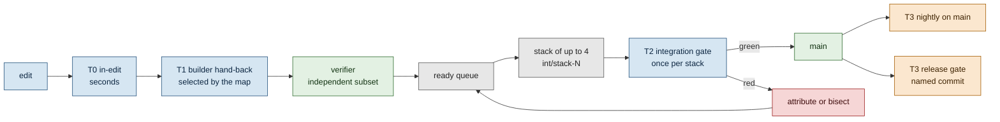

# Test strategy: tiered gates, stacked branches, one full run per release

**Status:** planned (docs and measurements only; no gate code yet). **Owner request, 25 Oct 2026:** agentic coding runs the
whole chain (`bash tools/check-all.sh`, the web build, vitest, Playwright e2e, budgets) after every small change; it is
slow, loads the machine so timing tests flake, and costs tokens. Design an approach that says exactly which tests a feature
branch or pull request must run, how ready branches are combined and verified once, and what runs only at release.
**Plan rows:** PLAN R-210 to R-214, TODO (25 Oct), BACKLOG 15.210 to 15.218, EXECUTION-PLAN 10.4, questions Q250 to Q258 (Q240 to Q249, R-197 to R-207, BACKLOG 15.200 to 15.208, EXECUTION-PLAN 10.3 and RELEASE-PLAN I7 are
held by the parallel ORIGIN-PLAN task).
**Supersedes:** "run `bash tools/check-all.sh` for core/, web/ and data changes" as the builder's per-change step
(`.claude/agents/travel-builder.md` step 2, HANDOVER section 2 "Full gate" as an every-change command), and the "every
commit" column of [11-quality-and-delivery.md](../11-quality-and-delivery.md) section 1, once TS-2 ships. Until then the
current rules stand.

## 1. Decision in one paragraph

Four tiers. **T0** runs inside an edit loop in seconds (typecheck of the changed package, the tests vitest finds related to
the changed files, the existing PostToolUse data hooks). **T1** is the builder's hand-back gate: `tools/gate.sh --tier 1`
diffs against `main`, selects suites from a checked path-to-suite map kept as data, runs them cheapest first with fail-fast,
prints at most 40 lines, and falls back to the full set when the change touches a shared contract. **T2** is the
coordinator's gate on a stack of up to four ready branches merged into one integration branch: every unit suite, every data
check, one build, budgets, the fixture builds, timing tests in isolation, and the e2e specs mapped to the stack's paths plus
the smoke set. **T3** runs at release and nightly: today's check-all, the full three-project e2e, the visual sweep and the
live smoke list. Results are cached by the git tree hash of each suite's inputs, so a docs-only stack, a rebase that
changed nothing a suite reads, or a verifier re-run on the builder's tree costs nothing for suites it may trust. **Trade-off:**
a mis-mapped path can let a regression through T1 and T2; it is caught at the nightly T3 or the sampled escape audit, a day
later at worst, and every escape makes the map wider.

## 2. Measurements (25 Oct 2026, worktree at `aa01821`)

Measured on `aa01821`, the last commit of the history before PUBLIC-SCRUB's filtered rewrite; the spec is committed on
`09784bc`. The two differ in 15 code, test and data files (the home point read from the environment with a decoy in
`core/test/setup/home-point.ts`, which both vitest configs now load through `setupFiles`; the invented seed data; two e2e
specs), and in none of the stage commands. Test file counts are the same (166 web unit, 132 core, 63 e2e specs).

Method: each check-all stage run alone, one after another, with `/usr/bin/time -l` (wall, user and system CPU, peak memory)
and its output captured to count lines and characters. Scripts lived in the session scratchpad and were not committed.
Apple M1 Pro, 10 cores. **The machine was shared**: the 1-minute load average was 9 to 35 during the runs (other agents
were running Playwright, builds and Spotlight indexing of the new worktree), so wall times are pessimistic; CPU seconds are
the better guide to cost. No test failed.

### 2.1 check-all, stage by stage

| Stage | Wall s | Share of wall | CPU s (user+sys) | Output lines | Output chars | Load at start |
|---|---|---|---|---|---|---|
| web test (vitest, `SKIP_WEB_BUILD=1`; its global setup still builds the two fixture apps) | 111.0 | 37.9% | 597.9 | 516 | 33,515 | 14.2 |
| web build (`next build`, renditions, share images) | 95.9 | 32.8% | 197.3 | 127 | 4,109 | 17.8 |
| core tests (132 files, 2,429 tests) | 23.1 | 7.9% | 160.1 | 73 | 6,689 | 18.0 |
| web lint (eslint, whole app) | 15.5 | 5.3% | 30.0 | 49 | 3,029 | 21.3 |
| web typecheck | 11.2 | 3.8% | 19.8 | 1 | 15 | 26.5 |
| next start smoke (GET /, health, OpenAPI) | 2.7 | 0.9% | 3.5 | 0 | 0 | 11.0 |
| python tests (22 files) | 8.3 | 2.9% | 7.9 | 5 | 351 | 16.9 |
| core typecheck | 5.2 | 1.8% | 11.6 | 1 | 15 | 34.9 |
| snapshot:check | 4.2 | 1.4% | 5.4 | 11 | 250 | 28.2 |
| slugs --check | 2.9 | 1.0% | 3.9 | 1 | 97 | 29.1 |
| **validate --all** | 2.4 | 0.8% | 3.4 | **1,592** | **611,521** | 30.2 |
| derive-area --check | 1.5 | 0.5% | 1.8 | 39 (to /dev/null in check-all) | 4,070 | 32.6 |
| suitability scope vitest | 1.5 | 0.5% | 1.6 | 10 (to /dev/null) | 298 | 30.2 |
| hardcode_scan --check | 1.2 | 0.4% | 1.1 | 1 | 70 | 26.5 |
| relevance derive --check | 0.8 | 0.3% | 1.2 | 1 | 38 | 28.2 |
| tree_check | 0.8 | 0.3% | 0.8 | 1 | 93 | 26.5 |
| normalise --budget --check | 0.8 | 0.3% | 1.1 | 1 | 66 | 30.2 |
| capture gaps --budget --check | 0.7 | 0.2% | 1.0 | 9 | 438 | 32.6 |
| derive-near, suitability check, capture build, relevance check, sources, mcp, ops, schema, openapi, towns, locations x2, search-vocab (13 stages) | 2.9 together | 1.0% | 4.7 | 26 | 876 | 18 to 33 |
| **Total (31 stages)** | **292.6 (4.9 min)** | 100% | **1,054 (17.6 CPU-min)** | **2,465** | **665,549** | |

Readings:

- **Two stages are 71% of the wall time**: the web vitest run (its global setup always builds two fixture apps, about 45 s
  of its 111 s, measured in 2.4) and the web build. Everything in `core/`, the python tests and every data check together is about 50 seconds.
- **CPU, not wall, is what loads the machine:** about 17.6 CPU-minutes per check-all. The web vitest run alone
  keeps about 5.4 cores busy for 111 s, core tests about 7 cores for 23 s. Two agents running check-all at once saturate the
  10 cores, which is when the timing tests below are at risk.
- **92% of the output is warnings from `validate --all`:** 1,591 `WARN` lines (W_TIER_REQUIRED 384, W_CAP_BELOW_USABLE 382,
  W_SUIT_BELOW_USABLE 315, E_PLACE_AREA 227, W_SUIT_CONFLICT 101, 10 more codes) that never fail the stage; the ratchet on them is
  `capture.ts gaps --budget`. At about 4 characters per token, one full check-all log is about **166,000 tokens**. The Bash
  tool truncates long output (about 30,000 characters by default), so an agent that reads check-all's output sees mostly
  warnings and can miss the failing step, then reruns. What the agent needs is the last `==` line, `CHECK-ALL OK` or the
  failing step's error: under 2,000 characters.
- **The full e2e** was not run for this spec (about 41 minutes on a quiet machine per HANDOVER section 2, 770 tests at
  2d6e4b5; it must not run on a loaded, shared machine). Its fixed costs were measured instead (2.4).

### 2.2 The heavy test files

Web vitest, 166 files, 2,046 tests (1 skipped, 23 todo), 279 file-seconds in total run in parallel:

| File | Seconds | Share | Needs the build |
|---|---|---|---|
| `web/tests/api/contract.test.ts` (101 tests) | 26.3 | 9.4% | no |
| `web/tests/privacy.test.ts` | 20.6 | 7.4% | real and fixture builds |
| `web/tests/budget.test.ts` | 17.5 | 6.3% | real build |
| `web/tests/scrub.test.ts` | 13.4 | 4.8% | no |
| `web/tests/data/adapter.test.ts` | 11.4 | 4.1% | no |
| `web/tests/data/legs-files.test.ts` | 10.5 | 3.7% | no |
| `web/tests/trips/add-invariants.test.ts` (1 property test) | 9.2 | 3.3% | no |
| `web/tests/account/layout.browser.test.ts` | 9.1 | 3.3% | no |
| `web/tests/data/public-privacy.test.ts` | 8.7 | 3.1% | real and fixture builds |
| by folder | `tests/data` 27%, root 22%, `tests/api` 14%, `tests/search` 9%, `tests/places` 9%, `tests/trips` 7%; the other 12 folders 12% | | |

Core vitest, 132 files, 2,429 tests (63 skipped or todo, mostly the database suites without `TEST_DATABASE_URL`), 138
file-seconds: the three CLI suites that spawn processes are 34% (`core/test/suitability/cli.test.ts` 20.7 s, relevance 13.4 s,
sources 12.9 s), then `core/test/catalogue/load-engine.test.ts` 11.6 s and `core/test/capture/placement-block.test.ts` 11.4 s.

`vitest related src/sun/index.ts` in `core/` selected 40 of 132 files (962 tests) in 9.2 s against 21.3 s for all. Import
graphs make related selection wide for shared modules, which is the safe direction.

### 2.3 Which tests need what

| Trait | Files | Notes |
|---|---|---|
| Read the real build through `web/tests/helpers/built.ts` | 19 web files: `analytics`, `budget`, `fonts`, `images`, `og-images`, `og`, `privacy`, `api/openapi-routes`, `data/globe-data-renditions`, `data/light-data`, `data/link-only-facts`, `data/photo-credits-clean`, `data/place-size`, `data/public-privacy`, `data/specimen-privacy`, `export/page-data`, `places/built-pages`, `places/tracks-markers`, `trips/timeline-outlinks` | A missing build throws (backlog 15.1), never skips |
| Read a fixture build (`.fixture-out`, `.fixture-beacon`) | `privacy`, `og`, `no-hex`, `analytics`, `data/public-privacy` | built by `web/tests/global-setup.ts` on **every** web vitest run, even for one file |
| Wall-clock thresholds (sensitive to load) | `web/tests/api/revision-timing.test.ts` (first `revision()` under 300 ms; measured 91 ms under load 14), `web/tests/search/budget.test.ts` (parse p95 at most 0.5 ms), `web/tests/home/search.test.ts` (under 16 ms per query), `web/tests/search/split.test.ts` (under 25 ms per query) | Four files. `web/tests/entities/shards.test.ts` times but asserts no time. The e2e globe motion specs (`*.gpu.spec.ts`) measure frames on the GPU |
| Byte budgets (deterministic, but need a build) | `web/tests/budget.test.ts` (200 KB gzipped start JS; trip page had 2 B headroom at v0.1), `web/tests/data/place-size.test.ts` (+25% median place HTML; 19 B headroom), `web/tests/search/budget.test.ts` (search chunks) | Any web or data change can move them |
| Postgres | `core/test/db/*` (5 files) and `core/test/seed/*` (2) | skip without `TEST_DATABASE_URL`; local Docker (`pnpm db:test`) or the Neon child only by hand |
| A running server | the check-all smoke block; every e2e spec | e2e starts one `next start` on a free port; `PW_REUSE_SITE=1` with `PW_SITE_URL` reuses one |

### 2.4 Fixed costs (pass 2, one at a time)

| Run | Wall s | CPU s | Load at start |
|---|---|---|---|
| One fixture build (`node web/scripts/build-fixture.mjs .fixture-out`) | 22.7 | 79.2 | 20.3 |
| One web unit file through today's config (`SKIP_WEB_BUILD=1 vitest run tests/format.test.ts`, 9 tests) | 47.5 | 162.2 | 17.2 |
| The same file with the global setup turned off (a scratch config spreading the web config with `globalSetup: []`), twice | 0.9 and 0.85 | 0.9 | 14.6 |
| `web/tests/api/revision-timing.test.ts` alone, today's config | 50.0 | 166.6 | 14.1 |
| The four wall-clock files together, no global setup, `--no-file-parallelism` (36 tests; `revision()` measured 97 ms against 300) | 16.8 | about 16 | 14.6 |
| One e2e spec, `units-places.spec.ts` on Chromium, reusing the build (7 tests) | 14.6 | 9.5 | 10.4 |
| The smoke set, `cross-browser.spec.ts` on Chromium, reusing the build (12 tests) | 18.6 | 16.5 | 9.6 |
| One core module's related tests (`vitest related src/sun/index.ts`) | 9.2 | 52.4 | 19.3 |

Readings: **one web unit file costs 47.5 s today and 0.9 s without the global setup**, so the fixture builds are about 98%
of any small web test run (F1). An e2e spec on a reused build costs 15 to 19 s, against 96 s for the build it would
otherwise make first: build once per tree, then run specs. The wall-clock tests had a 3x margin under load 14 (`revision()`
91 and 97 ms against 300 ms); they passed in every run here, but nothing guarantees that at load 30. The tree was clean
(`git status --porcelain` empty) after both passes.

### 2.5 What recent branches touched

The last 80 merges into `main` (21 to 25 Oct), classified by the paths each changed:

| Kind | Merges | Share | What T1 would select |
|---|---|---|---|
| Docs only (`docs/`, Markdown, `research/` notes) | 18 | 22% | links and folder contract, seconds |
| Data only (plus docs) | 4 | 5% | the data family's checks, the build and budgets, smoke e2e |
| Web only | 8 | 10% | web typecheck, lint, related unit, build, budgets, mapped e2e |
| Core with others | 10 | 13% | core typecheck and related tests, web typecheck and related tests, data checks of that module |
| Web with core, data or tools | 38 | 48% | the union |
| Tools or root | 2 | 3% | full |

On 25 Oct alone: 34 merges, 14 docs-only (41%), 4 data-only, 16 with code. Of the 63 merges that changed code, 35 (56%)
touched a path on a first draft of the full list; the triggers were `core/src/schema/**` 12, `core/src/privacy/**` 10,
`tools/check-all.sh` 10 (lanes appending a step), `package.json` 7, `core/src/catalogue/store.ts` 7,
`tools/cons/baseline.json` 5 (the ratchet falling), `data/vocab/**` 4, `web/playwright.config.ts` 4, and 13 others once or
twice. Treating an appended check-all step as "run that suite plus the map check" and a falling ratchet baseline as
"run `hardcode`" brings it to **30 of 63 (48%)**, the list in 4.2. So about half of code branches still take the full set
at T1. The saving comes from the other half, from not running code suites at all on docs-only branches, from running T2
once per stack instead of once per branch, from one build per tree, and from output discipline.

## 3. What is wrong today (findings)

| # | Finding | Evidence | Fix in this plan |
|---|---|---|---|
| F1 | No fast web unit loop exists: every web vitest run builds two fixture apps first, even for one file | `web/tests/global-setup.ts`; 2.4 | split the web vitest config into projects (`unit`, `built`, `fixture`, `timing`), TS-2a |
| F2 | check-all output is 92% non-failing warnings; the failure can fall outside what an agent reads | 2.1 | the gate writes the full log to a file and prints counts plus failures only |
| F3 | The builder's definition says "`bash tools/check-all.sh` for core/, web/ and data changes"; the verifier and the coordinator run it again on the same tree | `.claude/agents/travel-builder.md`, `travel-verifier.md`; HANDOVER 3 | tiers and roles (sections 4 and 8); cache by tree hash (section 6) |
| F4 | check-all stops at the first failure and puts the 3.5 minutes of web stages last, so a lint error is found after every data check, and a data failure hides the web stages | `tools/check-all.sh` | cheapest-first order with fail-fast inside a tier, plus `--keep-going` for T2 and T3 |
| F5 | Four wall-clock tests run in the same parallel pool as everything else, and under another agent's build | 2.3 | the `timing` project runs alone, serially, behind the load guard (section 7) |
| F6 | Nothing stops two agents from building or running Playwright at once; HANDOVER only asks for a "quiet machine" | HANDOVER 2 and 3 | machine-wide slots for builds, e2e and timing (section 7.3) |
| F7 | An e2e spec run without `SKIP_WEB_BUILD=1` rebuilds the app (about 96 s here) before a 10 s spec | `web/tests/e2e/global-setup.ts` | the gate builds once per tree and passes `SKIP_WEB_BUILD=1` or `PW_REUSE_SITE=1` |
| F8 | No record says which suites a hand-back ran, so a coordinator cannot tell a cached pass from a skipped one | hand-backs | one hand-back block (section 8.2) and `last.json` |

## 4. The tiers



| Tier | Who runs it | When | What | Target wall time | Output an agent reads |
|---|---|---|---|---|---|
| **T0** | the builder, in the edit loop | after each edit that compiles | `tsc --noEmit` of the changed package (`--incremental` with the build info in the git dir); `vitest related --run <changed files>` in the `unit` project; `eslint <changed files>`; the existing PostToolUse hooks (`tools/hooks/data_changed.sh`, `schema_changed.sh`, `locations_changed.sh`) | under 30 s | pass, or the first 30 error lines |
| **T1** | the builder, before hand-back; the verifier re-runs part of it (8.3) | once per hand-back, and after each fix round | `tools/gate.sh --tier 1 --base main`: suites selected by the map from `git diff --name-only main...HEAD` plus uncommitted changes; full fallback on shared contracts (4.4); the build and budgets when anything that ships to a page changed; mapped e2e specs on Chromium only | docs 10 s; data 3 min; web 4 to 6 min; full 7 to 9 min | at most 40 lines: one per suite, failures, the log path |
| **T2** | the coordinator (or the verifier on its behalf) | once per stack of ready branches, before `main` moves | every unit suite (core, web `unit`, python), every data check, core and web typecheck, lint, one build, the `built` and `fixture` projects, the `timing` project alone, the next start smoke, the e2e specs mapped from the stack's union of paths plus the smoke set on Chromium; `--keep-going` | 8 to 12 min | the same summary, per branch attribution on failure |
| **T3** | the coordinator at release; a nightly job on `main` | each release named commit (RELEASE-PLAN 4.1); every night | today's check-all in full, the full e2e on Chromium, WebKit desktop and iPhone, the visual sweep at 1440 and 390 in light and dark for UI releases, the database suites against local Docker, the live smoke list after deploy (RELEASE-PLAN 4.2), the escape comparison (10.5) | about 50 min, quiet machine | a dated summary file; the coordinator reads the summary only |

Rules that hold at every tier:

- **No tier passes on a skip.** A suite that could not run (lock timeout, machine load, missing Docker) is `deferred`, the
  gate exits non-zero for T2 and T3, and a T1 hand-back must list it. A deferred suite at T1 moves to T2, never away.
- **Selection only ever adds.** A path matched by several rules runs the union. When in doubt the map names more suites.
- **The full log is always written** (section 5), so nothing is lost by printing less.
- Principles: budgets and privacy suites guard P8 and P9 and run whenever page output can change; the visual sweep guards
  P1 to P7 and runs at UI rounds and T3, never at T0 or T1 except for the screens a UI lane changed
  ([principles.md](../design/foundation/principles.md)).

### 4.1 Suites

A suite is one command with known inputs and cost. These replace the check-all stage list one for one (the map check in
4.3 enforces that every check-all step belongs to a suite).

| Suite id | Command (as the gate runs it) | Inputs (tree-hash key) | Cost class | Needs | T1 when |
|---|---|---|---|---|---|
| `links` | `python3 tools/relink.py check` (all relative Markdown links), then `python3 tools/tree_check.py` | all tracked files | s | none | always |
| `hardcode` | `python3 tools/cons/hardcode_scan.py --check` | `web/**`, `core/src/**`, `tools/cons/**` | s | none | any code |
| `py.tools` | `python3 -m pytest tools/tests -q` | `tools/**` | s | venv | `tools/**` |
| `locations` | `locations.py validate`, `build --check` | `data/locations/**`, `tools/locations.py`, `tools/location_views.py` | s | none | those paths |
| `core.types` | `pnpm --dir core typecheck` | `core/**` | s | none | `core/**` |
| `core.unit` | `vitest run` in `core/` (T1: `vitest related --run <changed core files>`) | `core/**`, `data/**` | m | none | `core/**`, `data/**` read by tests |
| `core.generated` | schema `generate --check`, `capture.ts build --check`, `openapi.ts --check`, `ops.ts --list`, the MCP initialize line | `core/src/**`, `core/bin/**`, `data/vocab/**`, `data/schema/**` | s | none | `core/**`, `data/vocab/**`, `data/schema/**` |
| `data.capture` | `capture.ts gaps --budget --check`, `derive-near --check`, `derive-area --check`, `validate.ts --all`, `normalise.ts --budget --check` | `data/**`, `core/src/**`, `core/bin/**` | s | none | `data/**`, `core/src/{capture,validate,derive,normalise,schema}/**` |
| `data.towns` | `python3 tools/towns.py --check` | `data/reference/**`, `tools/towns.py`, `tools/towns_admin1.json` | s | none | those paths |
| `data.suit` | suitability scope vitest plus the `git diff --exit-code` on `data/suitability/scope.json`, `suitability.ts check` | `data/suitability/**`, `data/capture/**`, `core/src/suitability/**`, `web/lib/public/**` | s | none | those paths |
| `data.relevance` | `relevance.ts check`, `derive --check` | `data/relevance/**`, `data/capture/**`, `core/src/relevance/**` | s | none | those paths |
| `data.sources` | `sources.ts check` | `data/sources/**`, `research/method/lanes/**`, `core/src/sources/**` | s | none | those paths |
| `data.slugs` | `slugs.ts --check` | `data/**`, `core/src/catalogue/**` | s | none | `data/**`, `core/src/catalogue/**` |
| `web.snapshot` | `pnpm --dir web snapshot:check` | `data/seed/**`, `web/data-snapshots/**`, `web/redirects.json`, `web/scripts/snapshot*` | s | none | those paths |
| `web.vocab` | `search-vocab.mjs --check` | `data/vocab/**`, `web/lib/search/**`, `web/scripts/search-vocab.mjs` | s | none | those paths |
| `web.types` | `pnpm --dir web typecheck` | `web/**`, `core/src/**` | s | none | `web/**`, `core/src/**` |
| `web.lint` | `eslint` (T1: changed files; T2: whole app) | `web/**` | s | none | `web/**` |
| `web.unit` | vitest project `unit` (T1: `related --run <changed web and core files>`) | `web/**`, `core/src/**`, `data/**` | m | none | `web/**`, `core/src/**` |
| `web.build` | `pnpm --dir web build` with the e2e build env pinned (maps family `maplibre`, keys empty), the `^Error:` check, the ORS key scan | everything that ships: `web/**` except tests, `core/src/**`, `data/**`, `legacy/MANIFEST.json`, lockfile | l | slot `build` | anything that changes page output: `web/{app,components,lib,public,scripts}/**`, `core/src/**`, `data/**` |
| `web.built` | vitest project `built` (the 19 files of 2.3) | `web.build` key plus `web/tests/**` | m | `web.build` | with `web.build` |
| `web.fixture` | vitest project `fixture` (two fixture builds, privacy, analytics, og, no-hex) | `web.build` key plus `web/tests/fixtures/**` | l | slot `build` | `web/lib/public/**`, `web/lib/server/**`, `core/src/privacy/**`, `web/app/layout.tsx`, `web/tests/fixtures/**`; else T2 |
| `web.timing` | vitest project `timing` (the four files of 2.3), `--no-file-parallelism`, one worker | `web/lib/search/**`, `web/lib/server/**`, `core/src/catalogue/**`, `data/**` | s | slot `timing`, load guard | those paths; else T2 |
| `web.serve` | the check-all next start smoke block | `web.build` key | s | `web.build` | with `web.build` |
| `e2e.mapped` | `playwright test <specs> --project=chromium` with `SKIP_WEB_BUILD=1` | `web.build` key plus the spec files | m to l | slot `e2e`, `web.build` | the specs the map attaches to the changed paths (4.2) |
| `e2e.smoke` | `cross-browser.spec.ts` on Chromium | `web.build` key | m | slot `e2e` | T2 always; T1 when a FULL path changed |
| `e2e.full` | `pnpm --dir web e2e` (three projects) | `web.build` key plus `web/tests/e2e/**` | xl | slot `e2e`, quiet machine | T3 only |
| `db.local` | `pnpm db:test` against the Docker Postgres | `core/src/db/**`, `core/test/db/**`, `core/test/seed/**`, migrations | m | Docker | those paths at T1 when Docker is up, else deferred to T3 |
| `visual` | the screenshot sweep (1440 and 390, light and dark) of the screens a UI lane changed | the screens' source | m | slot `e2e` | UI rounds, by the verifier and the design reviewer; T3 for UI releases |

### 4.2 The path-to-suite map is data

One file, `tools/gate/map.json` (new, TS-1), read by the gate and checked by `tools/gate/check_map.py` (new). Shape:

```json
{
  "version": 1,
  "suites": {
    "web.build": { "run": ["pnpm", "--dir", "web", "build"], "cost": "l", "slot": "build",
                   "inputs": ["web/**", "!web/tests/**", "core/src/**", "data/**", "legacy/MANIFEST.json", "pnpm-lock.yaml"],
                   "steps": ["web build"] },
    "web.timing": { "vitest": { "dir": "web", "project": "timing" }, "cost": "s", "slot": "timing", "serial": true,
                    "tests": ["web/tests/api/revision-timing.test.ts", "web/tests/search/budget.test.ts",
                              "web/tests/home/search.test.ts", "web/tests/search/split.test.ts"] }
  },
  "rules": [
    { "paths": ["web/components/trips/**", "web/app/trips/**", "web/lib/entities/**"],
      "suites": ["web.types", "web.lint", "web.unit", "web.build", "web.built", "web.serve"],
      "e2e": ["trip-*.spec.ts", "trips*.spec.ts", "to-top.spec.ts"] },
    { "paths": ["data/capture/**"],
      "suites": ["data.capture", "data.suit", "data.relevance", "data.slugs", "core.unit", "web.build", "web.built"],
      "e2e": ["places*.spec.ts", "place-*.spec.ts"] }
  ],
  "full": ["pnpm-lock.yaml", "package.json", "*/package.json", "pnpm-workspace.yaml", "**/tsconfig.json",
           "web/vitest.config.ts", "web/playwright.config.ts", "web/next.config.*", "web/eslint.config.mjs",
           "core/vitest.config.ts", "tools/gate/**", "tools/gate.sh",
           "core/src/schema/**", "core/src/catalogue/store.ts", "core/src/privacy/**", "data/vocab/**",
           "web/tests/helpers/**", "core/test/setup/**", "web/tests/global-setup.ts", "web/tests/e2e/global-setup.ts", "web/tests/e2e/fixtures.ts",
           "web/tests/budget.test.ts", "web/tests/data/place-html-baseline.json", "web/tests/data/place-size.test.ts",
           "web/app/layout.tsx", "web/app/themes.css", "tools/theme_tokens.py"],
  "quiet": ["docs/**", "research/**/*.md", "*.md", "CHANGELOG.md"],
  "quarantine": [],
  "review": ["tools/gate/**", "tools/gate.sh", "tools/check-all.sh"]
}
```

- `suites` hold the command, the input globs that key the cache, the cost class, the machine slot, and for test suites
  the test files they own (`tests`), so the check can prove every test file is owned.
- `rules` attach suites and e2e spec globs to path globs. A changed path matching no rule and no `quiet` glob is an error
  in the map check and a full run in the gate (never a silent skip).
- `full` lists shared contracts, configs, lockfiles, the vocabulary (`data/vocab/types.json` included), budgets and their
  baselines, test infrastructure and the gate itself. Any match: T1 runs every T2 suite (full e2e still waits for T2 and T3).
  Two paths are deliberately not on it: `tools/check-all.sh` (a lane appending a step runs that step's suite, and M3 forces
  the map entry; any other edit of the file is a `review` path) and `tools/cons/baseline.json` (a falling count runs
  `hardcode`; a rising count already fails `hardcode`).
- `quiet` paths select only `links`.
- `quarantine` holds flaky tests with a BACKLOG row and an expiry date (7.2).
- `review` paths need an Opus reviewer's sign-off in the hand-back (10.1).

Dependency awareness: the rules carry the known fan-out explicitly, and vitest's import graph covers the rest.

| Changed | Also runs | Why |
|---|---|---|
| `core/src/**` (any) | `web.types`, `web.unit` related to the changed core files, `core.generated` | 111 web source files and 31 web test files import `@travel/core` |
| `core/src/{capture,validate,derive,normalise}/**` | `data.capture` | the checks run that code over all data |
| `core/src/{suitability,relevance,sources}/**` | the matching `data.*` suite | the same |
| `core/src/catalogue/**`, `web/lib/public/**`, `web/lib/server/**` | `web.build`, `web.built`, `web.fixture`, `web.timing`, `e2e.smoke` | every page and route reads the store through this boundary (P9) |
| `data/**` | `web.build`, `web.built` | data moves page bytes; the place-size budget had 19 B of headroom at v0.1 |
| `web/app/**`, `web/components/**` | `web.build`, `web.built`, the specs mapped to that area | start JS budget (2 B headroom on the trip page at v0.1) |
| any `web/tests/e2e/<spec>` | that spec | a changed spec runs itself |
| any test file | that test file | always, whatever the rules say |

### 4.3 The map cannot rot: `check_map.py` (runs in check-all and at T1, about 1 s)

| Check | Fails when |
|---|---|
| M1 | a test file (`core/test/**/*.test.ts`, `web/tests/**/*.test.ts(x)`, `web/tests/e2e/*.spec.ts`, `tools/tests/test_*.py`, `tools/suitability-scope/**`) is owned by no suite, or a web test is in the wrong vitest project (a file that imports `helpers/built` outside `built` or `fixture`; a file with `performance.now` and an assertion on it outside `timing`) |
| M2 | a tracked file matches no rule, no `full` glob and no `quiet` glob (a new folder forces a map entry the day it appears) |
| M3 | a `step "..."` label in `tools/check-all.sh` is not listed in some suite's `steps`, or a suite names a step that no longer exists |
| M4 | an e2e spec is attached to no rule and is not marked `release_only` with a reason |
| M5 | a rule names an unknown suite, a glob matches no tracked file, or a quarantine entry has expired or has no BACKLOG row |
| M6 | the vitest projects in `web/vitest.config.ts` own, together, exactly the 166 (today) unit files, each once |

### 4.4 Full fallback, stated once

T1 escalates to every T2 suite when any of these is true: a `full` path changed; more than 60 files changed outside `quiet`;
the change set has a path no rule matches; the branch rebased with conflicts resolved by hand; the builder passes `--full`;
the last commit carries the trailer `Gate: full` (for a risky change the author knows is risky). T2 escalates to T3 content
for a stack that contains a `full` change and goes into a release the same day.

## 5. The command (TS-2): `tools/gate.sh`

```text
tools/gate.sh --tier 0|1|2|3 [--base main] [--quiet] [--full] [--keep-going] [--no-cache] [--only <suite,...>]
              [--dry-run] [--explain <path>] [--stack <branch,...>]
```

- `tools/gate.sh` is a thin wrapper (puts the venv first on `PATH`, sets the pinned build env, never moves
  `web/.env.local`: like `web/tests/e2e/global-setup.ts`, it sets `NEXT_PUBLIC_PLACE_MAP_FAMILY=maplibre` and empty map keys,
  which Next does not override). The logic is `tools/gate/gate.py`, Python 3 standard library only, with pytest tests.
- **Selection:** `git diff --name-only <base>...HEAD`, plus staged, unstaged and untracked files, matched against the map;
  `--dry-run` prints the selected suites with the rule that chose each, and `--explain <path>` prints what one path selects.
- **Order:** cost class first (all `s` suites, then `m`, then `l`), and inside a class the order of check-all; dependants
  after their dependency (`web.built` after `web.build`). T0 and T1 stop at the first failing suite; T2 and T3 keep going
  and report all (`--keep-going` is their default).
- **Output:** one line per suite (`PASS 4.1s web.types`, `CACHED web.build (key 3f2a...)`, `FAIL 12.8s web.unit`,
  `DEFERRED web.timing: load 2.4 per core`), then for each failure an excerpt of at most 30 lines taken by a per-tool
  extractor (tsc `error TS` lines; vitest `FAIL` and the assertion block; eslint error lines; pytest short summary; the
  check-all style tools' last non-WARN lines; Playwright's failed test list and first error), then the totals line and the
  log path. `--quiet` prints the totals line and the failure excerpts only.
- **Files:** the full log at `$(git rev-parse --git-dir)/gate/<tier>-<time>.log` (per worktree, never tracked, outside
  `web/test-results/`, which Playwright empties); `last.json` beside it with tier, base, head, tree hash, selection with
  reasons, per-suite status, seconds and cache keys.
- **Exit codes:** 0 pass; 1 a suite failed; 2 deferred suites at T2 or T3, or a map error; 3 the gate itself broke.

## 6. Caching by tree hash (TS-3)

- **Key** of a suite run: SHA-256 over the suite id, its command, the git object ids of its input globs
  (`git ls-files -s -- <inputs>` hashed, plus `git hash-object` of any dirty input file), the toolchain (node, pnpm and
  python versions, the lockfile id), and the OS.
- **Record:** `{key, suite, status, seconds, head, tree, worktree, agent, model, time}` in
  `$(git rev-parse --git-common-dir)/travel-gate/cache/<key>.json`, shared by every worktree of this clone and never tracked.
- **Only passes are cached**, for 7 days. A failure is never reused. `--no-cache` ignores the store.
- **Inputs default wide.** A suite without an `inputs` list keys on every tracked file outside `quiet`. Narrow lists are a
  map change and need review (10.1). A docs-only stack then reuses every code suite safely.
- **What it buys:** the builder's T1, the verifier's trusted suites (8.3), the coordinator's T2 and a re-run after a no-op
  rebase share results whenever the inputs are byte-identical. A stack re-run after ejecting one branch reruns only the
  suites whose inputs that branch touched.
- **Artefacts are not cached** (no copying of `web/.next` between worktrees: its traces hold paths, and a stale build is the
  failure backlog 15.1 closed). Within one worktree the gate reuses `web/.next` when its recorded key equals the current
  `web.build` key (written to `web/.next/gate-key` after a green build).
- **Vitest's own cache** (`node_modules/.vitest-cache`, already present) stays on; it orders files by last duration and
  failures, which helps fail-fast.
- Turborepo or Nx were considered and not adopted: two packages and a Python tool set do not need a task graph engine, and
  their remote caches are paid or another service; content keys on git object ids give the same correctness for this repo.

## 7. Load, flakiness, locks and ports (TS-4)

### 7.1 Timing tests

- The four wall-clock files move to the vitest project `timing`: one worker, no file parallelism, run after the `unit`
  project and never while this gate holds a `build` slot.
- **Load guard** before the timing suite and before `e2e.*`: the 1-minute load average divided by the core count. Above
  1.5 the gate waits, printing who holds slots, re-checking every 15 s for up to 3 minutes; still above, the suite is
  `deferred` with a loud line (`DEFERRED web.timing: load 2.4 per core for 3 min; T2 must run it`). Never a pass. Under
  these measurements (load 9 to 35 on 10 cores) the guard would have deferred most of the timing runs, which is correct:
  their numbers say nothing on a saturated machine.
- Thresholds are not loosened to pass under load. A later option (Q254) is a calibration loop that scales the threshold
  by a short reference benchmark measured in the same run.

### 7.2 Retries, the flake ledger, quarantine

- A failing test is retried **once**, alone (`vitest run <file> -t "<name>"`, `playwright test <spec> -g "<title>"
  --retries=0`). Pass on retry = **flaky**: the suite passes, the summary says `FLAKY 1`, and a line goes to the ledger
  `$(git rev-parse --git-common-dir)/travel-gate/flakes.jsonl` (test id, suite, head, load, time, agent).
- **The same test flaky twice in 7 days, or twice in one stack run, fails the gate** and asks for a fix or a quarantine.
- **Quarantine** is a map entry (`quarantine`: test id, BACKLOG row, owner, expiry at most 14 days). Quarantined tests still
  run at T2 and T3 and are reported, but do not fail T1 or T2. An expired entry fails the map check (M5).
- The nightly T3 summary lists the ledger's last 7 days by test; the coordinator opens a BACKLOG row for any test with two
  or more entries. The known case (`places-parity.spec.ts` under CPU load, TODO 18 Oct "Test health") is the first entry
  to judge against this rule.

### 7.3 Machine slots (one clone, many worktrees, several agents)

| Slot | Holders at once | Why | Wait, then |
|---|---|---|---|
| `build` (`next build`, fixture builds, image steps) | 2 | one build used about 2 cores on average over 96 s with peaks above that; two leave room for edits and unit runs on 10 cores | wait up to 20 min with a "waiting for v2-X (pid N)" line every minute; then `deferred` |
| `e2e` (Playwright, the visual sweep) | 1 | GPU-backed Chromium and timing-sensitive specs; HANDOVER's quiet-machine rule | same |
| `timing` | 1, and only when no `build` slot is held by anyone | the four wall-clock files | the load guard |
| `full-e2e` (T3) | 1, and no other slot held | 41 minutes of a quiet machine | waits for the others to drain; new requests queue behind it |

- Slots are lock directories created with `mkdir` (atomic; `flock` is not installed on this Mac) under
  `$(git rev-parse --git-common-dir)/travel-gate/slots/<slot>/<n>`, holding the PID, worktree, agent label and start time. A
  lock whose PID is gone is reclaimed. The gate releases on exit, including on interrupt.
- Vitest worker count: the gate passes `--maxWorkers=50%` when any other `build` or `e2e` slot is held, else the default.
- **Ports:** suites take a free port from the OS (check-all and the e2e setup already do); no test binds a fixed port; the
  preview ports in HANDOVER section 5 (3440, 3476, 3488) are never used by the gate.
- Two builds in one `web/` still corrupt `web/.next`; the gate takes a per-worktree `build-here` lock in addition to the
  machine slot.

## 8. Token discipline, roles and the hand-back

### 8.1 Rules for every brief

1. Run `tools/gate.sh --tier 1 --quiet` before hand-back, and T0 while editing. Do not run `bash tools/check-all.sh` or the
   full e2e unless the brief says T2 or T3.
2. Never paste a log. Quote at most the failure excerpt the gate printed. For detail, read `last.json` or `grep` the log
   for the failing suite; never `cat` it.
3. When a run is `deferred` (load or lock), say so in the hand-back; do not retry in a loop. One retry after 5 minutes.
4. Builders run only their own e2e specs, which the gate selects; a spec outside the selection is run by name only when the
   brief names it.
5. Screenshots for review go outside `web/test-results/` (HANDOVER section 3).

### 8.2 The hand-back block (every code lane)

```text
Gate: T1 PASS at <head sha> (tree <tree sha>), base main <sha>, model <model>
Selected: 11 suites by rules [web/components/trips/**, data/capture/**]; full fallback: no
Result: pass 8, cached 2, flaky 0, deferred 1 (web.timing: load)
Failures: none
E2E: trip-timeline.spec.ts, trip-polish.spec.ts on chromium: 31 passed
Log: <path to the log>
```

### 8.3 Who runs what, and what the verifier must run itself

| Role | Runs | May trust the cache for | Never trusts |
|---|---|---|---|
| `travel-builder` (Sonnet, Opus for contracts) | T0 while editing; T1 before each hand-back | anything | |
| `travel-verifier` (Sonnet) | computes the selection itself from `git diff` (never the builder's list) and re-runs with `--no-cache`: both typechecks for touched packages, the `unit` tests related to the change, `web.build` with `web.built` (budgets, privacy) whenever page output can change, the mapped e2e specs, and for UI rounds the visual sweep. Other selected suites (data checks, python) may be cache hits | data checks, python, `links` | the builder's cache records for typecheck, related tests, build, budgets, e2e and the sweep |
| `travel-design-reviewer` (Opus) | reads the verifier's screenshots or takes its own; runs no suites | | |
| coordinator | T2 on each stack; the escape audit; T3 at release | anything except the sampled escape run (10.5) | |
| nightly job | T3 on `main` | nothing (`--no-cache`) | |

If the verifier's own selection contains a suite the builder's hand-back does not list, that is a finding in the verify
report, whatever the result.

## 9. Branch stacking (TS-7)

### 9.1 Which branches may stack

- Each branch has a T1 pass at its head, recorded in its hand-back block, and a verifier pass for UI or code lanes.
- **Disjoint files:** the sets `git diff --name-only main...<branch>` do not intersect, except the planning documents
  (`docs/v2/PLAN.md`, `TODO.md`, `BACKLOG.md`, `EXECUTION-PLAN.md`, `CHANGELOG.md`), whose conflicts are text only.
- **At most one branch with a `full` path**, and it goes first.
- **Not two branches that can move the same budget** (start JS of one page family, the place HTML median), because their
  sum can fail where each passed alone. Such pairs merge one after the other.
- **The same release row** in [RELEASE-PLAN.md](RELEASE-PLAN.md), or infra and docs branches, which ride any release.
- **At most four branches.** With four, a failure costs at most two halving rounds.

### 9.2 Running a stack

1. `tools/gate.sh --stack a,b,c` (TS-7) creates the worktree `travel-wt/int-<date>-<n>` with branch `int/stack-<date>-<n>`
   from `main`, merges the branches with `git merge --no-ff` in order (the `full` one first, then ascending risk), and stops
   on a text conflict outside the planning documents.
2. T2 runs once on the tip. Selection is the union of the branches' paths; the cache supplies every suite whose inputs did
   not change across the combination (a docs branch adds nothing; a data branch and a web branch share one build).
3. **Green:** the coordinator fast-forwards `main` to the stack tip in the main checkout (the merge commits are those of
   step 1, so history matches today's `--no-ff` merges), then pushes `main` on a line of its own.
4. **Red:** first the flake rule (7.2). Then attribution: if the failing suite's inputs were touched by one branch only, that
   branch is ejected, the stack is rebuilt without it and T2 re-runs (mostly cache hits). If several branches touched them,
   bisect: rebuild with the first half, run the failing suite only, then the other half. Each verdict names the branch.
5. **A branch that rebases after a stack lands** (it was not in the stack, or was ejected): if the rebase applied cleanly,
   T1 re-runs and the cache skips every suite whose inputs did not change; if conflicts were resolved by hand, the rebase is
   a full fallback (4.4) and the verifier re-runs its subset.

### 9.3 How the coordinator picks

Every morning and after each landing: take the ready queue oldest first; add a branch to the open stack when it passes the
rules of 9.1 against every branch already in it; close the stack at four branches, or when the oldest has waited two hours,
or when the next branch would break a rule. A docs-only branch never waits: it merges alone after `links` passes.

## 10. Guardrails against missed tests

1. **The map is reviewed.** A change under `tools/gate/**` is a `full` and a `review` path: its hand-back needs an Opus
   reviewer's line that the new rules are no narrower than before, or that the narrowing is justified with evidence.
2. **The map check runs in check-all and at T1** (4.3), so a new test file, folder or check-all step cannot land unmapped.
3. **Nightly T3 on `main`** (TS-6): a launchd job at 03:00 in a dedicated detached worktree `travel-wt/nightly` (clean
   checkout of `origin/main`, its own `web/.og-cache` copy), running `tools/gate.sh --tier 3 --no-cache`: check-all, the full
   three-project e2e, the database suites on Docker; the summary to `travel-wt/nightly-results/<date>.txt`; the coordinator
   reads it first thing. A red night blocks new stacks until it is triaged. Once the repository is public, the nightly
   `e2e.yml` of RELEASE-PLAN 7.2 (Chromium, no secrets, decoy data, maps on MapLibre) runs as well and is the off-machine
   check; WebKit stays on the Mac.
4. **"Full run required"** for risky changes without waiting for the map to say so: the commit trailer `Gate: full`, or the
   brief line "T1 runs full".
5. **Escape audit (sampling):** every fifth stack, the coordinator runs T3 content (`--no-cache`, full e2e on Chromium) on
   the same tip right after T2. Anything T3 finds that T2 passed is an **escape**: a row in the escape table of this page
   (section 15, coordinator-only writer), a map fix the same day, and the stack's branches named. Target: no escape in four
   weeks. Two escapes in four weeks: sample every second stack until four clean weeks.
6. **Selection replay (TS-1 acceptance):** for the last 80 merges, the map applied to each merge's diff must select every
   test file that merge changed, and every check-all step that, on that merge, would have changed its result. A test the
   author changed with the code is the author's own statement that it is relevant.
7. **Not adopted:** mutation testing (Stryker on 4,500 tests is hours per run, out of proportion for under 100 users) and
   coverage gates (coverage says a line ran, not that the right suite was chosen; the escape audit measures the thing we
   care about).

## 11. Costs and savings

Estimates from section 2 (wall seconds on a loaded machine; CPU seconds are steadier). "Today" is what the agent
definitions ask for: the builder runs check-all once or twice per lane plus its own specs with a rebuild each time; the
verifier runs check-all and specs again; the coordinator runs check-all after the merge.

| Change kind (share of the last 80 merges) | Today per branch | T1 | Saved per branch |
|---|---|---|---|
| Docs only (22%) | check-all by the coordinator after merge: about 5 min wall, 17.6 CPU-min | `links`: about 2 s; T2 all cache hits | about 5 min wall and all CPU |
| Data only (5%) | 2 to 3 check-alls (10 to 15 min), plus specs with a rebuild each | data suites 10 s, `web.build` 96 s, `web.built` about 30 s, `core.unit` related about 10 s, mapped specs about 1 to 2 min: about 4 min | 6 to 11 min wall; the verifier reuses the data suites |
| Web only (10%) | as above plus 1 to 3 own specs, each with a rebuild (about 2 min each) | types 11 s, lint on changed files about 3 s, related unit about 10 to 30 s, build 96 s, built about 30 s, serve 3 s, mapped specs 1 to 3 min: about 5 min | 8 to 15 min wall |
| Core plus others (13%) | 2 to 3 check-alls | core related about 9 s, core types 5 s, web types 11 s, related web unit, data suites, build and built if page output can change: 3 to 5 min | 6 to 10 min |
| Full fallback (about 48% of code branches, 2.5) | 2 to 3 check-alls | all T2 suites once: 8 to 10 min | 2 to 5 min, from one build per tree instead of three to five |

Per stack of four branches, T2 runs once instead of four post-merge check-alls: about 10 minutes instead of 20, and one
build instead of four.

**Tokens.** One check-all log is about 665,000 characters, about 166,000 tokens if read in full; in practice an agent sees
a truncated slice and often reruns or greps. A gate summary is at most 40 lines, about 2,500 characters, about 600 tokens;
`--quiet` is about 150 tokens on a pass. A lane that today reads check-all three times (builder twice, verifier once) and
two spec runs spends, by these figures, 20,000 to 100,000 tokens on test output alone; the same lane on the gate spends
2,000 to 4,000. That is a 90% or better cut in test-output tokens per lane, before the cut in reruns.

**Machine.** One check-all is about 17.6 CPU-minutes; a typical web T1 is about 5 to 6 (the build is 3.3 of them). A one-file T0
loop drops from 2.7 CPU-minutes to under 1 CPU-second. The slots in 7.3 cap concurrent heavy work at two builds and one e2e, which keeps the load per core under
the 1.5 guard for most of a working day with two lanes running.

**What it costs in risk.** A regression whose path is mapped too narrowly passes T1 and T2 and is caught by the nightly T3
(within a day) or the escape sample. The guardrails make each escape widen the map, so the rate should fall to zero.

## 12. Tasks

| Id | Task | Agent, model | Effort | Depends on | Owns (writes) | Must not touch | Acceptance check |
|---|---|---|---|---|---|---|---|
| TS-1 | The map and its check: `tools/gate/map.json` covering every suite of 4.1, rules for every source folder, the `full` and `quiet` lists; `tools/gate/check_map.py` with M1 to M5 (M6 after TS-2a); pytest tests; the selection replay over the last 80 merges | travel-builder, **Opus** (a shared contract) | 5 h | none | `tools/gate/map.json`, `tools/gate/check_map.py`, `tools/tests/test_gate_map.py` | `tools/check-all.sh` (TS-2 adds the line), product code, `web/**`, `core/**` | check passes on `main`; each of M1 to M5 has a failing fixture; replay: 100% of changed test files selected on 80 merges, misses listed and fixed |
| TS-2a | Split the web vitest config into projects `unit`, `built`, `fixture`, `timing` (global setup per project: no build for `unit`, the real build for `built` unless `SKIP_WEB_BUILD=1`, fixtures for `fixture`; every project keeps `setupFiles: ['../core/test/setup/home-point.ts']`, the decoy home point); `pnpm --dir web test` still runs all four | travel-builder, Sonnet; Opus review (test infrastructure is a `full` path) | 3 h | TS-1 | `web/vitest.config.ts`, `web/tests/global-setup.ts`, a new `web/tests/global-setup-fixture.ts` | test bodies, `web/tests/helpers/built.ts` behaviour, product code | `vitest run --project unit tests/format.test.ts` under 10 s with no build; full run: the same 166 files and the same test count as `pnpm --dir web test` on the base commit; M6 green; no project runs without the home-point setup file |
| TS-2 | The gate: `tools/gate.sh` and `tools/gate/gate.py` (selection, ordering, fail-fast and keep-going, extractors, `--quiet`, `--dry-run`, `--explain`, logs, `last.json`, exit codes); add the map check to check-all as one step | travel-builder, Sonnet | 8 h | TS-1, TS-2a | `tools/gate.sh`, `tools/gate/gate.py`, `tools/gate/extract.py`, `tools/tests/test_gate*.py`, one `step` in `tools/check-all.sh` | `web/**`, `core/**`, the map semantics (TS-1's) | dry-run on 10 replayed merges equals TS-1's expected selection; a forced tsc error prints at most 40 lines including the error; T2 on `main` passes and lists every check-all step |
| TS-3 | Cache by tree hash (section 6) | travel-builder, Sonnet; Opus reviews the key | 4 h | TS-2 | `tools/gate/cache.py`, tests | the map | a second T1 on an unchanged tree is all `CACHED` in under 10 s; touching one data file invalidates exactly the suites whose inputs hold it; failures never cached |
| TS-4 | Slots, load guard, retry once, flake ledger, quarantine (section 7) | travel-builder, Sonnet | 4 h | TS-2 | `tools/gate/slots.py`, `tools/gate/flakes.py`, tests | test thresholds | two gates started at once in two worktrees: the second waits and says for whom; a killed holder's slot is reclaimed; a fake flaky test passes once with `FLAKY 1`, fails the second time in 7 days; load above 1.5 per core gives `DEFERRED`, exit 2 at T2 |
| TS-5 | Docs and agent briefs: the rules of 8.1 and the block of 8.2 into `.claude/agents/travel-builder.md` and `travel-verifier.md`; HANDOVER's command table; the brief template; the proposed CLAUDE.md lines (section 14) only after the owner's yes | travel-planner, Opus | 2 h | TS-2 (TS-3, TS-4 for the cache and slot lines) | the two agent files, HANDOVER section 2 rows, this page | `CLAUDE.md` until Q257 | a builder brief run end to end on a small web change uses T0 and T1 only and hands back the block; the verifier's report lists its own selection |
| TS-6 | Nightly T3: a launchd job and its script, the dedicated worktree, the summary file, a wake schedule note for the owner; the GitHub `e2e.yml` waits for LOCAL-4 and PUBLIC-AUDIT (RELEASE-PLAN 7.2, Q229) | travel-builder, Sonnet | 2 h (Mac) + the `e2e.yml` brief's size | TS-2 | `tools/nightly/` (new), a plist template | `.github/**` until LOCAL-4 | one night's run leaves a summary with every T3 suite; a planted failing test shows in the summary; nothing is pushed or deployed |
| TS-7 | `--stack`: integration worktree, ordered merges, T2, ejection and bisect, the verdict lines | travel-builder, Sonnet; Opus review | 5 h | TS-2, TS-3 | `tools/gate/stack.py`, tests | `main` (the coordinator moves it) | a stack of a docs, a data and a web branch passes with one build; a planted failure in one branch is attributed to it in one round; overlapping files are refused |
| TS-8 | First escape audit and review of the numbers after two weeks; update section 11 with measured savings | travel-verifier, Sonnet (audit), travel-planner, Opus (write-up) | 2 h | TS-2 in use for two weeks | this page, sections 11 and 15 | the map (a fix is a TS-1 follow-up) | escapes and flakes counted; the savings table measured, not estimated |

Order: TS-1, TS-2a, TS-2, then TS-4 and TS-6 (in parallel, disjoint files), TS-3, TS-5, TS-7, TS-8. **Total about 35 h
(Opus 9, Sonnet 26).** Shadow week: for the first five working days after TS-2, the coordinator still runs check-all after
each merge and compares with T2; any difference is an escape (10.5).

### 12.1 Brief verification block (every TS task)

- `pnpm --dir core typecheck` and `pnpm --dir web typecheck` if the task touched TypeScript; `python3 -m pytest tools/tests -q`.
- The task's own acceptance checks above, with the commands and their summary lines in the hand-back.
- Playwright screenshots at 1440 and 390, light and dark: **not applicable** (no screen changes); TS-5 and TS-7 run the
  gate's own e2e selection once to show it works.
- `python3 tools/tree_check.py` and the relative link check.
- Commit only owned paths with `git -C <worktree> add <paths>` (never `-A`); the message ends with the project's
  Co-Authored-By trailer; never push; never merge.

## 13. Owner questions (Q250 to Q258)

| ID | Question | Recommendation | Trade-off |
|---|---|---|---|
| Q250 | Adopt the tiers: builders run T0 and T1 only, check-all and the full e2e move to T2 (stacks) and T3 (release, nightly), after a one-week shadow period? | **Yes** | A narrow map can let a regression reach `main` for up to a day; the nightly and the escape sample catch it |
| Q251 | Stack up to four ready branches under the rules of 9.1, with the coordinator fast-forwarding `main` to a green stack tip? | **Yes** | A red stack delays its other branches by one or two short reruns; one stack's landing changes `main` by up to four branches at once |
| Q252 | Nightly T3 as a launchd job on this Mac at 03:00, with the Mac set to wake for it (owner sets the wake schedule)? | **Yes** | The Mac works at night; a night it sleeps through is a missed check, which the next morning's T2 does not replace |
| Q253 | Flakes: retry once, record, fail on a repeat within 7 days, quarantine at most 14 days with a BACKLOG row? | **Yes** | One extra run per failure; a quarantined test can hide a real bug for up to two weeks, so it still runs at T2 and T3 |
| Q254 | Timing tests under load: defer with a loud notice and require them at T2, rather than raise thresholds; a calibrated threshold later only if deferrals block stacks? | **Yes** | Some T1 hand-backs carry a `deferred` line; the stack picks it up |
| Q255 | Escape audit on every fifth stack, plus the nightly comparison; two escapes in four weeks doubles the sampling? | **Yes** | About 45 extra minutes of machine time per five stacks |
| Q256 | Cache passes by tree hash in the clone's shared git directory for 7 days; the verifier ignores the cache for its independent subset? | **Yes** | A wrong `inputs` list could reuse a stale pass; inputs default wide and narrowing needs review |
| Q257 | After TS-2 ships, change CLAUDE.md and the builder and verifier definitions as listed in section 14? | **Yes** | Agents follow new commands; old briefs that name check-all need the TS-5 note |
| Q258 | Machine slots: two builds and one Playwright run at a time across all agents, the full e2e alone; the "two lanes at a time" rule stays? | **Yes** | A third agent waits for a slot instead of competing for CPU, which shows up as wait time in its run |

## 14. Proposed edits for the owner (not applied)

CLAUDE.md, section "Platform (in progress)", the sentence "run `bash tools/check-all.sh` before publishing" becomes:

> Test tiers (`docs/v2/build/TEST-STRATEGY.md`): T0 while editing, `tools/gate.sh --tier 1 --quiet`
> before a hand-back, T2 on stacks (coordinator), T3 (`bash tools/check-all.sh` plus the full e2e) at release and nightly.
> Never paste a test log; read the gate's summary and `last.json`.

CLAUDE.md, "Agents and models", add one row:

> | Gate runs | builder T1; verifier its own subset (TEST-STRATEGY 8.3); coordinator T2 and T3 | as the agent |

`.claude/agents/travel-builder.md` "Verify" steps 1 and 2 become "T0 while editing; `tools/gate.sh --tier 1 --quiet`
before hand-back; the hand-back block of TEST-STRATEGY 8.2". `.claude/agents/travel-verifier.md` step 1 becomes "compute
your own selection (`tools/gate.sh --tier 1 --dry-run`) and run the subset of TEST-STRATEGY 8.3 with `--no-cache`; full
check-all and e2e only when the brief says T2 or T3". Both wait for TS-2 (TS-5 applies them).

## 15. Escape and flake record

| Date | Stack or run | What T3 found that T2 passed | Map fix | Commit |
|---|---|---|---|---|
| none yet | | | | |

## 16. Gotchas

- `web/test-results/` is emptied by every Playwright run; the gate's logs live in the git directory, never there.
- `next build` rewrites `web/tsconfig.json` for a new `.fixture-*` dist dir; the `fixture` project must keep the two
  existing names.
- `SKIP_WEB_BUILD=1` trusts whatever `web/.next` holds; the gate only sets it when `web/.next/gate-key` equals the current
  `web.build` key.
- `tools/hooks/prepublish.sh` matches the publish words anywhere in a Bash line; the gate's own messages and commands must
  not contain them.
- The database suites skip without `TEST_DATABASE_URL`; a skip there is reported as `deferred`, never as a pass.
- `git diff main...HEAD` is empty on `main` itself; the gate on `main` runs T2 content (the nightly runs T3).
- Measured numbers in section 2 are from a loaded machine; TS-8 replaces the estimates in section 11 with measured ones.

## Change log

| Date | Change |
|---|---|
| 2026-10-25 | Created (TEST-STRATEGY, planned only): measurements, tiers, map, gate, caching, stacking, load and flakes, roles, guardrails, tasks TS-1 to TS-8, Q250 to Q258 |
