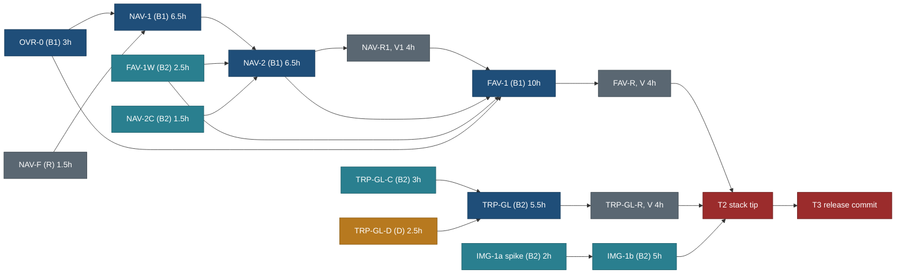

# Bundle A: v0.2, v0.3 and v0.4 as one release, with one paste-ready brief per remaining task

Written 26 Oct 2026 by travel-planner (Opus 5.5) on `public/BUNDLE-A-BRIEFS`, branched from `main` ce94e12e. **Planned
only: no product code changed.** Principles are cited by number from
[principles.md](../design/foundation/principles.md) (P1 to P9, T1 to T5).

**The owner's request (26 Oct 2026).** Release A is the next bundle to ship: v0.2 (phone sign-in item, privacy page,
page counts, 74 places: built and verifying), v0.3 (Mine: copies and favourites on this device) and v0.4 (trip-page
go-live fixes and share images). "Next release: plan it in detail, then build."

**This page is the build authority for bundle A.** Where it differs from [MASTER-ORDER.md](MASTER-ORDER.md),
[RELEASE-PLAN.md](RELEASE-PLAN.md), [EXECUTION-PLAN.md](public-site/EXECUTION-PLAN.md), the feature specs or the
briefs, section 2 lists the difference and this page wins for bundle A only. Everything after v0.4 stays as
MASTER-ORDER 5.3 says.

## 1. Decision in one paragraph

Ship v0.2, v0.3 and v0.4 as **one deploy, tagged `release/v0.4`** (Q290), built by two builders, one data seat, one
verifier and the design reviewer, on one integration branch `public/BUNDLE-A`. Every task branches from the tip of
`public/BUNDLE-A` when it starts, merges back with `--no-ff`, and is followed by a cheap per-merge step (typecheck,
its own tests, one build, `budget:report`) so every budget movement is pinned to one branch. One T2 runs on the stack
tip, then `public/BUNDLE-A` merges into `main`, and one T3 runs on the release commit. The trip-page and Mine chains are
split between the builders by **file**, not by folder: B1 runs OVR-0, NAV-1, NAV-2 and FAV-1 (the critical path,
about 38.5 agent hours including review waits, T2, T3 and the deploy); B2 runs the three small contracts (TRP-GL-C,
FAV-1W, NAV-2C), the trip-page fixes TRP-GL and the image build IMG-1; the data seat runs TRP-GL-D first.
**Trade-off:** `main` does not move for the bundle's code until T2 passes (about two working days), and a rollback
rolls back all three releases at once; capability flags (`mine`, `favourites`) give the finer rollback for the two new
features.

## 2. Where these briefs differ from other pages, and which wins

| # | Page and item | What it says | What this page says | Why | Wins |
|---|---|---|---|---|---|
| D1 | MASTER-ORDER 3.6 FAV-1; owner's task text | FAV-1 (Sonnet, 12 h) also wires `resolveRefs` through `store.ts`, `JsonStore`, OpenAPI | split: **FAV-1W** (B2, Opus, 2.5 h) wires the store method, the route, OpenAPI and `DataClient`; **FAV-1** (B1, Sonnet, 10 h) builds the UI | `store.ts`, `core/src/schema/api/**` and OpenAPI have one contract author (HANDOVER D-E2, MASTER-ORDER 4.1); the split also lets the wiring run while B1 builds NAV | this page |
| D2 | navigation spec 10.1 step 5; BACKLOG 15.168 | FAV-1 starts after NAV-R1 | FAV-1 starts when NAV-2 has merged into `public/BUNDLE-A`; it builds `web/lib/favourites/**` first and the Mine panel last; NAV-R1 findings land as a separate NAV-1F before the panel step | keeps B1 working while the reviewer and verifier run (4 h) | this page |
| D3 | MASTER-ORDER 4.1 and 4.2 (`web/components/trips/**` one task at a time; TRP-GL blocked by FAV-1) | TRP-GL after FAV-1 in B1 | TRP-GL in B2, beside NAV-2, with an explicit file list disjoint from OVR-0, NAV-2 and FAV-1 (section 4.3) | the folder rule was a proxy for file overlap; the lists here are file-disjoint and the per-merge budget step measures each | this page |
| D4 | MASTER-ORDER 3.6 TRP-GL owned paths | `web/components/trips/**`, `actions/**`, `timeline.css` | adds `web/components/map/MapChrome.tsx`, `map.css` (N4), `web/components/ui/Menu.tsx` (N5, one rule), conditional token files (SHOULD-2); removes `TripActions.tsx`, `CopySheet.tsx`, `TripPlan.tsx` | the 34 px controls live in the shared `MapChrome` (review 10.4 N4) | this page |
| D5 | navigation spec 6 and 13; MASTER-ORDER 4.5 | NAV-1 at +0 B trip start JS against the ACCT-PH baseline; drop the dot if the net is above 0 B; bar icons to CSS masks to pay place HTML | NAV-1 may spend **at most +160 B** trip start JS, paid from what OVR-0 frees; the dot stays if it fits; masks only if `budget:report` shows chrome headroom under 300 B after the change | BUD-1 moved shell chrome out of S13 into its own cap (5,028 B public), and OVR-0 runs first; the "+0 B" rule was set at 2 B of headroom | this page |
| D6 | [NAV-C-HANDOFF.md](public-site/briefs/NAV-C-HANDOFF.md) 7 | "the badge reads the envelope through `readCopies`" | the bar never imports `core/src/schema/**`; the dot compares two raw keys, `travel.mine.seen` and `travel.mine.latest` (ISO times); `readCopies` and the favourites readers load only in `/mine/` and in the lazy writers | `BottomBar.tsx` is in every page's start chunk; `readCopies` pulls Zod into it (several KB) | this page |
| D7 | navigation spec 10 NAV-1 | `/favourites/` redirect in `web/next.config.*` | `web/app/favourites/page.tsx` with `permanentRedirect('/mine/?show=favourites')` | `next.config.ts` carries the function file tracing; a page is a smaller blast radius | this page |
| D8 | navigation spec 10, 11 and the ACCT-PH review (section 3.3) I1, I2, I3, P-1 | NAV-1 removes "`useSignedIn`" and "`header-session.ts`"; current on `/mine/`, `/account/`, `/sign-in/` | the real removal list (NAV-1 step 2), `/sign-up/` current too, 44 px phone header targets, a signed-in phone icon link (never the avatar menu), the home search fix at 320 px | the ACCT-PH review found the spec describes a mechanism that was never built | this page; the spec banner points here |
| D9 | NAV-C-HANDOFF 3.1 and 3.2 | "NAV-2 widens the mapping (in core, through the NAV-C owner, or with a core change in its own brief)" | a separate **NAV-2C** (B2, Opus, 1.5 h): lenient `fromLegacy`, move once per device under its own key `travel.copies.legacyMovedAt` (no envelope field) | `core/src/schema/copies.ts` is a privacy contract (children's ages); one author | this page |
| D10 | navigation spec 2.3, 3.1 | the copy's snapshot (`title`, `days`, `cc`, `photo`) "from the light row the trip page already has" | NAV-2 passes `cc` and `photo` from the trip page into `TripActions.tsx` and `CopySheet.tsx` as props (RSC payload of trip pages only, 0 B start JS) | `TripActions` carries no photo or country today | this page |
| D11 | visitor spec 7, 15; BACKLOG 15.70 | trip-page heart at most +0.15 KB once OVR-0 lands | the same cap **and** a floor: after FAV-1 the trip page keeps at least 256 B of headroom; if not, the trip heart moves into the Export menu's lazy chunk ("Add to favourites" row) and the heart ships on place pages and cards only | protects R59-1's +0.2 KB in v0.8 | this page |
| D12 | [briefs/OVR.md](public-site/briefs/OVR.md) step 4 | move `CategoryView` "and the future overview" into one chunk loaded on the first "Trip overview" click | the overview does not exist yet: OVR-0 makes `CategoryView` a `next/dynamic` import with SSR kept (a direct `?view=category` still renders on the server); OVR-2 later adds the overview to the same chunk | no SSR regression for direct links and no-JS readers (T2) | this page |
| D13 | RELEASE-PLAN 6 step 8 | "until v0.8 says prebuilt" | IMG-1 decides; recommended: remote builds stay (`vercel deploy --prod`) and the image and share-image steps move **before** `next build`; prebuilt deploys only if the IMG-1 spike shows the adapter still drops the files | prebuilt from the Mac does not by itself fix the order (the adapter runs inside `next build` in `vercel build` too) | this page |
| D14 | MASTER-ORDER 5.2; TEST-STRATEGY 9.1 | stacks of at most four branches, never two that move the same budget, T2 per stack | one integration branch, serial merges each followed by the per-merge budget step, one T2 on the tip | the owner asked for one T2 and one T3; the per-merge step keeps the budget attribution the rule protects | this page, bundle A only |
| D15 | RELEASE-PLAN 3; MASTER-ORDER 5.3; Q224 | v0.2, v0.3, v0.4 are three deploys | one deploy, one tag `release/v0.4`; v0.2 and v0.3 are recorded "shipped inside v0.4" | each deploy costs an approval, a smoke and a phone check; the train keeps its numbers (v0.5 next) | this page, if Q290 is yes |
| D16 | MASTER-ORDER 3.4 TRP-GL-D | "blocked: RIS-J" | ready | RIS-J and SEASONS-C merged (c4ed1bc6) | fact |
| D17 | MASTER-ORDER 3.3 IMG-1 owned paths | images and OG scripts, `package.json`, `tree_check` | adds `web/lib/server/images.ts`, `web/lib/format/image.ts`, the photo URL call sites in `web/lib/public/**` (mapping only), `web/app/og-manifest.json/route.ts` (deleted), `web/tests/e2e/global-setup.ts` and the one `tools/check-all.sh` line that orders the scripts | the fix moves the rewrite from build output to render time | this page |

**Superseded and marked in the page itself:** navigation spec (banner), visitor spec (banner), OVR brief (banner),
NAV-C-HANDOFF (banner), REMAINING-CLOSURE-PLAN 4 (banner), MASTER-ORDER (pointer line). RELEASE-PLAN step 8 and
BACKLOG 15.163, 15.168, 15.222, 15.223 get their pointer from the coordinator after `public/PLAN-CONSOLIDATE` merges
(that branch edits both files today).

## 3. State at the start (checked 26 Oct 2026 on `main` ce94e12e)

### 3.1 Merged and consumable

| Thing | Commit | What a brief consumes |
|---|---|---|
| BUD-1 (place budget on catalogue content, chrome cap) | 226c3efc | `pnpm --dir web budget:report`; S13 median 1.2485 (113 B headroom); chrome cap 5,028 B public, 6,693 B sign-in on; trip start JS 199.4 KB (641 B headroom) |
| GSI-P (privacy page, footer link), corrected after review | fcf72686 | `/privacy/` exists; one footer link |
| NAV-C and NAV-C-FIX (`copies/1`, `trip-custom/1` skeleton, `fromRef`, compare-and-set) | 2c520d40, f347ecf8 | `core/src/schema/copies.ts`: `probeStorage`, `memoryStorage`, `readCopies`, `updateCopies`, `addCopy`, `removeCopy`, `restoreCopy`, `moveLegacyCopies`, `placeholderSnapshot`, `rev`; review findings M3 to M5 in NAV-C-HANDOFF |
| FAV-C (`favourites/1`, `resolveRefs` contract, merge planner) | 431f98bf | `core/src/schema/favourites.ts`, `core/src/favourites/**`: `readFavourites`, `updateFavourites`, `addFavourite`, `removeFavourite`, `restoreFavourite`, `applyResolution`, `noticeDue`, `snoozeNotice`, `markNoteSeen`, `handleOf`; `ResolveRefsMethod` and `resolveRefsResult` declared, not wired; case table `core/test/favourites/resolveRefs.cases.ts` |
| RIS-J and SEASONS-C | c4ed1bc6 | data families normalised; TRP-GL-D is unblocked |
| D2b (74 stored places), option A of Q88 (answered: re-baseline) | earlier | v0.2 content |
| Detector keys | `core/src/privacy/detect.ts` | `fromRef`, `gw`, `copiedAt`, `travellers`, `favouredAt`, `favourites` are private |

### 3.2 Worktrees already created by the coordinator

`/Users/nks/workspace/travel-wt/v2-OVR0` (`public/OVR-0`) and `/Users/nks/workspace/travel-wt/v2-NAVF`
(`public/NAV-F`), both at ce94e12e. Their briefs are 7.1 and 7.2; if they were launched with MASTER-ORDER's text, the
additions here (7.1 acceptance, 7.2 heart and Mine patterns) go in as a follow-up message to the running agent.

### 3.3 v0.2 in flight (not briefed here)

- `public/ACCT-PH-RV` (fdfc6ed2): design review of the phone sign-in item, **approved, no must**, so no ACCT-PH-F.
  Its file `docs/v2/design/shell/review-acct-ph-2026-10-25.md` is not on `main` yet; merge it first into
  `public/BUNDLE-A`. Its I1, I2, I3 and P-1 are folded into NAV-1 (7.6).
- `public/V02-VERIFY` (worktree `v2-V02VERIFY`): the verifier's v0.2 sweep and the ACCT-PH budget baselines. Its note
  merges into `public/BUNDLE-A` when done; any must becomes a task row in section 4.1 before T2.
- `public/BUD-1-RV`, `public/GSI-P-RV`: review notes; merge the docs.

## 4. Tasks, order and seats

### 4.1 Ordered task list

Hours are agent hours. "Seat" follows MASTER-ORDER 5.1: B1 public web UI, B2 contracts and platform, D data seat, R
design reviewer, V verifier, C coordinator.

| # | Task | Release | Seat | Model | h | Needs (merged into `public/BUNDLE-A`) | Review |
|---|---|---|---|---|---|---|---|
| 1 | OVR-0: `CategoryView` into its own chunk | v0.3 | B1 | Sonnet | 3 | none | verifier re-measures at the per-merge step (no visible change) |
| 2 | NAV-F: foundation text for the bar, header icon, copy and favourite patterns, the Mine page | v0.3 | R | Opus | 1.5 | none | owner reads in the notes |
| 3 | TRP-GL-C: booking windows in the export contract | v0.4 | B2 | Opus | 3 | none | second Opus read of the contract diff (inside the 3 h) |
| 4 | TRP-GL-D: three Rockies identities through sourced points | v0.4 | D | Opus | 2.5 | none | coordinator data checks |
| 5 | FAV-1W: `resolveRefs` wired through the store, route, OpenAPI, `DataClient` | v0.3 | B2 | Opus | 2.5 | none | contract kit on three runners |
| 6 | NAV-2C: lenient legacy mapping and move once | v0.3 | B2 | Opus | 1.5 | none | tests |
| 7 | NAV-1: Mine in the bar, header icon, `/mine/` shell | v0.3 | B1 | Sonnet | 6.5 | 1, 2 | in NAV-R1 |
| 8 | IMG-1a: spike, adapter order and the chosen design | v0.4 | B2 | Opus | 2 | none | its note is the IMG-1b brief's step 0 |
| 9 | NAV-2: My trips on the device, copy sheet changes | v0.3 | B1 | Sonnet | 6.5 | 5, 6, 7 | NAV-R1, NAV-V1 |
| 10 | TRP-GL: go-live fixes N1 to N5, N6 tests, MUST-6 print, SHOULD-2 and D4 evidence | v0.4 | B2 | Sonnet | 5.5 | 3, 4 | TRP-GL-R (Opus 2 h), TRP-GL-V (Sonnet 2 h) |
| 11 | IMG-1b: build the image and share-image steps | v0.4 | B2 | Sonnet | 5 | 8 | IMG-1V (Sonnet 1 h) |
| 12 | TRP-GL-R, TRP-GL-V | v0.4 | R, V | Opus, Sonnet | 2 + 2 | 10 | |
| 13 | NAV-R1, NAV-V1 | v0.3 | R, V | Opus, Sonnet | 2 + 2 | 9 | |
| 14 | TRP-GL-F: fixes from TRP-GL-R (and the token change if SHOULD-2 needs it) | v0.4 | B2 | Sonnet | 0 to 1.5 | 12 | reviewer re-checks the changed shots |
| 15 | NAV-1F: fixes from NAV-R1 and NAV-V1 | v0.3 | B1 | Sonnet | 0 to 1.5 | 13 | reviewer re-checks |
| 16 | FAV-1: hearts, badges, the Favourites tab | v0.3 | B1 | Sonnet | 10 | 1, 5, 9 (panel step also 15) | FAV-R, FAV-V |
| 17 | FAV-R, FAV-V | v0.3 | R, V | Opus, Sonnet | 2 + 2 | 16 | |
| 18 | FAV-1F: fixes from FAV-R and FAV-V | v0.3 | B1 | Sonnet | 0 to 1.5 | 17 | reviewer re-checks |
| 19 | IMG-1V: verify on one hand-made preview deploy | v0.4 | V (C deploys) | Sonnet | 1 | 11 | |
| 20 | T2 on the stack tip | bundle | C | coordinator | 2 | everything above | |
| 21 | T3 on the release commit, with the Opus privacy audit of public output | bundle | C, V, Opus auditor | | 2.5 | 20, merged into `main` | |
| 22 | Owner approval, deploy, smoke, tag, notes | bundle | C, owner | | 1 | 21 | |

Total about 74.5 agent hours (with the full fix allowances): B1 29, B2 21, data 2.5, reviewer 8.5 (with the privacy
audit), verifier 7.5, coordinator 5.5.

### 4.2 Dependency graph



### 4.3 Parallel plan by seat (agent hours from the start; review waits included)

| Hours | B1 (web UI, Sonnet) | B2 (contracts and platform) | Data seat | Reviewer (Opus) | Verifier (Sonnet) |
|---|---|---|---|---|---|
| 0 to 3 | OVR-0 | TRP-GL-C (Opus) | TRP-GL-D (Opus), 0 to 2.5 | NAV-F, 0 to 1.5 | v0.2 verify (in flight) |
| 3 to 9.5 | NAV-1 | FAV-1W (Opus) 3 to 5.5; NAV-2C (Opus) 5.5 to 7; IMG-1a (Opus) 7 to 9 | CATALOGUE-EARLY lane (not in the bundle) | idle | per-merge re-measure of OVR-0 |
| 9.5 to 16 | NAV-2 | TRP-GL (Sonnet) 9 to 14.5; IMG-1b (Sonnet) 14.5 to 19.5 | as above | TRP-GL-R 14.5 to 16.5 | TRP-GL-V 16.5 to 18.5 |
| 16 to 27.5 | FAV-1 (core and lib first); NAV-1F inserted at 20.5 (up to 1.5) | TRP-GL-F 19.5 to 21 | as above | NAV-R1 16.5 to 18.5 | NAV-V1 18.5 to 20.5; IMG-1V 21 to 22 |
| 27.5 to 33 | FAV-1F 31.5 to 33 | free for MASTER-ORDER lane P (TS-1) on `main`, outside the bundle's files | | FAV-R 27.5 to 29.5 | FAV-V 29.5 to 31.5 |
| 33 to 38.5 | | | | Opus privacy audit at T3 | T2 33 to 35 (coordinator), T3 35 to 37.5, smoke 37.5 to 38.5 |

**Pairs that run at the same time, and why they cannot collide (files disjoint by name).**

| Pair | B1 owns | B2 or D owns | Shared file? |
|---|---|---|---|
| OVR-0 and TRP-GL-C | `TripPlan.tsx` (import), `CategoryView.tsx`, `web/styles/trips.css` (one rule) | `core/src/export/**`, `core/src/schema/api/export.ts`, `web/lib/export/{plan,build.server,client}.ts` | none |
| OVR-0 and TRP-GL-D | as above | `data/capture/**` records, `data/capture/points.json`, legs, two test pin files | none |
| NAV-1 and FAV-1W | shell, `app.css`, `home.css`, `app/mine/**`, `app/favourites/page.tsx`, `lib/mine/storage.ts`, `lib/capabilities.ts`, `lib/config/product.ts` | `core/src/catalogue/**`, `core/src/schema/api/{resolve,index}.ts`, `web/app/api/v1/resolve/**`, `web/lib/client/**` (resolve section) | none |
| NAV-1 and NAV-2C, IMG-1a | as above | `core/src/schema/copies.ts` (two functions); IMG-1a writes only its note | none |
| NAV-2 and TRP-GL | `lib/mine/copies.ts`, `components/mine/**` (trips), `lib/export/draft.ts`, `actions/CopySheet.tsx`, `trips/TripActions.tsx`, `TripCover.tsx`, `TripEnd.tsx` (props) | `actions/TripPrintView.tsx`, `actions/ExportMenu.tsx`, `actions/actions.css`, `trips/TripRouteMap.tsx`, `trips/timeline/**` (N3 only), `map/MapChrome.tsx`, `map/map.css`, `ui/Menu.tsx`, `web/styles/timeline.css` | none (`actions/**` split by file) |
| NAV-2 and IMG-1b | as above | `web/scripts/{images,og,commons-cache}.mjs`, `web/package.json` (build line), `web/lib/server/images.ts`, `web/lib/format/image.ts`, photo URL call sites in `web/lib/public/**`, `web/app/og-manifest.json/route.ts`, `tools/tree_check.py` | none |
| FAV-1 and IMG-1b | `lib/favourites/**`, `components/mine/Favourites*.tsx`, mount lines in `SaveToTrip.tsx`, `TripActions.tsx`, card files, `lib/capabilities.ts` | as above | none, **unless** IMG-1b's call sites include a card file; IMG-1b lists its call sites in its hand-back and FAV-1 rebases on them |

Budgets are shared even when files are not: every merge is followed by the per-merge step (section 8.2), in the merge
order of section 8.1.

### 4.4 Critical path

B1: OVR-0 3 → NAV-1 6.5 → NAV-2 6.5 → FAV-1 10 (with NAV-1F 1.5 inside) → FAV-R 2 → FAV-V 2 → FAV-1F 1.5 → T2 2 →
T3 2.5 → deploy and smoke 1 = **about 38.5 agent hours**, plus the owner's approval time. B2 finishes about hour 22,
the data seat's bundle work at hour 2.5. The shortest way to cut the path is to skip FAV-1F (no must from FAV-R and
FAV-V) and NAV-1F, which saves up to 3 hours.

### 4.5 What starts now, and what launches next

| When | Launch | Seat | Worktree, branch |
|---|---|---|---|
| Now (coordinator) | OVR-0 | B1 | `v2-OVR0`, `public/OVR-0` (exists) |
| Now (coordinator) | NAV-F | R | `v2-NAVF`, `public/NAV-F` (exists) |
| Now (recommended: these seats are idle) | TRP-GL-C | B2 | `v2-TRPGLC`, `public/TRP-GL-C` |
| Now (recommended) | TRP-GL-D | D | `v2-TRPGLD`, `public/TRP-GL-D` |
| **Next two, when OVR-0 and NAV-F finish** | **NAV-1** (needs both merged) | B1 | `v2-NAV1`, `public/NAV-1` |
| | **FAV-1W** (if TRP-GL-C is already done; otherwise FAV-1W follows TRP-GL-C in B2 at once) | B2 | `v2-FAV1W`, `public/FAV-1W` |

Now, before launching TRP-GL-C and TRP-GL-D, the coordinator creates `public/BUNDLE-A` from `main` ce94e12e (the base of OVR-0 and NAV-F too)
(`git -C /Users/nks/workspace/travel worktree add /Users/nks/workspace/travel-wt/v2-BUNDLEA -b public/BUNDLE-A main`)
and merges the v0.2 docs branches of 3.3 into it.

### 4.6 Worktrees, branches and ports

| Task | Worktree under `/Users/nks/workspace/travel-wt/` | Branch | Port for `next start` |
|---|---|---|---|
| integration | `v2-BUNDLEA` | `public/BUNDLE-A` | 3512 |
| OVR-0 | `v2-OVR0` | `public/OVR-0` | 3500 |
| NAV-F | `v2-NAVF` | `public/NAV-F` | none |
| TRP-GL-C | `v2-TRPGLC` | `public/TRP-GL-C` | none |
| TRP-GL-D | `v2-TRPGLD` | `public/TRP-GL-D` | none |
| FAV-1W | `v2-FAV1W` | `public/FAV-1W` | none |
| NAV-2C | `v2-NAV2C` | `public/NAV-2C` | none |
| NAV-1 | `v2-NAV1` | `public/NAV-1` | 3502 |
| IMG-1 (a then b, one branch) | `v2-IMG1` | `public/IMG-1` | 3508 |
| NAV-2 | `v2-NAV2` | `public/NAV-2` | 3504 |
| TRP-GL (and TRP-GL-F on the same branch) | `v2-TRPGL` | `public/TRP-GL` | **3496** (credentialed Google build; the owner adds it to the key's referrers) |
| NAV-1F | `v2-NAV1F` | `public/NAV-1F` | 3502 |
| FAV-1 (and FAV-1F) | `v2-FAV1` | `public/FAV-1` | 3506 |
| reviews and verifies | `v2-NAVR1`, `v2-NAVV1`, `v2-TRPGLR`, `v2-TRPGLV`, `v2-FAVR`, `v2-FAVV`, `v2-IMG1V` | `public/<same name>` | 3510 |
| release | `release-v0.4` (detached at the named commit) | none | none |

Never use ports 3440 or 3476. Kill a server by its PID, never by name.

## 5. Budgets: rules and the planned ledger

Measure with `pnpm --dir web budget:report` (reads `.next`; pass another dist dir as
`node web/scripts/budget-report.mjs <distDir>`) on the public build and on the sign-in-on build, before and after, and
paste both outputs (under 20 lines each) into the hand-back.

| Budget | Today (ce94e12e) | Hard limit | Bundle rule |
|---|---|---|---|
| Trip start JS, gzip | 199.4 KB, **641 B** headroom | 200 KB | OVR-0 frees (target at least 300 B); NAV-1 at most +160 B; NAV-2 +0 B; TRP-GL at most +64 B; FAV-1 at most +150 B **and** at least 256 B headroom left after it (D11); IMG-1 +0 B. Planned spend 374 B; with OVR-0's 300 B the bundle ends near 567 B headroom |
| Place HTML S13 median | 1.2485 of 1.25, **113 B** headroom | 1.25 (Q88 option A baseline) | every UI task +0 B; a new client module boundary in the shell costs about 70 B of content (a `<script>` tag) and is not allowed (render new shell UI inside an existing client component); TRP-GL-D measures the median alone after its merge |
| Shell chrome, public / sign-in on | cap 5,028 B / 6,693 B (today's bytes + 1 KB, beacon allowance inside) | the caps | NAV-1 is the only shell task; it quotes the chrome headroom before and after; CSS masks only if headroom after is under 300 B (D5) |
| `/mine/` route chunk | new | 30 KB gzip for both panels | NAV-1 shell, NAV-2 My trips, FAV-1 Favourites; each quotes the chunk size |
| Places and Trips list start JS | per `budget.test` | as today | FAV-1 card badges and the Places pill at most +0.2 KB, loaded lazily after first paint |

**Ledger (the coordinator fills it at each per-merge step; numbers in bytes against ce94e12e).**

| Merge | Trip start JS headroom | S13 median (public, sign-in on) | Chrome headroom (public, sign-in on) | `/mine/` chunk |
|---|---|---|---|---|
| start | 641 | 1.2485, (record) | (record), (record) | none |
| OVR-0 | | | | |
| TRP-GL-C | | | | |
| TRP-GL-D | | | | |
| FAV-1W | | | | |
| NAV-2C | | | | |
| NAV-1 | | | | |
| TRP-GL | | | | |
| IMG-1 | | | | |
| NAV-2 | | | | |
| NAV-1F | | | | |
| FAV-1 | | | | |
| fixes | | | | |

## 6. Common to every brief

Paste this block above each brief in section 7.

**Before anything.** Read [principles.md](../design/foundation/principles.md) (P1 to P9, T1 to T5), then the spec pages
your brief names, then [trip-scope-scenarios.md](../design/trip-scope-scenarios.md) and
[keep-from-live-site.md](../design/keep-from-live-site.md). Cite principles by number in commits and hand-backs.

**Set up.**

```bash
git -C /Users/nks/workspace/travel worktree add /Users/nks/workspace/travel-wt/<worktree> -b public/<TASK> public/BUNDLE-A
cd /Users/nks/workspace/travel-wt/<worktree> && pnpm install --frozen-lockfile && cp -R /Users/nks/workspace/travel/web/.og-cache web/
set -a; . ~/.config/travel-secrets/home-point.env; set +a     # Q261; never print the values
```

(The two worktrees of 3.2 were cut from `main` ce94e12e, which equals `public/BUNDLE-A` at its start.) Never copy the
root `.env.local`. Only TRP-GL (credentialed map shots) and TRP-GL-D (a legs run) may copy `web/.env.local` into their
worktree, mode 600, and delete it before hand-back; never print it. Use the venv from HANDOVER section 2 for Python
tools (`PATH=<venv>/bin:$PATH`).

**Never touch.** `legacy/**`, `HANDOVER.md`, `CLAUDE.md`, `docs/v2/PLAN.md`, `docs/v2/build/public-site/EXECUTION-PLAN.md`,
`docs/v2/build/MASTER-ORDER.md`, `web/app/themes.css` (generated; only TRP-GL-F may regenerate it, through
`python3 tools/theme_tokens.py`), the root `.env.local`, another task's owned files (section 4.3), the Obsidian notes
vault. Never call favourites or copies "saved" (visitor spec 3). No green, no purple, no literal colours: tokens only.

**T1 gates, before hand-back (until TS-2 ships).**

1. `pnpm --dir web exec tsc --noEmit` and `pnpm --dir core exec tsc --noEmit`: 0 errors.
2. The vitest files your task adds or changes, plus the suites named in your brief (`pnpm --dir web exec vitest run <files>`,
   `pnpm --dir core exec vitest run <files>`).
3. If page output can change: one public build (`pnpm --dir web build`) and one sign-in-on build, then
   `web/tests/data/place-size.test.ts`, `web/tests/data/shell-size.test.ts`, `web/tests/budget.test.ts` and
   `web/tests/data/boundary.test.ts` in both, and `pnpm --dir web budget:report` before and after.
4. Your own e2e specs on Chromium after one build: `SKIP_WEB_BUILD=1 pnpm --dir web exec playwright test <specs> --project=chromium`;
   add `--project=webkit-iphone` for phone behaviour your brief names.
5. `python3 tools/tree_check.py --check` and `python3 tools/relink.py check`.
6. UI tasks: screenshots (below), then hand back for `travel-design-reviewer`, then `travel-verifier`. Do not run a
   review while an e2e runs.

**Screenshots (UI tasks).** Playwright Chromium from `web/node_modules`, GPU flags (`--use-angle=metal`), device scale
2, viewports **1440x900 and 390x844** (plus **320x640** where the brief says), **light and dark**, with dark set by
clicking the site's own "Switch to dark theme" control. Take full-page shots and also cut each into viewport-sized
tiles (1440x900 or 390x844 per tile) and read the tiles, not one tall image. Save to
`/Users/nks/workspace/travel-wt/shots-<TASK>/`, never inside `web/test-results/` (Playwright wipes it). Do not commit
them.

**T2 and T3** are the coordinator's (section 8). Do not run `bash tools/check-all.sh` or the full e2e unless your brief
says so; say in the hand-back what you did not run.

**UI issues outside your task** go as one row each in [UI-NOTES.md](UI-NOTES.md), in your commit.

**Commit.** Stage only owned paths: `git -C /Users/nks/workspace/travel-wt/<worktree> add <paths>`, never `-A`.
Message `<area>(<TASK>): <what>`, a body that cites principles by number, and the Co-Authored-By trailer of the model
that did the work. Do not push, do not merge.

**Hand-back.** Commits; model used; checks run with results; `budget:report` before and after (both builds); screenshot
folder; contracts consumed and any gap found in them (a gap is a written request to B2, never an edit); anything not
verified and why.

## 7. The briefs

### 7.1 OVR-0: the category view in its own chunk (B1, Sonnet, 3 h)

- **Goal.** Free trip start JS before any Mine or heart byte lands (P8 budgets, P7: the 90% read trip pages). The
  "By category" view loads as a dynamic chunk; a direct `?view=category` link still renders on the server.
- **Spec.** [briefs/OVR.md](public-site/briefs/OVR.md) step 4, as amended by D12.
- **Owns.** `web/components/trips/TripPlan.tsx` (the `CategoryView` import and its two mount lines only),
  `web/components/trips/CategoryView.tsx` (export shape only, if `next/dynamic` needs it), `web/styles/trips.css` (one
  loading rule that reserves height), `web/tests/data/boundary.test.ts` (one appended case),
  `web/tests/e2e/trip-category-lazy.spec.ts` (new).
- **Must not touch.** Everything else in `web/components/trips/**`, `web/components/actions/**`, `TripActions.tsx`,
  `core/**`, `data/**`.
- **Steps.**
  1. On a fresh public build, run `pnpm --dir web budget:report` and record trip start JS and the top five modules of
     the trip page's start chunk (from the build's client reference manifest or `next build` output).
  2. Replace the static import with `const CategoryView = dynamic(() => import('./CategoryView').then((m) => m.CategoryView), { loading: () => <div className="cat-loading" aria-busy="true" /> })`
     (SSR on, the default). The loading box reserves the category list's first-row height so nothing shifts.
  3. Append to `boundary.test.ts`: `CategoryView` is not in the trip page's start chunk.
  4. New e2e: open `/trips/canadian-rockies-2029/?view=category` with JavaScript disabled and assert the category rows
     render; with JavaScript on, switch By day to By category and back and assert no layout shift (CLS 0 for the
     switch) and the URL keeps `view`.
  5. Rebuild, re-measure, record.
- **Acceptance (T1).** Trip start JS lower than 199.4 KB; target at least 300 B freed (any decrease merges; under
  300 B, list the next five candidates by size in the hand-back, move nothing else). S13 and chrome unchanged in both
  builds. Screenshots of `/trips/canadian-rockies-2029/` By day and `?view=category` at 1440x900 and 390x844, light and
  dark, compared with the same shots from `main`: no visible difference (state the pixel diff). Existing trip specs
  `trip-timeline.spec.ts` and `trip-routes.spec.ts` pass on Chromium.
- **Contracts consumed.** None.
- **Reviews.** No design review (no visible change); the verifier re-measures at the per-merge step.
- **Commit.** `web(OVR-0): trip category view in its own chunk (frees trip start JS, P8)`.

### 7.2 NAV-F: foundation text for Mine, the phone bar and header, copies and favourites (reviewer, Opus, 1.5 h)

- **Goal.** The design system says what NAV-1, NAV-2 and FAV-1 build, so the builders and the reviewers judge against
  one text (P4: one obvious pattern per action; P7: copy stays the primary action, the heart is secondary).
- **Spec.** [navigation-and-mine.md](../features/navigation-and-mine.md) sections 1, 2, 3.4, 7, 8, 9;
  [visitor-suggestions-and-favourites.md](../features/visitor-suggestions-and-favourites.md) sections 3, 13, 14; the
  ACCT-PH review (3.3) I2 and P-1.
- **Owns.** `docs/v2/design/foundation/components.md` (1.1 right cluster with Mine; 1.4 public bar
  Trips · Places · Globe · Search · Mine, the accent dot, the phone header icon at 44 px; the heart toggle as a
  component: 44 px hit area, 32 px visual on cards, `aria-pressed`, never in the primary action's place),
  `docs/v2/design/foundation/patterns.md` (1.1 table rows; 3.7 "Copy with my dates" lands in Mine with the device note
  and "Open in Mine"; a new short pattern "Mine: a visitor's own things" with the account card, tabs with counts, the
  device notice, empty states, the first-save note), `docs/v2/features/navigation-and-mine.md` (sections 1, 2 and 9
  only, if the review changes a wireframe or a string; never the banner at the top).
- **Must not touch.** Code, `tokens.md`, `tokens.json`, `specimen.html`, `themes.css`.
- **Steps.** 1. Replace the foundation's "Me" and public "Sign in" bar rows (spec "Supersedes" table). 2. Write the
  heart and Mine patterns from the specs, citing P2, P3, P4, P7, T2. 3. Check the wireframes of navigation spec 1.1 and
  2.1 against components 1.4 and 6.1; write any change back to the spec. 4. List in the commit body anything NAV-1,
  NAV-2 or FAV-1 must do differently because of this text.
- **Acceptance.** The foundation and the two specs agree (no row says "Me" or a public "Sign in" bar item); every new
  pattern names its principles; `relink.py check` and `tree_check` pass.
- **Reviews.** The owner reads it in the release notes; no second review.
- **Commit.** `docs(NAV-F): foundation text for Mine, the phone bar and header, copies and favourites`.

### 7.3 TRP-GL-C: booking windows in the export contract (B2, Opus, 3 h)

- **Goal.** Close MUST-6's contract half: print and CSV carry each booked stop's dateless window ("Book 60 days before
  day 3") from the same model the page uses (T1: when is part of every answer; P6: the booking window where the booking
  is due; P8: per-trip export only).
- **Spec.** [review-trp2b-2026-10-23.md](../design/trip-page/review-trp2b-2026-10-23.md) MUST-6;
  [review-trp2b2-2026-10-23.md](../design/trip-page/review-trp2b2-2026-10-23.md) 10.5;
  [REMAINING-CLOSURE-PLAN.md](public-site/REMAINING-CLOSURE-PLAN.md) 4; BACKLOG 15.46 (CSV time parity).
- **Owns.** `core/src/export/types.ts` (`TripExport.bookings: { name, rule, note, day, ref }[]` and an optional
  `bookRule` on a step), `core/src/export/csv.ts` (one column "Book ahead"), `core/src/schema/api/export.ts` (if the
  API export body lists fields), the OpenAPI regeneration (`node core/bin/openapi.ts`, writes
  `data/schema/generated/openapi.json`), `web/lib/export/plan.ts`, `web/lib/export/build.server.ts`,
  `web/lib/export/client.ts` (fill the field only), `core/test/export/**` and `web/tests/export/trip-routes.test.ts`
  (new cases only, appended; TRP-GL-D owns the count pins in that file), the export contract cases in
  `core/test/catalogue/contract/*.cases.ts` (append).
- **Must not touch.** `web/components/**` (TRP-GL renders), `web/lib/export/draft.ts` (NAV-2), `core/src/privacy/**`,
  `data/**`.
- **Steps.**
  1. Read how the page words a booking (`categoryItem.bookRule`, `bookNote` in `core/src/schema/api/trip.ts` and
     `web/lib/public/trips.ts`); reuse the same string, never re-derive it. No calendar date anywhere (public trips are
     dateless).
  2. Add `bookings` (trip-level list, in day order) and the per-step `bookRule` to `TripExport`, filled from the
     selected profile's plan (`forPage`), so print, CSV and the page agree.
  3. Settle and write in the `csv.ts` header comment the CSV time rule of BACKLOG 15.46: CSV times follow the selected
     profile exactly as print does (the B1 rule of TRP2b2); the API export, which has no profile, uses the default
     profile.
  4. CSV: one column "Book ahead" (empty when none). ICS unchanged.
  5. Contract cases: a trip with a booked stop exports its rule in JSON, CSV and the print model; a trip with none
     exports `bookings: []`; no output contains a calendar date for a booking; the detector passes.
- **Acceptance (T1).** Both typechecks; `pnpm --dir core test` for `test/export` and the contract kit;
  `web/tests/api/contract.test.ts` and `contract-store.test.ts`; `web/tests/export/**`; OpenAPI regenerated and
  `check-all`'s OpenAPI diff stage clean (run only that stage's command); Rockies and Dolomites CSV each show at least
  one "Book ahead" value (pinned from the data, not typed in). A second Opus agent reads the diff of the contract files
  before hand-back (15 minutes inside the 3 h).
- **Contracts consumed.** The export contract (TRP2b), `forPage`, `routedSteps`.
- **Commit.** `core(TRP-GL-C): booking windows in the trip export contract (MUST-6, T1, P6)`.

### 7.4 TRP-GL-D: three Rockies identities through sourced points (data seat, Opus researcher, 2.5 h)

- **Goal.** Close the B4 remainder (D5): emerald-lake / emerald-lakeshore, lake-louise / lake-louise-lakeshore and
  paint-pots / paint-pots-walk draw their legs as routes because each side holds a sourced point (T5: we draw only
  points we hold, with their source).
- **Spec.** [review-trp2b2-2026-10-23.md](../design/trip-page/review-trp2b2-2026-10-23.md) 10.3 B4 note and 10.5 D5;
  `research/README.md` 3a and 3b; the capture contract.
- **Owns.** The three trail records and their sidecars in `data/capture/canadian-rockies-2029/`,
  `data/suitability/canadian-rockies-2029/`, `data/relevance/canadian-rockies-2029/` (only as the tools write them),
  `data/capture/points.json` (one writer), `data/capture/gap-budget.json` (only falls), the legs files the legs tool
  writes for those pairs, a run note `research/runs/TRP-GL-D-identities.md` (new), the count pins for the Rockies family
  profiles in `web/tests/export/trip-routes.test.ts` and `web/tests/e2e/trip-routes.spec.ts` (numbers only).
- **Must not touch.** `data/locations/**` by hand, `data/vocab/**`, `core/**`, `web/components/**`, the Dolomites pins.
- **Steps.**
  1. For each pair, find the trail's own start point from an allowed source (OSM node or way by id through Overpass,
     the park's official page or map; one Overpass runner, the user agent of HANDOVER 3; never Google coordinates).
  2. Decide per pair and write the reason in the run note: (a) the trail start is a distinct sourced point (record it
     on the trail record), or (b) the trail starts exactly at the place's stored point (record the same coordinates
     with the source and a note), which makes the exact-coordinate join alias them. Never move a point to make a join.
  3. Run the follow-ons: `node core/bin/capture.ts derive-near --write`, `node core/bin/suitability.ts migrate --write`
     if the tool asks, `python3 tools/towns.py build` only if a point falls in a new admin area.
  4. Legs: copy `web/.env.local` in (mode 600), run `node web/scripts/legs-ors.mjs --check`; if new legs are needed, run
     it without `--check` under the ORS lock (one runner), then delete the env file.
  5. Update the Rockies family-6 and family-4 route counts in the two test files from the new output; Dolomites counts
     must not change.
- **Acceptance.** `node core/bin/capture.ts gaps --budget --check`, `node core/bin/sources.ts check`,
  `node core/bin/validate.ts --all`, `node core/bin/suitability.ts check`, `node core/bin/relevance.ts check`,
  `node core/bin/slugs.ts --check`, `pnpm --dir web snapshot:check`, the migration-ledger test; the gap budget does not
  rise; Rockies family profiles draw the three legs as routes (unit test from `routedSteps`); Dolomites 36 routes per
  tested profile unchanged. Leave `web.build`, S13 and the e2e to the per-merge step and T2; say so.
- **Commit.** `data(TRP-GL-D): sourced start points for three Rockies trail identities (B4/D5, T5)`.

### 7.5 FAV-1W: `resolveRefs` wired through the store, the route and the clients (B2, Opus, 2.5 h)

- **Goal.** `GET /api/v1/resolve?ref=...` answers up to 48 handles or refs from the pinned slug registry with light rows
  only, on every store, so Mine can refresh snapshots and show "No longer listed" (P8 light rows, P9 one data boundary).
- **Spec.** Visitor spec 4.5, 8.2; the FAV-C file header of `core/src/favourites/resolve.ts`.
- **Owns.** `core/src/catalogue/store.ts` (append `resolveRefs` to `CatalogueStore` from `ResolveRefsMethod`),
  `core/src/catalogue/json/index.ts` (the method: `resolveRefsResult` over `buildResolveIndex`, built once per
  revision), `core/src/catalogue/stub/index.ts`, `web/tests/api/handlerStore.ts`, `core/src/schema/api/resolve.ts`
  (new: re-exports the query and answer schemas from `core/src/schema/favourites.ts` for the API surface),
  `core/src/schema/api/index.ts` (one export line), `core/src/catalogue/openapi.ts` (the path),
  `data/schema/generated/openapi.json` (regenerated), `web/app/api/v1/resolve/route.ts` (new, through `respond()`,
  `Cache-Control` public and keyed by revision like the other read routes), `web/lib/client/data.ts`, `api.ts`,
  `static.ts`, `stub.ts` (one appended `resolveRefs` section each; the static adapter answers `not_available`),
  contract wiring of `core/test/favourites/resolveRefs.cases.ts` into the three runners
  (`core/test/catalogue/contract/**`, `web/tests/api/contract-store.test.ts`, `web/tests/api/contract.test.ts`).
- **Must not touch.** `core/src/favourites/**` and `core/src/schema/favourites.ts` (FAV-C's; a gap is a note in the
  hand-back), `core/src/privacy/**`, `web/components/**`, `web/lib/favourites/**`.
- **Steps.** 1. Interface and three implementations. 2. Route with the 48 cap (`too_large`), `invalid_input` with
  indexes only, never echoing a value. 3. OpenAPI path and regeneration. 4. `DataClient.resolveRefs(refs)` in each
  adapter. 5. Run the case table on stub, `JsonStore` (real data) and the handler.
- **Acceptance (T1).** Contract kit green on three runners; a pinned-but-private trip answers exactly like an unknown
  slug (privacy case); 49 refs answer `too_large`; OpenAPI lists `/api/v1/resolve`; the route body passes the detector;
  `budget.test` unchanged (no client code in start chunks); `boundary.test` passes.
- **Commit.** `core(FAV-1W): resolveRefs on every store, /api/v1/resolve and DataClient (P8, P9)`.

### 7.6 NAV-1: Mine in the bar, the phone header icon and the `/mine/` shell (B1, Sonnet, 6.5 h)

- **Goal.** A phone visitor reaches sign-in in one tap from the header and their own things in one tap from the bar;
  `/mine/` exists with its account card, tabs and empty states (P3, P4, P7, T2; scenario rule S8 thumb reach).
- **Spec.** [navigation-and-mine.md](../features/navigation-and-mine.md) sections 1, 2, 2.5, 6, 8, 9, 10 (NAV-1 row),
  11 item 1, as amended by D5 to D8; NAV-F's foundation text; the ACCT-PH review (3.3) I1, I2, I3, P-1;
  NAV-C-HANDOFF 7.
- **Contracts consumed.** `probeStorage` and `memoryStorage` from `core/src/schema/copies.ts` (wrapped in
  `web/lib/mine/storage.ts`, used only by `/mine/` and the lazy writers, never by the bar).
- **Owns.** `web/components/shell/BottomBar.tsx`, `SiteHeader.tsx` (cluster mount only), `AccountNav.tsx`,
  `SignInLink.tsx`, `web/components/shell/MineLink.tsx` (new, rendered **inside** `AccountNav`, a client component, so
  no new client boundary), `web/app/app.css` (bar, cluster and phone-header rules), `web/styles/home.css` and
  `web/components/home/CoverSearch.tsx` (the 320 px fix only), `web/app/mine/**` (new: page, layout with `noindex`,
  account card, tabs, empty states), `web/app/favourites/page.tsx` (new, `permanentRedirect('/mine/?show=favourites')`),
  `web/lib/mine/storage.ts` (new), `web/lib/mine/badge.ts` (new: the two raw keys), `web/lib/config/product.ts`
  (remove `ACCOUNT_LINKS`), `web/lib/capabilities.ts` (append `mine`), `web/app/layout.tsx` (remove the `account`
  prop only), `web/lib/sitemap.ts` (exclude `/mine/` if the generator would list it), `web/tests/shell/**`,
  `web/tests/e2e/mine-shell.spec.ts` (new). Deletes: `web/components/shell/AccountItems.tsx`,
  `web/components/shell/AccountCurrent.tsx`, `web/app/sign-in/layout.tsx`, `web/app/account/layout.tsx`, the two
  `data-acct` rules in `app.css`.
- **Must not touch.** `web/components/trips/**`, `web/components/actions/**`, `web/app/account/page.tsx`,
  `web/components/mine/**` beyond empty-state placeholders the panels replace (NAV-2, FAV-1), `core/**`.
- **Steps.**
  1. Measure: `budget:report` on both builds (trip start JS, S13, chrome) and the phone header widths at 320.
  2. Remove ACCT-PH's interim parts (the real list, review I1): `ACCOUNT_LINKS`, `AccountItems.tsx`,
     `AccountCurrent.tsx`, the sign-in and account route layouts, the two `data-acct` rules, the `account` prop in
     `BottomBar.tsx` and `layout.tsx`. Keep `AccountNav`'s `document.documentElement.dataset.signedIn` write.
  3. Bar: fifth item **Mine**, `layers` icon, `/mine/`; current on `/mine/**`, `/account/**`, `/sign-in/**`,
     `/sign-up/**`, computed from `usePathname()` in `BottomBar` (review P-1). Accessible name "Mine, new items" when
     the dot shows.
  4. The dot (`web/lib/mine/badge.ts`): shown when `travel.mine.latest` is later than `travel.mine.seen` (both ISO
     times, compared with `Date.parse`); two `getItem` calls in the bar's existing effect, a `storage` listener for other
     tabs, no import from `core/src/schema/**` (D6). `/mine/` writes `travel.mine.seen` on open. NAV-2 and FAV-1 write
     `travel.mine.latest`. If the dot costs more than 120 B of trip start JS, drop it and say so.
  5. Phone header (Q203, review I2): below 640 px the sign-in link shows as the `user` icon, `aria-label` "Sign in", to
     `/sign-in/`; signed in, `AccountNav` renders an icon link "Account" to `/account/` below 640 px and loads
     `AccountMenu` only at 640 px and wider (check `matchMedia` before the dynamic import, so phones never fetch Base
     UI). `aria-current="page"` on `/sign-in/`, `/sign-up/`, `/account/`. Make `.header-tools .btn-icon` 44 x 44 inside
     the 639 px media query. 320 px fit: brand + 12 + 3 x 44 + 2 x 8 must be at most 292 px; if not, the brand drops
     one type step (`--t-chip`) before any target shrinks.
  6. Desktop: `MineLink` (icon and label from 900 px, icon only 640 to 899 px) rendered after hydration inside
     `AccountNav`; `.header-tools` reserves its width in CSS (CLS 0).
  7. `/mine/` shell: page head "Mine", account card ("Kept in this browser only." Sign in · Create an account, both
     with `next=/mine/`; signed in "Signed in as <email>" Account), segmented tabs My trips · Favourites with counts
     (`role="tablist"`, arrows, Home and End), `?show=` with `replaceState`, the default-tab rule of spec 2.2, the
     empty states of spec 2.4 (copy from spec 9), the storage-blocked state through `web/lib/mine/storage.ts`.
     Static, `noindex`, not in the sitemap.
  8. Flag `mine`: on unless `NEXT_PUBLIC_MINE=0` (no backend is behind it; `0` is the rollback). Off: four bar items,
     no `/mine/` link, `/mine/` a noindex notice; the header icon stays.
  9. Home search at 320 px (review I3): `.home-search` `width: 100%; max-width: 100%; min-width: 0; box-sizing: border-box`;
     `.home-search-text` truncates with an ellipsis.
- **Acceptance (T1).**
  - At 320, 390 and 639 px: five bar items, each at least 56 px wide; the phone header shows brand, search, sign-in
    and theme on one row, each target at least 44 x 44, no overflow; `document.scrollingElement.scrollWidth` equals
    the viewport width on `/` at 320 (home search fixed), both themes.
  - One tap on the header icon reaches `/sign-in/`; signed in it reaches `/account/` and no `AccountMenu` chunk is
    requested below 640 px (network assertion in the e2e).
  - Mine current on `/mine/`, `/account/`, `/sign-in/`, `/sign-up/`; nowhere else.
  - `/favourites/` answers 308 to `/mine/?show=favourites`.
  - Budgets: trip start JS at most +160 B against the merge base; S13 +0 B in both builds (no new `<script>` tag on
    place pages: compare the script tag count before and after); chrome under its cap in both builds with the headroom
    quoted; `/mine/` chunk quoted.
  - CLS 0 when the desktop Mine link mounts; keyboard walk of the bar, the header and the tabs; axe passes on `/mine/`
    on Chromium and WebKit.
  - Screenshots: bar and header at 320x640, 390x844 and 1440x900, light and dark, signed out and signed in (signed in
    needs a local session: `docs/v2/build/public-site/NEON-SETUP.md`; if none is possible, fake `html[data-signed-in]`
    for the bar and say the header shot is missing); `/mine/` empty at 390 and 1440, both themes; home at 320, both
    themes.
- **Reviews.** NAV-R1 (Opus) then NAV-V1 (Sonnet) after NAV-2.
- **Commit.** `web(NAV-1): Mine in the phone bar, the phone header sign-in icon and the /mine/ shell (P3, P4, P7, T2)`.

### 7.7 NAV-2C: lenient legacy mapping and move once (B2, Opus, 1.5 h)

- **Goal.** Every copy a visitor made before NAV-2 reaches Mine, once, and never comes back after Remove (P7; review
  M3, L3, L5 in NAV-C-HANDOFF 3).
- **Owns.** `core/src/schema/copies.ts` (`fromLegacy` and `moveLegacyCopies` only, and one exported constant
  `LEGACY_MOVED_KEY = "travel.copies.legacyMovedAt"`), `core/test/schema/copies.test.ts` (new cases).
- **Must not touch.** The envelope schema (`copyItem`, `copiesEnvelope`), `core/src/privacy/**`, `web/**`.
- **Steps.** 1. `fromLegacy`: drop invalid overrides and additions instead of rejecting the draft; clamp `adults` and
  `children` ages to the schema; `copiedAt` from `savedAt`, else the move time; reject only a draft with no valid
  `slug` or `start`. 2. `moveLegacyCopies`: return `none` when `LEGACY_MOVED_KEY` is set; set it (ISO time) only after
  the envelope write and read-back succeed; drafts over the cap stay under the old key and are counted in `kept`, never
  moved later. 3. Property tests: a draft with one bad override moves without it; a child of 19 is clamped; a second
  run moves nothing; Remove then read does not refill the slot.
- **Acceptance (T1).** `pnpm --dir core exec vitest run test/schema/copies.test.ts`; the existing NAV-C tests still
  pass; the "bare `.parse`" guard test passes; core typecheck.
- **Commit.** `core(NAV-2C): legacy copies map leniently and move once per device (NAV-C-HANDOFF M3)`.

### 7.8 IMG-1: renditions and share images on Vercel builds (B2: IMG-1a Opus 2 h, IMG-1b Sonnet 5 h)

- **Goal.** Production serves every photo from our host and every share preview image, and never hotlinks Commons
  (P8, HANDOVER-DETAIL "Commons is never hotlinked"; CHANGELOG v0.1 known limits). Today the Vercel build adapter
  collects pages inside `next build`, before `scripts/images.mjs` rewrites Commons URLs and before `scripts/og.mjs`
  writes `public/og/**`, so production pages keep Commons URLs and have no share images
  ([EXECUTION-PLAN.md](public-site/EXECUTION-PLAN.md) 13.2; HANDOVER current section).
- **Owns.** `web/scripts/images.mjs`, `web/scripts/og.mjs`, `web/scripts/commons-cache.mjs`, `web/package.json` (the
  `build` script line only), `web/lib/server/images.ts`, `web/lib/format/image.ts`, the photo URL call sites in
  `web/lib/public/**` (the mapping call only; adding photos is PHO-R's), `web/app/og-manifest.json/route.ts` (deleted),
  `web/tests/e2e/global-setup.ts` (the script order), the one line of `tools/check-all.sh` that orders the image
  scripts (LOCAL-3 appends a different line; merge serially), `tools/tree_check.py` and its test in `tools/tests/`,
  `web/tests/images*.test.ts` (new), `docs/v2/build/public-site/IMG-1-spike.md` (new, IMG-1a).
- **Must not touch.** `.vercelignore` (it already uploads `web/.og-cache`), the Vercel project settings, any env value,
  `web/components/**`, `data/**`.
- **IMG-1a steps (spike, Opus).** 1. Confirm the cause from the Next 16 build adapter documentation and a local
  experiment: build with the post-build scripts removed and show that `.next/server/app` still holds Commons URLs.
  2. Write the design in `IMG-1-spike.md`; recommended (D13): a **prebuild** step that (a) collects every Commons
  photo the pages render from the data the adapter reads (the files `web/lib/server/runtime-files.ts` lists), (b) makes
  the 320, 640 and 960 px WebP renditions into `web/public/img/` and writes `.generated/image-map.json`, (c) builds the
  share-image list from the same data and writes `web/public/og/<kind>/<slug>.jpg` and the default; pages then emit
  rendition URLs at render time through `renditionOf()`; a post-build `--verify` fails the build on any
  `commons.wikimedia.org/wiki/Special:FilePath` or `upload.wikimedia.org` URL in `.next/server/app`. 3. Measure the
  prebuild time with the full cache (Vercel's build limit is 45 minutes). 4. If the adapter still drops `public/`
  files written before `next build`, recommend prebuilt deploys instead and stop for the coordinator.
- **IMG-1b steps (build, Sonnet).**
  1. `"build": "node scripts/images.mjs --prebuild && node scripts/og.mjs --prebuild && next build && node scripts/images.mjs --verify"`.
  2. Offline mode: `IMAGES_OFFLINE=1` makes `commons-cache.mjs` read the cache only, never the network; a photo missing
     from the cache is dropped (the page shows its placeholder) and listed at the end of the run. Recommended for
     Vercel Production and Preview and for CI (Q292).
  3. Render time: the adapter maps each Commons URL to its rendition; with no rendition, production drops the photo
     (never a Commons URL); `next dev` without a map may emit the Commons URL (development only, never in a build).
  4. Delete the `og-manifest.json` route; the share-image list comes from data.
  5. `tree_check` rule 10 accepts an absent `web/.og-cache` (runtime-path pattern), with a test.
  6. Tests: prebuild with `fetch` stubbed to throw completes and calls no Commons host; `--verify` fails on a planted
     Commons URL; every `og:image` URL in the build points at a file that exists.
- **Acceptance (T1).** A clean public build has 0 Commons URLs in `.next/server/app` **before** any post-build step; the
  photo count served equals today's (304 or more) with the full cache; `og:image` on `/trips/canadian-rockies-2029/` and
  `/places/moraine-lake/` names a file that exists in `public/og/`; S13 and trip start JS unchanged or lower; the e2e
  `global-setup` still builds once; `tree_check` passes without `web/.og-cache`. IMG-1V (verifier, 1 h): on one preview
  deploy the coordinator makes by hand from the IMG-1 tip (`vercel deploy` without `--prod`, Q266), the page source of
  the two URLs has 0 Commons URLs and the `og:image` URLs answer 200 `image/jpeg`.
- **Commits.** `docs(IMG-1a): why images miss Vercel builds, and the prebuild design`;
  `web(IMG-1): renditions and share images before next build; offline image mode; no Commons hotlinks (P8)`.

### 7.9 NAV-2: My trips on the device and the copy sheet (B1, Sonnet, 6.5 h)

- **Goal.** A copy a visitor makes is found again in Mine after a reload, with its dates and party, and opens the trip
  with their choices restored (P7: copy is the 90% action; P3, T1). No household value leaves the device.
- **Spec.** Navigation spec 2.3, 2.4, 3.1 to 3.4, 9; NAV-C-HANDOFF 3 (M3, L3, L5) as built by NAV-2C; D10.
- **Contracts consumed.** `readCopies`, `updateCopies` (every write; a `newer` result shows the error state of spec 3.1
  and writes nothing), `addCopy`, `removeCopy`, `restoreCopy`, `moveLegacyCopies` with `LEGACY_MOVED_KEY`,
  `placeholderSnapshot`, `rev`; `DataClient.resolveRefs` (FAV-1W) to refresh a row's title and to mark "No longer
  listed"; `core/src/schedule/profileCodec.ts` (read only) for Open.
- **Owns.** `web/lib/mine/copies.ts` (new), `web/components/mine/MyTrips*.tsx` and `web/components/mine/CopyRow*.tsx`
  (new), `web/app/mine/**` (the My trips panel mount only), `web/lib/export/draft.ts` (becomes a shim over
  `copies.ts`), `web/components/actions/CopySheet.tsx` (footer note, done step, toast, replace prompt only),
  `web/components/trips/TripActions.tsx` (pass `cc` and `photo` props only), `web/components/trips/TripCover.tsx` and
  `TripEnd.tsx` (the two props on their `TripActions` line only), `web/tests/mine/**`, `web/tests/e2e/mine-trips.spec.ts` (new).
- **Must not touch.** The copy sheet's date and traveller steps (OVR-1's), `web/components/trips/**` other than the
  two prop lines, the shell, `core/**`.
- **Steps.** 1. `copies.ts`: probe once, move legacy once, read, write through `updateCopies`, the `storage` event,
  memory fallback, write `travel.mine.latest` on add. 2. Rows (spec 2.3): photo 52 x 38, name, dates, countdown,
  party, chip "On this device"; groups Upcoming, Past (collapsed with count). 3. Open: `/trips/<slug>/` with the
  profile encoded by the codec (party band, pace, adults, walk, split, overrides, additions; never children's ages).
  4. Row menu: Add to calendar (ICS from the copy's dates), Print, Change dates (reopens the sheet prefilled), Remove
  with Undo in the toast. 5. Copy sheet: footer note signed out "Kept in this browser. Sign in to keep it on every
  device."; done step **Open in Mine** first, then the export list, Done; toast "Copied <title> to Mine · <n> days from
  <date>" with Undo; replace prompt; cap message; session-only copy. 6. "N older copies did not fit" from `kept`.
- **Acceptance (T1).** Copy, reload, find it in Mine; Open restores party, pace, variants and additions; the ICS uses
  the copy's dates; storage blocked by an init script shows the session note and the ICS works; a legacy draft with one
  bad override appears in Mine and the old key is deleted only after a good write; Remove then reload does not bring
  it back; a second tab updates through the `storage` event; the privacy e2e finds no copy, party or start date in any
  `/api/v1` body or exported page (spec 11 item 8); trip start JS +0 B (the sheet is lazy); S13 +0 B; `/mine/` chunk
  quoted. Screenshots: `/mine/` with two copies (one past) at 390 and 1440, light and dark; the copy sheet done step
  and the toast at 390, both themes.
- **Reviews.** NAV-R1 (Opus, 2 h: P1 to P9, T1, T2, the spec, review note `docs/v2/design/shell/review-nav-1.md`) and
  NAV-V1 (Sonnet, 2 h: sweep at 320, 390, 1440 in both themes, first-use walk P4, budgets in both builds,
  `docs/v2/build/public-site/verify-NAV-1.md`) cover NAV-1 and NAV-2 together.
- **Commit.** `web(NAV-2): My trips on this device and the copy sheet's Open in Mine (P3, P7, T1)`.

### 7.10 TRP-GL: the trip-page "before go-live" fixes (B2, Sonnet, 5.5 h)

- **Goal.** Close the TRP2b2 deferrals that production carries: booking windows on paper, the phone map key, the
  travel-day print, the split-drive distance, 44 px map targets, and the real-basemap evidence (P3, P5, P6, T1, T2, T5).
- **Spec.** [review-trp2b2-2026-10-23.md](../design/trip-page/review-trp2b2-2026-10-23.md) 10.4 N1 to N6, 10.5
  (SHOULD-2, D4, MUST-6); [review-trp2b-2026-10-23.md](../design/trip-page/review-trp2b-2026-10-23.md) MUST-6 and
  SHOULD-2; [REMAINING-CLOSURE-PLAN.md](public-site/REMAINING-CLOSURE-PLAN.md) 4.
- **Contracts consumed.** `TripExport.bookings` and the step `bookRule` (TRP-GL-C); the counts after TRP-GL-D.
- **Owns.** `web/components/actions/TripPrintView.tsx`, `web/components/actions/ExportMenu.tsx` (labels only, if
  needed), `web/components/actions/actions.css`, `web/components/trips/TripRouteMap.tsx` (phone key), the file in
  `web/components/trips/timeline/**` that renders a leg's distance (N3 only), `web/components/map/MapChrome.tsx`,
  `web/components/map/map.css`, `web/components/ui/Menu.tsx` (N5: icon `flex: none`), `web/styles/timeline.css`,
  `web/tests/export/print-view.test.tsx`, `web/tests/e2e/trip-routes.spec.ts` (N6 assertions; not the count pins),
  `web/tests/e2e/trip-golive.spec.ts` (new). Conditional (TRP-GL-F, only if TRP-GL-R rules SHOULD-2 needs it):
  `tools/theme_tokens.py`, `web/app/themes.css` (regenerated), `docs/v2/design/foundation/tokens.md`, `tokens.json`,
  `specimen.html`, `web/components/trips/routeSpec.ts`.
- **Must not touch.** `TripPlan.tsx`, `CategoryView.tsx` (OVR-0), `TripActions.tsx`, `TripCover.tsx`, `TripEnd.tsx`, `CopySheet.tsx`,
  `web/lib/export/draft.ts` (NAV-2), `core/**`, `data/**`, the shell.
- **Steps.**
  1. MUST-6 in print: a "Book ahead" section after the meta line, then the rule under the stop it belongs to, from
     `bookings` and `bookRule`; dateless words only.
  2. N1: the open phone key anchors to the bottom of the map (`top: auto; bottom: 8px`), `max-height: 50%` of the map
     surface with its own scroll, swatches in two columns, and the toggle stays in place (`visibility: hidden` on the
     collapsed item instead of removing it).
  3. N2: on a travel day the print lists every non-nested entry that is not a start or a check-out (legs, breaks, the
     end or anchor entry) in timeline order with their times.
  4. N3: a split drive shows each half's own distance by its share of the time, or the distance on the first half only;
     choose the second if the shares are not stored, and say so. The unit follows the visitor's unit switch (no
     per-country default change in this task; note the Italy question in UI-NOTES if it still reads oddly).
  5. N4: 44 px hit areas through padding or `::before` (drawn size unchanged) on the `MapChrome` buttons,
     `.trip-map-key-more` and `.trip-map-key-close`; the e2e floor rises from 32 to 44.
  6. N5 and N6 as written in the review.
  7. SHOULD-2 and D4 evidence: a credentialed public build (copy `web/.env.local`, mode 600) served on
     `127.0.0.1:3496`, real Google map; shots at 2x of Dolomites day 3 and day 4 version B (Croda del Becco or Sorapis)
     at 1440x900 and 390x844 in dark, and day 4 in light; measure line plus casing against the land and road fills
     (at least 3:1); the large stub (1 km or more) is dashed and named by the key. Hand the shots to TRP-GL-R, which
     rules whether `--map-estimate` is needed. Delete the env file after.
- **Acceptance (T1).** The Dolomites day 14 print contains "12:00" and "At the airport"; the Rockies print shows a
  "Book ahead" section and each booked stop's rule; the CSV has the "Book ahead" column; with the key open on Rockies
  day 5 at 390x844 at least 50% of the map surface stays visible and the dashed line and its key entry are both on
  screen, and the toggle does not move; Dolomites day 14 halves no longer add up to twice the distance; every map
  control and key button is at least 44 x 44; `trip-routes.spec.ts` on Chromium, WebKit desktop and WebKit iPhone;
  trip start JS at most +64 B; S13 +0 B. Screenshots: print preview of Dolomites day 14 and Rockies (Book ahead),
  phone key open on Rockies day 5 at 390x844 light and dark, the map controls at 390, the SHOULD-2 and D4 set above.
- **Reviews.** TRP-GL-R (Opus, 2 h, note `docs/v2/design/trip-page/review-trp-gl-2026-10-26.md`: P3, P5, P6, T1, T2,
  T5, the SHOULD-2 ruling with measured contrast), then TRP-GL-V (Sonnet, 2 h, `docs/v2/build/public-site/verify-TRP-GL.md`).
  TRP-GL-F applies their must list on the same branch.
- **Commit.** `web(TRP-GL): trip-page go-live fixes: booking windows in print, phone map key, travel-day print, split drive, 44 px targets (P3, P5, P6, T1, T5)`.

### 7.11 NAV-1F: fixes from NAV-R1 and NAV-V1 (B1, Sonnet, 0 to 1.5 h)

- **Goal.** Close every must in `review-nav-1.md` and `verify-NAV-1.md` before the Favourites panel builds on the Mine
  components. **Owns** exactly the files the review's must list names, from NAV-1's and NAV-2's owned sets. **Acceptance:**
  each must closed with a shot or test named in the hand-back; the reviewer re-checks only the changed shots.
  **Commit.** `web(NAV-1F): fixes from the Mine review and verify`.

### 7.12 FAV-1: hearts, card badges and the Favourites tab (B1, Sonnet, 10 h)

- **Goal.** A visitor hearts places and trips with no account, and finds them in Mine › Favourites after a reload;
  renamed, merged and withdrawn items are handled honestly (P1, P3, P4, P7: the heart never takes the primary action's
  place; T2: works without sign-in).
- **Spec.** Visitor spec 3, 4.1 to 4.5, 7, 13, 14, 16 items 1, 2, 6; navigation spec 2.2, 2.4, 2.5 (FAV-1 re-scoped,
  BACKLOG 15.168); D11.
- **Contracts consumed.** `readFavourites`, `updateFavourites`, `addFavourite`, `removeFavourite`, `restoreFavourite`,
  `applyResolution`, `noticeDue`, `snoozeNotice`, `markNoteSeen`, `handleOf`, `FAV_LOCAL_KEY`, `FAVOURITES_CAP`,
  `RESOLVE_MAX` (FAV-C); `DataClient.resolveRefs` (FAV-1W); `web/lib/mine/storage.ts` (NAV-1).
- **Owns.** `web/lib/favourites/**` (new: `store.ts`, `heart.tsx`, `badges.ts`, `toast.ts`), `web/components/mine/Favourites*.tsx`
  (new), `web/app/mine/**` (the Favourites panel mount only), mount lines in `web/components/places/SaveToTrip.tsx`
  (place heart) and `web/components/trips/TripActions.tsx` (trip heart, under D11), the badge mount line in the list
  pages' existing client island (one line each in the Places and Trips list components and the home strip; list the
  files in the hand-back), the "Favourites (n)" pill mount in `web/components/entity/FilterBar.tsx` (one line), `web/lib/capabilities.ts`
  (append `favourites`), `web/tests/favourites/**`, `web/tests/e2e/favourites.spec.ts` (new).
- **Must not touch.** `core/**`, `web/app/api/**` (FAV-1W), the shell, `CopySheet.tsx`, `TripPlan.tsx`,
  `web/lib/mine/copies.ts`.
- **Steps.**
  1. `store.ts`: probe once (shared probe), read with `readFavourites`, write only through `updateFavourites`, memory
     fallback with the session notice, `storage` event, write `travel.mine.latest` on add.
  2. Heart (`heart.tsx`, its own chunk, the heart SVG inside it, never in `Icon.tsx`): a toggle button,
     `aria-pressed`, name "Add <name> to favourites" or "Remove <name> from favourites", 44 px hit area; first-save toast
     once per device ("Added to favourites on this device. Sign in to keep them on every device." with Sign in when
     sign-in is on; the sign-in-off text otherwise); undo through the toast; cap message at 500.
  3. Place page: inside `SaveToTrip.tsx`, a `useSyncExternalStore` "live" check returns false on the server, and an
     effect `import()`s `heart.tsx` after hydration; no new props, no server bytes.
  4. Trip page: measure first. If the trip start JS headroom after the heart's `import()` stub (at most 150 B) stays at
     or above 256 B, mount it from `TripActions.tsx` the same way. If not, add an "Add to favourites" row to the Export
     menu (already lazy, 0 B start JS) and say so in the hand-back (D11).
  5. Card badges (`badges.ts`): imported lazily after first paint by the list pages' existing island; it reads the
     handle from each card's own link (`/places/<slug>/`, `/trips/<slug>/`), so cards gain no HTML; badge
     `aria-hidden`, the card's name gains ", in your favourites".
  6. Favourites panel: filters All · Places · Trips with counts, Kind and Country (local), sort Newest or Name, pages of
     48 (page number in the URL), withdrawn rows "No longer listed" with Remove, `resolveRefs` once per visit for the
     visible page and `applyResolution`, the device notice with Sign in and Got it (snooze rule of the contract), empty
     state of navigation spec 2.4. Phone: one column, filters in a bottom sheet.
  7. Flag `favourites`: on unless `NEXT_PUBLIC_FAVOURITES=0`; off renders no heart, no badge, no pill, and the tab shows
     a notice.
- **Acceptance (T1).** Visitor spec 16 items 1, 2, 6: heart 3 places and 1 trip, reload, all four in Mine with no
  network request made to save them; a second tab updates; storage blocked shows the session notice; a withdrawn
  fixture row reads "No longer listed" and Remove works; keyboard-only and screen-reader names; S13 +0 B, and the place page's HTML and RSC payload
  byte-identical to the merge base in both builds (assert it); trip start
  JS at most +150 B with at least 256 B left, or the D11 fallback; Places and Trips list start JS at most +0.2 KB;
  `/mine/` chunk under 30 KB with both panels; `boundary.test`: no favourites module in any start chunk; privacy e2e: no
  favourite in any `/api/v1` body or exported page. Screenshots: place page heart off and on, trip page heart (or the
  Export menu row), a card grid with badges, Mine › Favourites with filters and a withdrawn row, the first-save toast,
  each at 390x844 and 1440x900, light and dark.
- **Reviews.** FAV-R (Opus, 2 h, `docs/v2/design/shell/review-fav-1.md`), then FAV-V (Sonnet, 2 h,
  `docs/v2/build/public-site/verify-FAV-1.md`); FAV-1F on the same branch closes their musts.
- **Commit.** `web(FAV-1): favourites on this device: hearts, card badges and the Favourites tab in Mine (P1, P3, P7, T2)`.

### 7.13 Review and verify briefs (reviewer Opus, verifier Sonnet)

| Task | Reads | Writes (only) | Pass |
|---|---|---|---|
| NAV-R1 | NAV-1 and NAV-2 diffs, shots, the spec, NAV-F text | `docs/v2/design/shell/review-nav-1.md` | approved, or a must list with exact files for NAV-1F |
| NAV-V1 | the stack tip after NAV-2 | `docs/v2/build/public-site/verify-NAV-1.md` | sweep at 320, 390, 1440 both themes; first-use walk (P4: copy a trip, find it in Mine); budgets in both builds |
| TRP-GL-R | TRP-GL diff and shots, the SHOULD-2 set | `docs/v2/design/trip-page/review-trp-gl-2026-10-26.md` | every deferral of closure plan 4 closed or ruled; SHOULD-2 ruling with contrast numbers |
| TRP-GL-V | the stack tip after TRP-GL | `docs/v2/build/public-site/verify-TRP-GL.md` | acceptance of 7.10 re-run independently, print PDFs read |
| FAV-R | FAV-1 diff and shots | `docs/v2/design/shell/review-fav-1.md` | approved or a must list for FAV-1F |
| FAV-V | the stack tip after FAV-1 | `docs/v2/build/public-site/verify-FAV-1.md` | visitor spec 16 items 1, 2, 6 re-run; budgets |
| IMG-1V | the preview deploy of 7.8 | `docs/v2/build/public-site/verify-IMG-1.md` | 0 Commons URLs, `og:image` 200 |

Commit each as `docs(<TASK>): <one line>`. Never edit code; a must is a task row for the fix task.

## 8. Verification plan for the bundle

### 8.1 Merge order into `public/BUNDLE-A`

Docs first, then contracts, then data, then UI in budget order: v0.2 docs (3.3) → NAV-F → TRP-GL-C → FAV-1W → NAV-2C
→ TRP-GL-D → OVR-0 → NAV-1 → IMG-1 → TRP-GL (+F) → NAV-2 → NAV-1F → FAV-1 (+F) → review and verify notes. A branch
that finishes earlier waits for the ones before it only if it depends on them (4.1); otherwise it merges as it
finishes and the ledger records the actual order. Before every merge: `git merge-base --is-ancestor <branch base> main`
(public history only).

### 8.2 Per-merge step (coordinator, about 15 minutes each)

In `v2-BUNDLEA` after `git merge --no-ff public/<TASK>`: both typechecks; the merged task's own vitest files; one public
build and `budget:report`; a sign-in-on build and `budget:report` when the shell or a place page changed; write the
numbers into the ledger of section 5 (commit `docs(BUNDLE-A): budget ledger after <TASK>`). A budget over its limit
reverts the merge and goes back to the task.

### 8.3 T2 on the stack tip (coordinator, about 2 h, once)

1. `git merge main` into `public/BUNDLE-A` (picks up CATALOGUE-EARLY and any other merged work); re-run 8.2.
2. `mv web/.env.local <aside> && PATH=<venv>/bin:$PATH bash tools/check-all.sh; mv <aside> web/.env.local`: must end
   `CHECK-ALL OK`.
3. Mapped e2e right after, `SKIP_WEB_BUILD=1`, Chromium plus WebKit iPhone for the phone specs:
   `mine-shell`, `mine-trips`, `favourites`, `trip-category-lazy`, `trip-golive`, `trip-routes`, `trip-timeline`,
   `export`, `privacy`, `home`, `home.phone`, `foundation`, `a11y`, `a11y-place`, `places`, `auth-email`.
4. One build with `NEXT_PUBLIC_CF_BEACON_TOKEN` set to a dummy value: the beacon tag renders once on `/`, chrome stays
   under its cap (the allowance covers it), nothing else changes.
5. Budgets in both builds with the flags on and off (`NEXT_PUBLIC_MINE=0`, `NEXT_PUBLIC_FAVOURITES=0`).

Pass: all green. Then `git -C /Users/nks/workspace/travel merge --no-ff public/BUNDLE-A` into `main`.

### 8.4 T3 on the release commit (about 2.5 h, once)

RELEASE-PLAN 4.1 on `main` HEAD: the full gate, both typechecks, budgets in both builds, `tree_check`, the **quiet full
e2e** (`SKIP_WEB_BUILD=1 pnpm --dir web e2e`, all three projects, about 41 minutes, nothing else running), the design
reviews and verify notes present, an **Opus privacy audit** of rendered HTML and `/api/v1` bodies (copies, parties,
favourites and booking text: 0 household strings; Commons hotlinks: 0), no migration. The commit is the named commit.

### 8.5 Smoke on the named deployment

Base `https://travel-beta-tan.vercel.app` and the immutable deployment URL `vercel deploy` prints. RELEASE-PLAN 4.2
rows 1 to 17, plus:

| # | URL | Check |
|---|---|---|
| A1 | `/privacy/` | renders; names Cloudflare Web Analytics; footer link on every page |
| A2 | page source of `/` | `static.cloudflareinsights.com` once (production only) |
| A3 | `/` at 320 px (owner's phone or devtools) | no sideways scroll; header shows brand, search, sign-in icon, theme |
| A4 | `/mine/` | account card, tabs My trips and Favourites, empty states; `noindex` |
| A5 | `/favourites/` | 308 to `/mine/?show=favourites` |
| A6 | `/trips/canadian-rockies-2029/` | Copy with my dates, done step Open in Mine; the copy is in Mine after reload; Open restores the profile |
| A7 | `/places/moraine-lake/` | heart toggles; the place is in Mine › Favourites after reload |
| A8 | `/trips/canadian-rockies-2029/` | the trip heart (or the Export menu row, D11) |
| A9 | `/api/v1/resolve?ref=place:moraine-lake` | 200, one light row, `Cache-Control` public |
| A10 | print preview of `/trips/dolomites-2027/` day 14 | "12:00" and "At the airport" |
| A11 | print preview and CSV of `/trips/canadian-rockies-2029/` | "Book ahead" section and column |
| A12 | `/trips/canadian-rockies-2029/` at 390, day 5 key open | at least half the map visible; controls 44 px |
| A13 | page source of `/trips/canadian-rockies-2029/` and `/places/moraine-lake/` | 0 `commons.wikimedia.org` and 0 `upload.wikimedia.org` image URLs; photos load from `/img/` |
| A14 | `curl -sI` on both pages' `og:image` URLs | 200 `image/jpeg` |
| A15 | a share preview (owner pastes a trip link into a chat app) | image shows |
| A16 | `/api/v1/places` burst (owner checks the Firewall rule in the Vercel dashboard; no load test on production) | the rule exists and covers `/api/v1/*` |

### 8.6 Owner actions for the bundle

| # | Action | When |
|---|---|---|
| O1 | Confirm `HOME_POINT_LAT` and `HOME_POINT_LON` exist in Vercel Production and Preview (`vercel env ls production`, names only); the build fails closed without them | before T3 |
| O2 | Cloudflare Web Analytics site for `travel-beta-tan.vercel.app`; `NEXT_PUBLIC_CF_BEACON_TOKEN` in Vercel **Production only** | before the deploy |
| O3 | Maps key (Q-D): referrers `https://travel-beta-tan.vercel.app/*`, `http://127.0.0.1:3496/*` and `http://localhost:3496/*` (TRP-GL shots) and the existing local ports; Maps JavaScript API only; a daily quota | before TRP-GL step 7 (or add 3496 later) |
| O4 | Vercel Firewall rate-limit rule on `/api/v1/*` (BACKLOG 15.22; the one Hobby rule, shared later with `/mcp`) | before the deploy |
| O5 | `IMAGES_OFFLINE=1` in Vercel Production and Preview (Q292) | before the deploy |
| O6 | A manual snapshot of the production Neon branch (no migration in this bundle; two minutes of insurance, Q185 practice) | just before the deploy |
| O7 | Approve the privacy page words (GSI-P, corrected after review) | with the notes |
| O8 | Answer Q101 to Q108 ("yes as recommended"; FAV-C was built on them) and Q290 to Q292 | before FAV-1 merges |
| O9 | Phone check on a real phone at 390 (and 320 if available): bar, header icon, copy a trip then Mine, heart a place then Mine, the trip map key | after the deploy |
| O10 | Approve the named commit and the CHANGELOG entry ("approved <sha>") | after T3 |

### 8.7 CHANGELOG entry (draft for the coordinator's step 4; replaces the current "Next" lines for v0.2)

```markdown
## [v0.4] - pending

Commit <sha>. No database migrations. Owner actions: analytics token set for production; Maps key restricted;
rate limit on the catalogue API; image build set to offline; production database snapshot taken; approved the deploy
of this commit. This release also carries v0.2 and v0.3, which were not deployed on their own.

### Added
- **Mine.** A new item in the phone menu bar and a link in the header open Mine, one page for your own things, with
  two tabs: My trips and Favourites. Without an account, both are kept in this browser.
- **My trips.** A trip you copy with your own dates now appears in Mine, with its dates and who is travelling. Open it
  to see the plan with your choices, add it to your calendar, print it, change the dates or remove it. Copies made
  before this release move into Mine the first time you open it.
- **Favourites.** Tap the heart on a place or a trip to keep it in Mine. Cards show a small heart for your favourites.
- **Sign in from a phone.** A person icon in the phone header goes to sign-in, or to your account when signed in.
- **Privacy page.** What the site keeps and what it does not, linked from every page.
- **Page-view counts.** Anonymous counting by Cloudflare Web Analytics: no cookies and no personal data.
- **Booking windows on paper.** The printed plan and the CSV file list what to book ahead and when, in days before
  the trip day.
- **Link previews.** Sharing a trip or place link shows a preview image.
- **Basics for 74 more places:** where each one is and its seasons, or "Not checked yet".

### Changed
- Photos now load from this site in sizes that fit the screen.
- On phones, the open map key covers at most half the map, and the map buttons are easier to tap.
- A printed travel day shows its breaks and the arrival time, for example the time to be at the airport.
- A long drive split by a break no longer shows the full distance twice.
- Three Rockies walks now draw their drive as a road route instead of a straight line.

### Fixed
- On the smallest phones the home page search no longer scrolls sideways.

### Known limits
- Mine, copies and favourites stay in this browser; they do not follow you to another device yet, even when you sign
  in.
- Clearing browser data, a private window or some browsers' cleanup after a few weeks without a visit removes them.
- Most trail photos we have researched are not shown yet.
- Signing in with a code sent by email is not switched on yet.
- The site has no custom domain yet.

### Internal
- Budgets: trip start JS <n> KB of 200 KB; place size median <ratio> of 1.25; shell chrome <n> B of 5,028 B
  (from `budget:report` at T3).
- A read endpoint that resolves renamed and withdrawn pages for Mine; booking windows in the export contract; the
  image steps run before the build and never fetch from Commons on the build server.
```

The coordinator also moves the v0.1 "Known limits" that this release closes (photos from Commons, no preview image,
no phone sign-in link, a copied trip no page lists) only by not repeating them; v0.1's entry stays as written.

## 9. Owner questions (new)

| ID | Question | Recommendation | Trade-off |
|---|---|---|---|
| Q290 | Ship v0.2, v0.3 and v0.4 as one deploy tagged `release/v0.4`, with v0.2 and v0.3 recorded "shipped inside v0.4", so the train keeps its numbers (v0.5 next)? | **Yes** | One approval, smoke and phone check instead of three; a rollback rolls back all three (the `mine` and `favourites` flags give a finer rollback) |
| Q291 | If the trip page cannot take the heart's 150 B and keep 256 B of headroom, put "Add to favourites" in the trip's Export menu instead of a heart in the header (D11)? | **Yes** | One more tap to favourite a trip, against keeping room for the stop links of v0.8 |
| Q292 | Production and preview builds make images only from the uploaded photo cache (`IMAGES_OFFLINE=1`); a photo not in the cache shows the placeholder rather than a Commons link? | **Yes** | A new photo appears only after the cache on the Mac has it (the build lists what is missing); no Commons call from Vercel's build servers, no 429, no hotlink |

Already asked and still open, gating this bundle: Q101 to Q108 (favourites; FAV-C was built on the recommendations).

## 10. Gotchas

- **The bar is in every start chunk.** Anything `BottomBar.tsx` or `AccountNav.tsx` imports is paid on every trip
  page. No Zod, no `core/src/schema/**`, no `web/lib/mine/copies.ts` in either (D6).
- **A new client component in the shell costs place HTML.** A new client boundary adds a `<script>` tag and chunk refs
  that BUD-1 charges to content (about 70 B against 113 B of S13 headroom). Render new shell UI inside an existing
  client component (`AccountNav`, `BottomBar`).
- **`actions/**` is split by file**, not owned by one task: NAV-2 has `CopySheet.tsx`; TRP-GL has `TripPrintView.tsx`,
  `ExportMenu.tsx`, `actions.css`; FAV-1 may add one Export menu row only under D11, after TRP-GL merged.
- **TRP-GL-D changes count pins TRP-GL also edits nearby.** TRP-GL-D merges first and owns the numbers; TRP-GL rebases
  and edits only assertions.
- **The credentialed build is the only real-map evidence.** Stand-in Google shots do not settle SHOULD-2 (closure plan
  3). Port 3496 must be in the key's referrers once Q-D restricts it.
- **`next start` lists `public/` when it starts.** Any image step that writes `public/` must finish before the server
  starts (the e2e `global-setup` order).
- **`check-all.sh` is touched by IMG-1 (one ordering line) and LOCAL-3 (one appended step, data seat).** Merge them
  serially; never resolve by dropping a line.
- **Migrations that merge to `main` before T2 are not applied by this release.** CATALOGUE-EARLY's RIS-M or BKP-1 may
  land on `main` first; no bundle code reads them; the release notes say "No database migrations".
- **Never "saved".** Favourites and copies are never called saved anywhere in UI text or code comments users see.
- **Children's ages never leave the device.** Not in a URL (the codec carries only the youngest band), a log, an
  `/api/v1` body or a shared export.

## Change log

| Date | Change |
|---|---|
| 2026-10-26 | First version (BUNDLE-A-BRIEFS, planned only): bundle A as one deploy; differences D1 to D17 with which wins; state at the start; 22 ordered tasks with seats, models and hours; dependency graph; parallel plan with disjoint files; critical path about 38.5 h; launch list; worktrees and ports; budget rules and ledger; the common block; briefs for OVR-0, NAV-F, TRP-GL-C, TRP-GL-D, FAV-1W, NAV-1, NAV-2C, IMG-1, NAV-2, TRP-GL, NAV-1F, FAV-1 and the reviews; the bundle's verification plan (per-merge step, one T2, one T3, smoke, owner actions, CHANGELOG draft); Q290 to Q292 |
