# Builder program: dependency hierarchy, pick list, readiness gates and timeline

Status: **plan, docs only** (27 Oct 2026, travel-planner, Opus; task BUILDER-DEPS). No app code. BACKLOG 15.347; TODO row
of 27 Oct 2026. Requirement numbers R-271 to R-279 are reserved here for the coordinator's PLAN rows (section 8). Owner
questions Q-DEP1 to Q-DEP5 are new (section 7). Principles cited by number from
[principles.md](../design/foundation/principles.md) (P1 to P9).

> "Where you have done research and are adding these plans, make sure we write a detailed plan properly so that whenever
> you are picking, we know. And create a DEPENDENCY HIERARCHY: what things need to be ready before we create that, so that
> if we need, we can think what needs to be ready. And if something we are already doing as part of another project, we can
> take care of those things as a part of the existing plan." (owner, 27 Oct 2026)

Specs integrated: [trip-builder.md](../features/trip-builder.md) (TB), [builder-forward-compat.md](builder-forward-compat.md),
[trip-kinds-and-interest-profile.md](../features/trip-kinds-and-interest-profile.md) (TK),
[driving-time-model.md](../features/driving-time-model.md) (DT),
[destination-data-coverage.md](../features/destination-data-coverage.md) (DC),
[source-strategy-osm-google.md](../features/source-strategy-osm-google.md) (SRC),
[world-map-scratch.md](../features/world-map-scratch.md) (WM), against [MASTER-ORDER](MASTER-ORDER.md),
[RELEASE-PLAN](RELEASE-PLAN.md), [DATA-PLAN](DATA-PLAN.md) and the specs they order. **Where this page and a feature spec
differ on slot, seat or hours, this page wins; MASTER-ORDER carries the result.**

## 0. Decision in one paragraph

The builder program (builder, kinds and profile, drive model, sources, data coverage, world map) adds **963 h net** to the
program (990 h gross, 27 h absorbed by tasks already planned), taking it from 1,350.5 h to **2,295.5 h** in bundles plus
18 h later; 509 h of that is research in a second data seat. It does **not** lengthen the public-site critical path (B1)
if one new seat is added: **B3, a builder seat that works only inside the builder's isolated paths** (`core/src/{plan,drive}`,
`web/{app,components,lib}/plan`, the world-map folders). Contracts that create only new files are written by an Opus agent
in B3 now; every line in a shared contract file is a small **hook** task B2 lands at its slot after the B+C release
commit is named. With that, the **fastest useful slice FS-1** (near mode and single-base trips on the data we have, with
the layered drive model; 86 h) can be built from 28 Oct and ships with **bundle D** (earliest about 7 Nov at the measured
rate). Country-and-regions planning (TB-P2) and the interest profile ride **E**; algorithmic bases and getting there
(TB-P3, TB-P4) ride **F**, so the spec's new bundle **G2 is not needed** unless B3 is refused. **The data seat is the
bottleneck for usefulness, not for the first slice:** without a second data seat (Q-DC7) the Ontario and Italy stories
wait until after E. **Trade-off:** one more seat and one more design reviewer stream during C, D and E, against the
builder vision landing three bundles earlier and before the MCP bundles.

## 1. The dependency hierarchy

### 1.1 Graph

```mermaid
flowchart TB
  classDef live fill:#1F4E79,stroke:#163A5A,color:#FFFFFF
  classDef fly fill:#2A7F8F,stroke:#1E5F6B,color:#FFFFFF
  classDef plan fill:#5A6772,stroke:#3E4850,color:#FFFFFF
  classDef new fill:#B7791F,stroke:#8A5A12,color:#FFFFFF
  classDef ship fill:#2F6B4F,stroke:#1F4A36,color:#FFFFFF
  classDef gate fill:#9B2C2C,stroke:#6E1F1F,color:#FFFFFF

  subgraph L0["L0 merged and live"]
    SCH["schedule engine, checks, sun, bookings"]:::live
    STORE["store near, towns, parse, light rows, respond, data.ts"]:::live
    MINE["Mine, copies/1, favourites/1, party (release A)"]:::live
    GRAPH["graph EG-C, EG-I, parks PA-C..PA-W, matrix PM-C, PM-G"]:::live
    REF["public ref aliases REF-C, REF-W"]:::live
    DB["leg_cache 0003, plan_draft 0009, quota"]:::live
    CI["CI WF-2, WF-3, gate TS-1..3, budget:report"]:::live
  end
  subgraph L1["L1 in flight: bundle B+C"]
    C1["UXB-5, UXB-7, PA-R-CA, lane S to CAT-1"]:::fly
    C2["LST2b-C, LST2b, LST2c, MX hubs"]:::fly
    C3["ORG-C, ORG-D, ORG-A, ORG-1, ORG-G"]:::fly
  end
  subgraph L2["L2 planned prerequisites (MASTER-ORDER)"]
    D1["REQ-RF-C, REQ-RF, EG-Q, OVR-Ca, CAT-Q (D)"]:::plan
    E1["STY-P, STY-Ca, STY-E, OVR-1 (E)"]:::plan
    F1["CUS-C, NAV-D, FAV-D, NAV-3 (F)"]:::plan
    H1["MP2 (H), MP3 (H2)"]:::plan
  end
  subgraph L3["L3 new prerequisites"]
    N1["DT-C, TB-C, TK-C, WM-C new files (now)"]:::new
    N2["DT-1a, DT-P0, TB-L+DT-L (now)"]:::new
    N3["hooks X1 X3 X4, TK-C2 C3 C5, WM detect line (after B+C commit)"]:::gate
    N4["DC-C, SRC-C, SRC-A, DC-1..4, DC-6 (D, Internal)"]:::new
    N5["DC-SRV (E) then DC-W0 data"]:::new
  end
  P1["TB-P1 = FS-1 near mode, single base (D)"]:::ship
  TKA["TK kinds and activities (D)"]:::ship
  WM1["My map v1, v1.1 (D)"]:::ship
  P2["TB-P2 regions, chosen bases, sync; TK profile; WM ties (E)"]:::ship
  P34["TB-P3 algorithmic bases + TB-P4 getting there (F)"]:::ship
  P5["TB-P5 polish (J)"]:::ship
  W1["DC-W1 wave 1, DT-W1 (F, G)"]:::ship

  SCH --> N2
  STORE --> N2
  DB --> N2
  REF --> N1
  N1 --> N2 --> P1
  N3 --> P1
  C2 --> P1
  C3 --> P1
  C1 --> N3
  MINE --> WM1
  N1 --> WM1
  P1 --> TKA
  N4 --> N5
  CAT1["CAT-1 (B)"]:::fly --> N5
  D1 --> N5
  D1 --> P2
  P1 --> P2
  E1 --> P34
  P2 --> P34
  C3 --> P34
  N5 --> W1
  P34 --> P5
  F1 --> SYNC["TK-SY, WM account sync (F)"]:::ship
  H1 --> MCPT["TK-MCP, WM-M (H, H2)"]:::ship
  GRAPH --> P2
```

### 1.2 The layers in a table

| Layer | What | Ids (hours, bundle, status) |
|---|---|---|
| **L0** merged, live (release A 27 Oct; `main` 22724b55) | schedule engine (`scheduleDay`, `resolveLeg`, `estimateLeg`, `PACE_RULES`, `ageRules`, origin and `homeBy`), 16 day checks, `core/src/sun`, `core/src/bookings`; party model `core/src/trips/party.ts` and `travel.party` (UXB-2); store `near` (`/api/v1/near`), towns (`/api/v1/towns`), parser (`/api/v1/parse`), Places facets and URL codec, light rows, `respond()`, `data.ts` boundary, `capabilities.ts`; Mine (NAV-1, NAV-2, FAV-1, `copies/1`, `favourites/1`, `safe.ts`); graph contract and index (EG-C, EG-FX, EG-I, EG-I2 `requirementsOf`, EG-D); parks (PA-C, PA-FX, PA-X, PA-D `entryNeeds`, PA-W Book ahead); property matrix (PM-C, PM-G); public ref aliases (REF-C, REF-W); registry homes (RIS-H: `duration_min`, `activity_min`, `book_url`); trip tabs (UXB-1 to UXB-4, UXB-6); CI (WF-2 `check.yml`, WF-3), gate (TS-1, TS-2a, TS-2, TS-3), BUD-1 `budget:report`; tables `leg_cache` (0003, no write grant), `plan_draft` (0009), `quota` (0011); globe data (`countries.json` 249 units, shapes, ADM1, `gazetteer.json`); ORS legs for 2 trips; 504 capture records | done; nothing to schedule |
| **L1** in flight or next in B+C | trip page and places round; parks data; catalogue load; near and city; origin | UXB-5 6, UXB-7 10 and reviews (C, ready); PA-R-CA 6 (C, running); lane S RIS-M 7, RIS-L 8, RIS-T 7, LOCAL-5 2, CAT-V 2, DV-1 6, CAT-1 1.5 (B, ready); LST2b-C 3, LST2b 9, LST2c 9, MX 5 (C, ready); ORG-C 4, ORG-D 3, ORG-A 2, ORG-G 3, ORG-1/2 and reviews 16.5 (C, planned) |
| **L2** planned prerequisites already in MASTER-ORDER | what the builder program reads but does not own | REQ-RF-C 2, REQ-RF 4 (D: regions and world towns); EG-Q 4 (D window: `within`); OVR-Ca 4 (D window: windows); CAT-Q 6 (D: Postgres router); REQ-F1 8.5, REQ-F2 7 (D: "Ask us" targets); STY-P 2, STY-Ca 5, STY-E 6 (E: evaluator); OVR-1 6 (E: CopySheet order); OVT 7 (E data); CUS-C 10.25, NAV-D 2, FAV-D 4, NAV-3 6 (F); REQ-E-C 3, REQ-E UI 8, REQ-G0 3 (G); PA-3C 3, PA-R-ON 4 (G); MP2 41 (H); MP3 60 (H2) |
| **L3** new prerequisites from the 27 Oct specs | contracts, engines and pipelines the phases stand on | new-file contracts now: DT-C 4, TB-C 6 (own files), TK-C 4.5 (own files), WM-C 4.5 (own files); engines now: DT-1a 5, DT-P0 5, TB-L 5 with DT-L 3; hooks after the B+C commit: TB-C 1, TK-C 1.5, WM-C 0.5, DT-1b 3; Internal in D: DC-C 6, DC-L 2, SRC-C 6, SRC-A 8, SRC-T 4, SRC-L 4, SRC-AU 2, DC-6 3, DC-1 15, DC-2 6, DC-3 5, DC-4 5; E: DC-SRV 14, TB-RG 6 |
| **L4** first phase | **TB-P1 = FS-1** plus TK kinds and activities, DT wave 0 core, My map v1 and v1.1 | D (section 2) |
| **L5** | TB-P2, TK profile half, DT wave 0 modifiers, WM ties, DC-W0 | E |
| **L6** | TB-P3 and TB-P4, TK-SY, WM account sync, DC-W1 T0 | F |
| **L7** | DT-W1, DC-W1 T1 (G); TK-MCP, WM-M (H, H2); TB-P5, TK-W2, TK-H (J) | G to J |

## 2. Every task

Columns: **h** after the overlaps of section 3; **Model** per CLAUDE.md (Haiku mechanical, Sonnet specified, Opus contracts,
privacy, engines, research, review); **Risk** per [WORKFLOW-EFFICIENCY](WORKFLOW-EFFICIENCY.md) 5.2 (R0 docs, R1 data in
contract, R2 small UI, R3 feature or screen, R4 contract, privacy, migration, gate); **Seat** B1 public UI, B2 contracts
and auth, **B3 builder seat (new, Q-DEP1)**, D1 data seat, D2 second data seat (Q-DC7), R reviewer, V verifier, PL planner.
"Hot" names the shared files of MASTER-ORDER 4.1 a task writes; anything else is a new or builder-owned path.

### 2.1 Trip builder (TB, 179.5 h)

| Id | What | h | Model | Risk | Seat | Owns; hot | Needs | Unlocks | Bundle | Overlap, resolution |
|---|---|---|---|---|---|---|---|---|---|---|
| TB-N | design note, phone and desktop mocks, foundation A1 to A9 | 5 | Opus | R0 | R | `docs/v2/design/trip-builder/**`, `foundation/components.md` | Q-TB1 | TB-W1, TK-N; owner mock approval | D (start now) | |
| TB-C | own files now: `plan-draft/1`, `api/plan.ts`, isolation test, `web.plan` gate row; hook (1 h) later: X1 flag, X3 index and OpenAPI, X4 detector keys | 7 | Opus | R4 | B3 (files), B2 (hook) | hot via hook: `capabilities.ts`, `api/index.ts`, `openapi.json`, `detect.ts`, `tools/gate/map.json` | QI2, QI3; hook after FBK-C | TB-E1, TB-API, TK-C | D | +1 h of BACKLOG 15.343 counted here |
| TB-L | server leg service: `leg_cache` read and write, ORS matrix client, quota guard, `modelDrive` fallback; its `LegService` interface is SRC's `Routing`; migration `leg_cache_server_write` | 5 | Sonnet, Opus review | R4 | B3 | `web/lib/server/legs.ts`, migration slug; ORS runner | DT-C, DT-1a, Q-TB5, owner ORS key in the server env | TB-E1 routed cells, DT-K | D | ORG-M, MX, STY-L stay build-time batches; one ORS runner; SRC-A adopts the interface (−1 h) |
| TB-E1 | engine v1: score, candidates from `near` and region lists, K = 1, nights, pack, `scheduleDay`, Did not fit, reasons | 10 | Opus | R3 | B3 | `core/src/plan/**` | TB-C files, DT-1a | TB-G1, TB-API, TK-Ea, TB-E2 | D | near query is the built `CatalogueStore.near`; LST2c is UI only and not a gate |
| TB-API | `/api/v1/plan/{regions,candidates,build}` through `respond()`; `PlanService`; `DataClient` section (X2) | 4 | Sonnet | R3 | B3 | `web/app/api/v1/plan/**`; hot `data.ts` (append after REQ-RF) | TB-C, TB-E1 | TB-W1 | D | |
| TB-G1 | golden fixtures: Quebec City, Algonquin, day trip, infeasible | 3 | Sonnet | R3 | B3 | `core/test/fixtures/plan/**` | TB-E1 | TB-R1/V1 | D | |
| TB-W1 | `/plan/` phone and desktop, near mode, single-region trip mode; My plans entry (X6), home link (X8) | 18 | Sonnet | R3 | B3 | builder paths; hot Mine registry (after WM-2) | TB-N approved, TB-API, WM-2 | TK-W1a, TB-R1/V1 | D | X7 seed link moves to TB-W2 (CopySheet order puts OVR-1 first) |
| TB-R1/V1 | review, then verify (1440, 390, light, dark) | 6 | Opus, Sonnet | R3 | R, V | notes | TB-W1, DT-UI | FS-1 on | D | |
| TB-RG | `data/reference/region-groups.json` and its schema (new file); counts from LST2b-C's store counts | 6 | Opus 3, Sonnet 3 | R1 | D1 (E spare) | new files | LST2b-C, Q-TB7 | TB-W2, DC-5 | E | DC-5 extends the same file for wave 1 (TB-RG writes first) |
| TB-E2 | multi-base with visitor-chosen bases, move days | 6 | Opus | R3 | B3 | `core/src/plan/**` | TB-E1 | TB-W2, TB-E3 | E | |
| TB-W2 | Regions step, country-scale discover, shortlist, chosen bases; "Start from this trip" (X7) | 16 | Sonnet | R3 | B3 | builder paths; hot `CopySheet.tsx` after OVR-1 | TB-RG, TB-E2, OVR-1 | WM-B, TB-R2/V2 | E | |
| TB-SY | own `plan_draft` table (owner RLS), `/api/account/plans/**`, sign-in merge; "Open in the builder" link (after CUS-2) waits for G | 5 | Sonnet, Opus review | R4 | B3 | migration `plan_draft`; hot `data.ts` | QI1, Q-DEP3, accounts (B) | TK-SY, MP3 plan tools | E | UPL-C's `user-plan/1` and its `/api/account/plans` fold into this (UPL −5 h) |
| TB-P5b | `readPlannedCountries()` for the map (read only; extension X12) | 1 | Sonnet | R2 | B3 | `web/lib/plan/countries.ts` | WM-1 | WM-B | E | was 3 h "a draft marks its countries": the builder never writes `visits/1`; WM-B draws it (−2 h) |
| TB-R2/V2 | review and verify | 6 | Opus, Sonnet | R3 | R, V | notes | TB-W2, TB-SY | TB-P2 on | E | |
| TB-E3 | p-median bases with K, gateway order, other ways, STY-E messages | 12 | Opus | R3 | B3 | `core/src/plan/**` | STY-E, TB-E2, DT-L | TB-W3, TB-E5 | F | |
| TB-E4 | TOPTW local search, windows, locks, partial rebuild, `repack.ts` | 8 | Opus | R3 | B3 | `core/src/plan/**` | TB-E3, OVR-Ca, TK-S | TB-W3 | F | |
| TB-BL | lodging counts per candidate town from DC-1's Geofabrik extracts through SRC's `StaySupply`; ODbL layer | 3.5 | Sonnet, Haiku check | R1 | D1 | `data/reference/lodging/**` (new) | DC-1, SRC-A, Q-SRC1 | TB-E3 lodging term | F | Geofabrik, not Overpass, for bulk (DC 5.3) (−1 h) |
| TB-G3 | golden Rockies, Dolomites, Utah; property tests | 5 | Sonnet, Opus review | R3 | B3 | fixtures | TB-E3, TB-E4 | TB-R3/V3 | F | |
| TB-W3 | base cards and why, compare table, editor (drag and keys, move sheet), Did not fit fixes | 16 | Sonnet | R3 | B3 | builder paths | TB-E3, TB-E4 | TB-R3/V3 | F | |
| TB-R3/V3 | review and verify | 7 | Opus, Sonnet | R3 | R, V | notes | TB-W3 | TB-P3 on | F | |
| TB-E5 | arrival and departure days, open jaw | 4 | Opus | R3 | B3 | `core/src/plan/**` | ORG-C, TB-E3 | TB-W4 | F | calls ORG-C's ladder; owns no origin rule |
| TB-W4 | step 7: ORG picker, flight link, car and transit notes, Maps links | 10 | Sonnet | R3 | B3 | builder paths | ORG-1, TB-E5, TB-D4 | TB-R4/V4 | F | ORG-1's brief puts the picker in `web/components/origin/**`, props only (F1, +0 h) |
| TB-D4 | region transport notes with a source | 4 | Opus | R1 | D1 | `data/reference/region-transport.json` (new) | TB-RG | TB-W4 | F | it is DC's T2 "transport note per region" for these regions (DC-W0 −1.5 h) |
| TB-R4/V4 | review and verify | 4 | Opus, Sonnet | R3 | R, V | notes | TB-W4 | TB-P4 on | F | |
| TB-P5a | theme sentence entry | 4 | Sonnet | R2 | B3 | builder paths | parser `days` key | | J | closes BACKLOG 8.6 |
| TB-P5c | PDF of a draft | 4 | Sonnet | R2 | B3 | builder paths | F11 export contracts | | J | |

### 2.2 Trip kinds and interest profile (TK, 70.5 h)

| Id | What | h | Model | Risk | Seat | Owns; hot | Needs | Unlocks | Bundle | Overlap, resolution |
|---|---|---|---|---|---|---|---|---|---|---|
| TK-N | mocks: kind tiles, activity bar, interests sheet, reason chips, park rows, bundle driving | 4 | Opus | R0 | R | design notes | TB-N | TK-W1a, TK-W1b | D (start now) | |
| TK-C | own files now: C1 vocab (activities, presets, landscape ids), C3 `interests/1`, C4 plan widenings; hooks later: C2 `properties.ts` (1 h, capture chain), C3 detector and `travel.interests` key (0.5 h, X10), C5 `contextFit` export (relevance) | 6 | Opus | R4 | B3 (files), B2 (hooks) | hot via hooks: `properties.ts`, `detect.ts`, `web/lib/storage/keys.ts`, `core/src/relevance/derive.ts` | TB-C | TK-V, TK-R5, TK-L | D | C6 (party `needs`) not planned |
| TK-V | `activities.json` over the type tree, presets, pinned tests | 4 | Opus 3, Sonnet 1 | R1 | B3 | vocab files | TK-C | TK-Ea | D | |
| TK-R5 | `contextFit` with DT minutes | 3.5 | Sonnet, Opus review | R3 | B3 | relevance export (hook C5) | TK-C, DT-1a | TK-Ea | D | before PA-DV on `derive.ts` |
| TK-Ea | kinds half of the engine: `tripKindOf`, Draw by context, drive tolerance, `TK_DRIVE_SHARE` | 3 | Opus | R3 | B3 | `core/src/plan/**` | TB-E1, TK-R5 | TK-W1a | D | split of TK-E (6 h) |
| TK-W1a | kind tiles, season, activity bar, driving per row and bundle | 5.5 | Sonnet | R3 | B3 | builder paths | TK-N, TB-W1, DT-UI | TK-R1/V1 | D | driving display is DT-UI (−1 h on TK-W1) |
| TK-R1/V1 | review and verify, 2.5 h each half; the owner sees 3 profiles × 2 regions before the profile ships | 5 | Opus, Sonnet | R3 | R, V | notes | TK-W1a; TK-W1b | | D, E | |
| TK-Eb | profile half: Interest, Effort, FameAdj, spread, discovery, reasons; device re-rank | 3 | Opus | R3 | B3 | `core/src/plan/**` | TK-Ea, hook C3 | TK-G, TK-W1b | E | |
| TK-G | golden profiles × regions, metrics, synthetic 10,000 | 6 | Sonnet, Opus review | R3 | B3 | fixtures | TK-Eb | TK-R1/V1 | E | |
| TK-W1b | interests sheet (also a Mine entry), presets, reason chips | 5.5 | Sonnet | R3 | B3 | builder paths; Mine registry | TK-Eb, WM-2 | | E | |
| TK-S | type default seasons, `season_est` | 4 | Opus 2, Sonnet 2 | R3 | B3, D1 | builder derivation | TK-C | TB-E4 `TB_CLOSED` | E | D6a seasons and D7 windows win where present |
| TK-L | `derive-landscape` (DEM relief, Natural Earth coast, type rules) | 7 | Sonnet 6, Opus review 1 | R1 | D1 | `core/bin/capture.ts` (one at a time) | hook C2, DC-L | landscape axes | E | |
| TK-SY | `account_interests` migration, RLS, merge, export and delete | 4 | Sonnet, Opus review | R4 | B2 | migration | NAV-D, TB-SY | | F | reuses the TB-SY and NAV-D merge (−1 h) |
| TK-W2 | learned suggestions with consent | 4 | Sonnet | R3 | B3 | builder paths | FAV-1, WM-1 | | J | |
| TK-R2/V2 | review and verify | 2 | Opus, Sonnet | R3 | R, V | | TK-W2 | | J | |
| TK-H | public-holiday reference | 2 | Sonnet | R1 | D1 | `data/reference/holidays/**` | DC-L licence line | long-weekend chips | J | |
| TK-MCP | `get_my_interests` | 2 | Sonnet | R4 | B1 (lane X Sonnet builds) | MCP files | MP3 | | H2 | |

### 2.3 Driving time model (DT, 85 h)

| Id | What | h | Model | Risk | Seat | Owns; hot | Needs | Unlocks | Bundle | Overlap, resolution |
|---|---|---|---|---|---|---|---|---|---|---|
| DT-C | `drive-profile/1`, `drive-areas/1`, `drive-crossings/1`, `drive-segments/1`; `DriveEstimate`, `DrivePoint`, key grammar | 4 | Opus | R4 | B3 (new files) | `core/src/drive/types.ts`, `core/src/schema/drive/**` | Q-TB5 group | DT-1a, DT-P0, DT-L | D (start now) | |
| DT-1a | pure L2 model, modifiers framework, `core/bin/drive.ts`, golden fixture | 5 | Sonnet, Opus review | R3 | B3 | `core/src/drive/**` | DT-C | TB-L, TB-E1, TK-R5, DT-K | D (start now) | split of DT-1 (8 h) |
| DT-1b | `estimateLeg` and geo `bandOf` delegate; snapshot updates; alone in its stack | 3 | Sonnet, Opus review | R4 | B3 at a B2 slot | hot `core/src/schedule/legs.ts`, `core/src/geo/bands.ts`, `core/src/config/nearby.ts` | DT-K green; B+C commit named | honest numbers on trip and place pages | D | supersedes the ×1.42 last rung (trip-timeline 2.5) and the nearby constants; before CUS-C on the schedule engine |
| DT-P0 | `import-legal` and `legal-speeds.json` (CC BY-SA, separate file), wave 0 profiles CA, US, IT | 5 | Sonnet 4, Opus review 1 | R1 | B3 (was D1) | `data/reference/drive/**` | DT-C, Q-DT3 | DT-1a numbers | D (start now) | SRC-C adds the `by-sa` licence class (+0 h) |
| DT-T0 | terrain classes, wave 0 `areas.json` | 3 | Opus | R1 | D1 | `areas.json` | DT-C | DT-K | D | |
| DT-K | calibrate, check, build; check-all stage; Ontario, Quebec, New York golden legs | 5 | Sonnet | R3 | B3 | hot `tools/check-all.sh` (append) | DT-1a, MX | DT-1b | D | uses MX's routed hub pairs |
| DT-L | key grammar, visitor-start rule, home refusal, `leg_cache` columns, prune, one engine | 3 | Opus | R4 | B3 | inside TB-L and its migration | DT-C, TB-L | routed cache | D | counted here, not in TB-L |
| DT-UI | confidence labels, ranges, chips in builder rows | 1.5 | Sonnet | R2 | B3 (inside TB-W1) | builder paths only | DT-1a, TB-W1 | | D | trip-page timeline rows keep today's ≈ label: no `trips/**` edit |
| DT-V | verifier: golden, privacy, quota guard, display | 1.5 | Sonnet | R3 | V | notes | D tasks | | D | |
| DT-S0 | closures and winter factor (Sonnet 3, B3); wave 0 passes research (Opus 5, D1) | 8 | Sonnet, Opus | R1 | B3, D1 | `data/reference/drive/**` | DT-1a | | E | numbers only; no flag needed |
| DT-F0 | ferry and border modifiers (Sonnet 3); wave 0 ferries and CA-US crossings (Opus 5) | 8 | Sonnet, Opus | R1 | B3, D1 | same | DT-1a | Toronto to New York honesty | E | |
| DT-W1 | wave 1 profiles, terrain, ferries, borders, passes, recalibration | 28 | Opus 23, Sonnet 5 | R1 | D1 | same | wave 0 accepted, DC-W1 list | builder outside wave 0 | G (was G2) | |
| DT-W23 | waves 2 and 3 import only | 6 | Haiku 4, Sonnet 2 | R1 | D2 | same | DT-W1 | | later | |
| DT-X | self-host OSRM spike | 4 | Opus | R3 | B2 | spike note | 80% guard trips 5 days a month | | later | |

### 2.4 Destination data coverage (DC, 509 h)

| Id | What | h | Model | Risk | Seat | Owns; hot | Needs | Unlocks | Bundle | Overlap, resolution |
|---|---|---|---|---|---|---|---|---|---|---|
| DC-C | gazetteer lane, `listed`, tier judgement, `meta.target_tier`, `source-type-map.json`, per-value `licence`, `gem_candidate` | 6 | Opus | R4 | B2 | hot capture contract files (chain after TK-C2) | REF-C, EG-C (done), Q-DC4, Q-DC5 | SRC-C, DC-6, DC-1, DC-4 | D (Internal) | slot moved from "after EG-Q" into the capture chain |
| DC-L | licence rows, About the data lines, ODbL statement, registry flags; DEM and Natural Earth lines for TK-L; holiday source for TK-H | 2 | Opus | R1 | PL | `licences.json`, about copy | Q-SRC1 | SRC-L, TK-L, TK-H | D (start now) | |
| DC-6 | store split, `listed` excluded from WISHLIST and legacy outputs, towns anchors per wave | 3 | Sonnet | R1 | D2 | hot towns layer (after REQ-RF), store layout | DC-C, REQ-RF | DC-1 write | D | REQ-RF gives every country towns of 5,000 or more; DC-6 adds anchors only for T1 and T2 regions |
| DC-1 | `core/bin/gazetteer.ts`: plan, regions, areas, candidates (SPARQL, Geofabrik and osmium, Overture, OurAirports through ORG-D), select, write, runs, caches, locks; implements `PlaceIdentity` | 15 | Sonnet 13, Opus review 2 | R3 | D2 | new files | DC-C, SRC-A, ORG-D | DC-2, DC-3, TB-BL | D | adapter scaffolding in SRC-A (−1 h) |
| DC-2 | dedupe and review queue | 6 | Sonnet 5, Opus 1 | R3 | D2 | new files | DC-1 | DC-W0 | D | |
| DC-3 | fame from pageview dumps and sitelinks; `gem_candidate` | 5 | Sonnet | R3 | D2 | signals; Wikidata runner | DC-1 | DC-W0 | D | |
| DC-4 | `capture.ts coverage`; scoreboard S11 | 5 | Sonnet 4, Opus 1 | R3 | D2 | `core/bin/capture.ts` (one at a time) | DC-C | WM-F counts, region greying | D | |
| DC-5 | region groups for wave 1 countries over 25 units | 2 | Opus | R1 | D1 | extends TB-RG's file | TB-RG, DC-C | DC-W1 | E | |
| DC-RB | runbook `research/method/lanes/gazetteer.md` | 3 | Opus | R0 | PL | method docs | DC-1 to DC-4 | DC-W0 | E | |
| DC-SRV | gazetteer families from Postgres through the CAT-Q router, cached on-demand pages, sitemap of Usable only | 14 | Opus 4, Sonnet 10 | R4 | B2 (4), D2 (10, lane S) | `core/src/catalogue/postgres/**` | CAT-1, CAT-Q | **any gazetteer record on `main`** | E | its list, search, nearby and detail methods are reused by SRV-0 (SRV-0 −4 h) |
| DC-W0 | wave 0: ON, QC, NY, VT, NH, ME, MA to T2; IT T1 with Lombardy and Dolomites T2; CA T1; US T0 | 172 | Sonnet, Haiku; Opus about 25 | R1 | D2 | gazetteer lane files; one writer of `points.json` | DC-1 to DC-4, DC-6, DC-SRV merged first; D5c done (Commons) | the Ontario and Italy stories | E (lands E to F) | credits OVT's QC, Niagara, NH stops, PA-R-ON's entry rules, TB-D4 notes, D10-PAST and TRK-RW Algonquin and Vermont (−8 h) |
| DC-W1 | wave 1: 28 countries and 2 SARs at T0 (105 h); T1 for CH, IS, AR, CL, NO, CR, FR (170 h) | 275 | mixed | R1 | D2 | same | DC-W0 accepted (DC 6.8) | DT-W1, map counts | F (T0), G (T1) | |
| CTRY-L | refresh the country order | 1 | Haiku | R0 | D2 | | UN Tourism data | | later | |

### 2.5 Source strategy (SRC, 32 h)

| Id | What | h | Model | Risk | Seat | Owns; hot | Needs | Unlocks | Bundle | Overlap, resolution |
|---|---|---|---|---|---|---|---|---|---|---|
| SRC-C | `provider-policy.json` and schema, licence classes (adds `by-sa`), `assertStorable`, `E_SRC_NOT_STORABLE`, `E_ODBL_MIXED`, registry `licence_class`, `storable` | 6 | Opus | R4 | B2 | hot `codes.ts`, `validate/capture.ts`, registry build (capture chain right after DC-C) | DC-C, Q-SRC1, Q-SRC2 | SRC-A, SRC-T, SRC-L | D (Internal) | |
| SRC-A | `core/src/providers/**` interfaces, registry, kill switches, quota hooks | 8 | Opus 2, Sonnet 6 | R4 | B2 (2), B3 (6) | new files | SRC-C | DC-1, REQ-G, TB-BL | D | adopts TB-L's `LegService` as `Routing`, so TB-L does not wait for it |
| SRC-T | enforcement checks of SRC 7.4 | 4 | Sonnet | R4 | B3 | tests; hot `check-all.sh` (append) | SRC-A | | D | |
| SRC-L | ODbL layer export per country | 4 | Sonnet 3, Opus 1 | R3 | D2 | export tool | SRC-C, DC-L | DC-W0 publication | D | |
| SRC-AU | audit the 504 records by source class | 2 | Haiku 1, Opus 1 | R0 | D2 | audit note | counting starts now; verdicts after SRC-C | DC-W0 | D | |
| SRC-O | owner key split, quotas, USD 10 budget | 1 | Opus | R4 | B2 | owner checklist | Q-SRC3 | REQ-G | G | replaces REQ-G0's terms part (REQ-G0 −1 h) and REQ-G's adapter scaffolding (−1 h) |
| SRC-G | live place card | 7 | Sonnet 6, Opus 1 | R4 | B1 | | Q-SRC6 yes | | later | not planned while Q-SRC6 is "no" |

### 2.6 My map (WM, 98 h)

| Id | What | h | Model | Risk | Seat | Owns; hot | Needs | Unlocks | Bundle | Overlap, resolution |
|---|---|---|---|---|---|---|---|---|---|---|
| WM-DR | design review of the spec and palette; tokens through `theme_tokens.py` | 2 | Opus | R3 | R | design notes; token commit after the B+C commit | Q-WM5 | WM-1 | D (review now) | |
| WM-C | `visits/1`, derive, stats, Equal Earth; additive `countries.json` fields; detector line (0.5 h hook) | 5 | Opus | R4 | B3 (files), B2 (hook) | hot `detect.ts` via hook; `web/lib/mine/keys.ts` append | Q-WM2, Q-WM3 | WM-G, WM-1 | D (files now) | |
| WM-G | map-units geometry | 4 | Sonnet | R3 | B3 | `tools/globe_data.py` scratch output | WM-C | WM-1 | D | |
| WM-1 | `/mine/map/` route, local only | 14 | Sonnet | R3 | B3 | new folders; `capabilities.ts` append | WM-G, WM-DR | WM-2, TB-P5b | D | |
| WM-2 | Mine tab, list, stats; **builds Mine tabs as a registry (F3)** | 8.5 | Sonnet | R3 | B3 | hot `MineShell.tsx`, `MineTabs.tsx` | WM-1 | TB-W1 X6, TK-W1b, NAV-3 | D | takes F3's +0.5 h from NAV-3 |
| WM-R, WM-V | review and verify | 3 | Opus, Sonnet | R3 | R, V | | WM-2 | v1 on | D | |
| WM-4, WM-5 | city search per country slice; share image and export | 12 | Sonnet | R3 | B3 | world-map folders | phase 1 | | D (or E) | |
| WM-R2/V2 | review and verify | 2.5 | Opus, Sonnet | R3 | R, V | | WM-5 | | D | |
| WM-T | "Mark places as visited" from a past copy | 4 | Sonnet | R3 | B3 | hot Mine row (after ORG-2, before NAV-3) | phase 1 | | E | |
| WM-F | favourites offer, per-country counts | 3 | Sonnet | R3 | B3 | world-map folders | LST2b-C counts, DC-4 | | E | |
| WM-B | builder hand-off both ways: "Plan a trip here" link; "planned" layer from TB-P5b | 2 | Sonnet | R2 | B3 | world-map folders | TB-P2, TB-P5b | | E | absorbs the old TB-P5b drawing |
| WM-A | subdivisions and state badges | 9 | Sonnet, Opus 1 | R3 | B3 | world-map folders | phase 1 | | E | |
| WM-Q | goal | 2 | Sonnet | R2 | B3 | world-map folders | phase 1 | | E | |
| WM-R3/V3 | review and verify | 4 | Opus, Sonnet | R3 | R, V | | phase 2 | | E | |
| WM-P | "Been here" on place pages (lazy) | 3 | Sonnet | R2 | B1 | hot `web/components/places/**` | field slimming (F) | | F | |
| WM-D | visit tables migrations | 4 | Opus | R4 | B2 | migrations | CUS-C, NAV-D, FAV-D | WM-S | F | |
| WM-S | routes, merge, sync | 7 | Sonnet | R4 | B3 | account routes | WM-D | | F | reuses the NAV-D merge (−1 h) |
| WM-X, WM-SR, WM-V4 | F17 export and delete; security review; verify | 4 | Sonnet, Opus, Sonnet | R4 | B2, R, V | | WM-S | | F | |
| WM-M | `get_my_map` (H, 2.5); `mark_visited` (H2, 2.5) | 5 | Sonnet, Opus design | R4 | B1 (lane X) | MCP files | MP2; MP3 | | H, H2 | |

## 3. Overlaps with the existing plan, and their resolution

| # | Overlap | Resolution | Hours | Changes |
|---|---|---|---|---|
| O1 | TB-L versus ORG-* (ORS client, drive estimates) | TB-L is the only runtime ORS client; ORG-M, MX and STY-L stay build-time batches under one ORS lock; ORG-C's 6 h and 10 h thresholds read `modelDrive` once DT-1b lands (no rework: `estimateLeg` keeps its signature); TB-E5 calls ORG-C's ladder; TB-W4 imports ORG-1's picker, which ORG-1 places in `web/components/origin/**` | 0 | ORG-1 brief line |
| O2 | LST2b and LST2c near mode versus builder near mode | one store query: the built `CatalogueStore.near` with paging; the drive band is applied in `PlanService` by `modelDrive` (DT 6.2), so no store change; LST2c owns the Places UI (NearChip), which TB-W1 may import; LST2b-C's per-area counts feed `planRegions` (F7) | 0 | none |
| O3 | SRC adapters versus REQ-G0 and REQ-G | SRC-O takes REQ-G0's terms check; REQ-G implements `PlaceSearch`; DC-1 `PlaceIdentity`; TB-L's interface becomes `Routing` | −4 (REQ-G0 1, REQ-G 1, TB-L 1, DC-1 1) | MASTER-ORDER 3.7 |
| O4 | DT versus trip-timeline legs and nearby bands | the ladder order stays; its last rung and `bandOf`'s constants become `modelDrive` in DT-1b, alone in its stack, after the B+C commit and before CUS-C | 0 | DT-1 split |
| O5 | TK versus relevance and suitability | the profile ranks, suitability gates (unchanged); relevance gains one pure export (`contextFit`) before PA-DV edits `derive.ts`; day and weekend fits are computed, never stored | 0 | 4.1 row |
| O6 | DC versus DATA-PLAN lanes | DATA-PLAN keeps priority in D1; DC runs in D2; DC-W0 dedupes against and is credited for OVT (Quebec, Niagara, New Hampshire), PA-R-ON entry rules, TB-D4, D10-PAST, TRK-RW | −8 | DATA-PLAN 2.1 |
| O7 | QI1 draft table versus UPL-C and UPL-1 | one "own plan" model: `plan-draft/1` in `plan_draft` (TB-SY, E); UPL-C keeps `user-place/1` and `user_place` only, drops `user-plan/1` and `plan_draft.kind`; UPL-1 keeps `/api/account/places/**`; MCP-W's "create plan" writes through TB-SY's `/api/account/plans/**` | −5 | MASTER-ORDER 3.9 MP3 |
| O8 | WM Mine tab versus NAV tabs and TB "My plans" | WM-2 (D) turns Mine tabs into a registry (F3); then TB-W1 (X6), TK-W1b and NAV-3 each add one entry; X6 and X8 "after NAV-3" become "after WM-2" | 0 (0.5 moves) | 4.1 Mine row |
| O9 | QB9 (never suggest unresearched places) versus Q-DC5 (T0 records as candidates) | QB9 holds for live OSM or Wikidata items we have not ingested; our own T0 records may be shown in a separate group labelled "Not researched yet", never counted toward a region's slice bar, and picking one files a research request | 0 | owner answers both |
| O10 | `/api/account/plans/**` claimed by builder ISO-1 and UPL-1 | builder owns it (O7) | in O7 | |
| O11 | TB-RG versus DC-5 (`region-groups.json`) | one file, one schema; TB-RG creates it, DC-5 extends it for wave 1 | 0 | |
| O12 | TB-BL versus SRC type 7 and DC's no-Overpass rule | TB-BL counts from DC-1's Geofabrik extracts through `StaySupply`, ODbL class | −1 | |
| O13 | TB-D4 versus DC T2 transport notes | the same deliverable; TB-D4 writes it for the offered regions, DC-W0 reuses | in O6 | |
| O14 | TB-P5b versus WM-B | the builder never writes `visits/1`; it exposes a read helper (X12); WM-B draws the "planned" layer | −2 | |
| O15 | TK-C3 `travel.interests` versus ISO-3 (no builder edit of `web/lib/storage/**`) | the key is a person profile like `travel.party` (F5), so it is a new extension point X10 (one appended line, hook) | 0 | |
| O16 | DT-P0's CC BY-SA legal table versus SRC's licence classes (none for share-alike) | SRC-C adds a `by-sa` class: separate file, attribution, never merged into authored data | 0 | |
| O17 | DC-C slot "after EG-Q" (E) versus SRC-A "before TB-L" (D) | TB-L no longer waits for SRC (O1, O3); DC-C and SRC-C take the capture-contract chain in D's window | 0 | 4.3 |
| O18 | DC-SRV versus SRV-0 | PostgresStore list, search, nearby and detail methods built once in DC-SRV | −4 (SRV-0) | K |
| O19 | DC-W0 records versus P8 and P9 (static build, `JsonStore` cold start) | no gazetteer record merges to `main` before DC-SRV | 0 | gate |
| O20 | TK-W1 driving display versus DT-UI | one display, in DT-UI | −1 | |
| O21 | TK-SY, WM-S, TB-SY versus NAV-D merge | one merge keyed by envelope schema (F4) | −2 | |
| O22 | X7 CopySheet order (OVR-1 in E) versus P1 in D | the seed link moves to TB-W2 (E); P1 has no trip-page entry (+0 B on trip pages) | 0 | |
| O23 | trip-builder 15.3 "no TB task runs in B or C" versus building fast | new-file work runs now; every shared-file line is a hook after the B+C commit; merges pause during the B+C T3 | 0 | supersedes 15.3 row 1 |

**Absorbed in all: 27 h.**

## 4. Pick list and readiness gates

### 4.1 Ready to start when

| Phase | Ready to start when (all) | Earliest slot | Ships dark if late? |
|---|---|---|---|
| **FS-1 = TB-P1 + DT wave 0 core** | DT-C and TB-C own files merged; Q-TB1, QI2, QI3, Q-TB5 group, Q-DT3, Q-DEP1, Q-DEP4 answered; TB-N mocks approved; ORS key in the Vercel server env (owner); MX `hubs.json` and ORG-D airports merged (C); hooks X1 to X4 after the B+C commit; budgets: `/plan/` start JS at most 90 KB, +0 B elsewhere in both builds (G7), Mine 30 KB with the My plans panel lazy; data: **today's data** (QB2, QB3 answered) | build now; ships **D** | yes, flag `planBuilder` |
| TK kinds and activities | TB-E1, TK-C files, DT-1a; Q-TK1, Q-TK6; TK-N mocks | D | yes |
| TK profile | TK-Ea; hook C3; Q-TK2, Q-TK3, Q-TK5; owner screenshot round (3 profiles × 2 regions) | E | yes |
| DT wave 0 modifiers | DT-1a; D1 Opus hours in E's spare | E | numbers only |
| My map v1 and v1.1 | WM-C; WM-DR palette and tokens; Q-WM1 to Q-WM4, Q-WM6, Q-WM8; WM-2 first in the Mine chain | D | yes, flag `worldMap` |
| Gazetteer pipeline (Internal) | DC-C, SRC-C (B2 capture chain), SRC-A; ORG-D; Q-DC2, Q-DC4, Q-DC5, Q-DC6, Q-DC7, Q-DC8, Q-SRC1, Q-SRC2 | D | Internal |
| DC-W0 data | pipeline; **DC-SRV merged**; CAT-1 (B), CAT-Q (D); D5c finished (Commons); REQ-RF merged (towns) | E (lands E to F) | data: ships partial |
| **TB-P2** | FS-1 on; TB-RG; QI1, Q-DEP3 (TB-SY migration `plan_draft`); OVR-1 merged (seed link); EG-Q for `within` | E | yes |
| WM ties | phase 1 on; TB-P2 (WM-B); DC-4 or LST2b-C counts | E (WM-P F) | yes |
| **TB-P3 + TB-P4** | STY-E merged (E); TB-BL (DC-1, SRC-A, Q-SRC1); ORG-1, ORG-G; TB-D4; Q-TB8 | F | yes |
| Account sync (TK-SY, WM-D, WM-S) | NAV-D, FAV-D, CUS-C (F) | F | yes |
| DT-W1, DC-W1 T1 | DC-W0 accepted; wave 1 list | G | data |
| TB-P5, TK-W2, TK-H | TB-P3 on; WM-1 | J | yes |

### 4.2 What can start now, beside the B+C release, without touching a hot spot

All in builder-owned or new paths (trip-builder 15.1 ISO-2), so the isolation greps G1 to G6 print nothing; no file of
MASTER-ORDER 4.1 is written; no migration merges; merges pause while the B+C T3 runs.

| Task | Seat, model | Paths | Why it is isolated |
|---|---|---|---|
| TB-N, TK-N, WM-DR (review half) | R, Opus | `docs/v2/design/{trip-builder,world-map}/**` | docs |
| DT-C, then DT-1a, DT-P0 | B3, Opus then Sonnet | `core/src/drive/**`, `core/src/schema/drive/**`, `core/bin/drive.ts`, `data/reference/drive/**` | new folders; nothing imports them until DT-1b |
| TB-C own files | B3, Opus | `core/src/schema/plan-draft.ts`, `core/src/schema/api/plan.ts` (not yet exported), `web/tests/plan/isolation.test.ts` | new files; exports, flag and detector keys wait for the hook |
| TB-L code (migration held), TB-E1, TB-G1, TB-API routes | B3, Sonnet and Opus | `web/lib/server/legs.ts`, `core/src/plan/**`, `web/app/api/v1/plan/**` | routes return 404 without the flag; `data.ts` waits |
| TK-C own files, TK-V | B3, Opus | `data/vocab/activities.json`, `interest-presets.json`, `core/src/schema/{vocab,interests}*` | new files |
| WM-C own files, WM-G, WM-1 | B3, Opus then Sonnet | `core/src/visits/**`, `core/src/schema/visits.ts`, `web/app/mine/map/**`, `web/components/world-map/**` | new folders; the capability line and detector line wait |
| DC-L, SRC-AU counting | PL, Haiku | licence rows, an audit note | docs and read-only |

### 4.3 Seats and the two rules this page adds

| Rule | Text |
|---|---|
| Seat B3 (Q-DEP1) | One builder seat, Sonnet by default and Opus for engines and new-file contracts, owns only the builder, drive and world-map paths and `core/src/providers/**`. It never edits a 4.1 hot spot except through a hook B2 lands. Core-only tasks take no build slot; its UI tasks share the two-build limit with B1 (the verifier's e2e waits for at most one build; CI's `check.yml` takes the rest). Not RELEASE-PLAN rule B3 |
| Data seat 2 (Q-DC7) | Sonnet and Haiku for the gazetteer (DC-6, DC-1 to DC-4, SRC-L, SRC-AU, DC-SRV's Sonnet half, DC-W0, DC-W1); its Opus work uses the one Opus research lane's spare windows |
| New-file contracts | A contract whose files no other task writes may be authored now by an Opus agent in B3; MASTER-ORDER 5.1 "B2 keeps every contract" applies to the shared files of 4.1 |
| Hooks | Every line a builder-program task adds to a shared file (flag, index export, OpenAPI, detector keys, storage key, `properties.ts`, relevance export, `data.ts`, Mine registry, CopySheet) is a hook of at most 1.5 h, landed by B2 (or the Mine and CopySheet owners in their order) after the B+C release commit is named |

## 5. Contract chain, hot spots and migrations (applied to MASTER-ORDER 4.1, 4.3, 4.4)

| Where | Addition |
|---|---|
| 4.3 row 4 (D) | after FBK-C: **TB-C hook → WM-C hook → TK-C3 hook**, then REQ-RF-C → EG-Q → OVR-Ca; **TK-C5** (relevance export) before PA-DV; **DT-1b** before CUS-C on the schedule engine |
| 4.3 capture chain (D) | after PM-C: **TK-C2 → DC-C → SRC-C**, then STY-P (E) |
| 4.3 off-chain | DT-C, TB-C files, TK-C files, WM-C files: new files, now |
| 4.1 detector order | NAV-C, FAV-C, ORG-C, FBK-C, **TB-C, WM-C, TK-C3**, CUS-C, MCP-G |
| 4.1 Mine chain | **WM-2 (registry), TB-W1 (X6), WM-T, TK-W1b**, then NAV-3 |
| 4.1 CopySheet | NAV-2, TRP-GL, ORG-2, OVR-1, **TB-W2 (X7)** |
| 4.1 new rows | `core/src/schedule/legs.ts`, `core/src/geo/bands.ts`, `core/src/config/nearby.ts` (DT-1b); `core/src/relevance/derive.ts` (TK-C5 then PA-DV); `web/lib/storage/keys.ts` (TK-C3); `core/bin/capture.ts` (DC-4, TK-L, one at a time); `data/reference/region-groups.json` (TB-RG then DC-5); `tools/globe_data.py`, `countries.json` (WM-C then WM-G); Geofabrik downloads (DC-1, TB-BL; one at a time); ORS adds TB-L and DT-K; Wikidata adds DC-1, DC-3; Commons adds DC T1 photos after D5c; `capabilities.ts` adds `planBuilder`, `worldMap`; `data.ts` adds TB-API, TB-SY; check-all adds DT-K, SRC-T, DC-4 |
| 4.4 migrations | `leg_cache_server_write` with DT-L columns (TB-L, D); `plan_draft` (TB-SY, E); `account_interests` (TK-SY, F); visit tables (WM-D, F); UPL-C drops `plan_draft.kind` (H2) |

## 6. Critical path and timeline

### 6.1 Totals

| Stream | Gross h | Absorbed | Net in bundles | Later |
|---|---|---|---|---|
| Builder TB (182.5 + 1 for 15.343) | 183.5 | −4 | 179.5 | |
| Kinds and profile TK | 72.5 | −2 | 70.5 | |
| Drive model DT | 85 | 0 | 75 | 10 (DT-W23, DT-X) |
| Data coverage DC | 518 | −9 | 508 | 1 (CTRY-L) |
| Sources SRC | 32 | 0 | 25 | 7 (SRC-G) |
| My map WM (98.5 + 0.5 F3) | 99 | −1 | 98 | |
| Existing tasks credited (REQ-G0, REQ-G, UPL-C, UPL-1, SRV-0) | | −11 | −11 | |
| **Builder program** | **990** | **−27** | **945** | **18** |

| Bundle | Before (h) | Added (h) | After (h) | What is added |
|---|---|---|---|---|
| A, B, C | 84, 82, 301.5 | 0 | unchanged | none (public site first) |
| D | 131.25 | 234.5 | **365.75** | TB-P1 58, TK 28.5, DT 31, WM 51, SRC 24, DC pipeline 42 (Internal) |
| E | 213 | 299 | **512** | TB-P2 and TB-P5b 40, TK 28, DT 16, WM 24, DC-5, DC-RB, DC-SRV, DC-W0 191 |
| F | 100.75 | 200.5 | **301.25** | TB-P3 and TB-P4 73.5, TK-SY 4, WM 18, DC-W1 T0 105 |
| G | 119.5 | 197 | **316.5** | DT-W1 28, SRC-O 1, DC-W1 T1 170; REQ-G0 −1, REQ-G −1 |
| H | 81 | 2.5 | **83.5** | WM-M |
| H2 | 115 | −0.5 | **114.5** | TK-MCP 2, WM-M 2.5; UPL −5 |
| I | 29 | 0 | 29 | |
| J | 70.5 | 16 | **86.5** | TB-P5a, TB-P5c 8; TK-W2, TK-R2/V2, TK-H 8 |
| K | 23 | −4 | **19** | SRV-0 −4 |
| **All** | **1,350.5** | **945** | **2,295.5** (2,181 without H2) | plus 18 h later |

Of the 945 h, about **509 h runs in data seat 2** (447 h of research, the rest pipeline code) and 67.5 h more in data seat 1; B3 carries about 290 h; B1 gains
10 h (WM-P, WM-M, TK-MCP).

### 6.2 Critical paths

| Path | Chain | Length | Comment |
|---|---|---|---|
| Program (unchanged owner) | B1: rest of C (about 100 h) → D 56.5 → E 91 → F 53 + field slimming → G 66 → H 31.5 → H2 53 → J 29 | about 483 h of B1 | the builder adds nothing to B1 if B3 exists |
| FS-1 | DT-C 4 → DT-1a 5 → TB-L and DT-L 8 → TB-E1 10 → TB-API 4 → TB-W1 18 (after mock approval) → TB-R1/V1 6 → hooks after the B+C commit → D's T3 | about 55 h of B3 plus one owner approval | starts 28 Oct |
| Full vision (TB-P3 + TB-P4) | B2's D contracts → STY-P 2 → STY-Ca 5 → STY-E 6 (E) → TB-E3 12 → TB-W3 16 → TB-R3/V3 7 → F's T3 | about 50 h of B2 after the D contracts, 35 h of B3, three T3s | **B2's E chain is the gate**, not B3 |
| Useful builder beyond four areas | DC-C → DC-1 to DC-4 → DC-SRV → DC-W0 (172 h) | about 215 h of D2 | **the data seat is the bottleneck** |

### 6.3 Earliest dates

Assumptions (stated, not measured beyond what is named): the **fast** column uses the rate measured on 26 to 27 Oct (B1
merged UXB-2, UXB-3, UXB-4, UXB-6 and PA-W with reviews, about 30 plan-hours, in about 1.2 days): B1 25 plan-hours a day,
B2 and B3 20, each data seat 15 (the Opus cap of 70% a week holds), a T3 with owner approval and deploy 1 day (release A:
sweep on 26 Oct, tag 27 Oct). The **slow** column halves every rate and takes 2 days per T3. Owner answers and mock
approvals within a day of asking. H's private half waits 7 days of public use (RELEASE-PLAN B9). Today is 27 Oct 2026.

| Milestone | Gate | Fast | Slow |
|---|---|---|---|
| FS-1 owner answers and TB-N mocks approved | section 7 group A | 29 Oct | 31 Oct |
| FS-1 built (dark, on `main` after the hooks) | B3 chain above | 2 Nov | 7 Nov |
| **B+C ships** | B2's remaining C and B items (about 89 h), then T3 | 3 Nov | 9 Nov |
| **D ships, FS-1 on** (feature v0.11b) | D's B1 56.5 h, hooks, T3 | 7 Nov | 20 Nov |
| Kinds, activity bar, My map v1 | B3 after FS-1 | D (7 Nov) or E | E |
| Gazetteer pipeline built (Internal) | DC-C after B2's D contracts | 8 Nov | 18 Nov |
| **E ships: TB-P2 (country, regions, chosen bases, sync), profile, map ties** | E's B1 91 h, T3 | 13 Nov | 4 Dec |
| Wave 0 data complete (Ontario, Quebec, New England to T2; Italy T1) | D2 at 15 h a day, after DC-SRV | about 20 Nov (lands in F) | about 15 Dec; **after E's spare, about mid-January, without data seat 2** |
| **F ships: TB-P3 + TB-P4, the whole builder vision** | STY-E (E), TB-E3, TB-W3, T3 | 19 Nov | 18 Dec |
| G ships (wave 1 at T0 lands about here) | | 24 Nov | 1 Jan |
| H public MCP; private 7 days later | | 26 Nov; 3 Dec | 12 Jan; 19 Jan |
| Fallback without B3: TB-P2 in G, TB-P3 + TB-P4 in a bundle G2 after G | B1 carries about 200 h more | 30 Nov | 10 Jan |

### 6.4 The fastest useful first slice (FS-1) and what waits

**FS-1, about 86 h:** TB-N, TB-C, TB-L, TB-E1, TB-API, TB-G1, TB-W1, TB-R1/V1 (58 h) plus DT-C, DT-1a, DT-1b, DT-P0, DT-K,
DT-L, DT-UI, DT-V (28 h). A visitor picks a public hub, an airport or their location, a drive limit and 0 to 5 nights (or
one region of a country), sees ranked light rows with an honest drive figure (routed, or modelled and marked ≈), picks,
sets days and pace, gets one base, a day-by-day plan from the existing scheduler, edits by rebuilding, saves to My plans
and shares a link. Useful today around Banff, the Dolomites, Quebec City and Moab (P7: the 90% goal is a credible
weekend there); Ontario shows its true thin count with "Ask us" (T3).

| Deferred | To | Why it can wait |
|---|---|---|
| Kinds and activity bar (TK first half, 28.5 h) | D if ready, else E | the Places `f=` filters already narrow by kind |
| Interest profile (28 h) | E | it re-ranks almost nothing on today's data (5.2 of the TK spec) |
| DT ferries, borders, passes (16 h) | E | numbers improve; the model marks them ≈ |
| Regions step, multi-base, sync, seeds (TB-P2) | E | P1 is device-only |
| Algorithmic bases, getting there (TB-P3, TB-P4) | F | needs STY-E |
| My map | D, dark if late | independent; no builder dependency |
| Data at scale | E onward, data seat 2 | owner: build on the data we have, research later (QB2, QB3) |

### 6.5 Where the data seat is the bottleneck

| Where | Effect | Mitigation |
|---|---|---|
| C window, data seat 1 (lane S to CAT-1, then C's research, about 90 h) | the long pole for CAT-1 and C's data readiness | C cuts on schedule; CAT-1 rides the next bundle (RELEASE-PLAN 0a.3 row 3); DT-P0 moves from D1 to B3 |
| Gazetteer (509 h) | without data seat 2 it starts in E's 61 h spare and runs into G; the Ontario and Italy stories slip about four bundles | **Q-DC7 yes** |
| One Opus research lane at 70% a week | D window asks about 38 Opus research hours (D7 16, D8 8, DT 14) in under three days; D to G about 170 h in all (DATA-PLAN 49, DT 37, TB 7, TK 3, DC about 72) | DT-S0 and DT-F0 research moved to E; DC Opus work batched as reviews in E and F; D7 keeps priority |
| Commons runner | DC T1 photos (about 45 h of wall clock for wave 1) share the runner with D5c and L3 | after D5c; top 100 per country only |

## 7. Owner decisions, consolidated

QB1 to QB10 are written **Q-TB1 to Q-TB10** in plan pages (section 8). "FS-1" marks a question the first slice waits on.

| Group | Id (merged ids) | Question in short | Recommended | Consequence | State | FS-1 |
|---|---|---|---|---|---|---|
| Builder | Q-TB1 (QB1) | public, no sign-in, drafts on the device, synced after sign-in | yes | most visitors never sign in; drafts can be lost with browser storage | open | **yes** |
| Builder | Q-TB2 (QB2) | P1 first | yes | | **answered** (owner: build P1 on the data we have) | |
| Builder | Q-TB3 (QB3) | Toronto batch before P1 | no, research later | Ontario shows its true count in FS-1 | **answered** (owner: research later) | |
| Builder | Q-TB4 (QB4) | bases after picks, pin any time | yes | | **answered** | |
| Builder | Q-TB5 (QB5, Q-DT1, Q-DT2, Q-DT4, Q-DT5) | drive times: ORS on the server cached in `leg_cache`; our model marked ≈ when the quota runs out; calibrate only against open engines; visitor start never stored; no traffic data in year one | yes | free and storable; alpine estimates rough until routed | open | **yes** |
| Builder | Q-DT3 | import legal speed limits (CC BY-SA) as a separate generated file | yes | 25 h of hand authoring saved; one share-alike file kept apart | open | **yes** |
| Builder | QI2, QI3 | runtime kill switch; API under `/api/v1/plan/**` | yes, yes | | open | **yes** |
| Builder | Q-TB7 (QB7) | region groups authored once per country with our labels | yes | | open | no (TB-P2) |
| Builder | Q-TB8 (QB8) | getting there as link-out and notes only | yes | | open | no (TB-P4) |
| Builder | Q-TB9 (QB9) with Q-DC5 | no live unresearched places; our own T0 records shown labelled "Not researched yet", in their own group, picking one files a request | QB9 no; Q-DC5 yes (O9) | honest breadth without padding | open | no |
| Builder | Q-TB10 (QB10) | builder before MCP | yes | | **answered** | |
| Plans | QI1 | own `plan_draft` table | yes | CUS-C, NAV-D untouched; two tables in Mine | open | no (E) |
| Plans | Q-DEP3 (new) | one "own plan" model: MCP's plans write `plan-draft/1` through the builder's routes; UPL-C keeps private places only | yes | saves 5 h; one model for plans | open | no (E, H2) |
| Kinds | Q-TK1, Q-TK6 | kind bands; kinds and activities in D, profile in E (amends Q-TK6's "profile in D") | yes | FS-1 not held by the profile | open | no |
| Kinds | Q-TK2, Q-TK3, Q-TK4, Q-TK5 | device-only profile; planner-only personalisation; consented learning; derived landscapes | yes | | open | no (E) |
| Data | Q-DC1 | OSM as a separable ODbL layer | | | **superseded by Q-SRC1** | |
| Data | Q-DC2, Q-DC3, Q-DC4, Q-DC6, Q-DC8 | breadth T0 plus slice depth; wave order; `listed` status; area tables per country; Overture for operator discovery | yes | | open | no |
| Data | Q-DC7 | second data seat from D's window | **yes** | without it the gazetteer starts after E | open | no |
| Sources | Q-SRC1 (absorbs QB6, Q-DC1) | stored provider per type, property and country; identity and geometry layer published as ODbL; lodging as OSM counts, no names | yes | | open | no |
| Sources | Q-SRC2, Q-SRC3, Q-SRC4, Q-SRC5 | Google live only; USD 10 budget with quotas; never send a start or home to Google; `place_id` on records by single lookup | yes | | open | no |
| Sources | Q-SRC6 | live Google card in year one | no | SRC-G stays later | open | no |
| Map | Q-WM1 to Q-WM8 | name, "of 195", transit, slot D, palette, quick mark, no public link, owner seeds by hand | yes as written | | open | no |
| Ordering | Q-DEP1 (new) | add seat B3 for the builder, drive and map paths | **yes** | the vision lands in F, not after G; one more stream to coordinate | open | **yes** (else FS-1 waits for B1 after C, about one bundle) |
| Ordering | Q-DEP2 (new) | TB-P2 in E and TB-P3 + TB-P4 in F, no bundle G2 (G2 stays the fallback without B3) | yes | E and F grow (512 h, 301 h) but every builder feature is flagged | open | no |
| Ordering | Q-DEP4 (new) | builder new-file work merges during the B+C window (inert, isolation-tested), hooks after the B+C commit; supersedes trip-builder 15.3 "no TB task runs in B or C" | yes | about a week earlier; C's T3 includes a few inert core tests | open | **yes** |
| Ordering | Q-DEP5 (new) | DT-1b changes drive numbers on public trip and place pages in D (alone in its stack, before and after table in the hand-back) | yes | public drive times change once, for the better (30% to about 20% mean error) | open | **yes** |
| Owner inputs | ORS key in Vercel server env; `NEXT_PUBLIC_PLAN_BUILDER`, `PLAN_BUILDER_PAUSED`, `worldMap` env rows; mock approvals TB-N, TK-N, WM-DR; the profile screenshot round | values and approvals | | | open | ORS key and TB-N **yes** |

## 8. Numbering map (collisions fixed)

| Collision | Fix |
|---|---|
| Builder questions QB1 to QB10 read like the MCP's Q-B1 to Q-B3 | plan pages write **Q-TB1 to Q-TB10** (QBn = Q-TBn); trip-builder.md keeps QB as written |
| Builder phases P1 to P5 against principles P1 to P9 and parks P1 to P3 | plan pages write **TB-P1 to TB-P5** (as MCP phases are MP1 to MP5); parks stay "parks P1" |
| BACKLOG: the world-map row had no number ("WM") and 15.344 sat after 15.345 | WM is **15.346 (WM)**; rows reordered 15.344, 15.345, 15.346; this page is 15.347 |
| driving-time-model.md header says BACKLOG 15.342 (the SOURCES row) | the row is 15.344 (renumbered at merge); spec header to be corrected by the coordinator |
| PLAN R-numbers for the 27 Oct specs unassigned (DC says "R-27x") | reserved: R-271 trip builder, R-272 builder isolation, R-273 kinds and profile, R-274 drive model, R-275 data coverage, R-276 gazetteer served from Postgres, R-277 per-type source policy, R-278 world map, R-279 this dependency map |
| New seat name B3 against RELEASE-PLAN rule B3 | written "seat B3" everywhere |
| TK-E and TK-W1 split | TK-Ea, TK-Eb; TK-W1a, TK-W1b. DT-1 split: DT-1a, DT-1b |

## 9. Supersedes, and edits other pages need

**This page supersedes** (each spec keeps its text until the coordinator adds a pointer): trip-builder.md 9.2 seats (B2
builds TB-L, TB-E1, TB-API, TB-G1: now B3), 9.7 slots (P2 in G, P3 and P4 in a new G2: now E and F, G2 fallback only), 15.2
X6 and X8 "after NAV-3" (after WM-2) and X7 in TB-W1 (now TB-W2), 15.3 row 1 (O23); builder-forward-compat F3 owner (NAV-3
to WM-2); TK 7.3 slots (P1 46.5 h in D: now 28.5 h D and 28 h E; TK-SY F); DT 8 (DT-1 split, DT-P0 to B3, DT-S0 and DT-F0 to
E, DT-W1 to G); DC 9.1 slots (DC-C capture chain in D; DC-SRV in E; DC-W0 after DC-SRV); SRC 8 (SRC-A no longer before
TB-L); WM 5.1 (WM-B in E; WM-2 builds the tab registry); mcp/product-staging-and-admin-writes 4 UPL-C and UPL-1 (O7);
MASTER-ORDER 1 "four working seats at most" (five plus data seat 2, if Q-DEP1 and Q-DC7 are yes).

| Page | Edit (coordinator) |
|---|---|
| PLAN.md 2 | rows R-271 to R-279 (section 8) |
| trip-builder.md | pointers at 9.2, 9.7, 15.2, 15.3 and 11 (QB to Q-TB) to this page |
| trip-kinds-and-interest-profile.md 7.3; driving-time-model.md header and 8; destination-data-coverage.md 9.1; source-strategy-osm-google.md 8; world-map-scratch.md 5.1 and BACKLOG id | one pointer line each |
| builder-forward-compat.md F3 and the NAV-3 note | owner of the registry is WM-2 |
| mcp/product-staging-and-admin-writes.md 4 | UPL-C and UPL-1 narrowed (O7) |
| trip-origin-and-nearest-airport.md ORG-1 brief | picker in `web/components/origin/**`, props only |
| HANDOVER.md | the seats of 4.3 |

## 10. Gotchas

- A hook is small but lands in a hot file; it follows the 4.1 order like any contract, one at a time.
- Merging inert builder files during C still adds core tests to C's T3; pause merges while the T3 runs.
- DT-1b changes public numbers; quote a before and after table of ten legs in the hand-back and keep it alone in its stack.
- Gazetteer records must never reach `main` before DC-SRV, or the static build and `JsonStore` cold start grow with them (P8, P9).
- `core/bin/capture.ts` is a one-at-a-time file: DC-4 and TK-L do not run beside each other or beside RIS-S.
- The legal speed table is CC BY-SA: never merge it into an authored file.

## Change list (edits made by BUILDER-DEPS on `public/BUILDER-DEPS`)

| File | Edit |
|---|---|
| this page | created |
| [MASTER-ORDER.md](MASTER-ORDER.md) | header note; section 0 bundle table (D, E, F, G, H, H2, J, K, All, later line); new 3.10 (builder program by seat and bundle, with the credits to REQ-G0, REQ-G, UPL-C, UPL-1, SRV-0); 4.1 new hot-spot rows and the detector, Mine and CopySheet orders; 4.3 rows 4 and the capture chain; 4.4 four migrations; 4.6 owner gates; 5.1 seat B3 and data seat 2; 5.3 new train rows; 5.4a builder seats by window; C20; change log |
| [RELEASE-PLAN.md](RELEASE-PLAN.md) | header note; 0a.2 bundle rows D to K and All, the count lines; 0a.3 rows 15 to 19; 0a.4 lines for D to G; change log |
| [DATA-PLAN.md](DATA-PLAN.md) | header note; 2.1 rows 51 to 63 and totals; 2.2 window rows and data seat 2; change log |
| [BACKLOG.md](public-site/BACKLOG.md) | WM row numbered 15.346 and rows reordered; new row 15.347 |
| [TODO.md](../TODO.md) | new Open row; the WM row's BACKLOG id |

## Change log

- 2026-10-27: created (BUILDER-DEPS, travel-planner, Opus 5.5) from the owner's request of the same day.
