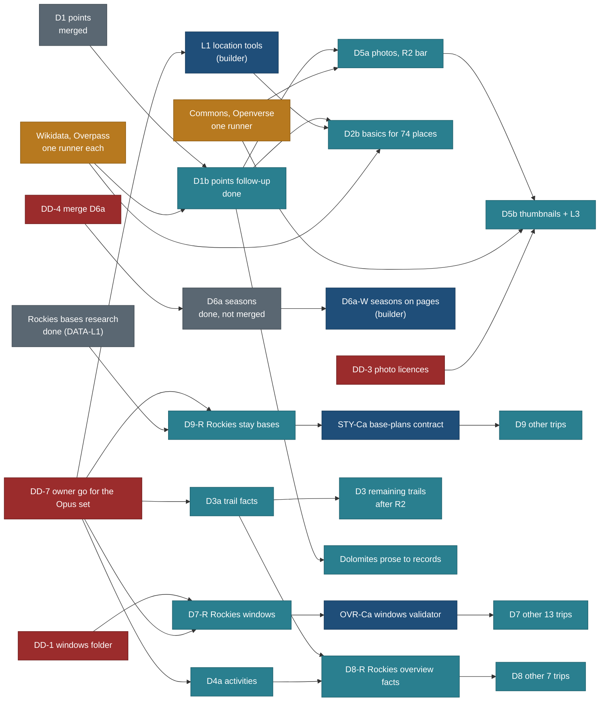

# DATA roadmap: every research batch, its state, order and open decisions

Status: 25 Oct 2026, written by travel-planner (Opus) on `public/DATA-RECON` after reconciling `public/DATA-L1`,
`public/DATA-D6a` and `main` (280f0ec). This page is the one tracked view of the data research. The method and rules are in
[briefs/DATA.md](briefs/DATA.md) and [briefs/DATA-LOC.md](briefs/DATA-LOC.md); the copy-paste prompts are in
[briefs/DATA-AGENT-PROMPTS.md](briefs/DATA-AGENT-PROMPTS.md). PLAN rows: R-10, R-13, R-67, R-80, R-110 to R-112. BACKLOG:
15.56, 15.80, 15.110 to 15.113.

**The coordinator reads section 6 (decisions log) first:** it lists what is waiting for the owner and who is blocked.

Priorities that set the order (product direction, 18 Oct): the public read-only site first, so the R2 data bar
(PHASE-E-START section 9, owner Q90) comes before anything that only the planner uses; free tiers and light request
volumes; Opus lanes pause when the week's use is above 70% (PHASE-E-START usage rule).

## 1. Measured numbers (25 Oct 2026, on this branch; data identical to `main`)

`node core/bin/capture.ts gaps --placement` (8 trips, 394 records):

| Trip | Records | No area | No point | Approximate | Offers saying nowhere |
|---|---|---|---|---|---|
| canadian-rockies-2029 | 199 | 136 | 2 | 23 | 17 |
| dolomites-2027 | 76 | 34 | 0 | 3 | 0 |
| iceland-ring-road-2027 | 31 | 29 | 0 | 4 | 0 |
| patagonia-2027 | 28 | 26 | 2 | 6 | 0 |
| utah-five-parks | 25 | 19 | 1 | 1 | 0 |
| chamonix-mont-blanc-2028 | 23 | 21 | 1 | 2 | 0 |
| algonquin-muskoka-2026 | 6 | 6 | 0 | 0 | 0 |
| vermont-fall-2026 | 6 | 6 | 0 | 2 | 0 |
| **All** | **394** | **277** | **6** | **41** | **17** |

No record has a missing nearest town or sits outside its area.

`node core/bin/capture.ts gaps --tier required`:

| Kind | Records | Required tier complete |
|---|---|---|
| place | 196 | 7 |
| trail | 118 | 1 |
| other route | 25 | 0 |
| offer | 46 | 1 |
| event | 1 | 0 |
| stay | 8 | 0 |

Per layer (records answering): place 201 records, point 200, area 39, official link 45, OSM id 44, Wikidata 29, photo 21,
season 9. Trails 118: point 105, official link 66, area 26, where 13, season 0, photo 0. Offers 49: where 32, official 25,
price 24, season 16, operator 12, duration 12, minimum age 6, window 4.

`gaps --budget --check`: OK, no count rose. Budget: `E_PLACE_AREA` 277, `E_PLACE_ORPHAN` 17, `W_PLACE_POINT` 6,
`W_PLACE_APPROX` 0, `E_PLACE_FAR` 0, `W_PLACE_TOWN` 0, `W_TIER_REQUIRED` 385 (3,875 keys).

Locations store (`data/locations/locations.json`, `locations.py validate` ok): 74 places, 8 tied to a trip and 66 not;
73 with a point (1 `unconfirmed`), 66 with a Wikidata QID, 62 with an image, 32 with elevation, 24 with season months, 0 of
7 trails with length or gain. Kinds: park 12, town 8, city 8, trail 7, mountain 7, lake 6, region 5, waterfall 4, island
4, viewpoint 3, canyon 3, activity 2, place 2, lighthouse 1, valley 1, drive 1. These match DATA-LOC section 1.

## 2. State of every batch

State words: **merged** (on `main`), **done** (finished on its branch, not merged), **in progress**, **not started**.
Effort is agent time. "Prompt" names the section in [DATA-AGENT-PROMPTS.md](briefs/DATA-AGENT-PROMPTS.md); every prompt
listed was checked against this page on 25 Oct and corrected where it was out of date.

| Batch | What | State | Branch / worktree | Owner | Model | Effort | Depends on | Acceptance check | Next action | Prompt |
|---|---|---|---|---|---|---|---|---|---|---|
| D1 | Points for the 84 records with none | **merged** (`public/DATA-D1`, integrated by `public/DATA-D1-integrate`) | `v2-DATA-D1`, `v2-DATA-D1-integrate` (frozen) | travel-researcher | ran on Sonnet (brief said Opus) | 6 h | META-1 | `W_PLACE_POINT` 84 to 6; `E_PLACE_FAR` 0 | none; D1b reviews its rulings on Opus | D1 (marked done) |
| D1b | Points follow-up: 6 with none, 41 `approx`, 3 payoff parts, Fanes track, 5 operator questions, 3 conflicts, 20-point check | **done** (`public/DATA-D1b`, integrated by `public/DATA-D1b-integrate`, 25 Oct; five decisions open in the run note; merge to main waits for the coordinator) | `v2-DATA-D1b`, `public/DATA-D1b` | travel-researcher | Opus | about 4 h (planner estimate) | D1 merged (yes) | `W_PLACE_POINT` at most 6, each a dated search; approx points down from 41, trailheads and meeting points first; 18 of 20 sampled points within 100 m | let it finish; coordinator merges, re-runs `gaps --placement` and updates section 1 | D1b |
| D2b (DATA-LOC L2) | Basics tier for the 74 stored places | not started | `v2-DATA-D2b`, `public/DATA-D2b` | travel-researcher | Opus | about 6 h | L1; D1b (frees `points.json` and the Wikidata lock) | every place has each basics layer or `searched_none`; `basics --report` before and after | wait for L1 and D1b | D2b (added 25 Oct) |
| L1 (DATA-LOC tools) | `quick-add`, `basics --report`, `edit` flags, the trip-less lane | not started | `v2-DATA-LOC-L1`, `public/DATA-LOC-L1` | travel-builder | Opus (capture contract) | about 5 h | none | commands work; a `wishlist` record validates; no count changes | start on the owner's go (DD-7); lane id kept renameable (DD-8) | L1 (added 25 Oct) |
| L3 (DATA-LOC photos) | Photos for the 74, wider sources | not started | with D5a/D5b runner | travel-researcher | Opus picks, Haiku runs | in D5b's 12 h | `tools/gallery/` Openverse and Geograph support (builder, not yet briefed); DD-3 | every place has a licensed photo or "No licensed photo yet" with a date | wait for DD-3 and D1b | D5a/D5b rules apply |
| L4, L5 (DATA-LOC) | Cross-check; grow the list | not started | later | verifier; researcher | Sonnet; Opus | 2 h; open | L2, L3; L1 | one `gaps --basics` report; conflicts recorded | after L2 and L3 | DATA-LOC section 6 |
| D3a | Trail facts: Rockies plan-day trails and the 5 R2 trails | not started | `v2-DATA-D3a`, `public/DATA-D3a` | travel-researcher | Opus; Haiku checks; Sonnet verify | 5 h + 1 h | none | the five R2 trails and Rockies plan-day trails have distance, gain, time, shape or `searched_none`; `gaps --tier required` falls | start now beside D1b (R2 bar) | D3a |
| D3 | Trail facts for the rest (122 pages minus D3a) and store trails | not started | per trip | travel-researcher | Opus | about 10 h | D3a; after R2 (Q90) | `gaps --tier required` per trip falls; no link-only values | after R2 | D3 (added 25 Oct) |
| D4a | Where the 17 Rockies offers happen; Rockies plan-day offers | not started | `v2-DATA-D4a`, `public/DATA-D4a` | travel-researcher | Opus; Sonnet verify | 4 h + 0.5 h | none | `E_PLACE_ORPHAN` 17 to 0; plan-day offers have operator, season, price or `none_stated` | start now beside D1b (R2 bar) | D4a |
| D5a | Photos for the 5 R2 trails and Rockies plan-day stops | not started | `v2-DATA-D5a`, `public/DATA-D5a` | travel-researcher | Opus; Sonnet verify | 3 h + 0.5 h | D1b (final points); no other Commons agent | each target has a licensed photo or a dated "No licensed photo yet"; Commons run records do not overlap | after D1b | D5a |
| D5b | Thumbnails for all 118 trails, then plan-day stops | not started | `v2-DATA-D5b` | Haiku explorer runs, Opus picks | Haiku + Opus | 12 h | D1b, D5a; DD-3 for any source beyond Commons and NPS | each trail has a photo or `searched_none`; licences on the allowlist | after D5a | D5b |
| D6a | Seasons for the 6 trips with none; dated seed texts | **merged** (c3ae77c, 25 Oct; audit) | `v2-DATA-D6a`, `public/DATA-D6a` (tip e8e43fe) | travel-researcher (files say Opus; commits co-authored by Copilot) | Opus | 2 h | none | checks in section 7 all pass | owner go to merge (DD-4); then D6a-W; then the 3.10 list | D6a (marked done) |
| D6a-W | Show the D6a seasons on the six trips (BACKLOG 15.113) | not started | `v2-D6aW`, `public/D6aW` | travel-builder, then design reviewer and verifier | Sonnet | 2 h + review | D6a merged | "Season not set yet" gone for the six trips; screenshots 1440 and 390, light and dark | after DD-4 | D6a-W (added 25 Oct) |
| D7-R | Rockies best-time windows, the pattern | not started | `v2-DATA-D7R`, `public/DATA-D7R` | travel-researcher | Opus | 4 h | none (validated by hand until OVR-Ca); writes `data/windows/` (DD-1) | 2 to 4 windows, every plus and minus sourced or inference-noted, no calendar date, default sun equals the schedule | start on the owner's go (Q100, DD-7) | D7-R (path updated) |
| D7 | Windows for the other 13 trips | not started | per trip | travel-researcher | Opus | about 16 h | OVR-Ca (validator); Q99 for the 6 overview trips | same as D7-R, validator passes | after OVR-Ca | D7 |
| D8-R | Rockies overview facts: access season, booking state, durations, effort | not started | `v2-DATA-D8R`, `public/DATA-D8R` | travel-researcher | Opus | 8 h | none | every Rockies plan item has the four facts or `searched_none`; counts before and after | after D3a and D4a free the Opus seat (DD-7) | D8-R |
| D8 | Overview facts for the other 7 trips with days | not started | per trip | travel-researcher | Opus | 8 h | D8-R | same fields per trip | after D8-R | D8 (added 25 Oct) |
| D9-R | Rockies stay bases: 7 towns, 4 ways to stay, 3 swaps, day map, open jaw | not started | `v2-DATA-D9R`, `public/DATA-D9R` | travel-researcher | Opus | 6 h | Banff research (done); STY-P only for `BS.json`; D1b for town points | DATA acceptance 11 and 12; strategies per spec 3.2 as revised (DD-2) | start on the owner's go (Q115, DD-7); branch after this branch merges | D9-R (strategies updated) |
| D9 | Stay bases for the other trips | not started | per trip | travel-researcher | Opus | about 8.5 h | STY-Ca | validator and `stays.ts messages` pass per trip | after STY-Ca | D9 |
| Banff stays (Rockies bases research) | OSRM comparison of 10 strategies, facts table | **done**, merged into this branch from `public/DATA-L1` | `v2-DATA-L1` (frozen) | travel-planner and researcher (DATA-L1) | not recorded | done | none | spec 3.6 and 3.7 | merge this branch; D9-R builds on it | none (the add-on is no longer needed) |
| Dolomites prose to records | Confirmed facts from the 5 Dolomites research files into records | not started (optional) | `v2-DATA-DP`, `public/DATA-DP` | travel-researcher | Opus | about 4 h | D1b; not beside D9 on the Dolomites | records with sources; no property names or prices | after D1b, when the Opus seat is free | Dolomites prose to records (files added) |

## 3. Dependency graph

(Grey is done, teal is a research batch, blue is code, amber is an external service, red is an owner decision that gates
the box it points at. D8-R depends on D3a and D4a only for the Opus seat, not for data.)

## 4. Run order and what can run in parallel

The rule: parallel agents get disjoint files. The table names the files each batch writes; a file in two rows is a
conflict and is resolved by the "shared files" rule below.

| Set | Batches together | Files each one writes (only these) | Why this set |
|---|---|---|---|
| A (now) | D1b (running), D3a, D4a, L1 | D1b: `data/capture/points.json`, `data/capture/<trip>/*.json` for 3 payoff parts, runs, `research/runs/DATA-D1b-*`. D3a: `data/capture/<trip>/TF.json`, `data/suitability/<trip>/TF.json`. D4a: `AC.json` and its sidecar, `data/capture/operators.json`. L1: `tools/locations.py`, tests, the lane acceptance in `core/` | R2 data bar first (D3a, D4a); L1 unblocks D2b and is code, so it uses a builder seat |
| B (when an Opus seat frees) | D7-R, D9-R, then D8-R | D7-R: `data/windows/canadian-rockies-2029.json`, `research/trips/canadian-rockies-sept-2029/timing-windows.md`. D9-R: `data/base-plans/canadian-rockies-2029.json`, `research/trips/canadian-rockies-sept-2029/stay-bases.md`. D8-R: `OV.json` and its sidecar | Owner priorities on the trip page (best time, where to stay); none of them touch points or photos |
| C (after D1b) | D5a, D2b, Dolomites prose | D5a: `data/capture/<trip>/PH.json`. D2b: `data/locations/locations.json` through `locations.py`, `data/capture/wishlist/BA.json`. DP: `data/capture/dolomites-2027/DP.json` | Photos need final points; D2b needs L1 and the free Wikidata lock |
| D | D5b with L3 (one photo runner), D6a-W (after DD-4) | `PH.json` per trip (D5b), the place galleries (L3); D6a-W: `web/lib/public/seasons.ts`, `trips.ts` season lines, tests, snapshots | Commons and Openverse allow one runner; D6a-W is a builder seat |
| E (after their contracts) | D7 (after OVR-Ca), D9 (after STY-Ca), D8 (after D8-R), D3 (after R2), L4 | per-trip lane files as above | Validators must exist before the bulk runs |

Shared files (one writer at a time): `data/capture/points.json` is D1b's until it hands back; D9-R and D2b list new
points in their run notes for the coordinator until then. `research/method/operator-questions-2026-10-18.md` is shared by
D1b, D4a and D8-R: each appends one section under its batch name. `data/capture/gap-budget.json` only goes down; on a
rebase take the lower count. `data/sources/registry.json` is regenerated by the coordinator at merge. `research/backlog.md`:
append only.

Merge order (coordinator): this branch (`public/DATA-RECON`) first, so new batches branch from a `main` that has the stay
research and the `data/windows/` path; then D6a on the owner's go; then each batch as it hands back, re-running
`gaps --budget --check`, `sources.ts check` and `check-all.sh` after each.

## 4b. Completion standard for every location, tied to a trip or not (owner, 25 Oct 2026: "capture as much as we can; we do not have to miss it")

Scope: all 74 places in `data/locations/locations.json` (66 tied to no trip, 8 tied to one: US 35, CA 22, IT 10, VN 3, FR 2, CN 1, IN 1; 12 parks, 8 towns, 8 cities, 7 trails, 7 mountains, 6 lakes, 5 regions, 4 waterfalls, 4 islands, 3 viewpoints, 3 canyons, 2 activities, 2 places, and 1 each lighthouse, valley, drive) and every place later added through the `location` skill. They go through the same capture contract as trip records, in the trip-less lane `catalogue` (DD-8; built by L1).

A location is **done** only when each of these is a sourced value or a dated `searched_none` (a gap is never a yes):
1. Identity and place: name, kind, area chain, a point with its role, nearest town (derived), Wikidata QID, elevation, one own-words summary.
2. Image: one licensed photo (strict licences, DD-3) or "No licensed photo yet" with the search date.
3. When: season months and closures, best time of year (a window if it has trip use), hazards.
4. By kind: trail (distance, gain, shape, surface, difficulty on a named scale, time, dogs, stroller, wheelchair, trailhead and parking points, links); a place reached by car (parking point, fee, capacity note, shuttle or permit rule); an activity or lift (operator, season, duration, price, minimum age, height and weight limits, booking need, booking URL and window); a town or city (what it is good for, transport, a base-town fact row if it could serve as a base); a park (entry fee or pass, main trailheads, official page).
5. Suitability for families and the effort level, and the relevance sidecars (never a "yes" from a gap).
6. Links (official pages, OSM, Wikipedia or Wikidata; AllTrails, Google, Tripadvisor and Komoot as links only), source rows with read dates.
7. Privacy: nothing may reveal that a place came from the owner's private list (PRIV1); no household data; the saved-post laundry list stays private.

**How the research runs** (D2b, Opus judgement plus Sonnet fills, after L1 and D1b; both are done or in progress):
- **Split by country so runs are disjoint and sequential per service:** D2b-US (35), D2b-CA (22), D2b-IT (10), D2b-INT (VN 3, FR 2, CN 1, IN 1 = 7). One lane file per split under the `catalogue` lane; writing through `python3 tools/locations.py edit` and the capture commands only.
- **Order inside a split:** points and areas first (Wikidata then OSM; Overpass sparingly), then official pages for fees, seasons and trail numbers, then suitability, then photos (D5 batch after the points are final).
- **Done check per split:** `node core/bin/capture.ts gaps --tier required` for the lane shows every place complete or searched_none; the count of "records with the required tier complete" must rise to 74 of 74 for the lane, not stay at 7 of 196 for places; no gap count rises; a 10-value sample check against the sources passes at least 9 of 10; an Opus pass reviews a sample of 10 per split.
- **Maintenance:** the `location` skill's capture step runs this standard for every new place, so the list never falls behind again.

## 4c. What a batch stores, and how it reaches Postgres (owner, 25 Oct 2026)

Every batch follows [catalogue-intake-and-storage.md](../../features/catalogue-intake-and-storage.md): store a value only
when it passes the keep-or-drop rule (section 2: decision, display, filter, check, money, proof, freshness); facts a batch
finds for records it does not own go into a changeset file (`data/capture/changesets/<run>.json`, once RIS-C lands), operator
questions into the run record as `ask` outcomes, and reasoning stays in the run note. Its section 5 lists what D1, D1b,
D3a, D4a, D6a, D7-R and D9-R produced that no record holds yet; task RIS-A promotes it. Q175 asks that D2b start after RIS-C
and RIS-N so the 74 places are born compliant.

## 5. Request volume and one runner per service

Every external call is sequential and goes through a lock, across all agents on this Mac. `flock` was not installed on 21
Oct: install it (`brew install flock`) before the first call made outside the repo's scripts, and say so in the run
record. User agent `travel-relevance-signals/1.0 (+https://nks-travel.pages.dev/about/)`, never an email.

| Service | Lock | Rule | Expected use, sets A to D |
|---|---|---|---|
| Overpass | `/tmp/travel-overpass.lock` | at least 10 s between queries; one agent at a time; off-peak retry only | D1b about 40 queries; L1 tests none (fixtures) |
| Wikidata (API and SPARQL) | `/tmp/travel-wikidata.lock` | one request at a time, batches of 50 ids | D1b about 20; D2b about 30; L1 `quick-add` 1 a second |
| Nominatim | `/tmp/travel-nominatim.lock` (new) | at most 1 request a second (its usage policy) | `quick-add` fallback only |
| Wikimedia Commons | `/tmp/travel-commons.lock` | one runner for the whole machine; never from parallel agents (a 429 hit four agents at once); warm renditions after each batch | D5a about 60; D5b about 130 to 250; L3 after D5b |
| Openverse | `/tmp/travel-openverse.lock` (new, with the gallery support) | one runner, same agent as Commons, anonymous rate | L3 only, after DD-3 |
| OSRM public demo | none needed for one call | the DATA-L1 run used one `/table` call; not a store source (DD-5) | none planned |
| ORS | the legs script's own key and pacing | builder runs STY-L's script, sequential | D9-R legs only, after STY-L |
| Official pages (Parks Canada, Alberta Parks, NPS, operators, ECCC) | none | plain page reads, at most one read every 5 s per host per agent, never a scripted crawl; cite the page and read date | D3a about 25, D4a about 40, D7-R about 25, D8-R about 60, D9-R about 40 |

Link-only platforms (AllTrails, Google, Tripadvisor, Komoot, Gaia, Wikiloc) are never read for values or coordinates.

## 6. Decisions log

Open decisions for the owner. "Applied" means the planner did the safest reversible thing so work can continue; the owner
can reverse it at the cost named. Recorded in PLAN section 5 as DD-1 to DD-8.

| # | Decision | Options | Recommendation and trade-off | Who is blocked | Status |
|---|---|---|---|---|---|
| DD-1 | Where best-time windows live, now that D6a uses `data/seasons/` with another schema | A: `data/windows/<trip>.json` (`trip-windows/1`), `data/seasons/` keeps D6a's basic season. B: one file in `data/seasons/` with `trip-windows/1` widened to 1 to 4 windows plus a `season` block | **A.** D6a merges unchanged, the windows validator stays strict (2 to 4), D7 cannot overwrite a season file. Trade-off: two small files per trip with the plan's months in both, tied by `E_WIN_SUN` | D7-R and OVR-Ca if the owner picks B (they would write and read `data/seasons/` instead) | **applied** in the overview spec, OVR, DATA, prompts, F12, BACKLOG 15.51; reversible until D7-R writes a file |
| DD-2 | Rockies three-base strategies: Golden (owner's idea) or Lake Louise as the middle base | Golden in both three-base strategies (first spec); Lake Louise in both, Golden as a swap (research); both as full strategies (over the cap of 3) | **Lake Louise, Golden as the swap `golden-for-lake-louise`.** 27.4 h against 33.0 h of day-trip driving; the owner's plan is still shown with its numbers. Trade-off: the owner's version is one click deeper | nobody (D9-R researches both); Q114 decides the default | **applied** in stay spec 3.2 and the D9-R prompt; pending Q114 |
| DD-3 | Photo licences beyond CC BY, CC BY-SA, CC0, public domain | allow NC files and the Unsplash and Pexels licences (DATA-LOC 4, Q-LOC-4 as recorded) or keep the D5b allowlist (DATA.md, media.md 6 "non-free licences are rejected") | **Keep the D5b allowlist for now.** NC ties every photo to a site that never earns, and the Unsplash and Pexels licences forbid building a similar collection and are not CC. Trade-off: fewer photos for obscure places | L3 wider sources; any D5b pick from Openverse with NC | **BLOCKED** for the wider set; the strict default applies in every prompt |
| DD-4 | Merge `public/DATA-D6a` into `main` | merge now; merge after its run note and the 3.10 list; send back | **Merge now**; ask a Haiku follow-up for the run note (`research/runs/DATA-D6a-seasons.md`) and the list of the 42 dated texts in legacy files. Every check passes (section 7) and sun times match `core/bin/sun.ts` on two spot checks. Trade-off: the record is missing its prose note until the follow-up | D6a-W (15.113); the six trips keep "Season not set yet" | open |
| DD-5 | OSRM public demo as a routing source for stored legs | register it and store its minutes; keep ORS for stored legs and OSRM as research evidence | **ORS for stored legs; OSRM stays a cross-check.** The demo server is for light use, and the legs script, checks and key already exist for ORS. Trade-off: the 3.6 numbers are re-run through ORS before publication | nobody now; STY-L later | applied in stay spec 3.7 |
| DD-6 | Q-BASE-1: is an easy Calgary return a rule (last base within 2 h of the airport) or a preference | rule; preference | **Preference**, stated by message M5. Trade-off: a Lake Louise finish (155 min) stays possible, shown with its minus | D9-R's strategy set if it is a rule | open (stay spec section 18) |
| DD-7 | The owner's go for the Opus research set beside D1b, and its order | all at once; R2 bar first (D3a, D4a) then D7-R and D9-R, then D8-R; trip-page features first | **R2 bar first**, then D7-R and D9-R (Q100, Q115 already ask for their go), then D8-R; L1 in a builder seat now. Trade-off: best time and where to stay reach the trip page later | D3a, D4a, D7-R, D8-R, D9-R, L1 (none started) | open |
| DD-8 | Name of the trip-less capture lane | `wishlist` (Q-LOC-3 as recorded); a neutral id such as `catalogue` | **A neutral id.** "wishlist" says which places came from the owner's private list, the concern behind GB-B-3; the lane id is internal but trip ids reach the API. Trade-off: none if decided before L1 ships; L1 keeps the id one constant | L1 only at its last step | open |

Earlier open questions this work touches, not repeated here: Q93 (Flickr, answered: Openverse only), Q99 (windows for the
6 overview trips), Q100 (start D7-R), Q109 to Q116 (stays; Q113 now also covers Q-BASE-3, Q114 is Q-BASE-2), Q90 (R2
data bar), Q88 (place-size budget, which D2b and D3 must respect).

## 7. D6a check (25 Oct, without merging into `main`)

Method: `git merge --no-ff --no-commit public/DATA-D6a` in this worktree, the checks below, then `git merge --abort`.

| Command | Result |
|---|---|
| `node core/bin/capture.ts build --check` | pass ("generated capture files match") |
| `node core/bin/validate.ts --all` | pass (61 files; warnings only, `W_SUIT_BELOW_USABLE`, unchanged) |
| `python3 tools/locations.py validate` | pass |
| `python3 tools/locations.py build --check` | pass ("up to date") |
| `node core/bin/capture.ts gaps --budget --check` | pass (no count rose) |
| `node core/bin/sources.ts check` | pass (405 sources, 0 errors) |
| `pnpm --dir web snapshot:check` | pass ("snapshot is current") |
| `python3 tools/cons/hardcode_scan.py --check` | pass |
| `python3 tools/tree_check.py` | pass after creating the empty, untracked `web/.og-cache` that a fresh worktree lacks (the only failures were that missing cache folder, not D6a) |
| `pnpm --dir web exec vitest run tests/data tests/trips tests/privacy.test.ts tests/scrub.test.ts tests/format.test.ts` | pass (41 files, 535 tests, 1 skipped) |
| `pnpm --dir core test` | pass (99 files, 1,991 tests) |

No test reads `data/seasons/` today (grep of `core/`, `web/lib`, `web/tests`, `web/scripts`, `tools/` finds none), so the
files are checked only by hand until D6a-W adds a schema.

**Schema answer.** Not the same schema. D6a's files are `trip-season-basic/1`: one window (the plan's own, `verdict: null`,
with a `schema_note` saying `trip-windows/1` needs 2 to 4), plus a `season` block in the adapter's Season shape (months,
label, why, weather with `{ value, basis, src, on }` fields), climate-station `points`, `legacy_folder`, `months_basis`.
The window fields (`start`, `sun`, `plus`, `minus`, `events`, `affects`, `unknown`) use the `trip-windows/1` names. The two
collide on the folder: a `trip-windows/1` validator over `data/seasons/` fails every D6a file with `E_WIN_COUNT`, and D7
would overwrite them. Resolved by DD-1 (A).

Content notes for the merge: the six files cite official normals (ECCC, NOAA NCEI, MeteoSwiss, WMO through NCEI) and
`core/bin/sun.ts`; spot checks of Québec on 29 Sep and Bergen on 24 Jun match the sun tool to the minute. One Swiss station
(Jungfraujoch) has no coordinates, which a schema must allow or fill. BACKLOG 3.10 is partly done: 5 seed texts rewritten
(snapshot report 236 to 231); 42 dated trip texts remain (40 Rockies day and booking notes from the frozen legacy
itinerary, the New Hampshire and Niagara subtitles), not yet listed for the coordinator.

## 8. Renumbering and moved content

`public/DATA-L1` used numbers that `main` had already given out. Mapped on 25 Oct:

| Old (DATA-L1) | New | What |
|---|---|---|
| PLAN R-62 (first commit 429eef5, renumbered by DATA-L1 itself to R-68) | R-110 | DATA-LOC basics, photos, easy adding |
| PLAN R-68 | R-110 | same |
| PLAN R-69 | R-111 | DATA batch order after D1, this roadmap |
| PLAN R-70 | R-112 | Rockies bases research (R-70 on `main` is favourites) |
| BACKLOG 3.68 | 15.110 | DATA-LOC |
| BACKLOG 3.69 | 15.111 | D1b and the order |
| BACKLOG 3.70 | 15.112 | Rockies bases |
| (new) | 15.113 | D6a-W, show the seasons |
| DATA-LOC title labels "D7, D2b, D5b" | L1 to L5; L2 runs as D2b | "D7" collided with best-time windows |
| Q-BASE-1 | Q-BASE-1 (stay spec 18) | kept |
| Q-BASE-2 | Q114 | same question |
| Q-BASE-3 | Q113 | folded in |
| ST-1, ST-2, ST-3, ST-4 | D9-R (3.5 items 9 and 10); STY-Ca, STY-E, STY-Cb, STY-1; STY-R, STY-V; D9 | steps |
| `data/stays/<trip>.json`, `trip-stays/1` | `data/base-plans/<trip>.json`, `trip-base-plans/1` | data shape |

The number ranges left free for others: R-100 to R-109 and 15.100 to 15.109 (email sign-in), Q140 and up.

Spec content moved: `docs/v2/features/trip-bases-and-stays.md` is a pointer. Its research summary and the strategy numbers
are [stay-bases-and-optimisation.md](../../features/stay-bases-and-optimisation.md) 3.6; its decisions B1 to B6 and every
disagreement with what was kept are 3.7; its open facts are 3.5 items 9 and 10; its gotchas are section 19; its questions
are section 18. The research file [base-strategies.md](../../../../research/trips/canadian-rockies-sept-2029/base-strategies.md)
is unchanged apart from a pointer line.

## Change log

| Date | Change |
|---|---|
| 2026-10-25 | First version: merged `public/DATA-L1`, renumbered (section 8), unified the stay specs, checked D6a without merging (section 7), moved windows to `data/windows/` (DD-1), the batch table, graph, run order, service rules and decisions DD-1 to DD-8; added prompts L1, D2b, D3, D8, D6a-W and owned files for the Dolomites batch |
