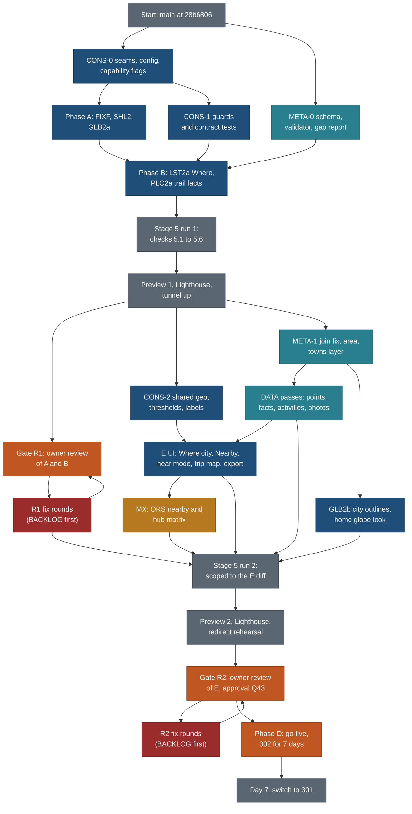

# Execution plan: the public site from now to go-live (phases A, B, E, D with review gates R1 and R2)

Written 20 Oct 2026 by travel-planner (Opus) for the coordinator. This is the sequenced plan for doing everything in [MASTER-PLAN.md](MASTER-PLAN.md) phases A, B, E and D, with the owner's two reviews (phase C) as proper gates. Status lives in [BACKLOG.md](BACKLOG.md); live lane state in [STATUS.md](STATUS.md); the briefs are in [briefs/](briefs/). Nothing here is started.

**Supersedes:** the phase order of MASTER-PLAN section 2 (E after go-live) and the single stage 5 and stage 6 of [STAGE4-plan.md](STAGE4-plan.md) sections 4 and 5, which now run once per review gate (section 7 here). The stage 7 checklist in STAGE4-plan section 6 is replaced by section 12 here. The phase order in [OWNER-ROUND1-plan.md](OWNER-ROUND1-plan.md) section 3 is replaced by this plan.

Principles cited by number from [principles.md](../../design/foundation/principles.md): P1 to P9, T1 to T5.

## 1. Goal and the new order

**Goal.** Ship the public read-only site (no login) with everything the owner reported in testing fixed, the Where filter, Nearby, the towns and cities layer, the Google trip map, the whole-trip export, and the metadata that makes "related" and "nearby" work for every place and activity. It is reviewed twice by the owner, and every feature is built so the server version later replaces one adapter, not a component.

### 1.1 Owner decisions applied (20 Oct 2026)

| # | Decision | Effect in this plan |
|---|---|---|
| D1 | Order is A, then B, then E, then D. E comes **before** go-live | E's lanes (towns, Where city level, Nearby, near mode, Google trip map, Export trip, globe city outlines and home look, the drive matrix, the data passes) all ship in the first release |
| D2 | Owner review happens twice: **R1** after A+B, **R2** after E. Then D goes live | Two preview builds, two stage 5 runs (scoped, see 7), two owner scripts (8.4, 10.4) |
| D3 | "Go with all recommendations" for Q42 to Q64 | Recorded in BACKLOG. Q65 to Q69 (server side) stay out of scope |
| D4 | Research pause lifted for all of phase E data work | Points for the 121 pointless pages, the trail points, trail facts, Commons photos, activity basics and the locations store required tier run in E (section 14) |
| D5 | Phase C is a full part of the plan | Sections 8 and 10: entry, checklist, roles, exit, round loop, owner script |
| D6 | Metadata for every place and every activity is the foundation | Workstream META (section 6, brief [META.md](briefs/META.md) and [DATA.md](briefs/DATA.md)) |
| D7 | Consistency, server-ready seams, no hard-coded values | Workstream CONS (section 5, brief [CONS.md](briefs/CONS.md)), scheduled before the E features |
| D8 | Every item is designed for the server switch | A "Server switch" column in every task table; rules in 4.2; a contract test per seam; the runbook in section 13 |

### 1.2 How the order works in practice

A and B lanes **build in parallel** (their files are disjoint) and **merge in order**, A first. E lanes **start when the R1 preview is frozen** (the owner reviews a fixed build; merges to `main` do not change it), and R1 fix rounds take priority over E lanes on any shared file. The alternative, E waiting for R1 exit, costs about 3 working days for no gain in quality, because the R1 preview is a frozen build either way (question Q72 confirms this with the owner).

CONS-0 and CONS-1 land first (day 1 to 3), because every later lane uses the seams, the config module and the guards. META-0 (the schema and validator part of the metadata workstream) runs in B, so R1 can show the baseline gap report and E's data passes fill against a rule that already exists.

### 1.3 Flow

### 1.4 Diagram spec (companion to the flow above)

Architecture rules: one node per milestone or lane group; gates are amber-red; data lanes teal; external services amber; infrastructure grey. Labels stay under 30 characters a line.

| Node ID | What | Section |
|---|---|---|
| N0 | The starting commit on `main` | 2 |
| C0 | CONS-0: the typed data client interface, capability flags, config module, placeholder adapters | 5.2 |
| A | Phase A lanes FIXF, SHL2, GLB2a | 3 |
| B | Phase B lanes LST2a, PLC2a (merge after A) | 4 |
| M0 | META-0: placement block, tiers, validator codes, gap reports | 6.6 |
| C1 | CONS-1: hard-coding guards (ratchet), contract test kit with the stub server adapter | 5.3, 5.5 |
| S51 | Stage 5 run 1, all six checks | 7 |
| P1 | Preview 1 build, Lighthouse, tunnel | 8.1 |
| R1 | Owner review 1 | 8 |
| F1 | R1 fix rounds (loop back to R1 re-check) | 8.5 |
| C2 | CONS-2: one geo module, thresholds, kind labels, home point module | 5.4 |
| M1 | META-1: point join fix, area_id migration; META-2: towns layer | 6.6 |
| DT | DATA batches D1 to D5 | 14 |
| EUI | LST2b, LST2c, PLC2b, TRP2 | 9 |
| G2 | GLB2b | 9 |
| MX | ORS nearby matrix and hub matrix | 9, 14 |
| S52 | Stage 5 run 2, scoped | 7 |
| P2 | Preview 2, Lighthouse, redirect and header rehearsal | 10.1 |
| R2 | Owner review 2 and the go-live approval (Q43) | 10 |
| F2 | R2 fix rounds | 10.5 |
| D | Go-live | 12 |
| D7 | 302 to 301 switch after 7 days | 12 |

| # | Flow step | From | To |
|---|---|---|---|
| 1 | Seams before any lane writes data code | N0 | C0 |
| 2 | A merges, then B | A | B |
| 3 | Schema rule ready before B merges | M0 | B |
| 4 | Guards in before B merges, so B is gated | C1 | B |
| 5 | Stage 5 on the merged A+B | B | S51 |
| 6 | Preview frozen, R1 opens | P1 | R1 |
| 7 | E starts on the frozen preview | P1 | C2, M1 |
| 8 | Data before the UI that shows it | DT | EUI |
| 9 | All E merged, stage 5 run 2 | EUI, G2, MX, DT, F1 | S52 |
| 10 | R2, approval, go-live, 301 after a week | R2 | D, D7 |

Decisions: E starts at P1, not at R1 exit (Q72, saves about 3 days). Stage 5 runs twice (section 7). Open question on the diagram: none. Change log: section 20.

## 2. Milestones and gates

| ID | Milestone | Done when | Working day (estimate) |
|---|---|---|---|
| M0 | Seams and guards in | CONS-0 and CONS-1 merged; check-all runs the new guards and the contract kit | 1 to 3 |
| M1 | Phase A merged | FIXF, SHL2, GLB2a merged and verified | 3 |
| M2 | Phase B merged | LST2a, PLC2a, META-0 merged; quiet full e2e passes | 3 to 4 |
| M3 | Stage 5 run 1 closed | 5.1 to 5.6 pass; every must row fixed | 5 to 6 |
| **R1 entry** | Preview 1 up | Section 8.1 criteria met; owner has the link and the script | 6 |
| **R1 exit** | Owner review 1 closed | Section 8.5 criteria met | 8 to 9 (owner time assumed 2 days) |
| M4 | E foundations merged | CONS-2, META-1, META-2 (towns) merged | 7 to 8 |
| M5 | E data passes merged | DATA D1 to D5 merged; placement gap report shows 0 unknown | 8 to 13 |
| M6 | E features merged | LST2b, LST2c, PLC2b, TRP2, GLB2b, MX merged; quiet full e2e passes | 13 |
| M7 | Stage 5 run 2 closed | Scoped checks pass; must rows fixed | 14 to 15 |
| **R2 entry** | Preview 2 up | Section 10.1 criteria met | 16 |
| **R2 exit** | Owner review 2 closed, Q43 approval | Section 10.5 criteria met | 17 to 18 |
| **Go-live** | Phase D steps 1 to 14 done | Section 12 | 19 |
| M8 | 301 switch | Step 15, seven days after go-live | about 24 |

## 3. Phase A: the owner's bug reports (small, before R1)

Every task row has a **Server switch** entry: the boundary function in `web/lib/client/data.ts` it uses, the contract a server would implement, and what stays unchanged. A row with no entry is not done (4.2).

| ID | Task | Rows | Lane | Owned files (disjoint) | Effort | Depends on | Acceptance check | Verifier | Server switch |
|---|---|---|---|---|---|---|---|---|---|
| A0 | Typed data client interface, capability flags, config module, placeholder adapters | 13.1 | CONS-0 | `web/lib/client/contract.ts` (new), `web/lib/client/static.ts` (new, wraps today's functions), `web/lib/client/data.ts` (re-exports only), `web/lib/capabilities.ts` (new), `web/lib/config/product.ts` (new), `core/src/schema/api/**` (new Zod request and response schemas) | 6 h | none | `DataClient` covers list, count, search, detail, export, globe, near (stub), report (stub); every existing component compiles against it unchanged; capability flags all false except static ones | travel-verifier | Is the seam: a server adapter implements `DataClient` with the same Zod shapes |
| A1 | Home search panel clamped to the viewport; header Search closes on a second tap (pulled from 3.66) | 9.1, 3.66 part | FIXF | `web/components/search/GlobalSearch.tsx`, `web/styles/search.css`, `web/components/home/CoverSearch.tsx`, new `web/tests/e2e/search-panel.spec.ts` | 2.5 h | none | e2e opens it from both buttons at 1000, 1100, 1440 and 1920 and asserts the panel rect is inside the viewport; a second tap on header Search closes it | travel-verifier | `search()`, `suggest()`, `parseQuery()`: unchanged; the panel is layout only. Server: `GET /api/search?q=` with the same `SearchResult` shape |
| A2 | Hide header Sign in behind the `signIn` capability flag; keep `/sign-in/` as a noindex "comes with the planner" page, out of the sitemap | 11.1, Q64 | SHL2 | `web/components/shell/**`, `web/app/sign-in/page.tsx`, `web/tests/shell/**` | 1 h | A0 | No Sign in in header or phone bar at 1440 and 390; flag on in a test shows it | travel-verifier | Placeholder seam `auth` (5.2): `capabilities.signIn=false`, static no-op adapter; server flips the flag and supplies the adapter. Laundry list item 1, 36 |
| A3 | "Report a problem" on every page (footer) and in About: an issue link with the page path prefilled; no personal address | 11.2, Q63, Q70 | SHL2 | `web/components/shell/SiteFooter.tsx`, `web/app/about/**` (one link), `web/lib/config/product.ts` key `reportUrl` (value supplied by CONS-0 config, URL from Q70) | 2 h | A0, Q70 | The footer link opens the issue form with `?page=<path>`; About links the same; privacy test finds no email | travel-verifier | Placeholder seam `report`: `reportProblem(input)` in the boundary returns `{kind:'link', url}` today; server returns `{kind:'submitted', id}` from `POST /api/report` with the same Zod input. Laundry list item 4 |
| A4 | Globe: Fly here moves the camera; every feature class gets a fit (point, line, area); landform centres audited against their boxes | 9.7 | GLB2a | `web/components/globe/**`, `web/lib/globe/**`, `web/app/globe*/**`, `tools/globe_data.py`, `data/reference/globe/**`, `web/public/globe/**`, `web/tests/globe/**`, `web/tests/e2e/globe*.spec.ts` | 8 h | none | e2e picks a river, plain, delta, lake and range and asserts the camera ends inside the feature's box; Ganges Plain centre within its box | travel-verifier, then travel-design-reviewer | `globeGazetteer()`, `globeCard()`: same shapes, fit data added to the gazetteer row. Server: `GET /api/globe/feature/:id` |
| A5 | Globe: rivers draw their own line, never the parent state | 9.4 | GLB2a | as A4 | 4 h | A4 | Ganges, Danube, Nile each draw a line; no state outline | as A4 | New reader `globeLine(id)` appended to the boundary; per-feature file today, `GET /api/globe/line/:id` later |
| A6 | Globe: Natural features switch in Map options, `nf=0` in the URL, features grouped last in search | 9.8, Q52 | GLB2a | as A4 | 3 h | A5 | e2e: off removes features from search and picking; the link keeps it; default on | as A4 | URL key `nf` is the same on static and server; filtering happens in the pure search ranker, not the file layout |

## 4. Phase B: before the first review

### 4.1 Tasks

| ID | Task | Rows | Lane | Owned files (disjoint) | Effort | Depends on | Acceptance check | Verifier | Server switch |
|---|---|---|---|---|---|---|---|---|---|
| B1 | Where pill on Places: Country, State or province, Parks and areas, with counts (phase N0) | 8.1, Q54 | LST2a | `web/components/entity/WhereMenu.tsx` (new), `web/components/entity/FilterBar.tsx` (pill slot), `web/lib/entities/types.ts`, `web/lib/entities/descriptors/place.tsx`, `web/styles/filters.css`, `web/tests/entities/where.test.ts`, `web/tests/e2e/places-where.spec.ts` | 8 h incl. review | A0 | Nearby spec 7 N0 checks 1 to 9 (Canada, Alberta gives the Alberta count and `country=CA&region=alberta`; four pills, six when scoped; keyboard path; 44 px phone rows) | travel-verifier, then travel-design-reviewer | `listPlaces(query)`, `countList()`: no new file. Server: `GET /api/places?country=&region=&area=` returns the same `ListResult` and facet counts |
| B2 | Trail key-facts strip from the contract (length, gain, loss, high point, time, route type, effort, surface, hazards, dogs, stroller, wheelchair, season, trailhead, route status), "Not checked yet" in empty slots | 10.1 | PLC2a | `web/components/places/**` except `rows.ts`, `PlacesMap.tsx`, `PlaceCardFooter.tsx`, `cluster.ts`; `web/lib/public/sections.ts`, `contract.ts`; `web/tests/places/**`, `web/tests/e2e/place*.spec.ts`, `places-trail.spec.ts` | 4 h | none | Fenland Loop shows every slot; a gap reads "Not checked yet"; order from the contract `glance` of `nature.trail` | travel-verifier, then travel-design-reviewer | Build-time: `getPlace(slug)` through the adapter; the strip renders a `PageModel` slot list, so a server `GET /api/places/:slug` returning the same model changes nothing |
| B3 | AllTrails on every trail: direct where supplied, else a labelled "Search AllTrails" link built from name and area; never fetched | 10.3, Q53 | PLC2a | `web/lib/map/links.ts` (one link builder for every derived link: directions, Google Maps, AllTrails search, Komoot search), `web/tests/map/links*.test.ts` | 2 h | none | Every trail page has the link, new tab, third-party note; the builder is the only place these URLs are formed (CONS guard) | travel-verifier | Pure function, runs at build, in the browser or on a server unchanged |
| B4 | META-0: placement block (`point_role`, `approx`, `near_town`, `geonames_id`), tiers per kind from `types.json` marks, validator codes, `capture.ts gaps --placement` and `gaps --tier`, researcher checklist line | 8.3, 13.5, 3.37 part | META | `core/src/schema/capture/properties.ts`, the `point` value and points sidecar schemas in `core/src/schema/capture/**`, `core/src/validate/capture.ts` and `codes.ts`, `core/src/capture/gapsCli.ts`, `core/bin/capture.ts`, generated outputs via `capture.ts build`, `docs/v2/research/capture-contract.md` (new section 3.7), `.claude/agents/travel-researcher.md` (one line), `core/test/capture/**` | 10 h | none | Section 6.6 META-0 checks; check-all green with warnings (not errors) on migrated records | travel-verifier | Zod schemas in `core/` are the shape a Postgres loader and an API validate; no web change |
| B5 | CONS-1: hard-coding guards in ratchet mode, the contract test kit and the in-memory stub server adapter | 13.2, 13.4 | CONS | new `web/tests/cons/**`, `web/lib/client/stub.ts` (new, in-memory adapter for tests only), `tools/cons/hardcode_scan.py` (new), `tools/cons/baseline.json` (new), one line in `tools/check-all.sh` | 6 h | A0 | Section 5.3 and 5.5 checks: a new hex, rgb, slug, domain, UA or threshold literal fails check-all; every seam's contract cases pass on both adapters | travel-verifier | Is the switch proof: the same cases on static and stub |
| B6 | Merge A then B; quiet full e2e on the merged head | 3.63 | coordinator | none | 2 h | B1 to B5 | 0 failures, or each failure a real bug with a row | coordinator | n/a |

### 4.2 Server-switch rules (every lane, every brief)

1. Components never import data files, shards or JSON directly. All reads and writes go through `web/lib/client/data.ts`, which implements the typed `DataClient` interface in `web/lib/client/contract.ts` (P9). The boundary test (`web/tests/data/boundary.test.ts`) enforces it.
2. Request and response types are Zod schemas in `core/src/schema/api/**`, exported, so a server validates the same shape. Web types are `z.infer` of them.
3. URLs and query keys are the same on static and server: `country`, `region`, `area`, `city`, `near`, `r`, `k`, `nf`, `p`, `split`, `ids`, `base`, `days`. One key per meaning (Q62).
4. Pure logic (nearby, filters, ranking, the parser, the scheduler, link builders, distance) lives in framework-free modules that run in the browser, at build and on a server: `core/src/**` or `web/lib/**` files with no React and no `fs`.
5. Build-time outputs (place page blocks, shards, `where-<cc>.json`, town parts) are produced by the same functions a server would call.
6. No feature depends on a static-file layout the UI can see. Paths are private to the static adapter.
7. Caps and P8 limits (radius cap 100 km, page size, the list-row allowlist, no unscoped near query) are enforced inside the boundary function, and tested there, not by how files are split.
8. Every seam has one contract test run against the static adapter and the in-memory stub (5.5). A switch is then a config change plus one adapter.

## 5. Workstream CONS: consistency, server seams, no hard-coded values

Brief: [briefs/CONS.md](briefs/CONS.md). Four lanes: CONS-0 (A0), CONS-1 (B5), CONS-2 (E, first), CONS-3 (E, burn-down).

### 5.1 Why first, and what it saves

| E item | Without CONS first | With CONS first |
|---|---|---|
| Nearby block, near mode, Where city counts, MX bands | A ninth great-circle function and a third copy of the 25 km threshold (core `NEAR_KM`, web `NEARBY_MAX_KM`) | One `core/src/geo/` module and one `nearby` config block; about 3 h of rework avoided in PLC2b, LST2c and MX |
| Trip map on Google | Pin and route colours copied from `web/lib/map/palette.ts` fallbacks a second time | Map colours read from theme tokens through one palette reader; TRP2 adds no colour |
| Report a problem, Sign in, guest drafts | Ad hoc `if` in components | Capability flags and placeholder adapters; the server flips flags |
| Towns layer and city outlines | Two town lists (search parts, globe outlines) | One `data/reference/towns/` list read through the boundary |
| Every E lane | Hard-coding found at R2 and fixed late | check-all fails on the first new literal |

Must be finished before the Where city level (LST2b), Nearby (PLC2b), near mode (LST2c) and the trip map (TRP2) start: CONS-0, CONS-1 and CONS-2. CONS-3 (slug tables, palette fallbacks, legacy special cases) can run alongside E because no E lane adds to those classes once the guard is on.

Effort: CONS-0 6 h, CONS-1 6 h, CONS-2 8 h, CONS-3 8 h, total 28 h.

### 5.2 Seams and placeholders

Every row is a function on `DataClient`, a Zod contract in `core/src/schema/api/`, and a contract test.

| Seam | Static implementation today | Future server implementation | Flag | Laundry-list item |
|---|---|---|---|---|
| list and filter | `listPlaces`, `listTrips`, `countList*`, shards loaded by `ensureShards` | `GET /api/places?filters&page`, `GET /api/trips?...` | `capabilities.serverLists=false` | 10 |
| near query | `nearPlaces(centre, r, query, pageSize)`, `resolveNear`, `townsNear` over shards whose bbox meets the circle (LST2c) | `GET /api/places?near=&r=` (PostGIS) | `serverNear=false` | 11 |
| search | `search`, `suggest`, `parseQuery`, split lazy index | `GET /api/search?q=` with the same parser | `serverSearch=false` | 12 |
| place and trip detail | build-time `getPlace`, `getTrip` into HTML; `globeCard` at runtime | `GET /api/places/:slug`, `GET /api/trips/:slug` | `serverDetail=false` | 13, 17 |
| export | `loadExport(type, slug)`, per item, built at build time | `GET /api/export/:type/:slug?format=` rate limited | `serverExport=false` | 14 |
| report a problem | `reportProblem(input)` returns `{kind:'link', url}` (issue link, Q70) | `POST /api/report` returns `{kind:'submitted', id}` | `reportForm=false` | 4 (API) |
| sign in | no-op `auth` adapter, `session()` returns `null`; header link hidden | Supabase or chosen backend (Q65, Q66) | `signIn=false` | 1, 36 |
| save to a trip, copy to my trips | Copy sheet makes a local draft (ICS, PDF); "Save" hidden | `POST /api/trips/:id/items` | `saveToTrip=false` | 25, 36 |
| guest drafts | none; placeholder `draftStore` with an in-memory implementation and share URL (`ids`, `base`, `days`) | server drafts for signed-in users | `guestDrafts=false` until SB1 | 23 |
| smart trip builder | none; route name `/plan/` reserved, not built | SB1 then SB2 | `tripBuilder=false` | 23 |
| collaboration | none | realtime | `collab=false` | 30 |
| routed times | committed matrices (`data/outings/nearby-ors.json`, `from-hubs.json`) read at build | ORS through the server with `leg_cache` | `serverRouting=false` | 34 |

UI state for every flag that is off: the control is hidden, or it shows a plain "Comes with the planner" line where a visitor would look for it (the existing `/sign-in/` page). Never a dead button (P4).

### 5.3 Hard-coding audit (measured 20 Oct 2026 on `main` 28b6806)

Method: `grep` over `web/components`, `web/lib`, `web/app`, `web/scripts`, `core/src`, `tools`, excluding generated files and the gitignored cache. Counts are lines or files as stated.

| Class | Found (real counts and paths) | Single source of truth | Migration step | Guard |
|---|---|---|---|---|
| Hex colours | 0 outside `web/app/themes.css` (the existing `web/tests/no-hex.test.ts` holds) | `web/app/themes.css` from `tools/theme_tokens.py` | none | exists |
| `rgb()` colour literals | 26 lines: `web/lib/map/palette.ts` 12 lines of fallback palettes, `web/lib/globe/palette.ts` 2 lines of theme values plus helpers, `web/lib/map/maplibre/engine.ts` 2, `web/components/ui/ui.css` 1, `web/styles/globe.css` 1 | theme tokens; fallbacks generated by `theme_tokens.py` into a generated TS module | CONS-3 | extend `no-hex.test.ts` to `rgb(`, `hsl(`, named colours; baseline lists the parser helpers |
| Trip slugs and folder maps | 36 non-comment literal lines: `web/lib/public/slugs.ts` (folder to slug, 14 plus prototype ids), `web/lib/public/globe.ts` lines 12 to 25 (trip to country) | `legacy/MANIFEST.json` and the trip data (country from the trip's stops) | CONS-3, with 7.11 | scan for `-20NN` slug literals outside data and tests |
| Trip- and place-specific special cases in code | `web/lib/public/trips.ts:180` (Dolomites and Rockies "full" folders), `web/lib/public/places.ts:370` (Dolomites trip folder), `web/lib/public/trail-places.ts:92` (Dolomites default area) and `:230`, `web/lib/public/sources.ts:129` (Rockies data path) | data flags on the trip (`depth`, `default_area`) | CONS-3; sources.ts path moves with 7.11 | same scan |
| Distance functions | 8 great-circle implementations: `core/src/checks/time.ts`, `core/src/relevance/fit.ts`, `web/lib/map/geo.ts`, `web/lib/public/origin.ts`, `web/lib/public/places.ts`, `web/scripts/tracks-osm.mjs`, `web/scripts/legs-ors.mjs`, `tools/locations.py` | `core/src/geo/distance.ts` (TS); `tools/geo.py` for Python with a parity test against the TS cases | CONS-2 | scan for `6371` outside the two modules |
| Nearby thresholds | 25 km twice (`core/src/relevance/derive.ts` `NEAR_KM`, `web/lib/public/relevance.ts` `NEARBY_MAX_KM`); 100 km (`AREA_KM`); the home radius twice (`core/src/relevance/inputsCheck.ts` `PRIVATE_RADIUS_KM=2`, `web/lib/public/origin.ts` `radiusKm: 2`) | `core/src/config/nearby.ts`: `NEAR_KM`, `DAY_TRIP_KM`, `RADIUS_PRESETS=[10,25,50,100]`, `RADIUS_CAP=100`, `WALK_KM`, bands | CONS-2 | scan for `_KM\s*=` outside config |
| Household home point | `web/lib/public/origin.ts` lines 7 and 10 (public start city and the home point) | one module `core/src/privacy/home.ts`, read by both core and web. **Intentional exception**: it stays in the private repo, because the scrub must run without the env file (check-all). If the repo is ever made public it moves to a secret | CONS-2 | listed exception |
| Domain `nks-travel.pages.dev` | 14 occurrences in 13 files: `web/lib/site.ts` (the default, correct), `web/lib/export/share.ts`, `core/src/relevance/signals.ts`, `core/src/schema/export.ts`, `core/src/sources/links.ts`, `tools/globe_data.py`, `tools/locations.py`, and 6 `web/scripts/*.mjs` (most inside the UA string) | `siteOrigin()` and `SITE_ORIGIN`; the UA string from one constant | CONS-3 (before the custom domain at go-live) | scan for the host outside `site.ts` and the UA modules |
| User-agent string | 7 files: 4 `web/scripts/*.mjs`, `tools/globe_data.py`, `tools/locations.py`, `core/src/relevance/signals.ts` | `core/src/net/ua.ts` and `tools/net.py`, built from `siteOrigin()` | CONS-3 | scan for `travel-relevance-signals` outside the two |
| External API base URLs | ORS 1, Commons API 3, Nominatim 3, Overpass 3 hosts (5 lines), Wikidata API 4, SPARQL 1 | `core/src/net/endpoints.ts` and `tools/net.py` | CONS-3 | scan |
| Kind labels outside the vocabulary | `web/components/trips/timeline/model.ts:64` `KIND_LABEL`, `web/components/ui/KindGlyph.tsx` label map | `data/vocab/types.json` labels through `web/lib/entities/labels.ts` | CONS-2 | scan for `lake: '` style label maps |
| Named numeric constants | 86 `UPPER_CASE = <number>` lines in `web/lib`, `web/components`, `web/app` (motion, globe, shards, search) | they stay where they are when used in one module; product thresholds move to `web/lib/config/product.ts` (radius, shard rows, page size, budgets) | CONS-2 for thresholds; motion stays (one module each) | duplicate-value scan for threshold names |
| Motion durations | 8 files define `_MS` constants (`web/lib/globe/motion.ts`, `flight.ts`, `wikidata.ts`, `trips/timeline/useSwap.ts`, `useScrollSpy.ts`, `ui/Toast.tsx`, `search/useQueryParse.ts`, `ui/urgency.ts`); no motion tokens in `themes.css` | foundation motion tokens (design reviewer to rule) | later (polish, not E-blocking) | none yet; listed |
| Counts typed into copy | 0 found in `web/app` and `web/components` (only comments) | n/a | none | scan for `\d+ (places|trips|trails)` in JSX text |
| Data paths in components | 1: `web/components/map/MapLibreMap.tsx:35` fetches the MapLibre worker URL (a library asset, not data) | n/a | intentional exception | boundary test exists |
| Env vars | 20 names read, documented in HANDOVER 4 except `NEXT_PUBLIC_CF_BEACON_TOKEN`, `TRAVEL_TODAY`, `HUB_TODAY` and the `*_LOCKED` switches | `docs/v2/build/public-site/README.md` env table, names only | CONS-0 | a test that every `process.env.X` is in the table |
| Magic ids in tests | 218 occurrences of six slugs in 70 test files | `web/tests/fixtures/` named fixtures (`FIXTURE.lakePlace`) | later, not E-blocking; new tests use fixtures | scan applies to new test files only |

Guard mode: `tools/cons/hardcode_scan.py` writes the current findings to `tools/cons/baseline.json`; check-all fails on any finding not in the baseline. CONS-2 and CONS-3 shrink the baseline. **At R2 the baseline holds only the intentional exceptions listed in [CONS.md](briefs/CONS.md).**

### 5.4 Consistency rules

One component or pattern per job, and new work reuses it:

| Job | The one component or module |
|---|---|
| Filters and pills | `components/entity/FilterBar.tsx` with facets from descriptors; Where uses `WhereMenu.tsx` |
| Cards and rows | `components/entity/CardsView.tsx` with `PlaceCardFooter`; trips `TripCard` |
| Empty, loading, error | one set in `components/ui/` (EmptyState, "Counting…", error line); "Not checked yet" from the contract's `gap` text |
| Links list | `components/places/sections` Links block; link URLs from `web/lib/map/links.ts` only |
| Badges and chips | `components/suit/**` chips; relevance badge one chip |
| Map wrappers | `web/lib/map/**` family adapters; one family per page |
| Distance, bearing, bands | `core/src/geo/` and `web/lib/public/nearby.ts` |
| URL keys | `web/lib/entities/url.ts` only |

The design reviewer adds a **consistency item** to every UI round (a new screen reuses the table above or says why), and R1 and R2 each run it (8.2, 10.2).

### 5.5 Contract test kit

`web/tests/cons/contract/<seam>.test.ts` runs one case table per seam against `static.ts` and `stub.ts` (in-memory, loads a small fixture). Cases include the caps: `near` with `r=500` clamps to 100; an unknown centre returns the error shape and loads nothing; a list page never exceeds the page size; a row never carries a field outside the allowlist. A server adapter later runs the same table against a local API.

## 6. Workstream META: metadata for every place and every activity

Brief: [briefs/META.md](briefs/META.md) (schema, validator, migration, towns) and [briefs/DATA.md](briefs/DATA.md) (the research batches).

### 6.1 Why it is the foundation

Nearby, near mode, the Where filter's city level, "At this place you can also", an activity's "where it happens", related places and the trip builder all read three things: a sourced point with its role, the area chain with the nearest town, and the relations between records. Today 121 of 359 pages have no point and 0 records carry a nearest town, so every one of those features would show "nothing near" for a third of the catalogue.

### 6.2 Record kinds and their tiers

The tiers come from `data/vocab/types.json` marks (R required, A applicable, N not applicable) plus one placement block for every record. **Required** means the record cannot be Usable without it: a value, or an honest `searched_none` with a date. **Enrichment** is filled when sources allow. A gap is never a yes.

| Kind (layer and type) | Required tier | Enrichment tier |
|---|---|---|
| Every record | stable `ref`, `type`, `layer`, `name`, schema version, provenance per value (`src`, `on`, confidence) | n/a |
| Place (`place:*`: lakes, falls, viewpoints, sights, areas, towns, lifts' stations, huts) | placement block (6.3), Wikidata QID or `searched_none`, OSM id or `searched_none`, official link state, season or "all year", summary, photo or "No licensed photo yet" | GeoNames id for towns, bounding box or geometry for areas, elevation, hours, price, best time, toilets and parking (Q22), second photo, Wikipedia, tourism board |
| Trail (`route:nature.trail.*`) | placement with `point_role: trailhead` (`starts_at`), `area_id`, distance, gain, adult time, route shape (loop, out and back, point to point), effort with the source grade, route status (confirmed track or not), season, link set (official, AllTrails direct or search, OSM) | loss, high point, surface, hazards, dogs, stroller, wheelchair, parking, GPX (licence), Komoot, two photos, child time |
| Other routes (drives, lifts as routes, boat lines) | placement (start, and `ends_at` for point to point), `area_id`, length or ride time, season, official link | geometry, photos |
| Activity or offer (`offer:*`: rafting, gondola tickets, tours, rides) | where it happens (`at`, `on` or `starts_at` resolving to a place or route), operator (`run_by`), season, duration, price or `searched_none`, minimum age, height and weight as stated or `none_stated`, booking window or "no booking", booking URL, meeting point, official link | accessibility, cancellation, kit, photo, variants, nearby (derived) |
| Event | name, type, season (types.json `event` R marks), where (`at` or `part_of`) | hours, price, window |
| Stay (`stay.*`: huts and refuges that are destinations) | placement, operator, season, booking URL and window | photo, facilities. **Lodging pages are not public** (seed rule 3.58) and household stay ideas never are |
| Booking | **Not a public record kind.** Household bookings belong to the planner (F08) and RLS (Q69). The public site carries booking windows and URLs on offers | n/a |

### 6.3 Fields the owner listed, and where each lives

| Group | Field | Home | Mark | Exists today? |
|---|---|---|---|---|
| Geo | point with role (`trailhead`, `centre`, `entrance`, `parking`, `meeting`, `summit`, `route_start`) | `data/capture/points.json` by ref | R | point yes (sidecar); `point_role` **new** |
| Geo | `approx` flag | with the point | R | **new** |
| Geo | country > state or province > area chain | `area_id` on the record; country and region read from it | R | property exists; 48 of 394 records carry it |
| Geo | city or town with distance (`near_town`, `near_town_km`) | the record, derived from the towns layer | R (derived) | **new** |
| Geo | park or parent place | `part_of`, `at` | A | exists |
| Geo | bounding box or geometry | `geometry` (routes), area polygons in the globe data | A | exists |
| Geo | Wikidata QID, OSM id | `wikidata`, `osm_ref` | R (or `searched_none`) | exist |
| Geo | GeoNames id | `geonames_id` | A (R for towns) | **new** |
| Relations | nearby within bands | **derived at build** by `web/lib/public/nearby.ts` into each page's HTML; near mode at runtime over scoped shards | derived | after PLC2b, LST2c |
| Relations | related places (same trail system, same park, same theme) | derived from `part_of`, `area_id`, tags and type; judged `pairs_with` and Similar nearby stay authored | derived plus authored | partly (relevance) |
| Relations | activities at a place, places an activity happens at | authored `at`, `on`, `starts_at`; the reverse (`reached_by`, "At this place you can also") is derived, never stored | authored plus derived | exists in `sections.ts` |
| Relations | parent and child | `part_of` | authored | exists |
| Relations | related by theme, season, suitability | derived from tags, `season`, suitability flats | derived | partly |
| Links | Google Maps link and directions | **generated at render** from our own point and name (`navigation`; `google-maps` is not a stored kind), never a data or coordinate source | derived | directions yes; one builder in `web/lib/map/links.ts` (B3) |
| Links | official, booking, Wikipedia, Wikidata, Komoot, AllTrails (direct or search) | `links[]` with `kind`, `state` (`filled`, `searched_none`), `on` (last checked), `src` | R for official; A for the rest | exists; AllTrails search derived (B3) |
| Trail | length, gain, loss, high point, time, shape, surface, hazards, dogs, stroller, wheelchair, season, trailhead, parking, route status, GPX | suitability fields (`distance_km`, `gain_m`, `loss_m`, `surface`, `dogs`, `stroller`, `wheelchair`, `hazards`) and capture (`high_point_m`, `geometry`, `gpx_licence`, `starts_at`, `parks_for`) | see 6.2 | exist |
| Photos | one or two credited images | `photos[]` `{file, licence, author, attribution, source_url, width ≥ 1600, height}` | R (or "No licensed photo yet") | exists |
| Activity | operator, season, duration, price, minimum age, height, weight, booking window, meeting point, accessibility, nearby | `run_by`, `season`, `duration_min`, `price`, suitability limits, `window`, `book_url`, `starts_at`, `accessibility`; nearby derived | see 6.2 | exist |
| Provenance | source, date, confidence on every value | `src[]` into `data/sources/registry.json`, `on`, `basis` or `confidence` | R | exists |

Storage under P8 and P9: derived relations are computed by pure functions at build and written into the page that shows them (about 1.5 KB a page for Around here), never into a whole-catalogue file. Near mode loads only the shards whose bbox meets a capped circle. A server later computes the same relations with the same functions (4.2 rule 5).

### 6.4 Audit against the tiers (measured 20 Oct 2026)

Method: a read-only run of `createPublicData()` from `web/lib/public/index.ts` (the same adapter the build uses; `web/out` on disk is stale from 17 Oct and was not used), plus Python over `data/capture/*/*.json`, both points sidecars, `data/suitability/*/*.json` and `data/locations/locations.json`.

**Built pages: 359**, 238 with a point, **121 without**.

| Page kind | Pages | Point | Area chain (3 levels) | Wikidata | Photo | Season | Summary | Official link | AllTrails link | Who it suits | Level Draft / Usable |
|---|---|---|---|---|---|---|---|---|---|---|---|
| trail | 122 | 41 | 122 | 5 | 4 | 7 | 10 | 74 | 72 | 112 | 121 / 1 |
| sight | 49 | 35 | 49 | 3 | 3 | 0 | 12 | 1 | 1 | 37 | 48 / 1 |
| viewpoint | 39 | 35 | 39 | 9 | 5 | 2 | 8 | 1 | 1 | 23 | 38 / 1 |
| lake | 31 | 29 | 31 | 6 | 4 | 3 | 15 | 2 | 2 | 24 | 26 / 5 |
| area | 28 | 26 | 28 | 22 | 15 | 8 | 2 | 0 | 0 | 5 | 28 / 0 |
| waterfall | 28 | 24 | 28 | 5 | 4 | 2 | 12 | 0 | 0 | 17 | 28 / 0 |
| activity | 27 | 15 | 27 | 1 | 1 | 1 | 4 | 0 | 0 | 23 | 26 / 1 |
| town | 25 | 25 | 25 | 15 | 14 | 3 | 6 | 0 | 0 | 9 | 24 / 1 |
| lift | 8 | 6 | 8 | 0 | 0 | 0 | 1 | 1 | 1 | 8 | 8 / 0 |
| eatery | 2 | 2 | 2 | 0 | 0 | 0 | 2 | 1 | 1 | 0 | 2 / 0 |

Trail facts on the 122 trail pages: distance 78, gain 77, time 74, a drawn track 12. No point by trip: Rockies 54 trails, 12 activities, 10 sights; Utah 9 trails; Patagonia 6; Dolomites 5. **No trail page has a stored trailhead access point while lacking a page point**, so migration step 3 (trailheads from held data) yields little; the open-data pass is the main source. 19 of the 121 have a sidecar point under a ref ending in their slug (the spec's 23 used a full ref join; META-1 measures the real figure).

**Capture records: 394** (place 201, route 143, offer 49, event 1) across six trips (Algonquin, Rockies, Chamonix, Dolomites, Iceland, Patagonia; Utah, Vermont and the rest have no capture records yet).

| Layer | Records | `area_id` | Point (sidecar) | OSM id | Wikidata filled | Official filled | Photos | Season | Where (`at`/`on`/`starts_at`) | Operator | Price | Duration | Window | Min age stated |
|---|---|---|---|---|---|---|---|---|---|---|---|---|---|---|
| place | 201 | 24 | 173 | 44 | 29 | 45 | 23 | 9 | n/a | n/a | 5 | 3 | 2 | 1 |
| route | 143 | 24 | 77 | 1 | 0 | 76 | 0 | 5 | 14 (`starts_at`) | n/a | 2 | n/a | 1 | 0 |
| of which trails | 118 | 23 | 63 | 0 | 0 | 66 | 0 | 0 | 13 | n/a | 0 | n/a | 1 | 0 |
| offer | 49 | 0 | 17 | 0 | 0 | 25 | 0 | 16 | 32 | 12 | 24 | 12 | 4 | 4 |
| event | 1 | 0 | 0 | 0 | 0 | 0 | 0 | 0 | 0 | n/a | 0 | n/a | 0 | n/a |

Suitability on routes: walk km on 96 of 143, gain on 86. Stays: 5 stay places (point 5, official 5, season 5) and 3 stay offers. **17 offers have no `at`, `on` or `starts_at`**: they cannot say where they happen and would fail `E_PLACE_ORPHAN`.

**Locations store: 74 places**, area 74, point 73, Wikidata 66, image 62, season months 24, elevation 32, kid fit 10, stats 8, trip link 8, nearest town 0. This confirms the BACKLOG 8.7 audit.

**Trail point count, reconciled.** Row 10.5's "47 of 128" was a rough count on an older build. On the current adapter it is **81 of 122** trail pages (125 if counted by capture type `nature.trail.*`, which includes 3 pages of another page kind). Rows 8.8 and 10.5 now carry 81.

### 6.5 Acceptance numbers (R2 and go-live)

| # | Measure | Target |
|---|---|---|
| 1 | Records with no `area_id` (places and routes) | 0 |
| 2 | Pages with no point and no `searched_none` record of the search | 0 ("unknown" is gone; every remaining gap is a dated search) |
| 3 | Trail pages with no point | at most 10, each with a dated `searched_none` |
| 4 | Records with a non-approximate point and no `near_town` | 0 |
| 5 | Offers with no resolvable `at`, `on` or `starts_at` | 0 |
| 6 | Trails with the link set (official state, AllTrails direct or search, OSM state) | 122 of 122 |
| 7 | Trails with distance, gain and time, or a dated gap | 122 of 122 |
| 8 | Trails with a photo or "No licensed photo yet" after a dated Commons search | 122 of 122; photo on at least 70 |
| 9 | Offers with operator, season, price, minimum age and window answered or `none_stated` | 49 of 49 |
| 10 | Locations store required tier (area chain, point with role, nearest town, kind, source, QID where one exists) | 74 of 74 |
| 11 | `E_PLACE_FAR` (point more than 25 km outside its area) | 0 |
| 12 | Values from Google, AllTrails, Komoot or Tripadvisor | 0 |

### 6.6 Mechanics

- **A new type** is one entry in `data/vocab/types.json`. **A new property** is a registry change in `core/src/schema/capture/properties.ts`, then `node core/bin/capture.ts build` regenerates `data/schema/**` and `docs/v2/research/capture/**` (never hand-edited).
- **New fields (META-0):** `near_town` (property, identity group, base R, derived), `geonames_id` (property, A, R for `settlement.*`), `point_role` and `approx` (fields of the `point` value and the points sidecar). Link entries already carry `state` and `on`.
- **Validator codes (META-0):** `E_PLACE_AREA`, `E_PLACE_ORPHAN`, `W_PLACE_POINT` (error after migration), `W_PLACE_APPROX`, `E_PLACE_FAR`, `W_PLACE_TOWN` (nearby spec 3.4), plus `W_TIER_REQUIRED` per kind from the types.json R marks. Migrated records warn (pinned by `migration-ledger.json`); new records error from day one.
- **Gap reports:** `capture.ts gaps --placement [--trip]` (nearby spec 3.3) and `capture.ts gaps --tier required|enrichment --layer <layer> [--type <prefix>]`, printing the per-kind matrix of 6.4. Both have `--json` for the review gates.
- **check-all gates:** the validator codes; `capture.ts build --check`; a `gaps --placement --json` threshold file (`data/capture/gap-budget.json`) that may only go down.
- **Researcher checklist:** one line in `.claude/agents/travel-researcher.md` and in every research brief: "Every record you add or touch leaves with its placement block (area, point with role and source, no approximate point without a reason) and its required tier answered or searched; your hand-back includes `gaps --placement` and `gaps --tier required` for your trip."
- **Order of filling:** open data first (Wikidata, OSM, GeoNames), then official and agency pages, then photos (Commons geosearch needs the points).
- **Stable ids and versions:** every record keeps its `ref` (never renamed; a rename is a `same_place_as` plus a redirect), its file `schema` version and per-value provenance, so the same JSON loads into Postgres (`docs/v2/schema.sql`) without reshaping (laundry list item 17).

### 6.7 What the UI needs from this data

| UI | Needs | Lane |
|---|---|---|
| Where filter, country and province (B1) | `area_id` chain on every row | LST2a (works today; the chain is 100% on pages) |
| Where city level | `near_town` on rows, the towns layer, points | LST2b |
| Around here block on place pages | non-approximate points, bands, pair collapse | PLC2b |
| Near mode and "near Whitby" | points, shard bbox, towns parts | LST2c |
| At this place you can also; an activity's "where it happens" | `at`, `on`, `starts_at` on every offer | PLC2b checks the offer page shows its place |
| Related places (same park, same theme) | `part_of`, `area_id`, tags | PLC2b (existing Similar nearby, plus "In the same park") |
| Trail facts strip | trail tier fields | PLC2a (B), filled by DATA D3 |
| Trail heroes and galleries | photos with credits | DATA D5; existing gallery |
| Trip map pins and legs | stop points, ORS legs | TRP2 |
| Globe city outlines | towns layer with QIDs | GLB2b |

## 7. Stage 5 independent checks: once per review gate, scoped the second time

**Recommendation: run stage 5 twice.** Run 1 is the full set before R1. Run 2 before R2 is scoped to the E diff, but keeps the two checks that E changes most: the public output audit (Whitby becomes allowed in the towns layer, a privacy change) and the P8 code audit (near mode, town parts and city outlines are new files). Trade-off: about 1.5 extra days, against shipping a privacy exemption and new data files the first release never had checked.

| Check | Run 1 (before R1) | Run 2 (before R2) |
|---|---|---|
| 5.1 Full sweep and measurements (Sonnet) | all page types, 3 sizes, light and dark, 3 browsers, 10,000-place numbers | the same, plus near mode at 10,000 places (P1) and the trip map on Google |
| 5.2 Public output audit (Opus) | full | full, plus the Whitby rule: the word only in towns-part rows and near chips (8.10), GeoNames and ODbL credits on the trip map |
| 5.3 Research sample (Sonnet checks Opus research) | 80 values across CS7c and CS7d | 80 values across DATA D1 to D5: points, trail facts, activities, photo licences |
| 5.4 Timeline plausibility (Opus) | 12 days under 4 profiles | only if `core/src/schedule/**` changed in E; otherwise the export and trip-map day order on 3 trips |
| 5.5 P8, P9 and security code audit (Opus) | the A+B diff | the E diff: radius cap in the function, shard bbox loading, town parts under 20 KB gzip, no ORS key in `web/out`, the contract kit green |
| 5.6 Design-ruling and consistency closure (Sonnet) | every review file item closed or "later" | the same for E reviews, plus the CONS consistency table (5.4) and the hard-coding baseline at its exceptions |

All checks run on one frozen commit. A failed check opens a `5.x-n` row (run 2 rows are `5.x-r2-n`), fixed before the preview.

## 8. Gate R1: the owner's first review (after A and B)

### 8.1 Entry criteria

| # | Criterion |
|---|---|
| 1 | A and B merged: CONS-0, FIXF, SHL2, GLB2a, LST2a, PLC2a, META-0, CONS-1 |
| 2 | `bash tools/check-all.sh` ends `CHECK-ALL OK` on the merged head, with `web/.env.local` moved aside |
| 3 | Quiet-machine full e2e: 0 failures, or each a real bug with a fixed row |
| 4 | Stage 5 run 1 closed: no must row open |
| 5 | Preview 1 built from the frozen commit with the public maps key in; ORS key absent from `web/out` (grep its first 8 characters locally, never printed) |
| 6 | Legacy routes removed from the preview staging (2.48); go-live `_redirects` and `_headers` added; `X-Robots-Tag: noindex` on the preview |
| 7 | Deployed to a Pages preview branch (`--branch v2-preview`), or the tunnel fallback is up with the old preview servers killed by PID |
| 8 | Lighthouse on the preview (2.47): mobile and desktop for home, trips, Rockies, places, Moraine Lake, Tre Cime, globe; targets as STAGE4-plan 5.3 |
| 9 | The 9.2 home globe mock (GLB2b design note) is ready to show, so the owner approves it at R1 rather than waiting for R2 |
| 10 | Baseline metadata report: `capture.ts gaps --placement --json` and `gaps --tier required --json` saved to `verify-R1.md` |

### 8.2 Review checklist

| # | Area | What to check | Rows |
|---|---|---|---|
| 1 | Rockies trip | default plan, then "Plan it for" a 3-year-old: do times and no-fit wording read true | 6.1 |
| 2 | Place page | new layout (Moraine Lake), older layout (Capri): is the seam acceptable | 6.1 |
| 3 | Places list on a phone | filters set; the collapsed bar says what is filtered | 6.1 |
| 4 | Globe | spin, drag, open a city, a place, reload a deep link | 6.1 |
| 5 | Sentence search | "easy hike with kids near Banff in September" | 6.1 |
| 6 | Safari | his iPhone and Mac (only he has them) | 6.1, 2.29 |
| 7 | Dark mode on a phone | every page type | 6.1 |
| 8 | Search panel (A1) | open from the hero and the header at 1000, 1100, 1440 and 1920 px wide: never clipped | 9.1 |
| 9 | Fly here and rivers (A4, A5) | search "Ganges", pick the river, then the plain: the camera moves; a line, not a state | 9.4, 9.7 |
| 10 | Natural features switch (A6) | off, then share the link | 9.8 |
| 11 | Sign in hidden (A2) | no Sign in in the header or phone bar | 11.1 |
| 12 | Report a problem (A3) | the footer link opens the issue form with the page prefilled | 11.2 |
| 13 | Where filter (B1) | Canada, then Alberta, then Banff National Park; remove Canada | 8.1 |
| 14 | Trail facts strip (B2) | Fenland Loop: every slot, gaps as "Not checked yet" | 10.1 |
| 15 | AllTrails links (B3) | any trail: the link opens AllTrails search in a new tab | 10.3 |
| 16 | Home globe mock (9.2) | approve or change the look before GLB2b builds it | 9.2 |
| 17 | Metadata completeness (baseline) | read the one-page gap summary: what E will fill | 13.5 |
| 18 | Consistency | anything that looks or behaves differently for the same job | 13.3 |

The coordinator also runs, before the hand-over: the privacy scrub check (5.2 result), the sitemap URL check (every URL 200), `/globe/<level>/` reload rule, `/img/*` immutable header, `robots.txt` AI block, no `/specimen` route.

### 8.3 Who does what

| Who | Does |
|---|---|
| Coordinator | Builds and deploys the preview, writes `verify-R1.md`, sends one hand-over message (URL, Lighthouse table, the script in 8.4, the gap summary, the questions Q70 to Q72), logs every finding |
| Owner | Follows the script, reports findings in any form; approves the home globe mock |
| travel-verifier | Re-checks each fixed finding on the GPU after a round |
| travel-design-reviewer | Rules on any finding that is a design change, before a builder starts it |
| Builders | Fix rows in the lane that owns the file |

### 8.4 Owner script for R1 (one page)

**Open** the preview link from the hand-over message on your Mac (Safari), then on your iPhone (Safari). About 45 minutes.

| Step | Open | Try | Report if |
|---|---|---|---|
| 1 | Home | Click the big search button, then the header search. Resize the window wide | The panel is cut off or covers the hero |
| 2 | `/globe/` | Search "Ganges", pick the river, then "Ganges Plain", press Fly here. Turn off Natural features in Map options, copy the link, open it in a new tab | Nothing moves, a state lights up for a river, or the switch is lost |
| 3 | `/places/` on the phone | Where: Canada, Alberta, Banff National Park. Remove Canada | Counts look wrong, the bar hides what is filtered |
| 4 | Any trail, e.g. Fenland Loop | Read the facts strip; tap Search AllTrails | A slot is missing, a gap is hidden, the link does not open |
| 5 | Rockies trip | Plan it for a 3-year-old | A time or a "does not fit" reads false |
| 6 | Moraine Lake and Capri | Compare | The two layouts feel like two sites |
| 7 | Search | "easy hike with kids near Banff in September" | The chips misread it |
| 8 | Header and footer | Look for Sign in; use Report a problem | Sign in still shows; the report link fails |
| 9 | Phone, dark mode | Any three pages | Anything unreadable |
| 10 | Home globe mock (link in the message) | Approve or say what to change | You want a different look |
| 11 | Gap summary (attached) | Read | Something you expected filled is not on the E list |

**How to report:** reply to the hand-over message, one line per finding with the page and what you saw (a screenshot helps). Every finding goes into BACKLOG first with an ID, and you get the list of IDs back.

### 8.5 Exit criteria and the round loop

1. Every owner finding is a BACKLOG row (`6.2-R1-n`) the same day, marked must (blocks R1 exit) or later (with the owner's agreement).
2. Fix rounds: the coordinator groups must rows by lane ownership, re-opens only those lanes as `FIX-R1-<lane>`, in the same merge order (A lanes, then B). Design changes get a reviewer ruling first.
3. After each round: verifier re-checks the changed screens on the GPU, check-all green, the preview rebuilt (same URL on the Pages preview branch), and the owner told which rows to look at again.
4. **R1 exits** when no must row is open and the owner says so (a reply is enough). The 9.2 mock is approved or changed. R1 does not approve go-live.

## 9. Phase E: before the second review

E lanes start at R1 entry (preview frozen). Lane groups that touch the same files are serial; the rest run in parallel (section 15).

| ID | Task | Rows | Lane | Owned files (disjoint across parallel lanes) | Effort | Depends on | Acceptance check | Verifier | Server switch |
|---|---|---|---|---|---|---|---|---|---|
| E1 | CONS-2: one geo module, nearby thresholds config, kind labels from the vocabulary, home point module; baseline shrinks | 13.2 | CONS | `core/src/geo/**` (new), `core/src/config/nearby.ts` (new), `core/src/privacy/home.ts` (new), edits replacing local copies in `core/src/checks/time.ts`, `core/src/relevance/fit.ts`, `derive.ts`, `inputsCheck.ts`, `web/lib/map/geo.ts`, `web/lib/public/origin.ts`, `places.ts` (distance line only), `relevance.ts` (constant only), `web/components/trips/timeline/model.ts` (labels), `web/components/ui/KindGlyph.tsx` (labels), `tools/geo.py` (new), `tools/locations.py` (distance only), `tools/cons/baseline.json` | 8 h | R1 entry | One distance function per language with a parity test; `6371` appears only in the two geo modules; the 25 km and 2 km values each defined once | travel-verifier | Pure modules shared by build, browser and a server |
| E2 | META-1: point join fix (sidecars read by ref before "no point"), `area_id` migration (346 records), trail trailheads from held data, `E_PLACE_FAR` first | 8.3, 8.7b | META | `web/lib/public/places.ts` (point read order; serial with E1 on this file), `core/bin/capture.ts migrate-placement` (new verb), `core/src/capture/migratePlacement.ts` (new), `data/capture/**` (`area_id` writes), `data/capture/points.json` | 6 h | E1, META-0 | No-point pages drop from 121 by the joined count; `E_PLACE_FAR` 0; every place and route has `area_id` | travel-verifier | Point read order lives in the adapter; a server reads the same joined `point` column |
| E3 | META-2 (TW): towns layer from GeoNames `cities1000` filtered to 100 km of our points plus hubs and bases; `near_town` derived; Whitby exemption with its test; GeoNames credit | 8.4, 8.9, 8.10, Q50, Q55 | META | `tools/towns.py` (new), `data/reference/towns/**` (new, committed), `core/src/derive/near.ts` (new), `web/lib/public/origin.ts` (exemption only, after E1), `web/tests/data/public-privacy.test.ts` (the Whitby rule), `web/components/home/AboutData.tsx` (credit line) | 6 h | E1 | Whitby, Oshawa, Ajax, Canmore and Cortina d'Ampezzo resolve; every town part under 20 KB gzip; `near_town` on every record with a non-approximate point; the privacy test pins Whitby to town rows and near chips | travel-verifier | `townsNear()`, `townParts()` appended to the boundary (LST2c); server: `GET /api/towns?near=&r=` |
| E4 | DATA D1: points for the rest of the 121 (Wikidata P625, then OSM), sequential under the locks | 8.8, 10.5, Q58 | DATA | `data/capture/points.json`, `data/capture/runs/**`, `docs/v2/research/lanes/DATA-notes.md` | 6 h agent | E2 | Section 6.5 rows 2 and 3; every new point has a source row and a role | travel-verifier (5.3 sample in run 2) | Data only; stable refs |
| E5 | DATA D2: locations store required tier for all 74; both tiers as `locations.py validate` warnings | 8.7, Q58 | DATA | `data/locations/locations.json` via `tools/locations.py edit`, `tools/locations.py` (validate warnings), `tools/tests/**` | 4 h | E3, E4 (Wikidata runner free) | 6.5 row 10; `locations.py build --check` passes | travel-verifier | Data only |
| E6 | DATA D3: trail facts (distance, gain, loss, high point, time, shape, surface, dogs, stroller, wheelchair, season) from confirmed tracks, then official pages, then marked estimates; trail gap report | 10.2 | DATA | `data/capture/<trip>/TF.json` (new lane files), `data/suitability/<trip>/TF.json` | 10 h agent | META-0 | 6.5 row 7 | travel-verifier | Data only |
| E7 | DATA D4: activity required tier for 49 offers: where it happens, operator, season, duration, price, limits, window, meeting point | 13.5, 3.53 part | DATA | `data/capture/<trip>/AC.json`, `data/capture/operators.json`, `data/suitability/<trip>/AC.json`, `docs/v2/research/operator-questions-2026-10-18.md` | 8 h agent | META-0 | 6.5 rows 5 and 9 | travel-verifier | Data only |
| E8 | DATA D5: Commons photos, one or two per trail, then per activity and per public-trip stop; credited; "No licensed photo yet" after a dated search | 10.4 | DATA | `data/capture/<trip>/PH.json`, the gallery cache under `tools/gallery/` (gitignored) | 10 h agent | E4 (geosearch needs points) | 6.5 row 8; no parallel Commons request in the run record | travel-verifier | Data only; images move to a bucket later (laundry list 16) |
| E9 | LST2b: Where city level (towns group, counts within 25 km, `city=`), `where-<cc>.json`, Trips Where by province | 8.1, 8.11 part, 8.12, Q61, Q62 | LST2 | `web/components/entity/WhereMenu.tsx`, `web/lib/entities/descriptors/place.tsx` and `trip.tsx`, `web/lib/entities/url.ts`, `types.ts`, `shards.ts`, `web/components/places/rows.ts` (one allowlist key `near_town`), `web/app/list/places/**`, `web/lib/client/data.ts` (Where section), `web/lib/public/tags.ts` (trip regions), `web/tests/entities/**`, `web/tests/data/light-data.test.ts`, `web/tests/e2e/places-where.spec.ts` | 12 h incl. review | E3, E1 | Nearby spec WH-C and TR checks: Canmore via `city=ca-ab-canmore`, nearest first; Whitby from the find field gives the empty state and the towns strip with Oshawa and Ajax; `area=banff` links still work; "Where · Alberta" on Trips gives the Rockies | travel-verifier, then travel-design-reviewer | `listPlaces({city, r})` and the Where counts through the boundary; server `GET /api/places?city=&r=` |
| E10 | PLC2b: `lib/public/nearby.ts` (pure), the Around here block, "In the same park" related row, offer pages show where they happen, 8.15 pair collapse | 8.2, 8.14, 8.15, Q56, Q57 | PLC2 | `web/lib/public/nearby.ts` (new), `web/components/places/sections/Nearby.tsx` (new) and its wiring in `Sections.tsx`, `web/lib/public/sections.ts` (related and offer rows), `web/tests/data/nearby*.test.ts`, `web/tests/e2e/place-nearby.spec.ts` | 10 h incl. review | E1, E2, E4 | Nearby spec NB checks 1, 8: Moraine Lake lists Larch Valley 2.6 km SW and Lake Louise 10 km N with bands; no approximate point in any distance; block under 2 KB a page; every offer page names its place | travel-verifier, then travel-design-reviewer | `nearbyForPlace(slug)` is a pure function at build; a server calls the same function or `GET /api/places/:slug/nearby` |
| E11 | LST2c: near mode (`near=`, `r=`), NearChip, towns strip, shard bbox, distance sort and band groups, map ring, parser near rule ("near <place>", "near <town>", "within N km of"); parser code budget held | 8.2 list part, 8.11, 8.16, 3.66 part | LST2 (after E9) | `web/components/entity/NearChip.tsx` (new), `web/lib/entities/url.ts`, `types.ts`, `shards.ts`, `web/lib/client/data.ts` (near section: `resolveNear`, `nearPlaces`, `townsNear`, `townParts`), `web/lib/search/parse/**`, `web/lib/search/build.ts` (town parts), `web/components/places/PlacesMap.tsx`, `web/tests/search/**`, `web/tests/cons/contract/near.test.ts`, `web/tests/e2e/places-near.spec.ts` | 9 h incl. review | E9, E10 (`nearby.ts`), E3 | NB checks 2 to 7: `r=500` clamps to 100; unknown centre loads 0 shards; network assertion loads only bbox shards; 30-query parser fixture passes | travel-verifier, then travel-design-reviewer | `nearPlaces()` with the cap inside the function; the contract test runs it on both adapters; server `GET /api/places?near=&r=` |
| E12 | TRP2: trip route map on Google Maps JS (Map ID, POIs off), solid ORS legs, estimates dashed, numbered pins in day order, Fit and All days, hover ring and pin-click scroll; visible "Export trip" (print or PDF, ICS for a dated copy, CSV, KML or GPX) honouring the profile | 9.5, 9.6, 3.67 part, Q51, Q46 | TRP2 | `web/components/trips/**` except `TripsMap.tsx`, `TripCover.tsx`, `types.ts`, `tags/**`; `web/lib/map/**` (Google route layer); `web/lib/export/**`; `web/components/actions/**`; `web/styles/timeline.css`; `web/tests/trips/**`, `web/tests/export/**`, `web/tests/e2e/trip-*.spec.ts`, `export.spec.ts` | 18 h incl. note and review | design note `docs/v2/design/trip-page/google-map-note.md`; E1 | One map family per page; day change fits the day; legend true; ODbL credit shown for ORS legs; each export opens; no household data; gaps shown | travel-verifier, then travel-design-reviewer | `loadExport(type, slug, format, profile)` through the boundary; server `GET /api/export/trip/:slug?format=&p=` |
| E13 | GLB2b: city outlines for listed towns (per-city files), the honest ring fallback; home cover globe look from the approved mock | 9.2, 9.3 | GLB2 | as A4 plus `web/components/home/CoverGlobe.tsx` (this lane only), `web/public/globe/city/**` (new), `web/scripts/globe-cities.mjs` | 25 h incl. note and mock | E3, the R1 mock approval | 10 picked cities (Whitby, Banff, Calgary, Quebec City and 6 more) each show an outline or the stated fallback; contrast AA both themes; 0% green; files 1 to 2 KB gzip each | travel-verifier, then travel-design-reviewer | `globeCityOutline(townId)` appended to the boundary; server `GET /api/globe/city/:id` |
| E14 | MX: ORS nearby matrix (bases and hubs against places within 100 km) and the hub matrix `from-hubs.json` (pulled from 3.12); routed times replace bands where a pair exists | 8.13, 3.12 | MX | `web/scripts/nearby-ors.mjs` (new), `data/outings/**` (new), the reader in `web/lib/public/nearby.ts` (after E10 merges), `web/tests/data/nearby-ors.test.ts` | 5 h | E10, E11 | `--check` fails on a missing pair; "about 25 min" replaces a band where routed; ORS key never in `web/out` | travel-verifier | Matrix read at build; server routes through `leg_cache` (laundry list 34) |
| E15 | CONS-3: slug tables from the manifest, trip special cases to data flags, palette fallbacks generated, one UA and endpoint module, domain only via `siteOrigin()` | 13.2 | CONS | `web/lib/public/slugs.ts`, `globe.ts` (trip-country map only; GLB2b does not edit it), `trips.ts:180`, `places.ts:370` (after E2), `trail-places.ts`, `web/lib/map/palette.ts`, `web/lib/globe/palette.ts` (after E13 merges), `core/src/net/**` (new), `tools/net.py` (new), the 4 scripts and 3 tools that carry the UA, `tools/theme_tokens.py` (fallback output) | 8 h | E1; serial after the lanes that own each file | Baseline holds only the listed exceptions | travel-verifier | Config and pure modules |
| E16 | Merge E in order; quiet full e2e | 3.63 | coordinator | none | 3 h | E1 to E15 | 0 failures | coordinator | n/a |

## 10. Gate R2: the owner's second review (after E) and the go-live approval

### 10.1 Entry criteria

R1 criteria 2 to 8 again on the E head, plus:

| # | Criterion |
|---|---|
| 1 | All E lanes merged (E1 to E16); R1 rows closed |
| 2 | Stage 5 run 2 closed |
| 3 | Metadata report meets section 6.5 (saved to `verify-R2.md`) |
| 4 | Hard-coding baseline holds only the listed exceptions; contract kit green on both adapters |
| 5 | Rehearsal on the preview: `./publish.sh --product --dry-run` staging with `_redirects` (all 461 legacy URLs resolve), `_headers`, `robots.txt`; Pages limits checked (file count, largest file, rule count) |
| 6 | Globe long flights re-profiled on the preview (4.7, 3.65); trips-map green pixels re-measured (3.62) |
| 7 | The key restriction list drafted (hosts for 7.2 including the custom domain if Q71 is settled) |

### 10.2 Review checklist

R1 items 1 to 7 and 18 again (regression), plus:

| # | Area | What to check | Rows |
|---|---|---|---|
| 1 | Where city level | Canada, Alberta, Canmore: nearest first; the radius stepper | 8.1 |
| 2 | "near Whitby" | type it in search: Whitby, Oshawa and Ajax in the towns strip; the honest empty state | 8.2, 8.4, Q50 |
| 3 | Around here | Moraine Lake: places by distance and band | 8.2 |
| 4 | Near mode | from a place page's "Day trips" link; change the radius | 8.2 |
| 5 | Globe | pick Whitby, Banff, Quebec City: outline or the honest ring; the home globe look | 9.2, 9.3 |
| 6 | Trip map | Rockies day 8 on Google: solid routed legs, numbered pins, legend | 9.5 |
| 7 | Export trip | each format; calendar on a dated copy | 9.6 |
| 8 | Trail photos, facts, points | five trails across trips: photo with credit, facts filled or a dated gap, a map | 10.2, 10.4, 10.5 |
| 9 | Activity pages | a rafting or gondola page names where it happens, the operator, limits and booking window | 13.5 |
| 10 | Metadata completeness | the report at 0 unknown (6.5) | 13.5 |
| 11 | Consistency | Where, near chip and Around here use the same chips, bands and empty states | 13.3 |
| 12 | Owner-only items | Q43 approval; Q44 and Q71 domain; the Google key restrictions and the daily quota (his console); optional: confirm the held trail data (L4: Braies P1, Monte Piana trailhead, Lago d'Antorno) | 7.2, Q43 |

### 10.3 Who does what

As 8.3. The hand-over adds the go-live checklist (section 12) with the owner's own steps marked.

### 10.4 Owner script for R2 (one page)

About 60 minutes, Mac and iPhone, Safari.

| Step | Open | Try | Report if |
|---|---|---|---|
| 1 | Search | "near Whitby"; then "waterfalls within 50 km of Quebec City" | Oshawa and Ajax are missing, or the result invents places |
| 2 | `/places/` | Where: Canada, Alberta, Canmore; change 25 km to 50 km | Order is not nearest first, counts jump |
| 3 | Moraine Lake | Read Around here; tap "Day trips" | Distances look wrong, the list is cluttered |
| 4 | `/globe/` | Pick Whitby, Banff, Quebec City; look at the home globe | No outline and no honest ring; the look is not what you approved |
| 5 | Rockies trip | Day 8 map; then Export trip in each format | Not Google, legs dashed where routed, an export fails or shows household data |
| 6 | Five trails (one per trip) | Photo, facts, map, AllTrails | A blank where a fact should be with no "Not checked yet" |
| 7 | One activity (e.g. a gondola) | Where it happens, operator, ages, booking | Missing with no gap marker |
| 8 | The metadata report (attached) | Read the totals | A number you do not accept |
| 9 | Phone, dark mode, and R1 pages again | Any regression | Anything that got worse |
| 10 | Approval | Reply "approved for go-live" when your rows are closed (Q43) | n/a |

**How to report:** as R1. Findings become `6.2-R2-n` rows first.

### 10.5 Exit criteria and the round loop

The loop of 8.5, with `FIX-R2-<lane>`. **R2 exits** when no must row is open and the owner replies with the Q43 approval. Approval is for a named commit; any later change needs a one-line re-approval.

## 11. Phase F items: pulled in or left

| Item | Rows | Decision | Why |
|---|---|---|---|
| Point as a record property | 3.37 | **Pulled into META-0** as a decision: the point stays in the sidecar keyed by ref, with `point_role` and `approx` added to its schema | E's placement rule depends on it; a record property would move 268 points for no gain |
| Hub drive matrix | 3.12 | **Pulled into MX** | Same ORS run and script as the nearby matrix; it also un-hides the "From Toronto" pill (3.23) |
| Parser code budget, search sizes | 3.66 part | **Pulled into LST2c** | Town parts and the near rule touch the parser; the budget test must hold |
| Header Search closes on a second tap | 3.66 part | **Pulled into FIXF** | Same file as 9.1 |
| Map hover ring and pin-click scroll | 3.67 part | **Pulled into TRP2** | The trip map is rebuilt on Google; doing it once is cheaper |
| Activity basics (operator, limits, windows) | 3.53 part | **Pulled into DATA D4** | "At this place you can also" and activity pages need them (6.7) |
| Globe long flights | 3.65, 4.7 | **Pulled into R2 entry** as a measurement | It is profiled on a real CDN only |
| Lighthouse and speed numbers | 2.47 | **Pulled into both previews** | Needs a real deploy |
| Owner check of held trail data | L4 | **Optional at R2** | Only a person can confirm; not blocking |
| Data research batches: prices, summaries, seasons for 6 trips, Waterton fares, Walcott dates, the 8 remaining Dolomites routes | 3.61, 3.28, 3.47, 3.49, 3.9 | Left in F | No E feature needs them; pages already show honest gaps |
| Short trips and legacy times | 3.1c, 3.13, 3.14 | Left in F | A new page type; not in the owner's A, B, E scope |
| Words chip | 3.66 part | Left in F | Polish |
| Embedding search | 3.15 | Left in F | Measured, not worth it yet |
| Smart trip builder (SB1, SB2) | 8.5, 8.6, Q59, Q60 | Left in F (placeholder seams in CONS-0) | The planner product; it needs E first |
| Scheduler bundle trim | 3.67 part | Left unless TRP2 changes `core/src/schedule` | Budget test still holds |
| Move legacy-read files to `data/`, remove `legacy/` | 7.11 | Left in D cleanup (after go-live) | CONS-3 removes the special cases but not the files |
| Motion tokens | 13.2 part | Left (listed in the baseline) | Needs a foundation ruling; not E-blocking |

## 12. Phase D: go-live, revised because E ships first

Only after the Q43 approval at R2 exit. In order.

| # | Step | Rows | Who | Check | Rollback |
|---|---|---|---|---|---|
| 1 | Freeze the approved commit; check-all, quiet e2e, metadata report (6.5) and hard-coding baseline at exceptions | 13.5, 13.2 | coordinator | all green | n/a |
| 2 | Remove `/specimen` (route, sitemap, robots rule) | 2.42, 7.8 | coordinator | 404 on `/specimen/` | revert the commit |
| 3 | Custom domain attached in Cloudflare (Q44, name from Q71); `nks-travel.pages.dev` keeps working; `SITE_ORIGIN` set for the build so canonicals, sitemap and OG use it | 7.7 | owner (dashboard), coordinator (env) | both hosts serve; canonical is the domain | detach the domain; rebuild with the old origin |
| 4 | Bot Fight Mode, Block AI Bots, one rate-limit rule (about 100 requests per 10 s per IP on `/places/*`, `/trips/*`, `/list/*`, `/search/*`) on the zone | 7.6, Q44 | owner | a burst from one IP is limited; search engines allowed | toggle off |
| 5 | `robots.txt`: allow search engines; disallow AI crawlers by name | 7.6 | coordinator | served file matches | revert |
| 6 | `_headers`: `/img/*` immutable; `/globe-data/*`, `/search/*`, `/list/*`, `/globe/city/*` 1 hour; HTML `max-age=0, must-revalidate`; no noindex in production | 2.46, 7.12 | coordinator | header check per path | delete the file, redeploy |
| 7 | `_redirects`: app rules, legacy trip URLs to `/trips/<slug>/` with **302**, `/globe/*` rewrite last; all 461 old URLs resolve; rule count under the Pages limit | 7.1, 7.10, 2.48, Q45 | coordinator | served-URL check | remove the rules, redeploy |
| 8 | Google: restore the key's website restrictions (localhost ports, `nks-travel.pages.dev/*`, `*.nks-travel.pages.dev/*`, the custom domain, `*.trycloudflare.com/*` only if a tunnel is still used); set a daily quota on Maps JavaScript API; Map ID style with POIs off (both place and trip maps use it); remove `NEXT_PUBLIC_GOOGLE_MAPS_MAPID` | 7.2, 7.3, Q48 | owner (console), coordinator (env file, never printed) | place and trip maps load on both hosts; a request from another host fails | widen the restriction again |
| 9 | Confirm Pages needs no build env (the build runs locally); ORS key absent from `.site/` | 7.4 | coordinator | grep of the first 8 characters, never printed | n/a |
| 10 | `./publish.sh --product --go-live` from the frozen commit | 7.5, 7.12 | coordinator | deploy succeeds | Pages dashboard: roll back to the previous production deployment (instant) |
| 11 | Post-publish check: every page type on both hosts, place and trip maps with the restricted key, redirects, headers, robots, near mode, town parts, city outlines, exports; Lighthouse on production | 7.5 | travel-verifier | all pass | as step 10 |
| 12 | Submit the sitemap to Search Console | 7.5 | owner or coordinator | accepted | n/a |
| 13 | Exports stay per item and public until sign-in; P8 wording amended | 7.9, Q46 | coordinator (doc) | principles.md updated | n/a |
| 14 | Update STATUS, MASTER-PLAN, BACKLOG, CLAUDE.md for the single product | 7.11 | coordinator | docs match | n/a |
| 15 | **Day 7:** rerun with `--legacy-status 301` if no rollback happened | 7.10, Q45 | coordinator | 301 served | before this step a rollback is clean; after it, browsers cache 301s for good |
| 16 | Cleanup, after go-live and with the owner's confirmation of each deletion: merged worktrees, stale tunnels; then 7.11 moves legacy-read files into `data/` and removes `legacy/` | Q49, 7.11 | coordinator | listed batch confirmed | recreate from branches |

Cannot be rolled back cleanly: 301s cached after step 15, search indexing, and what AI crawlers read before step 4.

## 13. Switch-over runbook (static to server, later)

This is the order seams move to a server once the backend exists (Q65 to Q69, laundry list section 2). Each move is one adapter and one flag; the contract kit (5.5) proves parity first.

| Order | Seam | Flips | Data that moves to the database | Rollback |
|---|---|---|---|---|
| 1 | near query, list and filter | `serverNear`, `serverLists`; `DataClient` picks the server adapter for those functions | places, routes, offers, points, towns (`schema.sql` catalogue tables, laundry list 10, 11, 17) | flag off: the static adapter and files are still deployed as the cache |
| 2 | search | `serverSearch` | search records | flag off |
| 3 | exports | `serverExport` (rate limits per user) | none new | flag off |
| 4 | report a problem | `reportForm` (form posts, issue link kept as fallback) | reports table | flag off |
| 5 | sign in, save to a trip, guest drafts, builder, collaboration | `signIn`, `saveToTrip`, `guestDrafts`, `tripBuilder`, `collab` | household tables under RLS (Q69), trips | flag off hides the controls again |

Steps for each: run the seam's contract cases against the local API; deploy the API; set the flag for a preview build; run the e2e and the 5.5 audit; flip in production; keep the static files one release as the fallback.

## 14. Data workstream detail for E

Order and counts. All external calls are sequential, one runner per service (`flock /tmp/travel-overpass.lock`, `/tmp/travel-commons.lock`, `/tmp/travel-wikidata.lock`), user agent `travel-relevance-signals/1.0 (+https://nks-travel.pages.dev/about/)` (from the one UA module after CONS-3). AllTrails, Google, Tripadvisor and Komoot are links only; coordinates never from Google; no household data; P8.

| Order | Step | Records | Source | Expected requests | Wall time |
|---|---|---|---|---|---|
| 1 | Gap reports (META-0) | 394 capture records, 359 pages, 74 locations | local | 0 | minutes |
| 2 | Join fix (E2) | 19 to 23 pages gain a point | local sidecars | 0 | minutes |
| 3 | `area_id` migration (E2) | 346 records | local hierarchy, point-in-polygon | 0 | minutes |
| 4 | Trailheads from held data (E2) | up to 5 (only the Dolomites have tracks; no trail has a trailhead without a page point) | local tracks | 0 | minutes |
| 5 | Towns layer (E3) | an estimated 1,500 to 3,000 towns | GeoNames `cities1000` and `admin1Codes` | 2 downloads, cached | minutes |
| 6 | Points, open data (E4) | about 95 to 100 records | Wikidata search (about 100) and entity batches (about 3), then Overpass by name in the area bbox (about 70 to 90, at least 10 s apart) | about 200 | about 1 h, plus agent review |
| 7 | `near_town` derived (E3 rerun after E4) | every record with a non-approximate point | local | 0 | minutes |
| 8 | Locations required tier (E5) | 74 (8 QIDs, 1 point, 42 elevations via Wikidata) | Wikidata | about 15 | minutes |
| 9 | Trail facts (E6) | 122 trails; gaps: distance 44, gain 45, time 48 | confirmed tracks (12, local), then official pages (Parks Canada lists several trails a page) | about 30 to 60 page reads | half a day agent |
| 10 | Activities (E7) | 49 offers: 17 without a place, 37 without operator, 25 without price, 45 without minimum age, 45 without window | operator and official pages | about 40 page reads | a day agent |
| 11 | Photos (E8) | 118 trails first, then about 190 other pages without a photo | Commons geosearch (1 per item) and imageinfo (batches of 50) | about 130 for trails, about 360 for all | API minutes; contact-sheet review is the long pole |
| 12 | City outlines (E13) | 300 to 600 listed towns | Overpass by Wikidata QID, 20 a query | about 15 to 30 | under 1 h |
| 13 | ORS matrices (E14) | about 1,800 nearby cells plus hub pairs | ORS matrix | tens of calls, inside the free daily quota | minutes |

Every record keeps its stable `ref`, its file schema version and per-value provenance (`src`, `on`, confidence), so the same JSON loads into Postgres later without reshaping. New lane files (`TF.json`, `AC.json`, `PH.json`) are disjoint per batch; `data/sources/registry.json` is regenerated by the coordinator at merge (`node core/bin/sources.ts build --write`).

## 15. Parallelism map

| Window | Runs together (disjoint files) | Serial, and why |
|---|---|---|
| Days 1 to 3 | CONS-0 and FIXF and GLB2a and PLC2a and META-0 start day 1; SHL2, LST2a and CONS-1 start after CONS-0 (about 6 h) | Merge order: CONS-0, FIXF, SHL2, GLB2a (A), then LST2a, PLC2a, META-0, CONS-1 (B) |
| Days 4 to 6 | Stage 5 checks 5.1 to 5.6 on one frozen commit (5.3 is data, the rest read-only) | Full e2e only on a quiet machine, coordinator only |
| Days 6 to 9 (R1 open) | CONS-2 and META-2 (towns); then META-1 after CONS-2 (both edit `places.ts`/`origin.ts` lines); TRP2 design note and build; DATA D3 (facts) and D4 (activities) | R1 fix rounds win any shared file; DATA D1 (points) after META-1; Overpass, Wikidata, Commons each one runner across all agents |
| Days 8 to 13 | LST2b then LST2c (same files); PLC2b (after META-1, D1); GLB2b (after towns, mock approval); DATA D5 photos (after D1); D2 locations (after D1 frees Wikidata); CONS-3 per file as owners finish | MX after PLC2b and LST2c; CONS-3 edits each file only after its owning lane merges |
| Days 14 to 18 | Stage 5 run 2, preview 2, R2 | Quiet machine for e2e and Lighthouse |

Builders never run the full e2e while other lanes run (it flakes under load); each runs its own specs. GPU flags for every visual check.

## 16. Risks and gotchas

| Risk | Effect | Mitigation |
|---|---|---|
| Commons 429 (one shared IP; 25+ minutes after four parallel agents, 12 Oct) | D5 stalls; builds that refetch renditions fail | One Commons runner under the lock; never a cold-cache `pnpm build` during a D5 session; warm `web/.og-cache` after each photo batch, sequentially; keep `../travel-caches` packed |
| e2e flakes under load | false failures, wasted fix rounds | Each lane runs its own specs; the coordinator runs the full suite on a quiet machine before each merge batch and each preview |
| Google key restrictions open for testing | key abuse until go-live | Step 8 of D is the owner's; preview hosts listed; a daily quota cap |
| Map ID shared by place and trip maps | a style change (POIs off) hits both | One Map ID, changed once in D step 8; TRP2 tests with and without a Map ID |
| ODbL on Google maps | ORS legs and OSM tracks drawn on Google without credit | TRP2 shows "© OpenStreetMap contributors" on the trip map; 5.2 checks it |
| check-all runs without the env file | the Google trip map family cannot be set in the gate | The trip map falls back to MapLibre without a key (one family per page still holds); a separate keyed build is checked by the verifier |
| Privacy scrub vs the towns layer (Whitby) | privacy test fails, or Whitby leaks into trip text | E3 exemption limited to towns-part rows and near chips, pinned by a test; 5.2 run 2 audits it |
| Household home point in source | leaks if the repo is ever made public | One module (CONS-2), listed exception; moves to a secret before any visibility change |
| Bundle and size budgets: place page JS 147 KB, Around here under 2 KB a page, scheduler 13,312 bytes, town parts under 20 KB gzip, city outlines 1 to 2 KB each | regressions slip in during E | Budget tests in the lanes; 5.5 run 2 measures them |
| P8 on nearby and matrix files | a near query or town part becomes a back door to the catalogue | Cap in the function, bbox shards only, matrix never shipped whole, contract test cases for the caps |
| Cloudflare Pages limits (files per deployment, 25 MiB a file, `_redirects` rule count) | deploy fails | Measured at R2 entry; the dry run counted 6,367 files and 108 rules on 20 Oct; city outlines add 300 to 600 files |
| Thin catalogue around Toronto | "near Whitby" shows no places | Honest empty state with the towns strip and the next radius; never padded |
| `web/out` on disk is stale (17 Oct) | audits from it are wrong | Audits run through `createPublicData()` or a fresh build |
| Duplicate BACKLOG ID 8.7 | two rows with one ID | The point-join row is renamed 8.7b in this commit |
| Report link to a private repo | visitors hit a GitHub 404 | Q70 before A3 merges |

## 17. Calendar (working days, estimates)

Assumes a start on Wed 21 Oct 2026, 8-hour agent days, three to four builder lanes plus one data lane at a time, and two working days of owner time at each gate.

| Phase | Effort (hours) | Working days | Approximate dates |
|---|---|---|---|
| A (CONS-0, FIXF, SHL2, GLB2a, reviews) | 32 | 1 to 3 | 21 to 23 Oct |
| B (LST2a, PLC2a, META-0, CONS-1, merges, quiet e2e) | 38 | 1 to 4 (parallel with A) | 21 to 26 Oct |
| Stage 5 run 1, fixes, preview 1 | 20 | 4 to 6 | 26 to 28 Oct |
| R1 (owner) and fix rounds | 12 (builders) | 6 to 9 | 28 Oct to 2 Nov |
| E (CONS-2, CONS-3, META-1, META-2, DATA D1 to D5, LST2b, LST2c, PLC2b, TRP2, GLB2b, MX, reviews, merges) | 165 | 6 to 13 | 28 Oct to 6 Nov |
| Stage 5 run 2, fixes, preview 2 | 20 | 14 to 16 | 9 to 11 Nov |
| R2 (owner) and fix rounds | 12 | 16 to 18 | 11 to 13 Nov |
| D go-live | 8 | 19 | about 16 Nov |
| D day-7 switch and cleanup | 3 | about 24 | about 23 Nov |
| **Total** | **about 310** | **19 to go-live** | |

The critical path is E: towns (E3), then the Where city level (E9), near mode (E11) and MX (E14), with GLB2b (E13) running beside it. Owner time beyond two days a gate moves every date after it by the same amount.

## 18. Open questions for the owner

Only these are genuine; everything else is decided.

| ID | Question | Recommendation | Trade-off |
|---|---|---|---|
| Q70 | The repository is private, so a "Report a problem" issue link would 404 for visitors. Where should reports go? | Create a small public repo (for example `travel-feedback`) with an issue form; the link prefills the page path. A form comes later with the server (`reportForm` flag) | Visitors need a GitHub account to report until the form exists |
| Q71 | Q44 says yes to a custom domain. Which name, and may we register it through Cloudflare Registrar (at cost, about one domain fee a year)? | Yes, Cloudflare Registrar, a short name you choose | Without a domain, edge protection (P8) does not apply at launch |
| Q72 | May phase E start while you review R1 (the preview is a frozen build), with R1 fixes taking priority? | Yes; it saves about 3 working days | A few files may need a rebase after R1 fixes |

## 19. Briefs

| Lane | Brief | Phase |
|---|---|---|
| CONS (0 to 3) | [briefs/CONS.md](briefs/CONS.md) | A, B, E |
| FIXF | [briefs/FIXF.md](briefs/FIXF.md) | A |
| SHL2 | [briefs/SHL2.md](briefs/SHL2.md) | A |
| GLB2 (a, b) | [briefs/GLB2.md](briefs/GLB2.md) | A, E |
| LST2 (a, b, c) | [briefs/LST2.md](briefs/LST2.md) | B, E |
| PLC2 (a, b) | [briefs/PLC2.md](briefs/PLC2.md) | B, E |
| META (0, 1, 2) | [briefs/META.md](briefs/META.md) | B, E |
| DATA (D1 to D5) | [briefs/DATA.md](briefs/DATA.md) | E |
| TRP2 | [briefs/TRP2.md](briefs/TRP2.md) | E |
| MX | [briefs/MX.md](briefs/MX.md) | E |
| GO-LIVE | [briefs/GO-LIVE.md](briefs/GO-LIVE.md) | D |

## 20. Change log

| Date | Change |
|---|---|
| 2026-10-20 | First version: owner order A, B, E, D with gates R1 and R2; Q42 to Q64 applied; research unpaused for E; stage 5 twice; Phase C gates with entry, checklist, roles, exit, loop and owner scripts; CONS workstream with the measured hard-coding audit, seams and placeholders, contract test kit and switch-over runbook; META workstream with tiers per kind and the measured completeness audit; a server-switch column in every task table; trail points reconciled to 81 of 122; Q70 to Q72 |
