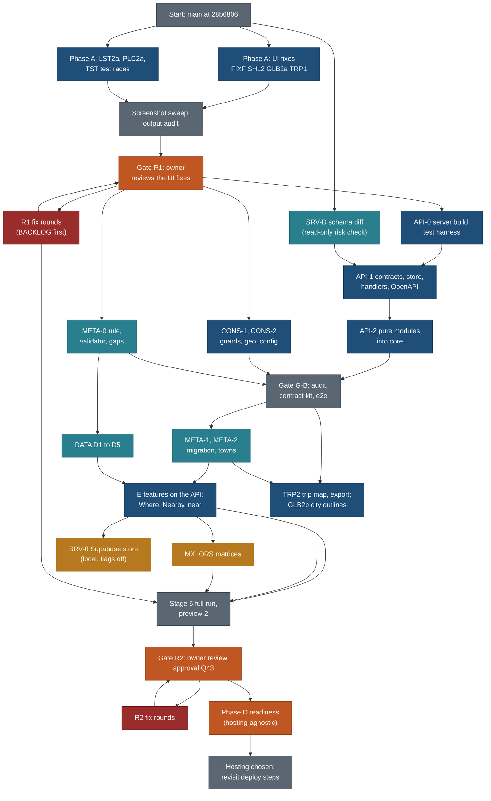

# Execution plan: the public site, UI fixes first, then API-over-JSON, then E, then readiness

> **21 Oct 2026:** the entry point is now [docs/v2/PLAN.md](../../PLAN.md) (requirements, order, status, open decisions). This file stays the authority for task-level detail. L7 in section 18 is closed (PR #7 closed 21 Oct; old remote branches archived as `archive/*` tags).

Written 20 Oct 2026 by travel-planner (Opus) for the coordinator; **rewritten the same day** after the owner's decisions on deployment, the API layer and the order of work (1.1). Status lives in [BACKLOG.md](BACKLOG.md); live lane state in [STATUS.md](STATUS.md); briefs in [briefs/](briefs/). Nothing here is started.

**Supersedes:**
- the first version of this file (same date): phase order A, B, E, D with static export and a Cloudflare Pages go-live;
- MASTER-PLAN section 2's old order (E after go-live);
- [STAGE4-plan.md](STAGE4-plan.md) sections 4 to 6 (one stage 5, one stage 6, a Pages go-live checklist);
- [OWNER-ROUND1-plan.md](OWNER-ROUND1-plan.md) section 3 (order);
- [nearby-and-regions.md](../../features/nearby-and-regions.md) 5.7's static-file mechanics as the design driver (they become the fallback adapter);
- every statement that the site must be a static export (`output: 'export'`, `_redirects` and `_headers` as design constraints, "Pages caps files at 25 MiB", the Pages preview branch). These no longer drive design. Hosting is chosen later.

Principles cited by number from [principles.md](../../design/foundation/principles.md): P1 to P9, T1 to T5.

## 1. Goal and order

**Goal.** Fix every UI issue the owner reported first and let him review that. Then put a real API between the UI and the data (Next.js route handlers over the repo JSON, through framework-free functions in `core/` and shared Zod contracts), so the later move to Supabase is one store swap. Then build the E features (towns, Where city level, Nearby, near mode, Google trip map, Export trip, globe city outlines, the data passes) on that API. Then a second review and a hosting-independent readiness checklist.

### 1.1 Owner decisions applied (20 Oct 2026)

| # | Decision | Effect |
|---|---|---|
| D1 | Go with all recommendations Q42 to Q64 | Recorded in BACKLOG; Q65 to Q69 stay open |
| D2 | Research pause lifted for all phase E data work | DATA D1 to D5 (section 14) |
| D3 | Phase C is a full part of the plan | Gates R1 and R2 with entry, checklist, roles, exit, loop and owner scripts (8, 11) |
| D4 | Metadata for every place and activity is the foundation | Workstream META (6) |
| D5 | Consistency and no hard-coded values | Workstream CONS (5) |
| D6 | Every item designed for the server switch | A server-switch column in every task table; rules 4.3; contract kit 4.6 |
| **D7** | **Deployment is out of scope for now.** No static-export assumption | Phase D becomes a hosting-agnostic readiness checklist marked "revisit when the hosting is chosen" (13). `output: 'export'` is removed in API-0 |
| **D8** | **Build API-over-JSON now** | Route handlers under `web/app/api/v1/` over `CatalogueStore` with `JsonStore`; `DataClient` gets an API adapter as the default; OpenAPI from Zod (section 4) |
| **D9** | **API-over-Supabase is not built now** | Lane SRV-0 is defined and ordered after E (4.8); the read-only schema diff SRV-D runs on day 1 as a risk check |
| **D10** | **UI issues first, with their own review gate** | Phase A is UI-only, R1 follows it with a screenshot sweep; A does not wait on the API |

### 1.2 Phases

| Phase | What | Gate after it |
|---|---|---|
| **A** | The UI fixes: search panel (9.1) and header search toggle, globe Fly here, rivers and the natural-features switch (9.7, 9.4, 9.8), Sign in hidden (11.1), Report a problem to a public feedback repo (11.2, Q70), the Where pill country and province (8.1 N0), trail facts strip and AllTrails links (10.1, 10.3), **and every other visible defect the coverage sweep found** (54 UI lines in [COVERAGE.md](COVERAGE.md): the REVIEW4 fix-soon remainders, 4.12, the 3.62 to 3.67 UI follow-ups, the trip page polish lane TRP1, the test races TST, a WebKit gallery accessibility defect). Plus SRV-D (read-only schema diff), which touches no code | **R1** (owner) |
| **B** | Foundations: API-0 (server build mode, test harness), API-1 (contracts, `CatalogueStore`, `JsonStore`, handlers, OpenAPI, API adapter), API-2 (pure modules into `core/`), CONS-1 and CONS-2 (guards, geo, thresholds), META-0 (metadata rule and validator) | **G-B** (internal: code audit, contract kit, quiet e2e) |
| **E** | Features on the API: META-1 and META-2 (migration, towns), DATA D1 to D5, LST2b and LST2c, PLC2b, TRP2, GLB2b, MX, CONS-3 | **R2** (owner), with the full stage 5 run first |
| **D** | Readiness, hosting-agnostic: privacy, redirect policy, key restrictions, sitemap, Lighthouse, owner approval. Deployment itself: **revisit when the hosting is chosen** | none |
| **S** | SRV-0: API-over-Supabase locally, after E; does not block R2 | contract kit green on `SupabaseStore` |

**Why R1 sits right after A.** The owner asked for the UI fixes first. A is all UI on today's data functions, so he can judge it on its own, and nothing in B changes what a visitor sees. B starts at R1 entry on the frozen preview (Q72, decided yes), so his review time is not idle build time.

**How A avoids waiting on the API, and avoids rework.** A's components call only the existing functions in `web/lib/client/data.ts`, with today's names and argument shapes. API-1 later puts the `DataClient` interface and the API adapter **behind those same exports**. The components do not change again. The one new boundary function in A is `reportProblem()` (SHL2); its signature is the final one.

### 1.3 Flow



### 1.4 Diagram spec (companion to the flow)

Rules: one node per lane group or gate; gates amber-red, data lanes teal, external services and later-store work amber, infrastructure grey; labels under 30 characters a line.

| Node ID | What | Section |
|---|---|---|
| N0 | Starting commit on `main` | 2 |
| SD | SRV-D: read-only diff of `docs/v2/schema.sql` against the capture contract | 4.8 |
| A | FIXF, SHL2, GLB2a, TRP1 | 3 |
| A2 | LST2a (Where pill N0 and list polish), PLC2a (trail facts, AllTrails, place polish), TST (test races) | 3 |
| SW | Screenshot sweep and output audit on A (stage 5 checks 5.1 and 5.2, scoped) | 7 |
| R1 | Owner review 1 | 8 |
| F1 | R1 fix rounds | 8.5 |
| API0 | Server build mode, harness changes | 4.7 |
| API1 | Zod contracts, `CatalogueStore`, `JsonStore`, handlers, OpenAPI, API adapter | 4 |
| API2 | Filter engine, parser, scrub, export builders, nearby moved to `core/` behind shims | 4.7 |
| CN | CONS-1 guards and CONS-2 geo, thresholds, labels | 5 |
| M0 | META-0 | 6 |
| GB | Internal gate after B | 9 |
| M1 | META-1 migration, META-2 towns | 6 |
| DT | DATA batches D1 to D5 | 14 |
| EUI | LST2b, PLC2b, LST2c | 10 |
| ETR | TRP2, GLB2b | 10 |
| MX | ORS nearby and hub matrices | 10 |
| S5 | Stage 5 full run, preview 2 | 7, 11.1 |
| R2 | Owner review 2 and Q43 | 11 |
| F2 | R2 fix rounds | 11.5 |
| D | Readiness checklist | 13 |
| SRV | SRV-0, local Supabase store, contract kit | 4.8 |
| HOST | Deployment steps revisited once hosting is chosen | 13.2 |

| # | Flow step | From | To |
|---|---|---|---|
| 1 | UI fixes and the schema diff start on day 1 | N0 | A, A2, SD |
| 2 | Sweep on the merged A, then R1 | A, A2 | SW, R1 |
| 3 | B starts on the frozen R1 preview | R1 | API0, CN, M0 |
| 4 | The diff informs the contracts | SD | API1 |
| 5 | Data passes start after the metadata rule | M0 | DT |
| 6 | E features build on the API after G-B | GB | M1, ETR |
| 7 | Full stage 5, then R2 | EUI, ETR, MX, F1 | S5, R2 |
| 8 | Supabase store after the E features, beside R2 | EUI | SRV |
| 9 | Readiness, then deployment when hosting is chosen | R2 | D, HOST |

Decisions: R1 after A only (D10); B during R1 (Q72, decided); SRV-0 after E and off the R2 path. Open question on the diagram: none. Change log: section 22.

## 2. Milestones and gates

| ID | Milestone | Done when | Working day |
|---|---|---|---|
| M1 | Phase A merged | FIXF, SHL2, GLB2a, LST2a, PLC2a, TRP1, TST merged and verified; every UI line of COVERAGE.md mapped to A closed or shown already fixed; quiet full e2e green | 4 |
| **R1 entry** | Preview 1 up | 8.1 criteria | 5 |
| **R1 exit** | Owner review 1 closed | 8.5 criteria | 7 (owner time assumed 2 days) |
| M2 | API layer in | API-0, API-1 merged; every list, search, detail, globe and export read goes through `/api/v1/` by default | 9 |
| **G-B** | Foundations closed | API-2, CONS-1, CONS-2, META-0 merged; section 9 checks pass | 11 |
| M3 | E data and foundations | META-1, META-2, DATA D1 to D4 and D6 merged | 14 |
| M4 | E features merged | LST2b, LST2c, PLC2b, TRP2, GLB2b, MX, DATA D5, CONS-3 merged; quiet full e2e | 17 |
| M5 | Stage 5 full run closed | 7 | 19 |
| **R2 entry** | Preview 2 up | 11.1 criteria | 20 |
| **R2 exit** | Owner review 2 closed, Q43 approval | 11.5 | 22 |
| **D** | Readiness checklist done | 13.1 | 23 |
| S | SRV-0 contract kit green on `SupabaseStore` | 4.8 | about 23 (parallel, flags off) |

## 3. Phase A: the UI fixes (no API dependency)

Every row has a **Server switch** entry: the boundary function it calls, the API contract that serves it from phase B, and what stays unchanged. A row without one is not done (4.3).

| ID | Task | Rows | Lane | Owned files (disjoint) | Effort | Depends on | Acceptance check | Verifier | Server switch |
|---|---|---|---|---|---|---|---|---|---|
| A1 | Home search panel clamped to the viewport; header Search closes on a second tap | 9.1, 3.66 part | FIXF | `web/components/search/GlobalSearch.tsx`, `web/styles/search.css`, `web/components/home/CoverSearch.tsx`, new `web/tests/e2e/search-panel.spec.ts` | 2.5 h | none | e2e opens it from both buttons at 1000, 1100, 1440, 1920 and 390 and asserts the panel rect is inside the viewport; second tap closes | travel-verifier | Calls `search()`, `suggest()`, `parseQuery()` unchanged; from B served by `GET /api/v1/search` and `/api/v1/parse`. Component unchanged at the switch |
| A2 | Header Sign in hidden behind a `signIn` capability flag; `/sign-in/` stays a noindex "comes with the planner" page | 11.1, Q64 | SHL2 | `web/components/shell/**`, `web/app/sign-in/page.tsx`, `web/lib/capabilities.ts` (new; CONS and API extend it later by appending), `web/tests/shell/**` | 1 h | none | No Sign in in header or phone bar at 1440 and 390; flag on in a test shows it | travel-verifier | Placeholder seam `auth`: flag off, `session()` null. Server sign-in flips the flag (laundry list 1, 36) |
| A3 | Report a problem on every page and in About: a link to the public feedback repo's issue form with the page path; no email (Q70 decided: a public feedback repo; it must exist before A3 merges with the link on) | 11.2, Q63, Q70 | SHL2 | `web/components/shell/SiteFooter.tsx`, `web/app/about/**` (one link), `web/lib/config/product.ts` (new, `reportUrl` only; CONS-1 extends it), `reportProblem()` appended to `web/lib/client/data.ts` | 2 h | Q70 repo name | Link opens the issue form with `?page=<path>`; privacy test finds no email | travel-verifier | `reportProblem(input)` returns `{kind:'link', url}`; from B the API's `POST /api/v1/report` returns the same until `reportForm` is on |
| A4 | Globe: one fit model, Fly here moves the camera, landform centres audited | 9.7 | GLB2a | `web/components/globe/**`, `web/lib/globe/**`, `web/app/globe/**`, `web/app/globe-data/**`, `web/styles/globe.css`, `web/public/globe/**`, `tools/globe_data.py`, `data/reference/globe/**`, `web/scripts/globe-*.mjs`, `web/lib/public/globe.ts`, `web/tests/globe/**`, `web/tests/e2e/globe*.spec.ts` | 8 h | none | e2e picks a river, plain, delta, lake and range; the camera ends inside each box | travel-verifier, travel-design-reviewer | `globeGazetteer()`, `globeCard()` unchanged; served by `/api/v1/globe/*` from B |
| A5 | Rivers and lines draw their own line | 9.4 | GLB2a | as A4 | 4 h | A4 | Ganges, Danube, Nile draw lines | as A4 | New `globeLine(id)` appended now with its final signature; `GET /api/v1/globe/feature/{id}/line` from B |
| A6 | Natural features switch, `nf=0`, features grouped last, default on | 9.8, Q52 | GLB2a | as A4 | 3 h | A5 | Off removes features from search and picking; the link keeps it | as A4 | `nf` key identical on static and API; filtering in the pure ranker |
| A7 | Where pill on Places: country, state or province, parks and areas, with counts (N0) | 8.1, Q54 | LST2a | `web/components/entity/WhereMenu.tsx` (new), `web/components/entity/FilterBar.tsx` (pill slot), `web/lib/entities/types.ts`, `web/lib/entities/descriptors/place.tsx`, `web/styles/filters.css`, `web/tests/entities/where.test.ts`, `web/tests/e2e/places-where.spec.ts` | 8 h | none | Nearby spec N0 checks 1 to 9 | travel-verifier, travel-design-reviewer | `listPlaces(query)`, `countList()` unchanged; from B `GET /api/v1/places?country&region&area` and `/api/v1/places/counts` |
| A8 | Trail key-facts strip from the contract, "Not checked yet" in empty slots | 10.1 | PLC2a | `web/components/places/**` except `rows.ts`, `PlacesMap.tsx`, `PlaceCardFooter.tsx`, `cluster.ts`; `web/lib/public/sections.ts`, `contract.ts`; `web/tests/places/**`, `web/tests/e2e/place*.spec.ts`, `places-trail.spec.ts` | 4 h | none | Fenland Loop shows every slot | travel-verifier, travel-design-reviewer | Renders the `PageModel` from `getPlace()`; from B the same model from `GET /api/v1/places/{slug}` |
| A9 | AllTrails on every trail (direct, else a labelled search link); one builder for every derived link | 10.3, Q53 | PLC2a | `web/lib/map/links.ts`, `web/tests/map/links*.test.ts` | 2 h | none | 122 of 122 trail pages have the link | travel-verifier | Pure; moves to `core/src/links/` in API-2 behind a re-export |
| A2b | Gallery tiles: the accessible name matches the visible label on WebKit (`label-content-name-mismatch`) | 15.2 | SHL2 | `web/components/ui/Gallery.tsx` and its test (SHL owns `components/ui/**`) | 1 h | none | axe on WebKit passes on a trip page gallery; the `trip-day-spy.spec.ts:231` skip is removed | travel-verifier | none (component only) |
| A4b | Globe and home polish: "Tap a pin" hint only once pins draw; one cluster radius for the cover and the globe page; sprite prewarm and panel re-render deferred on pitched picks (3.65a); data-size check that home is unaffected (3.65b); check first and fix: label collisions, translucent Style panel, cluster overlaps, two small pins below the target size | R4-H1, R4-H2, 3.65, VI-1 | GLB2a | as A4, plus `web/components/home/CoverGlobe.tsx` for phase A only | 4 h | A4 | screenshots at 390 and 1440 light and dark show no hint before pins; cover and globe clusters equal for one view; long-flight numbers recorded; targets at least 24 px | as A4 | `globePins()` unchanged |
| A7b | List polish: Kids pill wording after 4.24 (check first); 6 or fewer sort options; phone panel search box; "No waterfalls here yet" for a lone Kind chip; map view scoped to the viewport; trips-map ring above cluster at 390; count tween; merged-duplicate aliases searchable (3.62c, 3.66h); card kids chip and effort glyph check (3.62d); trips map cluster centroids and framing (check first) | R4-P2, R4-P3, 3.62c-d, 3.66c-h, VI-2 | LST2a | A7's files plus `web/components/entity/**` (other than A7's), `web/components/places/rows.ts`, `PlacesMap.tsx`, `PlaceCardFooter.tsx`, `cluster.ts`, `web/components/trips/TripsMap.tsx`, `web/lib/search/aliases.ts`, the list specs `places.spec.ts`, `lists-lst.spec.ts`, `trips-filters.spec.ts` | 8 h | A7 | each item shown fixed at 1440 and 390, light and dark, or reported already fixed with a screenshot | travel-verifier, travel-design-reviewer | `listPlaces({bbox})` through the boundary; the API serves the viewport query from B |
| A8b | Place page polish: 4.12 S5, S6, S7, S9 to S13 and the far pointer (check each first); Akureyri season glance; Otzi hours printed twice; Gondola orphan dot; cover Directions opens the same chooser as the rail; fact repetition, "the pin we stored" wording, map cluster over the trailhead pin; Otzi price glance and the checks count (3.49) | 4.12, R4-PP2, R4-PP4, R4-PP5, R4-C1, VI-5, 3.49 | PLC2a | as A8 | 8 h | A8 | each item shown fixed on its page at 1440 and 390, light and dark, or reported already fixed | travel-verifier, travel-design-reviewer | page model from `getPlace()`; unchanged at the switch |
| A13 | TRP1, trip page polish: the phone "Map · All days" pill over Plan it for; Patagonia cover, Day 2 "0 stops", "Exposure: level None"; Switzerland overview Copy text matches its buttons, season shown once, grey tiles load; Dolomites Day 4 shows stated limits only; re-read Dolomites #day-3, Patagonia #day-2 and the 1024 view; the merged duplicate that drops a Rockies stop, re-pin 207 to 206; the Day 6 time-zone marker and the Day 9 canoe pin | R4-T1 to T4, 3.62b, 3.67d, 3.35a-b | TRP1 | `web/app/trips/[slug]/**`, `web/components/trips/**` except `TripsMap.tsx`, `TripCover.tsx`, `types.ts`, `tags/**`; `web/lib/public/trips.ts`, `timeline.ts`, `prose.ts`; `data/schedules/**`; `core/src/schedule/**` (pins only); `web/styles/timeline.css`; `web/tests/trips/**`, `web/tests/e2e/trip-hero.spec.ts`, `trip-polish.spec.ts`, `trip-timeline.spec.ts` | 8 h | none | each item fixed at 1440, 1024 and 390, light and dark; core's stop count pinned at 206 with the stop linked | travel-verifier, travel-design-reviewer | `getTrip()` unchanged; served by `GET /api/v1/trips/{slug}` from B |
| A14 | TST: fix the e2e races (wait for the settled value): `who-it-suits.spec.ts:36`, `home.spec.ts:40`, `url-state.spec.ts:110`, `smart-search.spec.ts:188` on WebKit, the `trip-day-spy` family, `places-parity.spec.ts` | 3.63, 3.67g, T14 | TST | those six spec files only (no other lane edits them in phase A) | 4 h | none | each passes 3 runs out of 3 under a 4-lane load | coordinator | none |
| A10 | SRV-D: read-only diff of `docs/v2/schema.sql` (63 tables) against the capture contract (398 types, 83 properties, layers, sidecars); a risk list for API-1 and SRV-0 | 14.1 | SRV | `research/reports/schema-diff-2026-10.md` (new) | 3 h | none | Every capture layer, property group and sidecar maps to a table and column, or is listed as a gap with a proposed change | travel-verifier | It is the input to `SupabaseStore` |
| A11 | Merge A in order (TST, FIXF, SHL2, GLB2a, TRP1, LST2a, PLC2a); quiet full e2e | 3.63 | coordinator | none | 4 h | A1 to A14 | 0 failures | coordinator | n/a |

Phase A total: about 75 h including reviews, verification and merges (42 h for the owner's reports, 33 h for the visible defects the coverage sweep added). Lane TRP1 and lane TST are new in phase A; TRP1's files go to TRP2 in phase E, serially.

## 4. The API layer (phase B): API-over-JSON now, Supabase later

Brief: [briefs/API.md](briefs/API.md).

### 4.1 Shape

```
component -> DataClient (web/lib/client/data.ts, P9)
               |-- ApiAdapter (default)    -> fetch /api/v1/...  -> route handler (thin)
               |-- StaticAdapter (fallback, build-time path: prerendered JSON routes)
route handler -> respond(): parse input with Zod, call CatalogueStore, scrub, check caps and allowlist, ETag, error shape
CatalogueStore (core/src/catalogue/store.ts)
               |-- JsonStore (now): reads data/** through core/src/store FileStore and the dataset builder
               |-- StubStore (tests): in-memory fixture
               |-- SupabaseStore (later, SRV-0)
pure functions in core/: query (filters, sort, page), near, parse, rank, schedule, export, privacy scrub, links, geo
```

Server components (place and trip pages) also read through `CatalogueStore` at build or request time, so a page and the API never disagree. The `JsonStore` takes the dataset built by `createPublicData()` (injected), so `core/` never imports `web/`.

### 4.2 `CatalogueStore`: the exact interface

All inputs and outputs are Zod schemas in `core/src/schema/api/**`, exported (types are `z.infer`). Every method enforces its caps inside itself and returns `Result<T> = {ok:true, data:T, revision:string} | {ok:false, error:ApiError}`.

| Method | Input | Output | Caps and rules (P8, inside the function) |
|---|---|---|---|
| `revision()` | none | `string` (content hash of the data the store serves) | used for ETags |
| `listPlaces(q, page)` | `PlaceQuery` (`country`, `region`, `area`, `city`, `k`, facet keys, `sort`, `bbox`), `Page` (`page`, `pageSize`) | `Paged<PlaceRow>` (`items`, `total`, `page`, `pageSize`, `nextPage`) | `pageSize` ≤ 100 (default 48); rows carry only allowlist keys |
| `countPlaces(q)` | `PlaceQuery` | `FacetCounts` (per facet value, plus `unchecked`) | counts only, no rows |
| `getPlace(slug)` | `slug` | `PlaceDetail` (the page model) or `not_found` | one item |
| `nearbyForPlace(slug)` | `slug` | `NearbyBlock` (Around here, towns, day-trip count) | 25 km list cap 8; no approximate points |
| `near(q, page)` | `NearQuery` (`near` token or `city`, `r`, plus `PlaceQuery`), `Page` | `Paged<NearRow>` (row plus `km`, `bearing`, `band`, `basis`) | requires a resolvable centre; `r` clamped to 100 with `clamped:true`; unscoped refused (`invalid_scope`) |
| `towns(q)` | `TownQuery` (`near`+`r`, or `prefix`+`cc`+`region`) | `Town[]` | ≤ 200 rows; one region for a prefix |
| `parse(q)` | `{q}` | `ParsedQuery` (chips, keys, did-you-mean) | pure |
| `search(q)` | `SearchQuery` (`q`, `scope`, `limit`) | `SearchResult` | `limit` ≤ 50 |
| `listTrips(q, page)` | `TripQuery` | `Paged<TripRow>` | allowlist |
| `getTrip(slug, profile?)` | `slug`, `profile` (`p`, `split`) | `TripDetail` with the scheduled days | one item; dateless |
| `getExport(q)` | `ExportQuery` (`type`, `slug`, `format`: `ics`, `csv`, `kml`, `gpx`, `print`; `p`; overrides) | `ExportFile` (`filename`, `mime`, `body`, `source line`) | one item; licence guard (ODbL, approximate points labelled) |
| `globeTree()`, `globePins(cc)`, `globeCard(key)`, `globeFeature(id)`, `globeLine(id)`, `globeCity(townId)` | ids | the existing globe shapes | per country, per item |
| `report(input)` | `ReportInput` (`page`, `kind`, `text?`) | `ReportResult` `{kind:'link', url}` now, `{kind:'submitted', id}` later | rate-limited later; no personal data stored now |

`ApiError` is `{code, message, details?}` with `code` one of `invalid_input`, `invalid_scope`, `not_found`, `too_large`, `not_available` (a flag is off), `internal`. HTTP mapping: 400, 400, 404, 413, 501, 500.

### 4.3 Server-switch rules (every lane, every brief)

1. Components never import data files, shards or JSON. All reads and writes go through `DataClient` (P9); the boundary test enforces it.
2. Request and response shapes are the Zod schemas in `core/src/schema/api/`; the API validates input and (in tests) output with them.
3. URL and query keys are identical in the page URL, the API and every adapter: `country`, `region`, `area`, `city`, `near`, `r`, `k`, `nf`, `p`, `split`, `page`, `pageSize`, `q`, `ids`, `base`, `days`.
4. Pure logic lives in framework-free modules in `core/` (no React, no Next, no `fs` in the function itself; I/O only in the store): query, near, parse, rank, schedule, export, privacy, links, geo.
5. Build-time outputs (prerendered pages, the fallback JSON routes, `where-<cc>` counts) come from the same store methods the API calls.
6. No feature depends on a file layout the UI can see; file paths are private to `JsonStore` and `StaticAdapter`.
7. Caps and P8 limits live in the store methods and are tested there.
8. Every API response passes the privacy scrub and the allowlist check in `respond()`.
9. Every seam has contract cases run against `JsonStore`, `StubStore` and later `SupabaseStore` (4.6).
10. Stable ids (`ref`, `slug`), schema versions and per-value provenance are carried through unchanged.

### 4.4 Endpoints (versioned, read-only now)

| Method and path | Store method | Cache |
|---|---|---|
| `GET /api/v1/places` | `listPlaces` | ETag from `revision()`; `Cache-Control: public, max-age=60, stale-while-revalidate=600` |
| `GET /api/v1/places/counts` | `countPlaces` | same |
| `GET /api/v1/places/{slug}` | `getPlace` | same |
| `GET /api/v1/places/{slug}/nearby` | `nearbyForPlace` | same |
| `GET /api/v1/near` (`near` or `city`, `r`, filters) | `near` | same |
| `GET /api/v1/towns` | `towns` | same |
| `GET /api/v1/parse`, `GET /api/v1/search` | `parse`, `search` | same |
| `GET /api/v1/trips`, `GET /api/v1/trips/{slug}` | `listTrips`, `getTrip` | same |
| `GET /api/v1/export/{type}/{slug}` | `getExport` | `private, max-age=0`; `Content-Disposition` |
| `GET /api/v1/globe/...` | globe methods | long (`max-age=3600`) |
| `POST /api/v1/report` | `report` | `no-store` |
| `GET /api/v1/openapi.json` | none | generated |
| `GET /api/v1/health` | `revision()` | `no-store` |

Conditional requests: `If-None-Match` returns 304 when the revision matches. **Naming:** the local ops server `core/bin/serve.ts` already uses `/api/v1/trips/<slug>` for planner trip files on port 4319 (localhost only). The public API owns `/api/v1/` in the web app; the ops paths move to `/api/v1/plan/*` when the planner server is built (laundry list item 3). Until then the two never run on one host.

**OpenAPI (API-first):** `core/bin/openapi.ts` builds OpenAPI 3.1 from the Zod schemas with Zod 4's `z.toJSONSchema()` into `data/schema/generated/openapi.json` (generated; `--check` in check-all); `/api/v1/openapi.json` serves it.

### 4.5 `DataClient` adapters

| Adapter | When | Notes |
|---|---|---|
| `ApiAdapter` | default from API-1 | `fetch` to `/api/v1/*`; parses responses with the Zod schemas in development and tests |
| `StaticAdapter` | fallback (`NEXT_PUBLIC_DATA_ADAPTER=static`) and the build-time path | today's functions over the prerendered JSON routes (`/list/places/*`, `/search/*`, `/globe-data/*`), kept as `force-static` route handlers |
| `StubAdapter` | tests | wraps `StubStore` in memory |

The exports of `web/lib/client/data.ts` keep their names and signatures; each becomes a call on the selected adapter. Phase A components are not touched again.

### 4.6 Contract test kit

`core/test/catalogue/contract/<method>.cases.ts` holds one case table per store method; `core/test/catalogue/contract.test.ts` runs every table against `JsonStore` (on the real `data/`) and `StubStore` (fixture); `web/tests/api/contract.test.ts` runs the same tables through the route handlers (in process, no network) to cover `respond()`: scrub, allowlist, error mapping, ETag and 304. SRV-0 adds `SupabaseStore` to the first runner. Required cases: page size cap; allowlist; `r=500` clamps to 100; unknown centre gives `not_found` and touches no shard; unscoped near gives `invalid_scope`; one item per export; household strings absent; stable `slug` and `ref`; `revision` changes when data changes.

### 4.7 API-0 and API-2: what changes in the build and the harness

| Item | Today | After API-0 |
|---|---|---|
| `web/next.config.ts` | `output: 'export'` | removed; `next build` then `next start` |
| e2e (`web/tests/e2e/global-setup.ts`) | stages `.site/` with `publish.py --dry-run` and serves it | builds once and runs `next start` on a free port (PID recorded, killed by PID) |
| Privacy, budget, OG and size tests that scan `web/out` | 11 test files read `web/out` | read the prerendered HTML in `.next/server/app` and API responses in process; the fixture build keeps its own `distDir` |
| `scripts/images.mjs`, `scripts/og.mjs` (post-build over `web/out`) | run on `out/` | run on the build's public output or `public/` before build (API-0 decides; same files produced) |
| Existing JSON routes (`/list/places/*`, `/search/*`, `/globe-data/*`, sitemaps) | prerendered for export | kept, `force-static`, as the `StaticAdapter` path |
| `tools/publish.py --product` | the deploy path | kept but out of scope; not run (deployment revisited with hosting) |
| check-all | builds the export | builds in server mode and runs the contract kit and the OpenAPI check |

API-2 moves the pure modules into `core/` with re-export shims in `web/` so imports do not change: the filter engine (`web/lib/entities/filter.ts`, `sort.ts`, `url.ts` parsing), the parser (`web/lib/search/parse/**`), the privacy scrub (`web/lib/public/origin.ts`, `party.ts`, `dateless.ts`), the export builders (`web/lib/export/{ics,csv,kml,gpx,licence}.ts`), the link builder (`web/lib/map/links.ts`) and, in E, `nearby`. React-dependent files stay in `web/`.

### 4.8 API-over-Supabase: SRV-D now, SRV-0 later

| Lane | When | What | Owns | Effort |
|---|---|---|---|---|
| **SRV-D** | Phase A, day 1 (read-only) | Diff `docs/v2/schema.sql` against the capture contract and the sidecars: tables and columns for place, route, offer, event, points with role, relations, links with state and date, photos with licence, suitability flats, relevance, sources, towns; gaps and proposed changes; the risk list for API-1's contracts | `research/reports/schema-diff-2026-10.md` | 3 h |
| **SRV-0** | After E features merge (day 16 to 22), beside stage 5 and R2, flags off; it must not block R2 | `supabase start` locally (Docker), migrations via `supabase migration new` from the diff, local only, never a remote; RLS on every table before any code (house rule), public read policies for the catalogue; a JSON-to-Postgres loader (`core/bin/load-catalogue.ts`) that loads `data/**` unchanged (stable ids, versions, provenance); `SupabaseStore` implementing `CatalogueStore`; generated types with `supabase gen types typescript`; the contract kit run against it | `supabase/**` (new), `core/src/catalogue/supabase/**` (new), `core/bin/load-catalogue.ts`, `core/test/catalogue/supabase.test.ts` (skipped unless a local Supabase is up) | 24 h |

Sign-in, RLS for household data and the planner tables stay in the [laundry list](../SERVER-SIDE-LAUNDRY-LIST.md) with their flags off. SRV-0 does not need Q65 (where the backend lives) because it runs locally; going to any hosted Supabase does.

### 4.9 Phase B tasks

| ID | Task | Rows | Lane | Owned files (disjoint) | Effort | Depends on | Acceptance check | Verifier | Server switch |
|---|---|---|---|---|---|---|---|---|---|
| B1 | API-0: server build mode and harness | 14.2 | API | `web/next.config.ts`, `web/playwright.config.ts`, `web/tests/e2e/global-setup.ts`, `web/tests/global-setup.ts`, the 11 tests that read `web/out` (path helper only), `web/scripts/images.mjs`, `og.mjs` (input path), `tools/check-all.sh` (web build lines) | 10 h | R1 entry | check-all green; quiet full e2e green against `next start`; privacy tests still find 0 household strings | travel-verifier | Removes the static-export assumption |
| B2 | API-1: Zod contracts, `CatalogueStore`, `JsonStore`, `StubStore`, `respond()`, handlers, OpenAPI, `ApiAdapter` default, `StaticAdapter` fallback, contract kit | 14.3, 13.1, 13.4 | API | `core/src/schema/api/**`, `core/src/catalogue/**` (store, json, stub), `core/bin/openapi.ts`, `data/schema/generated/openapi.json` (generated), `core/test/catalogue/**`, `web/app/api/v1/**`, `web/lib/server/respond.ts`, `web/lib/client/{contract,api,static,stub}.ts`, `web/lib/client/data.ts` (re-exports over the adapter), `web/lib/capabilities.ts` (append), `web/tests/api/**` | 22 h | B1, SRV-D | Every list, count, search, parse, detail, globe, export and report read in the browser goes to `/api/v1/` (network assertion in e2e); contract kit green on JsonStore and StubStore; OpenAPI `--check` green; `NEXT_PUBLIC_DATA_ADAPTER=static` still passes the e2e smoke set | travel-verifier; Opus code audit at G-B | Is the switch: `SupabaseStore` later implements the same interface |
| B3 | API-2: pure modules into `core/` behind shims | 14.4 | API | `core/src/{query,parse,privacy,export,links}/**` (new), the moved files in `web/lib/entities/`, `web/lib/search/parse/`, `web/lib/public/{origin,party,dateless}.ts`, `web/lib/export/{ics,csv,kml,gpx,licence}.ts`, `web/lib/map/links.ts` (each becomes a re-export) | 14 h | B2 | No React, Next or `fs` import in the moved modules (a lint rule); every web test passes unchanged; the scheduler bundle budget holds | travel-verifier | The same functions run in a handler, at build and in a server |
| B4 | CONS-1: hard-coding guards (ratchet), env table | 13.2 | CONS | `tools/cons/**`, `tools/tests/test_hardcode_scan.py`, `web/tests/cons/**`, `web/tests/no-hex.test.ts` (extension), `web/lib/config/product.ts` (extend), one line in `tools/check-all.sh`, the env table in `docs/v2/build/public-site/README.md` | 6 h | R1 entry | A new colour, slug, host, UA or threshold literal fails check-all | travel-verifier | Config read through one module on every adapter |
| B5 | CONS-2: one geo module, nearby config, home point module, kind labels | 13.2 | CONS | `core/src/geo/**`, `core/src/config/nearby.ts`, `core/src/privacy/home.ts`, the replacement lines listed in [CONS.md](briefs/CONS.md) | 8 h | B4; serial with B3 on `origin.ts` | `6371` only in the geo modules; 25 km and 2 km each defined once | travel-verifier | Pure modules |
| B6 | META-0: placement block, tiers per kind, validator codes, gap reports, researcher line | 8.3, 13.5, 3.37 | META | as [META.md](briefs/META.md) META-0 | 10 h | R1 entry | 6.6 checks | travel-verifier | Zod in `core/` is what a Postgres loader validates |
| B7 | Gate G-B | 9 | coordinator, Opus code auditor | none | 8 h | B1 to B6 | Section 9 | Opus | n/a |

Phase B total: about 78 h.

## 5. Workstream CONS: consistency and no hard-coded values

Brief: [briefs/CONS.md](briefs/CONS.md). The server seams that used to be CONS-0 are now API-1 (B2). CONS keeps the guards (CONS-1, B4), the shared modules (CONS-2, B5) and the burn-down (CONS-3, E). Effort 22 h.

### 5.1 What doing it first saves

| E item | Without CONS first | With CONS first |
|---|---|---|
| Nearby, near mode, Where city, MX | a ninth distance function, a third copy of 25 km | one `core/src/geo/`, one `nearby` config |
| Trip map on Google | colours copied again from `web/lib/map/palette.ts` | colours from tokens through one reader |
| Every E lane | hard-coding found at R2 | check-all fails on the first literal |

Must be finished before LST2b, PLC2b, LST2c and TRP2 start: API-1, API-2, CONS-1 and CONS-2 (all in B, closed at G-B).

### 5.2 Placeholders (capability flags in `web/lib/capabilities.ts`, all off)

| Seam | Today | Server later | Flag | Laundry list |
|---|---|---|---|---|
| sign in | `session()` null; link hidden | Supabase auth (Q66) | `signIn` | 1, 36 |
| save to a trip | Copy sheet local draft; Save hidden | `POST /api/v1/plan/trips/{id}/items` | `saveToTrip` | 25, 36 |
| guest drafts | none; `draftStore` in memory and share URL when SB1 is built | server drafts | `guestDrafts` | 23 |
| smart trip builder | `/plan/` reserved, not built | SB1, SB2 | `tripBuilder` | 23 |
| collaboration | none | realtime | `collab` | 30 |
| report form | `POST /api/v1/report` returns the issue link | stores a report | `reportForm` | 4 |
| routed times at runtime | committed matrices read by the store | ORS through `leg_cache` | `serverRouting` | 34 |
| catalogue from Postgres | `JsonStore` | `SupabaseStore` | `CATALOGUE_STORE=json|supabase` (server env) | 10 to 17 |

A flag that is off hides the control, or shows "Comes with the planner" where a visitor would look for it. Never a dead button (P4).

### 5.3 Hard-coding audit (measured 20 Oct 2026 on `main` 28b6806)

| Class | Found (real counts and paths) | Single source of truth | Step | Guard |
|---|---|---|---|---|
| Hex colours | 0 outside `web/app/themes.css` (`web/tests/no-hex.test.ts` holds) | `themes.css` from `tools/theme_tokens.py` | none | exists |
| `rgb()` literals | 26 lines: `web/lib/map/palette.ts` 12 (fallback palettes), `web/lib/globe/palette.ts` 2 plus helpers, `web/lib/map/maplibre/engine.ts` 2, `web/components/ui/ui.css` 1, `web/styles/globe.css` 1 | tokens; fallbacks generated by `theme_tokens.py` | CONS-3 | extend no-hex to `rgb(`, `hsl(`, named colours |
| Trip slugs and folder maps | 36 non-comment literal lines: `web/lib/public/slugs.ts`, `web/lib/public/globe.ts` lines 12 to 25 | `legacy/MANIFEST.json` and trip data | CONS-3, with 7.11 | slug-literal scan |
| Trip special cases | `web/lib/public/trips.ts:180`, `places.ts:370`, `trail-places.ts:92` and `:230`, `sources.ts:129` | trip data flags | CONS-3 (`sources.ts` with 7.11) | same |
| Distance functions | 8: `core/src/checks/time.ts`, `core/src/relevance/fit.ts`, `web/lib/map/geo.ts`, `web/lib/public/origin.ts`, `web/lib/public/places.ts`, `web/scripts/tracks-osm.mjs`, `web/scripts/legs-ors.mjs`, `tools/locations.py` | `core/src/geo/distance.ts`; `tools/geo.py` with a parity test | CONS-2 | `6371` scan |
| Nearby thresholds | 25 km twice (`core/src/relevance/derive.ts` `NEAR_KM`, `web/lib/public/relevance.ts` `NEARBY_MAX_KM`); 100 km (`AREA_KM`); home radius twice (`core/src/relevance/inputsCheck.ts`, `web/lib/public/origin.ts`) | `core/src/config/nearby.ts` | CONS-2 | `_KM =` scan |
| Household home point | `web/lib/public/origin.ts` lines 7 and 10 | `core/src/privacy/home.ts`; **intentional exception** while the repo is private (the scrub must run without the env file); moves to a secret before any visibility change | CONS-2 | listed |
| Site host | 14 occurrences in 13 files (`web/lib/site.ts` is the legitimate default) | `siteOrigin()`, `SITE_ORIGIN` | CONS-3 | host scan |
| User agent | 7 files | `core/src/net/ua.ts`, `tools/net.py` | CONS-3 | UA scan |
| External API hosts | ORS 1, Commons 3, Nominatim 3, Overpass 5 lines, Wikidata 4, SPARQL 1 | `core/src/net/endpoints.ts`, `tools/net.py` | CONS-3 | host scan |
| Kind labels | `web/components/trips/timeline/model.ts:64`, `web/components/ui/KindGlyph.tsx` | `types.json` labels via `web/lib/entities/labels.ts` | CONS-2 | label-map scan |
| Named numeric constants | 86 lines in `web/lib`, `web/components`, `web/app` | product thresholds to `web/lib/config/product.ts` and `core/src/config/`; single-module constants stay | CONS-2 | duplicate-value scan |
| Motion durations | 8 files with `_MS` constants; no motion tokens | foundation motion tokens (needs a ruling) | later | listed |
| Counts in copy | 0 | n/a | none | scan |
| Data paths in components | 1, the MapLibre worker asset (`web/components/map/MapLibreMap.tsx:35`) | n/a | exception | boundary test |
| Env vars | 20 names; `NEXT_PUBLIC_CF_BEACON_TOKEN`, `TRAVEL_TODAY`, `HUB_TODAY` and the `*_LOCKED` switches are undocumented | env table (names only) | CONS-1 | env-table test |
| Magic ids in tests | 218 occurrences of six slugs in 70 test files | named fixtures | later; new tests only | scan on new files |

At R2 the baseline holds only the listed exceptions.

### 5.4 Consistency rules

| Job | The one component or module |
|---|---|
| Filters and pills | `components/entity/FilterBar.tsx`; Where uses `WhereMenu.tsx` |
| Cards and rows | `components/entity/CardsView.tsx` with `PlaceCardFooter`; `TripCard` |
| Empty, loading, error | one set in `components/ui/`; "Not checked yet" from the contract's gap text; API errors map to one error line per `ApiError.code` |
| Links | `core/src/links/` (from `web/lib/map/links.ts`) |
| Chips and badges | `components/suit/**`; one relevance chip |
| Map wrappers | `web/lib/map/**` families; one family per page |
| Distance, bearing, bands | `core/src/geo/`, `core/src/nearby/` |
| URL keys | `core/src/query/url.ts` (from `web/lib/entities/url.ts`) |

The design reviewer adds a consistency item to every UI round; R1 and R2 run it.

## 6. Workstream META: metadata for every place and activity

Brief: [briefs/META.md](briefs/META.md) (schema, validator, migration, towns) and [briefs/DATA.md](briefs/DATA.md) (research batches).

### 6.1 Why it is the foundation

Nearby, near mode, the Where city level, "At this place you can also", an activity's "where it happens", related places and the trip builder read a sourced point with its role, the area chain with the nearest town, and the relations. Today 121 of 359 pages have no point and no record carries a nearest town.

### 6.2 Record kinds and their tiers

Tiers come from `data/vocab/types.json` marks (R, A, N) plus a placement block on every record. **Required:** a value, or `searched_none` with a date. **Enrichment:** filled when sources allow. A gap is never a yes.

| Kind | Required tier | Enrichment tier |
|---|---|---|
| Every record | stable `ref`, `type`, `layer`, `name`, file schema version, provenance per value (`src`, `on`, basis or confidence) | n/a |
| Place | placement block (6.3), Wikidata QID or `searched_none`, OSM id or `searched_none`, official link state, season or "all year", summary, photo or "No licensed photo yet" | GeoNames id for towns, bbox or geometry for areas, elevation, hours, price, best time, toilets and parking (Q22), second photo, Wikipedia, tourism board |
| Trail | placement with `point_role: trailhead` (`starts_at`), `area_id`, distance, gain, adult time, route shape, effort with source grade, route status, season, link set (official, AllTrails direct or search, OSM) | loss, high point, surface, hazards, dogs, stroller, wheelchair, parking, GPX (licence), Komoot, two photos, child time |
| Other route | start (and `ends_at`), `area_id`, length or ride time, season, official link | geometry, photos |
| Activity or offer | where it happens (`at`, `on` or `starts_at`), operator (`run_by`), season, duration, price or `searched_none`, minimum age, height and weight as stated or `none_stated`, booking window or "no booking", booking URL, meeting point, official link | accessibility, cancellation, kit, photo, variants, nearby (derived) |
| Event | name, type, season, where (`at` or `part_of`) | hours, price, window |
| Stay (huts and refuges that are destinations) | placement, operator, season, booking URL and window | photo, facilities. Lodging pages are not public (3.58) |
| Booking | **Not a public record kind.** Household bookings are planner data (F08) under RLS (Q69) | n/a |

### 6.3 Fields and where each lives

| Group | Field | Home | Mark | Today |
|---|---|---|---|---|
| Geo | point with role (`centre`, `trailhead`, `entrance`, `parking`, `meeting`, `summit`, `route_start`) | `data/capture/points.json` by ref | R | point yes; role **new** |
| Geo | `approx` | with the point | R | **new** |
| Geo | country > region > area chain | `area_id`; country and region read from it | R | 48 of 394 records |
| Geo | nearest town and distance | `near_town`, `near_town_km`, derived | R | **new** |
| Geo | park or parent | `part_of`, `at` | A | exists |
| Geo | bbox or geometry | `geometry`; area polygons in globe data | A | exists |
| Geo | Wikidata QID, OSM id, GeoNames id | `wikidata`, `osm_ref`, `geonames_id` | R, R, A (R for towns) | GeoNames **new** |
| Relations | nearby by band | derived by `core/src/nearby/` in `nearbyForPlace` and `near` | derived | E |
| Relations | related (same park, trail system, theme) | derived from `part_of`, `area_id`, tags, type; judged `pairs_with` and Similar nearby stay authored | both | partly |
| Relations | activities at a place, places of an activity | authored `at`, `on`, `starts_at`; reverse derived, never stored | both | exists in `sections.ts` |
| Relations | by theme, season, suitability | derived from tags, `season`, suitability flats | derived | partly |
| Links | Google Maps and directions | generated from our point and name by the one link builder; never a data or coordinate source | derived | directions yes |
| Links | official, booking, Wikipedia, Wikidata, Komoot, AllTrails | `links[]` with `kind`, `state`, `on`, `src` | R official; A rest | exists |
| Trail | length, gain, loss, high point, time, shape, surface, hazards, dogs, stroller, wheelchair, season, trailhead, parking, route status, GPX | suitability fields and capture properties | 6.2 | exist |
| Photos | one or two, credited | `photos[]` with file, licence, author, attribution, source URL, size | R or gap | exists |
| Activity | operator, season, duration, price, limits, window, meeting point, accessibility | `run_by`, `season`, `duration_min`, `price`, suitability limits, `window`, `book_url`, `starts_at`, `accessibility` | 6.2 | exist |
| Provenance | source, date, confidence | `src[]` into `data/sources/registry.json`, `on`, basis | R | exists |

Derived relations are computed by pure functions inside store methods, per request or per page, never written to a whole-catalogue file (P8). The same functions run in `SupabaseStore` or in SQL later (P9).

### 6.4 Audit against the tiers (measured 20 Oct 2026)

Method: a read-only run of `createPublicData()` (the adapter the build uses; `web/out` on disk is stale from 17 Oct and was not used) and Python over `data/capture/*/*.json`, both points sidecars, `data/suitability/*/*.json` and `data/locations/locations.json`.

**Pages: 359**, 238 with a point, **121 without**.

| Page kind | Pages | Point | Area chain | Wikidata | Photo | Season | Summary | Official link | AllTrails | Who it suits | Draft / Usable |
|---|---|---|---|---|---|---|---|---|---|---|---|
| trail | 122 | 41 | 122 | 5 | 4 | 7 | 10 | 74 | 72 | 112 | 121 / 1 |
| sight | 49 | 35 | 49 | 3 | 3 | 0 | 12 | 1 | 1 | 37 | 48 / 1 |
| viewpoint | 39 | 35 | 39 | 9 | 5 | 2 | 8 | 1 | 1 | 23 | 38 / 1 |
| lake | 31 | 29 | 31 | 6 | 4 | 3 | 15 | 2 | 2 | 24 | 26 / 5 |
| area | 28 | 26 | 28 | 22 | 15 | 8 | 2 | 0 | 0 | 5 | 28 / 0 |
| waterfall | 28 | 24 | 28 | 5 | 4 | 2 | 12 | 0 | 0 | 17 | 28 / 0 |
| activity | 27 | 15 | 27 | 1 | 1 | 1 | 4 | 0 | 0 | 23 | 26 / 1 |
| town | 25 | 25 | 25 | 15 | 14 | 3 | 6 | 0 | 0 | 9 | 24 / 1 |
| lift | 8 | 6 | 8 | 0 | 0 | 0 | 1 | 1 | 1 | 8 | 8 / 0 |
| eatery | 2 | 2 | 2 | 0 | 0 | 0 | 2 | 1 | 1 | 0 | 2 / 0 |

Trail facts on 122 trail pages: distance 78, gain 77, time 74, a drawn track 12. No point, by trip: Rockies 54 trails, 12 activities, 10 sights; Utah 9 trails; Patagonia 6; Dolomites 5. No trail lacks a page point while holding a trailhead, so held data gives little and the open-data pass is the main source. 19 of the 121 have a sidecar point under a ref ending in their slug (the spec says 23 by full ref; META-1 measures).

**Capture records: 394** (place 201, route 143, offer 49, event 1), six trips only.

| Layer | Records | `area_id` | Point | OSM id | Wikidata | Official | Photos | Season | Where | Operator | Price | Duration | Window | Min age |
|---|---|---|---|---|---|---|---|---|---|---|---|---|---|---|
| place | 201 | 24 | 173 | 44 | 29 | 45 | 23 | 9 | n/a | n/a | 5 | 3 | 2 | 1 |
| route | 143 | 24 | 77 | 1 | 0 | 76 | 0 | 5 | 14 | n/a | 2 | n/a | 1 | 0 |
| of which trails | 118 | 23 | 63 | 0 | 0 | 66 | 0 | 0 | 13 | n/a | 0 | n/a | 1 | 0 |
| offer | 49 | 0 | 17 | 0 | 0 | 25 | 0 | 16 | 32 | 12 | 24 | 12 | 4 | 4 |
| event | 1 | 0 | 0 | 0 | 0 | 0 | 0 | 0 | 0 | n/a | 0 | n/a | 0 | n/a |

Routes: walk km on 96 of 143, gain on 86. Stays: 5 places, 3 offers. **17 offers say nowhere where they happen.** Locations store, 74 places: area 74, point 73, Wikidata 66, image 62, season 24, elevation 32, kid fit 10, stats 8, trip 8, nearest town 0.

**Trail points reconciled:** 81 of 122 trail pages have no point (125 by capture type `nature.trail.*`). Row 10.5's "47 of 128" was an older, rough count.

### 6.5 Acceptance numbers (R2 and readiness)

| # | Measure | Target |
|---|---|---|
| 1 | Places and routes with no `area_id` | 0 |
| 2 | Pages with no point and no dated search | 0 |
| 3 | Trail pages with no point | at most 10, each with a dated `searched_none` |
| 4 | Non-approximate points with no `near_town` | 0 |
| 5 | Offers with no resolvable `at`, `on`, `starts_at` | 0 |
| 6 | Trails with the link set | 122 of 122 |
| 7 | Trails with distance, gain and time, or a dated gap | 122 of 122 |
| 8 | Trails with a photo or a dated "No licensed photo yet" | 122 of 122; photo on at least 70 |
| 9 | Offers with operator, season, price, minimum age, window answered | 49 of 49 |
| 10 | Locations store required tier | 74 of 74 |
| 11 | `E_PLACE_FAR` | 0 |
| 12 | Values from Google, AllTrails, Komoot, Tripadvisor | 0 |

### 6.6 Mechanics

- A new type is one entry in `data/vocab/types.json`; a new property is a registry change in `core/src/schema/capture/properties.ts`; then `node core/bin/capture.ts build` regenerates `data/schema/**` and `research/types/**`.
- New fields: `near_town`, `near_town_km`, `geonames_id` (properties); `point_role`, `approx` (point value and sidecar).
- Validator: `E_PLACE_AREA`, `E_PLACE_ORPHAN`, `W_PLACE_POINT` (error after migration), `W_PLACE_APPROX`, `E_PLACE_FAR`, `W_PLACE_TOWN`, `W_TIER_REQUIRED`. Migrated records warn; new records error.
- Gap reports: `capture.ts gaps --placement` and `gaps --tier required|enrichment --layer --type`, both with `--json`.
- Gates: the codes, `capture.ts build --check`, and `data/capture/gap-budget.json` (counts may only fall).
- Researcher line in `.claude/agents/travel-researcher.md` and every research brief.
- Fill order: open data, then official pages, then photos.
- **Stable ids, versions, provenance:** `ref` never changes (rename is `same_place_as` plus a redirect), every file carries `schema`, every value carries `src`, `on`, basis, so the JSON loads into Postgres through SRV-0's loader without reshaping.

### 6.7 What the UI needs from the data

| UI | Needs | Lane |
|---|---|---|
| Where country and province (A7) | `area_id` chain on rows (100% today) | LST2a |
| Where city | `near_town`, towns, points | LST2b |
| Around here | non-approximate points, bands, pair collapse | PLC2b |
| Near mode, "near Whitby" | points, towns | LST2c |
| At this place you can also; where an activity happens | `at`, `on`, `starts_at` on every offer | PLC2b |
| Related (same park) | `part_of`, `area_id`, tags | PLC2b |
| Trail facts strip | trail tier | PLC2a, filled by D3 |
| Photos | `photos[]` | D5 |
| Trip map | stop points, ORS legs | TRP2 |
| Globe city outlines | towns with QIDs | GLB2b |

## 7. Independent checks (stage 5)

| Check | Before R1 (scoped to A) | At G-B (internal) | Before R2 (full) |
|---|---|---|---|
| 5.1 Sweep and measurements (Sonnet) | **Screenshot sweep:** every page type at 1440, 390 and 844 x 390, light and dark, Chromium and WebKit, the A changes first | e2e smoke against `next start` and with the static fallback | full: all page types, 3 browsers, 10,000-place numbers through the API (first card, filter-to-count, near query) |
| 5.2 Public output audit (Opus) | rendered HTML of A's pages | API responses through the contract kit | everything: HTML and API; the Whitby rule (towns rows and near chips only); GeoNames and ODbL credits |
| 5.3 Research sample (Sonnet) | none | none | 80 values across DATA D1 to D5 |
| 5.4 Timeline plausibility (Opus) | none | none | only if `core/src/schedule/**` changed; else the export and trip-map order on 3 trips |
| 5.5 P8, P9 and security code audit (Opus) | none | **the API diff:** caps in the store, `respond()` scrub and allowlist, error shapes, no key in client bundles, input validation on every handler, no path traversal in `JsonStore` | the E diff |
| 5.6 Ruling and consistency closure (Sonnet) | review items for A | none | all E reviews, the consistency table, the hard-coding baseline at its exceptions |

Rows from a failed check: `5.x-R1-n`, `5.x-GB-n`, `5.x-R2-n`.

## 8. Gate R1: the owner reviews the UI fixes

### 8.1 Entry criteria

| # | Criterion |
|---|---|
| 1 | Phase A merged (A1 to A9) |
| 2 | `bash tools/check-all.sh` ends `CHECK-ALL OK` with `web/.env.local` moved aside |
| 3 | Quiet full e2e: 0 failures |
| 4 | The A-scoped checks in section 7 closed, with the screenshot sweep read in tiles and filed in `verify-R1.md` |
| 5 | Preview 1 built from the frozen commit with the public maps key in, served locally and behind a tunnel (the old preview servers killed by PID); ORS key absent from the output |
| 6 | Legacy routes not in the preview |
| 7 | Lighthouse on the preview for home, trips, Rockies, places, Moraine Lake, Tre Cime, globe (numbers recorded; a tunnel is not a CDN, so the targets are judged again at R2) |
| 8 | The 9.2 home globe mock ready to show |
| 9 | Baseline metadata summary: today's figures from 6.4 on one page |

### 8.2 Checklist

| # | Area | What to check | Rows |
|---|---|---|---|
| 1 | Search panel | hero and header buttons at 1000, 1100, 1440, 1920; second tap closes | 9.1 |
| 2 | Globe | Ganges river then Ganges Plain, Fly here; rivers draw lines; Natural features off, link kept | 9.7, 9.4, 9.8 |
| 3 | Header and footer | no Sign in; Report a problem opens the feedback repo's form with the page | 11.1, 11.2 |
| 4 | Where filter | Canada, Alberta, Banff National Park; remove Canada | 8.1 |
| 5 | Trail facts and AllTrails | Fenland Loop strip; Search AllTrails | 10.1, 10.3 |
| 6 | Carried over | Rockies trip and "Plan it for"; Moraine Lake and Capri; places list on a phone; globe deep link reload; sentence search; Safari on iPhone and Mac; dark mode on a phone | 6.1 |
| 7 | Home globe mock | approve or change | 9.2 |
| 8 | Metadata baseline | read what E will fill | 13.5 |
| 9 | Consistency | anything that looks or behaves differently for the same job | 13.3 |
| 10 | Visible-defect sweep | every UI line of [COVERAGE.md](COVERAGE.md) mapped to phase A, shown fixed in the screenshot sweep or reported already fixed: trip page polish (Patagonia, Switzerland, Dolomites day 4, the phone map pill), place page polish (4.12, Akureyri, Otzi, Gondola), list polish (sort options, Kids pill, phone search box), globe and home polish | 15.3, 15.4 |
| 11 | Mount Robson time-zone marker | the Day 6 inference reads right to you | 3.67f |
| 12 | Default list order | countries with a photo first: keep or change | 3.66j |

The coordinator also runs: privacy scrub check, sitemap URLs return 200 on the preview, `/globe/<level>/` reload, no `/specimen` link from any page.

### 8.3 Who does what

| Who | Does |
|---|---|
| Coordinator | builds and serves the preview, writes `verify-R1.md`, sends one hand-over (URL, sweep sheet, Lighthouse numbers, the script, the metadata page, the open questions in section 18), logs findings |
| Owner | follows the script; approves the home globe mock |
| travel-verifier | re-checks each fix on the GPU |
| travel-design-reviewer | rules on design changes before a builder starts |
| Builders | fix rows in the owning lane |

### 8.4 Owner script for R1 (one page, about 40 minutes)

Open the link from the hand-over on your Mac (Safari), then your iPhone (Safari).

| Step | Open | Try | Report if |
|---|---|---|---|
| 1 | Home | big search button, then the header search; resize wide; tap header Search twice | cut off, covers the hero, or does not close |
| 2 | `/globe/` | "Ganges": the river, then "Ganges Plain", Fly here; Map options, Natural features off; copy the link to a new tab | nothing moves; a state lights up for a river; the switch is lost |
| 3 | Header, footer | look for Sign in; use Report a problem | Sign in shows; the link fails |
| 4 | `/places/` on the phone | Where: Canada, Alberta, Banff National Park; remove Canada | wrong counts; the bar hides what is filtered |
| 5 | Fenland Loop (any trail) | facts strip; Search AllTrails | a slot missing, a gap hidden, the link broken |
| 6 | Rockies trip | Plan it for a 3-year-old | a time or "does not fit" reads false |
| 7 | Moraine Lake and Capri | compare | two layouts feel like two sites |
| 8 | Search | "easy hike with kids near Banff in September" | chips misread it |
| 9 | Phone, dark mode | three pages | anything unreadable |
| 10 | Home globe mock | approve or say what to change | |
| 11 | Metadata page | read | something you expected is not on the E list |
| 12 | Patagonia, Switzerland, Dolomites day 4 | cover, overview buttons, limits | anything still odd from the review list in the hand-over |

**How to report:** reply to the hand-over, one line per finding with the page and what you saw (a screenshot helps). Each becomes a BACKLOG row (`6.2-R1-n`) the same day; you get the IDs back.

### 8.5 Exit and the round loop

1. Every finding is a row, marked must or later (later only with the owner's agreement).
2. Rounds: must rows grouped by owning lane, re-opened as `FIX-R1-<lane>`; design changes ruled first.
3. After each round: verifier on the GPU, check-all, preview rebuilt, the owner told which rows to look at.
4. **R1 exits** when no must row is open and the owner says so. It does not approve go-live.

## 9. Gate G-B: the foundations (internal)

| # | Check |
|---|---|
| 1 | Every browser read goes to `/api/v1/` by default (e2e network assertion over home, trips, a trip, places with filters, a place, the globe, an export) |
| 2 | Contract kit green on `JsonStore` and `StubStore`, and through the handlers |
| 3 | `data/schema/generated/openapi.json` `--check` green; `/api/v1/openapi.json` validates as OpenAPI 3.1 |
| 4 | `NEXT_PUBLIC_DATA_ADAPTER=static` passes the e2e smoke set |
| 5 | Opus code audit (5.5) on the B diff: no must row |
| 6 | Moved modules have no React, Next or `fs` imports (lint) |
| 7 | Hard-coding guard on; CONS-2 classes at zero |
| 8 | META-0 checks pass; baseline gap reports filed |
| 9 | Screenshots of home, a trip, a place and the globe match the R1 preview (pixel diff under 0.1%): the API changed nothing a visitor sees |
| 10 | Quiet full e2e green |

## 10. Phase E: features on the API

| ID | Task | Rows | Lane | Owned files (disjoint across parallel lanes) | Effort | Depends on | Acceptance check | Verifier | Server switch |
|---|---|---|---|---|---|---|---|---|---|
| E1 | META-1: point join in `JsonStore`, `area_id` migration, trailheads from tracks, `E_PLACE_FAR` | 8.3, 8.7b | META | `core/src/catalogue/json/points.ts` (the read order), `core/bin/capture.ts migrate-placement`, `core/src/capture/migratePlacement.ts`, `data/capture/**` (`area_id`), `data/capture/points.json` | 6 h | G-B | no-point pages fall by the joined count; `E_PLACE_FAR` 0; every place and route has `area_id` | travel-verifier | the join is inside the store; `SupabaseStore` reads a joined column |
| E2 | META-2: towns layer, `near_town`, Whitby exemption, GeoNames credit | 8.4, 8.9, 8.10, Q50, Q55 | META | `tools/towns.py`, `data/reference/towns/**`, `core/src/derive/near.ts`, `core/src/privacy/**` (exemption only), `web/tests/data/public-privacy.test.ts`, `web/components/home/AboutData.tsx` | 6 h | G-B | Whitby, Oshawa, Ajax, Canmore, Cortina resolve; town parts under 20 KB gzip; privacy test pins Whitby | travel-verifier | `towns()` store method; `GET /api/v1/towns` |
| E3 | DATA D1 points | 8.8, 10.5, Q58 | DATA | `data/capture/points.json`, `data/capture/runs/**`, `research/method/lanes/DATA-notes.md` | 6 h agent | E1 | 6.5 rows 2, 3 | travel-verifier | data only |
| E4 | DATA D2 locations required tier | 8.7 | DATA | `data/locations/locations.json` via `locations.py edit` | 4 h agent | E2, E3 | 6.5 row 10 | travel-verifier | data only |
| E5 | DATA D3 trail facts | 10.2 | DATA | `data/capture/<trip>/TF.json`, `data/suitability/<trip>/TF.json` | 10 h agent | META-0 (starts in B) | 6.5 row 7 | travel-verifier | data only |
| E6 | DATA D4 activities | 13.5, 3.53 part | DATA | `data/capture/<trip>/AC.json`, `data/capture/operators.json`, `data/suitability/<trip>/AC.json`, the operator questions file | 8 h agent | META-0 (starts in B) | 6.5 rows 5, 9 | travel-verifier | data only |
| E7b | DATA D6: seasons for the 6 trips without one, the 34 dated texts as relative wording, summaries and seasons for anchors and trip stops (the usable basics) | 3.9, 3.10, 3.53 | DATA | `data/capture/<trip>/BS.json`, the trip season sources the adapter reads (listed by the researcher first; legacy plan files are not edited without the coordinator) | 6 h agent | META-0 | no trip shows "season not set yet"; the dateless drop report lists 0 texts; usable share for anchors reported | travel-verifier | data only |
| E7 | DATA D5 photos | 10.4 | DATA | `data/capture/<trip>/PH.json` | 10 h agent | E3 | 6.5 row 8 | travel-verifier | data only |
| E8 | LST2b: Where city level (`city=`), city counts, Trips by province | 8.1, 8.11, 8.12, Q61, Q62 | LST2 | `web/components/entity/WhereMenu.tsx`, `web/lib/entities/descriptors/{place,trip}.tsx`, `web/components/places/rows.ts` (one key), `core/src/query/**` (city facet, counts), `core/src/schema/api/places.ts` (city fields), `web/tests/entities/**`, `web/tests/data/light-data.test.ts`, `web/tests/e2e/places-where.spec.ts` | 12 h | E2 | Canmore nearest first via `city=ca-ab-canmore`; Whitby empty state with Oshawa and Ajax; `area=banff` works; Trips "Where · Alberta" gives the Rockies | travel-verifier, travel-design-reviewer | `countPlaces`, `listPlaces` with `city`; `GET /api/v1/places?city=&r=` |
| E9 | PLC2b: `core/src/nearby/` (pure), `nearbyForPlace`, Around here, related "In the same park", offers show where they happen, pair collapse | 8.2, 8.14, 8.15, Q56, Q57 | PLC2 | `core/src/nearby/**` (new), `core/src/catalogue/json/nearby.ts`, `core/src/schema/api/nearby.ts`, `web/components/places/sections/Nearby.tsx` and its wiring in `Sections.tsx`, `web/lib/public/sections.ts`, `core/test/nearby/**`, `web/tests/e2e/place-nearby.spec.ts` | 10 h | E1, E3 | Moraine Lake: Larch Valley about 2.6 km SW, Lake Louise about 10 km N, with bands; no approximate point; block under 2 KB; every offer names its place | travel-verifier, travel-design-reviewer | `nearbyForPlace(slug)`; `GET /api/v1/places/{slug}/nearby` |
| E10 | LST2c: near mode, NearChip, towns strip, distance sort and bands, map ring, parser near rule; parser budget | 8.2, 8.16, 3.66 part | LST2 (after E8) | `web/components/entity/NearChip.tsx`, the towns strip, `web/components/places/PlacesMap.tsx`, `core/src/catalogue/json/near.ts`, `core/src/schema/api/near.ts`, `core/src/parse/**` (near rule), `web/app/api/v1/near/**`, `web/app/api/v1/towns/**`, `core/test/catalogue/contract/near.cases.ts`, `web/tests/e2e/places-near.spec.ts` | 9 h | E8, E9, E2 | `r=500` clamps to 100; unknown centre `not_found`; unscoped `invalid_scope`; "near Whitby" gives Oshawa and Ajax; parser fixture of 30 queries passes | travel-verifier, travel-design-reviewer | `near()`; `GET /api/v1/near`; PostGIS later |
| E11 | TRP2: Google trip route map (Map ID, POIs off, ODbL credit, solid routed legs, dashed estimates, numbered pins, hover ring, pin-click scroll); Export trip through `getExport` | 9.5, 9.6, 3.67 part, Q51, Q46 | TRP2 | `web/components/trips/**` except `TripsMap.tsx`, `TripCover.tsx`, `types.ts`, `tags/**`; `web/lib/map/**` except the link shim; `core/src/export/**`; `core/src/schema/api/export.ts`; `web/app/api/v1/export/**`; `web/components/actions/**`; `web/styles/timeline.css`; `web/tests/trips/**`, `web/tests/export/**`, `web/tests/e2e/trip-*.spec.ts`, `export.spec.ts` | 18 h | G-B; note first | one map family; day fits; legend true; ODbL credit; each export opens through the API; no household data | travel-verifier, travel-design-reviewer | `getExport()`; `GET /api/v1/export/trip/{slug}?format=&p=` |
| E12 | GLB2b: city outlines (per-city, through `globeCity`), honest ring; home globe look from the approved mock | 9.2, 9.3 | GLB2 | as A4 plus `web/components/home/CoverGlobe.tsx`, `web/public/globe/city/**`, `core/src/catalogue/json/globe-city.ts`, `web/app/api/v1/globe/city/**` | 25 h | E2, R1 mock approval | ten cities show an outline or the ring; 1 to 2 KB gzip each; AA both themes; 0% green | travel-verifier, travel-design-reviewer | `globeCity(townId)`; `GET /api/v1/globe/city/{id}` |
| E13 | MX: ORS nearby and hub matrices | 8.13, 3.12 | MX | `web/scripts/nearby-ors.mjs`, `data/outings/**`, the routed-value read in `core/src/nearby/` (after E9) | 5 h | E9, E10 | `--check` fails on a missing pair; routed times replace bands; key never in client output | travel-verifier | store reads the matrix; server routes through `leg_cache` later |
| E14 | CONS-3: slug tables, special cases, palette fallbacks, one UA and endpoints module, host only via `siteOrigin()` | 13.2 | CONS | as [CONS.md](briefs/CONS.md) CONS-3, each file only after its owning lane merges | 8 h | owners finished | baseline at exceptions | travel-verifier | config and pure modules |
| E15 | Merge E; quiet full e2e | 3.63 | coordinator | none | 3 h | E1 to E14 | 0 failures | coordinator | n/a |

Phase E total: about 161 h (agent and builder time), including DATA D6.

## 11. Gate R2: the owner reviews E and approves readiness

### 11.1 Entry criteria

R1 criteria 2, 3, 5 to 7 again on the E head, plus: E merged; R1 rows closed; G-B closed; the full stage 5 run closed (7); 6.5 met (saved in `verify-R2.md`); hard-coding baseline at the listed exceptions; contract kit green; globe long flights re-profiled (4.7, 3.65); trips-map green pixels re-measured (3.62); the Google key restriction list drafted for the chosen preview host.

### 11.2 Checklist

R1 items 1 to 6 and 9 again (regression), plus:

| # | Area | What to check | Rows |
|---|---|---|---|
| 1 | Where city level | Canada, Alberta, Canmore; radius stepper | 8.1 |
| 2 | "near Whitby" | Whitby, Oshawa, Ajax in the towns strip; honest empty state | 8.2, 8.4, Q50 |
| 3 | Around here | Moraine Lake by distance and band | 8.2 |
| 4 | Near mode | "Day trips" link; change the radius | 8.2 |
| 5 | Globe | Whitby, Banff, Quebec City outlines; the home globe look | 9.2, 9.3 |
| 6 | Trip map | Rockies day 8 on Google | 9.5 |
| 7 | Export trip | every format | 9.6 |
| 8 | Trails | five trails: photo, facts or dated gaps, map | 10.2, 10.4, 10.5 |
| 9 | Activities | a gondola or rafting page: where, operator, limits, booking | 13.5 |
| 10 | Metadata | report at 0 unknown | 13.5 |
| 11 | Consistency | Where, near chip and Around here share chips, bands, empty states | 13.3 |
| 12 | Owner-only | Q43 approval; optional: confirm held trail data (L4) | Q43 |

### 11.3 Who does what

As 8.3; the hand-over adds the readiness checklist (13) with the owner's steps marked.

### 11.4 Owner script for R2 (one page, about 60 minutes)

| Step | Open | Try | Report if |
|---|---|---|---|
| 1 | Search | "near Whitby"; "waterfalls within 50 km of Quebec City" | Oshawa and Ajax missing; invented places |
| 2 | `/places/` | Where: Canada, Alberta, Canmore; 25 to 50 km | not nearest first; counts jump |
| 3 | Moraine Lake | Around here; "Day trips" | wrong distances; clutter |
| 4 | `/globe/` | Whitby, Banff, Quebec City; the home globe | no outline and no honest ring; not the approved look |
| 5 | Rockies trip | day 8 map; Export trip in each format | not Google; dashed where routed; an export fails or shows household data |
| 6 | Five trails | photo, facts, map, AllTrails | a blank with no "Not checked yet" |
| 7 | One activity | where, operator, ages, booking | missing with no gap marker |
| 8 | Metadata report | totals | a number you do not accept |
| 9 | R1 pages, phone, dark mode | regressions | anything worse |
| 10 | Approval | reply "approved" when your rows are closed (Q43) | |

Findings become `6.2-R2-n` rows first.

### 11.5 Exit

The loop of 8.5 with `FIX-R2-<lane>`. **R2 exits** when no must row is open and the owner approves a named commit (Q43).

## 12. Phase F items: pulled in or left

| Item | Rows | Decision | Why |
|---|---|---|---|
| Point as a record property | 3.37 | Pulled into META-0 as a decision: sidecar keyed by ref, with role and `approx` | E's rule needs it |
| Hub drive matrix | 3.12 | Pulled into MX | same ORS run |
| Parser budget | 3.66 part | Pulled into LST2c | near rule touches the parser |
| Header Search second tap | 3.66 part | Pulled into FIXF | same file as 9.1 |
| Map hover ring and pin-click scroll | 3.67 part | Pulled into TRP2 | the map is rebuilt |
| Activity basics | 3.53 part | Pulled into DATA D4 | activity pages need them |
| Server versions of list, near, search, detail, export | laundry list 10 to 14 | **Pulled in as API-over-JSON** (owner D8); the Postgres store is SRV-0 | owner decision |
| Globe long flights; Lighthouse | 3.65, 4.7, 2.47 | Pulled into the gates as measurements | real numbers only from a real host; judged again when hosting is chosen |
| Owner check of held trail data | L4 | Optional at R2 | only a person can confirm |
| Data batches not needed by E | 3.61, 3.28, 3.47, 3.49, 3.9 | Left | pages show honest gaps |
| Short trips, legacy times | 3.1c, 3.13, 3.14 | Left | new page type |
| Words chip; embedding search | 3.66, 3.15 | Left | polish; measured not worth it |
| Smart trip builder | 8.5, 8.6, Q59, Q60 | Left; flags and route name reserved | planner product |
| Scheduler bundle trim | 3.67 part | Left unless TRP2 touches the scheduler | budget holds |
| Move legacy-read files, remove `legacy/` | 7.11 | Left for after readiness | not needed by E |
| Motion tokens | 13.2 part | Left (baseline) | needs a ruling |
| Deployment and edge protection | 7.4 to 7.7, 7.12, Q44, Q71 | **Left: revisit when the hosting is chosen** (owner D7) | hosting not chosen |

## 13. Phase D: readiness (hosting-agnostic)

> **Revisit when the hosting is chosen.** Deployment, the CDN, edge protection, a custom domain and the publish script are out of scope for now (owner, 20 Oct 2026). This checklist keeps only what holds on any host.

### 13.1 Readiness checklist

| # | Item | Rows | Who | Check | Rollback |
|---|---|---|---|---|---|
| 1 | Owner approval of a named commit (R2 exit) | Q43 | owner | reply recorded | n/a |
| 2 | Privacy: 0 household strings in rendered HTML and API responses; Whitby only in towns rows and near chips; no point within 2 km of home | 5.2, Q50 | Opus auditor | audit file | revert the commit |
| 3 | Redirect policy: every old legacy URL (461) maps to its `/trips/<slug>/` page; 302 for the first 7 days, then 301; the map is data (`web/redirects.json`), expressed in whatever the host uses | 7.1, 7.10, Q45 | coordinator | the mapping test resolves every URL | 302 keeps rollback open for a week |
| 4 | Robots policy: allow search engines; disallow AI crawlers by name (`web/app/robots.ts`) | 7.6 | coordinator | served file | revert |
| 5 | Sitemap: every URL returns 200 on the preview; `/specimen` removed from the build and sitemap | 2.42, 7.8 | coordinator | crawl of the sitemap | revert |
| 6 | Cache policy written as data: ETag and `Cache-Control` per API path (4.4); long cache for hashed images | 2.46 | coordinator | header test in process | n/a |
| 7 | Google key: restrictions list ready (localhost ports, the chosen host, the preview host); a daily quota on Maps JavaScript API; Map ID with POIs off, shared by place and trip maps; remove `NEXT_PUBLIC_GOOGLE_MAPS_MAPID` | 7.2, 7.3, Q48 | owner (console), coordinator (env, never printed) | maps load from allowed hosts only | widen the restriction |
| 8 | Secrets: ORS key never in client bundles or API responses; no key in the repo | 5.5 | coordinator | grep of the first 8 characters, never printed | n/a |
| 9 | Lighthouse on the preview: numbers recorded; targets (STAGE4-plan 5.3) re-judged on the real host later | 2.47 | travel-verifier | table | n/a |
| 10 | Exports stay per item and public until sign-in; P8 wording amended | 7.9, Q46 | coordinator | principles.md | n/a |
| 11 | Metadata report (6.5) and hard-coding baseline unchanged from the approved commit | 13.5, 13.2 | coordinator | reports | n/a |
| 12 | Docs updated for the single product (STATUS, MASTER-PLAN, BACKLOG, CLAUDE.md, README) | 7.11 | coordinator | docs match | n/a |

### 13.2 Revisit when the hosting is chosen

Choose a host that runs Next.js route handlers (the site is no longer a static export). Then decide: the deploy command, preview environments, the custom domain (Q71), edge protection and one rate limit (P8, 7.6, 7.7), how the redirect map and cache policy are expressed, environment variables, the Google key's host list, the 302-to-301 switch date, a rollback path, and what happens to `tools/publish.py` and `nks-travel.pages.dev` (which still serves the old site).

## 14. Data and server workstream detail

### 14.1 Data order, counts and request volume

All external calls sequential, one runner per service (`flock /tmp/travel-overpass.lock`, `/tmp/travel-commons.lock`, `/tmp/travel-wikidata.lock`), user agent `travel-relevance-signals/1.0 (+https://nks-travel.pages.dev/about/)` from the one UA module after CONS-3. Links only: AllTrails, Google, Tripadvisor, Komoot. No coordinates from Google. No household data.

| Order | Step | Records | Source | Requests | Wall time |
|---|---|---|---|---|---|
| 1 | Schema diff (SRV-D) | `schema.sql` 63 tables, the contract | local | 0 | hours |
| 2 | Gap reports (META-0) | 394 records, 359 pages, 74 locations | local | 0 | minutes |
| 3 | Join fix, `area_id` migration, trailheads (META-1) | 19 to 23 pages gain points; 346 records; up to 5 trailheads | local | 0 | minutes |
| 4 | Towns (META-2) | 1,500 to 3,000 towns (estimate) | GeoNames | 2 downloads | minutes |
| 5 | Points (D1) | about 95 to 100 | Wikidata (about 100 searches, 3 batches), Overpass (about 70 to 90, ≥10 s apart) | about 200 | about 1 h plus review |
| 6 | `near_town` | every non-approximate point | local | 0 | minutes |
| 7 | Locations (D2) | 74 | Wikidata | about 15 | minutes |
| 8 | Trail facts (D3) | 122 trails (gaps 44, 45, 48) | tracks, official pages | 30 to 60 page reads | half a day |
| 9 | Activities (D4) | 49 offers | operator pages | about 40 page reads | a day |
| 10 | Photos (D5) | 118 trails, then about 190 others | Commons geosearch and imageinfo | about 130, then about 360 in all | review is the long pole |
| 11 | City outlines (GLB2b) | 300 to 600 towns | Overpass by QID, 20 a query | 15 to 30 | under 1 h |
| 12 | ORS matrices (MX) | about 1,800 cells plus hub pairs | ORS | tens | minutes |

Each batch writes its own lane files (`TF.json`, `AC.json`, `PH.json`); `data/sources/registry.json` is regenerated at merge. Every record keeps its stable `ref`, its file schema version and per-value provenance, so SRV-0's loader moves it to Postgres unchanged.

### 14.2 Switch-over runbook (JSON to Supabase, later)

Each move is one store setting and, for writes, one flag. The contract kit proves parity before any flip.

| Order | Seam | Flips | Data into Postgres | Rollback |
|---|---|---|---|---|
| 1 | list, counts, near, towns | `CATALOGUE_STORE=supabase` for those methods (a per-method router in `core/src/catalogue/`) | places, routes, offers, events, points, towns, relations (`schema.sql` catalogue tables; laundry list 10, 11, 17) | set back to `json` |
| 2 | search, parse | same, for `search` | search records | back to `json` |
| 3 | detail and export | same, for `getPlace`, `getTrip`, `getExport` | suitability, relevance, sources, photos | back to `json` |
| 4 | report | `reportForm` on | reports table | flag off (issue link again) |
| 5 | sign in, save, drafts, builder, collaboration | `signIn`, `saveToTrip`, `guestDrafts`, `tripBuilder`, `collab` (after Q65 to Q69) | household tables under RLS | flags off |

For each: run SRV-0's loader; run the method's contract cases against `SupabaseStore`; switch a preview; run e2e and the 5.2 and 5.5 audits; switch; keep `JsonStore` deployable for one release.

## 15. Parallelism map

| Window | Together (disjoint files) | Serial, and why |
|---|---|---|
| Days 1 to 4 | TST, FIXF, SHL2, GLB2a, TRP1, LST2a, PLC2a, SRV-D (disjoint files; TST alone owns the six racy specs) | merge order TST, FIXF, SHL2, GLB2a, TRP1, LST2a, PLC2a |
| Day 5 | A-scoped sweep and audit; preview 1 | quiet machine |
| Days 5 to 11 (R1 open) | API-0 then API-1 then API-2 (one lane, serial); CONS-1 then CONS-2; META-0; DATA D3 and D4 after META-0 | R1 fixes win any shared file; CONS-2 edits `origin.ts` only after API-2 has moved it |
| Days 11 to 17 | META-1 and META-2; then D1, then D2 and D5; LST2b then LST2c; PLC2b; TRP2; GLB2b; CONS-3 per file as owners finish | MX after PLC2b and LST2c; one runner per external service across all agents |
| Days 17 to 23 | stage 5 full run, preview 2, R2; SRV-0 beside them (owns only `supabase/**`, `core/src/catalogue/supabase/**`, `core/bin/load-catalogue.ts`) | quiet machine for e2e and Lighthouse; SRV-0 never edits a file R2 fixes touch |

Builders run only their own specs; the coordinator runs the full suite on a quiet machine. GPU flags for every visual check.

## 16. Risks and gotchas

| Risk | Effect | Mitigation |
|---|---|---|
| Dropping `output: 'export'` breaks the harness: 11 tests read `web/out`, e2e stages `.site/` through `publish.py`, the image and OG scripts run on `out/` | red check-all for days | API-0 is its own lane and merges only with check-all and the quiet e2e green; a path helper replaces every `web/out` literal |
| Route handlers make every page a server round trip | slower pages, P5 | pages stay prerendered where they can; the API serves the client-side reads; ETag and 304; budgets in the sweep |
| Two adapters drift | the fallback breaks unnoticed | e2e smoke set on `static` at G-B and R2; the same contract cases |
| Moving modules into `core/` | import churn, bundle growth (scheduler 13,312 bytes) | re-export shims; budget tests; lint against React, Next and `fs` in moved modules |
| Name clash with the ops server's `/api/v1/trips/<slug>` | confusion when the planner server lands | ops move to `/api/v1/plan/*` then (laundry list 3); never served on one host before |
| Privacy on API output | household strings in JSON the HTML never showed | scrub and allowlist in `respond()` for every response; 5.2 audits API output |
| P8 by API | a client pages through everything | page size cap, no unscoped near, allowlist, per-item export, rate limit when hosting is chosen; honest that per-item reads stay possible |
| Schema drift between JSON and `schema.sql` | SRV-0 discovers reshaping late | SRV-D on day 1; its gaps feed API-1's contracts |
| Commons 429 (one shared IP) | D5 stalls; builds that refetch renditions fail | one runner under the lock; no cold-cache build during a D5 session; warm the image cache after each batch |
| e2e flakes under load | wasted rounds | own specs per lane; full suite on a quiet machine |
| Google key open for testing | abuse | readiness item 7; restrict to the preview host meanwhile |
| ODbL on Google maps | missing credit | TRP2 shows it; 5.2 checks |
| check-all without the env file | Google trip family not set | trip map falls back to MapLibre without a key |
| Whitby exemption | leaks into trip text | narrow exemption, pinned by a test |
| Home point in source | leak if the repo goes public | one module, listed exception, move to a secret first |
| Budgets: place page JS 147 KB; Around here under 2 KB; town parts under 20 KB gzip; city outlines 1 to 2 KB | regressions | budget tests; 5.5 |
| No host chosen | Lighthouse on a tunnel is not a CDN figure | numbers recorded, targets re-judged when hosting is chosen |
| `web/out` stale on disk | wrong audits | audits through the store |
| Report link | a private repo 404s | the public feedback repo (Q70) |
| Phase A grew from 42 h to 75 h with the visible-defect sweep | R1 later by about a day | lanes run in parallel on disjoint files; "check first" items already fixed by FIXA to FIXD close with a screenshot, not a rebuild |
| Several "check first" items may already be fixed | wasted builder time | each brief asks for a screenshot before any change; the hand-back lists already-fixed items |

## 17. Calendar (working days, estimates)

Start Wed 21 Oct 2026; 8-hour agent days; three to four builder lanes plus one data lane; two working days of owner time at each gate.

| Phase | Hours | Days | Dates |
|---|---|---|---|
| A: the owner's UI reports, the visible-defect sweep, Where pill, trail facts, SRV-D, merges | 75 | 1 to 4 | 21 to 26 Oct |
| R1: A-scoped checks, preview 1, owner review, fix rounds | 16 (builders and checkers) | 5 to 7 | 27 to 29 Oct |
| B: API-0, API-1, API-2, CONS-1, CONS-2, META-0, G-B | 78 | 5 to 11 | 27 Oct to 4 Nov |
| E: META-1, META-2, DATA D1 to D6, LST2b, LST2c, PLC2b, TRP2, GLB2b, MX, CONS-3 | 161 | 9 to 17 (D3, D4, D6 from day 7) | 2 to 12 Nov |
| Stage 5 full run, fixes, preview 2 | 24 | 18 to 19 | 13 to 16 Nov |
| R2: owner review, fix rounds, approval | 12 | 20 to 22 | 17 to 19 Nov |
| D: readiness checklist | 6 | 23 | 20 Nov |
| S: SRV-0 (parallel, not on the critical path) | 24 | 17 to 23 | 12 to 20 Nov |
| **Total** | **about 396** (372 on the phases, 24 for SRV-0) | **23 to readiness** | |

Critical path: API-0, API-1, API-2 (46 h serial), then towns, the Where city level, near mode and MX. Deployment is not scheduled. Owner time beyond two days a gate moves later dates by the same amount.

## 18. Open questions for the owner

Decided by the owner on 20 Oct after the first version: Q70 (a small public feedback repo with an issue form; still to be created), Q71 (register the domain through Cloudflare Registrar, name to come; now deferred with hosting), Q72 (start the next phase during R1; applied to phase B).

| ID | Question | Recommendation | Trade-off |
|---|---|---|---|
| Q70 follow-up | May the coordinator create the public feedback repo now with `gh` under your account (name `nitin27may/travel-feedback`, issues only, one issue form with the page path prefilled)? A3 merges without the link if not | Yes, before A3 merges | a public repo under your name; visitors need a GitHub account to report until a server form exists |
| L7 | P4b PR #7 and the parked P3b worktree: close and delete? | **Closed 21 Oct 2026:** PR #7 closed; `phase/p3b`, `phase/p4b`, `claude/serene-goldberg-wtn3di` and the wip branches deleted from the remote and kept as tags `archive/*`; no doc was missing from `main` | none |
| L9 | Free AI features (embedding search, CLIP photo picks, similar places): go now? | Not now; keep in Phase F and revisit near 1,000 places with summaries | the spike measured no gain at today's size |

Q65 to Q69 stay open in the laundry list; SRV-0 runs locally without them. Every hosting question waits for the hosting decision (13.2).

## 19. Briefs

| Lane | Brief | Phase |
|---|---|---|
| FIXF | [briefs/FIXF.md](briefs/FIXF.md) | A |
| SHL2 | [briefs/SHL2.md](briefs/SHL2.md) | A |
| TRP1 | [briefs/TRP1.md](briefs/TRP1.md) | A |
| TST | [briefs/TST.md](briefs/TST.md) | A |
| GLB2 (a, b) | [briefs/GLB2.md](briefs/GLB2.md) | A, E |
| LST2 (a, b, c) | [briefs/LST2.md](briefs/LST2.md) | A, E |
| PLC2 (a, b) | [briefs/PLC2.md](briefs/PLC2.md) | A, E |
| API (0, 1, 2) | [briefs/API.md](briefs/API.md) | B |
| CONS (1, 2, 3) | [briefs/CONS.md](briefs/CONS.md) | B, E |
| META (0, 1, 2) | [briefs/META.md](briefs/META.md) | B, E |
| DATA (D1 to D5) | [briefs/DATA.md](briefs/DATA.md) | B window, E |
| TRP2 | [briefs/TRP2.md](briefs/TRP2.md) | E |
| MX | [briefs/MX.md](briefs/MX.md) | E |
| SRV (D, 0) | [briefs/SRV.md](briefs/SRV.md) | A (SRV-D), S |
| READINESS | [briefs/GO-LIVE.md](briefs/GO-LIVE.md) | D |

## 20. Superseded statements, for the record

| Statement | Where it was | Now |
|---|---|---|
| The site is a static export for Cloudflare Pages | `web/next.config.ts`, README, STAGE4-plan 5 and 6, the first version of this file | server build with route handlers (API-0); hosting chosen later |
| P8's edge layer at go-live needs a custom domain on Cloudflare | STAGE4-plan 7, BACKLOG 7.7, Q44 | deferred to the hosting decision |
| Near mode loads shards whose bbox meets the circle | nearby spec 5.7 | that is the `StaticAdapter` fallback; the default is `GET /api/v1/near`, with the cap inside `near()` |
| E ships after go-live | MASTER-PLAN (old), nearby spec 7 | E before R2 |
| One owner review at stage 6 | STAGE4-plan, REPORT-2026-10-20 | R1 and R2 |
| CONS-0 owns the seams | the first version of this file | API-1 owns them |
| Go-live about 16 Nov with a Pages deploy | the first version of this file | readiness about 20 Nov; no deploy scheduled |

## 21. Coverage matrix

Every pending item from every source (BACKLOG, TODO, design reviews and notes, lane docs, research queues, feature specs, owner memory, code markers and test skips) is one line in **[COVERAGE.md](COVERAGE.md)** with its type, the task that delivers it, its phase and lane. Totals from the 20 Oct sweep:

| Phase | Lines |
|---|---|
| A (UI fixes) | 58 |
| B (API and foundations) | 14 |
| C (review gates and checks) | 33 |
| E | 42 |
| D (readiness) | 16 |
| S (SRV-0) | 1 |
| F (later) | 13 |
| Server side | 8 |
| Dropped | 4 |
| Done or decided (status was stale, corrected) | 32 |
| Merged duplicate | 21 |
| Needs owner decision | 2 (L7, L9); L7 closed 21 Oct, so 1 (L9) remains |
| **Total** | **244** |
| **Unmapped** | **0** |

84 lines are visible UI defects or polish; 55 of them are in phase A, and phase A is not done until each is shown fixed or shown already fixed. The rest are E features or data the owner sees at R2.

## 22. Change log

| Date | Change |
|---|---|
| 2026-10-20 | First version: order A, B, E, D with gates R1 and R2; CONS, META; server-switch column; Q70 to Q72 |
| 2026-10-20 | Coverage sweep: COVERAGE.md (244 lines, 0 unmapped); phase A gains the visible-defect lines (TRP1, TST, A2b, A4b, A7b, A8b), 42 h to 75 h; DATA D6; calendar to readiness about 20 Nov; new rows 15.1 to 15.6 |
| 2026-10-21 | Banner pointing to docs/v2/PLAN.md as the entry point; L7 closed (PR #7 closed, branches archived as `archive/*` tags) |
| 2026-10-20 | Rewrite after the owner's decisions D7 to D10: deployment out of scope, phase D a hosting-agnostic readiness checklist; API-over-JSON now (`CatalogueStore`, `JsonStore`, route handlers, Zod contracts, OpenAPI, `ApiAdapter` default, contract kit); API-over-Supabase defined as SRV-0 after E, with the read-only schema diff SRV-D on day 1; phase A is UI fixes only with R1 straight after; internal gate G-B; calendar to readiness about 19 Nov; Q71 deferred |
