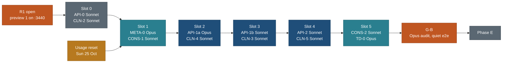

# Phase B start sheet: API-over-JSON and the foundations

> **Status: Done 23 Oct 2026.** Every lane in this sheet is merged and gate G-B passed at main 05c1d4e (merge commits: API-0 ed881c5, META-0 5a5dc82, CONS-1 62f20fc, API-1a 7271ed4 and 1dd3447, API-1b 4239bfc, API-1c e60932b, API-2 095e208, CONS-2 d1a1156, GBFIX 05c1d4e). Deferred items: BACKLOG 15.20 to 15.31. The sections below are history.

Written 21 Oct 2026 by travel-planner (Opus) so phase B can start the moment the owner says go. Docs only; nothing here is started.

**Authority.** This sheet decides the order, the models, the worktrees, the preconditions, the collisions and the rollback for phase B and for the cleanup lanes that run in the phase B gap (CLN-2, CLN-3, CLN-4, CLN-5) plus TD-0. [EXECUTION-PLAN.md](EXECUTION-PLAN.md) section 4 stays the authority for the API shape (store interface, endpoints, error codes, caps). The lane briefs ([API](briefs/API.md), [CONS](briefs/CONS.md), [META](briefs/META.md), [DATA](briefs/DATA.md)) were revised the same day to match this sheet. [PLAN.md](../../PLAN.md) section 3 points here.

**Supersedes:**
- EXECUTION-PLAN 15, the "Days 5 to 11" row (API, CONS, META and DATA D3/D4 side by side). Phase B now runs at most two lanes at a time, in the order of section 2, because the weekly usage allowance is nearly spent.
- EXECUTION-PLAN 4.9: B2 as one Sonnet lane of 22 h (now API-1a on Opus, then API-1b on Sonnet); B6 on Sonnet (now Opus, by the model rubric); the "11 tests that read `web/out`" (16 test files and 3 scripts, measured below).
- DATA brief "D3, D4 and D6 start after META-0, during phase B". They now start after G-B unless the owner says otherwise (section 13, B-2).
- SRV-D subsection 13.1 item 5's recommendation of ISO 3166-2 codes as the canonical `region` value. This sheet keeps the shipped kebab-name value (decision D-B3).

Principles cited by number from [principles.md](../../design/foundation/principles.md): P1 (scale), P4 (no manual needed), P8 (protect the catalogue), P9 (one data boundary, server-ready).

## 1. State on 21 Oct (verified in the repo)

| Item | State |
|---|---|
| `main` | `e98e4fe`. Phase A is merged: TST, FIXF, SHL2, GLB2a, TRP1, LST2a, PLC2a, then the R1 fix lanes SHL2b, GLB2c, PLC2b and DATA1, and E2E (portable GPU Chromium) |
| Gate R1 | Entry done: hand-over written ([R1-HANDOVER.md](R1-HANDOVER.md)); preview 1 is commit `4794989`, served on `127.0.0.1:3440` by a Python server. The owner's review is open. Q72 lets B start now |
| Cleanup | CLN-1 (`8c5ac03`) and CLN-R (`aa157db`) merged. CLN-7 is in flight (worktree `v2-CLN7`, uncommitted: `CLAUDE.md`, `README.md`, `.claude/skills/**`, `research/method/**`). CLN-2 has not started |
| TD-0 | In flight (worktree `v2-TD0`, uncommitted). It has touched `core/test/research/templates.test.ts`, which its brief gives to TD-1 (section 3, collision C12) |
| Build | `web/next.config.ts` still has `output: 'export'`; e2e still stages `.site/` through the legacy staging script's `--dry-run`; check-all runs `web test` **before** `web build` |
| Tests that read the build | 16 test files: `images`, `budget`, `fonts`, `og-images`, `og`, `privacy`, `analytics` (top level); `data/light-data`, `data/place-size`, `data/link-only-facts`, `data/photo-credits-clean`, `data/public-privacy`; `places/built-pages`, `places/tracks-markers`; `export/page-data`; `trips/timeline-outlinks`. Plus `web/tests/global-setup.ts`, the comment in `e2e/trips.shots.spec.ts`, and the scripts `images.mjs`, `og.mjs`, `globe-cities.mjs` (`--from` default) |
| Machine | macOS, Apple M1 Pro. `web/playwright.config.ts` exports `GPU_ARGS` with `--use-angle=metal` on darwin. `/usr/bin/timeout` exists. System `python3` has no pytest |
| Python tests | Use a venv: the current one is `/private/tmp/claude-501/-Users-nks-workspace-travel/6ecdf19c-bdc2-4d26-a05a-b168e5a5515a/scratchpad/venv`. Run check-all as `PATH=<venv>/bin:$PATH bash tools/check-all.sh`. If the venv is gone: `uv venv <scratchpad>/venv && uv pip install --python <scratchpad>/venv pytest` |
| Env file | `web/.env.local` is moved aside (mode 600) for check-all and the e2e, and put back after |
| Usage | 82% of the weekly allowance used on 21 Oct; it resets on Sun 25 Oct |
| Schema diff | [research/reports/schema-diff-2026-10.md](../../../../research/reports/schema-diff-2026-10.md) (moved by CLN-1). Owner decisions Q73 to Q76 recorded |

## 2. Lane order and models

At most two lanes run at once. A slot ends when both of its lanes are merged and verified. Opus work waits for the 25 Oct reset.

| Slot | Lane | Agent | Model (rubric) | Why this model | Worktree | Branch | Dev port | Agent-hours |
|---|---|---|---|---|---|---|---|---|
| 0 | **API-0** server build mode and harness | `travel-builder` | Sonnet | harness work, brief and checks exist | `/Users/nks/workspace/travel-wt/v2-API0` | `public/API0` | 3469 | 12 + 1 verify |
| 0 | CLN-2 (after CLN-7 merges) | `travel-builder` | Sonnet | scripted moves | `v2-CLN2` | `public/CLN2` | none | 1 |
| 1 | **META-0** placement block, tiers, validator | `travel-builder` | **Opus** | changes the capture contract | `v2-META0` | `public/META0` | none | 10 + 1 verify |
| 1 | **CONS-1** hard-coding guards, env table | `travel-builder` | Sonnet | guard, well specified | `v2-CONS1` | `public/CONS1` | 3467 | 6 + 0.5 verify |
| 2 | **API-1a** Zod contracts, `CatalogueStore`, `StubStore`, slug registry, contract kit tables | `travel-builder` | **Opus** | sets the shared contract | `v2-API1a` | `public/API1a` | 3469 | 9 + 1 Opus contract read |
| 2 | CLN-4 one globe writer | `travel-builder` | Sonnet | brief exists | `v2-CLN4` | `public/CLN4` | 3471 | 3 + 1 verify |
| 3 | **API-1b** `JsonStore`, `respond()`, handlers, OpenAPI, adapters | `travel-builder` | Sonnet | implements a fixed contract against written cases | `v2-API1b` | `public/API1b` | 3469 | 13 + 1 verify |
| 3 | CLN-3 retire `prototype/` | `travel-builder` | Sonnet | brief exists | `v2-CLN3` | `public/CLN3` | 3472 | 6 + 1 verify |
| 4 | **API-2** pure modules into `core/` | `travel-builder` | Sonnet | moves behind re-exports | `v2-API2` | `public/API2` | 3469 | 14 + 1 verify |
| 4 | CLN-5 folder-contract guard | `travel-builder` | Sonnet | guard, brief exists | `v2-CLN5` | `public/CLN5` | none | 5 + 0.5 verify |
| 5 | **CONS-2** geo, nearby config, home point, kind labels | `travel-builder` | Sonnet; the privacy step is audited by Opus at G-B | consolidation with parity tests | `v2-CONS2` | `public/CONS2` | 3467 | 8 + 1 Opus ruling + 0.5 verify |
| 5 | TD-0 trip data contract (if not merged by then) | `travel-planner` | Opus (in flight) | docs with judgement | `v2-TD0` (exists) | `public/TD0` | none | 3 |
| 6 | **G-B** gate | coordinator; `travel-verifier`; Opus code auditor | Sonnet for the quiet e2e, static smoke and pixel diff; **Opus** for audits 5.2 and 5.5 | audits are never below the model that wrote the work | main checkout `/Users/nks/workspace/travel` | none | e2e picks free ports | 3 Sonnet + 4 Opus + 1 coordinator |
| any | Pre-flight scans before slots 1, 3 and 5: re-run the EXECUTION-PLAN 5.3 greps, list uncommitted files in every worktree | `explorer` | **Haiku** | mechanical | none | none | none | 1 in total |

Port 3440 stays with preview 1 until R1 exits. The e2e picks free ports itself. Find a port's owner with `lsof -iTCP:<port> -sTCP:LISTEN`; kill by PID only.

**Why this order.** API-0 first: it is Sonnet work, it unblocks everything, and it changes the harness every later lane verifies with. META-0 before API-1a: the API's detail point carries `pointRole` and `approx`, and META-0 defines them (one enum, written once). CONS-1 before API-1a: the scan then covers the files API-1 creates. API-1 split in two: the contract is Opus work under the rubric; implementing it against written cases is Sonnet work. That saves about 13 Opus hours. CONS-2 after API-2: it edits `origin.ts` only after API-2 has moved it. The cleanup lanes fill the second seat in each slot on files no API lane owns.

**Cheapest viable sequence under the usage constraint.** Before the reset (21 to 24 Oct), run only slot 0, and only if R1 fix rounds leave room. R1 fixes come first; the owner's findings are the release path. After the reset, run slots 1 to 6 in order. Run nothing in parallel beyond the pairs above. Defer DATA D3, D4 and D6 to after G-B; they are Opus research, and nothing in B needs them. Opus is used for META-0, API-1a, one contract read, one design ruling, TD-0 (already in flight) and the G-B audits, about 28 h of 108.5 h.

## 3. Owned files and collisions

Full owned-file lists are in each brief. The shared files, and the rule that settles each overlap:

| # | File or folder | Lanes | Rule |
|---|---|---|---|
| C1 | `tools/check-all.sh` | API-0 (reorders the web block), META-0 (gap budget), CONS-1 (scan), API-1a (slugs `--check`), API-1b (OpenAPI `--check`), CLN-3 (snapshot current), CLN-5 (folder contract) | Slot order decides. API-0 lands first. Each later lane adds one named `step` line at the anchor in section 7 and keeps every other lane's line on rebase. Nobody reorders another lane's step |
| C2 | `docs/v2/build/public-site/README.md` | API-0 (build and run), CONS-1 (env table) | API-0 first. CONS-1 adds a new "Environment variables" section and does not edit API-0's text |
| C3 | `web/tests/data/public-privacy.test.ts` | API-0 (built-output paths), CLN-3 (source-path line), META-2 in E (Whitby rule) | Line-scoped. API-0 in slot 0, CLN-3 in slot 3 rebases |
| C4 | `web/package.json` | API-0 (`build`, `prebuild`), CLN-3 (`snapshot`, `snapshot:check`) | Different keys. API-0 first |
| C5 | `web/lib/public/slugs.ts` | API-1a (`assignPlaceSlugs` becomes a re-export of `core/src/catalogue/slugs.ts`), CONS-3 in E (slug tables) | API-1a edits the function only. CONS-3 comes later |
| C6 | `web/lib/public/places.ts` | API-1a (the slug call and the `ref` it keeps for rows), CONS-2 (distance line), META-1 in E (point read order), TD-2 in E | Line-scoped, serial by slot |
| C7 | `web/components/places/rows.ts` | API-1a (the row type and `PLACE_LIST_KEYS` derived from the Zod schema, plus `ref`) | Type lines and the keys constant only; no render change. LST2b owns it in E |
| C8 | `web/lib/public/globe.ts` | CLN-4 (line 31 and the read helper), API-1b (none), CONS-3 in E | API-1b's globe methods call the exported functions of `globe.ts` and add no path literal. CLN-4 merges in slot 2, before API-1b |
| C9 | `web/lib/public/{origin,party,dateless}.ts` | API-2 (moves), CONS-2 (edits after the move) | Serial: slot 4, then slot 5 |
| C10 | `core/src/schema/enums.ts` | META-0 (appends `POINT_ROLE`), API-1a (imports it) | META-0 first. Append only |
| C11 | `data/schema/generated/**`, `data/schema/capture/**`, `research/types/**` | META-0 (`capture.ts build`, `schema.ts generate`), API-1b (`openapi.json`) | Never hand-merge a generated file. After a rebase, rerun the generators and commit their output. API schemas are not registered as data tables, so `schema.ts generate` does not change because of them |
| C12 | `core/test/research/templates.test.ts` | TD-0 (in flight, outside its brief), TD-1 in E | TD-0 either drops the edit or the coordinator accepts it as TD-1's mapping line landed early. No B lane touches it |
| C13 | `core/src/validate/codes.ts` | META-0 (B), TD-1 (E) | TD-1 after G-B, as already planned |
| C14 | `CLAUDE.md` | CLN-7 (in flight), CLN-2, CLN-4 (globe writer line) | Serial: CLN-7, then CLN-2, then CLN-4. CLN-4 finds its line by content, not by number, because CLN-7 rewrites the file |
| C15 | `HANDOVER.md` | CLN-3 (regeneration row), coordinator | CLN-3 owns one row; anything else is the coordinator's |
| C16 | `research/**` | META-0 (`method/capture-contract.md` 3.7, regenerated `types/`), TD-0 (`formats/`), CLN-7 (`method/` pages), CLN-5 (rules over the research root) | Disjoint files. CLN-5 takes its baseline in slot 4, after META-0 and TD-0 have merged |
| C17 | Ref strings in `data/**` that look like paths (`legacy/canadian-rockies-sept-2029/adventures/banff-gondola` is a key in `data/capture/points.json`) | CLN-5 rule 10 (dead paths) | CLN-5 does not scan JSON values under `data/**` for paths. A ref is an id, not a path. Its fixture proves a ref is not reported |
| C18 | `web/lib/client/data.ts`, any phase A file | API-1b; R1 fix rounds (`FIX-R1-*`) | R1 fixes win. A B lane never edits a line an open R1 row names; it rebases after the fix merges |
| C19 | `web/lib/capabilities.ts`, `web/lib/config/product.ts` | API-1b (flags), CONS-1 (page sizes, budgets) | Append only |
| C20 | `.claude/agents/travel-researcher.md` | META-0 (one checklist line) | CLN-7 touches no agent file (measured), so no overlap |
| C21 | `web/app/places/[slug]/page.tsx`, `web/app/trips/[slug]/page.tsx` | API-1b (data-loading lines only) | No layout or markup change. TRP2 owns the trip page in E |

No collision was found between the B lanes and CLN-3, CLN-4 or CLN-5 other than C1, C2, C3, C4, C8, C14, C16 and C17. Each is settled by slot order.

## 4. Hard preconditions

| Lane | Must be true before it starts |
|---|---|
| API-0 | R1 entry done (yes). `main` check-all green on this Mac with the venv on `PATH` and `web/.env.local` aside (rerun on the current `main`; the R1 measurement was on `4794989`). No open R1 row names `web/playwright.config.ts`, `web/tests/e2e/{global-setup,fixtures}.ts`, `web/next.config.ts` or `tools/check-all.sh`. Preview 1's PID recorded so nothing kills it |
| CLN-2 | CLN-7 merged (both edit `CLAUDE.md` and `README.md`) |
| META-0 | CLN-R merged (yes, `aa157db`). TD-1 not started. Usage reset done (Opus) |
| CONS-1 | R1 entry done (yes). API-0 merged (C1, C2) |
| API-1a | API-0 and META-0 merged. CONS-1 merged, so the scan covers the new files. Decisions D-B1 to D-B6 of section 5 not vetoed by the owner. SRV-D 13.1 items 1 to 7 read |
| CLN-4 | CLN-7 and CLN-2 merged (C14; CLN-2 item 2.3 rewrites `tools/globe_data.py` comments). A11 merged (yes) |
| API-1b | API-1a merged, with its contract read by Opus (1 h) and the contract case tables committed. Failing cases against the `JsonStore` skeleton are expected; making them pass is the job |
| CLN-3 | API-0 merged (C3, C4). CLN-2 merged. The owner confirms the `prototype/` removal on the day (decision D1 covers it; the safety rule asks for a confirmation before each deletion) |
| API-2 | API-1b merged. The scheduler bundle size recorded on `main` before the first move |
| CLN-5 | CONS-1 merged (the ratchet pattern). META-0, CLN-3 and TD-0 merged, so its baseline is taken once |
| CONS-2 | API-2 merged (`origin.ts` is in `core/src/privacy/`). CONS-1 merged |
| TD-0 | CLN-7 merged |
| G-B | Every lane above merged and verified. Quiet machine: no other lane, no dev server except preview 1 |

## 5. Decisions this sheet makes

Each is the planner's call, with its trade-off. The owner can veto D-B1 and D-B3 at G-B at low cost, because nothing is live.

| # | Decision | Trade-off |
|---|---|---|
| D-B1 | **Slug stability: a pinned slug registry.** `data/catalogue/slugs.json` (schema `catalogue-slugs/1`, read by `JsonStore` only, never served) maps each identity key to its slug, each region key to its slug, and each retired slug to the key that replaced it. `assignPlaceSlugs` and `assignSeedSlugs` move to `core/src/catalogue/slugs.ts` and take the registry as input. A pinned key keeps its slug forever, even when its name changes. A new key gets the computed slug and skips every pinned and retired slug, so a newcomer whose name clashes takes the suffix; the incumbent is never renamed. A deliberate rename is `node core/bin/slugs.ts rename <key> <slug>`: the old slug is retired and answers 308 to the new one. A key that disappears (merged through `same_place_as`, or an identity change such as a locations place gaining a capture record) fails `slugs.ts --check` until someone runs `slugs.ts alias <old-key> <new-key>`, which carries the slug over. The first registry is today's slugs, byte for byte | First come keeps the plain name, so a better-known place added later gets the suffix. One more committed file (about 400 rows, under 40 KB). In return a slug never changes silently, the contract case "stable slug" holds across loads, and SRV-0's loader copies the file instead of reimplementing slug assignment (SRV-D risk 2) |
| D-B2 | **Identity and `ref`.** Every row and detail carries `ref` beside `slug` (SRV-D 13.1 item 1; owner Q74: `entity.id` is the ref). `ref` is the capture ref verbatim when the page has a capture record, otherwise the key the adapter already uses: `loc:<locations id>` or `proto:<prototype id>`. Refs keep spaces, `:` and `#`; any URL that carries one encodes it | Two non-capture prefixes survive until TD-4 imports the old trips. They are already the internal keys, so nothing is invented |
| D-B3 | **Canonical URL values.** `region` emits the kebab of the region's English name, as shipped in phase A and written in the nearby spec (`region=alberta`, `region=ontario`), pinned in the slug registry's `regions` section. Every alias in `regionAliases` (the ISO 3166-2 code `CA-AB`, the code `AB`, the old names) is accepted on input and answered with the canonical value. `city` takes the town id `<cc>-<admin1>-<slug>` (Q76, `ca-on-whitby`); until META-2 the store answers `not_available` | SRV-D recommended ISO codes. Keeping the kebab name avoids changing a shipped URL, the LST2a e2e spec and the owner-approved nearby spec. The pin removes the one real risk of a name-derived key (a rename in the locations store) |
| D-B4 | **Provenance in API output: one `apiVal` schema.** Storage keeps one Val: `val()` in `core/src/schema/suitability.ts`, which capture records already reuse. API-1a adds `core/src/schema/api/val.ts`: `apiVal(inner)` with `v`, `state` (`SUIT_STATE`: `value`, `none_stated`, `searched_none`, `not_applicable`, `gap`, `no_limit`), `basis` (`REL_BASIS`, which is `SUIT_BASIS` plus `editorial`), `src` as **registry ids only** (`s-` plus 10 hex characters, from `data/sources/registry.json`), `on`, and `read`, `note`, `conflicts` where present. File-local `src-NNNN` ids never leave the store. An id with no registry entry fails a contract case instead of being dropped | One mapping step inside the store. The source tier in SRV-0 keeps the file's own ids (SRV-D 12), so nothing is lost |
| D-B5 | **Sort and paging.** Every paged method sorts by a sort key computed in core (`sortKey(name)`: NFKD, marks stripped, lower case, compared by code point, never `localeCompare`) with `ref` as the tiebreaker. The key is part of the store's projection, so the proposed `PostgresStore` (SRV-0, Neon; not implemented) stores it and sorts with `collate "C"` | Accented names sort by their base letters. Page boundaries match across stores (SRV-D risk 10) |
| D-B6 | **`revision()`** is a SHA-256 of the canonical JSON (sorted keys) of what the store serves: the dataset plus the slug registry. Never mtimes. The same data in two processes gives the same revision | Every data commit changes every ETag, which is fine at this size |
| D-B7 | **Image renditions and share images move before the build.** `next start` serves only the files that were in `public/` at build time, so the post-build rewrite of `out/` cannot carry over. API-0 runs `images.mjs` and `og.mjs` as a `prebuild` step into `web/public/img/` and `web/public/og/` (both gitignored), from a dump of the dataset made with the vitest dump pattern of `tools/suitability-scope/`. The Commons-to-rendition rewrite moves into the data path (`web/lib/format/image.ts` and the dataset builder), so HTML, RSC payloads and API responses carry the same URL | A pre-build data dump adds about a minute to each build. The alternative (two builds) doubles it |
| D-B8 | **DATA D3, D4 and D6 move to after G-B** (owner may override: B-2) | Phase E data starts about four working days later than the 20 Oct calendar; R2 moves by about one day, because D3, D4 and D6 were not on the critical path |

## 6. The contract kit (EXECUTION-PLAN 4.6, extended)

`core/test/catalogue/contract/<method>.cases.ts`, one table per store method, written by API-1a. `core/test/catalogue/contract.test.ts` runs every table against `JsonStore` on the real `data/` and against `StubStore`. `web/tests/api/contract.test.ts` runs the same tables through the route handlers in process, with no network, to cover `respond()`. SRV-0 later adds the proposed `PostgresStore` to the first runner.

| # | Case | Methods | Source |
|---|---|---|---|
| K1 | `pageSize` above 100 is refused or capped (`too_large` or capped with a flag, one rule for all) | every paged method | 4.6 |
| K2 | Rows carry only the allowlist keys, now derived from the `PlaceRow` Zod schema | `listPlaces`, `near`, `listTrips` | 4.6 |
| K3 | `r=500` clamps to 100 with `clamped: true` | `near` | 4.6 (pending until E) |
| K4 | Unknown centre gives `not_found` and reads no shard | `near` | 4.6 (pending until E) |
| K5 | Unscoped near gives `invalid_scope` | `near` | 4.6 (pending until E) |
| K6 | One item per export | `getExport` | 4.6 |
| K7 | No household string in any output (the privacy test's list) | all | 4.6 |
| K8 | `ref` present on every row and detail, and stable: the same ref gives the same slug on two loads | `listPlaces`, `getPlace`, `listTrips`, `getTrip` | SRV-D 13.1 item 1; D-B1, D-B2 |
| K9 | A retired slug answers with the current slug (`moved`), and the handler answers 308 | `getPlace` | D-B1 |
| K10 | `revision()` is equal for the same data in two store instances and changes when one value changes; touching a file's mtime does not change it | `revision` | SRV-D item 6; D-B6 |
| K11 | Page 2 starts at the same `ref` on every store; ties break by `ref` | paged methods | SRV-D item 7; D-B5 |
| K12 | Every `src` in output is a registry id; an unknown id fails | `getPlace`, `getTrip` | SRV-D item 4; D-B4 |
| K13 | Every Val state and basis in output is in the enum | `getPlace` | D-B4 |
| K14 | Every region alias (ISO, code, old name) gives the same result and the canonical `region` value | `listPlaces`, `countPlaces` | SRV-D item 5; D-B3 |
| K15 | `city=ca-on-whitby` gives `not_available` until META-2, then results | `listPlaces`, `towns` | D-B3 (pending until E) |
| K16 | Every detail point carries `pointRole` (a role or null) and `approx` (true only when marked) | `getPlace` | SRV-D item 3 |
| K17 | Approximate points are excluded from `near` and `nearbyForPlace`, and `basis` says so | `near`, `nearbyForPlace` | SRV-D item 3 (pending until E) |
| K18 | Invalid input gives 400 `invalid_input`; each `ApiError` code maps to its status | handlers | 4.2 |
| K19 | `If-None-Match` with the current revision gives 304 | handlers | 4.4 |

"Pending until E" cases are written now, marked pending with the task that fills them, and counted in the hand-back. None is skipped silently.

## 7. check-all and the e2e harness for the server build

| Item | Today | After phase B |
|---|---|---|
| `web/next.config.ts` | `output: 'export'` | removed; `trailingSlash`, `images.unoptimized`, `transpilePackages` and the fixture `distDir` stay |
| Web build | `next build`, then `images.mjs` and `og.mjs` rewrite `web/out/` | `prebuild` (dataset dump, renditions into `public/img/`, share images into `public/og/`), then `next build` (D-B7) |
| Built output the tests read | `web/out/**` | prerendered HTML and RSC payloads under `.next/server/app/` (a trailing-slash route is `places/<slug>.html`, not `places/<slug>/index.html`), client chunks under `.next/static/`, API responses in process. One helper, `web/tests/helpers/built.ts`, resolves them and **fails** when there is no build (row 15.1) |
| Privacy scan | every file of `web/out/` | `.next/server/app/**` (`.html`, `.rsc`, `.body`, `.meta`), `.next/static/**`, and every API response in the contract kit. Not `.next/server/chunks/**` or `.next/cache/**`: server code legitimately holds the scrub module |
| Static adapter smoke | none | `NEXT_PUBLIC_DATA_ADAPTER=static` is inlined at build time, so the smoke set needs its own build in `.next-static`. Run at G-B and R2 only, not in every check-all |
| e2e server | global setup stages `.site/` with the legacy staging script; each worker serves it with `python3 -m http.server` | global setup builds once (or reuses the build when `SKIP_WEB_BUILD=1`), starts one `next start` on a free port, writes its PID, and teardown kills that PID. The `site` fixture returns the shared URL. `PW_REUSE_SITE=1` with `PW_SITE_URL` reuses a running server. The `legacy` list fixture stays until CLN-6 |
| e2e specs that hit legacy routes in `.site/` | pass on the staged mix | API-0 lists them. Each moves to the `legacy` fixture or loses its legacy assertion, named in the hand-back for the verifier (legacy routes are not part of the new site; R1 entry criterion 6) |
| e2e network assertion | none | `web/tests/e2e/api-reads.spec.ts` (API-1b): home, trips, a trip, places with filters, a place, the globe and an export read from `/api/v1/` |

**check-all step order after phase B** (each lane adds only its own line):

1. python tests, locations validate and `build --check`, core tests (with the contract kit), core typecheck, mcp, ops list, schema generate `--check`, capture `build --check` (unchanged).
2. META-0: `capture gap budget` (`node core/bin/capture.ts gaps --budget --check`), after the capture contract step.
3. validate every data file, search vocabulary, suitability, relevance, source registry (unchanged).
4. API-1a: `catalogue slugs are pinned` (`node core/bin/slugs.ts --check`).
5. CLN-3: `prototype snapshot is current` (`pnpm --dir web snapshot:check`).
6. CONS-1: `no hard-coded values` (`python3 tools/cons/hardcode_scan.py --check`).
7. CLN-5: `folder contract` (`python3 tools/tree_check.py`).
8. web typecheck, web lint.
9. web build (server mode, with `prebuild`; the existing `Error:` line guard stays).
10. web test with `SKIP_WEB_BUILD=1` (reads the build from step 9; the fixture builds still run).
11. API-1b: `OpenAPI is current` (`node core/bin/openapi.ts --check`).
12. API-0: `server answers` (`next start` on a free port, `GET /api/v1/health` and `/api/v1/openapi.json`, kill by PID). Until API-1b lands, API-0's version requests `/` only.

The full e2e stays out of check-all, as today. The coordinator runs it on a quiet machine.

## 8. Acceptance

Per-lane checks are in each brief. Gate G-B passes when all of these hold (EXECUTION-PLAN 9, items 1 to 10, plus 11 to 17 from this sheet):

| # | Check |
|---|---|
| 1 | Every browser read goes to `/api/v1/` by default (`api-reads.spec.ts` over home, trips, a trip, places with filters, a place, the globe, an export) |
| 2 | Contract kit green on `JsonStore` and `StubStore`, and through the handlers; pending cases counted |
| 3 | `data/schema/generated/openapi.json` `--check` green; `/api/v1/openapi.json` validates as OpenAPI 3.1 |
| 4 | `NEXT_PUBLIC_DATA_ADAPTER=static` passes the e2e smoke set (its own build) |
| 5 | Opus code audit 5.5 on the B diff: no must row (caps in the store, `respond()` scrub and allowlist, error shapes, no key in client bundles, input validation on every handler, no path traversal in `JsonStore`, the CONS-2 home point module) |
| 6 | Moved modules have no React, Next or `node:fs` import (lint) |
| 7 | Hard-coding guard on; the CONS-2 classes at zero |
| 8 | META-0 checks pass; baseline gap reports filed |
| 9 | Screenshots of home, a trip, a place and the globe at 1440 and 390, light and dark, match the R1 preview (pixel diff under 0.1%) |
| 10 | Quiet full e2e green on Chromium and WebKit |
| 11 | `slugs.ts --check` green; the sitemap's URL list equals preview 1's (0 slug changes) |
| 12 | Opus audit 5.2 over API output: 0 household strings, refs carry nothing private |
| 13 | CLN-3: the three snapshot hashes unchanged, `prototype/` gone after its tag. CLN-4: the gazetteer hash unchanged. CLN-5: green on `main` with its baseline, each rule has a failing fixture |
| 14 | TD-0's template validates, or the page lists the exact errors TD-1 removes |
| 15 | Per lane, `git diff --name-only` shows only owned paths (verifier) |
| 16 | Timings at 10,000 places through the API recorded against the static numbers of BACKLOG 3.66 |
| 17 | BACKLOG rows 14.2, 14.3, 14.4, 15.1 and the B parts of 13.1, 13.2, 13.4, 13.5 marked done with commits; this sheet's change log updated |

## 9. Rollback per lane

Every lane merges with a merge commit, so the hard rollback is always `git revert -m 1 <merge>` on `main`, followed by the generators (`node core/bin/schema.ts generate`, `node core/bin/capture.ts build`) and check-all.

| Lane | Soft rollback (no revert) | Hard rollback notes |
|---|---|---|
| API-0 | none; it is the base of everything after it | Revert before any later B lane merges. After API-1b has merged, revert both, newest first |
| META-0 | Raise `gap-budget.json` counts only with a written reason (never silently) | Revert, then `capture.ts build`; migrated records were only warned, so no data changes back |
| CONS-1 | Add a finding to `baseline.json` with a reason | Revert removes the check-all line and the scan |
| API-1a | none (contract only, nothing calls it yet) | Revert; the slug registry goes with it and slugs return to computed |
| API-1b | Build with `NEXT_PUBLIC_DATA_ADAPTER=static`: every read goes back to the prerendered JSON routes, which API-1b keeps | Revert removes the handlers and adapters; `data.ts` exports keep their names, so components are untouched |
| API-2 | none needed per module | One commit per module; revert the module's commit. The re-export shims mean no import changes either way |
| CONS-2 | none | One commit per step; revert the step |
| CLN-2, CLN-4 | none | Revert; hashes recorded in the hand-back prove the restore |
| CLN-3 | `git checkout archive/prototype-2026-10-<dd> -- prototype` restores the folder | Revert the merge, then `pnpm --dir web snapshot:check` |
| CLN-5 | Remove its one check-all line (the guard only reports) | Revert |
| TD-0 | none | Revert (docs only) |

## 10. Effort and calendar

| Lane | Model | Agent-hours |
|---|---|---|
| API-0 | Sonnet | 13 |
| CLN-2 | Sonnet | 1 |
| META-0 | Opus build, Sonnet verify | 11 |
| CONS-1 | Sonnet | 6.5 |
| API-1a | Opus | 10 |
| CLN-4 | Sonnet | 4 |
| API-1b | Sonnet | 14 |
| CLN-3 | Sonnet | 7 |
| API-2 | Sonnet | 15 |
| CLN-5 | Sonnet | 5.5 |
| CONS-2 | Sonnet, Opus ruling | 9.5 |
| TD-0 | Opus | 3 |
| G-B | Opus audits 4, Sonnet 3, coordinator 1 | 8 |
| Pre-flight scans | Haiku | 1 |
| **Total** | Opus about 28 h, Sonnet about 79.5 h, Haiku 1 h | **about 108.5** |

Phase B proper (API, CONS, META, G-B and the scans) is about 88 h against EXECUTION-PLAN's 78 h. The difference is verifier time now counted per lane, the Opus read of the contract and the image renditions moving before the build (D-B7). The cleanup lanes and TD-0 add about 20.5 h.

| Slot | Longest lane | Working days | Dates if slot 0 starts Thu 22 Oct | Dates if slot 0 waits for the reset |
|---|---|---|---|---|
| 0 | API-0, 13 h | 1.5 | 22 to 23 Oct | 26 to 27 Oct |
| 1 | META-0, 11 h | 1.5 | 26 to 27 Oct | 27 to 28 Oct |
| 2 | API-1a, 10 h | 1.25 | 28 Oct | 29 Oct |
| 3 | API-1b, 14 h | 1.75 | 29 to 30 Oct | 30 Oct to 2 Nov |
| 4 | API-2, 15 h | 2 | 2 to 3 Nov | 3 to 4 Nov |
| 5 | CONS-2, 9.5 h | 1.25 | 4 Nov | 5 Nov |
| 6 | G-B, 8 h | 1 | 5 Nov | 6 Nov |

Critical path: API-0, META-0, API-1a, API-1b, API-2, CONS-2, G-B (about 81 h serial). R1 fix rounds come first and move these dates by their own length.

## 11. What the owner reviews at G-B

G-B is an internal gate. The owner gets one page and about 15 minutes; no browsing is needed.

| Item | What he sees | What he decides |
|---|---|---|
| Nothing visible changed | the pixel-diff summary for home, a trip, a place and the globe; the slug count unchanged | nothing, unless something moved |
| D-B1 and D-B3 | the slug rule and `region=alberta` as the canonical key | keep, or ask for ISO codes in URLs (about 3 h now; more after go-live) |
| Metadata baseline | META-0's gap reports: what phase E will fill, per kind | anything missing from the list |
| Phase E start | the E order, DATA timing (B-2) and the usage plan | go for E |
| Optional | `/api/v1/openapi.json` on the local preview | none |

## 12. Go/no-go checklist (before slot 0)

| # | Check | Who |
|---|---|---|
| 1 | The owner says go for phase B and chooses slot 0 now or after the reset (B-1) | owner |
| 2 | `main` is at or after `e98e4fe`; check-all green on this Mac with the venv on `PATH` and `web/.env.local` aside | coordinator, Sonnet verifier |
| 3 | No open R1 must row names an API-0 file (BACKLOG `6.2-R1-*`) | coordinator |
| 4 | Preview 1's PID on 3440 is recorded; no B lane uses 3440 | coordinator |
| 5 | CLN-7's state is known: merged, or its files untouched by slot 0 (API-0 owns none of them) | coordinator |
| 6 | TD-0's edit to `core/test/research/templates.test.ts` is settled (C12) | coordinator |
| 7 | Each worktree is created from the current `main` with `git -C /Users/nks/workspace/travel worktree add /Users/nks/workspace/travel-wt/v2-<lane> -b public/<lane> main`, then `pnpm install --frozen-lockfile` at the worktree root | lane |
| 8 | Branch names are free: the R1 fix rounds used `public/PLC2b`, `public/GLB2c`, `public/SHL2b` and `public/DATA1`, so phase E must not reuse those names (use `public/PLC2b-E`, `public/DATA-D1`) | coordinator |
| 9 | Enough allowance for the slot: Sonnet slots before the reset only if R1 fixes leave room; Opus slots only after it | coordinator |
| 10 | Every lane's hand-back records its model, so the rubric can be judged afterwards | lane |

**No-go** if any of 2, 3 or 9 fails.

## 13. Decisions only the owner can make

| ID | Decision | Recommendation | Trade-off |
|---|---|---|---|
| B-1 | Start slot 0 (API-0, Sonnet, about 13 h) before the 25 Oct reset, or wait | Wait unless R1 has closed its must rows by Thu 22 Oct | Starting now gains about two working days; it spends allowance R1 fixes may need |
| B-2 | DATA D3, D4 and D6 during B (as planned 20 Oct) or after G-B | After G-B | Opus research during B would roughly double the Opus spend in the B window; after G-B moves R2 by about one day |
| B-3 | Veto D-B1 (first-come slug registry) or D-B3 (`region=alberta` as the canonical key) | Keep both | Cheap to change before go-live; costly after |
| B-4 | Confirm the `prototype/` removal on the day CLN-3 runs | Yes (decision D1 already covers it) | The tag keeps it; the safety rule asks for the confirmation |

## 14. Conflicts with older pages, and how they were settled

| Older statement | Where | Now | Edited here? |
|---|---|---|---|
| B starts "waiting on R1 entry"; about 78 h | PLAN.md section 3, row B | Ready, waiting on the owner's go; about 88 h plus 20.5 h cleanup and TD-0 | yes: PLAN.md section 3 row B and new 4.3 |
| "Days 5 to 11: API serial; CONS-1 then CONS-2; META-0; DATA D3 and D4 after META-0" in parallel | EXECUTION-PLAN 15 | Seven slots of at most two lanes; DATA after G-B | superseded by this sheet; EXECUTION-PLAN not edited (outside this change) |
| B2 one Sonnet lane, 22 h; B6 Sonnet | EXECUTION-PLAN 4.9; old API and META briefs | API-1a Opus 9 h, API-1b Sonnet 13 h; META-0 Opus | briefs edited; EXECUTION-PLAN not edited |
| "The 11 tests that read `web/out`" | EXECUTION-PLAN 4.7 and B1, BACKLOG 14.2, old API brief | 16 test files and 3 scripts | BACKLOG 14.2 and the API brief edited |
| B1's owned files omit `fixtures.ts`, `package.json`, `image.ts`, `build-fixture.mjs` | EXECUTION-PLAN 4.9 | Added in the API brief | brief edited |
| "Models: Sonnet builds and verifies" | PLAN.md section 1, row "Models" | The 21 Oct rubric in CLAUDE.md: a builder task that sets a shared contract is Opus | not edited (section 1 is outside this change); the coordinator should point that row at the rubric |
| Phase A "next: start now"; the first-10 table | PLAN.md sections 3 and 4 | Phase A is merged; R1 is open | 4.3 says so; the row A status itself is outside this change |
| Canonical `region` should be the ISO 3166-2 code | schema diff 13.1 item 5 | The shipped kebab name, pinned (D-B3) | schema diff not edited (a record of the research) |
| DATA run notes in `research/method/lanes/DATA-notes.md` | old DATA brief | `research/runs/DATA-<batch>-<trip>.md` | brief edited |
| CLN-5 rule 10 scans `data/` for dead paths | CLEANUP-PLAN CLN-5 | Refs in JSON values are ids, not paths (C17) | CLEANUP-PLAN not edited; CLN-5's lane applies C17 |

## Gotchas

- **`public/` is read at build time.** `next start` does not serve files written into `public/` after `next build`. The image and share-image steps must run before the build (D-B7).
- **`NEXT_PUBLIC_*` values are inlined at build.** The static adapter needs its own build, and `web/.env.local` present or absent changes the build. Never compare a build with the env file to one without it.
- **Prerendered paths change shape.** With `trailingSlash`, the server build writes `places/<slug>.html` under `.next/server/app/`, not `places/<slug>/index.html`. Client chunks are under `.next/static/`, while the pages reference `/_next/static/...`; strip `_next/` when mapping.
- **Do not scan `.next/server/chunks/` for household strings.** The scrub module lives in server code and holds the home point by design (a listed exception while the repo is private). Scan what is served: prerendered output, static chunks and API responses.
- **check-all ran the web tests before the build.** Built-output tests read a stale `web/out` or skipped silently (row 15.1). The new order builds first.
- **One `next build` per `distDir` at a time.** The unit global setup, the e2e global setup and check-all all build; a second build into the same `.next` during a running `next start` corrupts it. Use `SKIP_WEB_BUILD=1` after check-all has built, and a separate `distDir` for fixtures and the static smoke.
- **A hook fires on any Bash command that contains the deploy script's name.** Read or search those files with the Read and Grep tools, not with shell `grep`, or the hook blocks the command.
- **System `python3` has no pytest.** check-all's first step fails unless the venv's `bin` is first on `PATH`.
- **`flock` is not installed on this Mac.** The fetch scripts hold their own locks; any manual call to Overpass, Wikidata or Commons needs `brew install flock` first. This matters for DATA, not for B.
- **Each worktree needs its own `pnpm install`.** The workspace root holds `pnpm-lock.yaml`; run `pnpm install --frozen-lockfile` at the worktree root before the first build.
- **"Placement" means two things.** `data/capture/placement.json` (`capture-placement/1`) records where facts sit between layers. META-0's placement block is the area chain, the point with its role and the nearest town. Do not merge them.
- **GeoNames admin1 codes are not ISO codes.** Ontario is `08` in `admin1CodesASCII`, not `ON`. META-2 needs a mapping to build `ca-on-whitby` (META-0 writes the rule into nearby spec 3.1).
- **Refs that look like paths are ids.** `legacy/canadian-rockies-sept-2029/adventures/banff-gondola` is a key, and it stays valid after the legacy folder moves. Never rewrite it, and never let a dead-path check flag it.
- **Branch names from the R1 fix rounds** (`public/PLC2b`, `public/DATA1`, `public/GLB2c`, `public/SHL2b`) collide with phase E lane names. Pick new names in E.
- **Worktree paths in older briefs** are from the first machine (`/home/nitin27may/...`). Use `/Users/nks/workspace/travel-wt/v2-<lane>`.

## Change log

| Date | Change |
|---|---|
| 2026-10-21 | First version: lane order in seven slots of at most two lanes, models by the 21 Oct rubric (API-1 split into 1a Opus and 1b Sonnet; META-0 Opus), worktrees and ports, collisions C1 to C21, preconditions, decisions D-B1 to D-B8 (slug registry, refs, canonical region and city values, `apiVal`, sort key, revision, renditions before the build, DATA after G-B), contract cases K1 to K19, check-all order, G-B checks 1 to 17, rollback, about 108.5 agent-hours, owner decisions B-1 to B-4 |
| 2026-10-23 | Phase B done and G-B passed at main 05c1d4e: status banner added, BACKLOG rows 14.2, 14.3, 14.4, 15.1 and the B parts of 13.1, 13.2, 13.4, 13.5 marked done with commits |
