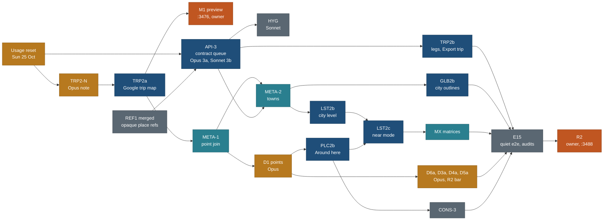

# Phase E start sheet: features and data on the API, trip map first

> **Status (23 Oct 2026, main f393d58): under way; META-2, HYG and TRP2b are merged, fix round TRP2b2 in progress. See STATUS.md.**

> **Sequential closure update:** main reached `7d7a018` (FIXDOC, A29 to A40
> restored). The owner approved the queue in
> [REMAINING-CLOSURE-PLAN.md](REMAINING-CLOSURE-PLAN.md). TRP2b2's preview
> fixes and re-review are on the session branch; main integration is still pending.

> **Backend provider (24 Oct, PLAN R-58, R-60):** the later catalogue store is a proposed `PostgresStore` on Neon Postgres, not a `SupabaseStore`. It is not implemented; `JsonStore` serves and the parity gate below is unchanged.
> The old calendar below is not a fresh delivery estimate.

Written 23 Oct 2026 by travel-planner (Opus) so phase E can start the moment the owner says go. Docs only; nothing here is started.

**Authority.** This sheet decides the order, the models, the worktrees and ports, the collisions, the preconditions, the rollback, the calendar and the owner milestones for phase E. [EXECUTION-PLAN.md](EXECUTION-PLAN.md) section 4 stays the authority for the API shape, section 6 for the metadata tiers and section 11 for gate R2, except where this sheet amends them (listed below). The lane briefs ([TRP2](briefs/TRP2.md), [META](briefs/META.md), [DATA](briefs/DATA.md), [LST2](briefs/LST2.md), [PLC2](briefs/PLC2.md), [GLB2](briefs/GLB2.md), [MX](briefs/MX.md), [CONS](briefs/CONS.md), [SRV](briefs/SRV.md)) were revised the same day to match it. Two lanes have no brief file of their own and are specified in full in section 15 (API-3) and section 16 (HYG, M1). [PLAN.md](../../PLAN.md) section 3 and 4.5 point here.

**Owner priority (23 Oct).** The owner looked at preview 1 and said the day plan on the trip page still does not show the Google map. That is BACKLOG 9.5 and Q51, task E11 (TRP2). TRP2 goes first in phase E, and the owner gets a mid-phase preview (M1) of the trip map as soon as it merges, before R2.

**Supersedes:**
- EXECUTION-PLAN 10, the E order and its single TRP2 lane of 18 h. TRP2 is now two lanes: TRP2a (the Google map, first, no contract change) and TRP2b (routed legs with geometry and Export trip, after API-3).
- EXECUTION-PLAN 10 owned-file lists where a Sonnet lane edited the shared contract: E8 (`core/src/schema/api/places.ts`), E10 (`core/src/schema/api/near.ts`, `core/src/catalogue/json/towns.ts`), E2 (`core/src/privacy/**`). Contract and privacy edits in E belong to API-3 only (decision D-E2).
- EXECUTION-PLAN 11.1, the entry criterion "6.5 met". R2 now needs the minimum viable data set of section 9; rows 7 to 10 in full move to the readiness checklist (owner decision Q90).
- EXECUTION-PLAN 15 (days 11 to 17) and 17 (E calendar). Phase E runs two seats, never more than two lanes at once, from Sun 25 Oct (section 10).
- PHASE-B-START D-B6 (revision = hash of what the store serves). The revision becomes a hash of the inputs and the build id, cached per process (D-E4). Contract case K10 is unchanged.
- (Superseded 23 Oct by A33, API-3c, 7ee3032: towns are shown exactly as the public gazetteer; no safe geometry, no exclusion.) The GB-A-8 recommendation "exclude the home town from the towns layer". This sheet serves the home town like any town and makes its geometry safe at load, because Q50 (decided) lets Whitby appear in the towns layer (D-E3; the owner may still choose exclusion, Q87).
- [SKILLS-AND-DATA-ONLY.md](../../SKILLS-AND-DATA-ONLY.md) 9: TD-1 to TD-3 in phase E. Recommended now: after R2, to save about 22 h (6 h Opus) of allowance (Q80, recommendation changed).
- PLC2 brief step 6 and nearby spec 5.2: Around here as full HTML at build. It is now a summary line at build and the list on open (D-E8, the place-size budget).

Principles cited by number from [principles.md](../../design/foundation/principles.md): P1 (scale), P2 (progressive disclosure), P3 (a glance, then a few clicks), P5 (smooth linked open and close), P6 (the right metadata at the right moment), P7 (the 90% goal: read, copy, export), P8 (protect the catalogue), P9 (one data boundary, server-ready).

## 1. State on 23 Oct (verified in the repo at 33d3254)

| Item | State |
|---|---|
| `main` | `33d3254`. Phase B is merged and pushed; G-B passed at `05c1d4e` (check-all OK; full e2e 745 passed, 27 skipped, 0 failed; sitemap 380 URLs, 0 slug changes) |
| API | `/api/v1` live over `JsonStore`; `ApiAdapter` is the browser default, `StaticAdapter` the fallback. Route files exist for every method, including `near`, `towns`, `places/{slug}/nearby` and `globe/city/{townId}`, which answer `not_available` until E fills them (`core/src/catalogue/json/index.ts` lines 96, 155, 163, 169, 272) |
| Contract kit | 113 cases. The `near` (7) and `nearbyForPlace` (2) tables are pending on every target with the reason "phase E" (`core/test/catalogue/contract.test.ts:60`, `web/tests/api/contract-store.test.ts:7`, `web/tests/api/contract.test.ts:21`). K15 (`city=`) answers `not_available` |
| What B built that E reads | `core/src/geo/{distance,bands}.ts`, `core/src/config/nearby.ts` (CONS-2); `core/src/query/**` (API-2); `core/src/privacy/{home,detect,origin,party,dateless}.ts` (API-2, CONS-2, GBFIX: one detector); `core/src/catalogue/{store,httpCodec,openapi,revision,slugs,sorting,sortKey,distance}.ts`, `json/`, `stub/`; `web/lib/server/**` (respond, exports, placeDetail, tripDetail, privacy, images, moved); `web/lib/client/{data,api,static,contract,stub}.ts`; `core/src/export/**` (moved by API-2) |
| Network assertion | G-B check 1 is `web/tests/e2e/api-default.spec.ts` (PHASE-B-START named it `api-reads.spec.ts`; no file has that name) |
| META-0 | Merged: `POINT_ROLE`, `point_role` and `approx`, the validator codes, `capture.ts gaps --placement` and `--tier`, `data/capture/gap-budget.json` and its check-all step |
| REF1 | In flight in `/Users/nks/workspace/travel-wt/v2-REF1` (branch `public/REF1`, Opus): the 74 wishlist refs `loc:<id>` become opaque `place/<slug>` (BACKLOG 15.24). This sheet assumes it merges before any E lane except TRP2a branches (precondition P0) |
| Trip map today | `web/components/trips/TripRouteMap.tsx` registers `/trips/[slug]` as `maplibre` (line 9). `web/components/map/GoogleJsMap.tsx` already draws pins, solid routes and dashed `straight-estimate` lines and loads from its own dynamic chunk (`MapSurface.tsx` lines 21 to 23). There is no trip family selector: `family.ts` has `placePageFamily()` only |
| Route legs | One file: `data/schedules/legs/dolomites-2027.json` (`trip-legs/1`, km and minutes only, **no geometry**). `web/scripts/legs-ors.mjs` is Dolomites-only (pairs from `web/data-snapshots/prototype.json`). The Rockies, the trip the R2 script checks, has no legs file. Schedules exist for two trips only (`canadian-rockies-2029`, `dolomites-2027`) |
| Env file | `web/.env.local` exists on this Mac (mode 600) with the names `NEXT_PUBLIC_GOOGLE_MAPS_KEY`, `NEXT_PUBLIC_GOOGLE_MAP_ID`, `NEXT_PUBLIC_PLACE_MAP_FAMILY`, `ORS_API_KEY` and the unused `NEXT_PUBLIC_GOOGLE_MAPS_MAPID` (values not read) |
| Budgets | Place pages: median and largest HTML at most +25% over `web/tests/data/place-html-baseline.json` (binding, BACKLOG 15.30). Trip page start JS: 0.75 KB under the 200 KB budget (`web/tests/budget.test.ts`) |
| Branch names taken | `public/PLC2b`, `public/DATA1`, `public/GLB2c`, `public/GLB2d`, `public/SHL2b` (R1 fix rounds and B). E uses `public/PLC2b-E` and `public/DATA-D1` and so on |
| Preview 1 | `127.0.0.1:3440`, commit `74b2a14` per PLAN 4.4. R1 is open; no `6.2-R1-n` finding row exists yet. The owner's trip-map remark is row 9.5 |
| Usage | 83% of the weekly allowance used on 21 Oct; it resets on Sun 25 Oct and again on Sun 1 Nov |
| Machine | macOS, Apple M1 Pro, `--use-angle=metal`. System `python3` has no pytest: use the scratchpad venv (`PATH=<venv>/bin:$PATH bash tools/check-all.sh`). `flock` is not installed |

## 2. Lane order and models

Two seats, never more than two lanes at once. A seat starts its next lane when its own lane is merged and verified, if the preconditions of section 5 hold. Opus work starts only after the 25 Oct reset. Models follow the CLAUDE.md complexity rubric: Haiku for mechanical work, Sonnet for well-specified work inside owned files, Opus for a shared contract, privacy, research that needs judgement, design taste, gates and audits.

| # | Lane | Seat | Agent | Model (rubric) | Why this model | Worktree | Branch | Port | Agent-hours |
|---|---|---|---|---|---|---|---|---|---|
| 0 | Pre-flight scans (5.3 greps, worktree states, REF1 merged, the place-size median, the trip start JS, legs coverage) | either | `explorer` | **Haiku** | mechanical counts | none | none | none | 1 |
| 1 | **TRP2-N** design note for the Google trip map | A | `travel-design-reviewer` | **Opus** | taste | none (writes in the TRP2a worktree) | `public/TRP2a` | none | 1.5 |
| 2 | **TRP2a** Google trip route map (no contract change) | A | `travel-builder` | Sonnet; Opus review | implements a ruled note inside owned files | `/Users/nks/workspace/travel-wt/v2-TRP2a` | `public/TRP2a` | 3477 | 8 + 1 Opus review |
| 3 | **API-3** the contract-change queue (3a contract, 3b implementation, one worktree) | B | `travel-builder` | **Opus** for 3a and the read; Sonnet for 3b | sets the shared contract and a privacy rule; the implementation is written cases | `/Users/nks/workspace/travel-wt/v2-API3` | `public/API3` | 3478 | 7 Opus + 8.5 Sonnet + 1 Opus read |
| 4 | **M1** mid-phase trip-map preview for the owner | A | coordinator, `travel-verifier` | Sonnet | build, serve, screenshots | main checkout | none | **3476** | 1.5 |
| 5 | **META-1** point join, `area_id` migration, trailheads | A | `travel-builder` | Sonnet | implements META-0's rules | `/Users/nks/workspace/travel-wt/v2-META1` | `public/META1` | none | 6.5 |
| 6 | **HYG** hygiene: GB-A-14, the stub parity corpus (15.27); 15.31 only if a budget needs it | B | `travel-builder` | Sonnet | small, specified | `/Users/nks/workspace/travel-wt/v2-HYG` | `public/HYG` | 3487 | 3 |
| 7 | **META-2** towns layer and `near_town` | B | `travel-builder` | Sonnet | implements META-0's rules and API-3's town guard | `/Users/nks/workspace/travel-wt/v2-META2` | `public/META2` | 3479 | 6.5 |
| 8 | **TRP2b** routed legs with geometry, Export trip | A | `travel-builder` | Sonnet; Opus review | implements API-3's `tripLegs` and export contract | `/Users/nks/workspace/travel-wt/v2-TRP2b` | `public/TRP2b` | 3480 | 10 + 1 Opus review |
| 9 | **DATA D1** points | B | `travel-researcher` | **Opus**; Haiku checks; Sonnet verify | research with judgement | `/Users/nks/workspace/travel-wt/v2-DATA-D1` | `public/DATA-D1` | none | 6 + 0.5 + 0.5 |
| 10 | **LST2b** Where city level, Trips by province | A | `travel-builder` | Sonnet; Opus review | implements a written spec | `/Users/nks/workspace/travel-wt/v2-LST2b` | `public/LST2b` | 3481 | 11 + 1 |
| 11 | **PLC2b** Around here, In the same park, Where it happens | B | `travel-builder` | Sonnet; Opus review | implements a written spec on fixed contracts | `/Users/nks/workspace/travel-wt/v2-PLC2b-E` | `public/PLC2b-E` | 3482 | 9 + 1 |
| 12 | **DATA D6a** seasons for the 6 trips without one | A | `travel-researcher` | **Opus** | research | `/Users/nks/workspace/travel-wt/v2-DATA-D6a` | `public/DATA-D6a` | none | 2 |
| 13 | **LST2c** near mode, NearChip, towns strip, parser near rule | A | `travel-builder` | Sonnet; Opus review | implements a written spec | `/Users/nks/workspace/travel-wt/v2-LST2c` | `public/LST2c` | 3483 | 8 + 1 |
| 14 | **CONS-3** palette, UA and endpoints, host rule (slug-table step deferred with TD) | B | `travel-builder` | Sonnet | guard work, brief exists | `/Users/nks/workspace/travel-wt/v2-CONS3` | `public/CONS3` | 3486 | 6 |
| 15 | **DATA D3a** trail facts for the Rockies trails and the five R2 trails | B | `travel-researcher` | **Opus**; Haiku checks; Sonnet verify | research | `/Users/nks/workspace/travel-wt/v2-DATA-D3a` | `public/DATA-D3a` | none | 5 + 0.5 + 0.5 |
| 16 | **GLB2b** city outlines and the home globe look | A | `travel-builder`; reviewer | Sonnet; **Opus** ruling and review | build from an approved mock | `/Users/nks/workspace/travel-wt/v2-GLB2b` | `public/GLB2b` | 3484 | 21 + 2 Opus |
| 17 | **MX** ORS nearby and hub matrices | B | `travel-builder` | Sonnet | brief exists | `/Users/nks/workspace/travel-wt/v2-MX` | `public/MX` | 3485 | 5 |
| 18 | **DATA D4a** activities for the R2 bar | B | `travel-researcher` | **Opus**; Sonnet verify | research | `/Users/nks/workspace/travel-wt/v2-DATA-D4a` | `public/DATA-D4a` | none | 4 + 0.5 |
| 19 | **DATA D5a** photos for the R2 bar | B | `travel-researcher` | **Opus** (contact sheets need judgement); Sonnet verify | research | `/Users/nks/workspace/travel-wt/v2-DATA-D5a` | `public/DATA-D5a` | none | 3 + 0.5 |
| 20 | **E15** merge check, quiet full e2e, stage 5 run, audits, preview 2 | both | coordinator, `travel-verifier`, Opus auditor | Sonnet; **Opus** for audits 5.2 and 5.5 | audits are never below the model that wrote the work | main checkout | none | **3488** (preview 2) | 10.5 Sonnet + 4 Opus + 1 coordinator |

Port 3440 stays with preview 1 until R1 exits. Port 3476 is M1 and stays up until preview 2 replaces it. The e2e picks free ports itself. Find a port's owner with `lsof -iTCP:<port> -sTCP:LISTEN`; kill by PID only.

**Why this order.**
- **TRP2a first.** It is the owner's open complaint, and nothing from B blocks it. It needs the note, the map adapter (`web/lib/map`, `GoogleJsMap`, already built by LM), the trip route model (already served by `getTrip`) and the Google key (in the env file). It needs no contract change, no towns, no points work and no ORS run: legs it cannot route stay dashed and labelled, which is honest (T5). TD-0's contract matters only when TD-2 renders data-only trips, which is after R2.
- **API-3 beside it.** Disjoint files, and every later contract-dependent lane builds on it. Running it in the second seat costs no calendar time.
- **META-1 in seat A after M1** because API-3 is still running in seat B, and META-1 owns no API-3 file (the point join goes in the dataset builder, `web/lib/public/places.ts`, one function).
- **TRP2b after API-3**, because it needs `tripLegs` and the `json` export format.
- **D1 before PLC2b** (Around here needs points); **META-2 before LST2b and GLB2b** (towns); **LST2b and PLC2b before LST2c**; **LST2c before MX**.
- **GLB2b last in seat A.** It is the longest lane (23 h), depends only on META-2 and the owner's mock approval, and is the first feature to cut if the allowance runs short (Q91).
- **DATA batches fill seat B's gaps** and move to after the 1 Nov reset where they can (D4a, D5a), so Opus spend is split across two weeks.

**Cheapest viable sequence.** Opus is used for the note, API-3a and its read, five design reviews, D1, the four R2-bar data batches, the GLB2b ruling and review, and the two R2 audits: about 40.5 h of 160 h. The rest is Sonnet (about 116.5 h) and Haiku (about 2 h). Deferred to after R2: DATA D2 and the rest of D3 to D6 (about 24 h Opus), TD-1 to TD-3 (22 h, 6 h Opus), TD-4 and TD-6, and CONS-3's slug-table step.

**Usage rule.** Before each Opus lane the coordinator checks the allowance. If the week's use is above 70%, Opus data lanes pause and Sonnet lanes continue. Cut order if the allowance cannot cover the plan: D5a, then D4a down to the R2 sample activity, then GLB2b to after R2 (owner, Q91), then D3a down to the five R2 trails, then MX. Never cut: TRP2a, TRP2b, API-3, META-1, META-2, D1, PLC2b, LST2b, LST2c, E15.

## 3. What each lane depends on from phase B

| Lane | Needs from B (all merged) | Blocking? |
|---|---|---|
| TRP2a | `GoogleJsMap` and `MapSurface` dynamic chunks (LM); `getTrip` and the route model through the API (API-1b); colour through `web/lib/map/palette.ts`; the one-family registry and its test | **nothing blocking** |
| API-3 | the contract, codec, OpenAPI generator and kit (API-1a, 1b, 1c), the detector (GBFIX), REF1 | REF1 must merge first |
| META-1, META-2 | META-0 rules and codes, `core/src/geo` (CONS-2), the home module (CONS-2) | no; META-2 waits for API-3's town guard |
| TRP2b | `core/src/export/**` (API-2), `getExport`, API-3's `json` format and `tripLegs` | API-3 |
| LST2b, LST2c | `core/src/query` (API-2), `core/src/config/nearby.ts`, the `city` key (D-B3), API-3's `nearTown` row key and parsed counts | API-3, META-2 |
| PLC2b | `core/src/geo`, the bands, the `nearbyForPlace` route and schema (API-1) | D1 for data |
| GLB2b | `globeCity` route and schema (API-1), API-3's corrected globe card path | META-2, mock approval |
| MX | `core/src/nearby` (PLC2b) | PLC2b, LST2c |

## 4. Owned files and collisions

Full owned-file lists are in each brief and in sections 15 and 16. The shared files, and the rule that settles each overlap:

| # | File or folder | Lanes | Rule |
|---|---|---|---|
| E1 | `core/src/catalogue/json/index.ts` | API-3 (revision, export, counts, unchecked, card search, legs, globe card), META-2 (`towns()`), LST2b (`city=` facet and counts), PLC2b (`nearbyForPlace`), LST2c (`near`), GLB2b (`globeCity`) | Each lane replaces only its own `not_available` line with one call into its own new file (`json/legs.ts` API-3, `json/towns.ts` META-2, `json/places-city.ts` LST2b, `json/nearby.ts` PLC2b, `json/near.ts` LST2c, `json/globe-city.ts` GLB2b). Serial by merge order; API-3 first. No lane reformats the file |
| E2 | `core/src/catalogue/store.ts`, `core/src/schema/api/**`, `core/src/catalogue/{httpCodec,openapi,revision}.ts`, `data/schema/generated/openapi.json` | API-3 only | A later lane that needs a contract change writes the request in its hand-back; the coordinator queues an API-3 follow-up (Opus, at most 1 h). This takes `core/src/schema/api/places.ts` from LST2b and `core/src/schema/api/near.ts` from LST2c (D-E2). Never hand-merge the generated OpenAPI; regenerate |
| E3 | `core/src/privacy/**` | API-3 (town guard, typed exemption) | META-2 calls the guard and edits nothing here (D-E3). The home point stays in `home.ts` only |
| E4 | `core/src/query/**` | API-3 (read; one exported function if parsed counts need it), LST2b (city facet and counts) | Serial: API-3 merges first; LST2b rebases |
| E5 | `core/src/parse/**` | API-3 (read only), LST2c (near rule) | API-3 does not edit it. If it must, it says so and LST2c rebases |
| E6 | `web/lib/client/{data,api,static,contract}.ts` | API-3 (new methods; parsed counts, unchecked and text search stop evaluating in the browser), TRP2b (none: it calls `loadExport` and API-3's `tripLegs` client), LST2c (`nearPlaces`, `townsNear`), PLC2b (`nearbyForPlace` client), GLB2b (`globeCityOutline`) | Append-only sections named for the lane (`// near (LST2c)`). API-3 first; the rest serial by merge |
| E7 | `web/lib/server/**` | API-3; HYG (`images.ts` only, after API-3 merges) | Serial |
| E8 | `core/src/geo/**`, `core/src/config/nearby.ts` | none edits in E; PLC2b, LST2c, MX, META-2 import | A needed change is a coordinator request, done by PLC2b with a parity test |
| E9 | `core/src/catalogue/json/towns.ts`, `data/reference/towns/**`, `tools/towns.py` | META-2 | LST2c, PLC2b and GLB2b read them (the LST2 brief listed `towns.ts` in part c; superseded) |
| E10 | `web/lib/public/places.ts` | META-1 (point read order, one function), CONS-3 (line 370 area), TD-2 (after R2) | Serial: META-1, then CONS-3 |
| E11 | `web/components/map/**`, `web/lib/map/**`, `core/src/links/types.ts` (`MapSpec`) | TRP2a, TRP2b; PLC2 owns `web/lib/map/links.ts`; CONS-3 owns `palette.ts` after TRP2b | TRP2a may append optional fields to `MapSpec` only (named in the note). Place-page maps must look the same before and after (screenshot pair) |
| E12 | `web/components/trips/**`, `web/styles/timeline.css` | TRP2a, then TRP2b; R1 fix rounds (`FIX-R1-TRP`) | R1 fixes win; the TRP2 lane rebases after the fix merges. LST2 keeps `TripsMap.tsx`, `TripCover.tsx`, `tags/**` |
| E13 | `web/components/places/**` | PLC2b; LST2c (`rows.ts`, `PlacesMap.tsx`, `PlaceCardFooter.tsx`, `cluster.ts`) | Disjoint files; the place-size budget applies to both (D-E8) |
| E14 | `data/capture/points.json`, `data/capture/gap-budget.json` | META-1 (trailheads; lowers the budget), D1, D3a to D5a (lower only) | Serial for points (META-1, then D1). Budget counts only fall; on a rebase take the lower count |
| E15 | `data/schedules/legs/**`, `web/scripts/legs-ors.mjs` | TRP2b | CONS-3 edits the UA line of `legs-ors.mjs` only after TRP2b merges |
| E16 | `tools/check-all.sh` | API-3 (none expected), MX (`--check` line), HYG (none) | One named step line at an anchor; keep every other lane's line on rebase |
| E17 | `docs/v2/build/public-site/README.md` env table | TRP2a (`NEXT_PUBLIC_TRIP_MAP_FAMILY`) | One row appended |
| E18 | `web/tests/data/public-privacy.test.ts` | META-2 (the Whitby pin, as written by API-3's rule) | Line-scoped |
| E19 | `web/lib/public/globe.ts`, `web/scripts/globe-cities.mjs`, `tools/globe_data.py` | GLB2b; CONS-3 (trip-to-country table and UA lines) | CONS-3 runs before GLB2b starts (Fri 30 Oct); otherwise it waits for GLB2b to merge |
| E20 | Every file REF1 touches (`data/catalogue/slugs.json`, `core/src/catalogue/slugs.ts`, ref schemas, contract cases) | REF1 (in flight), API-3 | Every E lane except TRP2a branches from `main` after REF1 merges. TRP2a rebases on it before its merge |
| E21 | Any phase A file an open R1 row names | R1 fix rounds, any E lane | R1 fixes win. An E lane never edits a line an open `6.2-R1-n` row names; it rebases after the fix merges |

Collisions found and settled by this sheet: E1 (six lanes in one store file), E2 (two Sonnet lanes listed contract files), E3 (META-2 and API-3 both in privacy), E9 (META-2 and LST2c both listed `towns.ts`), E11 (`GoogleJsMap.tsx` and `MapSpec` were owned by nobody in E; TRP2 needs them), E15 (CONS-3 and TRP2b on `legs-ors.mjs`), E19 (CONS-3 and GLB2b on the globe files), E20 (REF1). The rest are settled by order.

## 5. Hard preconditions

| Lane | Must be true before it starts |
|---|---|
| any E lane | P0: REF1 merged into `main` (TRP2a excepted: it rebases before merge). The owner said go for phase E. `main` check-all green with the venv on `PATH` and `web/.env.local` aside. The lane's worktree is new from current `main` |
| TRP2-N | Usage reset done (Opus) |
| TRP2a | The note committed in the TRP2a worktree. No open `6.2-R1-n` row names `web/components/trips/**`, `web/components/map/**` or `web/lib/map/**` |
| API-3 | REF1 merged. Usage reset done. The decisions D-E3 to D-E7 not vetoed (the owner may answer Q87 later; the guard is written so that exclusion is a one-line switch) |
| M1 | TRP2a merged. Q89 done by the owner: the Map ID has POIs off, and the key's referrer list allows `http://127.0.0.1:3476/*`. Preview 1's PID recorded |
| META-1 | TRP2a merged (seat A free). G-B passed (yes) |
| HYG | API-3 merged (it edits `web/lib/server/images.ts` and the stub) |
| META-2 | META-1 merged (both edit `core/bin/capture.ts`). API-3 merged (the town guard) |
| TRP2b | API-3 merged (`tripLegs`, `json` export). `ORS_API_KEY` present in the env file (names only checked) |
| D1 | META-1 merged. `brew install flock` done or every call goes through a script that takes its lock |
| LST2b | META-2 and API-3 merged |
| PLC2b | D1 and META-1 merged; API-3 merged |
| D6a | none beyond G-B |
| LST2c | LST2b and PLC2b merged (`core/src/nearby/` exists) |
| CONS-3 | TRP2b merged (palette, legs UA line); GLB2b not started (globe files); META-1 merged (`places.ts`) |
| D3a | META-0 (yes) |
| GLB2b | META-2 merged; the owner approved `docs/v2/design/globe/mock/index.html` (R1 item 7). If not approved by the start day, build city outlines only (steps 8 and 9) and leave the home look for after the approval |
| MX | PLC2b and LST2c merged |
| D4a, D5a | D1 merged (D5a needs points for geosearch). No other agent calling Commons |
| E15 | Every lane above merged and verified. Quiet machine: no lane running, no dev server except previews 1 and M1 |

## 6. Decisions this sheet makes

Each is the planner's call, with its trade-off. The owner can veto any of them at M1 or R2.

| # | Decision | Trade-off |
|---|---|---|
| D-E1 | **TRP2 in two lanes; the trip map family defaults to Google.** TRP2a ships the Google map with what exists today. `tripPageFamily()` returns `google-js` when a browser key is present (Q51 decided), else MapLibre; `NEXT_PUBLIC_TRIP_MAP_FAMILY` is an override for tests only. TRP2b adds routed geometry and Export trip after API-3 | The owner sees Google a week earlier. Until TRP2b, every leg is dashed (no geometry exists for any trip) |
| D-E2 | **One contract lane.** In phase E only API-3 edits `store.ts`, `core/src/schema/api/**`, the codec, OpenAPI and `core/src/privacy/**`. Opus writes the contract and the cases (3a); Sonnet implements them in the same worktree (3b); Opus reads the result (1 h). Later requests go through a short API-3 follow-up | A Sonnet lane that finds a missing field waits about half a day for the follow-up. In return the shared contract has one author and one review, which the rubric requires |
| D-E3 | **SUPERSEDED 23 Oct by A33 (API-3c, 7ee3032): the safe-geometry rule below (moved centre, 4.5 km offset, vertex dropping, `approx` flag) is history. The rule now: Owner ruling 23 Oct (Q87 reopened, FINAL): towns are shown exactly as the public GeoNames/OSM data has them; nothing is moved, dropped or flagged. The privacy check accepts a point only when it equals the public gazetteer point for that town id. Implemented by lane API-3c (merged 7ee3032): decisions A33 (rewritten), A39 and A40 in `core/src/catalogue/store.ts`; nearby spec 2.4 and 5.6 rewritten. META-2 hard rule (META-2): the towns file is written only from the GeoNames download, verbatim and unedited, with a checksum manifest and a privacy scan.** Was: **The home town is served like any town, with safe geometry.** At load, the towns layer runs `safeTown()` from `core/src/privacy/towns.ts` on every town (never by name): a centre inside the home radius is replaced by the town's Wikidata point if that is outside the radius, else by the nearest point 0.5 km outside the radius, and the row is marked `approx`; an outline with any vertex inside the radius is served as the ring. The detector exemption is typed: a towns row's `id` and `name`, and the near or city chip label, may hold the home town's name; nothing else may. So `towns()`, `near(city=)` and `globeCity()` never answer 500 for one town, and no request is an oracle | Keeps Q50 (decided: "near Whitby" works, Oshawa and Ajax in the strip). The audit's alternative (exclude the town) breaks Q50, R2 check 2 and LST2b's acceptance, and a missing town of 138,000 people is itself a weak oracle. Cost: one town may draw as a ring instead of an outline. The owner can choose exclusion (Q87) |
| D-E4 | **Revision from inputs.** `revision()` = SHA-256 of the build id plus the sorted content hashes of every input file the store reads (data files and the slug registry), computed once per process and cached; a failed computation is retried (GB-A-5 kept). K10 holds: the same data in two processes of one build gives the same revision, a changed value changes it, an mtime does not | A code change with no data change also changes every ETag, through the build id; that is correct. The first call drops from 2.9 s (hashing every built detail at 10,000 places) to a file-hash pass |
| D-E5 | **Trip legs as their own method.** `tripLegs(slug)`, `GET /api/v1/trips/{slug}/legs/`, read when the map mounts, not in `getTrip`. Data file `trip-legs/2` adds an optional encoded polyline per leg (precision 5, simplified to about 30 m), the ORS and OSM attribution kept in the file | One more request when the map opens (P2, P8). The trip detail and the trip page HTML do not grow |
| D-E6 | **Export formats.** `json` joins `EXPORT_FORMATS` and carries the structured model the client reads; `print` becomes a `text/plain` printable file. The on-page print view is rendered by the browser from `json` | One more enum value in a contract that is not public yet; renaming later would cost more (GB-D-2) |
| D-E7 | **The browser stops evaluating lists itself.** `countPlaces` takes an optional `parsed` input (from `parse`) and counts in that scope on the server; `listUnchecked(q, page)` returns the rows whose value for a filtered key is a gap ("Not checked yet"); `searchCards(q)` searches card text (name, summary, area, kind label, tags), at most 50 rows. The `StaticAdapter` keeps its local evaluation as the fallback. API-3a names the final signatures | Three methods more for the proposed `PostgresStore` to implement. Without them G-B check 1 keeps three listed exceptions and P9 is not met for search |
| D-E8 | **Place-size budget: lazy sections, data fills in place.** New place-page sections in E render a summary line at build (Around here: "8 places within 25 km · nearest 2.6 km"; In the same park: the count) and load the list from the API when opened (P2, P8). Data batches fill existing slots, where a value replaces a "Not checked yet" marker. If a data batch would still push the median over +25%, the lane commits the over-budget records on its branch unmerged, lists them, and they wait for the owner's ruling at R2 (Q88). Nobody raises `BUDGET` before R2 | Crawlers see fewer internal links on place pages; one request on open. Builders are never blocked: the rule is decided now, and only the over-budget data waits |
| D-E9 | **Trip page start JS: net zero.** TRP2a and TRP2b add no bytes to `/trips/[slug]` start JS: map code lives in the map's dynamic chunk, the export menu loads on open. If a lane cannot hold the budget, HYG lands 15.31 (`sideEffects: false` in core, about 11 KB) with a full quiet e2e before the lane merges | The 0.75 KB headroom stays; 15.31 runs only when needed, because it needs a quiet machine |
| D-E10 | **R2 needs the minimum viable data set (section 9), not every 6.5 row.** Rows 7 to 10 in full move to the readiness checklist | R2 shows fewer photos and filled facts; every gap is honest ("Not checked yet"). Saves about 24 h of Opus before R2 (Q90) |
| D-E11 | **TD-1 to TD-3 after R2** (changes the 21 Oct recommendation for Q80) | Saves 22 h, 6 of them Opus, inside the usage window. A trip written as data before R2 has a list row with no page; no such trip is queued |
| D-E12 | **A mid-phase owner milestone (M1)** after TRP2a: preview on `127.0.0.1:3476`, about 10 minutes of the owner's time | One more build and hand-over (1.5 h Sonnet); the owner's main complaint is checked a week before R2 |

## 7. The contract kit after phase E

API-3a writes the new tables in `core/test/catalogue/contract/`; the lanes that fill a pending table remove its pending entry from the three runners.

| # | Case | Methods | Lane |
|---|---|---|---|
| K3, K4, K5, K17 | near clamps, unknown centre reads no shard, unscoped refused, approximate points excluded | `near` | LST2c removes the pending entry |
| K17 (nearby) | approximate points excluded from `nearbyForPlace` | `nearbyForPlace` | PLC2b removes the pending entry |
| K15 | `city=ca-on-whitby` gives results, not `not_available` | `listPlaces`, `towns` | META-2, LST2b |
| K20 | `getExport` with `format=json` parses to the export model schema | `getExport` | API-3 |
| K21 | `format=print` is `text/plain`, holds no JSON, carries "Not checked yet" for gaps | `getExport` | API-3 |
| K22 | `countPlaces({parsed})` equals counting the rows `listPlaces` returns for the same scope | `countPlaces` | API-3 |
| K23 | `listUnchecked` returns only rows whose value for the filtered key is a gap; paged and capped | `listUnchecked` | API-3 |
| K24 | `searchCards` caps at 50, rows on the allowlist, ties by `ref` | `searchCards` | API-3 |
| K25 | The globe card answers at `/api/v1/globe/card/{kind}/{slug}` and OpenAPI publishes that path | `globeCard`, handlers | API-3 |
| K26 | No town makes any method answer 500; a planted town inside the home radius is served with a moved centre and a ring; K7 still passes | `towns`, `near`, `globeCity` | API-3 (fixture), META-2 (real data) |
| K27 | `tripLegs` answers per trip, `not_found` for an unknown or unlisted trip, every coordinate passes the detector | `tripLegs` | API-3 |
| K28 | Engine parity corpus (C5, 15.27): `listPlaces` and `countPlaces` on every store equal `core/src/query` over 30 queries | paged methods | HYG |

R2 needs the kit green on `JsonStore`, `StubStore` and the handlers with **0 pending cases**. Proposed `PostgresStore` cases stay not-applicable until SRV-0.

## 8. Acceptance

### 8.1 Per lane

The full checks are in each brief. The ones the coordinator checks at merge:

| Lane | Acceptance at merge |
|---|---|
| TRP2a | Rockies day 8 on Google with the env file in place: roads and names, numbered pins in day order, estimates dashed and labelled "Straight line, not a route"; scroll to day 9 fits day 9; Fit and All days; hover ring; pin click scrolls to the entry; one family on the page (`families.test.ts`); without a key the page builds and shows MapLibre (check-all); trip start JS not larger than before; place-page map screenshots unchanged; screenshots at 1440 and 390, light and dark |
| API-3 | K20 to K27 green on three targets; OpenAPI `--check`; `api-default.spec.ts` shows parsed counts, unchecked rows and text search read `/api/v1/`; first `revision()` on the 10,000-place clone measured (target under 300 ms); GB-A-10, 12, 13 closed; nearby spec 2 and 5.6 carry the town rule; no visible change (pixel diff of home, places with a sentence search, a trip, a place under 0.1%) |
| M1 | Preview on 3476 from the TRP2a merge commit, env file in place, ORS key prefix in 0 served files; screenshots filed; the owner's hand-over sent |
| META-1 | Every place and route has `area_id`; `E_PLACE_FAR` 0 or each hit listed for D1; no-point pages fall by the joined count; gap budget lowered |
| HYG | GB-A-14 closed; K28 green; 15.31 only if requested, with the full quiet e2e |
| META-2 | Whitby, Oshawa, Ajax, Canmore, Cortina d'Ampezzo resolve; K15 and K26 green on real data; town parts under 20 KB gzip; GeoNames credit on `/about/data/`; the privacy test passes under the typed rule |
| TRP2b | Rockies and Dolomites legs fetched with geometry (`--check` green); routed legs solid, estimates dashed; ODbL credit visible when a routed leg is drawn; Export trip in the plan bar and the page top; each format opens; "Not checked yet" in exports; no household data; trip start JS not larger |
| D1 | 6.5 rows 2 and 3; `E_PLACE_FAR` 0; Rockies trip-day stops all on the map or each with a dated search |
| LST2b | LST2 brief check 2; `nearTown` the only new row key; screenshots |
| PLC2b | Moraine Lake: Larch Valley about 2.6 km SW, Lake Louise about 10 km N, with bands; the summary line under 300 bytes of HTML; the list loads on open; median place size not raised; every offer names its place |
| LST2c | LST2 brief check 3; K3 to K5 and K17 green; the parser fixture passes |
| CONS-3 | Baseline at the intentional exceptions plus the deferred slug-table rows (reason: TD-2 after R2) |
| GLB2b | Ten cities show an outline or the ring; files 1 to 2 KB gzip; home look per the approved mock; AA both themes; 0% green |
| MX | `--check` green; Moraine Lake shows "about N min" from Lake Louise; "From Toronto" on a trip card; ORS key prefix in 0 served files |
| D3a, D4a, D5a, D6a | Their rows of section 9 |
| every lane | `git diff --name-only` shows only owned paths; the model recorded in the hand-back |

### 8.2 Gate R2 (EXECUTION-PLAN 11, amended)

R2 entry, checked by the coordinator and filed in `verify-R2.md`:

| # | Criterion |
|---|---|
| 1 | Every E lane of section 2 merged and verified; R1 must rows closed (R1 exited) |
| 2 | `bash tools/check-all.sh` ends `CHECK-ALL OK` with `web/.env.local` moved aside |
| 3 | Quiet full e2e on Chromium and WebKit: 0 failures |
| 4 | Contract kit green on three targets with 0 pending (section 7) |
| 5 | The minimum viable data set of section 9 met; the rest listed with its readiness date |
| 6 | Stage 5 run 2 closed (EXECUTION-PLAN 7), including check 5.3's sample of 80 values across D1, D3a, D4a, D5a |
| 7 | Opus audits: 5.2 over the new outputs (towns, near, nearby, legs, every export format), 5.5 over the E diff; no must row |
| 8 | Hard-coding baseline at the listed exceptions |
| 9 | Globe long flights re-profiled (4.7, 3.65); trips-map green pixels re-measured (3.62); place-size and JS budgets green |
| 10 | Preview 2 on `127.0.0.1:3488` from the R2 commit with the env file in place; the Google key's referrer list includes 3488 |
| 11 | The `StaticAdapter` smoke build passes (its own `distDir`) |
| 12 | BACKLOG rows 9.5, 9.6, 8.x, 10.x, 13.x and 15.21, 15.23, 15.27 to 15.29 marked done with commits |

The R2 checklist and owner script are EXECUTION-PLAN 11.2 and 11.4, with step 5 now "Rockies day 8 on Google: routed legs solid, estimates dashed" and step 8 reading the metadata report against section 9 of this sheet. The owner also rules on Q88 (place-size budget) and Q90 (the data bar) at R2.

## 9. The minimum viable data set for R2

| Need at R2 | Data | Lane | Opus h |
|---|---|---|---|
| 6.5 row 1: every place and route has `area_id` | migration, no research | META-1 | 0 |
| 6.5 rows 2, 3, 11: a point or a dated search on every page; at most 10 trails without a point; `E_PLACE_FAR` 0 | points | D1 (full) | 6 |
| 6.5 row 4: `near_town` on every non-approximate point | derived | META-2 | 0 |
| 6.5 row 5: every offer says where it happens (17 do not) | the 17, plus the Rockies offers on the plan's days (operator, season, price, minimum age, booking as stated or `none_stated`) | D4a | 4 |
| 6.5 row 6 and 12: link set on 122 trails; 0 values from link-only platforms | check, mostly done in PLC2a | D3a (check) | in D3a |
| R2 script step 6: five trails with photo, facts or dated gaps, map | `fenland-loop`, `johnston-canyon-walk`, `larch-valley`, `tre-cime-di-lavaredo-loop`, `lake-agnes-tea-house`; plus the Rockies trails on the plan's days (Q15: the plan's days first) | D3a (facts), D5a (photos) | 5 + 3 |
| No trip shows "season not set yet" (3.9) | seasons for the 6 trips | D6a | 2 |
| **Total before R2** | | | **20** |

After R2 (readiness, phase D): D2 locations (6.5 row 10), D3 for the other trails (row 7), D4 for the other offers (row 9), D5 photos to 70 trails and the trip stops (row 8), D6's 34 relative texts (3.10) and the usable basics (3.53). About 24 h of Opus.

## 10. Effort and calendar

| Lane | Model | Agent-hours |
|---|---|---|
| Pre-flight | Haiku | 1 |
| TRP2-N | Opus | 1.5 |
| TRP2a | Sonnet 8, Opus 1 | 9 |
| API-3 | Opus 8, Sonnet 8.5 | 16.5 |
| M1 | Sonnet | 1.5 |
| META-1 | Sonnet | 6.5 |
| HYG | Sonnet | 3 |
| META-2 | Sonnet | 6.5 |
| TRP2b | Sonnet 10, Opus 1 | 11 |
| D1 | Opus 6, Haiku 0.5, Sonnet 0.5 | 7 |
| LST2b | Sonnet 11, Opus 1 | 12 |
| PLC2b | Sonnet 9, Opus 1 | 10 |
| D6a | Opus | 2 |
| LST2c | Sonnet 8, Opus 1 | 9 |
| CONS-3 | Sonnet | 6 |
| D3a | Opus 5, Haiku 0.5, Sonnet 0.5 | 6 |
| GLB2b | Sonnet 21, Opus 2 | 23 |
| MX | Sonnet | 5 |
| D4a | Opus 4, Sonnet 0.5 | 4.5 |
| D5a | Opus 3, Sonnet 0.5 | 3.5 |
| E15 and R2 entry | Sonnet 10.5, Opus 4, coordinator 1 | 15.5 |
| **Total** | **Opus about 40.5 h, Sonnet about 116.5 h, Haiku about 2 h, coordinator 1 h** | **about 160** |

EXECUTION-PLAN 10 estimated 161 h for E. This plan moves about 24 h of data research and 22 h of TD work to after R2, and adds API-3 (16.5 h), HYG (3 h), M1 (1.5 h) and the TRP2 legs work (about 4 h).

Calendar, 8-hour agent days per seat, from the reset:

| Date | Seat A | Seat B | Owner |
|---|---|---|---|
| Sat 24 Oct | Haiku pre-flight only; go/no-go once REF1 merges | none | says go for E |
| **Sun 25 Oct** (reset) | TRP2-N note (Opus 1.5 h), then TRP2a | API-3a (Opus 7 h), then API-3b | |
| Mon 26 Oct | TRP2a: review, verify, merge; **M1 preview on 3476** in the evening; META-1 starts | API-3b | |
| Tue 27 Oct | META-1 merges; TRP2b starts | API-3 Opus read and merge; HYG; META-2 starts | **M1: looks at the trip map (10 min)** |
| Wed 28 Oct | TRP2b merges; LST2b starts | META-2 merges; D1 starts | |
| Thu 29 Oct | LST2b | D1 merges; PLC2b starts | |
| Fri 30 Oct | LST2b merges; D6a; LST2c starts | PLC2b merges; CONS-3 | |
| Sat 31 Oct | LST2c merges; GLB2b starts | CONS-3 merges; D3a; MX starts | |
| **Sun 1 Nov** (reset) | GLB2b | MX merges; D4a | |
| Mon 2 Nov | GLB2b | D5a; R2 hand-over draft and the metadata report | |
| Tue 3 Nov | GLB2b review and merge; E15 merge check and quiet full e2e | (quiet) | |
| Wed 4 Nov | stage 5 run 2, sweep | Opus audits 5.2 and 5.5 | |
| **Thu 5 Nov** | preview 2 on 3488; hand-over | | **R2 opens (about 60 min)** |
| Fri 6 to Mon 9 Nov | `FIX-R2-*` rounds | | rulings Q88, Q90; approval Q43 |

Critical path: TRP2-N, TRP2a, META-1, META-2, LST2b, LST2c, GLB2b, E15 (seat A, about 77 h). R1 fix rounds come first and move these dates by their own length. Owner time beyond a day at R2 moves the exit by the same amount.

Weekly Opus spend: about 27.5 h in the week from 25 Oct (note, API-3a and read, four reviews, D1, D6a, D3a), about 13 h in the week from 1 Nov (D4a, D5a, GLB2b, audits).

## 11. Rollback per lane

Every lane merges with a merge commit, so the hard rollback is `git revert -m 1 <merge>` on `main`, followed by the generators (`node core/bin/schema.ts generate`, `node core/bin/capture.ts build`, `node core/bin/openapi.ts`) and check-all.

| Lane | Soft rollback (no revert) | Hard rollback notes |
|---|---|---|
| TRP2a | Build with `NEXT_PUBLIC_TRIP_MAP_FAMILY=maplibre`: the page returns to today's map | Revert; nothing else depends on it except TRP2b |
| API-3 | none (contract) | Revert before TRP2b, META-2 or LST2b merge; after that, revert newest first |
| META-1 | none | Revert, then `capture.ts build`; the migration verb refuses a second run, so re-applying needs its ledger entry removed in the same revert |
| META-2 | Remove `data/reference/towns/**` from the build: `towns()` answers `not_available` again (K15 back to pending) | Revert |
| TRP2b | Delete the new legs files: every leg draws dashed; Export trip hides behind its capability flag | Revert |
| D1, D3a, D4a, D5a, D6a | none | Revert the data commit; `gap-budget.json` returns with it (the only way it may rise) |
| LST2b, LST2c | The `city` and `near` keys fall back to `not_available` through the capability flags | Revert, LST2c first |
| PLC2b | Hide Around here with its capability flag | Revert; MX's routed read goes with it (revert MX first) |
| GLB2b | Every town draws the ring | Revert; the home look returns to today's |
| MX | Delete the matrices: bands come back | Revert |
| CONS-3, HYG | none | Revert one commit per step |

## 12. What the owner reviews and when

| When | What | How long | What he decides |
|---|---|---|---|
| Sat 24 Oct | This sheet's summary | 5 min | go for E; Q87 to Q91 now or later; Q89 (console steps) before M1 |
| **Tue 27 Oct, M1** | `http://127.0.0.1:3476/trips/canadian-rockies-2029/` day 8 and day 9, `/trips/dolomites-2027/` day 3, on the Mac (Safari), light and dark. iPhone only if he allows a tunnel (Q92) | 10 min | "this is the Google map I wanted", or a finding (row `6.2-M1-n`) that TRP2b fixes |
| Thu 5 Nov, R2 | EXECUTION-PLAN 11.4 script on preview 2 (`127.0.0.1:3488`) | 60 min | findings `6.2-R2-n`; Q88; Q90; then Q43 approval of a named commit |

M1 hand-over (one page): the URL; three things to look at (Google roads and names; numbered pins in day order; dashed lines say "Straight line, not a route" until routed legs land in TRP2b); what is not in it yet (routed legs, Export trip, the towns, nearby and city features); how to report (one line per finding).

## 13. Go/no-go checklist (before Sun 25 Oct)

| # | Check | Who |
|---|---|---|
| 1 | The owner says go for phase E (R1 may stay open; Q72 precedent: R1 fixes win any shared file) | owner |
| 2 | REF1 merged into `main`, check-all green after it, e2e of its own specs green | coordinator |
| 3 | `main` check-all green on this Mac with the venv on `PATH` and `web/.env.local` aside | Sonnet verifier |
| 4 | The usage reset has happened (Opus lanes) | coordinator |
| 5 | Preview 1's PID on 3440 recorded; ports 3476 to 3488 free (`lsof`) | coordinator |
| 6 | No open `6.2-R1-n` row names a TRP2a file; if one does, its fix goes first | coordinator |
| 7 | Haiku pre-flight filed: worktree states (only `v2-PLANE` and `v2-REF1` exist), the place-size median ratio today, the trip page start JS today, legs files per trip, the 5.3 grep counts | Haiku |
| 8 | Each worktree created with `git -C /Users/nks/workspace/travel worktree add /Users/nks/workspace/travel-wt/v2-<lane> -b public/<branch> main`, then `pnpm install --frozen-lockfile` at the worktree root | lane |
| 9 | Branch names free (section 1) | coordinator |
| 10 | Q89 done before M1 (not before E starts) | owner |
| 11 | Each hand-back records its model | lane |

**No-go** if 2, 3 or 4 fails.

## 14. Decisions only the owner can make

| ID | Decision | Recommendation | Trade-off |
|---|---|---|---|
| Q87 | **ANSWERED 23 Oct (owner, reopened, FINAL): show towns exactly as the public data; see D-E3 and A33 (API-3c, 7ee3032).** Was: the home town in the towns layer: serve it like any town with safe geometry (D-E3), or exclude it (audit GB-A-8)? | Serve it with safe geometry | Exclusion breaks Q50, the "near Whitby" feature and R2 check 2; serving it costs one town drawn as a ring |
| Q88 | Place-size budget at R2: keep +25% and require lazy sections for new rows (D-E8), or raise the median budget to +35% for growth that is filled data replacing a gap marker? | Keep +25%, lazy sections | Lazy sections cost one request on open and fewer crawlable links; +35% lets data land without waiting but makes every page heavier for good |
| Q89 | Google console, before M1: confirm the Map ID behind `NEXT_PUBLIC_GOOGLE_MAP_ID` has POIs off, and add `http://127.0.0.1:3476/*` and `http://127.0.0.1:3488/*` to the key's referrer list | Yes, now | Without it the M1 map fails to load, or shows shops and restaurants over the route |
| Q90 | R2 with the minimum viable data set (section 9); 6.5 rows 7 to 10 in full move to the readiness checklist | Yes | R2 shows fewer photos and filled facts, all honest; saves about 24 h of Opus before R2 |
| Q91 | GLB2b (city outlines, home globe look) inside E, or after R2 if the allowance runs short? | Inside E, last in seat A; after R2 only if the week from 1 Nov passes 70% before it starts | After R2 drops R2 check 5 and moves the globe look one round later |
| Q92 | M1 over a tunnel so the iPhone can open it? | Mac only for M1; the tunnel at R2 | The phone layout of the map waits for R2 |
| Q80 (re-asked) | TD-1 to TD-3 (trip pages from data) in E or after R2? | **After R2** (changed from "in E" because of the usage limit) | A trip written as data before R2 has no page; none is queued |
| GB-C-6 (15.26, carried) | Home radius offset (two decimal places) | Owner choice | unchanged from G-B |

## 15. Brief: API-3, the contract-change queue (self-contained)

- **Agent and models:** `travel-builder`. Part 3a on **Opus** (it changes the shared contract and writes a privacy rule); part 3b on **Sonnet** in the same worktree after 3a's commits (it implements written cases); one Opus read of the result (1 h). `travel-verifier` (Sonnet) after. Record each model in the hand-back.
- **Effort:** 3a 7 h, 3b 8 h plus 0.5 h verify, read 1 h.
- **Rows:** BACKLOG 15.21 (GB-A-8), 15.23 (GB-A-10, 12, 13), 15.28 (GB-D-2), 15.29; review-API1a R-22 and R-26 if still open; D-E3 to D-E7 of this sheet.
- **Principles:** P2, P8, P9; the privacy rules of PLAN.md section 1.
- **Starts:** Sun 25 Oct after REF1 merges. Ends before TRP2b, META-2 and LST2b start.

**Goal.** Every contract change phase E needs lands once, written by one author: the export formats, parsed counts, unchecked rows, card search, trip legs, the globe card path, a cheap revision, the town guard, and the row key for the nearest town. After it, the browser no longer evaluates lists itself (P9).

**Files you own.** `core/src/catalogue/{store,httpCodec,openapi,revision}.ts`; `core/src/catalogue/json/index.ts` (your methods only) and new `json/legs.ts`; `core/src/catalogue/stub/**` (your methods only); `core/src/schema/api/**`; `core/src/privacy/towns.ts` (new) and `core/src/privacy/detect.ts` (the typed exemption only); `core/test/catalogue/contract/**` (new tables `exportFormats`, `countsParsed`, `unchecked`, `searchCards`, `tripLegs`, `townGuard`; edits to `globe.cases.ts` and `household.cases.ts`); `core/test/privacy/**`; `web/lib/server/**`; `web/lib/client/{api,static,contract,data}.ts` (a `// API-3` section); `web/app/api/v1/trips/[slug]/legs/route.ts` (new), `web/app/api/v1/places/unchecked/route.ts` (new), `web/app/api/v1/places/cards/route.ts` (new), `web/app/api/v1/places/counts/route.ts` (the parsed input); `data/schema/generated/openapi.json` (regenerated); `web/tests/api/**`, `web/tests/e2e/api-default.spec.ts`; `docs/v2/features/nearby-and-regions.md` sections 2 and 5.6 (the town rule paragraph).

**Do not touch.** `web/components/**`, `core/src/query/**` and `core/src/parse/**` (read; if parsed counts need one exported function in `core/src/query`, add it and say so), `core/src/geo/**`, `core/src/config/**`, `core/src/privacy/home.ts`, `data/**` except the generated OpenAPI, `data/catalogue/slugs.json`, `legacy/**`.

**Steps (3a, Opus).**
1. Export (D-E6): `EXPORT_FORMATS` gains `json`; `print` is `text/plain; charset=utf-8`. Cases K20, K21.
2. `countPlaces` gains an optional `parsed` input (D-E7); write the counts semantics into `store.ts` (which facet keys, option order, how `unchecked` and `gaps` are counted). Case K22.
3. `listUnchecked(q, page)` and `searchCards(q)` with inputs, outputs, caps and HTTP paths (D-E7). Cases K23, K24.
4. Globe card path `GET /api/v1/globe/card/{kind}/{slug}` in the contract; remove the OpenAPI override in `openapi.ts:28-33`. Case K25.
5. `revision()` from inputs (D-E4); keep K10; add a timing test on the 10,000-place clone used at G-B (target under 300 ms for the first call).
6. (Superseded 23 Oct by A33, API-3c, 7ee3032: exact public towns accepted by identity; done.) Town guard (D-E3): `safeTown()` in `core/src/privacy/towns.ts`, generic over every town and never naming one; the typed exemption in `detect.ts` (a towns row's `id` and `name`, and the chip label); write the rule into nearby spec 2 and 5.6. Case K26 with a planted fixture town.
7. `tripLegs(slug)` and the `trip-legs/2` data schema with an optional `geometry` (encoded polyline, precision 5) per leg (D-E5). Case K27.
8. `placeRow` gains `nearTown` (town id or null), the only new allowlist key LST2b needs; update K2. Near and nearby rows gain a nullable `minutes` beside `basis` (null until MX writes routed values), so MX needs no contract change.
9. GB-A-10: `globePins(cc)` refuses above 2,000 pins with `too_large`. GB-A-12: `r` decoded by a decimal pattern, a repeated `f.` key refused, the export `profile` comment corrected (or applied). GB-A-13: a 308 keeps the query string. R-26: `towns` says `clamped`.
10. Regenerate OpenAPI; commit the case tables with the new cases failing against the JsonStore skeleton, each marked with the step that fills it.

**Steps (3b, Sonnet).** 11. Implement 1 to 9 in `JsonStore`, `StubStore`, the handlers and both adapters. The `ApiAdapter` stops evaluating parsed counts, unchecked rows and text search in the browser; the `StaticAdapter` keeps them as the fallback. 12. Make every case pass; extend `api-default.spec.ts` to assert the three reads go to `/api/v1/`.

**Acceptance checks.**

| # | Check |
|---|---|
| 1 | K20 to K27 green on `JsonStore`, `StubStore` and through the handlers; K10 unchanged and green |
| 2 | `node core/bin/openapi.ts --check` green; `/api/v1/openapi.json` validates as OpenAPI 3.1 and lists the card path with `{kind}/{slug}` |
| 3 | `api-default.spec.ts`: parsed counts, unchecked rows and text search read `/api/v1/` |
| 4 | First `revision()` on the 10,000-place clone measured and recorded (target under 300 ms) |
| 5 | The town guard never names a town (grep of `towns.ts` for any town name: 0); the privacy test and K7 pass |
| 6 | No visible change: home, places with a sentence search, a trip and a place match `main` at 1440 and 390, light and dark (pixel diff under 0.1%) |
| 7 | `git diff --name-only` shows only owned paths |

**Server switch.** Every new method is a `CatalogueStore` method with a Zod input and output and contract cases; the proposed `PostgresStore` implements the same cases in SRV-0. URLs and components do not change on the switch.

**Verification.** `pnpm --dir core typecheck && pnpm --dir core test`, `pnpm --dir web typecheck && pnpm --dir web lint && pnpm --dir web test` (with `SKIP_WEB_BUILD=1` after a build), your own e2e specs only (`api-default.spec.ts`, `export.spec.ts`), then `PATH=<venv>/bin:$PATH bash tools/check-all.sh` with `web/.env.local` moved aside (mode 600) and restored. Playwright screenshots at 1440 and 390, light and dark, set through the site's theme control, on the project's `GPU_ARGS`, into `web/test-results/shots/API3/`, read in tiles. Never touch ports 3440 or 3476.

**Commit rules.** Worktree `/Users/nks/workspace/travel-wt/v2-API3`, branch `public/API3` from `main` after REF1, then `pnpm install --frozen-lockfile` at the worktree root. Commits `core(API-3): ...`, `web(public/API3): ...`. Stage owned paths only with `git -C /Users/nks/workspace/travel-wt/v2-API3 add <paths>`, never `-A`; end each message with the Co-Authored-By trailer; regenerate OpenAPI after a rebase instead of merging it; do not push.

**Hand-back.** Commits; models per part; the final method signatures; case counts per table and target; the revision timing; the places the guard changed in the fixture; any request for another lane.

## 16. Briefs: HYG and M1 (self-contained)

### HYG: hygiene from the G-B audit

- **Agent:** `travel-builder` on **Sonnet**; `travel-verifier` after. **Effort:** 3 h. **Rows:** 15.23 (GB-A-14), 15.27 (GB-D-1, C5), 15.31 (only on request). **Principles:** P8, P9.
- **Goal.** The image map failure is no longer silent, server traces stop carrying `web/out` and tests, and `StubStore` is held to the query engine by a corpus case.
- **Files you own.** `web/lib/server/images.ts`; `web/next.config.ts` (`outputFileTracingExcludes` only); `core/src/catalogue/stub/**`; `core/test/catalogue/contract/corpus.cases.ts` (new, K28) and its registration in `index.ts`; `core/package.json` (`sideEffects` only, only when 15.31 is requested).
- **Do not touch.** Everything else; the contract (API-3's).
- **Steps.** 1. Log once, server-side, when `.generated/image-map.json` is missing or empty. 2. `outputFileTracingExcludes` for `web/out/**` and `web/tests/**`; report the traced file count for `api/v1/places` before and after. 3. `StubStore` filters and counts through `core/src/query`; K28 compares `listPlaces` and `countPlaces` on every target with the engine over 30 queries. 4. Only if the coordinator asks (D-E9): `sideEffects: false` in core, the trip page start JS before and after, then the coordinator's full quiet e2e before the merge.
- **Acceptance.** K28 green on three targets; the log line fires in a test with no map; traced files reported; for step 4, the full e2e green and the saving recorded; `git diff --name-only` shows only owned paths.
- **Verification.** Core and web typecheck and tests, check-all with the env file aside; no UI change, so one before-and-after screenshot pair of a place page at 1440 and 390, light and dark, to prove it.
- **Commit rules.** Worktree `/Users/nks/workspace/travel-wt/v2-HYG`, branch `public/HYG`, port 3487. `core(HYG): ...`, `web(public/HYG): ...`; owned paths only with `git -C <worktree> add <paths>`; Co-Authored-By trailer; do not push.

### M1: the mid-phase trip-map preview

- **Who:** coordinator with `travel-verifier` (**Sonnet**). **Effort:** 1.5 h. **Starts:** TRP2a merged; Q89 done.
- **Steps.** 1. In the main checkout at the TRP2a merge commit, build with `web/.env.local` in place (never print it). 2. `next start` on `127.0.0.1:3476`; record the PID. 3. Check the ORS key prefix is in 0 served files (count only). 4. Screenshots at 1440 and 390, light and dark: Rockies day 8, day 9 after scroll, Dolomites day 3, the map key; into `web/test-results/shots/M1/`, read in tiles. 5. Send the one-page hand-over of section 12. 6. Leave it running until preview 2; kill by PID.
- **Acceptance.** The map on the preview is Google (`data-map-family="google-js"`), the screenshots are filed, the hand-over is sent, preview 1 on 3440 still answers.

## Gotchas

- **No trip has route geometry.** The one legs file (Dolomites) holds km and minutes only, and `legs-ors.mjs` reads Dolomites pairs from the prototype snapshot. "Solid routed legs" needs TRP2b's geometry fetch; until then every leg on M1 is dashed, which is honest.
- **The trip route registers `maplibre` by hand** (`TripRouteMap.tsx:9`). Flip the registration, or the one-family test and the runtime disagree.
- **The Google key is referrer-restricted.** A preview on a new port (3476, 3488) shows a grey map until that origin is on the key's list (Q89).
- **`NEXT_PUBLIC_*` values are inlined at build.** check-all builds without the env file (MapLibre fallback); M1 and preview 2 build with it. Never compare the two builds.
- **Two Map ID names.** `NEXT_PUBLIC_GOOGLE_MAP_ID` is the one in use; `NEXT_PUBLIC_GOOGLE_MAPS_MAPID` is unused and goes at readiness item 7. Do not wire the second.
- **Place pages draw a new row twice** (markup and payload), so a 1 KB block costs about 2 KB against the +25% median. That is why D-E8 makes new sections lazy.
- **The trip page has 0.75 KB of start JS left.** Any import added to `TripRouteMap.tsx` or `TripPlan.tsx` counts; code inside the map engine chunk does not.
- **A town is never special in code.** The guard runs on every town and names none; a grep for the home town's name in `core/src/privacy/towns.ts` must find nothing. GeoNames admin1 codes are not ISO codes (Ontario is `08`).
- **REF1 changes refs.** Rebase every E branch on it; never hand-merge `data/catalogue/slugs.json` or generated files; rerun the generators.
- **One runner per external service.** Overpass (D1, GLB2b), Wikidata (D1), Commons (D5a), ORS (TRP2b, MX): sequential, under the lock, the project user agent. `flock` is not installed on this Mac.
- **A hook fires on any Bash command that contains the deploy script's name.** Read or search those files with the Read and Grep tools.
- **System `python3` has no pytest.** Put the venv's `bin` first on `PATH` for check-all.
- **Each worktree needs its own `pnpm install --frozen-lockfile`.** One `next build` per `distDir` at a time; use `SKIP_WEB_BUILD=1` after check-all has built.
- **Branch names from earlier rounds** (`public/PLC2b`, `public/DATA1`, `public/GLB2c`, `public/GLB2d`, `public/SHL2b`) are taken; use the names in section 2.
- **Skills and research paths on this machine.** Researchers work through `.claude/skills/research/SKILL.md` (facts to the capture contract), places through `.claude/skills/location/SKILL.md`, trips through `.claude/skills/trip/SKILL.md` (a trip is data). The method is `research/method/`, the per-type checklists `research/types/` (generated), run notes `research/runs/`, the backlog `research/backlog.md`. Older briefs that name `docs/v2/research/`, `trip-planner` or `/home/nitin27may/...` are stale.

## Change log

| Date | Change |
|---|---|
| 2026-10-23 (later) | Progress and one ruling: TRP2-N, TRP2a (+TRP2a2), META-1, API-3 (3a, 3b, 3c) and FIXE merged; owner accepted M1 ('map is ok'); Q87 answered, D-E3 superseded by A33. In progress: TRP2b, META-2. Main 7ee3032 |
| 2026-10-23 | First version: two seats from Sun 25 Oct; TRP2 first and split (TRP2a, TRP2b) with the owner milestone M1 on port 3476; API-3 as the one contract lane (Opus 3a, Sonnet 3b); HYG; collisions E1 to E21; preconditions; decisions D-E1 to D-E12 (Google by default on the trip map, one contract author, safe home-town geometry, revision from inputs, `tripLegs`, `json` export, server-side counts and search, lazy place sections, net-zero trip JS, the R2 data bar, TD after R2, M1); contract cases K20 to K28; R2 entry amended; the minimum viable data set (20 h Opus); about 160 agent-hours; owner decisions Q87 to Q92 and Q80 re-asked |
