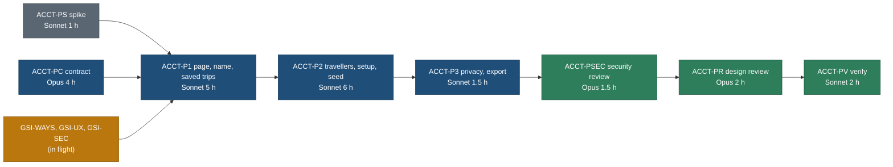

# ACCT-P: Account profile, travellers and a page that makes sense

- **Spec:** [features/account-profile-and-travellers.md](../../../features/account-profile-and-travellers.md) (read it
  whole; section numbers below point into it). Backlog 15.348. Owner questions Q-AP1 to Q-AP11 (Q311 to Q321).
- **Priority:** high (owner feedback, 27 Oct 2026).
- **Principles:** P2 and P3 (a one-line summary per section, one click to edit), P4 (no help text needed; skip always
  there), P5 (editors open in place, focus kept), P6 (ages where the party is used), P7 (the page's primary action is
  setup, then nothing), P8 and P9 (no new public load; one data boundary for account data), T4 (families first).
- **Tasks:** seven, below. Total about 23 h. Each task is a separate branch and a separate agent run.
- **Amendment, 27 Oct 2026 (owner, Q-AP1):** travellers are stored by **age** (`age` plus `age_as_of`, the date entered),
  with an optional date of birth (`dob`) from which the age is then derived; adults stay a count with optional ages. No
  birth month and year anywhere. The spec is amended to match (its amendment note and change log); the task sections below
  are updated, and ACCT-PC records what was built.

## Order and dependencies



ACCT-PS and ACCT-PC start now (disjoint files from everything in flight). ACCT-P1 starts after GSI-WAYS, GSI-UX and
GSI-SEC merge (they touch `web/app/account/page.tsx`, `web/app/account.css`, `web/components/auth/SignInCard.tsx`).

| Task | Agent | Model | Hours | Why this model |
|---|---|---|---|---|
| ACCT-PS | travel-builder | Sonnet | 1 | A specified probe with yes or no answers |
| ACCT-PC | travel-builder | **Opus** | 4 | Creates shared contracts: a migration with RLS, a Zod document, the device party envelope field, detector keys |
| ACCT-P1 | travel-builder | Sonnet | 5 | Specified UI inside owned files |
| ACCT-P2 | travel-builder | Sonnet | 6 | Specified; escalate to Opus if the seed rules (spec 5.2) fail review twice |
| ACCT-P3 | travel-builder | Sonnet | 1.5 | Copy and one route, fully specified |
| ACCT-PSEC | travel-design-reviewer as security reviewer (or the GSI-S reviewer) | Opus | 1.5 | Privacy of minors' data and an auth write path |
| ACCT-PR | travel-design-reviewer | Opus | 2 | Taste and P1 to P9 |
| ACCT-PV | travel-verifier | Sonnet | 2 | Independent checks and screenshots |
| Owner | | | 0.25 | Approve the migration on the child branch, then production; the live test |

## Common to every task

**Worktree.** `git -c core.fsmonitor=false worktree add /Users/nks/workspace/travel-wt/<TASK> -b public/<TASK> main`
from `/Users/nks/workspace/travel`. Branch from the current `main` at start; rebase onto `main` before hand-back.

**Do not touch, in any task:** `web/components/trips/**`, `web/components/places/**`, `web/components/actions/**`
(party bar, copy sheet, Travellers.tsx), `web/app/plan/**`, `web/components/plan/**`, `web/lib/plan/**`,
`core/src/plan/**`, `core/src/schema/plan-draft.ts`, `core/src/schema/{copies,trip-custom}.ts`, `web/lib/auth/guard.ts`
(unless ACCT-PS fails, then only ACCT-P1 under the fallback of spec 4.3), existing migrations 0001 to 0011,
`web/app/themes.css`, `web/app/app.css`, `web/app/globals.css`, `web/components/ui/**`, every budget baseline, `legacy/**`.

**Verification, every UI task.**

```bash
pnpm --dir web typecheck && pnpm --dir web lint && pnpm --dir web test
pnpm --dir core test        # when core files changed
pnpm --dir web budget:report  # every public page +0 B
bash tools/check-all.sh     # with web/.env.local moved aside (mode 600) and put back
```

Playwright screenshots at **1440 and 390, light and dark** (theme through the site's own control, GPU flags), plus 320
for ACCT-P2, into `web/test-results/shots/<TASK>/` (gitignored; copy to `/Users/nks/workspace/travel-wt/shots-<TASK>/`
before any e2e run wipes them). Read every shot before hand-back. Signed-in states use the existing e2e auth fixture on
the Docker database; the real Neon child branch only in ACCT-PV.

**Commit rules.** One commit per task, message `<area>(<TASK>): <what>` (for example
`web(ACCT-P1): Account leads with Profile; no create box, no live banner`). `git -C <worktree> add <paths>` with the
owned paths only, never `-A`. End with the Co-Authored-By trailer from your harness. Do not push or merge.

**Hand-back.** The commit, the files changed, each acceptance check with pass or fail, the shot folder, the model used,
and anything the next task must know.

---

## ACCT-PS: spike, the name write path (Sonnet, 1 h)

**Goal.** Prove on the Neon child branch that `getAuth().updateUser({ name })` from a Next server action changes
`neon_auth.user.name` for the signed-in user (spec 4.3).

**Files you own.** `research/runs/acct-ps-update-user-<yyyymmdd-hhmm>.md` (the run note) and a throwaway route or action
in your worktree that you **do not commit**.

**Steps.**
1. Child branch env (NEON-SETUP.md); sign in with a test account.
2. A temporary server action calls `getAuth().updateUser({ name: 'Spike Name' })`; read `getUser()` before and after,
   and `select name from neon_auth."user" where id = $1` with the owner role.
3. Measure how long `getUser()` returns the old name (the session-data cookie).
4. Confirm the browser proxy still answers 404 to `POST /api/auth/update-user`.
5. Write the run note: yes or no for (a), (b), (c) of spec 4.3, the stale window in seconds, the SDK call shape.

**Acceptance.** The run note answers (a) to (c). No commit except the run note.

---

## ACCT-PC: contracts (Opus, 4 h)

**Goal.** The `account_profile` table, the `travellers/1` document and its age rules, the DB functions, the device
party's `src` field, and the privacy detector keys (spec 5.1, 5.2, 9, 10.1).

**Files you own.**
- `core/src/db/migrations/00NN_account_profile.sql` (new; the next free number at merge, 0012 if nothing lands first)
- `core/src/schema/travellers.ts` (new; placed beside the other Zod documents, `copies.ts`, `plan-draft.ts`, by the
  coordinator's task of 27 Oct 2026), `core/src/config/account.ts` (new: the numbers that are not the party's)
- `core/src/db/profile.ts` (new), the export lines in `core/src/db/index.ts`, `account_profile` in
  `core/src/db/inventory.ts` (the RLS pin) and in `core/src/seed/contract.ts` `NOT_SEEDED` (class `account`)
- `core/test/schema/travellers.test.ts`, `core/test/db/profile.test.ts`, `core/test/db/account-profile.test.ts` (new)
- `core/src/privacy/detect.ts` (append keys only), its test file (append cases only)
- `web/lib/storage/partyKey.ts` (the `src` field: `writeParty(p, { src })`, `readPartySource()`), its test
  `web/tests/storage/party-src.test.ts`
- `core/src/trips/party.ts` (header comment only: "on this device, and seeded from the account when signed in")

**Do not touch.** The common list, plus `web/app/**`, `web/components/**`.

**Steps.**
1. Migration exactly as spec 9.1 (table, check, touch trigger, RLS four policies, revoke, grant). No signal, no FK.
2. `travellers.ts`: Zod `travellers/1` (strict, JSON-Schema subset; spec 5.1 as amended), `parseTravellers(x, today)`,
   `ageOn(dob, date)`, `ageNow(entry, date)`, `partyOf`, `travellersFromParty`, `sameAsParty`, `grownUp`,
   `ageNeedsCheck`, `refreshAges`; limits imported from `core/src/trips/party.ts`. Pure, no I/O.
3. `profile.ts`: `loadProfile(userId)`, `saveTravellers(userId, doc, revision, { finishSetup })` (upsert at revision 0,
   update guarded by revision afterwards; returns `{ kind: 'saved', revision } | { kind: 'conflict' } | { kind:
   'rejected', issues }`), `removeTravellers(userId, revision)`, `finishSetup`, `deleteProfile`; all through
   `withUserTransaction`, the user id from the argument only (callers pass the session id). As built, the trigger (not
   this module) records `travellers_consented_at`, `travellers_saved_at` and the revision (spec 9.1).
4. `partyKey.ts`: `writeParty` keeps writing `{ v: 1, adults, children }` and adds `src: "account"` only when asked;
   `readParty` unchanged; new `readPartySource(): "account" | null`. A test proves `cleanParty` and `readParty` ignore
   `src` and an old value without it.
5. `detect.ts`: `dob`, `born`, any `birth*` key, `age_as_of`, `ages`, `adult_ages`, the consent and save times, and the
   value `travellers/<n>` forbidden in public output; `LOG_DENY_KEYS` gains the document's keys; tests plant each.
6. DB tests (Docker; then the child branch): the RLS four cases, unset user, the check refusals, revision guard, touch
   trigger, and the "every application table has RLS" pin updated.

**Acceptance.**

| # | Check |
|---|---|
| 1 | `pnpm --dir core test` green; the RLS cases fail when a policy is removed (mutation check by hand, noted) |
| 2 | `ageOn('2019-03-15', '2026-10-27') = 7`, `ageOn('2026-10-01', '2026-10-27') = 0`, `ageOn('2019-11-01', '2026-10-27') = 6`; `ageNow({ age: 6, age_as_of: '2026-01-10' }, '2027-01-10') = 7` |
| 3 | `parseTravellers` refuses 13 adults, 9 children, a `dob` in the future, a `dob` that disagrees with the age, a child of 18 on `age_as_of`, unknown keys (a name, a `born`) |
| 4 | The migration applies on Docker and on the child branch; `\dp account_profile` shows only `travel_app` |
| 5 | `git grep -n "src" web/lib/storage/partyKey.ts` shows the only writer of `src` |
| 6 | `git diff --name-only main...HEAD` lists owned paths only |

**Verification.** The core and web unit suites, `tools/check-all.sh`. No screenshots (no UI).

**What ACCT-P1 and ACCT-P2 can rely on (as built, 27 Oct 2026).**
- `@travel/core/db/profile.ts` (also re-exported from `@travel/core/db/index.ts`): `loadProfile(userId)` answers an
  `AccountProfile` (`exists`, `travellers` parsed or null, `travellersInvalid`, `travellersSavedAt`,
  `travellersConsentedAt`, `setupDoneAt`, `revision`), `EMPTY_PROFILE` for no row, and throws when the database cannot be
  read (fail closed: no setup card, spec 2.5). Show the setup card only when the read succeeded and `setupDoneAt` is null.
- `saveTravellers(userId, doc, revision, { finishSetup: true })` for the setup card's Save; without the option for the
  settled editor, Undo of a removal and "Looks right". `removeTravellers(userId, revision)`; `finishSetup(userId)` for Skip
  and Close. `revision` is the one `loadProfile` returned; every guarded write returns the next one.
- `@travel/core/schema/travellers.ts`: the document type and `parseTravellers(x, today)` for the editor's own validation
  (issue strings are `$.children[0].dob: future` and similar: map them to AP-25); `ageNow` for any age shown; `partyOf`
  for the device party; `sameAsParty`, `grownUp`, `ageNeedsCheck`, `refreshAges`, `travellersFromParty` for the notices
  and prefill; `isoDay(new Date())` for the server's today (the client uses its local date).
- `@/lib/storage/partyKey`: `writeParty(p, { src: 'account' })` from the seed only; `readPartySource()` for the
  "differs" notice and sign-out; `readParty`, `clearParty` unchanged.
- The export route must answer through a private responder (spec 6.5): the public `respond()` refuses the document.

---

## ACCT-P1: the page, the name, Saved trips (Sonnet, 5 h)

**Goal.** `/account/` in the order of spec 2.1 with the header, Profile (name), the GSI-WAYS section where it sits,
Saved trips without the create box and without Realtime, and Your data (link only; the route is ACCT-P3). Travellers
renders a placeholder section that ACCT-P2 fills.

**Files you own.**
- `web/app/account/page.tsx`, `web/app/account/actions.ts` (add `saveName`; keep `createDraft` for Undo)
- `web/app/account/AccountDrafts.tsx` (becomes `SavedTrips.tsx`: rename the file), `web/app/account/ProfileSection.tsx`
  (new), `web/app/account/AccountSections.tsx` (new, the section frame)
- `web/app/account/RealtimeRoot.tsx` (delete it if nothing else imports it; check `git grep`)
- `web/app/account.css` (the `acct-` block)
- `web/lib/account/name.ts` (new, validation of spec 4.2, shared by action and field)
- tests: `web/tests/account/name.test.ts`, `web/tests/account/saved-trips.test.tsx`, `web/tests/e2e/account.spec.ts` (new
  or extend), and update `web/tests/account/actions.test.ts`, `drafts-ui.test.ts`, `live-query.test.ts` for what was
  removed

**Do not touch.** The common list, plus GSI-WAYS's `SignInMethods.tsx` (mount it where it is, unchanged),
`web/app/api/account/live-query/**` (leave the route; Mine may use it), `core/**`.

**Steps.**
1. Restructure `page.tsx` into the sections of 2.1 with `h2`s; keep the GSI-2 landing, `next` handling and the
   Suspense fallback (extend it to the new sections). Metadata description: AP-1.
2. Profile: summary row and the inline editor (2.4), `saveName` per spec 4.3 steps 1 to 5, with `quota_take` through
   the existing quota store (bucket `profile_name`, 10 per hour). If ACCT-PS said no, implement the fallback guarded
   route instead and say so in the hand-back.
3. Saved trips: remove the form, the live query, the status dot and both banners; keep rows, Rename, Delete, Undo; re-read
   through `/api/account/drafts/` after each write and on `window` focus; show 5, then "{n} more" (6.2). Empty state
   AP-30.
4. Your data: the section with "Download my data" linking to `/api/account/export/` (ACCT-P3 builds the route; until then
   the link is hidden behind a constant set to false).
5. Write down, in the hand-back, why the production stream stayed `connecting` (spec 8, last paragraph).

**Acceptance.**

| # | Check |
|---|---|
| 1 | No "Draft title", "Create draft", "Live" or "Reconnecting" text anywhere on `/account/` (e2e text assertion) |
| 2 | Sections render in the order of 2.1; one `h1`, one `h2` per section |
| 3 | A name saved shows on reload; an invalid name shows AP-21; the 11th save in an hour shows the rate message |
| 4 | `POST /api/auth/update-user` from the browser still answers 404 (existing guard test still green) |
| 5 | Rename, Delete and Undo work and survive a reload; a second tab sees the change on focus |
| 6 | Axe clean on every section state at 390 and 1440, light and dark; 44 px targets at 390 |
| 7 | `budget:report`: every public page +0 B |
| 8 | `git diff --name-only` shows owned paths only |

**Verification.** The common block; screenshots: signed-in settled page, name editor open, name error, Saved trips empty
and with 7 rows, at 1440 and 390, light and dark.

---

## ACCT-P2: Travellers, the setup card, the device seed (Sonnet, 6 h)

**Goal.** Spec 2.3, 2.4 (Travellers and its notices), 5.2 to 5.4: the editor, the first-run card, the Account and Mine
seed, the sign-in card seed, and sign-out.

**Files you own.**
- `web/app/account/TravellersSection.tsx`, `web/app/account/TravellersEditor.tsx`, `web/app/account/SetupCard.tsx` (new)
- `web/app/account/actions.ts` (add `saveTravellers`, `removeTravellers`, `finishSetup`)
- `web/app/account/page.tsx` (mount the card and the section in their slots only)
- `web/lib/account/seed-party.ts` (new; the table in spec 5.2)
- `web/app/api/account/profile/party/route.ts` (new)
- `web/app/mine/MineShell.tsx` (one dynamic import of the seed, signed in only), `web/app/account/SignOutButton.tsx`,
  `web/components/shell/AccountMenu.tsx` (sign-out path only: clear an account-seeded party), `web/components/auth/SignInCard.tsx`
  (success path only: dynamic import of the seed before `location.assign`)
- `web/app/account.css` (append)
- tests: `web/tests/account/travellers.test.tsx`, `web/tests/account/seed-party.test.ts`,
  `web/tests/account/profile-party-route.test.ts`, `web/tests/e2e/account-travellers.spec.ts` (new)

**Do not touch.** The common list (above all the party bar, the copy sheet and `Travellers.tsx`: they must work
unchanged), `core/**`, `web/lib/storage/**` (use ACCT-PC's API).

**Steps.**
1. The editor: Stepper for adults and children (limits from `core/src/trips/party.ts`), per child a fieldset with an Age
   select (Under 1, 1 to 17) and an optional date of birth behind "Add date of birth" (spec 2.3 rule 3), optional adults'
   ages, the derived age (AP-14), the privacy line (AP-15), errors only after Save (AP-25), focus rules of 2.6. Build the
   document with `age_as_of` = today; validate with `parseTravellers`; read ages with `ageNow` only.
2. Server actions: session check, then `saveTravellers(session.userId, doc, loadedRevision, { finishSetup })` (it runs
   `parseTravellers` itself with the server's UTC day); answers `saved`, `conflict`, `rejected`. Logs fixed codes only.
3. The setup card with `?setup=` steps (2.3 rules 1 to 8), shown only when the row has no `setup_done_at` and the row
   was read successfully.
4. The settled section with the five notices of 2.4 (including "Are these ages still right?", `ageNeedsCheck` and
   `refreshAges`) and Remove with Undo.
5. `seed-party.ts`: the rules of 5.2 exactly; Account and Mine call it after hydration; the sign-in card calls it after
   success and before navigating, with a 1.5 s timeout (never blocks sign-in). The route answers ages only.
6. Sign-out: remove `travel.party` when `readPartySource() === 'account'`, toast AP-32.

**Acceptance.**

| # | Check |
|---|---|
| 1 | Spec acceptance 1 to 6 as e2e tests (fixtures: a fixed clock of 27 Oct 2026) |
| 2 | Party bar, copy sheet and builder code unchanged (`git diff --stat main...HEAD -- web/components/trips web/components/actions web/app/plan web/lib/plan` prints nothing) and still prefilled (spec acceptance 3, e2e) |
| 3 | The route's body has no `dob` or `age_as_of` (test); a forged `userId` answers 401 |
| 4 | Network log on the trip page shows no account request (P9) |
| 5 | Axe clean and 44 px targets in every state of 2.3 and 2.4 at 320, 390 and 1440, light and dark; reduced motion |
| 6 | `budget:report`: every public page +0 B; the sign-in card's chunk grows by at most the dynamic import stub |
| 7 | Owned paths only |

**Verification.** The common block; screenshots: setup steps 1, 2 (empty, prefilled from device, with a missing age
error, with a date of birth open), done; settled Travellers; each notice; Remove confirm; at 1440, 390 and 320, light and dark.

---

## ACCT-P3: privacy page, export, spec amendments in code comments (Sonnet, 1.5 h)

**Goal.** Spec 10.2 wording, 6.5 export route, and the "Your data" link switched on.

**Files you own.** `web/app/privacy/PrivacyBody.tsx`, `web/app/api/account/export/route.ts` (new),
`web/tests/account/export-route.test.ts` (new), the privacy page test if one exists, the constant in
`web/app/account/AccountSections.tsx` (switch the link on).

**Steps.** 1. Replace and add the paragraphs of 10.2 word for word; bump `PRIVACY_CHANGED`. 2. The export route:
session, `private, no-store`, attachment, the shape of 6.5 (through a private responder: the public `respond()` refuses
the document's keys), `safeError` logging. 3. Test: signed out 401, signed in the exact keys, another user's data never
present.

**Acceptance.** The privacy page text matches 10.2; the export downloads with the 6.5 keys; owned paths only; shots of
`/privacy/` at 1440 and 390, light and dark.

---

## ACCT-PSEC: security and privacy review (Opus, 1.5 h)

Read the diffs of ACCT-PC to ACCT-P3. Check: RLS and grants; `user_id` only from the session in every action and route;
no `dob`, `age_as_of` or name in any log line, URL, public payload or feedback path (run the detector and log-scan tests and one
manual grep); the name path against spec 4.3 (or the fallback guard entry, with a test per refusal); the export route's
headers; the sign-out clear on a shared computer. Write `docs/v2/design/auth/review-acct-p-security-<date>.md` with
must-fix items. Commit the review only.

## ACCT-PR: design review (Opus, 2 h)

Against the spec, P1 to P9, T4, the foundation, trip-scope-scenarios (S8: thumb reach) and keep-from-live-site. Render
your own shots at 320, 390 and 1440, light and dark, every state of 2.3 and 2.4. First-use walk with no prior knowledge
(P4): can a new person save their family in under a minute without reading help? Write
`docs/v2/design/account/review-acct-p-<date>.md`. Commit the review only.

## ACCT-PV: verification (Sonnet, 2 h)

On the Vercel preview with the Neon child branch: the 12 feature acceptance criteria of spec 11, two browsers (Chromium,
WebKit), two accounts (email and Google), a shared-computer sign-out check, the network log of a trip page (no account
request), budgets, and a screenshot sweep at 1440 and 390 light and dark into `/Users/nks/workspace/travel-wt/shots-ACCTPV/`.
Report pass or fail per criterion; send the owner the rendered shots (owner verifies UI with screenshots). Commit
nothing but `docs/v2/build/public-site/verify-ACCT-P.md`.

## Owner steps

1. Answer Q-AP1 to Q-AP11 (the recommendations are what this brief builds).
2. Approve the migration on the child branch, then production (release rules).
3. Delete the "Nitin" test draft on `/account/` (Q-AP7).
4. Live test on the preview: setup with your family, open a trip, open the copy sheet.
