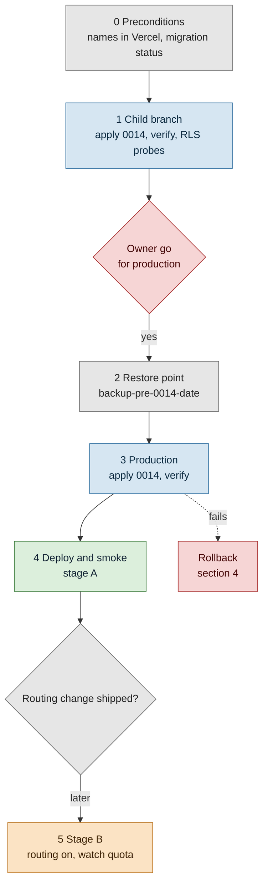

# Runbook: switching on server-written legs (TB-L, migration 0014)

Written 28 Oct 2026 (SEEDC). For the owner. Nothing in this page has been run: migration 0014 is **written and held**, and every
database step below waits for the owner's explicit go. No secret, URL or value appears here: placeholders are in angle brackets,
and a connection string only ever lives in a shell variable for one command.

Related: [driving-time-model.md](../features/driving-time-model.md) 5.6 (keys, privacy, life), [trip-builder.md](../features/trip-builder.md)
TB-L, [local-database-and-seed-sync.md](../features/local-database-and-seed-sync.md) 2.4 and 4.2 (the seed contract and the order
for any production change), `web/lib/server/legs.ts` (the leg service), `core/src/db/migrations/0014_leg_cache_server_write.sql`.

## 0. What going live means, and what it does not

| Stage | What changes | Who writes `leg_cache` |
|---|---|---|
| Today (0014 not applied) | the leg service runs, but `travel_app` has no grant on `leg_cache`: every cache read fails, is logged as `[legs] cache-read-failed`, and every leg is the drive model's estimate | nobody |
| A. 0014 applied | reads succeed (the table is empty), the read path bumps `hits` and `last_used` on server rows | nobody yet: builds run with `allowRouting: false` (`web/lib/server/planService.ts`), so the service never calls ORS |
| B. routing on for builds | the service asks ORS for cells the cache lacks and writes them as `origin = 'server'` rows | the leg service (`travel_app`) |

**Stage B needs a code change, not an env flag.** `defaultDeps()` in `web/app/api/v1/plan/shared.ts` builds the plan service
without `allowRouting`, so it defaults to cache only. Turning routing on is one deps field (TB-W1 decides, per the planService
header). This runbook covers stage A fully and lists stage B's steps for when that change ships (section 3, step 5).

### Why a seed run is safe (SEEDC, seed contract v2)

`leg_cache` has two writers. The seed (rows from `data/schedules/legs/*.json`, through STY-L, not built yet) and the server leg
service. Before SEEDC the contract said `onMissing: delete` for the whole table, so the first seed sync after 0014 would have
deleted every routed row. Now:

- 0014 adds `origin` (`seed` or `server`). Rows that exist before 0014 are backfilled `seed`; after it, the default is `server`.
- The seed contract scopes `leg_cache` to `origin = 'seed'` (`core/src/seed/contract.ts`, `scope`). The engine reads, updates,
  deletes and counts only those rows. It refuses a seed row without `origin = 'seed'` (`E_SEED_SCOPE`). A stored leg removed from
  the files is still deleted, but a server row is never read or touched.
- The policies let `travel_app` insert and update only `origin = 'server'` rows. It has no delete grant.
- A check constraint `leg_cache_origin_keys` keeps the two key spaces apart. Server rows have `r:`, `t:` or `g:` keys on both ends;
  seed rows keep at least one stop id. So a seed insert can never collide with a server row, and a server upsert can never overwrite
  a seed row.
- `leg_cache_prune(days)` (owner only) drops server rows older than `days` by `computed_at` or `last_used`. It never drops seed rows.

Contract v2 also means any older rehearsal file is no longer valid (`E_REHEARSAL_CONTRACT`). The next production seed sync needs a
fresh child rehearsal. That rehearsal is needed anyway.



## 1. Preconditions (read only)

1. **Vercel env names (names only, never values).** Run `vercel env ls` in the linked `web` project and check that these names are
   present for both Preview and Production:
   - `ORS_API_KEY` (confirmed present for Preview and Production, 28 Oct 2026)
   - `DATABASE_URL` (without it the service uses an in-memory cache and no quota store, which means no ORS call ever: the gate answers `quota`)
   - `HOME_POINT_LAT` and `HOME_POINT_LON`: the home radius refusal (`writableLegKey`) needs them. **Unset, it throws.**
     The plan service catches that throw without a log line, so every build quietly falls back to estimates. Check the names.
     Never copy them from the root `.env.local`.
   - `NEXT_PUBLIC_TRIP_EDIT` and `NEXT_PUBLIC_PLAN_BUILDER` (the flags, section 3)
2. **Migration status of production (read only).** With the owner connection string in a shell variable for this command only:
   ```sh
   DATABASE_URL_UNPOOLED="$(neon connection-string <production-branch> --project-id <project-id> --role-name <owner-role> --database-name <db>)" \
     node core/bin/db-migrate.ts plan
   ```
   The pending list must be **exactly `0014_leg_cache_server_write`**. `up` applies every pending file in order, so if 0012 or
   0013 are still pending they would go too. Stop: those have their own go (STEP2-GO GO-1).
3. **The file is the reviewed one.** `git log -1 --format=%H -- core/src/db/migrations/0014_leg_cache_server_write.sql` on the commit
   you deploy. 0014 was amended in place on 28 Oct (SEEDC) while unapplied. If any branch ever got the earlier text, the runner refuses
   it there for checksum drift. Recreate that branch rather than editing the ledger.
4. **Table is empty.** On the production branch (owner role, read only): `select count(*) from leg_cache;`. Expect `0`, because no
   writer has had a grant until now. If it is not 0, count the rows that would break `leg_cache_origin_keys` (server-grammar keys on
   both ends, backfilled `seed`) and report before going on, because the migration would roll back whole:
   ```sql
   select count(*) from leg_cache
    where from_cell ~ '^(r:[a-z0-9][a-z0-9/#._-]{1,199}|t:[1-9][0-9]{0,9}|g:[0-9bcdefghjkmnpqrstuvwxyz]{6})$'
      and to_cell   ~ '^(r:[a-z0-9][a-z0-9/#._-]{1,199}|t:[1-9][0-9]{0,9}|g:[0-9bcdefghjkmnpqrstuvwxyz]{6})$';
   ```

## 2. What the owner approves, in order

Each line is a separate go. Nothing is batched.

| # | Approval | Effect |
|---|---|---|
| G1 | apply 0014 to a Neon child branch | rehearsal only; production untouched |
| G2 | apply 0014 to production after G1 is green | stage A |
| G3 | deploy the build that reads the cache (already on `main`) with the flags of section 4 | builders on, cache only |
| G4 | (later) ship the routing change and deploy it | stage B: server writes |

### 2.1 Child branch first (G1)

Either the standing child `srv-migrate-verify` (reset from production first, then delete the copied sessions as the seed spec's 4.2
says), or a fresh child that expires by itself:

```sh
neon branches create --project-id <project-id> --name leg-0014-verify-<yyyymmdd> --parent <production-branch> --expires-at <iso-time-in-48h>
CHILD="$(neon connection-string leg-0014-verify-<yyyymmdd> --project-id <project-id> --role-name <owner-role> --database-name <db>)"
DATABASE_URL_UNPOOLED="$CHILD" node core/bin/db-migrate.ts plan     # pending: 0014 only
DATABASE_URL_UNPOOLED="$CHILD" node core/bin/db-migrate.ts up       # applies 0014 in one transaction
TEST_DATABASE_URL="$CHILD" pnpm --dir core exec vitest run test/db   # the child DB suite; never production
unset CHILD
```

Then run the checks of section 2.3 on the child. G2 waits for all of them to pass.

### 2.2 Production (G2), with a restore point

Same pattern as 0012 and 0013: a named branch of production taken immediately before, kept until the release is accepted.

```sh
neon branches create --project-id <project-id> --name backup-pre-0014-<yyyymmdd> --parent <production-branch>
PROD="$(neon connection-string <production-branch> --project-id <project-id> --role-name <owner-role> --database-name <db>)"
DATABASE_URL_UNPOOLED="$PROD" node core/bin/db-migrate.ts plan      # pending: 0014 only, same checksum prefix as on the child
DATABASE_URL_UNPOOLED="$PROD" node core/bin/db-migrate.ts up
unset PROD
```

Neon's instant restore window on Free is 6 hours. The `backup-pre-0014-<yyyymmdd>` branch is what lasts beyond it. If the
plan allows a manual snapshot, take one as well (seed spec 4.3, Q185).

### 2.3 Verify (child, then production)

Run as the owner role, in `psql` against the branch:

```sql
-- the ledger
select version, name from schema_migrations order by version desc limit 2;           -- 0014 leg_cache_server_write on top
-- the columns and the default flip
select column_name, column_default, is_nullable from information_schema.columns
 where table_schema = 'public' and table_name = 'leg_cache' order by ordinal_position; -- origin: default 'server', not null
-- constraints, policies, grants
select conname from pg_constraint where conrelid = 'public.leg_cache'::regclass order by 1;  -- includes leg_cache_origin_keys
select policyname, cmd, roles from pg_policies where tablename = 'leg_cache' order by 1;     -- read (SELECT), insert, update; roles {travel_app}
select privilege_type from information_schema.role_table_grants
 where table_name = 'leg_cache' and grantee = 'travel_app' order by 1;                       -- INSERT, SELECT, UPDATE (no DELETE)
select leg_cache_prune(180);                                                                 -- 0 on an empty table
```

RLS probes. Each block is its own transaction and ends in `rollback`, so nothing stays. A block that is expected to fail still
needs its `rollback`.

```sql
begin; set local role travel_app;
insert into leg_cache (from_cell, to_cell, mode, seconds, metres, provider) values ('t:1', 't:2', 'drive', 60, 1000, 'ors');
select origin, profile, engine from leg_cache where from_cell = 't:1';   -- server, driving-car, ors
rollback;

begin; set local role travel_app;
insert into leg_cache (from_cell, to_cell, mode, seconds, metres, provider, origin) values ('t:1', 't:2', 'drive', 60, 1000, 'ors', 'seed');
rollback;                                                                  -- expected: new row violates row-level security policy

begin; set local role travel_app;
insert into leg_cache (from_cell, to_cell, mode, seconds, metres, provider) values ('stop-a', 't:2', 'drive', 60, 1000, 'ors');
rollback;                                                                  -- expected: row-level security policy (not of the key grammar)

begin; set local role travel_app; delete from leg_cache; rollback;       -- expected: permission denied
begin; set local role travel_app; select leg_cache_prune(1); rollback;    -- expected: permission denied for function

begin;                                                                     -- as the owner: a seed row may not use server keys
insert into leg_cache (from_cell, to_cell, mode, seconds, metres, provider, origin) values ('t:1', 't:2', 'drive', 60, 1000, 'ors', 'seed');
rollback;                                                                  -- expected: violates check constraint leg_cache_origin_keys
```

## 3. Env flags and deployment order

| Step | Env (Vercel, Production) | Build needed | Result |
|---|---|---|---|
| 1 | `ORS_API_KEY`, `DATABASE_URL`, `HOME_POINT_LAT`, `HOME_POINT_LON` present (section 1) | no | nothing visible |
| 2 | 0014 on production (G2) | no | the server's cache reads stop failing |
| 3 | `NEXT_PUBLIC_TRIP_EDIT=1`, then `NEXT_PUBLIC_PLAN_BUILDER=1` | **yes**: both are build-time constants (`web/next.config.ts`), so redeploy after setting them | `/plan/` and `/api/v1/plan/*` exist. `planBuilder` requires `tripEdit`: with only the builder flag, the routes answer 404 |
| 4 | keep `PLAN_BUILDER_PAUSED` unset (`1` pauses: 503 `plan_paused`; read per request, no code change) | a redeploy of the same commit: Vercel applies an env change to new deployments only | builds run, cache only |
| 5 (stage B) | ship the routing change (G4), deploy | yes | routed cells written as `origin = 'server'` |

Preview first, when Preview's `DATABASE_URL` names a child branch that has 0014 (check the branch name in the Neon console, never
the value): do steps 3 to 5 on a Preview deployment and run the smoke list there before production. A Preview that points at
production is not a rehearsal; skip it.

## 4. Rollback

| What went wrong | Do |
|---|---|
| Migration failed on the child or in production | It ran in one transaction and rolled back. The ledger has no 0014 row. Nothing to undo; report the SQLSTATE |
| Builds misbehave after the deploy | Set `PLAN_BUILDER_PAUSED=1` and redeploy the same commit (fastest: no code change). Then set `NEXT_PUBLIC_PLAN_BUILDER=0` and redeploy to remove the routes |
| Routed rows look wrong (stage B) | Ship the routing change back to cache only, then as the owner `select leg_cache_prune(1);` drops the server rows older than a day; for all of them `delete from leg_cache where origin = 'server';` (owner role; seed rows stay) |
| Too many ORS calls | `PLAN_BUILDER_PAUSED=1`, or remove `ORS_API_KEY` from the Production env and redeploy (the gate answers `no-key`, every cell is estimated). The guard caps the damage at 400 calls a day either way |
| The schema itself must go | Restore from `backup-pre-0014-<yyyymmdd>` (Neon: restore the production branch from that branch, or point the app at it) only with the owner. 0014 is additive. The app code tolerates a missing grant (estimates), so the next step back is the restore, never a hand-written `drop` |

The runner never drops anything, and an applied migration is never edited. A fix is a new migration.

## 5. Quota behaviour (stage B)

- ORS free tier: 500 matrix requests a day, 3,500 cells a request (`core/src/config/drive.ts` `DRIVE_ROUTING`).
- The guard stops at `guardShare` 0.8 of `dailyCap` 500, so **400 matrix calls per fixed 86,400 s window** (UTC-aligned) on one
  global counter (`quota_bucket`, bucket `ors:matrix`, migration 0011). After that the gate answers `quota` and every missing cell is
  the model's estimate, marked as estimated. Nothing errors.
- A matrix is at most 40 by 40 (`DRIVE_CACHE.matrixMax`); a larger batch runs as consecutive matrices (`runLegBatch`), each one
  counted.
- No quota store (no `DATABASE_URL`) or a failed take: fail closed. No call is made and `quota-unavailable` is logged.
- Cache reuse: a cached cell younger than 180 days (`DRIVE_CACHE.maxAgeDays`) of the same engine and profile is not re-asked.
- The builder also has its own per-IP limit: 30 builds an hour (`plan:build`).

## 6. What to watch

Logs from the leg service carry fixed codes only, prefixed `[legs]`. They never include a coordinate, a key, a name or a body.

| Code | Means | Action |
|---|---|---|
| `cache-read-failed` | the cache read threw (before 0014: no grant; after: a database error or the 3 s statement timeout) | before G2, expected on every build; after G2, investigate if it persists |
| `cache-write-failed` | a write of routed rows failed (policy, constraint, timeout) | stage B only; a steady stream means a key outside the grammar or a lost grant |
| `quota-unavailable` | the quota store could not be read; no ORS call was made | check `DATABASE_URL` and `quota_bucket` |
| `breaker-open` | 3 ORS failures in a row; ORS is skipped for 60 s | ORS outage or a bad key |

Database checks (owner role, read only), weekly or after a busy day:

```sql
select origin, count(*), max(computed_at), max(last_used), sum(hits) from leg_cache group by origin;
select pg_size_pretty(pg_total_relation_size('leg_cache'));                 -- budget 100 MB (driving-time-model 5.6)
select window_start, count from quota_bucket where bucket = 'ors:matrix' order by window_start desc limit 7;
```

Prune: until a scheduled job exists, run `select leg_cache_prune(180);` as the owner once a month. Record the count it returns.

## 7. Smoke test list

Run on Preview (child database) first, then production, each after its deploy.

1. `/plan/` loads with both flags on, and returns 404 with `NEXT_PUBLIC_PLAN_BUILDER` unset (`planBuilder` requires `tripEdit`).
2. `GET /api/v1/plan/regions/<cc>` and `/candidates` answer 200 with an ETag.
3. `POST /api/v1/plan/build` for a known region answers 200 and `no-store`. Stage A: legs are estimated, no `cache-read-failed`
   in the function logs after G2.
4. (Optional, costs two redeploys) `PLAN_BUILDER_PAUSED=1` gives 503 `plan_paused` on `/api/v1/plan/build`; unset it again.
5. Stage B: build the same plan twice. The first build makes at least one ORS call (the `ors:matrix` window count goes up) and
   `select count(*) from leg_cache where origin = 'server'` grows. The second build makes no new ORS call: the cells come from
   the cache.
6. Stage B privacy: no row has a key within the home radius (the service refuses those). Spot-check with
   `select from_cell, to_cell from leg_cache where origin = 'server' limit 20;`: only `r:`, `t:` and `g:` keys. A near-mode build
   from a visitor start leaves no row for that start.
7. Function logs for the window: only the fixed `[legs]` codes, with no coordinate, key or body.
8. Seed safety, once STY-L exists: `node core/bin/db-seed.ts sync --dry-run --target child` plans no change to `origin = 'server'`
   rows, and `select count(*) from leg_cache where origin = 'server'` is the same before and after a child sync.

## 8. Open items

- Stage B's switch: `allowRouting` for builds (TB-W1). Recommended: an explicit server-only env switch read per request, so
  routing can be stopped without a redeploy. Not built.
- A scheduled `leg_cache_prune` job (internal cron) is not built. Run it by hand until then.
- STY-L (the `leg_cache` seed family) is not built. When it is, it must write `origin = 'seed'` and keep stop ids as keys
  (enforced by `E_SEED_SCOPE` and `leg_cache_origin_keys`; tested in `core/test/seed/leg-cache-scope.test.ts`).
