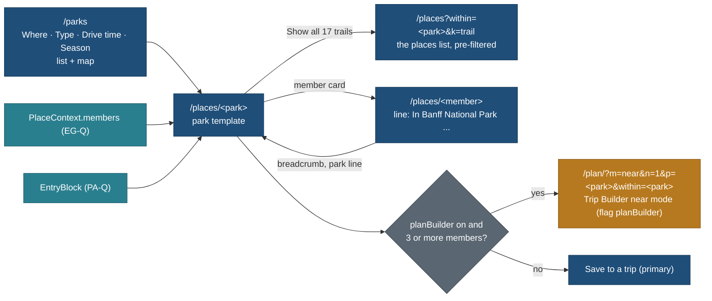

# Park page and the /parks index (PA-N): decisions

Status: **design for owner approval, gate G-PA** (27 Oct 2026, travel-planner, Opus). Docs only; no app code. Not yet
reviewed: `travel-design-reviewer` runs PA-NR on these pages before the owner sees them (section 9). Nothing in
`web/` is built from this until the owner approves.

Owner request (relayed by the coordinator, 27 Oct 2026): design the Parks page for national, provincial and state parks
as **one template** ("both will be almost the same"), plus a `/parks` index. It extends
[protected-area-entry.md](../../features/protected-area-entry.md) section 8 (the park page sections) and section 4 (the park
record's fields) and is an instance of [entity-graph.md](../../features/entity-graph.md) 9 (`within`, `PlaceContext`).
BACKLOG 15.292 and 15.292a; TODO row of 27 Oct 2026; PLAN R-253.

| File | What it holds |
|---|---|
| this page | decisions, what varies by park type (as data only), plan a visit, supersedes, requests to other lanes, open questions, tasks |
| [anatomy.md](anatomy.md) | the page section by section, wireframes at 1440 and 390 (Banff National Park with real data) |
| [states.md](states.md) | no data, stale data, closed season, a zone, loading and error |
| [parks-index.md](parks-index.md) | `/parks`: filters, URL, list and map, phone and desktop wireframes, states |
| [components.md](components.md) | every component mapped to the foundation; the five new pieces |
| [data-map.md](data-map.md) | every element on the page mapped to its read model and registry property, with the task that supplies it |
| [acceptance.md](acceptance.md) | acceptance checklist and the briefs for PA-2 and PA-IX |

Principles cited by number from [foundation/principles.md](../foundation/principles.md) (P1 to P9, T1 to T5).

## 1. The decision in one paragraph

Every protected area (national park, provincial or state park, conservation area, reserve, forest, dark-sky site, and a
zone inside one) renders through **one park template** inside the place page (`/places/<slug>`), and the only things that
differ between a Parks Canada national park and an Ontario provincial park are **data**: the authority, the entry
requirements and the pass that covers them, the season, the campgrounds, the permits and the wildlife rules. The template
has no branch on the park's type except one label word. The page leads with **Entry and bookings** at rest (P2 safety
exception), then **Plan a visit** chips (Day, Weekend, 2 or 3 days) that link into the Trip Builder's near mode with the
park pinned, then the places inside grouped by kind with counts. A new `/parks` index is the same places list with the
protected-area kinds fixed, four filters (Where, Type, Drive time, Season) and a list beside a map. **Trade-off:** a
national park with a rich system pass and a provincial park with a gate permit look the same shape, so neither gets a
bespoke layout; in exchange one template serves every country, every new park is research, not code, and P1 holds at
10,000 parks.

## 2. Decisions

| # | Decision | Why | Trade-off |
|---|---|---|---|
| PN1 | **One template for every `nature.protected.*` type and the zone.** No `if national` branch in `web/components/places/park/**`; a test greps for type-specific branches (acceptance AC-3) | the owner's "both will be almost the same"; one design to review and maintain | a type with a real difference later (a marine park with tides) adds a section driven by data, never a fork |
| PN2 | **Park pages stay at `/places/<slug>`.** `/parks` is the index only; no `/parks/<slug>` | public URLs never change after launch (patterns 1.2); park records already have place slugs (`banff-national-park`) | the address does not say "park"; the breadcrumb and kicker do |
| PN3 | **Breadcrumb root is "Parks"** for a park or zone page (Parks · Canada · Alberta), linking to `/parks?country=ca&region=ab` | the index is the way back (P3) | other places keep "Places" as root |
| PN4 | **Entry and bookings sits first under the cover, at rest**, grouped Book ahead, Passes and fees, On the day; each requirement a row that opens in place for its detail | P2 safety exception (permits and timed slots stay visible), P6, T1; the same three groups as the trip's Bookings tab (protected-area-entry 6.4) | a long entry block on a park with many permits; capped by grouping, never hidden |
| PN5 | **No visit-mode control on the park page.** Each requirement row says who needs it ("Day visitors and campers"); the mode filter lives in the builder and the trip page | P4: one control fewer; the owner asked for plan-a-visit as a link into the builder | a day visitor sees the backcountry permit row too, labelled "Backcountry campers only". **Supersedes** protected-area-entry 8's `visit=` filter of the entry block |
| PN6 | **Plan a visit = three link chips into `/plan/` near mode**: Day (`n=0`), Weekend (`n=1`), 2 or 3 days (`n=2`), each carrying the park as a pick and as the `within` filter. Drawn only with the `planBuilder` capability on and when the park has at least 3 member places with points | the owner's chips, deep-linked into the builder (trip-builder 2.2, 2.5; trip-kinds 1.8, 2.5); 3 is trip-kinds 2.5's park-row threshold | the builder must accept the park preset (request R1, section 7). **Supersedes** protected-area-entry 8's on-page pre-selection and hand-off to CUS and the add-a-place panel, and the PA-N3 note |
| PN7 | **Primary action (P7):** Plan a visit when the builder is on; otherwise **Save to a trip** (patterns 3.6). Directions go to the park's point (the main visitor centre), Share and the heart as on every place | the 90% reads and saves; the 10% plan | none |
| PN8 | **Things to do** lists members by public kind with counts (count cards), the top 6 of the three largest groups at rest, and "Show all n" into `/places?within=<slug>&k=<kind>`. No filters on the park page; filters live on the list | P1 at 10,000 members (never more than 18 member cards in the HTML, P8), P3, P4 | a visitor who wants "easy trails with kids" takes one click into the list |
| PN9 | **Members come from `PlaceContext.members`** (EG-Q) and render with EG-W's members block; PA-2 does not build a second one | one component per job; entity-graph 9.3 already caps groups at 6 | PA-2 waits for EG-W |
| PN10 | **Seasons and closures** draw the operating season as a month strip in a new **season variant** (open, limited, closed, not checked), standing closures with dates, and the authority's alerts link always. Live closures are never stored | T1, T3, P2; protected-area-entry 6.5 ("live closures are never stored") | the page cannot say "the road is closed today"; it says "check the alerts" with the link at rest |
| PN11 | **One at-rest banner at most under the cover**: closed for the season, else a dated closure that overlaps today or the next 30 days, else none. It prints the date it was computed ("as of Tue 27 Oct 2026") | P2; the page is cached, so the date makes it honest (T3) | a cached page can be a day old; the date says so. Pages revalidate daily (acceptance AC-12) |
| PN12 | **Where to stay or camp**: campgrounds, backcountry sites, huts and lodges that are members, each with its booking window; then gateway towns outside the park | protected-area-entry 8; T1 (the window where the booking is due, P6) | site kinds and food storage wait for the `camp` block (PA-3C, P3); until then those rows go to the Not checked yet block |
| PN13 | **Glance** (6 facts at most, only held facts, never repeating a section row): season, places inside, camping, gateway town, nearest airport, designations | W10's park template, patterns 3.11 | entry is not in the glance: it has its own at-rest section |
| PN14 | **`/parks` index** = the places list engine with `k` fixed to the protected-area types (zones excluded), four primary pills Where, Type, Drive time, Season, and a list beside a map on desktop, a list with a Map view on phones | P4 (four pills), keep-from-live-site (filters as pills, count, group by country, map with URL state); P9 (one list engine, one data boundary) | a second entry into the same list; no new list code |
| PN15 | **Drive time on `/parks` starts from a public hub or an airport only**; "Use my location" picks the nearest public hub on the device and says so. Drawn only after the driving-time model and the hub list exist | trip-builder 2.4 and OR9 (no home or town in a URL), P9 (server-answerable query) | coarser than a door-to-door time; honest about it ("from Toronto, the nearest hub to you") |
| PN16 | **Not a header tab.** Header stays Trips · Places · Globe; `/parks` is reached from the Places title block ("Parks" link), Home, every park breadcrumb and the Globe's park card | components 1.1: four tabs or fewer, Mine and search in the cluster | one click more from the header; the Places link is visible |
| PN17 | **A park page has its own HTML budget line**, measured at PA-2's baseline; every other place page stays +0 B, and `/parks` start JS is no larger than `/places` | MASTER-ORDER 4.5: place HTML has about 113 B headroom | the park page can grow with its sections without eating other pages' headroom |

## 3. What varies by park type: data only

Every row is a field or derived value; the template draws whatever the record holds. Examples are shapes, labelled where
they are real data on `main` (27 Oct 2026).

| What varies | Comes from | National park (Banff, real) | Provincial or state park (shape, protected-area-entry 2.4 B) |
|---|---|---|---|
| Type word on the kicker and the Type filter | `type` leaf, worded per country (Q-PN9) | "National park" | "Provincial park" in Canada, "State park" in the US |
| Authority | `run_by` operator record (name, url, terms) | Parks Canada | Ontario Parks, Alberta Parks, a state agency |
| Entry pass that covers the fee | `covered_by` on the fee offer; the pass is an operator offer | Discovery Pass, 12 months from purchase | an annual or seasonal provincial pass |
| Fees and how they are charged | `price` rows (`per` person, vehicle, family, person_night; ages; `residency`) and `entry.unit` | per person per day; 17 and under free; family or group rate | per vehicle per day, residents and non-residents |
| Exemptions | `entry.exemptions` | through traffic on Highways 1 and 93 South | campers (the campsite permit covers the vehicle) |
| Season | `season` (operating), suitability `access_season`, `hours` (gate) | open all year; zones and roads seasonal | operating season (for example May to October), gate hours |
| Timed entry, day-use reservations | `access.pass.timed_entry`, `access.pass.day_use_permit` offers with `window` | none on Banff; Lake O'Hara bus by lottery in Yoho | peak-weekend day-use reservations |
| Camping | member `stay.camp.*` places and their lodging offers (`window`, `price`); `camp` block from P3 | front-country campgrounds with a launch day | rolling reservation window, site kinds, max stay |
| Permits | `access.pass.backcountry_permit`, `access.pass.activity_permit` (`entry.for_types`) | backcountry permit per person per night | interior permit, fishing permit on fishing spots only |
| Wildlife and bear rules | park hazard `wildlife`; member `ext.wildlife.*`; `camp.food_storage` (P3); `conditions` link for orders | bears, elk rut, wildlife closures by order | food lockers or hang, bear spray advice |
| Zones | `nature.protected.zone` places `part_of` the park | Lake Louise area (Banff), Lake O'Hara (Yoho) | rarely; an interior zone with its own permit |
| Designations | relevance `signals.designations` | Canadian Rocky Mountain Parks World Heritage Site | Dark-sky preserve, where sourced |

## 4. The page in one diagram

## 5. Plan a visit: the link contract

| Chip | Sub-label | `n` (nights) | Trip kind it becomes (trip-kinds TK1, derived from `n`) |
|---|---|---|---|
| Day | no night | 0 | Day trip |
| Weekend | 1 night | 1 | Weekend |
| 2 or 3 days | 2 nights | 2 | Weekend (the 1 to 2 night band) |

Link: `/plan/?m=near&n=<n>&p=<park-slug>&within=<park-slug>` (keys of trip-builder 2.5; `within` is the Places facet key of
entity-graph 9.2, carried under the builder's filter rule `f`; if TB's codec writes filters differently, TB's codec wins
and the park page follows it). The park page never writes `from`, `r`, a date or a party: the builder fills the start from
the device's origin choice or asks for it, and applies the kind's default drive limit. The URL carries only public slugs
(trip-builder 2.5, OR9). The chips are server-rendered plain links (secondary buttons, components 2.1): +0 B start JS
(trip-builder ISO-9).

Why links and not an on-page pre-selection (the 26 Oct plan): the builder already ranks members by draw, season and the
visitor's party and profile (trip-kinds 2.5 "Pick the park"); doing it again on the park page would be a second planner
(protected-area-entry 8 said "no planner is invented here", and the owner now asks for the builder link).

The weekend chip and the "2 or 3 days" chip differ only in `n`. If the builder later adds a key for a Saturday-and-Sunday
date choice, the Weekend chip gains it (request R1 below).

## 6. Supersedes

| Page or row | What changes | Where it is recorded |
|---|---|---|
| [protected-area-entry.md](../../features/protected-area-entry.md) 8, "Plan a visit (P3)" paragraph | chips are links into the builder (PN6); no on-page `visit=` state, no pre-selection, no hand-off to CUS or the add-a-place panel from the park page | a pointer line at the top of section 8 (added in this commit) |
| protected-area-entry 8, Things to do: "filters season, kids, effort, duration" on the park page | filters live in the pre-filtered list (PN8); the "Show all" link uses `within=` (entity-graph 9.2), not the superseded `?park=` | same pointer |
| protected-area-entry 12, PA-N3 (plan-a-visit note, 2 h) | absorbed into this design | section 12 note, BACKLOG 15.293 |
| protected-area-entry 12, PA-3 (8 h) | now camping rendering after PA-3C and the Algonquin pilot page (4 h); plan-a-visit chips move into PA-2 | same |
| W10 "Park, area" type template (design/trip-page/ux-feedback-wireframes-2026-10-26.md) | for `nature.protected.*` places the sections are those of [anatomy.md](anatomy.md); W10 still governs other areas (counties, ranges) | anatomy.md 1 |

## 7. Requests to other lanes (hand-back items, not edits made here)

| # | To | Request |
|---|---|---|
| R1 | Trip Builder (TB-N, TB-FLOW, TB-W1) | Accept the park link of section 5: a `p` pick that is a protected area is pinned; `within` pre-sets Discover; open on the first unanswered step (From where); if the park is beyond the kind's largest drive band from the chosen start, keep the pick and offer "Plan it as a trip instead" (`m=trip&cc=<country>&p=<park>`); never drop the pick silently. Add the park link as a fixture in the builder's URL parser test. Optional: a key for "Saturday and Sunday" so the Weekend chip can say it |
| R2 | EG-N, EG-W (place context block) | The members block takes a `groupsAtRest` (3) and a `perGroup` (6) prop, excludes `access.*`, `stay.*` and zones from Things to do (they render in Getting there, Where to stay and Areas inside), and orders groups by count, then the fixed kind order |
| R3 | PA-Q (store and API, Opus) | `EntryBlock` carries `access` (season state for a month) and `closures` as `entryFor` already returns them (core/src/parks/needs.ts); member requirements grouped by `scope` for "Inside the park: own bookings"; the operator's pass with the count of parks it covers in our catalogue |
| R4 | travel-design-reviewer (PA-NR, foundation) | Add the `/parks` row to patterns 1.2; add the five new pieces of [components.md](components.md) 2 to foundation/components.md with measured contrast; add the honesty label "May be out of date" to components 2.8 |
| R5 | ORG (trip origin and nearest airport) | Nearest airport and gateway town per place through the store, so the glance and Getting there read them; no new field on the park |
| R6 | Data seat | Review the four `nature_reserve` records of Q-PN6 and retype those that are not protected areas; the Algonquin park record (locations store first, then `place/algonquin-provincial-park`) comes with PA-R-ON |

## 8. Open questions (owner), with recommendations

| Q | Question | Recommended | Trade-off |
|---|---|---|---|
| Q-PN1 | Park pages stay at `/places/<slug>`, and `/parks` is the index only (PN2)? | **Yes** | the URL does not say "park"; links never break |
| Q-PN2 | Plan a visit chips map Day = 0 nights, Weekend = 1 night, 2 or 3 days = 2 nights, and appear only with the builder on and 3 or more places inside (PN6)? | **Yes** | Weekend and 2 or 3 days differ by one night only until the builder has a weekend-dates key |
| Q-PN3 | No visit-mode control on the park page; each requirement row says who needs it (PN5)? | **Yes** | a day visitor reads one or two rows that are not for them, clearly labelled |
| Q-PN4 | The list row of a protected area gains two keys: `entry` (one label: no fee, fee, book ahead, not checked) and `members` (one integer), recorded as a P8 waiver and pinned by the row-key test? | **Yes** | two more keys in the light list data; no prices, windows or links |
| Q-PN5 | The Drive time filter on `/parks` waits for the driving-time model and the hub list, starts only from a public hub or airport, and "Use my location" maps to the nearest hub on the device (PN15)? | **Yes** | the filter ships later than the other three; until then the pill is not drawn |
| Q-PN6 | `/parks` lists national, state or provincial, conservation, reserve, forest and dark-sky types; zones appear only inside their park; and the data seat reviews four records typed `nature_reserve` that read as something else first (`place/dolomites`, the whole range; the Blue Lagoon area lava fields; Upper and Lower Kananaskis Lakes, already named mis-typed in protected-area-entry 11; the Lake Magog core area)? | **Yes** | about 1 h of data work before PA-IX ships; without it "Dolomites" lists as a park |
| Q-PN7 | `/parks` is not a header tab; it is reached from Places, Home, park breadcrumbs and the Globe (PN16)? | **Yes** | one more click from the header |
| Q-PN8 | The season banner and season state are computed when the page renders, print that date, and pages revalidate daily (PN11)? | **Yes** | a cached page can be up to a day old, and says so |
| Q-PN9 | The State or provincial type is worded by country ("Provincial park" in Canada, "State park" in the US) from a label map in `data/vocab/types.json`? | **Yes** | one small vocab addition (PA-IXC) |

## 9. Tasks, hours and gate

| Id | Task | Seat, model | h | After | Gate |
|---|---|---|---|---|---|
| PA-N | This design (docs) | travel-planner, Opus | 3 | P1 contracts merged | done on `design/PA-N` |
| PA-NR | Design review of PA-N (P1 to P9, T1 to T5, foundation fit; mocks from the wireframes) | travel-design-reviewer, Opus | 1.5 | PA-N | before the owner |
| **G-PA** | **Owner approves the park page and `/parks` design** (screens from PA-NR) | owner | | PA-NR | **blocks PA-2, PA-IXC, PA-IX** |
| PA-Q | Store and API: `EntryBlock` (R3) | B2, Opus | 2 | PA-D, EG-Q | unchanged |
| PA-IXC | Contract: list row keys `entry`, `members` (Q-PN4), `label_by_country` in types.json (Q-PN9), the protected-area kind set for `/parks`, drive query params reserved | B2, Opus (shared contract) | 2 | G-PA, PA-Q, EG-Q | new |
| PA-2 | Park template and member line, including the Plan a visit chips (+0.5 h) | B1, Sonnet | 10.5 | G-PA, PA-Q, EG-W | was 10 h |
| PA-IX | `/parks` index without the drive filter | B1, Sonnet | 7 | PA-IXC, PA-2 | new |
| PA-R2, PA-V2 | Review and verify of PA-2 and PA-IX | Opus 2.5, Sonnet 2.5 | 5 | PA-2, PA-IX | was 4 h |
| PA-IXD | The Drive time pill (hubs, bands, sort by drive) | B1, Sonnet | 2 | PA-IX, the driving-time model (DT) and the hub list | new, P3 |
| PA-3 | Camping section in full (site kinds, food storage, max stay) and the Algonquin pilot page | B1, Sonnet | 4 | PA-3C, PA-R-ON | was 8 h (plan a visit moved to PA-2); no longer waits for CUS-1 and v0.17 |
| PA-N3 | Plan-a-visit note | | 0 | | absorbed here (was 2 h) |

Hours: P2 becomes 34 h (was 23.5: PA-NR +1.5, PA-IXC +2, PA-2 +0.5, PA-IX +7, reviews +1, the rest unchanged); P3
becomes 17 h (was 21: PA-N3 -2, PA-3 -4, PA-IXD +2); all PA 82 h (was 75.5). Bundles: P2 stays in E, P3 in G (MASTER-ORDER
edits are listed in the hand-back, not made here). Commit rule for every task: one commit per task, `web(PA-2): ...`,
`git -C <worktree> add <owned paths>`, never `-A`, the project's Co-Authored-By trailer.

## Change log

- 27 Oct 2026: written (travel-planner, Opus) on branch `design/PA-N`.
