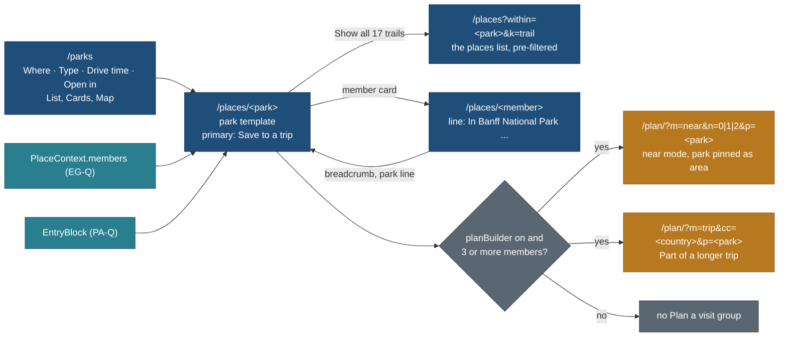

# Park page and the /parks index (PA-N): decisions

Status: **design revised after the PA-NR review; owner questions answered; gate G-PA still open** (27 Oct 2026,
travel-planner, Opus). Docs only; no app code. The review
([reviews/pa-nr-park-page-review-2026-10-27.md](../../reviews/pa-nr-park-page-review-2026-10-27.md), mocks and shots beside
it) approved the direction with 6 must-fix and 9 should-fix changes; all 15 are applied here (section 10). The owner
answered Q-PN1 to Q-PN9 on 27 Oct 2026 ("go ahead with recommendations"), with the reviewer's amendments (section 8).
**G-PA is not passed:** the owner still sees the screens of this revised design before PA-2, PA-IXC or PA-IX start.

Owner request (relayed by the coordinator, 27 Oct 2026): design the Parks page for national, provincial and state parks
as **one template** ("both will be almost the same"), plus a `/parks` index. It extends
[protected-area-entry.md](../../features/protected-area-entry.md) section 8 (the park page sections) and section 4 (the park
record's fields) and is an instance of [entity-graph.md](../../features/entity-graph.md) 9 (`within`, `PlaceContext`).
BACKLOG 15.292, 15.292a, 15.293; TODO row of 27 Oct 2026; PLAN R-253.

| File | What it holds |
|---|---|
| this page | decisions, what varies by park type (as data only), plan a visit, supersedes, requests to other lanes, owner answers, tasks, the review as applied |
| [anatomy.md](anatomy.md) | the page section by section, wireframes at 1440 and 390 (Banff National Park with real data) |
| [states.md](states.md) | no data, stale data, closed season, a zone, loading and error |
| [parks-index.md](parks-index.md) | `/parks`: filters, URL, views, phone and desktop wireframes, states |
| [components.md](components.md) | every component mapped to the foundation; what is new after the review |
| [data-map.md](data-map.md) | every element on the page mapped to its read model and registry property, with the task that supplies it |
| [acceptance.md](acceptance.md) | acceptance checklist and the briefs for PA-2, PA-IX and PA-IXD |

Principles cited by number from [foundation/principles.md](../foundation/principles.md) (P1 to P9, T1 to T5).

## 1. The decision in one paragraph

Every protected area (national park, provincial or state park, conservation area, reserve, forest, dark-sky site, and a
zone inside one) renders through **one park template** inside the place page (`/places/<slug>`), and the only things that
differ between a Parks Canada national park and an Ontario provincial park are **data**: the authority, the entry
requirements and the pass that covers them, the season, the campgrounds, the permits and the wildlife rules. The template
has no branch on the park's type except one label word. **Save to a trip is the one primary action.** The page leads with
**Entry and bookings** at rest (P2 safety exception), then Safety and rules, then **Seasons and closures**, then where to
stay or camp, the places inside grouped by kind with counts, and getting there. A labelled group of secondary links,
**Plan a visit: Day trip · 1 night · 2 nights · Part of a longer trip**, opens the Trip Builder with the park pinned as the
trip's area. A new `/parks` index is the places list with the protected-area kinds fixed, four filters (Where, Type, Drive
time, Open in) and the List, Cards and Map views of `/places`. **Trade-off:** a national park with a rich system pass and a
provincial park with a gate permit get the same shape, so neither gets a bespoke layout; in exchange one template serves
every country, every new park is research, not code, and P1 holds at 10,000 parks.

## 2. Decisions

| # | Decision | Why | Trade-off |
|---|---|---|---|
| PN1 | **One template for every `nature.protected.*` type and the zone.** No type branch in `web/components/places/park/**`; a grep anchored to the type ids checks it (AC-3) | the owner's "both will be almost the same" | a type with a real difference later (a marine park with tides) adds a section driven by data, never a fork |
| PN2 | **Park pages stay at `/places/<slug>`.** `/parks` is the index only (Q-PN1, answered yes) | public URLs never change after launch (patterns 1.2) | the address does not say "park"; the breadcrumb and kicker do |
| PN3 | **Breadcrumb root is "Parks"** for a park or zone page (Parks · Canada · Alberta), linking to `/parks?country=ca&region=ab` | the index is the way back (P3) | other places keep "Places" as root |
| PN4 | **Entry and bookings is the first section under the cover, at rest**, grouped Book ahead, Passes and fees, On the day, plus "Inside the park: own bookings"; each requirement a row that opens in place | P2 safety exception, P6, T1 | a long entry block on a park with many permits; capped by grouping, never hidden |
| PN5 | **No visit-mode control on the park page.** Each requirement row says who needs it (Q-PN3, answered yes) | P4 | a day visitor reads one or two rows that are not for them, labelled "Backcountry campers only". **Supersedes** protected-area-entry 8's `visit=` filter |
| PN6 | **Plan a visit = four link buttons**: "Day trip" (`/plan/?m=near&n=0&p=<slug>`), "1 night" (`n=1`), "2 nights" (`n=2`), "Part of a longer trip" (`/plan/?m=trip&cc=<country>&p=<slug>`). No `within` key. Drawn only with `planBuilder` on and 3 or more members with points (Q-PN2, answered yes with the review's changes M2, M3, S4) | trip-builder 2.5 has `m`, `n`, `p` and `cc`, and no `within`; near-mode hubs are in Ontario and Quebec today, so a mountain park needs the trip-mode link | the builder must pin a park pick as the trip's area (R1). "Weekend" waits for a Saturday-and-Sunday key. **Supersedes** protected-area-entry 8's on-page pre-selection and the PA-N3 note |
| PN7 | **Save to a trip is always the single filled primary** (`--accent`), with or without the builder. Directions is a secondary button. Share and the heart are icon buttons (components 2.1 icon, 38 px, hit area 44). Plan a visit is a secondary group (review M1) | P7: about 90% read and save | planning is one visual step quieter than saving |
| PN8 | **Things to do** lists members by public kind with counts (count cards), the top 6 of the three largest groups at rest, and "Show all n" into `/places?within=<slug>&k=<kind>`. No filters on the park page | P1 (at most 18 member cards in the HTML, P8), P3, P4 | "easy trails with kids" is one click away, in the list |
| PN9 | **Members come from `PlaceContext.members`** (EG-Q) and render with EG-W's members block | one component per job | PA-2 waits for EG-W |
| PN10 | **Seasons and closures** is the third section (review S1). Operating season as the month strip `variant="season"` only when some month is closed or partly open; a park open all twelve months shows one line, "Open all year, read <date>" (S8). Standing closures with dates; the alerts link always. Live closures are never stored | T1, T3, P2 | the page cannot say "the road is closed today"; it says "check the alerts" with the link at rest |
| PN11 | **One banner at most under the cover.** Closed for the season, or between seasons on a zone: **notice** (`--info-soft`, info icon). A dated closure that overlaps today or the next 30 days: **caution** (`--warn-soft`). It names the member as a link and, when there are more, "1 of 3 closures, see Seasons and closures". It prints the date it was computed ("as of Tue 27 Oct 2026"); pages revalidate daily (Q-PN8, answered yes; review S7) | P2; amber means "may stop you", information is slate blue; the printed date keeps a cached page honest (T3) | a cached page can be a day old, and says so |
| PN12 | **Where to stay or camp** is the one home of campground, hut and lodge booking windows. Entry's state line counts and links them ("· 2 campgrounds book ahead, see Where to stay"); Entry itself holds passes, fees, permits, timed entry and day-use reservations (review S3) | P6: a fact appears once, where it is decided | site kinds and food storage wait for the `camp` block (PA-3C, P3) |
| PN13 | **Glance** (6 facts at most, held only): **Season** ("Open all year", "May to Oct"), **Entry** (the list-row label: "Fee", "Fee · book ahead", "Book ahead", "No fee", "Entry not checked"; links to `#entry`), **Camping** ("3 campgrounds", absent when none), places inside, gateway town, nearest airport. Visitor centres are not a glance fact (they are map pins) (review S2) | P3: can we go, what does it cost, can we camp | the entry glance word repeats the section's state in one word; it is a summary, not a section row |
| PN14 | **`/parks`** = the places list engine with the protected-area kinds fixed, four pills Where, Type, Drive time, **Open in**, and the `/places` views **List (default), Cards, Map**. No list-beside-map in v1 (review S6) | P4, P9 (no new list code), PN17 (no map at first paint) | the split view comes later as a list-engine feature for `/places` too |
| PN15 | **Drive time on `/parks` uses the existing codec**: `drive=<hub>-<band>` (`drive=toronto-3`), the hub and band list the parser and labels already use (`core/src/parse/parse.ts`, `core/src/query/valueLabels.ts`). No new `from` key. Airports join as hub ids (`yyz-2`) once ORG has them. "Use my location" picks the nearest public hub on the device and says so (Q-PN5, answered yes; review M6) | one meaning per URL key across `/trips`, `/parks` and smart search; trip-builder OR9 (no town or home in a URL) | a band, not a door-to-door time; honest about it |
| PN16 | **Not a header tab** (Q-PN7, answered yes). `/parks` is reached from the Places title block, Home, every park breadcrumb and the Globe's park card | components 1.1 | one click more from the header |
| PN17 | **A park page has its own HTML budget line**, measured at PA-2's baseline; every other place page stays +0 B, and `/parks` start JS is no larger than `/places` | MASTER-ORDER 4.5 | the park page can grow without eating other pages' headroom |
| PN18 | **On phones the map card and "In public trips" come after Entry and bookings and Safety and rules**, before the rest. A park-page exception to patterns 2 (review M4); the foundation line is added after G-PA (R4) | P2 and T2: at rest means in the first scroll on a phone with weak signal | the map is lower on a phone park page than on other place pages |
| PN19 | **Stale prices are text only** ("read Mar 2026, may have changed", `--muted`). The honesty chip "May be out of date" is for booking windows and closures only, one per row (review S5) | T3 shows age; an alarm on every routine fee row would hide the one that matters | none |
| PN20 | **`/parks` Open in keeps unknowns**: parks with no checked season stay in the result, in a second group "Season not checked (n)" with the gap chip, under the open parks (review M5) | P1, P4: Banff has no operating-season record and must not vanish from "Open in July" | a longer result list |

## 3. What varies by park type: data only

Every row is a field or derived value; the template draws whatever the record holds. Examples are shapes, labelled where
they are real data on `main` (27 Oct 2026).

| What varies | Comes from | National park (Banff, real) | Provincial or state park (shape, protected-area-entry 2.4 B) |
|---|---|---|---|
| Type word on the kicker and the Type filter | `type` leaf, worded per country, fallback "Park" (Q-PN9) | "National park" | "Provincial park" in Canada, "State park" in the US |
| Authority | `run_by` operator record (name, url, terms) | Parks Canada | Ontario Parks, Alberta Parks, a state agency |
| Entry pass that covers the fee | `covered_by` on the fee offer; the pass is an operator offer | Discovery Pass, 12 months from purchase | an annual or seasonal provincial pass |
| Fees and how they are charged | `price` rows (`per` person, vehicle, family, person_night; ages; `residency`) and `entry.unit` | per person per day; 17 and under free; family or group rate | per vehicle per day, residents and non-residents |
| Exemptions | `entry.exemptions` | through traffic on Highways 1 and 93 South | campers (the campsite permit covers the vehicle) |
| Season | `season` (operating), suitability `access_season`, `hours` (gate) | no operating season held; zones and roads seasonal | operating season (for example May to October), gate hours |
| Timed entry, day-use reservations | `access.pass.timed_entry`, `access.pass.day_use_permit` offers with `window` | none on Banff; Lake O'Hara bus by lottery in Yoho | peak-weekend day-use reservations |
| Camping | member `stay.camp.*` places and their lodging offers (`window`, `price`); `camp` block from P3 | none held yet | rolling reservation window, site kinds, max stay |
| Permits | `access.pass.backcountry_permit`, `access.pass.activity_permit` (`entry.for_types`) | backcountry permit per person per night (not held yet) | interior permit, fishing permit on fishing spots only |
| Wildlife and bear rules | park hazard `wildlife`; member `ext.wildlife.*`; `camp.food_storage` (P3); `conditions` link for orders | not held yet (gap row) | food lockers or hang, bear spray advice |
| Zones | `nature.protected.zone` places `part_of` the park | Lake Louise area (Banff), Lake O'Hara (Yoho) | rarely; an interior zone with its own permit |
| Designations | relevance `signals.designations` | Canadian Rocky Mountain Parks World Heritage Site, when recorded | Dark-sky preserve, where sourced |

## 4. The page in one diagram

## 5. Plan a visit: the link contract

| Link button | Screen-reader name | URL | Trip kind it becomes |
|---|---|---|---|
| Day trip | Plan a day trip | `/plan/?m=near&n=0&p=<slug>` | Day trip (trip-kinds TK1, from `n`) |
| 1 night | Plan a visit with 1 night | `/plan/?m=near&n=1&p=<slug>` | Weekend band |
| 2 nights | Plan a visit with 2 nights | `/plan/?m=near&n=2&p=<slug>` | Weekend band |
| Part of a longer trip | Plan a longer trip that includes <park> | `/plan/?m=trip&cc=<country>&p=<slug>` | trip mode; the builder asks the rest |

- Keys are those of trip-builder 2.5 (`m`, `n`, `p`, `cc`). No `within`, `from`, `r`, date or party. The builder fills the
  start from the device's origin choice or asks for it (trip-builder 2.4, OR9). Only public slugs.
- The `p` slug is the park's or the zone's. R1 asks the builder to pin a protected-area pick as the trip's area.
- Labels say the nights in one line, with no sub-label (review M3). "Weekend" joins the 1-night label only after the builder
  has a Saturday-and-Sunday key (R1).
- The group is `div role="group"` labelled by its visible heading "Plan a visit", four secondary buttons as `<a>`,
  server-rendered: +0 B start JS (trip-builder ISO-9).
- Shown only with `planBuilder` on and 3 or more member places with points.

Checked against `docs/v2/features/trip-builder.md` 2.5 (keys `m`, `n`, `p`, `cc`, `f`; no `within`) and the end-to-end
flow on `design/TB-FLOW` (`docs/v2/design/trip-builder/FLOW.md`, dda24882 and its review 21229eb1): picks are saved as
`picks[]` with `ref` and `slug`, filters stay in `f`, and parks appear as hub rows (trip-kinds 2.5). FLOW.md does not yet
say what a park pick does; R1 asks for it.

## 6. Supersedes

| Page or row | What changes | Where it is recorded |
|---|---|---|
| [protected-area-entry.md](../../features/protected-area-entry.md) 8, "Plan a visit (P3)" | four link buttons into the builder (PN6); no on-page `visit=` state, no pre-selection, no hand-off to CUS or the add-a-place panel | the pointer at the top of section 8 |
| protected-area-entry 8, section order and Things to do filters | order Entry, Safety, Seasons, Where to stay or camp, Things to do, Getting there; filters live in the pre-filtered list; `?park=` is `within=` | same pointer |
| protected-area-entry 12, PA-N3 and PA-3 | PA-N3 absorbed (0 h); PA-3 is 4 h | section 12 note, BACKLOG 15.293 |
| W10 "Park, area" type template (design/trip-page/ux-feedback-wireframes-2026-10-26.md) | for `nature.protected.*` places the sections are those of [anatomy.md](anatomy.md) | anatomy.md 1 |
| patterns 2 (phones: map at the top of a detail page) | park pages put the map after Entry and Safety on phones (PN18) | R4: one line in patterns 2 after G-PA |
| This page's first version (1cd4ecb6) | `within` in the link, the "Weekend" and "2 or 3 days" labels, Plan a visit as primary, the glance, the section order, campsites under Entry, stale price chips, the `/parks` split view, `from`/`drive` in minutes, dropping parks with no season, "Regional park" | this revision |

## 7. Requests to other lanes (hand-back items, not edits made here)

| # | To | Request |
|---|---|---|
| R1 | Trip Builder (TB-N, TB-FLOW, TB-W1) | **A `p` pick that is a protected area or a zone is pinned as the trip's area**: Discover is pre-filtered to its `within` closure, and the park itself is never scheduled as a stop with a visit time. Accept the four links of section 5 as fixtures in the builder's URL parser test. In near mode, open on the first unanswered step (From where); if the park is beyond the kind's largest drive band from the chosen start, keep the pick and offer "Plan it as a trip instead" (`m=trip&cc=<country>&p=<park>`); never drop the pick silently. Later: a key for "Saturday and Sunday", so the 1-night link can read "Weekend" |
| R2 | EG-N, EG-W (place context block) | The members block takes `groupsAtRest` (3) and `perGroup` (6), excludes `access.*`, `stay.*` and zones from Things to do (they render in Getting there, Where to stay and Areas inside), and orders groups by count, then the fixed kind order |
| R3 | PA-Q (store and API, Opus) | `EntryBlock` carries `access` (season state for a month) and `closures` as `entryFor` returns them (`core/src/parks/needs.ts`); member requirements grouped by `scope`; the operator's pass with the count of parks it covers in our catalogue; campground booking rows kept out of Entry and counted for its state line (PN12) |
| R4 | travel-design-reviewer: **FND-PA, one foundation task after G-PA and before PA-2** (Opus, 1 h) | patterns 1.2: the `/parks` row; patterns 2: "Park pages: the map follows Entry and Safety on phones (PA-N)"; components **3.8 Requirement row** (N1, with the group rules folded in); 4.7 the `variant="season"` prop; 3.2 the `two-line` list-row variant; 2.8 the honesty label "May be out of date" (windows and closures only); measured pairs from the review's section 3 |
| R5 | ORG (trip origin and nearest airport) | Nearest airport and gateway town per place through the store, for the glance and Getting there; airport ids in the drive hub list (`yyz-2`) when ready |
| R6 | Data seat | Review the four `nature_reserve` records of Q-PN6 and retype those that are not protected areas; the Algonquin park record (locations store first, then `place/algonquin-provincial-park`) comes with PA-R-ON |
| R7 | REQ (requests and custom places) | "Ask us to research this park" points to the request route REQ ships; until that route exists in `web/app`, the link is not drawn |

## 8. Owner questions: answered 27 Oct 2026

The owner answered "go ahead with recommendations" on 27 Oct 2026. Each answer below is the recommendation as amended by
the PA-NR review. Answering these does **not** pass G-PA (the owner still sees the revised screens).

| Q | Question | Answer (27 Oct 2026) |
|---|---|---|
| Q-PN1 | Park pages stay at `/places/<slug>`, `/parks` is the index only? | **Yes** |
| Q-PN2 | Plan a visit links and when they show | **Yes, as amended:** "Day trip" (`n=0`), "1 night" (`n=1`), "2 nights" (`n=2`), plus "Part of a longer trip" (`m=trip`); link `/plan/?m=near&n=<n>&p=<slug>` without `within`; shown with the builder on and 3 or more members |
| Q-PN3 | No visit-mode control on the park page? | **Yes** |
| Q-PN4 | List row keys `entry` (label) and `members` (count), a P8 waiver? | **Yes, as amended:** `entry` values `none`, `fee`, `book_ahead`, `fee_book_ahead`, `not_checked` |
| Q-PN5 | Drive time later, from public hubs and airports only? | **Yes, as amended:** the existing `drive=<hub>-<band>` encoding (`toronto-3`), no `from` key |
| Q-PN6 | The kind set of `/parks`, zones excluded, four `nature_reserve` records reviewed first? | **Yes** |
| Q-PN7 | `/parks` is not a header tab? | **Yes** |
| Q-PN8 | Season state at render, "as of" date, daily revalidation? | **Yes** |
| Q-PN9 | Type word by country from `data/vocab/types.json`? | **Yes, as amended:** fallback "Park", not "Regional park" |

## 9. Tasks, hours and gate

| Id | Task | Seat, model | h | After | Gate |
|---|---|---|---|---|---|
| PA-N | This design (docs) | travel-planner, Opus | 3 | P1 contracts merged | done; revised after PA-NR |
| PA-NR | Design review of PA-N, mocks and shots | travel-design-reviewer, Opus | 1.5 | PA-N | **done** (ddb740da) |
| **G-PA** | **Owner approves the park page and `/parks` screens** (the revised design; mocks re-rendered by the re-review) | owner | | PA-N revision, short re-review | **open; blocks FND-PA, PA-IXC, PA-2, PA-IX** |
| FND-PA | Foundation edits of R4 | travel-design-reviewer, Opus | 1 | G-PA | new; before PA-2 |
| PA-Q | Store and API: `EntryBlock` (R3) | B2, Opus | 2 | PA-D, EG-Q | unchanged |
| PA-IXC | Contract: row keys `entry` (five values) and `members`; `label_by_country` with fallback "Park"; the `/parks` kind set; the `drive` facet allowed on places lists for protected areas | B2, Opus (shared contract) | 2 | G-PA, PA-Q, EG-Q | |
| PA-2 | Park template and member line, including the Plan a visit group | B1, Sonnet | 10.5 | G-PA, FND-PA, PA-Q, EG-W | |
| PA-IX | `/parks` index with the `/places` views, without the drive pill | B1, Sonnet | 5 | PA-IXC, PA-2 | was 7 h (no split view) |
| PA-R2, PA-V2 | Review and verify of PA-2 and PA-IX | Opus 2.5, Sonnet 2.5 | 5 | PA-2, PA-IX | |
| PA-IXD | The Drive time pill on the existing codec | B1, Sonnet | 2 | PA-IX, the driving-time model (DT) | P3 |
| PA-3 | Camping section in full (site kinds, food storage, max stay) and the Algonquin pilot page | B1, Sonnet | 4 | PA-3C, PA-R-ON | was 8 h; no longer waits for CUS-1 and v0.17 |
| PA-N3 | Plan-a-visit note | | 0 | | absorbed here (was 2 h) |

Hours: P2 is **33 h** (PA-N 3, PA-NR 1.5, FND-PA 1, PA-Q 2, PA-IXC 2, PA-2 10.5, PA-IX 5, PA-DV 2, PA-MUS 2.5, PA-R2/V2
5; the first revision said 34); P3 is 17 h; all PA **81 h** (was 75.5 before PA-N, 82 in its first version). Bundles: P2 in
E, P3 in G. Commit rule for every task: one commit per task, `web(PA-2): ...`, `git -C <worktree> add <owned paths>`, never
`-A`, the project's Co-Authored-By trailer.

## 10. The PA-NR review, as applied

| # | Finding | Applied in |
|---|---|---|
| M1 | Save to a trip is the single filled primary; Directions secondary; Share and heart icon buttons | PN7; anatomy 1, 2, 3; components 1; AC-7 |
| M2 | Link without `within`; R1: a park pick is pinned as the trip's area, never a stop | PN6; section 5; R1; diagram; states 5; AC-7 |
| M3 | Labels "Day trip", "1 night", "2 nights", one line, no sub-label | PN6; section 5; anatomy 2, 3, 7; AC-7 |
| M4 | On phones the map goes after Entry and Safety | PN18; anatomy 1, 3; states 2; AC-25; R4 |
| M5 | Parks with no checked season stay, in "Season not checked"; pill "Open in" | PN20; parks-index 3, 6; AC-18 |
| M6 | `drive=<hub>-<band>`, no `from` | PN15; parks-index 2, 3; data-map 2; AC-19; PA-IXC |
| S1 | Section order Entry, Safety, Seasons, Where to stay or camp, Things to do, Getting there | anatomy 1 to 3; AC-1; protected-area-entry 8 pointer |
| S2 | Glance: Season, Entry, Camping added; visitor centres dropped | PN13; anatomy 1; data-map 1 |
| S3 | Campsite windows only in Where to stay or camp | PN12; anatomy 1, 4; components N1 |
| S4 | "Part of a longer trip" link | PN6; section 5; AC-7 |
| S5 | Stale prices text only; chip on windows and closures | PN19; states 3; AC-11 |
| S6 | No list-beside-map on `/parks` in v1 (about -2 h) | PN14; parks-index 4; components; AC-20; PA-IX 5 h |
| S7 | Banner kinds: notice for season, caution for a dated closure | PN11; states 4 |
| S8 | No strip for a park open all year | PN10; states 4.1 |
| S9 | `/parks` phone rows: two chips, places inside in the meta line, sort in the Filters sheet; `fee_book_ahead` | parks-index 4.2, 5; Q-PN4 |
| Polish | window chip under the name on phones; `role="group"`, not `<nav>`; banner names the member; "Park" fallback; AC-3 anchored grep; the Ask us link only when REQ's route exists | anatomy 3, 5, 7; PN11; Q-PN9; AC-3; R7 |
| Components | N1 kept (foundation 3.8), N2 folded into N1, N3 a prop, N4 the list-row `two-line` variant, N5 split deferred, drive pill is the existing 2.7 pill | components 2 |

**Deferred, with the reason:** the `/parks` list-beside-map (S6: a list-engine feature for `/places` too, needs the map
after first paint and a measured budget; not worth it at 29 parks); "Weekend" on the 1-night link (needs R1's
Saturday-and-Sunday key); airports in the drive hub list (needs ORG); the "Ask us" link (needs REQ's route, R7); the
foundation edits (FND-PA, after G-PA so an unapproved design is not frozen into the foundation).

## Change log

- 27 Oct 2026: written (travel-planner, Opus) on branch `design/PA-N`, 1cd4ecb6.
- 27 Oct 2026: PA-NR review (ddb740da) applied: M1 to M6, S1 to S9, polish, component verdicts; Q-PN1 to Q-PN9 recorded as
  answered by the owner with the reviewer's amendments; FND-PA added; PA-IX 5 h; P2 33 h, all PA 81 h. G-PA still open.
