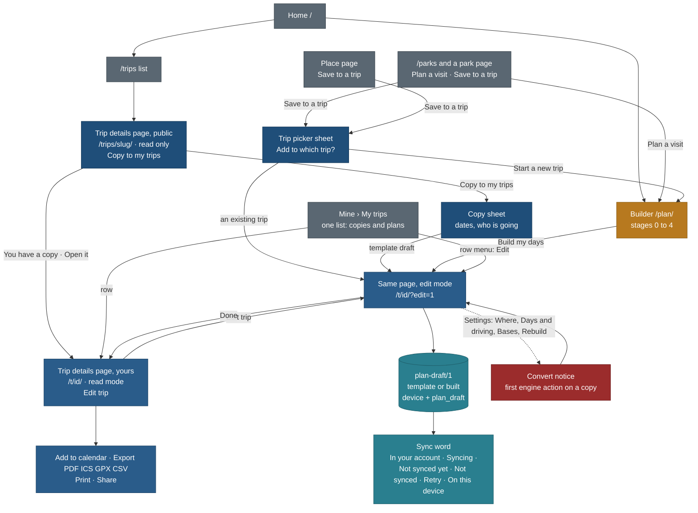

# Step 2: create, edit and the trip details page (the master plan)

Status: **plan, docs only** (27 Oct 2026, travel-planner, Opus, task STEP2-PLAN). No app code. PLAN R-285; BACKLOG 15.358
to 15.382; TODO row of 27 Oct 2026. Owner questions: [owner-questions.md](owner-questions.md) (7). Principles cited by
number from [foundation/principles.md](../foundation/principles.md) (P1 to P9, T1 to T5); rules from
[trip-scope-scenarios.md](../trip-scope-scenarios.md) (rules 1 to 9) and [keep-from-live-site.md](../keep-from-live-site.md).

| File | What it holds |
|---|---|
| this page | scope, the three parts, the one-page flow, the consistency matrix, the vocabulary, rulings on conflicting specs, what this plan supersedes |
| [gap-analysis.md](gap-analysis.md) | per surface: what `web/` has today, what the park and builder prototypes assume, what the details page must change, what the park page needs, data contract changes, and every pending trip-page enhancement with a ruling |
| [edit-mode-spec.md](edit-mode-spec.md) | the edit experience on the details page in full |
| [build-plan.md](build-plan.md) | work packages STEP2-* in order, with files, dependencies, model, checks, tests, owner gos and size in agent-sessions |
| [owner-questions.md](owner-questions.md) | the 7 decisions that need the owner, and the list of what this plan assumed |

## The owner's intent (27 Oct 2026)

"The whole step needs to be planned in detail, either it is create or edit. Every page should be consistent: the edit
experience should be the same, the trip details page should be the same. We have also redesigned the park page and
everything, so check in detail what needs to be done." Edit is part 2 and is **one experience for both sources** (a trip
the builder made from scratch, and a published trip copied and customised), edited **from the trip details page**
together with the enhancements still pending for that page. The builder ends by handing the trip to that page and has no
editor of its own. In edit mode every day lets the person delete any stop and add more stops. Answered 27 Oct 2026 as
recommended: Q-BE1, Q-BE3, Q-BE4, Q-BE5, Q-BE6 ([BRAINSTORM-edit-trip.md](../../prototypes/BRAINSTORM-edit-trip.md)).
Q-BE2, Q-BE7 and Q-BE8 are planned with their recommendation and marked **assumed** (owner question OQ3).

## 1. The decision in one paragraph

**There is one trip details page, and every trip renders through it**: our published trips at `/trips/<slug>/` (public,
read-only, cacheable, unchanged in purpose) and the person's own trips at `/t/<id>/` (private; a copy of one of our trips,
a plan the builder made, or a copy that was converted). The page at `/t/<id>/` is the same cover, party bar, tabs (Summary,
Days, Stops, Bookings, Photos), day cards, map and print as the public page, fed by the same components; it adds the
person's state (the sync word, marks such as "Added by you") and an **Edit trip** switch. Edit mode is a mode of that page,
not another page: each stop gets a handle and a `⋯` menu, each day a `⋯` menu and an "Add a place to Day n" picker, the
trip a Settings sheet, and every change is one operation with an inverse on the one document `plan-draft/1` (template mode
for copies, built mode for builder plans), saved on the device at once and synced to the account when signed in. **The
builder** (part 1) runs stages 0 to 4 at `/plan/` and its "Build my days" hands the plan to `/t/<id>/` in edit mode; it has
no plan screen of its own, and its Review stage becomes the details page's Summary and Bookings tabs. **The surfaces both
feed** (part 3) use the same words and the same trip picker: Mine lists every trip in one list, place and park pages offer
"Save to a trip", and the public trip page leads into a copy. **Trade-off:** `/t/<id>/` paints its plan on the client (the
document is private and often only on the device), so its first paint is a skeleton for one fetch; in exchange the public
page keeps its server HTML, its cache and its start-JS budget untouched (it has under 1 KB of headroom), and there is
exactly one editor.

## 2. Scope: three parts

| Part | What | Where | Specified in | This plan adds |
|---|---|---|---|---|
| **1 Create** (the builder) | Stages 0 Kind, 1 Start, 2 Where, 3 Pick, 4 Days and driving; Build my days | `/plan/` (stages only) | [FLOW.md](../trip-builder/FLOW.md) stages 0 to 4, [trip-builder.md](../../features/trip-builder.md), [trip-kinds](../../features/trip-kinds-and-interest-profile.md), [driving-time-model](../../features/driving-time-model.md), [location metadata](../../features/trip-builder-location-metadata.md) | the hand-off to `/t/<id>/` (section 3, step 6); stages 5 to 8 move to the details page (ruling R2); Settings in edit mode reopens stages 1 to 4 as sheets (edit-mode-spec 8) |
| **2 Edit** (the details page in edit mode) | delete any stop, add stops, move, reorder, days, notes, title, dates, party, bases (built plans), undo, reset, changes from our plan, warnings, sync states | `/t/<id>/?edit=1` | [edit-mode-spec.md](edit-mode-spec.md) (this folder); it folds [edit-my-trip.md](../../features/edit-my-trip.md) 5, FLOW 7.1, the brainstorm Q1 to Q8 | everything; it supersedes EM-3, EM-4, ED, CUS-1, CUS-2, REQ-E UI (section 7) |
| **3 Surfaces** | the trip details page itself (read mode on `/trips/` and `/t/`), Mine, place and park pages, the parks index, print and calendar | `/trips/<slug>/`, `/t/<id>/`, `/mine/`, `/places/<slug>/`, `/parks` | [patterns 3.10](../foundation/patterns.md), [trip-and-places-ux-fixes](../../features/trip-and-places-ux-fixes.md), [navigation-and-mine](../../features/navigation-and-mine.md), [park-page/](../park-page/README.md) | the consistency matrix (section 4), the vocabulary (section 5), Save to a trip as a trip picker, "In your trips" on place pages, one Mine list |

Out of Step 2 (each with its home): Today mode and offline maps (F13, later); bookings, tasks and budget per trip (L1,
later); collaboration and shared editing (F11, later); stops we do not have (`custom`, REQ-P, bundle G); the interest
profile (TK, bundle E); multi-base and getting there by air in the builder (TB-P3, TB-P4, bundle F); Where to stay tab
(STY-1, later).

## 3. The one-page flow

Diagram colours are documentation only, blue-gray with amber for the builder and red for the one confirming notice; they are
not product tokens (no green, product direction).

| Step | From | What happens | Lands on | Spec |
|---|---|---|---|---|
| 1 | Home, `/trips` | The public list as today | `/trips/<slug>/` | patterns 3.3, 3.10 |
| 2 | A public trip | **Copy to my trips** opens the copy sheet (date, who is going); its primary **Copy to my trips** makes a template draft and opens it in edit mode with the **Make it yours** card; toast "Copied Canadian Rockies to My trips · Undo". No done step (storage blocked keeps it, patterns 3.7) | `/t/<id>/?edit=1` | edit-mode-spec 2.2 |
| 3 | A public trip the device or account already holds a copy of | one line under the cover actions: "You have a copy of this trip · Open it" (lazy, after hydration; the server HTML is unchanged) | `/t/<id>/` | gap-analysis 2.1 |
| 4 | A place or park page | **Save to a trip** opens the trip picker: My trips rows, then "Start a new trip with Moraine Lake" | an existing trip: `/t/<id>/?edit=1&add=<slug>` with the add picker open on the best day; a new trip: `/plan/?p=<slug>` | edit-mode-spec 6.6; gap-analysis 2.4 |
| 5 | A park page | **Plan a visit** (Day trip, 1 night, 2 nights, Part of a longer trip): the four links of park-page README 5 | `/plan/?m=near&n=<n>&p=<slug>` or `/plan/?m=trip&cc=<CC>&p=<slug>` | park-page README 5; TB-PIN |
| 6 | The builder, stage 4 | **Build my days** builds on the server, then `history.replaceState` to the trip's own URL; the page opens in edit mode with the just-built status line ("Built 10 days · 1 did not fit · 1 warning"), Bases and Checks one line each, Day 1 open | `/t/<id>/?edit=1` | edit-mode-spec 2.1; ruling R2 |
| 7 | Mine › My trips | The row opens the trip in read mode on Days (`view=day`); the row menu has **Edit** | `/t/<id>/?view=day` or `?edit=1` | edit-mode-spec 2.3 |
| 8 | Read mode | **Edit trip** switches the same page to edit mode (`pushState`, so Back returns to read mode); **Done** switches back. Every edit is already saved | same URL with or without `edit=1` | edit-mode-spec 3 |
| 9 | Either mode | Sync is quiet: one state word; a notice only when a change could not apply | | edit-mode-spec 12 |
| 10 | Read mode | Add to calendar (dated) or Add dates (undated), Export (PDF, ICS, GPX, CSV), Print, Share; for a copy, Share sends the public trip's URL without the person's settings unless they choose "with my settings" (never the party, start, dates or notes) | files, the print view, the share sheet | edit-mode-spec 14 |

## 4. Consistency matrix

Rows are every surface Step 2 touches; columns are what each must share. "Same as" names the one component or rule each
row uses, so a builder agent does not write a second one. Components and tokens are those of
[foundation/components.md](../foundation/components.md) and [tokens.md](../foundation/tokens.md); colour only from
`web/app/themes.css`.

### 4.1 Components and layout

| Surface | Header and identity | Primary action (one filled) | Lists and rows | Overlays | Map | Phone bottom bar |
|---|---|---|---|---|---|---|
| Builder stages 0 to 4 (`/plan/`) | step header (phone, 9.1) and step rail (desktop, 9.1) | the named Next ("Next: Pick"), Build my days on stage 4 | pick rows (9.2), list rows 3.2 | bottom sheet 5.5 and 9.3 (phone), side sheet 5.1 (desktop) | lazy map sheet; list works without it (T2) | the builder's action bar (9.4) replaces the public bar |
| Details page, public read (`/trips/<slug>/`) | cover (patterns 3.4 item 1); no trip bar | **Copy to my trips** | day cards with timeline entries (4.3), Stops rows (3.2), day tables (4.6) | copy sheet (side on desktop, bottom on phone) | map column on desktop, map sheet on phone (patterns 3.10) | public bar (Trips, Places, Globe, Search, Mine) |
| Details page, yours, read (`/t/<id>/`) | the same cover; kicker "Your copy · from our Canadian Rockies trip" or "Your trip"; the sticky row (tab bar, plan bar or category strip) gains a 32 px identity cell and the title (scenario rule 1) | **Edit trip** (OQ2) | the same day cards, rows and tables, plus marks (edit-mode-spec 4.3) | the same sheets | the same | public bar |
| Details page, yours, edit (`/t/<id>/?edit=1`) | as read; the sticky row shows Undo, Redo, the changes count, Settings, **Done** on desktop | **Done** (the only filled button while editing) | the same entries with a handle (8.1) and a `⋯` (44 px); day header `⋯`; "Add a place to Day n" row | item sheet (phone) or menu (desktop) 5.2; add picker; Settings sheet (phone full height, desktop 420 px side panel); changes sheet | the same; the map follows the open day | **edit bar: Settings · Done**; Undo in the toast and the header `⋯` (TF18) |
| Mine › My trips (`/mine/`) | page head MINE, account card | none on the page (rows are links); empty state **Browse trips** | switcher rows (1.3, patterns 3.8 item 4): photo with identity ring, name, dates, party, one chip | row menu 5.2; Change dates sheet | none | public bar |
| Park page (`/places/<slug>`, park template) | park cover and glance (park-page anatomy) | **Save to a trip** (PN7) | requirement rows (3.8, FND-PA), member count cards (3.6) | trip picker (bottom sheet on phone, side sheet on desktop) | map card after Entry and Safety on phones (PN18) | public bar |
| Parks index (`/parks`) | Places title block | none | the places list engine, List, Cards, Map (PN14) | filter sheet on phones | Map view | public bar |
| Place pages (`/places/<slug>`) | place cover | **Save to a trip** or Directions (patterns 3.11 item 2) | facts, nearby | trip picker | map card | public bar |
| Print (own trip) | trip title, dates, party words, "Your copy of Canadian Rockies" | none | `TripPrintView` (Summary, Days, Bookings; never Photos or Stops, patterns 3.10 item 8) | none | none (T2) | none |
| Today (later, F13) | trip header 1.2 | the leave-by card | Today components 8.3 | | | |

### 4.2 Copy, tokens and states

| Surface | Loading | Empty | Error | Offline | Signed out | Tokens of note |
|---|---|---|---|---|---|---|
| Builder 0 to 4 | skeleton rows (6.2); build progress card | "No results" names the filters, nearest match first (6.1) | "We could not load places · Retry"; build failed banner (urgent 5.4), draft kept | dashed notice banner (5.4), last build opens | full flow on the device; "Sign in to keep it on every device" | `--accent` only for the one primary and "now"; identity colours (tokens 4) per draft |
| Details page, public | server HTML; lazy panels show a `role="status"` line | an overview trip: Summary only, no tab bar | 404 template (6.3) | page works from cache; map says "Map needs a connection" | the whole page; party kept on the device | as today |
| Details page, yours, read | skeleton cover and day cards until the document and the trip's plan model load (one fetch each, edit-mode-spec 15) | a built plan with no build: "Not built yet · Open the builder" | "This trip is not on this device or in your account" with **Open Mine** (no existence signal, 404 semantics) | reads from the device cache; state word "Not synced yet" when edits wait | a device trip is fully readable and editable (EM8) | marks are neutral chips (2.8) with words, never colour alone |
| Details page, yours, edit | edits disabled for at most the first fetch; then live | an emptied day: "No stops on Day 4 · Add a place to Day 4 · Drop Day 4" | an op that fails its rule: toast "Could not move Seceda: Day 4 is full" (no change made) | edits apply on the device; "Not synced yet"; the dashed banner only on the second failed attempt (edit-my-trip 5.5) | fully editable (EM8); "Kept in this browser. Sign in to keep it on every device." in the Settings sheet foot | Fix level `--crit` text with the triangle, Check level `--warn` text on `--warn-soft` (2.8, tokens 3), never a fill |
| Mine | skeleton rows | "No trips yet" (patterns 3.8 item 7, wording updated in 5) | per-row "Not synced · Retry" | rows read from the cache | "Kept in this browser only." | chips mono 12.5 neutral (edit-my-trip 4.7) |
| Park page | server HTML | "Basics only" template (park-page states) | 404 | page from cache | Save to a trip works on the device | the season banner kinds of PN11 |
| Place pages | server HTML | the basics template (patterns 3.11) | 404 | page from cache | as park | |

### 4.3 Phone and desktop

| Concern | Phone (390) | Desktop (1440) | Rule |
|---|---|---|---|
| Entering edit mode | Edit trip in the cover row; the edit bar replaces the public bar | Edit trip in the cover row; edit tools join the sticky row | one bar on phones (TF18) |
| A stop's actions | `⋯` (44 px) opens the item sheet, first row **Move to day…**, then **Move up**, **Move down** | hover or focus shows the handle and `⋯`; the menu has the same rows | Q-BE3; buttons first |
| Drag | long-press 300 ms **on the handle only**, within the open day | drag within and across days, onto a day in the plan bar's day rail | WCAG 2.5.7: every drag has a menu path |
| Add a place | full-height sheet | side sheet over the map column | one picker, edit-mode-spec 7 |
| Settings | full-height sheet, returns to the same day and scroll (P5) | 420 px side panel over the map | FLOW 7 |
| Map | the map sheet as today | the map column as today | patterns 3.10 |

## 5. Vocabulary: one name per thing

Every page uses these words. Where a live or specified label differs, the right column says what it replaces. Builders
copy strings from this table; a new string goes here first.

### 5.1 Things

| Thing | Word on screen | Never | Replaces or notes |
|---|---|---|---|
| A trip we researched and publish | **our trip**; the published days are **our plan** | "template", "public plan" | "Published plan" stays only as the public cover kicker |
| The person's own trip of any kind | **trip** ("My trips", "Your trip") | "draft" (except the builder's "Draft" chip before the first build), "plan" as a noun for the person's object | FLOW's "Your plan", "Close plan" become "Your trip", "Close" |
| A copy that follows our trip (template mode) | **your copy** ("Your copy of Canadian Rockies") | "customised trip", "shared plan" | B3's "Shared plan" for one's own copy (EM-B fixed it to "Your copy") |
| A copy after the first engine action (built mode, seeded) | **your trip, from our Dolomites trip** | "fork" | FLOW C5's "your plan" |
| A stop on a day | **stop** (a place on a day); the day card shows it as an entry | "item" in UI text | "item" stays a code word |
| A day | **Day 5** (capital D, a numeral) | "D5" in UI text | |
| A list of places not on any day | **Maybe** ("Maybe (3)") | "Wishlist", "Ideas" | |
| Places the engine could not fit | **Did not fit** | "Dropped" | |
| Where the trip sleeps | **base** ("Base: Jasper, 4 nights") | "hub" in UI text | |
| The people going | **who is going**; party words from the one function shared with Mine ("2 adults · 1 child (6)") | names (AD2) | |
| Warnings | **To fix** (level Fix) and **To check** (level Check) | "Error", "Problem" | brainstorm Q6 levels |

### 5.2 Buttons and labels

| Where | Label | Replaces |
|---|---|---|
| Public trip cover | **Copy to my trips** | FLOW C1 "Copy with my dates" and the sheet's "Copy and make it mine" (live label kept; principles P7's text reads "Copy with my dates" and is amended by this table) |
| Copy sheet primary | **Copy to my trips** | the done step's "Open in Mine" (the copy opens instead) |
| Own trip cover, read mode | **Edit trip** (primary, OQ2); **Add to calendar** (dated) or **Add dates** (undated) | the cover's Copy to my trips on a copy (EM-3's "Change dates" moves into Settings and the Mine row menu) |
| Edit mode exit | **Done** | none (edits are already saved; never "Save") |
| Phone edit bar | **Settings · Done** | FLOW TF18 "Settings · Review" (no Review screen, ruling R2) |
| Stop menu | **Move to day…**, **Move up**, **Move down**, **Swap with…**, **Swap for a nearby place**, **Remove from Day 5**, **Add to Maybe** (copies), **Add a note**, **Keep on Day 5** (switch, built), **Must see** (switch, built), **Open place page** | "Remove from this day" (live, visitor-added only), "Remove from the plan" (FLOW), "Placed by you", "Lock" |
| Day menu | **Add a day after Day 5**, **Drop Day 5**, **Reset Day 5** (copies), **Add a note**, **Version of Day 5** (copies, before conversion) | |
| Add row on a day | **Add a place to Day 5** | FLOW's "+ Add to Day n" |
| Add picker groups | the live labels "From the other versions of this day", "Elsewhere on this trip, near here", "Within 30 km, with a place page", plus "Removed from this day", "Maybe", "Your picks not on a day", "In Banff National Park", "Search results" | the brainstorm's "Other options for this day" |
| Trip `⋯` (own trip) | **Undo**, **Redo**, **Make it yours** (copies), **Rebuild** (built), **Reset to our plan** (copies), **Print**, **Remove from My trips** | "Back to our plan" (brainstorm Q7; one label, the confirm sentence says what it does) |
| Changes line | "**4 changes from our plan · Show**"; sheet title "Changes from our plan"; per row **Restore** | |
| Marks on a stop | "**Added by you**", "**Moved from Day 3**" (copies), "**Moved by you**" (built), "**From our trip**" (after conversion), "**Kept on Day 4**" | FLOW "Placed by you", TB-N2R chip "Kept on Day n" kept |
| Toasts | "Moved Seceda to Day 2 · kept there · Undo"; "Removed Moraine Lake from Day 5 · Undo"; "Added Pyramid Lake to Day 5 · Undo" | |
| Sync word | **In your account** (signed in, quiet: shown in the header, no chip in Mine), **Syncing**, **Not synced yet**, **Not synced · Retry**, **On this device** | "Saved", "Saved to your account" (foundation bans "saved" for a copy, patterns 3.7) |
| Place and park pages | **Save to a trip**; picker title "Add Moraine Lake to a trip"; rows are My trips; last row **Start a new trip with Moraine Lake** | the visitor note "Saving to a trip comes with the planner" (SaveToTrip.tsx) |
| Place page line | "In your copy of Canadian Rockies · Day 5" or "In your trip Dolomites" | |
| Mine row menu | **Open** · **Edit** · **Add to calendar** · **Print** · **Change dates** · divider · **Remove** | adds Edit |
| Mine empty state | "No trips yet" · "Copy one of our trips or plan your own. It stays here." · **Browse trips** · **Plan your own trip** (with `planBuilder`) | "No trips copied yet" |
| Builder hand-off | "**Build my days**"; status line "Built 10 days · 1 did not fit · 1 warning" | |
| Convert notice | "This makes it your own trip. Our later updates to the Dolomites trip will no longer change it. You can undo this until you leave the page." **Continue** · **Cancel** | FLOW C5 wording with "plan" → "trip" |

## 6. Rulings on conflicting specs

| # | Conflict | Ruling | Why |
|---|---|---|---|
| R1 | The owner's "edited from the trip details page (`/trips/<id>/`)" against F-Q2 and patterns 1.2 ("`/trips/...` always means a public, read-only page"; the planner lives under `/t/`) | **One page template, two addresses**: `/trips/<slug>/` public, `/t/<id>/` yours, the same components. The literal `/trips/<id>/` is not used. Owner question OQ1 confirms | the public page stays cacheable and inside its start-JS headroom (under 1 KB); a builder plan has no slug; a forwarded link never shows private data (rule 9) |
| R2 | FLOW TF9 and TF18 (an editor screen at `/t/<id>/` with its own Plan grid, outline 256, and a phone bar Settings · Review; before ED the plan lands in `/plan/?s=plan`) against the owner's "the builder has no editor of its own; edit from the details page" | **The details page is the plan screen.** Stages 5 to 7 (just built, getting there cards, customise) are the details page's Days tab in edit mode; stage 8 Review and prepare becomes the details page's Summary (state line, Checks, Did not fit, Known costs) and Bookings tab; the Plan grid is not built (the details page keeps its Days list with the map column). Build my days goes to `/t/<id>/?edit=1` from FS-1 on; there is never a `/plan/?s=plan` screen | one renderer (FLOW's own goal); the details page already has the map column, day rail and tabs |
| R3 | edit-my-trip 5.2 (EM-3: a bridge on `/trips/<slug>/#mine=<id>`, then `/t/<id>/` later) | **No bridge on `/trips/`.** The first package (STEP2-T1) opens copies at `/t/<id>/` with the edits that exist today routed to the document; a `mine=` link on `/trips/` redirects there | avoids two entry routes for one copy (Q-EM9's trade-off) and touching the public page's start JS |
| R4 | edit-my-trip 5.3 step 6 (phones reorder by Move up and Move down, "not drag") against FLOW 7.1 and components 8.1 (long-press drag) | Q-BE3 answered: **buttons first, plus long-press on the handle only, within the open day**; no cross-day drag on a phone. The prototype review's suggestion to drop on another day's chip on a phone (FINDINGS 3c) is not taken | the owner's answer |
| R5 | components 8.1 ("Space drops") against FLOW 7.1 and the prototype review ("Enter drops") | **Space or Enter lifts and drops; Esc cancels** | both documented keys work; no one is surprised |
| R6 | FLOW TF11 "Placed by you" and TB-N2R R1 "Keep on Day n" against the brainstorm's "Added by you", "Moved from Day 3" | one set of marks (5.2): Added by you, Moved from Day 3 (copies), Moved by you (built), From our trip, Kept on Day n; "Placed by you" is not shown (the switch "Keep on Day n" carries the meaning) | one vocabulary across modes |
| R7 | brainstorm Q4 ("Reset to our plan confirms when it discards more than three changes", answered yes) against foundation 4.4 ("reversible actions never ask") | the owner's answer stands, recorded as a foundation exception for FND-S2 to write | Undo lasts one session; a Reset of many changes a week later cannot be undone |
| R8 | trip-builder X6 (a separate Mine tab "My plans") against edit-my-trip ("one list in Mine") and FLOW TF13 | **one list, My trips**, for copies and builder plans; X6's tab is not built | one place to find a trip (P3) |
| R9 | FLOW F-Q4 (Review's primary is Add to calendar or Add dates) against the owner's ask that a trip be obviously editable | OQ2: **Edit trip** is the primary on your own trip; Add to calendar or Add dates is the first secondary; Review has no screen (R2) | the owner's complaint was "seems not editable" (P4); calendar stays one tap away |
| R10 | STY-2 (signed-in base tweaks on a copy as template `stays` ops) against FLOW's Q7 table (bases are an engine action that converts first) | **one path: a base change converts the copy, then runs the engine**; STY-2's template `stays` op is not built (OQ6) | two base-change engines would disagree |

## 7. What this plan supersedes (pointer notes added to each page)

| Page | Section | Superseded by |
|---|---|---|
| [features/edit-my-trip.md](../../features/edit-my-trip.md) | 5.2 (the bridge), 5.3 step 6 (no drag), 8 rows EM-3, EM-RV, EM-4, EM-5 | edit-mode-spec; build-plan STEP2-T1, STEP2-E1 to STEP2-E6, STEP2-P2 |
| [design/trip-builder/FLOW.md](../trip-builder/FLOW.md) | TF9, TF18, "The plan" stages 5 to 7 header and action bar, stage 8 as a screen, task ED, TB-W1's "just-built landing in `/plan/?s=plan`" | rulings R2, R9; edit-mode-spec 2.1, 8; build-plan STEP2-B1 to STEP2-B3 |
| [features/trip-overview-and-customisation.md](../../features/trip-overview-and-customisation.md) | 5.1 to 5.5 (customise, signed in only, `trip-custom/1`) | edit-mode-spec (signed out allowed, EM8; `plan-draft/1`) |
| BACKLOG 15.352 (EM-3, EM-RV, EM-4, EM-5), 15.173 (CUS-C widening, REQ-E), MASTER-ORDER rows CUS-1, CUS-2, CUS-R, REQ-E UI | | BACKLOG 15.358 to 15.382 |
| [prototypes/BRAINSTORM-edit-trip.md](../../prototypes/BRAINSTORM-edit-trip.md) "Settled" line ("one editor at `/t/<id>/` shared with the builder") | | ruling R1 and R2 (the prototype folder is frozen; not edited) |

## 8. Gotchas

- **`plan-draft/1` freezes when the first draft is stored.** Turning on `NEXT_PUBLIC_ACCOUNT_TRIPS` in production stores
  documents; after that every new key is `plan-draft/2`. STEP2-C1 (the keys edit mode needs) must merge before the flag is
  turned on, or its keys become a `/2` migration (owner question OQ4).
- **The builder fence.** `web/tests/plan/isolation.test.ts` forbids any file outside the builder's paths from importing
  `core/src/plan/**` or `plan-draft.ts`, except named extension points. Edit mode lives in `web/lib/trip-edit/**` and
  `web/components/trips/edit/**`; STEP2-C1 adds the extension point X-S2 for `web/lib/trip-edit/**` (lazy chunk only).
- **The public trip page's start JS has under 1 KB of headroom.** Nothing of edit mode loads on `/trips/<slug>/`; the "You
  have a copy" line is a dynamic import after hydration.
- **`travel.party` is the device's party for browsing; a trip's party is its own** (EM-B). Editing a trip never rewrites
  `travel.party`.
- **Our trips change.** A copy follows our plan (EM3); a change that no longer applies is listed, never dropped silently
  (edit-mode-spec 11.3).

## Change log

| Date | Change |
|---|---|
| 2026-10-27 | Created (STEP2-PLAN, travel-planner, Opus) from the owner's intent of 27 Oct, FLOW, edit-my-trip, the brainstorm, the park page design, the prototypes and a read of `web/` and `core/` on main ee3cd32f |
