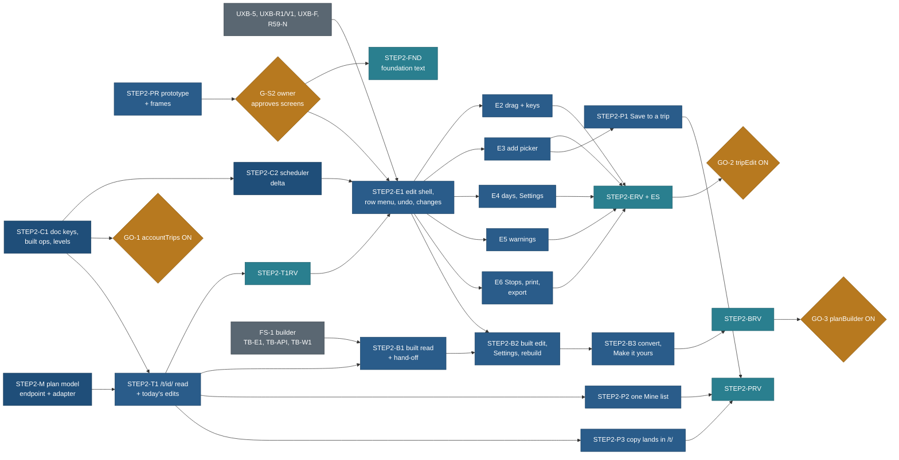

# Step 2 build plan: work packages STEP2-*

Status: **plan, docs only** (27 Oct 2026, travel-planner, Opus, STEP2-PLAN). Spec: [edit-mode-spec.md](edit-mode-spec.md);
gaps and files: [gap-analysis.md](gap-analysis.md); master plan and vocabulary: [README.md](README.md). BACKLOG 15.358 to
15.382 (one row per package). Models follow the CLAUDE.md complexity table: Opus for shared contracts, reviews and
judgement; Sonnet for specified work inside owned files; Haiku for mechanical follow-ups.

**Size unit: an agent-session** = one agent run from brief to hand-back inside the agent length cap (WORKFLOW-EFFICIENCY),
about one focused half-day of the old hour estimates. No dates.

## 1. Already done (prerequisites Step 2 builds on)

| Id | What | Commit | State |
|---|---|---|---|
| EM-B | a copy opens with its own party; "Your copy" | 7e7003d0 | merged |
| EM-C | `plan-draft/1` template mode, ops with inverses, `rebase`, route shapes | d2776eae | merged |
| EM-M, EM-1 | migration `0013_plan_doc`, routes `/api/account/plans/**` behind `NEXT_PUBLIC_ACCOUNT_TRIPS` | 8e4d00a0, 889e15ab | merged |
| EM-2 | signed-in Mine sync (cache, outbox, rebase, chips, sign-out question) behind the same flag | 39e244c6 | merged |
| EM-S, EM-F | security review and its fixes; `planner_draft` renamed `plan_draft`; 0012 and 0013 final | 6e7f9707, 5ffd1bae, 48f8ceb0 | merged |
| ACCT-PC, ACCT-P1 to P3 | account profile and travellers, device party seed | 39dadcd0 and later | merged |
| TB-C, DT-C | builder contract files and isolation test; drive model core | 5bf40b20 | merged |
| UXB-1 to UXB-4, UXB-6 (with fixes) | trip tabs, party bar, shape, When to go, Bookings, Photos | | merged |
| Migrations 0012 and 0013 | applied to the database per the coordinator's brief of 27 Oct 2026 ("live") | | STEP2-GO re-checks on the child and production before any flag flip |
| `NEXT_PUBLIC_ACCOUNT_TRIPS` | **off** in production | | flip is owner go GO-1 |

What remains from the old plan, and where it went: EM-3 (the bridge) is superseded by STEP2-T1; EM-4 and ED by STEP2-E1 to
E6, B2, B3; EM-5 by STEP2-P2; CUS-1, CUS-2, REQ-E UI and REQ-E-C by STEP2-C2 and E1 to E6 (gap-analysis 5).

## 2. Order (keeps `main` deployable at every merge)

Every package ships behind a flag that is **off** in production until its owner go: `tripEdit` (new, `NEXT_PUBLIC_TRIP_EDIT`,
read in `web/lib/trip-edit/flag.ts`; off means `/t/` answers `notFound()` and Mine's Open keeps today's `/trips/` link),
`accountTrips` (exists), `planBuilder` (exists in the spec; `planBuilder` on requires `tripEdit` on). Core packages add
functions and keys no live caller uses until a flag is on. No package changes `/trips/<slug>/` start JS or HTML (EA12).

| Phase | Packages | Bundle | Ships | Sessions |
|---|---|---|---|---|
| 0 (existing ids, not new rows) | UXB-5, UXB-R1/V1, UXB-F, R59-N (and R59-1 serial with E1 on `Entry.tsx`) | C | as planned | as planned |
| A | STEP2-PR, G-S2, STEP2-FND, STEP2-C1, STEP2-C2, STEP2-M, STEP2-T1, STEP2-T1RV, GO-1 | D | copies open at `/t/<id>/` with today's edits saved (dark until GO-2; sync can be on from GO-1) | 9 |
| B | STEP2-E1 to E6, STEP2-ERV, STEP2-ES, GO-2 | D (dark until GO-2; rule B3 if late) | edit mode for copies: delete any stop, add, move, days, notes, undo, warnings | 14 |
| C | STEP2-B1, B2, B3, STEP2-BRV, GO-3 | D with FS-1 (dark until GO-3) | builder hands off to the details page; built edit; conversion | 7 |
| D | STEP2-P1, P2, P3, STEP2-PRV | D or E | Save to a trip, one Mine list, copy lands in `/t/` | 5 |
| | | | **Total** | **35** |

Two builder seats and one contract seat can run at once: the contract seat takes C1, then C2 and M in either order; the UI
seats take PR (prototype folder only) while the contracts land, then T1; after E1 merges, E2 to E6 run two at a time on
disjoint folders; P2 and P3 can run beside E2 to E6 (they own `web/lib/mine/**` and `CopySheet.tsx`). Browser tests run one
at a time on a free port (never 4477 or 4311).

## 3. The packages

Each row is the brief's head; section 4 holds the text every brief ends with. "Owns" is the only set of paths the agent
may change; "Never" is the set it must not touch even though it is nearby.

### STEP2-PR: the edit-mode prototype round and the frames (BACKLOG 15.359)

| | |
|---|---|
| Goal | A clickable prototype of the details page in read and edit mode (copy and built), linked from the builder and parks prototypes, so the owner clicks the whole flow before any build (owner memory: prototypes must be clickable end to end; R-280) |
| Model, size | Sonnet builds (2 sessions), travel-design-reviewer Opus reviews (inside the 2) |
| Owns | `docs/v2/prototypes/trip/**` (new folder; a thin page over `shared/`), one link line each in `docs/v2/prototypes/index.html`, `builder/builder.js` (Build my days goes to `trip/?id=<id>&edit=1`), `parks-app/park.js` (Save to a trip opens the trip picker), tests in `docs/v2/prototypes/trip/tests/` |
| Never | `web/**`, `core/**`, any other prototype file beyond the link lines; this plan's pages |
| Depends | this plan; the owner's gap list (R-280) if it exists by then |
| Steps | 1 Read README sections 4 and 5, edit-mode-spec 1 to 17. 2 Build the frames of edit-mode-spec 17 at 390 and 1440, light and dark, over `shared/contract.js` with **one document shape** (fixes TODO X-1, X-2). 3 Template copy from `OUR_TRIP` renders the published days with versions (fixes B-F6). 4 Every action of edit-mode-spec 5 and 6 by button; long-press on the handle; keyboard model 5.3. 5 Specs for EA1 to EA6 in Chromium and WebKit touch emulation |
| Acceptance | the owner can go park page → Save to a trip → a trip in edit mode → remove, add, move, undo → Done → Mine; and builder → Build my days → the same page; every frame of 17 exists |
| Owner go | **G-S2**: the owner approves the screens (gates STEP2-FND and STEP2-E1's UI) |

### STEP2-FND: foundation text (15.360)

| | |
|---|---|
| Goal | Write Step 2's rules into the foundation so every builder reads one source |
| Model, size | travel-design-reviewer, Opus, 1 session |
| Owns | `docs/v2/design/foundation/patterns.md` (1.2: the `/t/<id>/` row with `edit`, `view`, `add` keys; 3.7: the copy opens the copy, no done step; 3.10: your own trip; 3.12 item 10; 4.4: the Reset exception, ruling R7), `components.md` (8.1 keys Space or Enter, ruling R5; 9.11 mount on the details page; a new 8.6 "Edit bar (phone)" and 8.7 "Item sheet"; 4.3 slots), `principles.md` P7 text "Copy to my trips" |
| Never | `tokens.md` values, `themes.css`, any page outside the foundation |
| Depends | G-S2 |
| Acceptance | each rule of README 5 and 6 that the foundation states is written once there; the proposed sections 9 and 3.12 marked approved or amended |

### STEP2-C1: document keys, built-mode operations, warning levels, fence (15.361)

| | |
|---|---|
| Goal | Every key and operation edit mode needs, in the one document, **before the first draft is stored in production** (README gotcha 1). Absorbs TB-C2's document keys |
| Model, size | Opus (shared contract), 1 session |
| Owns | `core/src/schema/plan-draft.ts`, `core/src/plan/ops.ts`, `core/src/plan/warnings.ts` (new), `core/src/config/plans.ts` (new `PLAN_EDIT` block only), `web/tests/plan/isolation.test.ts` (`EXTENSION_IMPORTERS`: X-S2 for `web/lib/trip-edit/**`, X10 re-pointed to `web/components/trips/edit/settings/**`), `core/test/plan/**`, `data/schema/generated/**` (regenerated by the existing generator only) |
| Never | `web/**` other than the isolation test, `core/src/schedule/**`, `core/src/db/**`, any migration, `core/src/checks/**` |
| Depends | EM-C, TB-C (merged); OQ3 (assumed yes until answered) |
| Steps | 1 Add optional keys (gap-analysis D1): top-level `notes`, `edits[].placed`, `edits[].fromTrip`, `identity`, `driveDayMin`, near `where.regions`, `convertedAt`; rules: placed and kept refs are in their day once. 2 Built ops (D2) with inverses: `moveItem` built form, `addPick`, `removePick`, `swapItems`, `replacePick`, `lock`, `unlock`, `release`, `setMust`, `insertDay`, `dropDay`, `moveDay`, `setNote`, `setPace`, `setNights`, `setBase`, and `convert` (template to built in place; inverse restores the template block byte for byte). 3 `WARN_LEVEL`: every `WARN_CODES` key and the builder's `TB_*` codes mapped to `fix`, `check` or `hidden` (edit-mode-spec 11.1); a test fails on an unmapped code. 4 `PLAN_EDIT = { undoSteps: 50, resetConfirmOver: 3 }` |
| Acceptance | every existing plan and copies test passes unchanged; property tests: apply then inverse is identity for each new op; `convert` then its inverse equals the input; rebase of non-overlapping built ops from two devices keeps both; a built draft from the builder fixtures parses byte for byte; isolation test green with the two new extension points |
| Tests | `pnpm --dir core test -- plan` focused; no UI, no screenshots |
| Owner go | none; **must merge before GO-1** |

### STEP2-C2: the scheduler applies the whole delta (15.362)

| | |
|---|---|
| Goal | The browser scheduler renders a copy with removed, moved, inserted and dropped days, not only versions and adds (H2) |
| Model, size | Opus (hard algorithm in a shared module), 1 session |
| Owns | `core/src/schedule/schedule.ts`, `core/src/schedule/template.ts` (new: `scheduleTemplate(days, delta, profile)`), `core/src/schedule/types.ts` (a plain `TemplateDelta` interface: the schedule never imports `plan-draft.ts`, the builder fence G1), `core/src/checks/codes.ts` (`W_NO_ROUTE`), `core/test/fixtures/warn/W_NO_ROUTE.json`, `core/test/schedule/**` |
| Never | `core/src/plan/**`, `core/src/schema/**`, `web/**` |
| Depends | STEP2-C1 (shapes agreed; no import) |
| Steps | `removeItem`, `moveItem`, `insertDay` (empty day, the base of the day before), `dropDay` (its stops to a named day, Maybe or removed); generated meals and rests return when room frees (trip-overview 5.2); bookings follow their stop; `scheduleTemplate` applies overrides, then removed, moved, added, day ops, in op order |
| Acceptance | golden tests on Rockies and Dolomites: remove a published stop, move one across days, insert and drop a day, each re-flows only the touched days; `W_NO_ROUTE` fixture passes `codes.test.ts` |
| Tests | `pnpm --dir core test -- schedule` |

### STEP2-M: the plan model endpoint and the built adapter (15.363)

| | |
|---|---|
| Goal | `/t/<id>/` gets the same `TripPageModel` the public page builds, through the one data boundary (P9), and a built draft maps onto it |
| Model, size | Opus (shared contract and public route), 1 session |
| Owns | `core/src/schema/api/trip.ts` (the plan-model shape), `core/src/plan/pageModel.ts` (new, `tripPageModelForBuilt`), `web/app/api/v1/trips/[slug]/plan-model/route.ts` (new, through `respond()`), the `respond` handler table entry (one line), `web/lib/client/contract.ts`, `api.ts`, `static.ts`, `stub.ts` (append `tripPlanModel(slug)`), the OpenAPI entry, `web/tests/api/plan-model*` |
| Never | `web/app/trips/**`, `web/components/**`, `core/src/schedule/**` |
| Depends | none (parallel with C1) |
| Acceptance | the endpoint's body for the Rockies equals the model embedded in `/trips/canadian-rockies-2029/` (a test compares them); cache headers by the catalogue revision; the privacy detector passes it; `tripPageModelForBuilt` on a builder fixture yields days with times, bases and kinds |
| Tests | focused api and core tests |

### STEP2-T1: your trip at `/t/<id>/` in read mode, with today's edits saved (15.364)

| | |
|---|---|
| Goal | A copy opens at `/t/<id>/` as the same details page, and the edits the page already has (party, version, add, remove an added place, title, dates) save to the document (fixes G1; supersedes EM-3) |
| Model, size | Sonnet, 2 sessions |
| Owns | `web/app/t/[id]/**` (new: `page.tsx` dynamic, `noindex`, `private, no-store`, `notFound()` when the flag is off), `web/lib/trip-edit/**` (new: `flag.ts`, `keys.ts`, `source.ts` the document `TimelineSource`, `open.ts`, `marks.ts`), `web/components/trips/edit/shell/**` (new: kicker, identity cell, sync word), mount lines in `TripCover.tsx`, `TripActions.tsx` (own-trip variant: Edit trip, Add to calendar or Add dates), `TripPlan.tsx` (one `source` prop), `timeline/useTimeline.ts` (read and write through `TimelineSource`; the URL source is today's code moved), `timeline/PlanBar.tsx` (identity cell slot), `useTripUrl.ts` (a `mine=` link redirects through a dynamic import), `web/lib/mine/rows.ts` (Open goes to `/t/<id>/?view=day` when `tripEdit` is on), `web/lib/config/product.ts` (`TRIP_EDIT_JS_BUDGET_KB`), `docs/v2/build/public-site/README.md` env row for `NEXT_PUBLIC_TRIP_EDIT`, `web/tests/trip-edit/**`, `web/tests/e2e/t-read.spec.ts` |
| Never | `web/app/trips/**` page HTML, `core/**`, `web/components/mine/**`, `CopySheet.tsx`, `web/lib/mine/sync.ts` (call it, do not change it) |
| Depends | STEP2-C1, STEP2-M; OQ1 answered (assumed yes) |
| Steps | 1 `TimelineSource` interface and the URL source (no behaviour change on `/trips/`). 2 Document source: reads `travel.copies.local` (device) and the account cache through the EM-2 engine; writes ops (`setParty`, `setVariant`, `addPlace`, `removePlace`, `setTitle`, `setDates`) to the device and, signed in, the outbox. 3 `/t/[id]/` shell: skeleton, then the model from `tripPlanModel(slug)` plus the delta. 4 Cover and sticky identity (README 4.1), state word. 5 Not-found and newer-document states. 6 Measure `/t/` start JS and set the budget value |
| Acceptance | EA12 (no change on `/trips/`); A7 of edit-my-trip (Open from Mine, swap Day 5's version, back in Mine and after a reload the copy holds it; another device too); EA13 headers; B1 to B3 regressions stay green |
| Tests | web unit for both sources; `playwright test t-read` alone; screenshots |
| Owner go | none (dark) |

### STEP2-T1RV: review and verify T1 (15.365)

travel-design-reviewer (Opus) then travel-verifier (Sonnet); 1 session in all. Checks README 4 and 5 on `/t/` read mode,
scenario rule 1, EA12, EA13; shots at 1440 and 390, light and dark.

### STEP2-E1: edit mode shell, the stop menu, remove any stop, undo, changes (15.366)

| | |
|---|---|
| Goal | The mode switch and every per-stop action by button (edit-mode-spec 3, 4, 5 without drag), the undo stack, marks, the changes sheet, resets, sync states (10, 12); and the slots the other E packages fill |
| Model, size | Sonnet, 3 sessions (Opus reviews inside ERV) |
| Owns | `web/components/trips/edit/` except the subfolders `drag/`, `add/`, `day/`, `settings/`, `warnings/`, `stops/`, `built/`, `convert/`; `web/lib/trip-edit/` (store, undo, apply, announcements); slot lines in `timeline/Entry.tsx` (handle, `⋯`, mark line; Remove on every stop in edit mode, H3 to H5), `timeline/DayTimeline.tsx` (day `⋯`, warnings and status slots), `timeline/AddToDay.tsx` (the add row opens E3's picker through a slot), `timeline/PlanBar.tsx` (edit tools), `web/components/shell/BottomBar.tsx` (hidden while the edit bar shows; one attribute read), `web/lib/config/product.ts` (`TRIP_EDIT_UI`, `TOAST_TIMES`), `web/tests/trip-edit/**`, `web/tests/e2e/t-edit-remove.spec.ts`, `t-edit-undo.spec.ts` |
| Never | `web/app/trips/**`, `core/**`, the subfolders other E packages own, `web/lib/mine/**` |
| Depends | STEP2-T1RV, STEP2-C2, G-S2, UXB-5, UXB-F; serial with R59-1 on `Entry.tsx` |
| Acceptance | EA1, EA3 (buttons part), EA5, EA6; every string from README 5 |
| Tests | web unit (undo cap and reload, op wiring); `t-edit-remove`, `t-edit-undo` one at a time; shots |

### STEP2-E2: drag and the keyboard model (15.367)

| | |
|---|---|
| Goal | Desktop drag within and across days and onto the day rail; phone long-press on the handle within the day; the full keyboard model with announcements (5.2, 5.3) |
| Model, size | Sonnet, 2 sessions |
| Owns | `web/components/trips/edit/drag/**`, `web/tests/e2e/t-edit-drag.spec.ts`, `t-edit-keyboard.spec.ts` |
| Never | everything E1 owns except through its slots |
| Depends | STEP2-E1 |
| Acceptance | EA3 (drag part, WebKit with touch emulation), EA4; a press on the row body scrolls on a phone |

### STEP2-E3: the add-a-place picker (15.368)

| | |
|---|---|
| Goal | One picker with the groups of edit-mode-spec 7.2, rows with fits lines, Rainy day, Move here for a place already on the trip, `add=<slug>` arrival |
| Model, size | Sonnet, 2 sessions |
| Owns | `web/components/trips/edit/add/**`, `web/components/trips/timeline/AddToDayPanel.tsx`, `timeline/model.ts` (the add radius read from config), `core/src/config/nearby.ts` (`ADD_NEARBY_KM`, moved from the literal `NEARBY_KM = 30`), `web/tests/e2e/t-edit-add.spec.ts` |
| Never | `core/src/schedule/**`, `web/lib/client/**` (use existing `near` and the list engine) |
| Depends | STEP2-E1, STEP2-M |
| Acceptance | EA2; no new bulk load (network panel: the picker fetches only `near` for the base and a search page) |

### STEP2-E4: day and trip actions, Settings for copies (15.369)

| | |
|---|---|
| Goal | Add a day, drop a day (with the stops question and the booking confirm), Reset Day n, notes, version menu; Settings sections Title, Dates (9.2), Who is going, Pace, Window, Make it yours links |
| Model, size | Sonnet, 2 sessions |
| Owns | `web/components/trips/edit/day/**`, `web/components/trips/edit/settings/**` (template sections; B2 adds the built ones), `web/tests/e2e/t-edit-days.spec.ts` |
| Depends | STEP2-E1 |
| Acceptance | EA7; a dropped day with a booking confirms, without one does not |

### STEP2-E5: warnings in two levels (15.370)

| | |
|---|---|
| Goal | Fix and Check levels from `WARN_LEVEL`, at rest on day headers, the count in the sticky row and the Summary, one fix each (11) |
| Model, size | Sonnet, 1 session |
| Owns | `web/components/trips/edit/warnings/**`, `web/lib/trip-edit/warnings.ts`, `web/tests/e2e/t-edit-warnings.spec.ts` |
| Depends | STEP2-E1, STEP2-C1 |
| Acceptance | EA8; a code with no level fails the C1 test, so the UI never meets one |

### STEP2-E6: Stops tab actions, print, export, calendar (15.371)

| | |
|---|---|
| Goal | Row actions in the Stops tab (H9); Table view read-only line (H10); print and exports of your own trip from its timelines (14), Q305 print order |
| Model, size | Sonnet, 1 session |
| Owns | `web/components/trips/edit/stops/**`, a slot line in `tabs/StopsPanel.tsx` and `CategoryView.tsx`, `web/components/actions/TripPrintView.tsx`, the own-trip source in `web/components/actions/ExportMenu.tsx`, `web/lib/export/**` (device-side export of the person's trip; no server call with household data) |
| Depends | STEP2-E1 |
| Acceptance | a PDF and an ICS of the edited Rockies copy carry the removed stop's absence and the added place; a privacy scan of the files finds no field beyond the person's own download rules |

### STEP2-ERV: design review, verify, real-service end to end (15.372)

travel-design-reviewer (Opus, 1 session) over E1 to E6 against README 4 and 5, edit-mode-spec, P1 to P9; then
travel-verifier (Sonnet, 1 session): every EA at 1440 and 390, light and dark; `web/tests/e2e/t-sync.spec.ts` on the HTTPS
preview with two contexts as one account (EA10) and a signed-out device copy (EA11). Fixes go back to the owning package.

### STEP2-ES: security and privacy review of `/t/` (15.373)

Opus, 1 session, review note in `docs/v2/reviews/`. `/t/` headers, not-found semantics, no household data in URLs, logs,
analytics, share text or exports; `plan-model` is public data only; the device-side export; the isolation fence.

### STEP2-B1: built plans on the details page, and the builder hand-off (15.374)

| | |
|---|---|
| Goal | A builder plan renders at `/t/<id>/` from `lastBuild`; Build my days lands there in edit mode (2.1); stage 8's content (state line, Checks, Did not fit, Known costs) sits in the Summary and Bookings tab (ruling R2) |
| Model, size | Sonnet, 2 sessions |
| Owns | `web/components/trips/edit/built/**`, `web/lib/trip-edit/built.ts`, the hand-off function in `web/lib/plan/handoff.ts` (builder path; the one line TB-W1 calls), `web/tests/e2e/t-built.spec.ts` |
| Never | `web/app/plan/**` beyond calling the hand-off, `core/src/plan/**` |
| Depends | FS-1's TB-E1, TB-API and TB-W1 (TB-W1's scope loses the `/plan/?s=plan` landing), STEP2-T1, STEP2-M |
| Acceptance | Build my days → `/t/<id>/?edit=1` with the just-built line; reopen from Mine → read mode; `planBuilder` on with `tripEdit` off is refused by the flag check |

### STEP2-B2: built-mode edits, Settings and rebuild (15.375)

| | |
|---|---|
| Goal | The built column of edit-mode-spec 13.1 wired to the C1 ops; Keep on Day n and Must see; the re-flow chunk (TB-E4 `repack.ts`) for moves on the device; Settings sections Where you start, Where, Days and driving, Bases, Getting there from the builder's stage components (X10); the Apply line and Rebuild |
| Model, size | Opus 1 session (the Apply and rebuild wiring to the server engine) + Sonnet 2 sessions |
| Owns | `web/components/trips/edit/settings/built/**`, `web/lib/trip-edit/reflow.ts`, `web/tests/e2e/t-built-edit.spec.ts` |
| Depends | STEP2-B1, STEP2-E1, TB-E4 |
| Acceptance | a move marks Moved by you and Kept on Day n; a pace change offers Re-flow with "3 kept and 2 added by you stay"; a rebuild never moves a kept stop |

### STEP2-B3: conversion and Make it yours (15.376)

| | |
|---|---|
| Goal | The Make it yours card (components 9.11) on a new copy; the convert notice before the first engine action; `convert` with Undo for the session; Mine's label (13.2) |
| Model, size | Sonnet, 1 session |
| Owns | `web/components/trips/edit/convert/**`, the converted label line in `web/lib/mine/rows.ts` |
| Depends | STEP2-B2 |
| Acceptance | EA9 |

### STEP2-BRV: review and verify phase C (15.377)

Opus reviewer and Sonnet verifier, 1 session: the builder-to-page flow on phone and desktop, EA9, FLOW's rules TF11, TF14.

### STEP2-P1: Save to a trip on place and park pages (15.378)

| | |
|---|---|
| Goal | The trip picker (gap-analysis 2.4) and the "In your trips" line; a park offers its members, never itself as a stop |
| Model, size | Sonnet, 2 sessions |
| Owns | `web/components/places/SaveToTrip.tsx`, `web/components/trip-picker/**` (new, shared), one slot line in `web/components/places/PlacePage.tsx`, `web/tests/e2e/save-to-trip.spec.ts` |
| Never | the park template files (PA-2 owns them; P1 hands it the component), `web/lib/mine/sync.ts` |
| Depends | STEP2-T1, STEP2-E3; the park variant waits for PA-2 (G-PA) |
| Acceptance | a place → Save to a trip → a trip → the picker on the best day → Add; no trips → "No trips yet" with Browse trips; the line never fetches a document (network panel) |

### STEP2-P2: one Mine list (15.379)

| | |
|---|---|
| Goal | One device list for copies and plans (EM-5 folded), row Edit, the Draft chip, the empty state words (gap-analysis 2.6) |
| Model, size | Sonnet, 1 session |
| Owns | `web/lib/mine/**` (not `sync.ts`'s rules), `web/components/mine/**`, `web/app/mine/**`, `web/lib/plan/keys.ts` (builder X-point), `web/tests/mine/**` |
| Depends | STEP2-T1 |
| Acceptance | a device with three copies and one draft lists four rows once; the move of `travel.copies.local` runs once and is idempotent |

### STEP2-P3: the copy lands in your trip (15.380)

| | |
|---|---|
| Goal | Copy to my trips opens `/t/<id>/?edit=1` with the toast (2.2); "You have a copy of this trip · Open it" on the public page (lazy) |
| Model, size | Sonnet, 1 session |
| Owns | `web/components/actions/CopySheet.tsx`, the lazy line's chunk `web/components/trips/edit/have-copy/**` and its one dynamic import in `TripActions.tsx` |
| Depends | STEP2-T1 |
| Acceptance | `/trips/<slug>/` start JS and HTML unchanged (EA12); storage blocked keeps the done step |

### STEP2-PRV: review and verify phase D (15.381)

Opus reviewer and Sonnet verifier, 1 session.

### STEP2-GO: owner gos (15.382)

| Go | When | What the owner does |
|---|---|---|
| G-S2 | after STEP2-PR | approves the screens |
| GO-1 | after STEP2-C1 merges (OQ4) | confirms 0012 and 0013 are applied in production, then `NEXT_PUBLIC_ACCOUNT_TRIPS=1` in Vercel production and a deploy of a named commit |
| GO-2 | after STEP2-ERV and STEP2-ES | `NEXT_PUBLIC_TRIP_EDIT=1` and a deploy of a named commit |
| GO-3 | after STEP2-BRV and FS-1's own gates | `NEXT_PUBLIC_PLAN_BUILDER=1`, the ORS key in the server env, a deploy |

No migration in Step 2 (gap-analysis D11). Never push, never deploy from an agent.

## 4. Text every brief ends with (paste as is)

**Worktree.** `git -c core.fsmonitor=false worktree add /Users/nks/workspace/travel-wt/<ID> -b public/<ID> main`; work only
there, with absolute paths.

**Before you start.** Read `docs/v2/design/step2/README.md` sections 4 to 6 and the edit-mode-spec sections your package
names; `docs/v2/design/foundation/principles.md` P1 to P9 (cite them by number in your hand-back). Colour only from
`web/app/themes.css` tokens; no green, no purple; no literal number that the spec gives a config home (edit-mode-spec 18).

**Verification.** `pnpm --dir core exec tsc --noEmit` and `pnpm --dir web exec tsc --noEmit`; the focused tests your row
names (`pnpm --dir core test -- <pattern>`, `pnpm --dir web test -- <pattern>`); Playwright specs **one at a time** on a free
port (never 4477 or 4311); for UI packages, screenshots of every changed screen at 1440 and 390 in light and dark into
`web/test-results/shots/` (not committed); `pnpm --dir web build` then `pnpm --dir web budget:report` before and after for
any package that touches `web/components/trips/**`, `web/app/**` or `web/lib/client/**`; `python3 tools/tree_check.py
--check`, `python3 tools/gate/check_map.py`, `python3 tools/cons/hardcode_scan.py --check`.

**Commit.** Only your owned paths, with `git -C /Users/nks/workspace/travel-wt/<ID> add <paths>`, never `-A`. Message
`<area>(<ID>): <what>`, ending with the project's Co-Authored-By trailer. Do not push, merge or deploy. Move your BACKLOG row
to done in the same commit only if the coordinator asked you to.

**Hand-back.** The commit, the test counts, the budget numbers before and after, the screenshot paths, the model used, any
change from this plan with its reason (the plan page's change log gets a line from the coordinator).

## 5. Test plan

| Layer | What | Where | Runs |
|---|---|---|---|
| Core property tests | apply then inverse is identity for every op; `convert` round trip; rebase keeps non-overlapping ops; every warn code has a level | `core/test/plan/**` | C1 |
| Core golden tests | remove, move, insert, drop on Rockies and Dolomites; only touched days re-flow | `core/test/schedule/**` | C2 |
| Contract tests | plan-model body equals the public page's model; privacy detector on it | `web/tests/api/plan-model*` | M |
| Web unit | `TimelineSource` both ways; undo cap 50 and reload; marks words; Mine one list | `web/tests/trip-edit/**`, `web/tests/mine/**` | T1, E1, P2 |
| Playwright (one at a time) | `t-read`, `t-edit-remove`, `t-edit-undo`, `t-edit-drag` (WebKit touch), `t-edit-keyboard`, `t-edit-add`, `t-edit-days`, `t-edit-warnings`, `t-built`, `t-built-edit`, `save-to-trip`, `mine-trips` | `web/tests/e2e/` | each package |
| Real service | `t-sync` on the HTTPS preview, two contexts, offline, tombstone | `web/tests/e2e/t-sync.spec.ts` | ERV |
| Budgets | `/trips/<slug>/` unchanged; `/t/` within its line | `budget:report` | T1, E1, P3 |
| Visual | every frame of edit-mode-spec 17 at 1440 and 390, light and dark | verifier | T1RV, ERV, BRV, PRV |

Every new spec file is attached to a suite in `tools/gate/map.json` in the package that adds it (`check_map.py` fails
otherwise).

## Change log

| Date | Change |
|---|---|
| 2026-10-27 | Created (STEP2-PLAN, travel-planner, Opus) |
