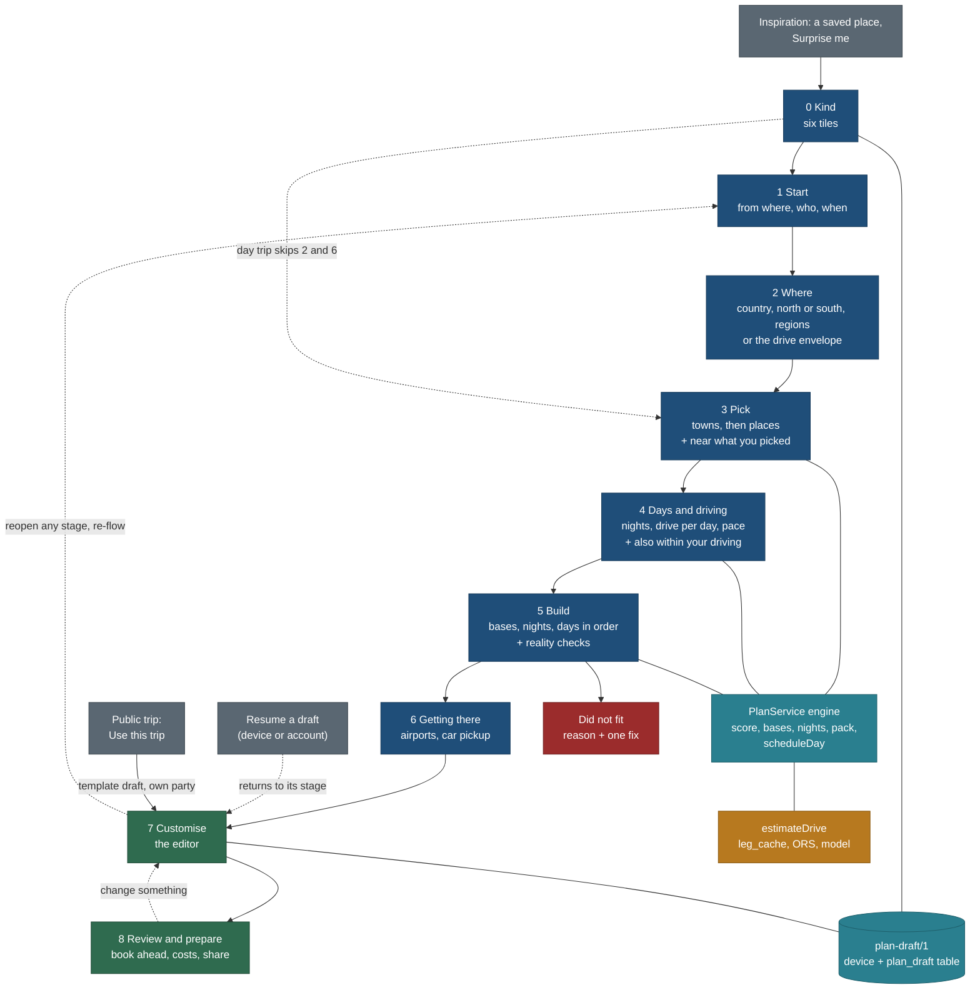

# Trip builder: the end-to-end flow (create, build, customise, copy, review)

Status: **design, planned only** (27 Oct 2026, travel-planner, Opus, task TB-FLOW). No app code. Owner requirement of
27 Oct 2026: "the Trip Builder is not just a create wizard; it is the full end-to-end experience of building a trip and
editing it". TODO row of 27 Oct 2026 (TB-FLOW); BACKLOG 15.353; PLAN R-278. Approved plan: Lane A of the coordinator's
plan "Trip Builder end to end".

**This page is the single flow.** It supersedes the step lists of [features/trip-builder.md](../../features/trip-builder.md)
2.1 and 2.2, of [README.md](README.md) section 1 and of TB-N's design note section 2 (branch `public/TB-N`, not merged),
and it amends [features/edit-my-trip.md](../../features/edit-my-trip.md) 5.2 (where a copy is edited) and Q-EM11. The
algorithms (trip-builder 4), the isolation rules (trip-builder 15, amended in decision TF9 below), the drive model
([driving-time-model.md](../../features/driving-time-model.md)), the kinds and profile
([trip-kinds-and-interest-profile.md](../../features/trip-kinds-and-interest-profile.md)) and the origin ladder
([trip-origin-and-nearest-airport.md](../../features/trip-origin-and-nearest-airport.md)) are not repeated here; each
stage links to the section it uses. The per-location data the engine reads is
[features/trip-builder-location-metadata.md](../../features/trip-builder-location-metadata.md).

Principles cited by number from [foundation/principles.md](../foundation/principles.md) (P1 to P9, T1 to T5). Every stage
was checked against [trip-scope-scenarios.md](../trip-scope-scenarios.md) (rules 1 to 9) and
[keep-from-live-site.md](../keep-from-live-site.md) (section 11 of this page).

Wireframes: [wireframes-phone.md](wireframes-phone.md) frames F0 to F8, E1 to E6, C1 to C3;
[wireframes-desktop.md](wireframes-desktop.md) frames W0 to W8, WE, WC. TB-N's visual decisions (focused flow on phones,
no drive-time rings, no swipe, Must see in the tray, kids chip first, primary action at the right of the step rail) are
kept in those frames.

## 0. The decision in one paragraph

**One flow of nine stages over one document.** Stage 0 picks the kind of trip (or starts from inspiration, a copy or a
draft); 1 says from where, who and when; 2 where to (country, north or south, then travel regions, or the drive envelope
from home); 3 picks towns and places, each pick surfacing what is near it; 4 sets days, driving per day and pace and
offers more places inside that driving; 5 builds the itinerary (bases, nights, days in time and road order) with the
reality checks; 6 confirms getting there; 7 is the editor, where the person owns and changes everything; 8 reviews and
prepares (book-ahead deadlines, known costs, warnings, share, calendar, print). **A copy of one of our trips enters at
stage 7** with a "Make it yours" sheet, so copying always leads into customising. Every stage writes the same
`plan-draft/1` document, which autosaves on the device and syncs to one account table when signed in; any stage can be
reopened from the editor and the plan re-flows, keeping what the person locked. **Every input after the kind is
pre-filled and skippable**, and is asked only where it changes the output. **Trade-off:** nine stages look long on paper;
the phone counts only the stages a kind asks (after the kind, a day trip is three steps and a weekend four), and stages 7 and 8 are the
same screen family the person lives in after the first build.

## 1. Decisions

| # | Decision | Why | Trade-off |
|---|---|---|---|
| TF1 | **Nine stages 0 to 8** (Kind, Start, Where, Pick, Days and driving, Build, Getting there, Customise, Review and prepare) replace trip-builder's eight steps. Bases move inside Build; Review becomes "Review and prepare" after Customise | The owner's order: build first, then take the result as a base and edit it; review is the finish line of planning, not a step before editing | A bases-only screen is gone; bases are the first card of the build result, editable there (TB2 kept: pin a town at any stage) |
| TF2 | **Six kind tiles over the five derived kinds**: Day trip, Weekend (1 to 2 nights), Long weekend (3 to 4), A week by car, A week by air, Longer holiday (10 to 21). "By car" is the week kind in near mode, "by air" in trip mode. The kind is still never stored (TK1, `planKindOf`) | The owner's six; the week was already split by mode (trip-kinds 1.1); no schema change | Two tiles map to one kind; changing nights moves the tile, changing mode moves between the two week tiles |
| TF3 | **Kind bands decided: weekend 1 to 2 nights, long weekend 3 to 4** (Q-TK1 yes). Public trip cards keep short-trips K1 labels | Owner, approved plan | Planner and card labels differ for 3 and 4 nights |
| TF4 | **Stage 1 asks from where, who and when for every kind**, each pre-filled (public hub or the device origin, the device party seeded from the account, "Any time" or the next weekend) | "When" gates which places are valid (seasons, closures, sun); "who" gates fit; "from where" sets the drive envelope or the arrival airport. Asked early because three later stages read them | One more screen for the person who knows nothing yet; every field has a default and Next works untouched |
| TF5 | **Where is country, then macro-region, then travel regions** (multi-select), from the region-groups reference; near kinds see the drive envelope instead, with travel regions inside it as optional narrowing (long weekend and week by car) | The owner: "Italy, then Northern or Southern Italy, then regions such as Dolomites, Lakes, Tuscany". A travel region (Dolomites) is not an admin region (it spans two) | Needs a two-level region-groups file with travel regions (metadata page M1); near-mode narrowing needs an optional `where.regions` on near drafts |
| TF6 | **Pick is one screen with two lists**: Towns and cities first (multi-select; "Stay here" pins a base), then Places (sights, hikes, activities, parks). **Every pick surfaces "Near what you picked"**: up to six unpicked places within the day-trip radius of that pick, one tap to add | The owner's order (towns, then places); nearby on pick turns a list into a plan as it grows (P3) | The near strip is one more request per pick (cached, 6 light rows, P8) |
| TF7 | **Driving per day is its own input** (`driveDayMin`, default from pace: relaxed 3 h, standard 4 h, full 6 h, the scheduler's `PACE_RULES.driveLimitMin`), separate from the one-way reach from home. It sets the day-trip radius (half of it, capped at 2 h one way) and powers "Also within your driving" | The owner: "how much do you want to drive per day, and use it to suggest more destinations inside the drivable envelope". Pace alone hides it | One schema key (`driveDayMin`, optional, before the first stored draft) |
| TF8 | **Build is deterministic and shows its work**: bases with why, nights, each day in time order and road order (Held-Karp), visit durations from `resolveDuration`, legs from `estimateDrive`, sun from `core/src/sun`, warnings from `core/src/checks`, book-ahead from `core/src/bookings`, Did not fit with one fix (trip-builder 4.3 to 4.9). The reality checks run here and stay live in the editor | A first draft the person trusts enough to edit; nothing vanishes silently (U6, T3) | Cold builds wait for routing (4 s budget with progress) |
| TF9 | **One editor for every draft.** Stage 7 is one action set (move, reorder, swap, add with "fits here", remove, lock, days, notes, re-flow, undo and redo) over EM-C's operations with inverses, used for built plans and for copies. **One home: `/t/<id>/`** (private, `noindex`, `no-store`) for every saved draft once the editor task ED ships; until then stage 7 runs inside `/plan/?draft=<id>&s=7` with the same action layer | The owner: create and edit are one experience; edit-my-trip already puts the copy editor at `/t/<id>/` and scenario rule 9 wants the trip in the URL | Amends ISO-1 (builder pages only `/plan/`) and ISO-2 for stage 7: the action layer is `web/components/plan/editor/**`, mounted by `/t/[id]/` through a new extension point X10. EM-4 and TB-W3's editor half merge into one task ED (section 9) |
| TF10 | **Copy leads straight into customising.** "Use this trip" (Copy to my trips) makes a template-mode draft with its own party (EM-B, merged 819dc834) and opens stage 7 with the "Make it yours" sheet. The first engine action (rebuild, new driving or pace, new region or places) converts it to a built draft **in place**, with a one-line notice and Undo; `seed` keeps the source | The owner: "copying an existing trip must lead into customising it to their liking". In place keeps one row in Mine | Our later fixes to the source trip stop reaching that copy once converted (EM3); the notice says so. Supersedes Q-EM11's "new draft" recommendation (open question F-Q3) |
| TF11 | **Locks win every re-flow.** A locked item keeps its day and position; a must-see is never dropped; re-flow after a move, reorder, remove or lock runs on the device with the picks matrix; new picks, bases, nights, pace or driving go to the server | Trust: an edit must not be undone by the engine (trip-builder 4.6 step 1; acceptance 4) | A locked plan can be infeasible; the warning says which lock causes it and offers "Unlock" |
| TF12 | **One account table, `plan_draft`, for copies and plans.** EM-M renames the live `planner_draft` to `plan_draft` (its RLS policies, grants, rows and the signal trigger move with it) and adds the EM-C columns. Q-EM1 yes (one document); QI1 yes (the name and one table for builder plans); Q-EM2's "extend the live table" kept as the mechanism | One document, one table, one sync path, one Mine list; the name matches ISO-6 and the builder fence | EM-M renames the table in the files that name it (`web/lib/server/drafts.ts`, `web/app/account/actions.ts`, `core/src/db/inventory.ts`, `core/src/db/tx.ts`, `core/src/seed/contract.ts`, their tests): about +1 h |
| TF13 | **Autosave, no "Save" needed to keep work.** A draft is written to the device on every stage change and every edit; it appears in Mine › My trips once it has one pick (a "Draft" chip and the stage it reached). Signed in, it syncs (edit-my-trip 4) | Families plan across several sittings and devices (research factor 12) | Abandoned drafts accumulate; the device cap (20) and account cap (50) apply, and Mine sorts drafts below dated trips |
| TF14 | **Resume where you were.** Stage 0 lists drafts with their stage and last change; opening one returns to that stage (derived from the document: no picks means stage 3, no build means stage 5, else stage 7). A build older than the engine version or the data revision shows "Rebuild to refresh drive times and closures", never a silent change | Research factor 12; T3 | Per-place change lists ("Moraine Lake road closed since you last opened") wait for a per-ref revision diff (later, section 3 row 12) |
| TF15 | **QB1 to QB10 decided as recommended, QB9 no** (approved plan, 27 Oct 2026). With Q-DC5: our own T0 `listed` records appear only in their own "Not researched yet" group; picking one files a request and never enters the engine | Honest breadth without padding (TB9) | QB3 conflicts with the owner's recorded answer "research later" (builder-dependency-map 7); kept as recorded, open question F-Q1 |
| TF16 | **Budget is not an input in v1.** No budget band, no running total. The editor and Review show **known costs** only (park entry, permits, timed entry, lifts: values we hold, each dated), with "Not priced" for the rest | Price is a value on 50 of 504 records and no lodging price exists (trip-kinds 1.2); a band or total over gaps would mislead (T3) and a filter would hide places on a gap ("a gap is never a yes") | The top family factor is only partly served in v1; section 3 row 3 states the trigger for the band (price on 60% of offered candidates and STY-P cost bands) |
| TF17 | **Car is the only way of getting around in v1**, stated on stage 4 ("We plan by car"); no-car, train and camper plans are later | The engine and the drive model route cars; transit routing is out (TB10, OR8) | Families without a car are served only by region transport notes (TB-D4) |

## 2. The flow

### 2.1 Stages per kind (what is asked, shown done, or skipped)

"Asked" is a screen; "done" means the desktop step rail shows the value and the phone does not count it (TB-N Q-TB-N5).

| Stage | Day trip | Weekend | Long weekend | A week by car | A week by air | Longer holiday |
|---|---|---|---|---|---|---|
| 0 Kind | asked | asked | asked | asked | asked | asked |
| 1 Start | asked | asked | asked | asked | asked | asked (from where may be "Decide later") |
| 2 Where | done ("Within 2 h of Toronto") | done | asked (optional narrowing) | asked (optional narrowing) | asked | asked |
| 3 Pick | asked (places; towns hidden) | asked | asked | asked | asked | asked |
| 4 Days and driving | done (0 nights; drive is the one-way reach) | asked | asked | asked | asked | asked |
| 5 Build | asked (one day, leave by, home by) | asked | asked | asked | asked | asked |
| 6 Getting there | done (the drive, inside the day) | done (drive out and back) | done | done | asked | asked |
| 7 Customise | asked | asked | asked | asked | asked | asked |
| 8 Review and prepare | asked; primary Add to calendar | asked; Add to calendar | asked; Add to calendar | asked; Save to Mine | asked; Save to Mine | asked; Save to Mine |
| **Phone step count** (stages 1 to 6 that ask; the kind screen is not counted) | 3 | 4 | 5 | 5 | 6 | 6 |

Primary actions follow trip-kinds 1.3 (P7). Stage 2 is also done when the country has one group (trip-builder 2.1).

## 3. Planning factors and what the flow does with each

The owner asked that the flow follow how families really plan. The research summary the coordinator supplied (indicative,
mostly vendor data): affordability and value rank first for families; children's ages and interests steer destination and
activities, and about a third of parents let the children pick; lead times are long (about 25% plan a year ahead, 61%
start five or more weeks ahead) and planning is spread over several sittings and devices; one family member usually leads
and others influence; travel moves through five stages (dream, plan, book, experience, share). Sources: TravelPulse,
"family vacations" article; Scitepress 2018, paper 84914 (family vacation decision-making); Tourism Update, "5 stages of
travel". These are cited as the coordinator summarised them; they were not re-read for this page.

Rule for every row: an input is added only where it changes the output, it is pre-filled, and Next works without it.

| # | Factor | Why it matters | Where asked (stage) | Default | Effect on the engine | v1 or later |
|---|---|---|---|---|---|---|
| 1 | **Who is going**: adults, children's ages | Ages steer places and activities (research); fit is a fact, not a taste (TK3) | 1 Start, one row "2 adults · 1 child (6) · Edit"; reused from the device party, seeded from the account (ACCT-P 5.5); a copy keeps its own party (EM-B) | the device party, else 2 adults | gates `TB_FIT`, pace caps (`capFamilyMin`), visit times (`ageRules`), the kids chip first on every row | **v1** (exists: `readParty()`; no new key) |
| 1b | Mobility and accessibility needs, stroller, infants | A step-free or stroller need removes options the age does not | 3 Pick, as filters (Stroller, Step-free) that exist on Places | off | filters on `stroller`, `wheelchair` (property registry) | **v1 as filters**; a party `needs` field is TK-C optional, **later** (one party model first) |
| 1c | Pets | Dogs change trails and lodging | 3 Pick, the existing "Dogs" trail filter | off | filter on `ext.trail.dogs` | v1 filter only; lodging for pets **later** (no stay data) |
| 1d | First-timer or experienced | changes famous-first versus quiet | not asked | none | the interest profile's "famous or quiet" habit (TK) | **later** with the profile (E) |
| 2 | **When**: dates or a month or season | Seasons, closures, sun and crowds make a place right or wrong (T1); long lead times mean most people know only a month | 1 Start: "When?" chips This weekend, Next weekend, a month, a season, exact dates, "Not sure yet" | short kinds: next weekend; others "Not sure yet" (scores season as unknown, never as open) | `TB_CLOSED`, season score, sun anchors, booking windows against the date | **v1** (`month`, TK-C4 `dated`, `sea`) |
| 2b | School and public holidays | Families travel on them; they fill parks | 1 Start, holiday weekends in the date chips | none | dates only | **later** (TK-H, P5: holiday reference per country) |
| 3 | **Budget** | Top-ranked family factor (research) | not asked in v1 (TF16) | none | none in v1; known costs shown at 7 and 8 | **v1: known costs only. Later: a three-band budget (Thrifty, Mid, Comfort) and a running estimate** when price covers 60% of offered candidates (TK-G measures) and STY-P gives lodging cost bands. Reason: a total built on gaps is wrong in the direction that hurts (too low) |
| 4 | **Purpose and vibe**: relax, adventure, culture, food, nature, kids-first | Drives what is shown first; children's interests count | 3 Pick: the "Looking for" activity chips (`act`) and, later, "Your interests" (TK) | All | filters and ranks (TK2, TK5); never gates | **v1** chips; profile **E** (Q-TK6 as amended) |
| 4b | **Pace**: relaxed, standard, full | Changes day length and how much fits | 4 Days and driving | relaxed with a child under 6, else standard (trip-kinds 1.2) | day caps, visit multiplier, drive per day default | **v1** (`pace`) |
| 4c | **Must-do versus nice-to-have** | Each person's must-do is protected | 3 Pick: Must see toggle in the tray (TB-N C4); 7 Customise: lock | nice-to-have | a must is never dropped by re-flow; an unfittable must is a Did not fit with a fix | **v1** (`picks[].must`, locks) |
| 5 | **Getting around**: own car, rental, no car, camper; EV, winter tyres, mountain roads | Changes routes, bases and day 1 | 4 states "We plan by car"; 6 Getting there offers "Pick up a car at VCE" for air kinds | car | drive model; winter factor and seasonal closures from the drive model's modifiers; `ext.drive.road_surface` and closures as warnings | **v1 car only (TF17)**; no-car, train, camper, EV and 4x4 routing **later** (no transit routing; `vehicle: "4x4"` exists in `estimateDrive` but no UI) |
| 6 | **Stay**: one base or moving, how many moves | Packing and unpacking is the hidden cost of a trip | 4 Days and driving: Moves (Fewer, Balanced, Shorter drives) and "Stay here" pins at stage 3 | Fewer for families with a child under 10, else Balanced | `M` in the base objective (trip-builder 4.4); pins are fixed bases | **v1** (`moves`, `bases[].pinned`) |
| 6b | Stay type: hotel, apartment, cabin, campground, kitchen, family rooms | Changes where a base can be | 3 Pick: the Camping activity chip includes campgrounds as base candidates (trip-kinds 1.3) | any | lodging class counts by type (TB-BL) | campground via chip **v1**; type filter **later** (stay records 8; lodging signal is counts, no names, TB12) |
| 7 | **Practical must-haves**: passports, visas or eTA, vaccinations, insurance, dietary, language, power and SIM, currency | Missing one cancels a trip; none changes the itinerary | 8 Review and prepare, as a checklist with official links per country, never a blocking question | shown for trips abroad from the start country | none | **later** (F09 tasks and checklists, signed-in planner); v1 Review shows one line "Check entry rules for Italy" linking the government page of the start country when the trip is abroad |
| 8 | **Decide together**: co-travellers comment or vote | One member leads, others influence (research) | 8 Review: Share link | none | none | **v1: share link** (public refs only; the recipient sees the plan with their own party). **Later**: per-item +1 and comments, "who picked this" (F11 collaboration needs accounts, moderation and a shared row; not worth it under 100 users) |
| 9 | **Dream and entry** | Most trips start from inspiration, not a country | 0 Kind: entry cards "From a place you saved", "From one of our trips", "Surprise me", "Resume" | none | "Surprise me" is near mode or trip mode with the kind, month and activity chips and no picks: the candidate query ranked by draw and season | **v1**: saved place (seeds Where and one pick), our trips (copy, TF10), Surprise me, resume. **Later**: compare two or three destinations side by side (the regions list already shows counts and best months; a real compare needs per-region drive and season summaries, TB-RG data) |
| 10 | **Reality checks before commit**: total driving, moves, daylight, cost, book-ahead deadlines, weather and season, closures | The plan stage's finish line | 5 Build (first run), live in 7, summarised in 8 | on | `core/src/checks` (16 codes), `core/src/bookings`, `core/src/sun`, `TB_*` codes; drive share caution (TB-N I6) | **v1** |
| 11 | **After the plan**: booking checklist, packing list, offline copy, day-of view, share and print, post-trip notes | The book, experience and share stages | 8 Review and prepare | on | none | **v1**: Book ahead list with deadlines and links, Add to calendar (ICS of the deadlines and days), print and PDF, share link, offline (the draft and last build open from the device). **Later**: packing list (F09), Today view of a draft (F13), post-trip notes feeding place data (F14) |
| 12 | **Resumability** | Several sittings and devices (research) | everywhere: autosave (TF13), resume (TF14), account sync (edit-my-trip 4) | on | none | **v1**; "what changed since you last opened" per place **later** |

## 4. The stages

Each stage lists: purpose, inputs, defaults, skip rules, what is saved in `plan-draft/1` (field names from
`core/src/schema/plan-draft.ts`; additions marked **new**, all optional and allowed in `/1` only before the first draft is
stored, as the file header says), empty and error states, phone and desktop notes, and the spec and task it maps to.

### Stage 0. Kind (and the ways in)

| | |
|---|---|
| Purpose | Choose the shape of the trip in one tap; or start from something |
| Inputs | Six tiles (TF2). Below them: "Your drafts" (device and account, newest first, with the stage reached), "From a place you saved" (favourites), "From one of our trips", "Surprise me" |
| Defaults | No tile pre-selected on a first visit (TB-N Q-TB-N8); a returning visitor's last kind is pre-selected |
| Skip | Never asked again once a draft exists; changing nights later moves the tile |
| Saved | nothing until a tile is chosen; then a new draft with `where.mode` (near for Day trip, Weekend, Long weekend, Week by car; trip for Week by air, Longer holiday), `nights` (0, 2, 3, 7, 7, 14), `pace` and `moves` from the kind |
| Empty and error | No drafts: the list is not drawn. Storage blocked: the notice of Mine (patterns 3.8 item 7) and the flow still works in the tab |
| Phone | F0: tiles stacked (56 px), entry rows below, action bar "Next: Start". Focused flow (TB-N C3) |
| Desktop | W0: tiles in a row, entry cards and drafts beside them, the globe or country map on the right |
| Maps to | trip-kinds 1.1, 1.7 copy; TB-N 3.1 `p01`, `d01`; trip-builder 2.6 (from our trips); TK tasks TK-W1 |

"From a place you saved" creates a draft with that place as the first pick, its country and travel region as Where, and
opens stage 1. "Surprise me" opens stage 1 and then goes straight to stage 3 with the list ranked by draw and season.

### Stage 1. Start: from where, who, when

| | |
|---|---|
| Purpose | The three facts every later stage reads |
| Inputs | **From where**: the one picker (OR11): public hubs, airports, gazetteer towns, "Use my location (stays on this device)". **Who**: the party row with Edit (device party). **When**: chips (factor 2) or a date range |
| Defaults | From where: the device origin `origin/1` (O3), else the account default (O4, later), else the nearest public hub; for Longer holiday "Decide later" is offered. Who: the device party. When: short kinds "Next weekend"; other kinds "Not sure yet" |
| Skip | Next works with the defaults. Who and when are one row each, collapsed to their values when set (P2) |
| Saved | near: `where.start` (hub, airport or towns-layer id; never a coordinate); trip: `origin` (OR9); `month`, `sea`, `dated` (TK-C4, device only); the party is **not** saved (`party: "device"`, trip-builder 2.4); a copy's own party is `party: "trip"` with `travellers` (EM-C) |
| Empty and error | Location refused: "We could not use your location. Pick a town or airport." No hub near the location within 100 km: the nearest towns-layer town is used and named |
| Phone | F1: three blocks, action bar shows a live count for near kinds ("9 places within 3 h ≈ · summer") and "Next: Where" |
| Desktop | W1: one pane, a map with the start point (never the exact device point: the town) |
| Maps to | trip-builder 2.2 step 1; origin 3 (ladder), 9 (picker), 10 (refs); trip-kinds 1.2, 1.4, 1.5; ACCT-P 5.5; tasks ORG-C, TB-W1 |

For air kinds the start city feeds stage 5: the nearest airport to the start (origin 4.2) and the gateway of each chosen
travel region (metadata M3) give the arrival airport the engine uses to order bases ("Fly into Venice, home from
Milan Malpensa"). Stage 6 confirms it.

### Stage 2. Where

| | |
|---|---|
| Purpose | Narrow the catalogue to where the trip happens |
| Inputs | **Trip mode**: country field (a region, park or town resolves to its country, parser), then macro-region chips ("Northern Italy", "Central Italy", "Southern Italy", "Islands"), then travel regions inside the ticked macro-regions as a multi-select list with counts ("Dolomites 69", "Lake Garda 3", "Tuscany 1", "Amalfi Coast 3", "Sicily: not researched yet"). **Near mode**: the envelope "Within 3 h of Toronto" with a reach control (1 to 8 h by kind) and, for Long weekend and Week by car, travel regions inside it as optional chips ("Muskoka", "Algonquin", "Adirondacks", "Laurentians") |
| Defaults | Trip mode: the macro-region with most researched places pre-expanded, none ticked; a country with one group skips to regions. Near mode: the kind's reach (2, 3, 4, 6 h) |
| Skip | Day trip and Weekend: shown done. Region narrowing in near mode is optional |
| Saved | `where.cc`, `where.regions` (travel region ids `it-dolomites` or region ids `IT/veneto`, PLAN_REGION_RE already accepts both); near: `where.driveLimitMin`, **new** optional `where.regions` on near drafts |
| Empty and error | A travel region with no researched places: greyed, "Not researched yet · Ask us to research it" (TB9), opens REQ-F1 pre-filled. A thin region: "Thin: 3 places". A country we hold nothing for: "We have not researched Portugal yet" with Ask us and our nearest trips |
| Phone | F2 (trip) and F2n (near). Region map is a 170 px peek; the count is always text (TB-N I8) |
| Desktop | W2: list pane and the region map; hover outlines, click toggles (P5) |
| Maps to | trip-builder 2.1 steps 1 and 2; TB-N 3.2; QB7; metadata M1 to M3; tasks TB-RG (merged with DC-5, metadata page 5), TB-W2 |

### Stage 3. Pick

| | |
|---|---|
| Purpose | Choose what the trip is for |
| Inputs | **Towns and cities** list (settlement records in the chosen regions or envelope, by draw; multi-select; each row has "Stay here" which pins it as a base). **Places** list (sights, hikes, activities, parks; parks as hub rows, trip-kinds 2.5): pills Looking for (`act`), Kids, Month, Effort, Filters (n); Pick control; Must see in the tray. **Near what you picked**: after each pick, a strip of up to six unpicked places within the day-trip radius of it, each with the drive ("25 min ≈ from Ortisei") and one-tap Pick |
| Defaults | Towns list collapsed to the top five when more than five; Places sorted by score (trip mode) or by drive (near mode) |
| Skip | Towns are hidden for Day trip. At least one place or town pick is needed for Next ("Pick at least one place"). "Surprise me" skips nothing: it pre-sorts |
| Saved | `picks[]` (`ref`, `slug`, `name`, `must`); `bases[]` with `pinned: true` for "Stay here"; `act`, `x` (TK-C4); filters stay in the URL only (`f`) |
| Empty and error | No results: names the filters, nearest match first (TB-N 4). Candidates failed: "We could not load places. Your picks are safe." with Retry. Near-strip failure is silent (the strip is a bonus) with a log count |
| Phone | F3: two section headings in one scroll, towns first; the tray peek shows "6 picked · about 5 days ≈"; the near strip slides in under the picked row (P5) and is announced ("3 places near Lago di Braies") |
| Desktop | W3: four panes (filters, list, map, tray); the near strip appears in the tray under the last pick and as outlined pins |
| Maps to | trip-builder 2.1 step 3, 4.3; TB-N 3.3; trip-kinds 2; nearby-and-regions 6.2 ranking; tasks TB-W1, TB-W2, TB-API (the near strip is `planCandidates` with `near=<ref>` and `limit=6`; TB-C adds the parameter) |

### Stage 4. Days and driving

| | |
|---|---|
| Purpose | How long, how hard, how much driving; then more places that fit that driving |
| Inputs | Nights (stepper, pre-filled from the picks' estimate, TB3), **Driving per day** (segmented 2 h, 3 h, 4 h, 6 h), Pace, Moves, and the line "We plan by car". Below: **Also within your driving**: up to 12 unpicked places inside the envelope of the picks (within half the daily driving of any pick, capped at 2 h one way), ranked by score, each with "+" |
| Defaults | Nights: the kind's default or the estimate when larger ("Your 9 picks need about 6 days"); driving per day from pace; pace and moves from the party (factor 4b, 6) |
| Skip | Day trip: shown done (the stage 2 reach is the driving). Everything has a default |
| Saved | `nights`, `pace`, `moves`, **new** `driveDayMin` (60 to 480, step 15; null means "from pace"), added picks |
| Empty and error | Nothing more within the driving: "Nothing else we hold within 2 h of your picks. Drive up to 3 h?" with the larger value as a button |
| Phone | F4: settings first, the suggestions list below with the count; action bar "Build my days" |
| Desktop | W4: settings left, suggestions and the map right (picks as filled dots, suggestions outlined; no rings, TB-N C2) |
| Maps to | trip-builder 2.1 step 4, 4.3 estimate, 4.4 radius; driving-time model 6.2 (base suggestion row); trip-kinds 1.2; tasks TB-E1 (radius from `driveDayMin`), TB-W1 |

### Stage 5. Build

| | |
|---|---|
| Purpose | Turn the picks into a dated or undated day-by-day plan the person can trust and edit |
| Inputs | None required. The result shows **Your bases** (letter, town, nights stepper, why, Swap town, Keep this base), **Other ways** (one base, one more base: moves and driving a day), then **Days**: each day's header (base, driving ≈, warnings), entries in time order, legs between them in road order, then **Did not fit** with one fix each, and the **Checks** summary (total driving, moves, daylight, book-ahead count, known costs) |
| Defaults | The engine's choice (trip-builder 4.4 to 4.6) |
| Skip | Never; Day trip builds one day with leave by, home by and the drive share (TB-N I6) |
| Saved | `bases[]` (accepted), `lastBuild` (`engine`, `basis`, `bases`, `days`, `didNotFit`, `spareDays`, `builtAt`) |
| Empty and error | Building: progress card "Working out drive times · 12 of 30". Failed: "We could not build your days" with the reason and Try again; the draft stays. Routing quota out: every leg ≈ with the notice. Paused (`PLAN_BUILDER_PAUSED`): read-only (TB-N 4) |
| Phone | F5: bases card, day chips, Day 1 open; action bar "Next: Getting there" (air kinds) or "Edit my plan" (others) |
| Desktop | W5: bases and the compare table left, the day document centre, the map right; one screen with stage 4's settings collapsed above (steps 4 and 5 on one screen, TB-N Q-TB-N9, kept) |
| Maps to | trip-builder 4.2 to 4.9, 4.11 golden fixtures; driving-time model 6.2; TB-N 3.4, 3.5; tasks TB-E1 to TB-E4, TB-G1, TB-G3, TB-W1, TB-W3 |

**Order inside a day** (the owner's "proper sequence: chronological and in road-route order"): the engine (1) places locked
items and items with a fixed slot or a single open weekday, (2) sorts the rest by bearing from the base and cuts them into
days balanced by demand, (3) orders each day exactly by drive (Held-Karp up to 10 stops), (4) moves items between days
only when that cuts driving or fixes a window, (5) runs `scheduleDay` for times, meals and sun, so a viewpoint with a
morning `best_time`, a car park with `fills_by` 08:00 or a lift's `last_up` pulls its stop earlier, and a stop past sunset
raises `W_DAYLIGHT` rather than moving silently. Visit time is `resolveDuration` (authored, then the record's range by
pace, then the type rule); drive time is `estimateDrive` to the stop's access point (car park or trailhead) when the
record has one.

### Stage 6. Getting there

| | |
|---|---|
| Purpose | Make day 1 and the last day real |
| Inputs | From (the stage 1 value), Arrive and leave (the arrival airport from the first base and the departure from the last; alternates; same airport or open jaw with the drive saved ≈), Flights ("Fares not shown", Search flights ↗), Car (pick up at the airport, one-way fee note), Transit (only with a region note and its source) |
| Defaults | origin ladder O1 to O7 (origin 3); the travel region's researched gateway beats the computed nearest airport (OR3, metadata M3) |
| Skip | Near kinds: shown done (the drive from the start is inside day 1 and the last day). Air kinds: "Not worked out yet" stays visible if skipped |
| Saved | `origin`, `gw` (EM-C); day 1 and day N re-flow (only those days) |
| Empty and error | No airport within 600 km: O7, "Getting there not worked out yet" |
| Phone | F6; desktop W6: the airport-to-base drive drawn, flights never drawn (T5) |
| Maps to | trip-builder 2.1 step 7, TB10; origin 4, 5, 9; TB-N 3.6; tasks TB-E5, TB-W4, TB-D4 |

### Stage 7. Customise (the editor)

The long-lived part. Every saved draft opens here; stages 1 to 6 open from it as sheets (phone) or panels (desktop) and
return here with the plan re-flowed.

| | |
|---|---|
| Purpose | The plan is the person's: change anything, and the plan stays coherent |
| Inputs | The interaction model below, plus a header with the trip's name, dates or "No date", party and kind (scenario rule 1), the state word of sync (edit-my-trip 4.7), and tools: Undo, Redo, Rebuild, Settings (opens stages 1, 2, 4, 6), Review |
| Defaults | Day 1 open (or today's day when dated and in progress) |
| Skip | n/a |
| Saved | `edits[]` (per-day order and `locked`), `picks`, `bases`, `nights`, `title`; template drafts: the `template` block ops (EM-C); every change through an operation with an inverse |
| Empty and error | A built plan whose engine version is old: "Rebuild to refresh drive times and closures" (TF14). Conflict from another device: edit-my-trip 4.4 notice. A locked plan that no longer fits: warning naming the lock with "Unlock" |
| Phone | E1 to E6; desktop WE |
| Maps to | trip-builder 2.1 step 6, 4.6, 4.10 (client re-flow), acceptance 4; edit-my-trip 4, 5; TB-N 3.5; tasks ED (section 9), TB-E4 `repack.ts` |

#### 7.1 Editor interaction model

| Action | Phone | Desktop (mouse) | Keyboard | Operation (inverse) | Re-flow | Feedback |
|---|---|---|---|---|---|---|
| Reorder inside a day | Move up, Move down in the item sheet; long-press the handle (400 ms) and drag with the insertion line | drag with the insertion line (components 8.1) | `Alt+Up`, `Alt+Down` | `moveItem(ref, day, index)` (back to the old index) | that day, on the device: times re-run, "moved 25 min later" marks | toast "Moved Seceda to 2nd on Day 2" with Undo; live region |
| Move to another day | item sheet → "Move to day…" sheet listing days with base, driving and free time ("Day 4 · A Ortisei · 1 h 40 free") | drag onto a day in the outline; the pill says "to Day 4 · +18 min driving ≈" | `M`, the day number, Enter | `moveItem(ref, toDay, index)` | both days, on the device | toast with Undo; both days flash their changed rows (reduced motion: no flash) |
| Swap two stops | item sheet → "Swap with…" | drag one onto the other with Shift | `S`, arrows, Enter | `swapItems(a, b)` (self-inverse) | both days | toast with Undo |
| Replace a stop with another place | item sheet → "Swap for a nearby place" (the near strip of that stop) | row menu, same | `R` on the row is Rebuild; replace is in the menu | `replacePick(old, new)` | that day; the server only when the new place has no matrix row (≈ meanwhile) | "Replaced; drive times ≈ until you rebuild" |
| Add a place with "fits here" | "+ Add" at the foot of each day: search or the near strip; each result shows **fits here** ("fits after Seceda · +15 min driving ≈ · day ends 17:40") or "Day full: try Day 5" | same, in a side sheet; dragging a candidate from the map onto a day shows the same line | `A` | `addPick(ref, day, index)` (remove) | that day; the fits line is computed on the device with `modelDrive` for the new place and the matrix for the rest | the line becomes the toast; the leg is ≈ until rebuilt |
| Remove a stop | item sheet → "Remove from the plan" (`--crit`, no confirm: undoable, patterns 4.4) | row menu, `Delete` | `Delete` | `removePick(ref)` (add back at the same place) | that day | toast with Undo; focus to the next row |
| Lock or unlock | switch "Locked to Day 2" in the item sheet; chip in the row | lock icon on the row | `L` | `lock(ref)` / `unlock(ref)` | none | chip "Locked to Day 2" (text, never colour alone) |
| Must see | tray or item sheet toggle | star on the row | `Shift+M` | `setMust(ref, bool)` | none until rebuild | chip "Must see" |
| Add or drop a day | day header menu: "Add a day after Day 5", "Drop Day 5" (confirms only if it holds a booking) | same | none | `insertDay(after)`, `dropDay(n)` | unlocked items of the neighbouring days; a dropped day's unlocked items re-flow or go to Did not fit | toast with Undo |
| Change a base or its nights | bases card: nights stepper, Swap town, Keep this base | same, or drag the base pin to a town | none | `setBase(...)` | server rebuild of that base's days (locks kept) | progress line, then "Day 6 to 9 rebuilt; 2 stops moved" with Undo |
| Change driving, pace, nights, regions, start | Settings → the stage as a sheet | Settings panel | none | `setDriveDay`, `setPace`, `setNights`, `setWhere`, `setOrigin` | server rebuild of unlocked items | same; "Rebuild" is never silent: one confirm "Rebuild unlocked days? 3 locked stops stay" |
| Rebuild | Rebuild in the header menu | Rebuild button | `R` (asks once) | `rebuild(scope)` (restore the previous `edits` and `lastBuild`) | server | as above |
| Notes | "Add a note" under the day title | inline (foundation 4.3) | Enter saves, Esc reverts | `setNote(day, text)` | none | none |
| Undo, redo | toast Undo (6 s); header Undo and Redo | header buttons | `Ctrl/Cmd+Z`, `Ctrl/Cmd+Shift+Z` | the inverse of the last op | as the op | toast names what was undone |

Rules:
- The undo history is per draft and per session on the device, 50 steps; the synced document carries no history (ops are
  rebased, edit-my-trip 4.4).
- Every drag has a menu and a keyboard path (WCAG 2.5.7); a phone never drags across days (TB-N 3.5).
- Warnings appear on the day header the moment an edit causes them (`W_PACE`, `W_DRIVE_LIMIT`, `W_DAYLIGHT`), each with
  one fix where one exists ("Move Cinque Torri to Day 8").
- Book-ahead rows follow their stop: moving Seceda to Day 4 moves "Seceda lift slot opens 1 Jun" to Day 4 and changes its
  book-by date from `core/src/bookings`.
- Re-flow never moves a locked item and never drops a must-see; it may move unlocked items and says how many ("2 stops
  moved").

### Stage 8. Review and prepare

| | |
|---|---|
| Purpose | The finish line of planning and the start of booking |
| Inputs | Title (editable), dates if not set ("Add dates" turns month into days), primary action by kind (P7) |
| Shows | Summary (days, bases, moves, driving a day ≈, places); **Book ahead** rows with book-by dates and links (`core/src/bookings`, park entry from `core/src/parks`); **Warnings** still open; **Did not fit**; **Known costs** (TF16): each fee we hold with its date, the sum of known ones, and "Not priced: lodging, car, food, 4 activities"; "Check entry rules for Italy" (trips abroad, one official link); share and export |
| Actions | Save to Mine (week and longer) or Add to calendar (short kinds) as primary; Copy link (public refs only, trip-builder 2.5); Add to calendar (days and book-by deadlines as ICS); Print and PDF (TB-P5c); Edit my plan (back to 7) |
| Saved | `title`, `start` (EM-C) when dates are added |
| Empty and error | Storage blocked: Copy link and Download lead (trip-builder design README 7) |
| Phone | F8; desktop W8 |
| Maps to | trip-builder 2.1 step 8; TB-N 3.6 `p14`; trip-kinds 1.6 booking windows; edit-my-trip 4.7 (no "saved" for copies: the button reads "Keep in Mine", see open question F-Q4) |

## 5. Copy and customise

| Step | What happens | Where |
|---|---|---|
| C1 | On a public trip, the primary action "Copy with my dates" (P7) opens the copy sheet (dates, who is going). The sheet's button reads "Copy and make it mine" | trip page, `CopySheet.tsx` (X7) |
| C2 | A template-mode draft is made (EM-C): `template.trip` is the slug, `party: "trip"` with `travellers` (EM-B fix), `start` if dates were given, `seed` set. It lands in Mine at once | device, then the account |
| C3 | The copy opens in stage 7 with **Make it yours**, a sheet on phone and a side panel on desktop, closable: "Keep it as it is" · "Change dates and who" · "Change where you start" · "Change places or regions" (opens stage 3 with the trip's places ticked and its regions set) · "Rebuild with my driving and pace" (opens stage 4) | `/t/<id>/` (before ED: the trip page bridge with `mine=`, edit-my-trip 5.2) |
| C4 | Edits that keep the trip's shape (version swap, add, remove, move, reorder, days, notes, dates, party) stay in template mode: our later fixes still reach the copy (EM3) | editor |
| C5 | The first engine action (rebuild, new driving or pace, new regions or places, a base change) shows one line: "This makes it your own plan. Our later updates to Dolomites will no longer change it." [Continue] [Cancel]. Continue converts **in place** (TF10): the template's days become locked `edits`, its stops become `picks`, its base plan becomes pinned `bases`, then the engine runs on what is unlocked. Undo restores the template draft | editor, `core/src/plan/ops.ts` (EM-C) `convertTemplate` |
| C6 | Mine shows one row: "Dolomites (your plan) · from our Dolomites trip" | Mine |

Seed, not fork (TB8, ISO-7): no live link back to the source after conversion; the source stays as `seed` for attribution.

## 6. Save, share, sync and resume

| Concern | Rule | Spec |
|---|---|---|
| Autosave | every stage change and every op writes the device draft (debounced 500 ms); signed in, the op goes to the outbox | TF13; edit-my-trip 4.3 |
| Device | `travel.plans.local` (`plan-drafts/1`), one device list for copies and plans after EM-5; cap 20 drafts, 16 KB each (Q-EM12) | trip-builder 15.1 ISO-3; edit-my-trip 6 |
| Account | `plan_draft` (TF12), owner-predicate RLS, cap 50, tombstones, revision; routes `/api/account/plans/**` | edit-my-trip 3, 4 |
| Sign-in | the automatic idempotent merge (M1 to M6) moves device drafts to the account | edit-my-trip 4.2 |
| Share | Copy link carries the URL keys of trip-builder 2.5 (public slugs, mode, regions, days, pace, bases, edited days); never the party, the start town, dates or notes. The recipient's device rebuilds the same plan (deterministic engine) with their own party and can "Use this plan" (a new draft, `seed` null, the sharer not named) | trip-builder 2.5, 7 |
| Resume | TF14; the stage reached is derived from the document, so it is the same on every device | |
| Print and export | per draft only (P8): PDF, ICS; no CSV of picks | principles P8 |

## 7. Phone and desktop

Unchanged from [README.md](README.md) section 2 and TB-N 3, with these additions:

| Concern | Phone (390) | Desktop (1440) |
|---|---|---|
| Stages 0 to 6 | focused flow (TB-N C3): step header with Back, the stage name, "3 of 6" counting asked stages only, Close keeps the draft | step rail with all nine stages, done ones as links with their values; primary at the right end of the rail (TB-N I4) |
| Stage 7 and 8 | the trip header of scenario rule 1 (name, photo or kind colour, dates), day chips, the public bottom bar returns (the person is now "in a trip") | the Plan grid: outline 256, day document 640, map fluid (wireframe D5) |
| Settings from the editor | each stage opens as a full-height sheet and returns to the same day and scroll (P5) | a 420 px side panel over the map; the day document stays visible so the effect of a change is seen |
| Near what you picked | a strip under the picked row | in the tray and as outlined pins |
| Make it yours | bottom sheet on first open of a copy, then a chip "Make it yours" in the header | side panel, then a header button |

## 8. What is saved: field map

| Field | Stage | Exists or new | Owner of the change |
|---|---|---|---|
| `where` (mode, cc, regions, start, driveLimitMin) | 0, 1, 2 | exists; **new** optional `regions` on near | TB-C follow-up (TB-C2, section 9) |
| `nights`, `pace`, `moves`, `month` | 0, 1, 4 | exists | |
| `act`, `sea`, `x`, `dated` | 1, 3 | planned TK-C4 | TK-C |
| `driveDayMin` | 4 | **new**, optional, 60 to 480 step 15, null = from pace | TB-C2 |
| `picks`, `bases`, `edits` | 3, 5, 7 | exists | |
| `origin`, `gw`, `fromRef` | 1, 6 | exists (`origin`); EM-C adds `gw`, `fromRef` | EM-C |
| `template`, `start`, `party: "trip"`, `travellers` | copy, 8 | planned EM-C | EM-C |
| `notes` for built drafts | 7 | **new**: today `notes` sits in the template block only; built drafts need the same `{trip, "<day>"}` map at the top level | EM-C (one `notes` for both modes) |
| `seed` | copy, 0 | exists | |
| `lastBuild` | 5, 6, 7 | exists | |
| `title` | 8 | exists | |

All additions are optional keys in `/1`, allowed only until the first draft is stored (FS-1 or EM sync, whichever ships
first; plan-draft.ts header). TB-C2 and EM-C must merge before either stores a draft (edit-my-trip gotcha 1).

## 9. Tasks this page adds or changes

| Id | What | Model | h | Needs | Bundle |
|---|---|---|---|---|---|
| TB-N2 | Design review of this page and the new frames (F0 to F8, E1 to E6, C1 to C3, W0 to W8, WE, WC); update TB-N's note so the two agree; mocks for the new screens (stage 1, the near strip, stage 4 suggestions, Make it yours, the editor sheets) | Opus (`travel-design-reviewer`) | 4 | this page | now |
| TB-C2 | Contract follow-up: `driveDayMin`, near `where.regions`, top-level `notes`, `planCandidates` `near` and `limit`; tests | Opus (shared contract) | 2 | TB-C (merged), before EM-C stores anything | D |
| TB-MD | Location metadata contract: region-groups two-level schema, gateway and transport fields, the `town` profile's `on_site_min` mark, `capture.ts coverage --builder` checks (metadata page 5) | Opus 3 + Sonnet 3 | 6 | DC-C | D (with DC-5) |
| ED | **The editor**: one action layer `web/components/plan/editor/**` over EM-C ops; mounted in `/plan/` stage 7 now and in `/t/[id]/` through X10; Make it yours; convert in place. **Merges EM-4 (30 h) and TB-W3's editor half (about 8 h)**; net change 0 h | Opus 6 (core) + Sonnet 24 + 8 | 38 | EM-C, TB-E4 `repack.ts`, TB-N2 | E (if pulled) or F |
| TB-W1 (scope change) | adds stage 1 Who and When, the near strip, stage 4 suggestions; +6 h | Sonnet | +6 | TB-C2 | D |
| EM-M (scope change) | renames `planner_draft` to `plan_draft` (TF12); +1 h | Opus | +1 | EM-C | D |

Net: +19 h (TB-N2 4, TB-C2 2, TB-MD 6, TB-W1 +6, EM-M +1). ED is hours moved, not added.

## 10. Open questions (each with a recommendation)

| # | Question | Recommendation | Trade-off |
|---|---|---|---|
| F-Q1 | QB3: fund the Toronto 4 h research batch before FS-1 ships? The approved plan says "QB1 to QB10 as recommended" (yes) but builder-dependency-map 7 records your answer "research later" | **Keep "research later"** (your recorded answer); FS-1 shows Ontario's true count with "Ask us" | The owner's Ontario story shows 4 places until the batch runs |
| F-Q2 | One editor at `/t/<id>/` for copies and plans, with stage 7 inside `/plan/` only until ED ships (TF9)? | **Yes** | Amends ISO-1 and ISO-2 for stage 7 (extension point X10); a short period with two renderers |
| F-Q3 | Convert a copy to your own plan **in place** on the first engine action, with a notice and Undo, instead of making a second draft (Q-EM11)? | **Yes** | The copy stops receiving our fixes to the source trip |
| F-Q4 | Review's primary button for week and longer reads "Keep in Mine" (the foundation bans "saved" for copies) rather than "Save to Mine"? | **Yes**, "Keep in Mine" | Differs from trip-builder and TB-N wording; one word change |
| F-Q5 | Budget out of v1: known costs only, the three-band budget and running estimate when price covers 60% of offered candidates (TF16)? | **Yes** | The top family factor waits for data |
| F-Q6 | Rename `planner_draft` to `plan_draft` in EM-M rather than keep the old name (TF12)? | **Yes** | About 1 h and a rename in six files; the old name would keep "planner" for a table that holds copies and plans |

## 11. Checks against the rules

| Rule | How the flow meets it |
|---|---|
| Scenario rule 1 (one trip in context, always visible) | stages 7 and 8 carry the trip header; stages 0 to 6 name the draft in the step header ("Italy · 10 days") |
| Rule 2 (switching keeps your place) | resume returns to the stage and day (TF14) |
| Rule 4 (nothing silently in the wrong trip) | "Add to a plan" from a place page always asks which draft |
| Rule 9 (URLs carry the trip) | `/t/<id>/` for every saved draft; `/plan/?draft=<id>` while building |
| Keep from live site | the place list keeps its pills, counts, chips and honesty markers; picks are the same rows with a Pick control |
| P8, P9 | candidates 40 light rows a page; near strip 6 rows; the build returns only the person's picks; all reads through `DataClient` |

## Change log

- 2026-10-27: created (TB-FLOW, travel-planner, Opus) from the owner's requirement and the approved plan (Lane A), with
  the owner's addition the same day (planning factors, section 3). Supersedes trip-builder 2.1 and 2.2 step lists,
  README section 1 and TB-N section 2; amends ISO-1, ISO-2, ISO-6 and Q-EM11.
