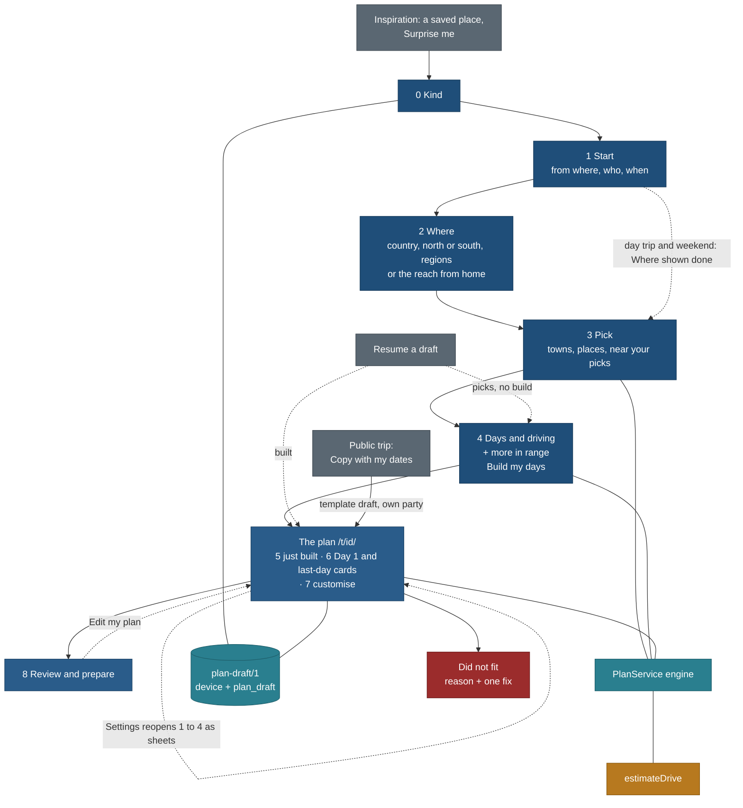

# Trip builder: the end-to-end flow (create, build, customise, copy, review)

Status: **design, planned only; revised after review TB-N2** (27 Oct 2026, travel-planner, Opus, task TB-FLOW). No app
code. Owner requirement of 27 Oct 2026: "the Trip Builder is not just a create wizard; it is the full end-to-end
experience of building a trip and editing it". TODO rows of 27 Oct 2026; BACKLOG 15.353; PLAN R-278, R-279. Review:
[reviews/review-TB-N2-trip-builder-flow-2026-10-27.md](../../reviews/review-TB-N2-trip-builder-flow-2026-10-27.md)
(must-fix M1 to M4, should-fix S1 to S12, polish L1 to L9, all applied here; section 12 lists how). Owner decisions of
27 Oct 2026 ("go ahead with recommendations") are in section 10, including F-Q4 (Review shows "In Mine" as a state; the primary is Add to calendar or Add dates).

**This page is the single flow.** It supersedes the step lists of [features/trip-builder.md](../../features/trip-builder.md)
2.1 and 2.2, of [README.md](README.md) section 1 and of TB-N's [design note](design-note-TBN.md) section 2 (folded in from branch `public/TB-N` on 27 Oct 2026),
and it amends [features/edit-my-trip.md](../../features/edit-my-trip.md) 5.2 (where a copy is edited) and Q-EM11. The
algorithms (trip-builder 4), the isolation rules (trip-builder 15, amended in TF9), the drive model
([driving-time-model.md](../../features/driving-time-model.md)), the kinds and profile
([trip-kinds-and-interest-profile.md](../../features/trip-kinds-and-interest-profile.md)) and the origin ladder
([trip-origin-and-nearest-airport.md](../../features/trip-origin-and-nearest-airport.md)) are not repeated here. The
per-location data the engine reads is
[features/trip-builder-location-metadata.md](../../features/trip-builder-location-metadata.md).

Principles cited by number from [foundation/principles.md](../foundation/principles.md) (P1 to P9, T1 to T5). Checked
against [trip-scope-scenarios.md](../trip-scope-scenarios.md) and [keep-from-live-site.md](../keep-from-live-site.md)
(section 11).

Wireframes: [wireframes-phone.md](wireframes-phone.md) frames F0 to F4, E0 to E7, F8, C1 to C3, X1;
[wireframes-desktop.md](wireframes-desktop.md) frames W0 to W4, WE, W8, WC. TB-N's visual decisions (focused flow on
phones, no drive-time rings, no swipe, Must see in the tray, kids chip first, the primary at the right end of the step
rail) are kept; the note's proposed foundation sections (components 9, patterns 3.12) now follow this page. Q-TB-N1 to
Q-TB-N10 status: [design-note-TBN.md](design-note-TBN.md) 12.

## 0. The decision in one paragraph

**One flow over one document, with no seam between building and editing.** The person answers four short stages: the
kind of trip (0); from where, who and when (1); where to (2: country, north or south, travel regions, or the drive reach
from home); what to see (3: towns, then places, each pick offering what is near it). Stage 4 sets days and driving and
offers more places in range, and its button is **Build my days**. **The first build lands in the editor**: the plan is
editable from the first second, with a "just built" status line, the bases and checks collapsed above Day 1, and, for
trips by air, getting there as the card on Day 1 and the last day. From then on the URL is the trip's own (`/t/<id>/`),
every earlier stage reopens as a settings sheet, and the plan re-flows while keeping **everything the person placed by
hand or locked**. Review and prepare (8) is the finish line: book-by dates, warnings, known costs, share, calendar,
print. **A copy of one of our trips opens in the same editor** with a non-modal "Make it yours" card. Every input after
the kind is pre-filled and skippable. **Trade-off:** the editor's code loads at the first build, not later; that is the
30 KB re-flow chunk the budget already assumes.

## 1. Decisions

| # | Decision | Why | Trade-off |
|---|---|---|---|
| TF1 | **Stages 0 to 8, with 5 to 7 as one screen**: 0 Kind, 1 Start, 2 Where, 3 Pick, 4 Days and driving, then **the plan** (5 the just-built state, 6 getting there as Day 1 and last-day cards, 7 customise), then 8 Review and prepare. Stage numbers stay for traceability | The owner: build, then take the result as a base and edit it. Review TB-N2 M1: a separate build screen is the wizard seam | No bases-only screen and no getting-there step; both are cards in the plan, expanded once on the first build |
| TF2 | **Six kind tiles over the five derived kinds**: Day trip, Weekend (1 to 2 nights), Long weekend (3 to 4), A week by car, A week by air, Longer holiday (10 to 21). "By car" is the week in near mode, "by air" in trip mode; the kind is never stored (TK1). A tile tap advances (L4) | The owner's six; no schema change | Two tiles map to one kind |
| TF3 | **Kind bands decided: weekend 1 to 2 nights, long weekend 3 to 4** (Q-TK1) | Owner, approved plan | Planner and public card labels differ for 3 and 4 nights |
| TF4 | **Stage 1 asks from where, who and when for every kind**, each pre-filled; for air kinds it shows the **departure airport** for the start city (S2) | When gates seasons and sun; who gates fit; from where sets the reach or the flights. The owner: "start city (nearest airport)" | One screen with three rows; Next works untouched |
| TF5 | **Where is country, macro-region, travel regions**; near kinds see the reach from home with travel regions inside it as optional narrowing | The owner's "Italy, Northern or Southern, then regions" | Needs the two-level region-groups file (metadata M1) and optional near `where.regions` (TB-C2) |
| TF6 | **Pick is towns then places; one "near what you picked" strip at a time**, collapsed under the latest pick; earlier strips move to the tray (S7). "Stay here" appears only on a picked town (R5) | Nearby on pick turns a list into a plan; one strip keeps the list stable for one thumb | Earlier suggestions are one tap further, in the tray |
| TF7 | **Two driving controls, named for what they do** (S1): "Longest drive from home, each way" (near reach, stage 2 or the reach pill) and "Driving on a day out from your base, in total" (`driveDayMin`, stage 4, only when nights are 3 or more). Day-trip radius is half of it, capped at 2 h one way | The owner's "how much do you want to drive per day"; two same-looking controls confused the reviewer | Weekend plans use the pace's default for day-out driving |
| TF8 | **Build is deterministic and shows its work** (trip-builder 4.3 to 4.9): bases with why, nights, days in time and road order, `resolveDuration`, `estimateDrive` to the access point, sun, warnings, book-ahead, Did not fit with one fix. Base order: for air kinds from the arrival airport to the departure airport; **for near kinds a loop from the start** (first base nearest the start on the way out, last base nearest it on the way home) | A draft the person trusts enough to edit (R8) | Cold builds wait up to 4 s with progress |
| TF9 | **One editor, one home.** One action layer `web/components/plan/editor/**` over EM-C's operations for built plans and copies. Owner decision F-Q2: its home is `/t/<id>/`, and **the `/plan/` stage 7 mount is removed in the same task (ED) that mounts `/t/[id]/`**: two renderers never ship in two releases. Before ED, the first build lands in `/plan/?draft=<id>&s=plan` with the same action layer; from ED on, the first build moves the URL to `/t/<id>/` with `history.replaceState`, so Back leaves the planner (L9) | The owner: create and edit are one experience; scenario rule 9 | Amends ISO-1 and ISO-2 (new extension point X10). EM-4 and TB-W3's editor half merge into ED |
| TF10 | **Copy leads into customising** (owner decision F-Q3: convert in place). "Copy with my dates" makes a template draft with its own party (EM-B) and opens the editor with the non-modal **Make it yours** card (S3). The first engine action converts it to the person's own plan in place, with a notice and Undo for this session; `seed` keeps the source; Mine's row label changes at once | The owner: copying must lead into customising | Our later fixes to the source stop reaching a converted copy |
| TF11 | **What the person placed stays placed** (M2). Move to day, reorder, add to a day, swap and replace mark the item "Placed by you" (`edits[].placed`, TB-C2); a lock pins it the same way; a must-see is never dropped. Rebuilds and re-flows move only engine-placed items. "Let the plan move it" releases one | TF11's promise: an edit must not be undone by the engine | A heavily edited plan has little room to re-flow; the rebuild line says how many items stay |
| TF12 | **One account table, `plan_draft`** (owner decision F-Q6): EM-M renames `planner_draft` and adds the EM-C columns; **the migration and the code that names the table ship in one release** (or with a one-release compatibility view), so live sync never meets a missing table | One document, one table | About +1 h in EM-M |
| TF13 | **Autosave; the draft is in Mine from its first pick** with a "Draft" chip and its state ("ready to build", "built, edited today"). Signed in, it syncs | Families plan across sittings and devices (factor 12) | Abandoned drafts count against the caps (device 20, account 50); the cap state is designed (X1) |
| TF14 | **Resume never runs the engine by itself** (S12). A draft with picks and no build opens stage 4 with Build my days; a built draft opens the plan; a build older than the engine or data revision says "Rebuild to refresh drive times and closures" | T3; a surprise rebuild would move things | Per-place "what changed" lists are later |
| TF15 | **QB1 to QB10 decided as recommended, QB9 no; QB3 "research later"** (owner decision F-Q1). Launch story: the trips by air (Dolomites, Rockies); Ontario's thin count shows on stage 1 before Pick ("4 places within 3 h so far · Ask us for more") | Honest breadth (TB9) | Weekends from Toronto look thin until the batch runs |
| TF16 | **No budget input in v1** (owner decision F-Q5). The plan and Review show known costs only, each dated: a **Free** chip where a zero price is known, and "EUR 74 for 5 of 9 places priced" | Price on 50 of 504 records; a total over gaps is too low (T3) | The band and running estimate wait for 60% price coverage and STY-P cost bands |
| TF17 | **Car only in v1, said at the start** (S8): the near kind tiles read "by car", air kinds say "We plan a hire car from the airport" on stage 1 | The limit must be known before the person invests time | Families without a car are served only by region transport notes |
| TF18 | **One bottom bar inside a plan on phones** (M4): the focused flow continues in the editor; its action bar (Settings · Review) replaces the public bottom bar; Undo lives in the toast and the header's ⋯ menu (Undo, Redo, Rebuild, Make it yours, Close plan) | One-handed use; two bars read as two apps (T2) | Trips and Places are one tap away (Close plan) until the planner's trip bar ships |
| TF19 | **Each draft gets a trip identity colour** at creation (tokens 4, the fixed set; `identity` in the draft, TB-C2) and shows the first pick's photo when one exists (S10) | Scenario rule 3: trips are never told apart by name alone | One optional key |
| TF20 | **A rainy-day option in the editor** (review 9): "Add to Day n" has a "Rainy day" chip that filters on `indoor`; about 1 h inside ED, no new data | Mountain trips with children need a plan B | Only places with `indoor` set appear (honest, thin today) |

## 2. The flow

Diagram colours are documentation only and blue-gray (no green, product direction); they are not product tokens (L7).

### 2.1 Stages per kind

"Asked" is a screen; "done" means the desktop rail shows the value and the phone does not count it, but the value stays
changeable (M3: the reach pill on stage 3 for near kinds).

| Stage | Day trip | Weekend | Long weekend | A week by car | A week by air | Longer holiday |
|---|---|---|---|---|---|---|
| 0 Kind | asked | asked | asked | asked | asked | asked |
| 1 Start | asked | asked | asked | asked | asked (departure airport shown) | asked ("Decide later" allowed) |
| 2 Where | done; reach pill on 3 | done; reach pill on 3 | asked (reach, optional regions) | asked (same) | asked | asked |
| 3 Pick | asked (places only) | asked | asked | asked | asked | asked |
| 4 Days and driving | done (one day; button Build my day on 3) | asked: nights, pace | asked: nights, day-out driving, pace, moves | same | same | same |
| The plan (5, 6, 7) | lands here; leave by, home by | lands here | lands here | lands here | lands here; Day 1 and last-day getting-there cards | same |
| 8 Review and prepare | yes | yes | yes | yes | yes | yes |
| **Phone steps to the plan** (stages 1 to 4 asked) | 2 | 3 | 4 | 4 | 4 | 4 |

Moves is hidden for Day trip and Weekend (one base, S1). Primary action on Review: Add to calendar (dated) or Add dates (undated), F-Q4.

## 3. Planning factors and what the flow does with each

Research summary supplied by the coordinator (indicative, mostly vendor data; cited as summarised, not re-read):
affordability and value rank first for families; children's ages and interests steer destination and activities (about a
third of parents let the children pick); lead times are long (about 25% plan a year ahead, 61% start five or more weeks
ahead) and planning spans sittings and devices; one member leads, others influence; travel moves through dream, plan,
book, experience and share. Sources: TravelPulse, family vacations article; Scitepress 2018, paper 84914; Tourism Update,
"5 stages of travel".

Rule: an input is added only where it changes the output, is pre-filled, and Next works without it.

| # | Factor | Why it matters | Where asked | Default | Effect on the engine | v1 or later |
|---|---|---|---|---|---|---|
| 1 | **Who is going**: adults, children's ages | Ages steer places and activities; fit is a fact (TK3) | 1 Start, one row; device party seeded from the account (ACCT-P); a copy keeps its own party (EM-B) | device party, else 2 adults | `TB_FIT`, family caps, `ageRules`, kids chip first; suggestions obey it (S9) | **v1** (no new key) |
| 1b | Mobility, accessibility, stroller | Removes options the age does not | 3 Pick filters Stroller, Step-free | off | `stroller`, `wheelchair` | v1 filters; a party `needs` field later (one party model first) |
| 1c | Pets | Trails and lodging | 3 Pick, Dogs filter | off | `ext.trail.dogs` | v1 filter; pet lodging later (no stay data) |
| 1d | First-timer or experienced | famous versus quiet | not asked | none | interest profile habit | later (E, with the profile) |
| 2 | **When**: dates, month or season | Seasons, closures, sun, crowds (T1) | 1 Start chips | short kinds: next weekend; others "Not sure yet" (scored unknown) | `TB_CLOSED`, season score, sun, booking windows; suggestions obey it (S9) | **v1** (`month`, `dated`, `sea`) |
| 2b | School and public holidays | Families travel on them | 1 Start date chips | none | dates only | later (TK-H, no reference data) |
| 3 | **Budget** | Top-ranked family factor | not asked (TF16) | none | none | **v1: known costs, Free chip, "N of M priced"**; band and running estimate later (price coverage) |
| 4 | **Purpose and vibe** | What is shown first | 3 Pick "Looking for" chips | All | filters and ranks; never gates | **v1** chips; profile in E |
| 4b | **Pace** | Day length | 4 Days and driving | relaxed with a child under 6, else standard | caps, visit multiplier, default day-out driving | **v1** |
| 4c | **Must-do versus nice-to-have** | Each person's must-do is protected | 3 tray Must see; editor lock and "Placed by you" | nice-to-have | never dropped; placed items stay (TF11) | **v1** |
| 5 | **Getting around** | Routes, bases, day 1 | said on the kind tiles and stage 1 (TF17); hire car on the Day 1 card | car | drive model, winter and closure modifiers | **v1 car only**; no-car, train, camper, EV, 4x4 later (no transit routing, no UI) |
| 6 | **Stay**: one base or moving | Packing is the hidden cost | 4 Moves (long kinds only), 3 "Stay here" | Fewer for a child under 10 | `M` in the base objective; pins | **v1** |
| 6b | Stay type | Where a base can be | Camping chip includes campgrounds | any | lodging counts by type | campgrounds v1; type filter later (8 stay records) |
| 7 | **Practical must-haves** | Missing one cancels a trip; none changes the itinerary | 8 Review, one line "Check entry rules for Italy" for trips abroad | shown abroad | none | v1 one link; checklist and packing later (F09) |
| 8 | **Decide together** | One member leads, others influence | 8 Review: Copy link | none | none | v1 share link; votes, comments, "who picked this" later (F11; accounts and moderation, not worth it under 100 users) |
| 9 | **Dream and entry** | Most trips start from inspiration | 0 Kind: drafts, a saved place, one of our trips, Surprise me | none | Surprise me ranks the candidate query by draw and season | v1; compare 2 or 3 destinations later (needs region summaries) |
| 10 | **Reality checks** | The plan stage's finish line | the plan's Checks line (live), Review | on | checks, bookings, sun, `TB_*`, drive share | **v1** |
| 10b | **Rainy day** | Plan B with children (review 9) | editor "Add to Day n" chip | off | filter on `indoor` | **v1** (TF20) |
| 11 | **After the plan** | Book, experience, share | 8 Review | on | none | v1: Book ahead with links (dated plans), calendar, PDF, share, offline draft; packing list, Today view, post-trip notes later |
| 12 | **Resumability** | Several sittings and devices | autosave, resume, sync | on | resume never builds by itself (TF14) | **v1**; stale-ref notice v1 (X1); per-place "what changed" later |

## 4. The stages

Field names from `core/src/schema/plan-draft.ts`; additions marked **new** are optional and allowed in `/1` only before
the first draft is stored (TB-C2 and EM-C merge before either stores one).

### Stage 0. Kind (and the ways in)

| | |
|---|---|
| Purpose | Choose the shape of the trip in one tap, or start from something |
| Inputs | Six tiles as buttons; a tap advances (L4). Meta lines: "by car" on Day trip, Weekend, Long weekend, A week by car; "fly somewhere" on air kinds (S8). Below: **Your plans** (three newest with their state, then "All plans in Mine", L3), From a place you saved, From one of our trips, Surprise me |
| Defaults | No tile marked on a first visit; Back from stage 1 returns with the tile marked |
| Saved | a new draft: `where.mode`, `nights` (0, 2, 3, 7, 7, 14), `pace`, `moves`, **new** `identity` (next free identity colour, TF19) |
| Empty and error | No plans: the list is not drawn. Device cap reached: X1 ("20 plans on this device. Delete one or sign in to keep more."). Storage blocked: the Mine notice |
| Phone, desktop | F0; W0 |
| Maps to | trip-kinds 1.1, 1.7; TB-N 3.1; TK-W1, TB-W1 |

### Stage 1. Start: from where, who, when

| | |
|---|---|
| Inputs | **From where** (one picker, OR11; Use my location stays on the device). For air kinds, under it: **"Fly from Toronto Pearson (YYZ) · 35 min ≈ · Change"** with alternates from origin 4.2 and the note "We use this for your flights; the airport you land at comes from where you go" (S2), and "We plan a hire car from the airport" (S8). **Who**: party row with Edit. **When**: chips |
| Defaults | origin ladder O3, O4, nearest public hub; device party; "Next weekend" for short kinds, "Not sure yet" otherwise |
| Live count (near kinds) | "9 places within 3 h ≈ · Oct" is a **button** that opens the reach control (M3). Thin: "4 places within 3 h so far · Ask us for more" (F-Q1) |
| Saved | `where.start` (near) or `origin` (air), `month`, `sea`, `dated`; the party is not saved (`party: "device"`) |
| Empty and error | Location refused: "We could not use your location. Pick a town or airport." |
| Next | names its stage: "Next: Where" or "Next: Pick" (L1) |
| Phone, desktop | F1; W0 (stages 0 and 1 share a screen on desktop) |
| Maps to | origin 3, 4.2, 9, 10; trip-kinds 1.2, 1.4, 1.5; ACCT-P 5.5; ORG-C, TB-W1 |

### Stage 2. Where

| | |
|---|---|
| Inputs | Trip mode: country field, macro-region chips, travel regions (multi-select, true counts, gateways and transport note in the row meta on desktop). Near mode (Long weekend, Week by car): **"Longest drive from home, each way"** (1 to 8 h) and optional travel region chips inside the reach |
| Defaults | the macro-region with most researched places expanded; the kind's reach (2, 3, 4, 6 h) |
| Skip | Day trip and Weekend: shown done; the reach is changed by the pill on stage 3 or stage 1's count |
| Saved | `where.cc`, `where.regions`; near: `where.driveLimitMin`, **new** near `where.regions` |
| Empty and error | Not researched yet · Ask us; Thin: n places; a country we hold nothing for |
| Phone, desktop | F2, F2n; W2 |
| Maps to | trip-builder 2.1, TB-N 3.2, QB7, metadata M1 to M5; TB-RG with DC-5, TB-W2 |

### Stage 3. Pick

| | |
|---|---|
| Inputs | Pills: for near kinds with stage 2 done, **the first pill is the reach** "Within 3 h ≈ ▾" (M3); then Filters (n), Looking for, Kids, Month. **Towns and cities** (multi-select; "Stay here" only on a picked town). **Places** with Pick. **Near what you picked**: one collapsed row under the latest pick, "3 places near Lago di Braies · Show"; expanded rows have two lines (name; "15 min ≈ from Braies") with fit, safety and booking chips; earlier strips move into the tray sheet as "Near your picks" (S7) |
| Suggestions | the near strip uses the stage 3 query (kids, month, Looking for); unfit or closed places are never suggested (S9); our T0 records never appear (QB9) |
| Action bar | left: Map; centre: tray peek "6 picked · Must see 1 · about 5 days (4 nights) ≈"; right: "Next: Days" or, for Day trip, "Build my day" (S7: Map never covers a row) |
| Saved | `picks[]`, `bases[]` pinned for Stay here, `act`, `x` |
| Empty and error | No results names the filters, nearest match first; candidates failed with Retry; no picks: Next disabled with the reason |
| Phone, desktop | F3, F3s; W3 |
| Maps to | trip-builder 2.1, 4.3; TB-N 3.3; trip-kinds 2; TB-W1, TB-API (`planCandidates` `near`, `limit`) |

### Stage 4. Days and driving

| | |
|---|---|
| Inputs | **Nights · n days** stepper with the estimate "Your 9 picks need about 6 days (5 nights) ≈" (L2); when nights are below the estimate: "3 nights will leave about 5 places out" (S12); **"Driving on a day out from your base, in total"** (2, 3, 4, 6 h; only when nights are 3 or more, S1); Pace; **Moves** only for Long weekend and longer (S1). Then **Also within your driving** (up to 12, same query and fit rules as the near strip, S9) |
| Saved | `nights`, `pace`, `moves`, **new** `driveDayMin` |
| Primary | **Build my days** |
| Empty | "Nothing else we hold within 2 h of your picks. Drive up to 3 h?" |
| Phone, desktop | F4; W4 |
| Maps to | trip-builder 4.3, 4.4; driving-time model 6.2; TB-E1, TB-W1 |

### The plan (stages 5, 6 and 7 on one screen)

**Stage 5, the just-built state** (M1). Build my days runs the engine with a progress card ("Working out drive times · 12
of 30") and lands on the plan with:
1. a status line "Built 10 days · 1 did not fit · 1 warning" (announced once);
2. **Bases** collapsed to one line ("2 bases · Ortisei 5 nights, Cortina 4 · Change") and **Checks** collapsed to one line
   ("1 h 25 driving a day ≈ · 1 move · Book ahead 3 · Known costs: 5 of 9 priced"); each expands in place;
3. Day 1 open below them with handles live. No "Edit my plan" button exists.

The URL becomes `/t/<id>/` (after ED; `/plan/?draft=<id>&s=plan` before it) with `history.replaceState` (TF9).

**Stage 6, getting there, as cards** (M1). For air kinds Day 1 starts with "Fly into Venice (VCE) · 2 h 30 ≈ to Ortisei
· Change" and the last day ends with "Fly home from Venice (VCE) · Change"; both are expanded on the first build only.
Change opens the getting-there sheet (from, arrive and leave, open jaw, flights link, car pickup note). Choosing a
different arrival or departure airport **re-runs the base order on the server with locks and placed items kept**; when
the bases are locked, a warning "Out of Milan (MXP) adds 2 h 10 ≈ on Day 10 · Reverse the bases" (S11). Near kinds:
the drive from the start sits inside Day 1 and the last day.

**Stage 7, customise.** The editor, section 7.1.

| | |
|---|---|
| Header | identity colour or the first pick's photo, title, dates or "No date", party, sync state word; ⋯ menu: Undo, Redo, Rebuild, Make it yours, Close plan (TF18) |
| Action bar (phone) | Settings · Review (the only bottom bar, M4) |
| Settings | sheets for Start, Where, Days and driving, Getting there, and "Make it yours" for copies; Apply states the effect ("Rebuild 6 days · 3 locked and 2 placed by you stay"), then an Undo toast; no second dialog (L5) |
| Saved | `edits[]` (order, `locked`, **new** `placed`), `picks`, `bases`, `nights`, `title`, `notes` (**new** top level), `origin`, `gw`, `lastBuild`; copies: the `template` block |
| States | Building; build failed ("We could not build your days" and Try again, the draft stays); quota out (every leg ≈); paused (read-only); stale engine ("Rebuild to refresh"); a pick no longer in our list ("1 place is no longer in our list · Remove it", kept in Did not fit, S12); conflict from another device (edit-my-trip 4.4); a lock or placement that no longer fits (warning naming it, with "Let the plan move it") |
| Phone, desktop | E0 to E7; WE |
| Maps to | trip-builder 4.6, 4.10; edit-my-trip 4, 5; TB-E4 `repack.ts`; ED |

#### 7.1 Editor interaction model

Drag model, gesture timing and keys follow components 8.1 (S6): Space to lift, arrows to move, PageUp and PageDown to
move across days, Enter to drop, Esc to cancel; long-press 300 ms on phones. Single-letter shortcuts work **only while
focus is on a plan row or the day document, never in a field**, are listed under `?`, and are turned off in one setting
(WCAG 2.1.4).

| Action | Phone | Desktop | Keyboard | Operation (inverse) | Re-flow | Feedback |
|---|---|---|---|---|---|---|
| Reorder inside a day | item sheet: one row with Up and Down (44 px each); long-press 300 ms and drag | drag with the insertion line | Space, arrows, Enter | `moveItem` | that day, on the device | "Moved Seceda to 2nd and kept there · Undo"; marks it Placed by you |
| Move to another day | item sheet **first row**: "Move to day…" (days with base, free time, driving change) | drag onto a day in the outline | Space, PageUp/PageDown, Enter; or `M` then the day number | `moveItem` | both days, on the device | "Moved to Day 4 and kept there · Undo"; Placed by you |
| Swap two stops | "Swap with…" | Shift-drag onto the other | `S` | `swapItems` | both days | toast; both Placed by you |
| Replace with a nearby place | "Swap for a nearby place" (the stop's near rows, fit and month applied) | row menu | menu | `replacePick` | that day; ≈ until rebuilt | toast; Placed by you |
| Add with "fits here" | "+ Add to Day n": search, near rows and a **Rainy day** chip (`indoor`, TF20); each row "fits after Siusi · +15 min ≈ · ends 17:55" or "Day full: try Day 5" | side sheet; drag from the map | `A` | `addPick` | that day; `modelDrive` for the new place | toast; Placed by you |
| Remove | "Remove from the plan" (`--crit`, no confirm) | row menu | Delete | `removePick` | that day | toast with Undo; focus to the next row, or the day's Add row when the last was removed |
| Lock, or let the plan move it | switch "Locked to Day 2"; "Let the plan move it" on a Placed by you item | lock icon | `L` | `lock`, `unlock`, `release` | none | chip "Locked to Day 2" or "Placed by you · Day 4" (words, not colour) |
| Must see | toggle | star | `Shift+M` | `setMust` | none | chip |
| Add or drop a day | day menu | same | none | `insertDay`, `dropDay` | free items of neighbouring days | toast |
| Base, nights, driving, pace, where, start | Settings sheets | Settings panel | none | `setBase`, `setNights`, `setDriveDay`, `setPace`, `setWhere`, `setOrigin` | server rebuild of free items | Apply line states the effect; toast with Undo |
| Rebuild | ⋯ › Rebuild | ⋯ › Rebuild | `R` opens the Apply line, never rebuilds directly | `rebuild` | server | as above |
| Notes | "Add a note" | inline | Enter, Esc | `setNote` | none | none |
| Undo, redo | toast Undo (6 s); ⋯ › Undo, Redo | ⋯ and header | Ctrl/Cmd+Z, Ctrl/Cmd+Shift+Z | inverse | as the op | toast names it |

Rules: undo history is per draft and per session (50 steps), not synced; every drag has a menu and keyboard path and a
phone never drags across days (WCAG 2.5.7); warnings appear on the day header with one fix; book-ahead rows follow their
stop; changed rows show a static "moved" marker for 6 s under reduced motion (otherwise a short highlight); re-flow
never moves a locked or placed item and never drops a must-see.

### Stage 8. Review and prepare

| | |
|---|---|
| Shows | summary; **state line**, not a save button: "In Mine · on this phone" or "In your account"; **Book ahead**: dated plans show book-by dates with links; month only "by about 1 Jun ≈ (for early July)"; "Not sure yet" shows "Add dates to see book-by dates" with the item names; lodging rows only with a sourced rule, labelled "rule of thumb ≈" (S5); Warnings; Did not fit; **Known costs** with the Free chip and "EUR 74 for 5 of 9 places priced"; "Check entry rules for Italy" for trips abroad |
| Actions | primary: **Add to calendar** when the plan has dates (days and book-by deadlines as ICS), **Add dates** when it has none (owner decision F-Q4); never "Keep in Mine" or "Save to Mine": the state line says the plan is in Mine. Secondary: Copy link, PDF, Edit my plan; signed out: "Sign in to keep it on every device" |
| Shared link states | "2 places in this plan are not public · showing 7" (S12) |
| Phone, desktop | F8; W8 |
| Maps to | trip-kinds 1.6; `core/src/bookings`; edit-my-trip 4.7 |

## 5. Copy and customise

| Step | What happens |
|---|---|
| C1 | On a public trip, "Copy with my dates" (P7) opens the copy sheet (dates, who is going); its button reads "Copy and make it mine" |
| C2 | A template-mode draft (EM-C) with `party: "trip"` and `travellers` (EM-B), `start` if dated, `seed`, an identity colour; in Mine at once |
| C3 | It opens in the editor with the **Make it yours** card inline at the top of Day 1, non-modal (S3): "Change places · Your driving and pace · Where you start", dismissed by "Keep it as it is". Afterwards it is the first section of Settings and the ⋯ item. Dates and who are in Settings › Start, not on the card |
| C4 | Shape-keeping edits (version swap, add, remove, move, reorder, days, notes, dates, party) stay in template mode; our later fixes still reach the copy (EM3) |
| C5 | The first engine action shows an inline notice: "This makes it your own plan. Our later updates to the Dolomites trip will no longer change it. You can undo this until you leave the page." [Continue] [Cancel]. Continue converts in place: the trip's days become items **placed "from our trip"** (the rebuild line names them so), its stops become picks, its base plan pinned bases. Mine's row becomes "Dolomites · your plan · from our Dolomites trip" at once |

Seed, not fork (TB8, ISO-7). Done trips opened as templates (scenario S10) enter the same way. Patterns 5.2's copy done
step changes from "Open in Mine" to "open the copy in the editor" in the TB-N foundation pass.

## 6. Save, share, sync and resume

| Concern | Rule |
|---|---|
| Autosave | every stage change and op writes the device draft (500 ms debounce); signed in, ops go to the outbox (edit-my-trip 4.3) |
| Device | `travel.plans.local`, one list for copies and plans after EM-5; cap 20 drafts of 16 KB; the cap state X1 |
| Account | `plan_draft` (TF12), RLS, cap 50, tombstones, revision; `/api/account/plans/**` |
| Sign-in | the automatic idempotent merge (edit-my-trip 4.2) |
| Share | URL keys of trip-builder 2.5, public refs only, never the party, start town, dates or notes; the recipient rebuilds with their own party and can "Use this plan" |
| Resume | TF14 |
| Export | per draft only: PDF, ICS (P8) |

## 7. Phone and desktop

| Concern | Phone (390) | Desktop (1440) |
|---|---|---|
| Stages 0 to 4 | focused flow (TB-N C3): step header with Back, the stage name, "2 of 3" counting asked stages; action bar with the named Next | step rail of stages 0 to 4 ending with a **"Your plan"** node (L6); done stages are links with their values; primary at the right end |
| The plan and Review | trip header (scenario rule 1) with ⋯; day chips; one action bar Settings · Review (TF18) | the Plan grid: outline 256 (bases and checks lines at its top), day document 640, map fluid; one Settings button; Make it yours inline above the day |
| Settings | full-height sheet, returns to the same day and scroll (P5) | 420 px side panel over the map |
| Near what you picked | one collapsed row under the latest pick; others in the tray sheet | in the tray column; outlined pins |

## 8. What is saved: field map

| Field | Stage | Exists or new | Owner |
|---|---|---|---|
| `where` (mode, cc, regions, start, driveLimitMin) | 0, 1, 2 | exists; **new** near `regions` | TB-C2 |
| `nights`, `pace`, `moves`, `month` | 0, 1, 4 | exists | |
| `act`, `sea`, `x`, `dated` | 1, 3 | planned | TK-C4 |
| `driveDayMin` | 4 | **new**, 60 to 480 step 15, null = from pace | TB-C2 |
| `identity` | 0 | **new**, one of the identity keys (tokens 4) | TB-C2 |
| `edits[].placed` | plan | **new**, refs placed by the person; rule: placed and locked refs are in their day, each once | TB-C2 |
| `picks`, `bases`, `edits`, `seed`, `lastBuild`, `title` | 3 to 8 | exists | |
| `origin`, `gw`, `fromRef` | 1, 6 | `origin` exists; `gw`, `fromRef` planned | EM-C |
| `template`, `start`, `party: "trip"`, `travellers` | copy | planned | EM-C |
| `notes` (top level, both modes) | plan | **new** | EM-C |

## 9. Tasks this page adds or changes

| Id | What | Model | h | Needs | Bundle |
|---|---|---|---|---|---|
| TB-N2 | Design review | Opus | 4 | done (21229eb1) | done |
| TB-N2R | Short re-review of the changed frames (section 12 list); F8 and W8 now carry final copy (F-Q4 decided) | Opus | 1.5 | this revision | now |
| TB-C2 | Contract: `driveDayMin`, near `where.regions`, `identity`, `edits[].placed` with its rules, `planCandidates` `near` and `limit`; tests | Opus | 2.5 | TB-C; before any draft is stored | D |
| TB-MD | Location metadata contract (metadata page) | Opus 3 + Sonnet 3 | 6 | DC-C | D |
| TB-W1 (scope) | stage 1 who, when, departure airport and thin count; reach pill; one near strip; stage 4 rules; the just-built landing in `/plan/?s=plan`; empty states X1; +9 h (was +6). **TB-N2R polish to build:** L-R2 phone header sub-line reads "July · On this phone"; L-R3 F3 pills one scrolling row, order Reach, Kids, Looking for, Month, Filters; L-R4 "Ask us for more" its own link, never inside the count button; L-R5 use the measured 4 places in F3 or mark numbers illustrative; L-R6 month chip reads "July ▾" once chosen; L-R7 F8 drops "Edit my plan", W8 reads "Back to the plan", F8 lists Book ahead rows in full or adds "Show 1 more"; L-R8 F3s strip indented 28 px on phones. Also takes the park-page request R1 (BACKLOG 15.354) | Sonnet | +9 | TB-C2 | D |
| ED | The editor: action layer over EM-C ops, `/t/[id]/` mount (X10) and **removal of the `/plan/` editor mount in the same task**, Make it yours card, convert in place, placed-by-you, rainy-day chip (+1 h), keyboard model per 8.1; **TB-N2R R1: one "Keep on Day n" switch, on for placed and locked items, reason under it ("On because you placed it. Turn off to let the plan move it."); off is the `release` op, on is `lock`; the day chip reads "Kept on Day n" with the lock icon; rebuild line "3 locked and 2 placed by you stay"; TB-N2R L-R1 toast reads "Moved to Day 2 · kept there" with Undo and the place name in the live region;** merges EM-4 (30 h) and TB-W3's editor half (8 h) | Opus 6 + Sonnet 33 | 39 | EM-C, TB-E4, TB-N2R | E or F |
| TB-E1 (scope) | near-kind loop base order; suggestions obey fit and month; resume never builds; +1 h | Opus | +1 | TB-C2 | D |
| TB-E5 (scope) | changing airports re-runs the base order with locks and placed items kept | Opus | +0.5 | | F |
| EM-M (scope) | rename `planner_draft` to `plan_draft` shipped with the code that names it | Opus | +1 | EM-C | D |

Net added by TB-FLOW and its review: TB-N2R 1.5, TB-C2 2.5, TB-MD 6, TB-W1 +9, ED +1, TB-E1 +1, TB-E5 +0.5, EM-M +1 =
**+22.5 h** (TB-N2's 4 h already spent).

## 10. Owner decisions

Answered by the owner on 27 Oct 2026 ("go ahead with recommendations"):

| # | Question | Decision |
|---|---|---|
| F-Q1 | QB3: the Toronto batch before FS-1? | **Research later.** Launch on the trips by air (Dolomites, Rockies); stage 1 shows Ontario's thin count before Pick ("4 places within 3 h so far · Ask us for more"). If weekends from Toronto become the launch story, fund the batch |
| F-Q2 | One editor at `/t/<id>/`? | **Yes**; the `/plan/` editor mount is removed in the same ED task that mounts `/t/[id]/` |
| F-Q3 | Convert a copy in place? | **Yes**; the notice says Undo lasts this session only; Mine's label changes at once |
| F-Q5 | Budget out of v1? | **Yes**; known costs only, a Free chip and "N of M priced" |
| F-Q6 | Rename `planner_draft` to `plan_draft`? | **Yes**; the migration and the code ship together (or with a one-release compatibility view) |
| F-Q4 | Review and prepare's primary action | **State line "In Mine" (or "In your account"); primary Add to calendar when dated, Add dates when not** (owner, 27 Oct 2026, option B). Reason: the draft is in Mine from its first pick (TF13), so a keep or save button would do nothing new (T3) |

## 11. Checks against the rules

| Rule | How the flow meets it |
|---|---|
| Scenario rule 1 | the plan and Review carry the trip header; stages 0 to 4 name the draft in the step header |
| Rule 2 | resume returns to the stage and day; never builds by itself |
| Rule 3 | identity colour per draft, first pick's photo (TF19) |
| Rule 4 | "Add to a plan" from a place page asks which plan |
| Rule 9 | `/t/<id>/` from the first build |
| Keep from live site | the pick list keeps pills, counts, chips, honesty markers |
| P8, P9 | light rows, 6-row strips, the build returns only the person's picks, all through `DataClient` |

## 12. Review TB-N2: how each item was applied

| Item | Applied as |
|---|---|
| M1 | TF1, "The plan" section, E0, WE; step counts in 2.1 |
| M2 | TF11, 7.1, `edits[].placed` (TB-C2), E1, E2, E5 |
| M3 | stage 1 count button, stage 3 reach pill; F1, F3 |
| M4 | TF18; E0, E1 |
| S1 | TF7; stage 4 rules; F2n, F4 |
| S2 | TF4; stage 1; F1 |
| S3 | section 5 C3; C2, WC |
| S4 | owner decision F-Q4 (option B): state line plus Add to calendar or Add dates; F8, W8 |
| S5 | stage 8 Book ahead rules; F8 |
| S6 | 7.1 opening rules and keys |
| S7 | TF6; stage 3; F3, F3s |
| S8 | TF17; F0, F1 |
| S9 | stage 3 and 4 suggestion rules; TB-E1 scope |
| S10 | TF19 |
| S11 | stage 6 card rules; TB-E5 scope |
| S12 | TF14; stage 4 below-estimate line; plan states; Review shared-link line; X1 |
| L1 to L9 | applied (L7: the diagram is now blue-gray) |
| Accessibility gaps (review 7) | 7.1 focus after Remove, reduced-motion marker, Undo in the ⋯ menu |
| Rainy day (review 9) | TF20 |
| Deferred | none |

## Change log

- 2026-10-27: created (TB-FLOW, travel-planner, Opus) from the owner's requirement and the approved plan (Lane A), with
  the planning factors added the same day (section 3).
- 2026-10-27: revised after review TB-N2 (21229eb1): build lands in the editor, getting there as Day 1 and last-day
  cards, placed-by-you, reach pill, one bar in the phone editor, S1 to S12 and L1 to L9 applied, TF18 to TF20 added;
  owner decisions F-Q1, F-Q2, F-Q3, F-Q5, F-Q6 recorded.
- 2026-10-27: owner decision F-Q4 (option B) recorded; F8 and W8 carry final copy.
- 2026-10-27: TB-N's design note merged into `design/PLAN-SYNC`; this page is its source of truth for the step list.
