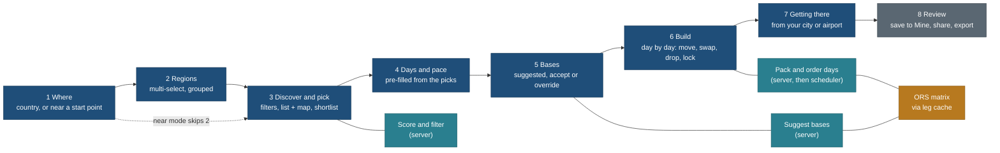

# Trip builder: design notes and wireframes (index)

Status: wireframes for the spec [features/trip-builder.md](../../features/trip-builder.md), 27 Oct 2026, travel-planner
(Opus). Not reviewed yet: the first build task (TB-N) is a `travel-design-reviewer` pass that turns these frames into a
design note and mocks the owner approves before any UI is built.

| File | What it holds |
|---|---|
| [wireframes-phone.md](wireframes-phone.md) | Every key screen at 390 px: stepper, bottom sheets, thumb zone, map as a sheet, swipe and its button alternative |
| [wireframes-desktop.md](wireframes-desktop.md) | Every key screen at 1440 px: multi-pane (filters, list, map, tray or itinerary at once), drag and drop, keyboard |
| this page | The flow diagram, what changes between phone and desktop, shared components, foundation additions, accessibility, budgets, slow and offline network |

Principles cited by number from [foundation/principles.md](../foundation/principles.md) (P1 to P9, T1 to T5).

## 1. The flow (both platforms, same steps, same URL keys)

Near mode (day trips and short stays) is the same flow with step 1 asking "from where, how far, how many nights" and
step 2 skipped; with 0 nights step 5 is skipped too.

## 2. Phone-native versus desktop-native (what changes, and why)

| Concern | Phone (390, one hand, T2) | Desktop (1440, mouse and keyboard) | Principle |
|---|---|---|---|
| Steps | A stepper header ("3 of 8 · Discover") with Back on the left and Next in the bottom bar; one step per screen | A step rail across the top; earlier steps stay editable in place (a region chip row above the list), and the user can jump to any reached step | P3, P4 |
| Where the map is | A bottom sheet with three snap points (peek 96 px, half, full); the list is the default; a "Map" pill swaps | Always visible, right pane, fluid width; hover on a row lifts its pin and the reverse | P5, T2 |
| Filters | Four primary pills in a scrolling row; "Filters" opens a full-height sheet with a live count and one "Show N places" button | A left rail (240 px) with every facet open, counts per value, results update as you choose | P4, P1 |
| Picking | A "+" button on every card (44 px), and swipe right on a card as a shortcut; the shortlist is a peek bar at the bottom ("6 picked · about 5 days · Next") | A checkbox on each row, a fourth column (360 px) with the shortlist, drag a row into the shortlist or onto a day | P3, P7 |
| Bases | Cards in a vertical list, each with "why", nights stepper and Swap; the map sheet shows rings | Bases listed on the left of the map with rings drawn; drag a base pin to another town to override | P2, P6 |
| Itinerary | Days as a vertical list; a horizontal day chip strip on top jumps to a day; reorder inside a day by long-press drag; move to another day through a "Move to day" sheet | Three panes: day outline (256), day document (620), map (fluid), as the foundation's Plan grid; drag between days on the outline; keyboard moves | P5, P2 |
| Editing | Tap an item for a sheet: Move, Swap, Lock, Drop, Details | Hover tools on the row, a right-click menu, and keys (section 6) | P4 |
| Thumb zone | Primary action always in the bottom 120 px; destructive actions never in the bottom-right corner | Primary action top right of the active pane and bottom of the tray | T2 |
| Density | One card per row, three chips at most per card at rest | Table-like rows, five chips at rest, the reasons line visible | P3, P6 |

**What is shared, unchanged:** the URL keys, the engine output, the data each card shows (the light row, P8), the copy
and chip wording, the order of steps, the honesty markers, the empty and error states. Only layout, gestures and how
many panes are visible differ.

## 3. Shared components (one implementation, two layouts)

| Component | Exists in the foundation? | Use in the builder |
|---|---|---|
| Place card and list row | yes, 3.1 and 3.2 | candidate rows; gain a pick control |
| Filter pills with menus | yes, 2.7 | Kind, Activity, Effort, Kids, Season, Time on site |
| Chips | yes, 2.8 | reason chips, base chips, warning chips |
| Map | yes, 7.1 (MapLibre, OpenFreeMap) | candidate pins, base rings, day legs |
| Bottom sheet (phone) | yes, 5.5 | map, filters, item actions; needs snap points (addition A3) |
| Side sheet | yes, 5.1 | item details on desktop |
| Day timeline row | yes, 4.3 | itinerary items |
| Drag handle, insertion line, drag pill | yes, 8.1 | itinerary moves |
| Toast with Undo | yes, 5.3 | every edit |
| "Not checked yet" block | yes, 6.5 | gaps in a place's facts; extended by "Did not fit" (addition A6) |
| Stepper | yes, 2.12 (numeric) | days and nights per base |
| Segmented control | yes, 2.9 | pace, "fewer moves / balanced / shorter drives" |

## 4. Foundation additions needed (to be written by TB-N, the design reviewer)

| # | Addition | Why it is new |
|---|---|---|
| A1 | **Flow step header (phone) and step rail (desktop)**: label, count, back, the next step's name | no multi-step flow exists today; the copy sheet is one step |
| A2 | **Pick control**: off, picked, must-see (a second tap or a menu), with a 44 px target and a text state | a checkbox alone cannot say "must" |
| A3 | **Bottom sheet snap points** (peek, half, full) with the map inside, and a rule for scroll handoff between sheet and list | 5.5 has one height |
| A4 | **Tray / peek bar**: the shortlist summary pinned to the bottom (phone) or a column (desktop), with a live "about N days" | new |
| A5 | **Reason chips and the "Why this?" disclosure**: draw, fit, season, theme, distance, in that order; never colour alone | nearby 6.2 defined the order; no component |
| A6 | **"Did not fit" block**: each left-out item with the reason code in words and one fix ("Add 1 day", "Swap with...", "Pick another base") | 6.5 covers missing facts, not plan conflicts |
| A7 | **Base pin and ring**: a lettered pin (A, B, C) per base with a drive-time ring legend marked ≈ when estimated | the map has place pins only |
| A8 | **Lock affordance** on an item and on a base, with its text state ("Locked to day 3") | new |
| A9 | **Region chooser**: a grouped multi-select list with counts and a simplified region map (polygons from the globe's admin-1 data) | the Where pill drills one path; the builder needs several regions at once |

## 5. Accessibility

- **Dragging has a non-drag path** (WCAG 2.2, 2.5.7): every drag (pick into tray, item between days, base on map) has a
  button or menu alternative, and keyboard moves (section 6 of the desktop file).
- **Swipe has a button.** Swipe right to pick is a shortcut only; the "+" control is always there.
- **The map is never required.** Every fact on the map is in the list: distance and direction chips, base letters,
  day drive totals (T5).
- **Live regions** announce counts and engine results: "24 places, 6 picked", "Built 7 days, 2 places did not fit".
- **Focus:** each step moves focus to its heading; closing a sheet returns focus to the control that opened it (P5).
- **Colour:** base and day colours always pair with a letter or number; warnings carry a word and an icon.
- **Reduced motion:** sheets and map fly-tos jump, the links stay (P5).
- **Targets:** 44 px on phone, 32 px on desktop; text at least 16 px on phone inputs (no iOS zoom).

## 6. Performance budgets

| Item | Budget | How |
|---|---|---|
| `/plan/` start JS | at most 90 KB gzip | the shell and step 1 only; each step a lazy chunk |
| Map chunk | loaded on first map view (desktop: after first paint; phone: on first "Map" tap) | the existing MapLibre chunk is shared, not duplicated |
| Candidate page | 40 light rows, at most 12 KB gzip per request | P8 row allowlist; paginated |
| Build response | at most 48 KB gzip for 40 picks and 14 days | times, legs (polylines simplified to 30 m), warnings, reasons |
| Client re-flow after an edit | at most 30 KB gzip chunk (scheduler plus the local packer), under 50 ms on a mid phone | uses the picks matrix returned by the build, never a bulk file (P9) |
| Engine time on the server | p95 at most 1.5 s warm cache; at most 4 s with cold ORS cells, with a progress line | section 7 of the spec |
| Draft on the device | at most 16 KB per draft, 10 drafts | `plan-draft/1` |

## 7. Slow and offline network

| Situation | Behaviour |
|---|---|
| Slow network | Skeleton rows, never a blank pane; the count says "Counting..." until it arrives; a build over 2 s shows "Working out drive times (12 of 30)" |
| ORS slow or out of quota | The build returns with straight-line estimates marked ≈ and a line "Drive times are estimates; we will refresh them"; nothing blocks |
| Offline after a build | The draft and its last build open from the device; edits re-flow locally with stored legs; new picks get ≈ legs; "Refresh routes" appears when back online |
| Offline before any build | Steps 1 to 4 work only on pages already loaded; Build says "You are offline. Your picks are saved on this device." |
| Storage unavailable | As Mine (navigation-and-mine 3.3): the draft lives in the tab, and the review step leads with "Copy link" and "Download" |
