# Google trip route map: design note (TRP2-N, 23 Oct 2026)

Rulings for [TRP2](../../build/public-site/briefs/TRP2.md) step 1, binding on TRP2a and, where marked, TRP2b. Written by `travel-design-reviewer` on Opus. Where this note changes an earlier ruling in [stage4-map-note.md](stage4-map-note.md) or [timeline-design.md](timeline-design.md) section 6, section 14 says so. Principles are cited by number from [principles.md](../foundation/principles.md). Tokens come from [tokens.md](../foundation/tokens.md) and `web/app/themes.css`; no new token is needed.

## 0. What this is based on

Rendered on 23 Oct, at 2x, 1440 and 390, light and dark (dark set through the header's theme control), Chromium on Metal:

- **Today's trip map** on preview 1 (`127.0.0.1:3440`, MapLibre), Rockies day 8, desktop column and phone sheet.
- **The Google basemap with the owner's current Map ID** (`NEXT_PUBLIC_GOOGLE_MAP_ID`, read from the env file at run time and never printed) and, for comparison, `DEMO_MAP_ID`: a scratch harness that draws day 8 the way this note rules, at zoom 8 (the day) and zoom 14 (Lake Louise village), with `colorScheme` light and dark.
- **A no-green target**: the same view with vegetation and parks recoloured to `--map-wood` and POIs off (a legacy style array, used only to preview what the Map ID style should produce).

The screenshots are in the session scratchpad (`.../scratchpad/trp2n/`), not in the repo. Preview 1's place pages are also MapLibre, so "the place-page Google map" exists only in the fixture build of `places-google.spec.ts`. The check for "place pages look the same" is therefore that the place-page code paths do not change (checklist 30).

## 1. Findings that shaped the rulings

| # | Rank | Screen | What is wrong | Why it matters to a family | Fix (section) |
|---|---|---|---|---|---|
| F1 | critical | Google map, both Map IDs | The Rockies render about 46% green in light (forest `#C3F1D5`, hue 143; fill at zoom 8 `#ACECCC`, hue 150), with green park labels and a green campground label. Dark is teal (`#164A55`, hue 190) | It breaks the owner's no-green rule ("maps included"), and every Rockies and Dolomites day sits inside a park | The Map ID style recolours vegetation and parks (2.2, owner Q-A) |
| F2 | critical | Google map, owner's Map ID, zoom 14 | POIs are **on** today: Lake Louise Inn (pink), the visitor centre (purple), Bow River Loop Trail (green icon). It looks the same as `DEMO_MAP_ID` | Google's hotels and trails look like our stops, and a click on one opens a Google card over our pins. A family follows the wrong pin | Q89 in the console; `clickableIcons: false` in code; a verifier check (2.2, 12) |
| F3 | critical | Today's map, day 8 | Pin 4 is "Icefields Parkway (Hwy 93N) scenic drive", a 230 km road stored as one point. It matches no timeline entry, so it sorts last and lands between pins 1 and 2. The dashed line then runs back north | This is the owner's "pins out of geographic order". A road drawn as a pin is a false position (T5) | Number only pins that match a timeline entry; never draw a road or drive as a pin (4.1) |
| F4 | important | Today's map, label row | "5 stops, 2 not on the map" sits above 4 numbered pins, and the timeline rows carry no numbers | The map and the list cannot be matched, so the numbers mean nothing | One counting rule, and the number on the row (4.1, 4.6) |
| F5 | important | 1440 x 900, 1024 x 768 | The sticky column is 890 px tall in a 767 px space. The map's bottom 22 px (38 px at 1024) and the whole key and honesty note under it are below the fold while a day is read | On Google, that bottom strip holds the logo and "Map data, Terms", which must stay visible. The legend that says the lines are not roads is never seen | The column is fitted to the viewport and the key moves above the map (3.1) |
| F6 | important | 640 to 1023 px | The map sits above the day list, static, and the Map button is hidden from 640 px up. Reading day 8 on a tablet, the map is 11,500 px above the screen, with no way back | Tablets lose the map entirely | The sheet applies below 1024 (3.3) |
| F7 | important | Google map | Google draws park boundaries and trails as thin dotted grey lines. A thin dimmed dashed estimate (today's 28% other-day lines) reads as one of them | An estimate must look like an estimate of ours, not like a Google trail | Bolder estimate dash with a halo; other days' lines hidden in Day view (5.1) |
| F8 | important | Rockies route model | `bases: []`: no Rockies base has a point, so no base signpost, no day line from base to base, and the M9 fallback (frame the day's base) cannot fire | Day lines start at the first stop, not where the family wakes | Rule in 6.3; data gap for D1 (section 16) |
| F9 | polish | Google map | Our "Jasper" and "Lake Louise" labels sit on Google's own town and park labels | Doubled, half-covered names | Google names the towns; markers hide the basemap labels they cover (4.2) |
| F10 | polish | Day 8 | The day line starts at the night's base (Lake Louise) rather than the morning's (Jasper) | On a travel day the line runs backwards | Morning base, then stops, then night base (5.3) |

## 2. Family, Map ID and the basemap

### 2.1 Family

- `tripPageFamily()` returns `google-js` only when **both** `NEXT_PUBLIC_GOOGLE_MAPS_KEY` and `NEXT_PUBLIC_GOOGLE_MAP_ID` are set. Otherwise it returns `maplibre`. The trip map never falls back to `DEMO_MAP_ID`: that ID shows every POI and is for testing only. This is stricter than the place family, so place pages are unchanged.
- `NEXT_PUBLIC_TRIP_MAP_FAMILY` overrides for tests only (brief step 2).
- One family per page, and the `registerPageFamily` call reads the resolved family.

### 2.2 Map options and the Map ID style

- **Map options for the trip map:**
  - `mapId` from the env
  - `colorScheme` `LIGHT` or `DARK` from `pageIsDark()` at creation
  - `disableDefaultUI: true`: our Zoom and Fit controls only, and no Google zoom pair beside ours
  - `clickableIcons: false`
  - `gestureHandling: 'cooperative'`
  - `keyboardShortcuts: true`
- **Owner, in the Cloud console (Q89, extended by Q-A):** open the style attached to the Map ID.
  - Map type: JavaScript, Vector. Use one style with a light and a dark variant.
  - **Points of interest: all off**, including Recreation, Parks and Lodging.
  - Natural land cover, forest, grass, scrub and park fills: `#E4E0D4` light and `#2B3845` dark (`--map-wood`).
  - Park and natural-feature label text: `#4D5B6B` light and `#A3B0BE` dark (`--muted`).
  - Everything else stays Google's: roads, names, water, ice, relief.
  - Publish. The preview harness shows the result is still clearly Google (roads, names, highway numbers) with no green fill.
- **Code cannot fix the style.** A style array is ignored when a Map ID is set. The code's only defence is `clickableIcons: false`, so a stray POI never opens a Google card.
- **If POIs or green still show** at M1:
  - It is a console finding against Q89 and Q-A, filed as `6.2-M1-n`, not a TRP2a bug.
  - M1 still goes ahead. The hand-over says plainly: "Google's own places (hotels, shops) are showing because the map style is not set yet. Our stops are the numbered dark pins."
  - If the Map ID is missing or invalid, see 12.

## 3. Layout

### 3.1 Desktop, 1024 px and up (sticky column)

The column is fitted to the viewport. Nothing the map needs sits below the fold.

```
| plan bar                                                  |
| day card (680)        | THE ROUTE                  (h2)   |
|                       | [All days | Day 8]          40 px |
|                       | Day 8 · Lake Louise village · 3 stops on the map · 2 not on the map  (live) |
|                       | (1) Stop  [■] Base  - - Straight line, not a route   (key row) |
|                       | +---------------------------------+ |
|                       | | map (flex 1)          [+][-][Fit]| |
|                       | | Google            Map data Terms | |
|                       | +---------------------------------+ |
|                       | Directions for Day 8 ↗   (action row, 36 px) |
```

- **The column:**
  - `.tl-mapcol`: `position: sticky; top: calc(var(--header-h) + var(--spy-bar-h) + var(--s-4)); height: calc(100dvh - var(--header-h) - var(--spy-bar-h) - 2 * var(--s-4)); display: flex; flex-direction: column`.
  - The map is `flex: 1 1 auto; min-height: 320px; max-height: 720px`. At 1440 x 900 that gives a map of about 580 px (today it is 668 px with 22 px clipped).
- **Below 640 px of viewport height** (was 600) the column is static and the map 360 px tall.
- **The key row** moves **above** the map, between the label row and the canvas, and is always visible (section 5.2). The separate note paragraph under the map (`.tl-mapcol-note`) is removed; its words move into the key (5.2).
- **The action row** sits under the map: the Directions link (section 9), left-aligned, 36 px, `--t-meta`, `--ink`. TRP2b adds nothing here.

### 3.2 Phone, below 640 px (the sheet)

The Map button stays in the sticky day strip (already built; nothing floats over the page).

- **Opening:**
  - The Map button toggles the sheet (`aria-expanded`). There are two Map buttons, in the plan bar and the category strip; each returns focus to itself on close.
  - The sheet opens at the current settled day.
- **Size:** keep the built frame: `bottom: var(--phone-bottombar-h)`, height `min(50dvh, calc(100dvh - 428px))`, `min-height: 280px`. At 390 x 844 that is 416 px, and days stay visible from the strip (bottom 145) to the sheet top (344).
- **Content, top to bottom:**
  - the bar (segment and Close 44 px)
  - the live label row, one line, ellipsis
  - the map (flex 1)
  - a single-line key: "- - Straight line, not a route"
  - the Directions link
  - The full key opens from "Map key" as today.
- **No scroll trap, no scroll lock:**
  - The sheet is non-modal and the page keeps scrolling under it.
  - `gestureHandling: 'cooperative'` means one finger on the map scrolls the page, and two fingers pan the map. Google shows its own "Use two fingers" hint; do not hide it.
  - While the sheet is open, `.tl-days` gets `padding-bottom` equal to the sheet height, so the last day's last row can be scrolled above the sheet.
- **Closing and focus:**
  - Esc, Close and the Map button close the sheet.
  - On open, focus goes to the label row (`tabindex="-1"`), because the heading is hidden on the phone. Tab can leave the sheet. No history entry.
- **Motion:** 260 ms in, 200 ms out (built). Reduced motion fades.

### 3.3 Tablet, 640 to 1023 px

Use the phone sheet, not the static map above the list (F6). Extend the sheet media query and the Map button's visibility to `max-width: 1023px`. Remove the 640 to 1023 `order: -1` block.

## 4. Pins

### 4.1 Which stops get a number

- **Order:** a pin's number is the order of its **timeline entry** for the profile shown (`orderRoute`), never the route model's order.
- **What is skipped:** a route point that matches no timeline entry for the shown profile gets no pin and no line vertex in Day view. That covers a lane-B-only stop on a whole-family profile, or a point dropped by the scheduler.
- **Roads and drives are never pins** in any view. That covers a point whose kind or subkind is a drive, road, scenic drive or route. It is a line feature stored as a point (F3, T5).
- **Shared spots:**
  - Two entries on one spot (within the existing 4-decimal cell) share one pin and one number, and both rows show that number.
  - Two entries for the same place in one day (morning and evening at the base town) share the pin and the first number.
- **The count in the label row:**
  - "N stops on the map" is the number of distinct numbered pins.
  - "M not on the map" is the number of stop entries for that day with no position.
  - These are the only two counts. The route model's raw point count is never shown.

### 4.2 Pin styles

| Pin | Drawn as | Size | Light | Dark | Clickable, tab stop |
|---|---|---|---|---|---|
| Picked day stop (`stop-numbered`, `--map-pin`) | disc, `--ink` fill, 2 px `--surface` edge, numeral mono 600 11.5 px `--surface`, drop shadow `0 1px 2px` at 35% black | 22 px; 10 and up become a pill 22 px tall, `padding: 0 5px` | ink `#172230`, numeral 16.06:1 | ink `#E7ECF1`, numeral 13.83:1 | yes, both |
| Two or more picked stops overlapping (centres under 20 px apart at the current zoom) | one pill "2·3" (`--map-cluster` co-located rule), same colours | 22 px tall | as above | as above | yes: click scrolls to the first entry; each row hover rings the pill |
| Base for the night (`--map-base`) | rounded square `--r` 6 px, `--ink` fill, 2 px `--surface` edge, `--surface` house glyph 14 px, label beside it in `--t-sign-s` with `--map-halo` | 24 px | 16.06:1 glyph | 13.83:1 | no |
| Base of the picked day (`--map-base-pick`) | as base, `--accent` fill, `--accent-ink` glyph, **1 px `--map-casing` outline** | 24 px | glyph 6.96:1; casing to amber 7.53:1 | same | no |
| Other days' stops (`--map-stop`) | dot, `--ink`, 1.5 px `--surface` edge | 8 px | 100% in All days; **50% in Day view** | same | All days only: click picks that day |
| Hover or focus ring (`--map-select-ring`) | a 2 px `--accent` ring outside a 2 px `--surface` gap, with a 1 px `--map-casing` outer edge | adds 10 px to the pin | amber to casing 7.53:1 | amber to casing 7.53:1, amber to `--surface` 6.54:1 | |

- **Basemap labels:** every marker uses `collisionBehavior: REQUIRED_AND_HIDES_OPTIONAL`, so a Google label under our pin or our label is hidden rather than half-covered (F9).
- **Our stop labels:**
  - Shown only for the picked day's numbered pins, and only when the map is at least 560 px wide.
  - Placed right of the pin, mono 600 12 px, `--ink-2` on a 3 px `--map-halo`, at most 24 characters, then an ellipsis.
  - Phone, tablet and the 1024 px column (360 px wide) draw numbers only (`Pin.quiet`).
- **Base labels:** the base's own label is drawn only for the picked day's base. Google names every other town.
- **Stacking:** picked pins over the base, the base over other-day dots, and dots over lines.
- **Tooltip:** each marker's `title` is "2 · Sunwapta Falls · 09:35" for stops and "Base: Lake Louise village" for bases. It is the native tooltip and the marker's accessible name.
- **Phone tap target:** on a coarse pointer the numbered marker's element is a 36 px transparent box with the 22 px disc centred. Pins are rarely closer than that at the day fit, and overlapping pins become the pill.

### 4.3 Stops not on the map

- They get no pin, no number and no vertex, in every view.
- **In the label row**, "2 not on the map" is a button (`aria-expanded`). It opens a list under the label row, outside the canvas, never on it. Each item is the stop name with a dash glyph, never a pin glyph, and links to its timeline entry (scroll and focus, as 7.2).
- **In the timeline**, the entry carries quiet meta text after its duration: "· not on the map" in `--muted` (6.94:1 light, 7.45:1 dark). It is not a chip. 31 Rockies stops have no position, and a chip on each would be noise; the honesty is in the words.

### 4.4 Numbers on the timeline (the link between list and map)

- **The badge:**
  - Each entry with a pin shows its number in a badge right before the title, vertically centred on the first line, 6 px gap.
  - It is a 20 px `--ink` disc with a mono 600 11.5 px `--surface` numeral (16.06:1, 13.83:1), the same picture as the pin.
  - It is a `<button>` named "Show stop 2 on the map".
- **On click (or Enter):** the matching pin rings for 1.5 s. The map pans only if the pin is outside the map's view, with no zoom change. On the phone the sheet opens first if it is closed.
- **Hit area:** 32 px on a fine pointer, 44 px on a coarse pointer, using negative margins so the row's height does not change.
- **Other days:** in Day view a badge only appears on the map's current day. The other days' badges show but are inert (`aria-disabled`), and their click picks that day.

## 5. Lines and the key

### 5.1 Line styles

| Line | When | Style | Contrast |
|---|---|---|---|
| Straight-line estimate, picked day (`straight-estimate`) | every leg without geometry: all legs at TRP2a | `--map-route` (ink) at 100%, 2.5 px, dash 8 gap 6 (icon repeat 14 px), over a 1 px `--map-halo` casing each side | ink on Google forest 12.89:1, on `--map-wood` 12.17:1; dark ink on dark forest 8.24:1 |
| Straight-line estimate, All days | every day | as above at 2 px | as above |
| Other days' lines in Day view | | **not drawn** (F7) | |
| Road route, picked day (`route-pick`, TRP2b) | a leg with geometry | `--map-route-pick` 3.5 px solid over a 5.5 px `--map-casing` line | light: casing 15.21:1 on forest, amber alone 2.02:1, so the casing carries it; dark: amber 3.89:1 on dark forest, 2.85:1 on Google's dark high ground, and the casing-to-amber edge is 7.53:1 everywhere |
| Road route, All days (`route`, TRP2b) | | `--map-route` 2 px solid with a 1 px halo | as estimate |
| Hovered leg (the leg into the hovered entry) | Day view | that leg's own pattern kept (dashed stays dashed), recoloured `--accent` over the same casing, 200 ms | as road route |

- An estimate is **never amber at rest and never solid** (T5). Amber at rest means a routed picked day.
- No time or distance label is drawn on an estimate. `--map-leg-label` ("38 min · 24 km") is for routed legs only (TRP2b), hidden below zoom 9.
- The timeline's "≈ Drive 30 min, estimated" stays where it is. The map makes no claim about drive time.

### 5.2 The key row (exact wording)

The key row sits above the map: one line at 1440, wrapping to two at 360 px. Items are listed in this order, and **only the ones drawn in the current view** appear.

| Swatch | Label |
|---|---|
| 22 px disc with "1" | Stop, in the day's order |
| base square | Base for the night |
| dashed ink line | Straight line, not a route |
| amber line with casing (TRP2b, only when a routed leg is drawn) | Road route |
| 8 px dot at 50% (Day view only) | Other days |

Under the swatches there is one sentence in `--t-meta` `--muted` (6.42:1 on `--bg` light, 8.23:1 dark):

- **No routed leg in view (every trip at TRP2a and M1):** "Road routes are not drawn yet. Lines join each day's stops in order; use Directions for the drive." This is what makes all-dashed read as a decision, not a fault. It says what the line is, why, and what to do instead.
- **Some routed and some not (TRP2b):** "Road routes from OpenStreetMap. A straight line means no route is stored for that leg."
- **All routed:** no sentence.

The key's text is `--ink-2` on `--bg` (11.18:1 light, 11.88:1 dark). The phone shows only the estimate item plus "Map key" (see 3.2).

### 5.3 Where a day's line runs

- **The order:** the morning base (where the family slept the night before, or the arrival point on day 1), then the numbered stops in order, then the night's base.
- **A missing end:** if a base has no point, the line starts or ends at the nearest numbered stop. Never invent a base point.
- **Segments:** each leg is its own line, `leg:<day>:<i>` (into pin i), so one leg can turn amber on hover (7.1).

## 6. Day fit, All days, Fit

### 6.1 When the camera moves

- **Before Day 1:** before Day 1 reaches the focus line, the map shows All days.
- **Following:** after that, it follows the settled day with the built 350 ms debounce. Hover never moves the camera.
- **"All days":**
  - Pauses following and fits every pin.
  - The label reads "Paused · Follow Day N" (built).
  - Following resumes from that link, the Day segment, or a rail or strip click.
- **"Fit"** (the map control) refits the current view: the day, or all days. Zoom in, Zoom out and Fit are 34 px on a fine pointer and 44 px on a coarse pointer (trip map only; see 13).

### 6.2 Padding

The map sits inside the sticky column and the sheet, so no sticky page UI overlaps it. The padding clears only the map's own chrome: the controls top right (34 px x 3 plus 6 px gaps and an 8 px inset), Google's logo and attribution row at the bottom (about 26 px), the ODbL credit chip top left (TRP2b), and our stop labels.

| Map | Padding (top, right, bottom, left) | maxZoom |
|---|---|---|
| Desktop, map 560 px or wider (labels drawn) | 56, 176, 48, 48 | 13 |
| Desktop column under 560 px, tablet or phone sheet (no labels) | 40, 60, 44, 28 | 13 |
| All days | same as the row for that width | none |
| One pin only | centre on it at zoom 13 | |

### 6.3 A day with no placed stop

- **The day's base has a point** (the M9 ruling, kept):
  - Frame the base at zoom 11, base-pick style.
  - Label: "Day 5 · Banff · no stop has a map position · showing the base".
- **No base point either** (every Rockies day today, F8):
  - Fit All days with every dot at 50%, and do not leave the previous day's view on screen.
  - Label: "Day 5 · no stop has a map position yet · showing the whole trip".
  - The "N not on the map" button still lists the day's stops.

## 7. Linking the map and the timeline (P5)

### 7.1 Hover and focus, both ways

- **Entry to pin:**
  - Hover or keyboard focus on an entry of the map's current day rings its pin. The ring appears with a 120 ms opacity fade, and the leg into that pin turns amber over 200 ms.
  - Leaving the entry clears both. Entries on other days do nothing.
  - On touch there is no hover. The number badge (4.4) is the touch path.
- **Pin to entry:**
  - Hover on a numbered pin rings the pin and gives its row `--surface-2` (ink on it 13.66:1 light, 12.24:1 dark), and the row's number badge gets the same amber ring.
  - Hover on a combined "2·3" pill highlights both rows.
- **Implementation rule:** hover must not rebuild the overlays. The spec's pins and lines are memoised without the hover state. The ring and the amber leg are applied by a separate effect that toggles a data attribute on the existing marker element and sets the one leg's options. A rebuild on every mouse move would flicker the pins.

### 7.2 Pin click, tap and keyboard

- **Click or tap a numbered pin:**
  - The timeline scrolls so the entry's top sits at the focus line (the existing `goDay` path and `scroll-margin-top`). It is smooth, or instant with reduced motion.
  - The row takes `--surface-2` for 1.5 s and then fades over 200 ms. With reduced motion it keeps the fill until the next interaction.
  - Focus moves to the entry's title (`tabindex="-1"` when the title is not a link), with the `--focus` ring.
  - **The entry's detail panels are not expanded** (section 14, change 3).
  - The camera does not move, because the map already shows that day.
- **On the phone**, with the sheet open, the scroll target is the strip between the plan bar and the sheet top, so the row lands at about y 153 in a 199 px band. The sheet stays open.
- **Keyboard:**
  - The picked day's numbered pins are focusable. Google makes `gmpClickable` markers tab stops, and they are added in number order.
  - Enter or Space on a pin does what a click does.
  - Bases and other-day dots are not clickable and not tab stops, so the number of tab stops is the day's pin count and does not grow with trip length (P1).
  - The focused pin shows the same ring as hover.
  - The number badge on the row is the keyboard path the other way (4.4).
- **All days:** a click on a dot picks that day (as a rail click does) and scrolls to the entry.

## 8. Attribution

- **Google** (service terms 2): the Google logo bottom left and "Map data ©2026 Google · Terms · Report a map error" bottom right are never covered or cropped. Our controls stay top right and our ODbL chip top left. The 3.1 sizing keeps the bottom strip on screen, and checklist 9 checks it at 1440 x 900, 1024 x 768 and 390 x 844.
- **OpenStreetMap, ODbL** (TRP2b): when at least one routed leg is drawn, a chip sits inside the map at the top left, 8 px inset.
  - Text: "Route lines © OpenStreetMap contributors", with "OpenStreetMap contributors" linked to `https://www.openstreetmap.org/copyright`.
  - Style: mono 11.5 px `--muted` on `--surface` at 88% (about 6.9:1 light and 7.4:1 dark, from the `--muted` on `--surface` pair), radius 6, padding 2 px 6 px.
  - With no routed leg it is absent. Our point sources are credited on `/about/data/`.

## 9. Directions (what the owner asked for)

- **The link:** "Directions for Day 8 ↗" opens Google Maps in a new tab with a Maps URL (no key, no charge).
  - The origin is the morning base and the destination is the night base, or the first and last numbered stop when a base has no point.
  - The numbered stops go in between, in order, as `waypoints`.
  - All are **our** coordinates, never names or Google place IDs (T5).
  - Maps URLs take up to 9 waypoints. A day with more uses the first 9, and the link reads "Directions for Day 8 (first 9 stops) ↗".
- **When it appears:** it sits in the action row (3.1, 3.2). In All days it reads "Pick a day for directions" and is not a link.
- **Where the code lives:** the builder goes in `web/components/trips/` (owned), not in `web/lib/map/links.ts` (PLC2's).

## 10. Loading: load on view, not on click

**Ruling: the trip map loads when it comes into view on desktop, and when the sheet first opens on phone and tablet. Place pages keep their click-to-load facade.**

- **Why not a facade here:** a facade on the trip page would repeat the owner's complaint: "the day plan does not show the Google map". LM check 4 was a cost control, not a terms rule; the Google terms do not require a click.
- **What it costs:**
  - One `new google.maps.Map` is one billable load. This page creates one per view.
  - Desktop: only when the column enters the viewport (IntersectionObserver, `rootMargin: 200px`), which is when the reader reaches the days.
  - Phone and tablet: only when the sheet opens. The Map button is the click, so a phone visitor who never opens the map costs nothing.
  - At under 100 users, a generous 3,000 trip page views a month is under a third of the 10,000 free Dynamic Maps loads, before place pages.
  - Keep the daily quota cap of 300 loads (map-stack), owner Q-C.
- **Save-Data:** when `navigator.connection.saveData` is true or `prefers-reduced-data: reduce` matches, show the facade with "Load the map" (T2: field use on poor signal). The facade shows the day's numbered stops as a text list, with the Directions link, so it still works.
- **One instance:**
  - Created once per page view. A day change redraws overlays, never the map.
  - A theme change destroys and re-creates the map, keeping the camera, because `colorScheme` is fixed at creation. That costs one more load; accept it.
  - The script is requested once (the existing loader).

```mermaid
stateDiagram-v2
  classDef core fill:#1F4E79,stroke:#163A5A,color:#FFFFFF
  classDef warn fill:#C05621,stroke:#8C3E17,color:#FFFFFF
  classDef infra fill:#5A6772,stroke:#3E4850,color:#FFFFFF
  [*] --> Waiting
  Waiting --> Loading: column in view, or sheet opened
  Waiting --> Facade: Save-Data or reduced data
  Facade --> Loading: "Load the map"
  Loading --> Ready: script ok and markers available
  Loading --> Failed: script error, auth failure, 10 s timeout, no Advanced Markers
  Failed --> Loading: "Try again"
  class Waiting,Facade infra
  class Loading,Ready core
  class Failed warn
```



- **Loading:**
  - A `--well` box at the final height, so there is no layout shift, with `role="status"` "Loading the map" in `--muted` (6.02:1 light, 8.58:1 dark).
  - The label row and key row are already drawn from the route model.
- **Failed:**
  - The same box, with `role="alert"`: "The map could not load. Every stop is in the day list, and Directions still works." and a "Try again" button (secondary, 36 px).
  - No Google error dialog is left on screen.

## 11. Motion and reduced motion

| Moment | Motion | Reduced motion |
|---|---|---|
| Day settles | `fitBounds` with the 6.2 padding. Google animates short moves and jumps long ones. Do not build a frame-by-frame tween | `moveCamera({ center, zoom })` computed from the bounds: an instant jump |
| Hover ring | 120 ms opacity | appears at once |
| Hovered leg | 200 ms colour | at once |
| Pin click scroll | smooth scroll, row fill fades after 1.5 s | instant scroll, fill stays until the next interaction |
| Sheet | 260 ms in, 200 ms out | fade |
| A new fit mid-move | the new fit replaces the old; fits never queue | |

Measure frame time only on the Metal GPU flags, never under SwiftShader.

## 12. When the Map ID or key is wrong

| Symptom | Detection | What the page shows |
|---|---|---|
| Key refused | `gm_authFailure` (built) | the Failed state (10) |
| Map ID missing at build | `tripPageFamily()` | MapLibre, as today. No Google request |
| Map ID invalid, or not a vector JavaScript ID | after the first `idle`, `map.getMapCapabilities().isAdvancedMarkersAvailable === false` | the Failed state with "Our pins cannot be drawn on this map". The map is not left on screen without our pins |
| POIs or green showing | not detectable in code | The map works, and `clickableIcons: false` keeps POIs inert. The verifier's zoom-14 shot at Lake Louise village and the zoom-8 day 8 shot are the check. A failure is an owner console finding (2.2) |

## 13. Code placement, `MapSpec` fields and start JS (D-E9)

- **Start JS:**
  - `TripRouteMap.tsx` (with `routeSpec`, `RouteKey`, `dayFitIds` and the Directions builder) becomes a `next/dynamic` import from `TripPlan.tsx`.
  - The day fit moves inside it, driven by a `picked` prop.
  - This takes code out of the trip page's start JS and pays for the badge and hover wiring in `Entry.tsx` and `TripPlan.tsx`.
  - Measure with `web/tests/budget.test.ts` before and after. If it still does not fit, D-E9's fallback (HYG 15.31) applies.
- **Optional `MapSpec` fields** (appended to `core/src/links/types.ts`; these and no others):

| Field | Type | Use |
|---|---|---|
| `load` | `'click' \| 'visible'` | default `'click'` (place pages unchanged); the trip map sets `'visible'` |
| `hover` | `{ pin?: string \| null; leg?: string \| null } \| null` | the ring and the amber leg (7.1), applied without a redraw |
| `fitPadding` | `{ top: number; right: number; bottom: number; left: number }` | 6.2 |
| `maxZoom` | `number` | 6.2 (13 on day fits) |

- **Optional `Pin` fields:**
  - `numbers?: number[]` for a combined pill, drawn "2·3"
  - `dim?: boolean` for other days' dots at 50%
- **`MapSurface` prop (not `MapSpec`):** `onHover?: (id: string | null) => void`.
- **Line ids:** `leg:<day>:<i>`. **Pin ids:** `stop:<day>:<placeSlug>`, `base:<id>`, `dot:<placeSlug>`. Entries map to pins by `placeSlug`; no new field is needed.
- **Trip-only styling:** every new style above is reached only through the trip styles (`stop-numbered`, `base`, `stop`) or the new optional fields. `place`, `trailhead`, `parking` and the place-page code paths do not change, so place pages look the same (checklist 30).
- **Accessibility wrapper:** the Google canvas wrapper on the trip map is `role="region"` with `aria-label="Route map, Day 8"` (it updates with the day). It drops `role="application"`, which stops screen readers passing keys to Google's own keyboard handling. The place page wrapper is left as it is; changing it is a PLC follow-up (polish).

## 14. Changes to earlier rulings

1. **Other days' lines in Day view** are hidden, not dimmed to 28% (stage4 section 1, timeline-design 6). On Google a thin dimmed dash reads as a Google trail or boundary (F7). Other days' stops stay as 50% dots.
2. **The key sits above the map**, not under it (stage4 section 1, `TripRouteMap.tsx` comment). It is still outside the canvas, so it covers neither labels nor attribution, and it is now always visible (F5).
3. **A pin click scrolls, highlights and focuses the entry; it does not expand its panels.** The brief says "open it". Expanding pushes every later row down under the reader's eye and breaks the visual pin-to-row link; one more click opens the detail (P3). Safety items are visible at rest anyway (P2 exception).
4. **Pins are tab stops for the picked day only** (stage4 said no pin is a tab stop). This gives the keyboard equivalent the brief asks for, and it is bounded by the day's pin count.
5. **The tablet uses the sheet** (timeline-design 8: the static map above the list), because of F6.
6. **The sticky map is static below 640 px of viewport height** (was 600), because the key row now sits above the map.

## 15. Colour pairs and contrast

There is no green in anything we draw, and the basemap's green is removed in the Map ID style (2.2). The Google basemap colours below are sampled from the 23 Oct renders. "Wood" is the target after Q-A.

**Pairs already in the allowed table:** pin numeral `--surface` on `--ink` 16.06 and 13.83; `--accent-ink` on `--accent` 6.96; `--ink` on `--surface-2` 13.66 and 12.24; `--muted` on `--surface` 6.94 and 7.45; `--muted` on `--bg` 6.42 and 8.23; `--ink-2` on `--bg` 11.18 and 11.88; `--muted` on `--well` 6.02 and 8.58.

**New non-text and on-map pairs, to add to tokens.md 5.1 when the next foundation change lands** (UI minimum 3:1; text on a halo 4.5:1):

| Pair | Light | Dark | Passes because |
|---|---|---|---|
| `--ink` pin or estimate line on the Google forest fill (`#C3F1D5` light, `#164A55` dark) | 12.89 | 8.24 | itself |
| `--ink` on the Google snow and high ground (`#FFFFFF` light; `#354053` and `#485876` dark) | 16.06 | 8.79 and 6.02 | itself |
| `--ink` on Google water (`#90DAEE` light, `#00102E` dark) | 10.28 | 15.86 | itself |
| `--ink` on `--map-wood` (the restyled fill) | 12.17 | 10.07 | itself |
| `--accent` on the Google forest fill | 2.02 | 3.89 | light fails alone; carried by `--map-casing` (15.21 light). Dark passes, except on high ground (2.85), where the casing-to-amber edge (7.53) carries it |
| `--accent` to `--map-casing` (ring, picked base, road route) | 7.53 | 7.53 | the boundary inside the mark is always high contrast, whatever the basemap |
| `--accent` to `--surface` (ring inner gap) | 2.52 | 6.54 | dark itself; light carried by the outer casing |
| `--ink-2` stop label on `--map-halo` over the forest fill | 11.85 | 11.86 | text, AAA |
| `--muted` ODbL chip on `--surface` 88% | ≈6.9 | ≈7.4 | text, AA |
| other-day dot, `--ink` at 50% on `--map-land` | 3.07 | 4.40 | context only, not required to pass; it passes anyway |

No `--id-*` identity colour, no `--ok` and no `--warn` is used on the map.

## 16. Data gaps found (for other lanes, not TRP2a)

- **Rockies bases have no points** (`route.bases` is empty), so there are no signposts and no base-to-base day lines. Owner of the fix: D1 (base town points from OSM or Wikidata).
- **"Icefields Parkway (Hwy 93N) scenic drive" is a road stored as a point**, attached to day 8. Either give it no point (it is a route) or, in TRP2b, a line. Owner: D1 or META-1.
- **31 Rockies stops have no position.** That is honest today and shown as "not on the map" (4.3).

## 17. Checklist for TRP2a (builder ticks; the design reviewer re-ticks from screenshots)

1. `tripPageFamily()` returns `google-js` only with both key and Map ID; MapLibre otherwise; `TRIP_MAP_FAMILY` overrides; the registration uses the resolved family.
2. The trip map never uses `DEMO_MAP_ID`.
3. Map options: `colorScheme` from the page theme, `disableDefaultUI`, `clickableIcons: false`, `gestureHandling: 'cooperative'`.
4. A theme toggle re-creates the map in the new scheme, keeping the camera.
5. Desktop: the map loads when the column comes into view. Phone and tablet: it loads when the sheet first opens. Save-Data shows the facade.
6. One map instance per page view; a day change redraws overlays only. The hand-back reports loads per page view.
7. Loading and Failed states match section 10 wording, with no layout shift.
8. No Advanced Markers (bad Map ID) gives the Failed state "Our pins cannot be drawn on this map".
9. The Google logo and the attribution row are fully visible at 1440 x 900, 1024 x 768 and 390 x 844 (sheet).
10. The sticky column is fitted to the viewport (3.1). The key row is above the map, and the old note paragraph is gone.
11. The key shows only the items drawn, with the exact labels of 5.2. With no routed leg, the sentence reads exactly "Road routes are not drawn yet. Lines join each day's stops in order; use Directions for the drive."
12. Numbered pins follow timeline order. Unmatched points and road or drive points are never pins (Rockies day 8 shows 1, 2, 3 north to south, with no pin 4).
13. The label row counts distinct pins and unplaced stop entries, and matches the drawn pins on Rockies day 8 and day 9 and Dolomites day 3.
14. Every timeline entry with a pin shows the same number in a 20 px badge. Two entries on one spot show the same number.
15. Pin styles, sizes and colours match 4.2 in light and dark, and overlapping picked pins draw one "2·3" pill.
16. Markers hide the Google labels they cover (`REQUIRED_AND_HIDES_OPTIONAL`). Stop labels appear only on maps at least 560 px wide.
17. "N not on the map" is a button that lists names outside the canvas, each linking to its entry. Entries say "· not on the map".
18. Estimates are dashed ink, 2.5 px, with a halo. Day view draws no other-day lines, and other-day dots are at 50%.
19. A fixture leg with geometry draws solid `--map-route-pick` with casing, and the key then shows "Road route". No estimate is ever amber at rest or solid.
20. The day line runs from the morning base through the stops to the night base where those points exist. Each leg is its own line.
21. Day settle fits with the 6.2 padding and maxZoom 13. All days, Fit and "Follow Day N" work. A rapid scroll does not move the camera, and fits do not queue.
22. A day with no placed stop: the base is framed when it has a point, otherwise the whole trip is shown dimmed, with the 6.3 wording.
23. Hovering an entry rings its pin and turns the leg into it amber. Hovering a pin highlights its row and badge. Neither rebuilds the overlays (no marker re-creation on hover; assert with the fake Google).
24. A pin click scrolls the entry to the focus line, highlights it for 1.5 s, focuses its title and does not expand it. On the phone it lands above the sheet.
25. The picked day's pins are tab stops in number order, and Enter equals click. Bases and dots are not tab stops.
26. Badge click or Enter rings the pin and pans only if the pin is off view; on the phone it opens the sheet first.
27. Tablet (640 to 1023) uses the sheet, and the Map button shows. The sheet adds bottom padding to the day list. Esc and Close return focus to the opener, with no scroll lock and no trap.
28. Reduced motion: camera jumps, rings appear at once, scroll is instant, the sheet fades.
29. "Directions for Day N" builds a Maps URL from our coordinates (origin, waypoints up to 9, destination). All days shows "Pick a day for directions".
30. Place pages: no change in `place`, `trailhead` and `parking` drawing, `load` defaults to `'click'`, and the place-page screenshot pair is unchanged.
31. Trip page start JS is not larger than on `main` (`TripRouteMap` is a dynamic import).
32. No new colour literal anywhere. Colours come through `readPalette` and tokens only, and nothing is green.
33. Screenshots at 1440 and 390, light and dark, through the theme control, on the Metal GPU flags: Rockies day 8, day 9, Dolomites day 3, the key, the not-on-the-map list open, the phone sheet, a pin hovered, and Lake Louise at zoom 14 (the POI check). Read in tiles.

TRP2b adds: checklist 19 on real legs, the ODbL chip of section 8, and the Export trip placement (Export trip sits at the page top as the secondary button beside the primary "Copy with my dates", and at the right end of the plan bar from 1024 px as a 36 px secondary "Export"; on the phone only at the page top, because the strip has no room).

## 18. Questions for the owner

| ID | Question | Recommendation | If not |
|---|---|---|---|
| Q-A | Restyle the Google Map ID so forests and parks use our warm neutral (`#E4E0D4` light, `#2B3845` dark) and park labels our grey, with all POIs off? Everything else stays Google's: roads, names, water, ice. On 23 Oct the Rockies render about half green, and the current Map ID shows hotels, a visitor centre and trails | **Yes, before M1** (2.2 has the console steps). It keeps "no green, maps included" and still looks like Google | The trip map ships green, against the no-green rule, and Google places sit beside our stops |
| Q-B | Google's highway shields (the green Trans-Canada maple leaf) cannot be recoloured, only hidden. Keep them? | **Keep.** Route numbers are what a driver follows, and the shield is Google's mark, like its logo | Hiding them removes "1", "93" and "16" from a road trip map |
| Q-C | Load the trip map on view (desktop) and on opening the sheet (phone), rather than behind a "Load map" click as on place pages. Set the Maps JavaScript daily quota to 300 loads | **Yes.** A click would repeat "the day plan does not show the Google map"; the free tier covers it many times over at under 100 users | Click-to-load: cheaper, but the map is hidden by default |
| Q-D | The key is unrestricted today. Restrict it now to the referrers `127.0.0.1:3476`, `:3477`, `:3488`, `localhost`, `nks-travel.pages.dev` and the go-live host, and to the Maps JavaScript API only? | **Yes, before M1 is shown anywhere off this Mac.** A browser key is public in every page | Anyone can bill loads to the key |
