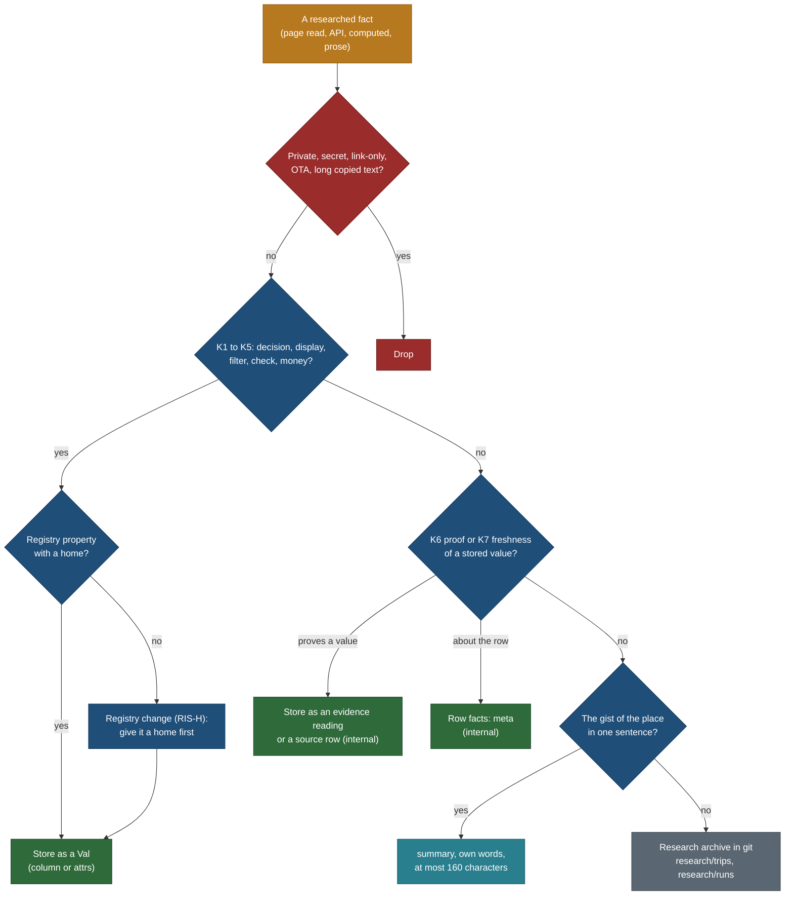
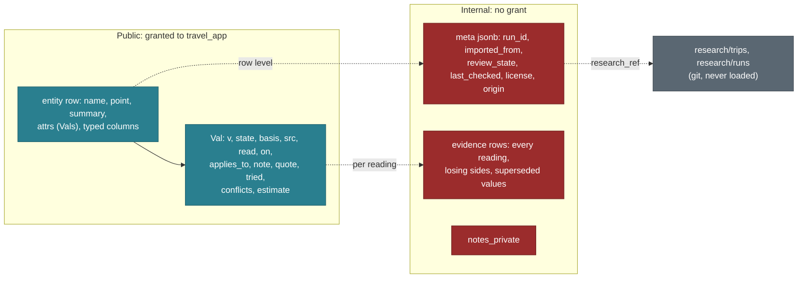

# Research intake and storage: what we keep, where it lives, how it loads

Status: spec, 25 Oct 2026, travel-planner (Opus). Docs only; nothing here is built. PLAN R-130 to R-136, BACKLOG 15.130 to
15.139, questions Q170 to Q177, TODO row of 25 Oct. Measured on `main` b7475fb plus the unmerged branches `public/DATA-D3a`
(9dd60a8) and `public/DATA-D4a` (62b5d74), read from their worktrees without checking them out. The file is named
`catalogue-intake-and-storage.md`, not `research-...`, because folder rule 3 (`tools/tree_check.py`) forbids "research" in a
`docs/` file name.

Owner request, 25 Oct 2026 (dictated, lightly cleaned): "For all the locations, we have to parse the research for our schema,
clean it, and put it in our database schema. We should also check the rest of the data: do we need to add it as notes, as a
description, or how do we do it? Because it is research data and we do not have to store everything; we should store only
what adds value. Also, should we add other metadata as a JSON in the table, which helps us later, and that applies not just
to this research but to every research, every property, every record?"

What this page decides, in one line each:

| # | Decision | Trade-off |
|---|---|---|
| RI-1 | **One keep-or-drop rule (K1 to K7, section 2).** A value is stored only when it changes a decision, a display, a filter, a check, money, or proves or dates another stored value. Everything else stays in the research archive, becomes one sentence of summary, or is dropped | Some interesting context never reaches the database; it stays one click away in git |
| RI-2 | **Three levels of metadata, never mixed (section 3).** Per value: the existing `Val` wrapper (public provenance). Per reading: the `evidence` table (internal history, conflicts, superseded values). Per row: a new `meta jsonb` column with one contract for every catalogue and research table (internal) | One more column and one more Zod schema; in exchange the loader is a pure transform and nothing needs a free-text field |
| RI-3 | **Normalise in the JSON first (section 4).** The repo files are brought into the contract (one basis vocabulary, one value shape, one source-id scheme, structured point provenance, `meta` blocks) and `check-all` enforces it, so the SRV-0 loader only copies | About 14 h of work before any Postgres code; it pays back because the loader, JsonStore and PostgresStore read the same shapes |
| RI-4 | **Prose is never loaded.** `research/trips/**` and `research/runs/**` stay the archive; a fact moves into a record only through the `research` skill's capture step, and the record links back with `meta.research_ref` | A human or agent step for each promoted fact; no parser guesses at prose |
| RI-5 | **Proposals, operator questions and rulings become data** (`capture-changeset/1`, a run-record outcome `ask`, evidence readings), so they load into the existing `changeset`, `change`, `research_gap` and `evidence` tables | Two small schema additions; markdown tables stay as the human view until generated |
| RI-6 | **`meta` and internal notes are never readable by the app role.** Public-read tables move from table grants to column-list grants that leave out `meta`, `notes_private` and `doc` | The PostgresStore must name its columns (`select *` fails); new columns are invisible until granted, which is the safe default |

Principles applied: P8 (light list data and no bulk output: `meta`, notes and evidence never ship), P9 (one data boundary: the
loader writes what JsonStore already reads, no new client-side loads), P6 (provenance one step away, from structured fields
rather than prose markers), P2 (safety facts such as closures and hard limits must be stored values so they can sit at rest,
not lines in a run note), P1 (the contract holds at 10,000 places: no per-row free text the loader must parse). The trip
scope scenarios and the keep-from-live-site rules do not change: this page adds no screen, and every trip-level file keeps
its trip id (scenario rule 4: nothing is silently put in the wrong trip).

## 1. Inventory: what research produces today and where it should live

### 1.1 Measured totals

Script: a read-only walk over `data/**` and the property registry (scratch scripts, not committed). Counts on `main` unless a
branch is named.

| What | Count | Note |
|---|---|---|
| Capture records (`capture/1`) | 394 in 13 files (place 201, route 143, offer 49, event 1) | 32 distinct top-level keys; 7 of them are not registry properties (`ref`, `layer`, `route_is_attraction`, `attraction_reason`, `origin` on 107, `offer_class` on 26, `aliases` on 2) |
| Sourced values (`Val`) | 5,100: capture 711, suitability 2,528, relevance 1,861 | states: value 4,317, `searched_none` 494, `gap` 237, `not_applicable` 37, `no_limit` 15; links add 39 `searched_none` link states |
| Value notes (`Val.note`) | 3,675 notes, 317,495 characters; 17 longer than 280 | served publicly through `apiVal.note` (A6): notes are not a private bin today |
| Quotes (`Val.quote`) | 686, 33,069 characters | served publicly up to 300 characters (A6) |
| Conflicts (`Val.conflicts`) | 112 (suitability 111, capture 1) | run records add 6 `conflict` outcomes |
| Basis values | SUIT_BASIS (8 values) on every Val that has a basis; gaps and searches carry none | trip-level files use a different set, see 4.2 |
| Points (`capture-points/1`) | 185 rows; `coord_src` osm 157, wikidata 23, official 5; 14 approximate | provenance is one free-text `point_source` string per row: 34,930 characters, longest 616 |
| Suitability sidecars | 520 records in 20 files | |
| Relevance sidecars | 1,273 records in 24 files, 8 schemas (`relevance/1`, derived, bases, points, 4 signal files) | |
| Run records (`capture-run/1`) | 9 on main, 1 on D3a, 1 on D4a; 353 results: filled 282, gap 34, searched_none 23, blocked 8, conflict 6 | |
| Source registry (`sources/1`) | 405 entries | built from suitability and relevance lane files only |
| Source-id schemes | lane-local `src-NNNN`: 4,232 references; registry hash `s-<10 hex>`: 233 references (windows, base plans, seasons) | the hash ids are not in the registry (D7-R and D9-R decisions 3 and 7) |
| Trip-level research files | windows 1 (4 windows, 22 sources), base plans 1 (4 strategies, 3 swaps, 13 sources), seasons 6 | none has a validator yet (OVR-Ca, STY-Ca, D6a-W) |
| Tracks (`trail-track/1`) | 17 files plus `inputs.json` | processing facts (stitched, confirmed, offsets, cut, DEM) sit beside the geometry |
| Locations store (schema v3) | 74 places, 36 owner source rows (saved posts), 0 visits; `notes` on all 74 (9,991 characters, longest 751); `field_meta` empty on all 74 | 66 places are tied to no trip |
| Property registry | 239 properties (86 base, 153 suitability); **43 have `home: none`** | a property with no home can be researched but not stored |
| Operator questions | 50 table rows in `research/method/operator-questions-2026-10-18.md`, plus 9 on D4a | markdown only |
| Prose research | 109 files, 3.3 MB under `research/trips/`; 1,248 `GAP:` lines | never loaded |
| Inbox | 7 files tracked in git (4 batch JSON, 3 screenshots of saved posts) | private origin (PRIV1) |
| Loadable JSON in total | 6.2 MB (capture, sidecars, sources, tracks, trip-level files, locations, towns, schedules) | about 20 MB in Postgres with the source tier, the serving tier and evidence, about 4% of Neon Free's 0.5 GB per project (check the plan's limit at build time) |

### 1.2 Every artefact, its home now and its home in Postgres

Tables are the applied migrations (`core/src/db/migrations/0003_catalogue.sql`, `0006_research.sql`, `0008_household_private.sql`).
"New" marks a change this page proposes (section 5.3).

| Artefact | Lives now | Postgres home | Rule |
|---|---|---|---|
| Capture record (place, route, offer, event) | `data/capture/<trip>/<lane>.json` | source tier: `dataset_file` + `record_doc` (verbatim); serving tier: `entity` (+ `offer` for the offer layer), `relation`, `entity_link`, `media`; `meta` per row (new) | K2, K3 |
| A `Val` (one researched value) | inside the record or sidecar | the value inside its typed column or `attrs` path (public: `v`, `state`, `basis`, `src`, `read`, `on`, `applies_to`, `note`, `quote`, `tried`, `conflicts`, `estimate` new); one `evidence` row per reading (internal) | K2 to K6 |
| `searched_none` | `Val.state` with `tried` and `on` | the Val as above, plus an `evidence` row with `state` and `tried` (new columns) | K6: an answer, not a gap |
| `gap` | `Val.state`; run outcome `gap` | `research_gap` (field, reason, tried); closed by the change that fills it | K7 |
| Conflict between sources | `Val.conflicts`; run outcome `conflict` | shown value plus `Val.conflicts` (the "Sources disagree" chip); every reading an `evidence` row; no separate conflict table | K6 |
| Estimate | a word in `Val.note` ("estimate") or an `INFERENCE:` marker in prose | `Val.estimate: true` (new) with basis `our_inference` and the method in `note`; `meta.estimate` for a whole row (a track cut by hand) | K2 (the "Estimate" chip comes from the flag, not from parsing text) |
| Superseded value | `data/capture/supersedes.json` | `capture_supersede` plus the old reading kept as an `evidence` row with `superseded_at` (new) | K6 |
| Suitability sidecar | `data/suitability/<trip>/*.json` | `suitability` (`block`, `flat`, `ext`) + `meta` | K2 to K4 |
| Relevance sidecar | `data/relevance/<trip>/*.json` | `relevance`; `relevance_signal` for signal files; `relevance_derived` is rebuilt, not loaded with `meta` | K1, K2 |
| Point | `data/capture/points.json` (`point_source` text) | `entity.point`, `point_role`, `point_approx`, `point_src` (structured: provider, element id, URL, read date, quote), `meta.review_state`, `meta.run_id`; competing coordinates as `evidence` rows | K2, K4 (distance and near checks), K6 |
| Track | `data/tracks/<place>.json` | `track` (`geom`, `source`, `source_ref`, `licence`, `fetched_on`, lengths, `elevation`); processing facts in `track.attrs` (new); `track.meta` becomes the row contract | K2, K6 |
| Operator | `data/capture/operators.json` | `operator` + `meta` | K2, K4 |
| Split provenance (`origin` on 107 records) | capture record key outside the registry | `meta.origin` `{from, reason}` | K6 |
| Splits and displaced judgements | `data/capture/splits/<trip>.json` | `record_doc` only (family widened, new) | K6 |
| Migration ledger, gap budget | `data/capture/migration-ledger.json`, `gap-budget.json` | not loaded: repository tests and CI only | drop from the database |
| Run record | `data/capture/runs/<run>.json` | `research_job` (one per run; hosts and scope in `scope`), `research_gap` for `gap`, `blocked` and `ask` (new outcome), `meta.run_id` on every row the run wrote | K6, K7 |
| Run note and run artefacts (before and after gap reports, generator scripts, ORS evidence JSON) | `research/runs/**` | not loaded; `research_job.scope.note` holds the note's path | archive |
| Best-time windows | `data/windows/<trip>.json` | `record_doc` family `trip-windows` (new) and the trip projection `trip_page`; `affects` refs checked as foreign keys; sources into `source` | K1, K2 |
| Base plans | `data/base-plans/<trip>.json` | `record_doc` family `trip-base-plans` (new) and `trip_page`; proposed refs wait for their records | K1, K2 |
| Seasons | `data/seasons/<trip>.json` | `record_doc` family `trip-season` (new) and `trip_page` | K2 |
| Locations store place | `data/locations/locations.json` | a capture record in the trip-less lane `catalogue` (DATA-LOC L1, DD-8), loaded as `entity` like any lane; the owner's list fields (status, trip, added, `contributed_by`) stay in the store and go only to the private `saved_place` | PRIV1 |
| Locations store `sources` (saved posts) | same file | private `saved_source` (0008); never `source` | PRIV1 |
| Locations store `notes` | same file | split: a public fact becomes a Val or the summary; a planning note becomes `notes_private` or is dropped (section 3.2) | K2 or drop |
| Locations store `confidence`, `review_status`, `verified_by`, `last_verified`, `licence`, `field_meta` | same file | `meta.basis`, `meta.review_state`, `meta.last_checked`, `meta.license` | K7 |
| Source row | lane `sources[]`, `data/sources/registry.json` | `source` (registry) and `source_local` (lane id to registry id) | K6 |
| Link (official, OSM, AllTrails as link only) | `links[]` on the record, `data/sources/links.json` | `entity_link` (`state`, `query`, `checked_on`, `link_only`) | K2 |
| Photo (Commons, NPS, agency) | `photos[]` on capture records (34 on 21 records), legacy `gallery.json` (9 files) | `media` (storage `commons`, `key` the file title, `licence`, `author`, `attribution`, `source_url` the file page); never the image bytes or the file's description text | K2 |
| Proposed patch for a record in another lane file | `research/runs/DATA-D3a/patch-proposals.json` (D3a) | `data/capture/changesets/<run>.json` (`capture-changeset/1`, new), loaded into `changeset` and `change` | K1 |
| Operator question | markdown table | run-record outcome `ask` (new) with `{to, contact_url, question}`, loaded as `research_gap` with `state = 'ask'` | K7 |
| Ruling between sources | run note prose | the winning Val with a one-sentence `note`; the losing reading as an `evidence` row | K6 |
| Person-check or sample check | run note table | `meta.review_state` `sample_checked` on each sampled row, `meta.run_id` of the check | K7 |
| Price band | `price` Val or `searched_none` | `offer.price` (jsonb list of Vals), `price_min`, `price_max`, `currency`, `price_read_on`; the price year in `applies_to` | K5 |
| Quote | `Val.quote` | public in the Val (A6, at most 300 characters) and internal in `evidence.quote` (300 already enforced) | K6 |
| URL | Val `src` source rows, links | `source.url`, `entity_link.url` | K6 |
| Page cache, HTML captures | gitignored crawler cache (capture contract 9.3) | never loaded, never committed | drop |
| Inbox screenshots and batch files | `research/inbox/` | never loaded; `meta.raw_ref` may point at one only from a private table | PRIV1 |
| Prose research | `research/trips/<folder>/*.md` | never loaded; promoted fact by fact (section 4.4) | archive |
| ORS legs | `data/schedules/legs/*.json` (stored legs), `research/runs/DATA-D9R/ors-legs-*.json` (evidence) | stored legs in `leg_cache` (`provider = 'ors'`, `computed_at`) through STY-L; the evidence file stays in the run folder | K4 for stored legs; archive for evidence |
| OSRM numbers (DATA-L1) | `base-strategies.md`, a run JSON | not stored (DD-5: a cross-check only) | archive |

### 1.3 Keys and facts that appear in research but in no record

| Found in | Fact | Registry key | Why it is stored nowhere |
|---|---|---|---|
| D7-R run note, window source notes | 11 access seasons: Sunshine gondola 2026 6 Jul to 20 Sep, 08:00 to 18:00; Moraine shuttle and Lake Connector 1 Jun to 12 Oct; Moraine canoe dock mid-June to mid-September; Yoho Valley Road mid-June to mid-October; Highwood Pass closed 1 Dec to 14 Jun; Bow Valley Parkway east end restricted 30 Apr to 25 Jun 2026; Minnewanka and Maligne cruise seasons; Columbia Icefield season | `season`, `hours` (capture), `access_season` (suitability), `closures` (`home: none`) | D7-R owned only `data/windows/**`; the facts went into window `source.note` text |
| D9-R `stay-bases.md` section 4 | town facts for 6 bases and 2 airports: Banff downtown parking CAD 12 an hour 1 May to 31 Oct 08:00 to 20:00; Roam routes; Kananaskis Conservation Pass CAD 15 a day, CAD 90 a year; check-in 16:00 and check-out 11:00 (n=2 operator pages); Golden on Mountain time | `transit`, `check_in_out`, `groceries`, `last_transport` (`home: none`); `access_cost` (relevance) | no settlement records until STY-P writes `BS.json`, and four of the properties have no home |
| D9-R section 3 | BC booster-seat rule (under 9, 18 kg to 145 cm); Alberta has none by law; CBRE "Alberta Resorts" ADR CAD 709.50 for September 2025 | none: these are facts about a region, and `area` has no `attrs` | no area-level property list exists (Q176) |
| D1b step 4 | Fanes official route: 7 km return, +249 m, 2 h 30, Easy (tourism board) | suitability effort drivers | D1b wrote the point only |
| D1b step 5 | Mount Indefatigable trail decommissioned in 2005 (OSM tag, trip reports; no official page) | `closures` (`home: none`) | open operator question; no closure home |
| D3a proposals | Johnston Canyon closed 13 Oct to 11 Dec 2026 for rock-slope work; Tre Cime dogs on lead; Sarrail distance estimate 9.4 km; Seekofel computed gain 1,467 m | suitability paths | one record per ref across lane files (`E_SUIT_DUP_REF`), so D3a could not write them |
| D4a note | Waterton horse limits: 6+, 115 kg up to 2 h, 98 kg for longer rides, under 10 led | `min_age`, `max_weight_kg` on the offer | the record holds two operators 600 km apart; split pending (D4a decision 2) |
| D1b step 3, D9-R new points | 3 sourced destination points (Cinque Torri, Val Fiscalina, Vallunga); 8 base and gateway points; 7 proposed settlement refs | points, settlement records | owners of `points.json` and of the parent records were other lanes |
| Locations store `notes` | example: "In the Canadian Rockies plan (September 2029)." | none (a planning note) | the store has one free-text field for both description and planning |

Rough mention counts in `research/trips/**` (grep, case-insensitive, lines): parking 607, closure 435, shuttle 352, crowd
217, grocer 84, transit 82, check-in 40, booster 21. They show where the homeless properties will be needed next; they are
not counts of facts.

## 2. The keep-or-drop rule

**Store a value when at least one of these holds:**

| Code | Holds when the value | Example |
|---|---|---|
| K1 decision | changes what someone chooses: a window verdict, a base strategy, go or no go, which car park | Moraine first shuttle 06:30 means leaving Golden by 05:20 |
| K2 display | is shown on a page, card, chip, map or export (the registry `display` list, or a key a trip-level adapter reads) | trail distance; a licensed photo |
| K3 filter | filters, sorts or searches (registry `filter`, the list-row allowlist) | effort band, season months |
| K4 check | is read by a day check, a booking-by date, or a safety gate (hard limits, closures, permits, timed slots, main hazards: P2 "Rest!") | Highwood Pass closed to 14 Jun; minimum age 6 |
| K5 money | is a price, fee, pass or a dated price band | Kananaskis pass CAD 15 a day |
| K6 proof | proves another stored value: a source row, a quote, a losing reading of a conflict, the `tried` list of a `searched_none` | the OSM reading that lost to the official 7.8 km |
| K7 freshness | dates a stored value or says when to re-check it: read date, `applies_to`, page-modified date, review state | "page modified 28 Sep 2026" on the Parks Canada pass page |

**Otherwise:** leave it in the research archive (`research/trips/**`, `research/runs/**`, linked from the record by
`meta.research_ref` and the run id), or write it as the one-sentence public summary if it is the gist of the place, or drop
it. **Always drop**, whatever K says: anything from a link-only platform or an OTA (values, ratings, prices), copied text
longer than a 300-character quote, the owner's private-list origin (PRIV1), household data, secrets, and intermediate numbers
a committed script reproduces.

**How it is tested.** Each registry property gets a `keep` list of the reasons K1 to K7 it serves; the registry test fails a
property with an empty list (RIS-C). A record key that is not a registry property, a schema key of its file family, or a
reserved `meta` key fails `E_KEEP_UNKNOWN`. A trip-level file key that no adapter reads is listed by `normalise.ts --check`
as `W_KEEP_UNREAD` for review.

### 2.1 Worked examples from today's research

| Fact (batch) | K | Decision and home |
|---|---|---|
| Parks Canada daily pass "valid until 4:00pm on the day after purchase", needed to stay in Banff, Lake Louise and Jasper (D9-R) | K4, K5 | store: the pass offer's `price` and `window`, each town's `access_cost`; the phrase as `Val.quote`; page-modified date in the source row |
| Moraine shuttle first departure 06:30, every 30 min, season 1 Jun to 12 Oct 2026 (D7-R, D9-R) | K1, K4 | store on the shuttle offer: `hours` and `season` Vals with `applies_to: "2026"`; the Park and Ride as a place with a point and `parks_for` |
| ORS drive minutes, 65 directions and 1 matrix (D9-R) | K1 (stored legs only) | stored legs through STY-L into `leg_cache`; the evidence JSON stays in `research/runs/DATA-D9R/`; numbers inside plus and minus texts stay as text with basis `our_inference` and method `computed` |
| OSRM strategy numbers (DATA-L1) | none | archive (DD-5) |
| OSM relation 1641053 (path 10), node 470623991 (park information point) (D1b) | K2, K6 | `entity.osm_ref` Val and an `osm` link; the node in `point_src.element`; ODbL credit through `meta.license` |
| Operator FAQ "Meeting point Rienz / Eisack: Sports zone St. Sigmund" (D1b) | K6 | `Val.quote` on the meeting point, the contact page a source row; the rest of the page dropped |
| Price bands for six base towns, all `searched_none` (D9-R) | K5 | Val `searched_none` with `tried` and `on`; "Cost not compared yet" is rendered, never stored |
| CBRE "Alberta Resorts" ADR CAD 709.50, September 2025 (D9-R) | K1 if shown | archive until Q176 gives areas a home and Q113 allows the dated line |
| A Commons file page for a trail photo (D5a) | K2 | `media` row: storage `commons`, key the file title, licence, author, attribution, file page URL; never the bytes or the description |
| Rawson Lake 7.8 km (Alberta Parks) against 4.9 km (OSM ways) (D3a) | K2, K6 | `v` 7.8 `official_info`; `conflicts` [4.9, `our_inference`, method computed]; two `evidence` rows; never an average |
| Grand View Point: Wikidata point 1.4 km from the NPS and OSM overlook (D1b) | K4, K6 | the OSM overlook as an `evidence` reading; the shown point waits for a points supersede (conflict C8) |
| Rawson time by Naismith; Sarrail 9.4 km from OSM ways (D3a) | K2 | `Val.estimate: true`, basis `our_inference`, method in `note`; the "Estimate" chip reads the flag |
| "Keep at least 30 m from elk" during the rut (D7-R minus point) | K4 | `hazards` Val on the Banff and Jasper townsites (official, Parks Canada); the window minus keeps its text |
| "Bring bear spray" | K4 only if sourced | sourced: a `hazards` Val with basis `official_info`; our own packing advice: the `pack_template` reference table, not the catalogue; unsourced in prose: archive |
| Check-in 16:00 and check-out 11:00 from two named operator pages (D9-R private section) | K1, but n < 5 | town `check_in_out` stays `searched_none` until n = 5 (D9-R decision 6); the two readings are internal `evidence` rows, so no property name reaches a public citation |
| Larch peak 20 Sep to 5 Oct from blogs (older notes) | none | archive; the official range is in the window |
| Jasper "about 20% fewer rooms" (local paper) | none as a number | archive; a public sentence only after an official figure |
| "Agent checked, needs a person's check" inside `point_source` (D1, D1b) | K7 | `meta.review_state: "agent_checked"`; the text is dropped |
| Byte-identical before and after gap reports (D7-R, D9-R) | none | drop (tree rule 7); hashes in the run note |

## 3. Free-form leftovers: summary, notes, attrs and meta

### 3.1 The four places free text and structure can go

| Field | Who reads it | Content | Limits | Validated by |
|---|---|---|---|---|
| `summary` (the public description; registry `summary`, home today relevance `why`) | everyone | one sentence in our own words: what the place is and why to go | at most 160 characters (today's 206 values: median 72, longest 102); no copied text; no date (`DATE_TEXT`); licence own words | registry, `E_SUMMARY_LONG` (new), the dateless scrub |
| `Val.note` | everyone (served through `apiVal.note`, A6) | the method or the reason behind one value: "Computed from OSM ways ...", "the official figure counts the approach" | at most 280 characters (17 of 3,675 are longer today and get rewritten); no planning text; no property names | `E_NOTE_LONG` (new), privacy detector |
| `notes_private` (new column on `entity`, `offer`, `operator`; new optional key on capture records) | owner and researchers only | a planning remark, a lead to follow, why a record exists | at most 1,000 characters; never served, never exported | privacy detector: `notes_private` joins `PRIVATE_KEYS`, so any served body holding it fails closed; no `travel_app` grant |
| `attrs` (kind-specific facts) | everyone, through the projections | only registry keys whose resolved contract allows them on the record's type; each value a Val | the registry's value types | registry and capture validators (`E_KEEP_UNKNOWN`, `E_CAP_*`) |

`description` in the owner's words is `summary`: one public sentence. There is no second, longer description field; detail
lives in the property sections the contract renders (CC8).

### 3.2 The locations store `notes`

The 74 notes mix three things. At adoption into the `catalogue` lane (L1) each sentence takes one path: a sourced fact
becomes a Val (with its source); the gist becomes the `summary`; a planning remark ("In the Canadian Rockies plan (September
2029).") becomes `notes_private` or is dropped. The store keeps its own `notes` for the owner's list view; nothing from it is
loaded as public text.

### 3.3 The `meta` contract (RowMeta, version 1)

**Recommendation: yes, every table that holds a researched fact or its provenance gets `meta jsonb not null default '{}'`**,
with one contract defined once in `core/src/schema/rowMeta.ts` (new; `core/src/schema/meta.ts` already exists and holds
table-definition helpers, so the name must differ). Tables: `area`, `town`, `operator`, `entity`, `entity_alias`, `offer`,
`relation`, `entity_link`, `track` (its column exists), `condition_report`, `event_occurrence`, `source`, `dataset_file`,
`record_doc`, `source_local`, `capture_supersede`, `evidence`, `media`, `suitability`, `relevance`, `relevance_signal`,
`type_node`, `tag`, `relevance_class`, `research_gap`, `change`, `changeset`: 27 tables. Left out: projections
(`place_row`, `place_page`, `trip_row`, `trip_page`: derived), `relevance_derived` (derived), `leg_cache` (a cache),
`catalogue_meta` (a key-value revision table, unrelated despite the name), and every household, planner and account table
(they hold the owner's data, not research).

**Reserved keys.** Every key is optional unless marked required. `meta` describes the row; it never holds a value the page
shows (that is a column, `attrs` or a Val).

| Key | Type | Meaning |
|---|---|---|
| `schema_version` | int, **required** | RowMeta version, 1 |
| `record_id` | string | the capture `ref` the row belongs to, when the row's own key is not that ref (`evidence`, `track`, `media`, `entity_link`, `research_gap`) |
| `run_id` | string, **required** on loaded rows | the run that last wrote the row (a `capture-run/1` id or a batch id such as `DATA-D7R`) |
| `first_run_id` | string | the run that created it |
| `imported_from` | `{file, sha256}`, **required** on loaded rows | the repository path and the hash of the file the loader read |
| `imported_at` | ISO datetime | stamped by the loader |
| `source_ids` | string[] | registry ids behind a row that has no Val of its own (a track, a point, a photo) |
| `observed_on` | date | when the fact was observed, when it differs from the read date (a community report of a hike) |
| `basis` | SUIT_BASIS | whose statement the row is, for rows without Vals |
| `method` | `read`, `crawl`, `api`, `computed`, `owner` | how it was obtained (capture contract 9.4) |
| `estimate` | bool | the whole row is an estimate (a track cut by hand, an approximate point) |
| `review_state` | `proposed`, `agent_checked`, `sample_checked`, `person_checked`, `approved`, `rejected` | how far it has been checked (9.5 "crawled values are proposals") |
| `conflicts` | string[] | ids of the `evidence` readings that disagree with the shown value |
| `searched_none` | `[{what, on, tried[]}]` | a search with no property to hold it (a duplicate check, a parent search); a property's own search is its Val, so a `what` that is a registry key fails `E_META_SN_PROP` |
| `original` | `{value, unit}` | the value and unit as the source gave them, when the normaliser converted (feet to metres, miles to km, Fahrenheit to Celsius) |
| `raw_ref` | string | a path under `research/inbox/`; **allowed only in private tables** (`saved_source`, `collection`), `E_META_RAWREF` elsewhere |
| `research_ref` | string[] | paths (with a heading anchor) under `research/trips/` or `research/runs/` that explain the row |
| `license` | string | the licence of the row's content: `ODbL-1.0` for OSM-derived points and tracks, `CC-BY-SA-4.0` for a photo, `own-words` for our text |
| `work_tags` | string[], at most 10, kebab-case | internal workflow labels (`r2-bar`, `rockies-plan-day`); never the public `entity.tags` vocabulary |
| `last_checked` | date | the last re-read that confirmed the row |
| `freshness_class` | id from `data/schema/freshness.json` | which stale rule applies |
| `ttl_days` | int | an override of that class's age limit, for this row only |
| `privacy_class` | `public`, `internal`, `private` | `private` is allowed only in private tables |
| `origin` | `{from, reason}` | the record this one was split from (today's capture `origin` key, 107 records) |

**Never in `meta`:** secrets, tokens, keys, connection strings; household data (names, ages, heights, weights, the home or
its coordinates, bookings, confirmation codes, payments, email addresses); the owner's private-list origin (`loc:` and
`proto:` keys, `contributed_by`, saved-post dates, the platform a place was saved from: PRIV1); third-party text (quotes live
in `Val.quote` and `evidence.quote`, at most 300 characters); page HTML; any value a page displays.

**Size.** At most 4 KB per row (`pg_column_size(meta) <= 4096` as a check constraint); the normaliser warns above 1 KB. The
largest provenance text today, a `point_source` of 616 characters, fits in about 400 bytes once structured.

**Indexing.** No GIN index on the whole column. Expression indexes only for the keys a query uses: `(meta->>'run_id')` for
rollback, `(meta->>'review_state')` for the review queue, `((meta->>'last_checked')::date)` for stale scans. A new index is
a new migration.

**Validation.** `rowMeta` is a strict Zod object (`additionalProperties: false` in the exported JSON Schema
`data/schema/generated/row-meta.json`); an unknown key fails `E_META_KEY`. `META_KEYS` in the same file lists each key with
`since` (the RowMeta version that added it), the tables it may appear on and its privacy class. `validate.ts --all` checks
every `meta` block in the JSON files; the loader validates again before writing; Postgres checks only the cheap part
(`jsonb_typeof(meta) = 'object'`, the size, `meta ? 'schema_version'`).

**`meta` against `attrs`.** `attrs` is the fact (what the place is: distance, fee, dogs), defined by the property registry,
public, each value a Val. `meta` is about the row (where it came from, when, how checked, how to roll it back), defined by
RowMeta, internal, no Vals. If a visitor could want it, it is `attrs`; if only we need it to trust, refresh or undo, it is
`meta`.

**Adding a key later.** An optional key is a code change only: add it to `META_KEYS` with `since` set to the next version,
add a test, no database migration (the column is jsonb) and no backfill. Making a key required, renaming it or changing its
meaning bumps `schema_version`, and the normaliser rewrites the JSON files, after which the loader rewrites the rows
(idempotent, section 4.5). A key that a query filters on gets an expression index in a new migration. A key is never reused
for a new meaning.

**Who can read it.** `meta`, `notes_private` and `doc` are never granted to `travel_app` (RI-6). Public provenance is the
Val inside the public columns; the PostgresStore never selects `meta`.

### 3.4 Three levels, one picture

## 4. The pipeline from research to Postgres

### 4.1 Steps and owners

| Step | What happens | Tool (new or existing) | Owner |
|---|---|---|---|
| S0 Capture | records, sidecars, points, trip-level files, a run record, a run note; prose for reasoning | the `research` and `location` skills, `capture.ts fields` | travel-researcher |
| S1 Normalise | units to SI (m, km, min, Celsius, kg, cm; the source's form in `meta.original`); currency ISO 4217 with the price year in `applies_to`; dates ISO, seasons as `MM-DD` rows, rules relative in public text ("the first Monday of September"), no calendar date in public text (`DATE_TEXT`); names: `name` as signed, other languages in `names {lang: name}`; slugs only from the slug registry (`catalogue-slugs/2`), never minted by a lane or the loader; refs never rewritten (aliases for renames); area chain from the locations store, then derived from the point (META-1 derive-area); town ids from `derive-near`; one basis vocabulary, one value shape and one source-id scheme (4.2); `point_source` parsed into `point_src` and `meta` | `node core/bin/normalise.ts --check|--write [--family <f>]` (new, RIS-N) | builder writes it; the researcher runs `--write` before hand-back; `check-all` runs `--check` |
| S2 Dedupe | candidate pairs by Wikidata QID, OSM element, or same type family and name within 150 m; outcome `same_place_as` (an alias row) or a merge recorded in the slug registry (`places.merged`); never automatic | `capture.ts dupes --trip <t>` (new, small, in RIS-N) | researcher proposes, coordinator rules |
| S3 Conflicts | the shown value is the official or operator reading; every other reading stays in `Val.conflicts` and, at load, an `evidence` row; never an average (research README 7) | existing validators | researcher |
| S4 Estimates | `Val.estimate: true`, basis `our_inference`, the method in `note` | RIS-C schema | researcher |
| S5 Sources | every `src` resolves to a registry entry; the registry build reads windows, base plans and seasons too | `sources.ts build` (extended in RIS-J) | coordinator at merge |
| S6 Privacy | the scrubs (`core/src/privacy/origin.ts`, `party.ts`, `dateless.ts`) and the detector on every file family; `meta` and `notes_private` are private keys | `core/src/privacy` (extended in RIS-C) | builder; runs in `check-all` |
| S7 Validate | Zod for every family (`validate.ts --all`), capture validators, the gap budget, `E_KEEP_UNKNOWN`, `E_META_*` | existing plus RIS-C | `check-all` |
| S8 Load | source tier verbatim, serving tier through the same core projection code as JsonStore, evidence appended, one transaction, revision swap (A8b) | `core/bin/load-catalogue.ts` (SRV-0, RIS-L) | builder builds; coordinator runs on a child branch, then production with the owner's approval |
| S9 Parity | the contract kit per method against JsonStore; a round trip of every source-tier document | `core/test/catalogue/postgres.test.ts` (SRV-0, RIS-T) | travel-verifier |

```mermaid
flowchart LR
  classDef core fill:#1F4E79,stroke:#163A5A,color:#FFFFFF
  classDef data fill:#2A7F8F,stroke:#1E5F6B,color:#FFFFFF
  classDef ext fill:#B7791F,stroke:#8A5A12,color:#FFFFFF
  classDef infra fill:#5A6772,stroke:#3E4850,color:#FFFFFF
  classDef guard fill:#9B2C2C,stroke:#6B1E1E,color:#FFFFFF
  classDef ok fill:#2F6B3A,stroke:#1F4A28,color:#FFFFFF

  SRC["Official, operator,<br/>open data pages"]:::ext
  PROSE["research/trips, research/runs<br/>(archive)"]:::infra
  JSON["data/** lane files,<br/>sidecars, trip-level files"]:::data
  NORM["S1-S5 normalise.ts<br/>units, basis, ids, meta"]:::core
  PRIV["S6 privacy detector"]:::guard
  VAL["S7 validate.ts, capture.ts,<br/>budget, E_KEEP, E_META"]:::core
  LOAD["S8 load-catalogue.ts<br/>one transaction per run"]:::core
  CHILD["Neon child branch"]:::infra
  PROD["Neon production<br/>(owner approval)"]:::guard
  PAR["S9 contract kit parity<br/>against JsonStore"]:::ok
  JS["JsonStore serves<br/>until the switch"]:::data

  SRC --> JSON
  SRC --> PROSE
  PROSE -- "promote one fact<br/>(research skill)" --> JSON
  JSON --> NORM --> PRIV --> VAL --> LOAD
  LOAD --> CHILD --> PAR
  PAR -- "green" --> PROD
  JSON --> JS
```

### 4.2 The normalisation tables

**Basis.** Measured: Vals use SUIT_BASIS; windows, base plans and seasons use a short set; `evidence.confidence` in 0003 uses a
third set. One target, SUIT_BASIS, plus `method`:

| Found | Where | Count | Becomes |
|---|---|---|---|
| `official` | windows 38, base plans 11, seasons 41 | 90 | `official_info`; `official_rule` when the text states a rule (a pass is required, a road is closed) |
| `operator` | windows 11, base plans 2 | 13 | `operator_info`; `operator_rule` for limits and booking rules |
| `computed` | windows 6, base plans 26, seasons 17 | 49 | `our_inference` with `method: computed` and the tool in `note` (ORS, `core/bin/sun.ts`) |
| `plan` | seasons 12 | 12 | `editorial` with `method: owner` (the plan's own months are the owner's statement) |
| `searched_none` used as a basis | seasons 1 | 1 | `state: searched_none`, basis null |
| `evidence.confidence` (`official`, `operator`, `community`, `agent_inferred`) | migration 0003 | no rows | a `basis` column with SUIT_BASIS (RIS-M); `confidence` kept nullable for one release |

**Value shape.** Capture and sidecars use `{v, state, basis, src, ...}`; seasons use `{value, basis, src, on}`; window and
base-plan points use `{text, factor, basis, src, on}`. Values become Vals (`value` to `v`, `state` added). Plus and minus
points, events and `unknown` entries stay claims (`text` plus provenance) because their text is the displayed thing; they get
the same basis set and source ids.

**Source ids.** Lane-local `src-NNNN` stay as they are and resolve through `source_local`; registry hashes `s-<10 hex>`
are already registry ids, and `sources.ts build` learns to read `data/windows/`, `data/base-plans/` and `data/seasons/` so
they resolve (RIS-J).

**Points.** `capture-points/2` (RIS-C) replaces the `point_source` string with `point_src: {provider, element, url, read,
quote}` plus `meta: {run_id, review_state, research_ref}`; conflict text becomes `evidence` readings in a `conflicts` list on
the row. RIS-J converts the 185 rows and keeps every pre-migration ledger leaf (the ledger test must still pass).

### 4.3 What must be built for the load (SRV-0, not built today)

1. **A migration, numbered at build time.** 0011 is reserved by CUS-C and 0012 and 0013 are expected for favourites and
   feedback, so this is 0014 or later; the runner refuses an out-of-order file, so take the next free number when RIS-M
   runs. Additive only: `meta jsonb not null default '{}'` with its checks on the 27 tables of 3.3 (`track.meta` gets the
   checks); `notes_private text` on `entity`, `offer`, `operator`; `track.attrs jsonb`; `record_doc.family` widened to
   `capture`, `suitability`, `relevance`, `trip-windows`, `trip-base-plans`, `trip-season`, `capture-splits`; a new
   `load_run` table (`id`, `started_at`, `finished_at`, `git_commit`, `files jsonb` path to sha256, `counts jsonb`, `status`,
   `rolled_back_at`), RLS on and no policy; `evidence` gains `run_id`, `basis` (SUIT_BASIS), `state`, `tried jsonb`,
   `estimate boolean`, `note text`, `superseded_at timestamptz`, `content_hash text unique`; `research_gap` gains `state`
   (`gap`, `blocked`, `ask`) and `run_id`; on every public-read table the table-level `select` grant is replaced by a
   column-list grant without `meta`, `notes_private` and `doc`. Tested on a Neon child branch first; production only with
   the owner's approval of the named commit (as for 0001 to 0010).
2. **The loader** `core/bin/load-catalogue.ts` with `core/src/catalogue/postgres/load/**`: reads only files that pass
   `normalise.ts --check` and `validate.ts --all`; writes the source tier verbatim, the serving tier through the same core
   functions as JsonStore (R-55), `evidence` from every Val and conflict, `research_job` and `research_gap` from run records,
   `changeset` and `change` from changeset files; stamps `meta.run_id`, `meta.imported_from` and `meta.imported_at`.
3. **The PostgresStore** `core/src/catalogue/postgres/store.ts` implementing `CatalogueStore` over the serving tier, naming
   its columns, never reading `meta`, `notes_private` or `doc`.
4. **Tests** (section 6): round trip, idempotency, privacy, size, parity.

### 4.4 Promoting a fact from prose into a record

Prose is the archive and is never parsed. A fact moves into a record when it passes the keep rule:
1. The researcher (the `research` skill, research README 3c) writes it into the lane record as a Val with its source row and
   read date, from the page the prose cites (re-read when older than its freshness class).
2. The record's `meta.research_ref` names the prose file and heading.
3. The prose line gets a marker `RECORDED <ref> <path> <date>`, the same habit as `GAP CLOSED`.
4. Validators run; the run record lists the field as `filled`.

A check `capture.ts prose-links --check` (new, small, RIS-N) fails when a `RECORDED` marker names a ref that does not exist or
a `research_ref` names a missing file. Nothing in prose is a source for the site until it is recorded.

### 4.5 Idempotency, provenance and rollback

- **Same input, same rows.** Natural keys (`ref`, `(file_id, ref)`, registry id, `content_hash` for evidence); a file whose
  sha256 equals `dataset_file.sha256` is skipped; upserts use `is distinct from`, so unchanged rows keep `updated_at` and
  `version`. A second run of the same commit writes zero rows (a test).
- **Provenance.** `load_run` holds the commit and the hash of every file read; every row carries `meta.run_id` and
  `meta.imported_from`.
- **Rollback by run id.** `load-catalogue.ts rollback --run <id>` reloads the file set of the previous successful `load_run`
  (the serving tier is a projection, so a reload is exact), deletes the `evidence` rows the rolled-back run inserted, and
  marks the run `rolled_back`. JsonStore stays deployable for one release (14.2), so the store switch is the faster rollback.

### 4.6 A refreshed value supersedes an old one and keeps history

The new reading is a new `evidence` row; the serving tier shows the new Val; the old reading gets `superseded_at` and is never
deleted. The page shows an "earlier figure" only under the existing rule (capture contract 9.7: a superseded pre-migration
leaf). The `evidence` table is the observation history the request asks for; no second history table.

### 4.7 Stale data

`data/schema/freshness.json` holds the classes (prices 120 days, hours 180, booking windows 365, ...), but its `fields` name
v1 tables (`offer_prices.amount`, `offers.opens_kind`); RIS-C remaps them to registry keys (conflict C4). A value is stale when
its `read` (or `meta.last_checked`) plus the class age, or `meta.ttl_days`, is before today, or when `applies_to` is an earlier
season than the trip's. `capture.ts stale [--trip <t>]` (RIS-S) lists them from the JSON today, and the same rule becomes a
SQL view over the latest `evidence` per `(entity, field)` after the load; `entity.fresh_until` is the earliest of its values.
The report feeds research README 3d and `research/backlog.md`.

### 4.8 The trip-less `catalogue` lane (DATA-LOC)

Lane id `catalogue` (DD-8). Files `data/capture/catalogue/<split>.json` per country split (D2b-US, D2b-CA, D2b-IT, D2b-INT),
with sidecars in the matching folders. They load exactly like a trip lane, with `dataset_file.trip` null. A store place
becomes public only through its capture record; the store's own fields (wishlist status, trip, added date, owner sources,
`page-keys.json`) are never loaded into public tables (detector: no `loc:` or `proto:` key in any loaded row).

## 5. Applied now: the audit of today's research

### 5.1 What each batch produced that no record holds

| Batch (state) | Produced outside records | Goes to | Change needed |
|---|---|---|---|
| D1 (merged) | 80 points with free-text provenance; 3 conflict rulings and check state inside `point_source`; base rulings applied to `bases.config.json` and the schedule | `point_src`, `meta.review_state`, `evidence` readings | `capture-points/2` (RIS-C, RIS-J) |
| D1b (merged) | rulings on Grand View Point, Cameron Lake, Cory Pass; a 20-point check (18 pass, seed 20261025); 3 sourced destination points not created; the Federa relation fix; Lac du Chatelard does not exist; Mount Indefatigable decommissioned 2005; the Fanes official route (7 km, +249 m, 2 h 30) | evidence readings; `meta.review_state: sample_checked` on the 20 rows; destination points as a changeset proposal; `closures` on Indefatigable once it has a home; Fanes facts into the route's effort drivers | RIS-H (`closures` home), RIS-A, points supersede (C8) |
| D3a (branch) | `R9-TF.json` (stored); patch proposals: 4 suitability sets (Johnston Canyon access season and the 2026 closure, Sarrail estimate, Tre Cime dogs, Seekofel computed gain), 4 link adds, 2 code requests | `data/capture/changesets/DATA-D3a.json`, applied by the coordinator; code requests to BACKLOG | `capture-changeset/1` (RIS-C) |
| D4a (branch) | 10 offers placed, operators, 12 limit sets (stored); 9 operator questions; 5 folded offer pages; the Waterton horse limits in the note only; 7 orphan offers | `ask` outcomes in its run record; the folds as slug-registry merges by the coordinator; the horse record split, then its limits as Vals | run outcome `ask` (RIS-C); D4a decision 2 |
| D6a (merged) | seasons with basis `plan` and `{value}` shapes; Jungfraujoch with no coordinates; 42 dated texts in legacy files not listed | normalised Vals; a schema that allows a station with no point; the list to BACKLOG 3.10 | RIS-N, RIS-J, D6a-W |
| D7-R (merged) | the windows file (stored); 11 access seasons, crowd figures, ECCC normals, light and larch notes in the run note and source notes; extra keys (`batch`, `validation_note`, `affects_states_note`, source `note` and `page_modified`, `pattern_year`); 22 sources outside the registry | access seasons onto the gondola, shuttle, canoe, road and cruise records (`season`, `hours`, `access_season`, `closures`); `page_modified` as a source field; `batch` and the notes into `meta`; registry reads windows | RIS-A, RIS-H, RIS-J |
| D9-R (merged) | the base-plans file (stored); town facts for 6 bases and 2 airports; 7 proposed refs; 8 new points; 65 ORS legs and 1 matrix; the STY-L pair list; check-in samples (private section); price bands `searched_none`; CBRE ADR; booster rule; Golden time zone; pass and parking fees | settlement records in `BS.json` after STY-P with homes for `transit`, `check_in_out`, `groceries`, `last_transport`; fees as `access_cost`; points through a changeset; legs through STY-L; area facts after Q176; the evidence JSON stays archived | RIS-H, RIS-A (after STY-P), Q176 |
| DATA-L1 (`base-strategies.md`) | OSRM comparison; blog claims (Canmore 20 to 30% cheaper); Banff ADR from a news report | archive; superseded by D9-R's ORS run | none |
| Dolomites prose (5 files, 743 KB) | stays, hut options, transport, timing | promotion only through the optional DP batch | none beyond 4.4 |
| Locations store | 74 notes mixing summary and planning; 36 private sources; empty `field_meta` | summary or Vals or `notes_private` at L1 adoption; `saved_source` | L1 mapping (section 3.2) |

### 5.2 Priority order

1. **RIS-C** contract (Opus): RowMeta, `keep` on properties, `Val.estimate`, run outcome `ask`, `capture-changeset/1`,
   `capture-points/2`, private keys, the freshness remap. Everything else reads it.
2. **RIS-N** normaliser and `check-all` stage (Sonnet).
3. **RIS-J** bring the JSON into the contract (Sonnet), after D3a and D4a merge so the files are not edited twice.
4. **RIS-H** homes for the homeless properties research already produces (Opus: a registry change).
5. **RIS-A** promote today's research (Opus researcher): D7-R access seasons, D3a and D4a proposals and asks, D1b points and
   facts; the D9-R town facts after STY-P.
6. **RIS-S** stale report from the JSON (Sonnet).
7. **RIS-M** migration (Opus), on a child branch; production on approval.
8. **RIS-L** and **RIS-T** inside SRV-0 (Sonnet), after the E features and the closure queue, as EXECUTION-PLAN 4.8 orders.

**Before the PostgresStore exists**, items 1 to 6 are done in the JSON, enforced by `check-all`, so the loader is a pure
transform and JsonStore benefits at once (structured provenance, the Estimate chip from a flag, closures at rest). D2b should
start after RIS-C and RIS-N, so the 74 places are born compliant (Q175).

### 5.3 Proposed schema and registry changes, exactly

| Change | Where | Task |
|---|---|---|
| `rowMeta` strict Zod, `META_KEYS`, JSON Schema export | `core/src/schema/rowMeta.ts`, `data/schema/generated/row-meta.json` | RIS-C |
| optional `meta` on every record of `capture/1`, `suitability/1`, `relevance/1`, `capture-points/2`, `trail-track/1`, `trip-windows/1`, `trip-base-plans/1`, `trip-season-basic/1`, `capture-operators/1`; optional `notes_private` on capture records | the family schemas in `core/src/schema/` | RIS-C |
| `keep: ("decision"|"display"|"filter"|"check"|"money"|"proof"|"freshness")[]` on `PropertyDef` | `core/src/schema/capture/properties.ts` | RIS-C |
| `estimate?: boolean` on the storage Val and on `apiVal` | `core/src/schema/suitability.ts`, `core/src/schema/api/val.ts` | RIS-C |
| run outcome `ask` with `{to, contact_url, question}` | the run record schema | RIS-C |
| `capture-changeset/1`: `{schema, run, by, on, sources, changes: [{file, ref, op, path, value, why}]}` | `core/src/schema/capture/changeset.ts` (new) | RIS-C |
| `capture-points/2` (`point_src`, `meta`, `conflicts`) | `core/src/schema/capture/points.ts` | RIS-C |
| `meta` and `notes_private` in `PRIVATE_KEYS` | `core/src/privacy/detect.ts` | RIS-C |
| freshness classes keyed by registry keys | `data/schema/freshness.json`, `core/src/schema/freshness.ts` | RIS-C |
| homes for `closures`, `transit`, `check_in_out`, `groceries`, `last_transport`, `book_url`, `fills_by` (capture record); the rest of the 43 stay `none` until research produces them | `core/src/schema/capture/properties.ts`, `data/vocab/types.json` marks unchanged | RIS-H |
| validator codes `E_KEEP_UNKNOWN`, `W_KEEP_UNREAD`, `E_META_KEY`, `E_META_SIZE`, `E_META_RAWREF`, `E_META_SN_PROP`, `E_SUMMARY_LONG`, `E_NOTE_LONG` | `core/src/validate/`, `core/src/capture/` | RIS-C (codes), RIS-N (checks) |
| the migration in 4.3 | `core/src/db/migrations/<next>_research_meta.sql`, `core/src/db/inventory.ts` | RIS-M |

## 6. Tasks

Model rule (CLAUDE.md): shared contracts and schema are Opus; specified code and tests are Sonnet; reviews are never below the
model that wrote the work. Every task records its model in the hand-back.

| Task | What | Agent, model | Effort | Depends on | BACKLOG |
|---|---|---|---|---|---|
| RIS-C | RowMeta contract, `keep` on properties, `Val.estimate`, outcome `ask`, `capture-changeset/1`, `capture-points/2`, private keys, freshness remap, codes | travel-builder, Opus | 8 h | none; must not run beside L1 if L1 touches `core/src/schema/capture/**` (coordinate files) | 15.131 |
| RIS-N | `core/bin/normalise.ts` (`--check`, `--write`, `--family`), `capture.ts dupes`, `capture.ts prose-links`, the `check-all` stage | travel-builder, Sonnet | 8 h | RIS-C | 15.132 |
| RIS-J | run `normalise --write` on every family; convert 185 points; `sources.ts build` reads windows, base plans, seasons; `origin` to `meta.origin`; `gap-budget` unchanged | travel-builder, Sonnet | 6 h | RIS-N; D3a and D4a merged | 15.133 |
| RIS-H | homes for the 7 properties in 5.3, renderers where the contract needs one, tests | travel-builder, Opus | 3 h | RIS-C | 15.134 |
| RIS-A | promote D7-R access seasons, D3a and D4a proposals (as changeset files) and asks, D1b facts and points; D9-R town facts after STY-P | travel-researcher, Opus; coordinator applies changesets | 6 h (plus 2 h after STY-P) | RIS-J, RIS-H; D1b points owner free | 15.135 |
| RIS-S | `capture.ts stale` from JSON, then the SQL view | travel-builder, Sonnet | 3 h | RIS-C; after RIS-N (both edit `core/bin/capture.ts`) | 15.139 |
| RIS-M | the migration of 4.3, inventory and grant tests, child-branch run | travel-builder, Opus | 6 h | RIS-C; the next free migration number at build time; owner approval for production (Q177) | 15.136 |
| RIS-L | loader, rollback, evidence, changesets, run records (the SRV-0 loader half; adds about 4 h to SRV-0's 24 h) | travel-builder, Sonnet; Opus review | 10 h | RIS-M, RIS-J; SRV-0 window (after the E features and the closure queue) | 15.137 |
| RIS-T | round trip, idempotency, privacy, size and parity tests | travel-builder then travel-verifier, Sonnet | 5 h | RIS-L | 15.138 |
| Reviews | RIS-C and RIS-M contract and privacy review; RIS-L code review | travel-design-reviewer is not needed (no UI); an Opus code reviewer | 2 h | each task | in each row |

Total about 57 h: Opus 25 (C 8, H 3, A 6, M 6, reviews 2), Sonnet 32 (N 8, J 6, S 3, L 10, T 5). The SRV-0 estimate rises
from 24 h to about 28 h; the rest is new.

### 6.1 Briefs (self-contained)

Common to every brief. **Must not touch:** `HANDOVER.md`, `CLAUDE.md`, `legacy/**`, `web/app/themes.css`,
`data/catalogue/slugs.json`, `data/capture/migration-ledger.json`, any file another running lane owns (check the roadmap's
run table). **Verification:** `pnpm --dir core typecheck` and `pnpm --dir web exec tsc --noEmit` clean; `pnpm --dir core
test` and the web data tests pass; `bash tools/check-all.sh` passes; where the task can change served data (RIS-H, RIS-J,
RIS-A), Playwright screenshots of `/places/lake-agnes-tea-house/`, `/places/rawson-lake/` and the Rockies trip page at 1440
and 390 in light and dark, saved to `web/test-results/shots/` (gitignored, outside any running e2e), compared with `main`;
any intended change is listed. **Commit rules:** a branch from `main` in its own worktree; `git -C <worktree> add <owned
paths>` only, never `-A`; message `<type>(RIS-x): <what>` ending with the session's `Co-Authored-By` trailer; no push, no
merge; the hand-back names the model used.

**RIS-C (Opus).** Goal: the contract every other task reads. Owns `core/src/schema/rowMeta.ts` (new),
`core/src/schema/capture/changeset.ts` (new), `core/src/schema/capture/points.ts`, `core/src/schema/capture/properties.ts`
(the `keep` field and its values for all 239 properties), `core/src/schema/suitability.ts` and `core/src/schema/api/val.ts`
(only `estimate`), the run-record schema (outcome `ask`), `core/src/schema/freshness.ts` and `data/schema/freshness.json`,
`core/src/privacy/detect.ts` (`PRIVATE_KEYS` only), the generated schema exports, tests under `core/test/schema/` and
`core/test/privacy/`. Steps: write RowMeta with `META_KEYS` exactly as 3.3; add optional `meta` to the families in 5.3; add the
codes in 5.3 to the code list; give every property a `keep` list and fail the registry test on an empty one; remap freshness.
Acceptance: every existing file still validates (all new fields optional); a fixture with an unknown meta key fails
`E_META_KEY`; a served body with `meta` or `notes_private` fails the detector; a property with `keep: []` fails; JSON Schema
for RowMeta has `additionalProperties: false`.

**RIS-N (Sonnet).** Goal: one command makes the JSON match the contract. Owns `core/bin/normalise.ts` (new),
`core/src/normalise/**` (new; not `core/src/intake/`, which the feedback and visitor-suggestion specs use), the `dupes` and
`prose-links` subcommands in `core/bin/capture.ts`, the new `check-all` stage line in `tools/check-all.sh`, tests under
`core/test/normalise/`. Steps: implement the tables of 4.2 and the unit, currency,
date and name rules of S1; `--check` lists every change it would make and exits 1 if any; `--write` changes only the
normalised paths and never a migration-ledger leaf. Acceptance: `--check` on a copy of today's data reports the 165 basis
mappings of 4.2, 36 seasons `value` shapes and 185 point rows; `--write` then `--check` exits 0; a second `--write` changes no
byte; the ledger test passes.

**RIS-J (Sonnet).** Goal: today's files in the contract. Owns the outputs of `normalise --write` on `data/capture/**`,
`data/suitability/**`, `data/relevance/<trip>/**`, `data/windows/**`, `data/base-plans/**`, `data/seasons/**`, `data/tracks/**`
and `data/capture/points.json`; `core/src/sources/**` (the registry build reading the three trip-level folders);
`data/sources/registry.json` (regenerated). Acceptance: `normalise --check` and `sources.ts check` pass; the 233 hash ids
resolve; no gap-budget count rises; the screenshots show no change except the intended ones (none expected).

**RIS-H (Opus).** Goal: the research that exists can be stored. Owns `core/src/schema/capture/properties.ts` (homes),
renderers in `web/lib/public/sections.ts` only if a value type has none, tests. Acceptance: the 7 properties have a capture
home; `capture.ts fields --type settlement.town` lists them; the page budget (Q88) holds.

**RIS-A (Opus, researcher).** Goal: promote what 5.1 lists. Owns `data/capture/changesets/*.json` (new folder), the run
records of the promoting run, `research/runs/RIS-A*.md`, the `RECORDED` markers in the prose files it promotes from. Steps:
one changeset per source batch; the coordinator applies each to the owning lane file. Acceptance: the D7-R access seasons are
Vals on their records; every D3a proposal is applied or rejected with a reason; the 9 D4a questions are `ask` outcomes; a
10-value sample against the sources passes 9 of 10; no count in the gap budget rises.

**RIS-S (Sonnet).** Goal: know what is stale. Owns `capture.ts stale`, tests. Acceptance: a fixture value read 200 days ago in
the hours class is listed; `applies_to: "2025"` on a 2026 trip is listed; the report is deterministic.

**RIS-M (Opus).** Goal: the database can hold the contract. Owns `core/src/db/migrations/<next>_research_meta.sql`,
`core/src/db/inventory.ts`, `core/test/db/**`. Steps: 4.3 item 1; run on the child branch; integration test. Acceptance:
`db-migrate up` twice is idempotent; every public-read table grants no `meta`, `notes_private` or `doc` column to
`travel_app` (asserted from `information_schema.column_privileges`); a 5 KB `meta` is refused; RLS stays on every table.
Production waits for the owner's named approval.

**RIS-L (Sonnet, Opus review).** Goal: SRV-0's loader with this contract. Owns `core/bin/load-catalogue.ts`,
`core/src/catalogue/postgres/load/**`. Acceptance: see RIS-T.

**RIS-T (Sonnet).** Tests, in `core/test/catalogue/postgres.test.ts` (skipped without `TEST_DATABASE_URL` on a disposable
child branch; a skip is not a pass):
1. Round trip: every `record_doc` read back equals its JSON record byte for byte after canonical ordering.
2. Idempotency: a second load of the same commit writes 0 rows; `load_run.counts` all zero.
3. Rollback: load commit A, then B, roll back B; the serving tier equals A's.
4. Privacy: no served row holds `meta`, `notes_private`, `doc`, a `loc:` key or a household key; the detector passes on every
   contract-kit response.
5. Size: no `meta` over 4 KB; the database stays under 50 MB after a full load.
6. Parity: the contract kit per method returns the same bodies from PostgresStore and JsonStore.

## 7. Open owner questions

| # | Question | Recommendation and trade-off |
|---|---|---|
| Q170 | Adopt the keep-or-drop rule K1 to K7, with a `keep` list on every registry property? | **Yes.** It makes "only what adds value" testable. Trade-off: interesting context stays in git rather than the database |
| Q171 | Give every catalogue and research table (27, section 3.3) a `meta jsonb` under one contract, never readable by the app role? | **Yes.** One contract, no free-text provenance, rollback by run id. Trade-off: the PostgresStore must name its columns |
| Q172 | Stop writing the verbatim record into the public `entity.doc` and `offer.doc` (write `{}`; `record_doc` keeps the verbatim copy, internal)? | **Yes.** 0003 calls `doc` "the resolved capture record, verbatim" on a public-read table, so every internal note would be readable by `travel_app`. Trade-off: one join to `record_doc` for internal tools |
| Q173 | Add `notes_private` (at most 1,000 characters, owner and researchers only) to records, `entity`, `offer` and `operator`? | **Yes, empty by default.** Reasoning stays in prose; the column holds a short lead or planning remark. Trade-off: one more private field the detector must guard |
| Q174 | Keep serving `Val.quote` up to 300 characters on public pages (A6), or cap public quotes at 120 and keep 300 internal in `evidence`? | **Keep A6** for now: today's 686 quotes are short factual phrases with credit, and they are how a reader checks a hard limit. Trade-off: a long quote of a page is copied text; RIS-N warns above 120 so the owner can review |
| Q175 | Start D2b (basics for the 74 places) only after RIS-C and RIS-N (about 16 h of build)? | **Yes.** The 74 are born compliant and need no second pass. Trade-off: D2b starts about two working days later |
| Q176 | Give areas a small property list in `area.attrs` (park-pass rule, child-seat law, a dated lodging-rate statistic, the time zone already a column), or keep area facts in prose until D9 needs them? | **Yes, four properties**, stored now, shown only when Q113 and the stay spec allow. Trade-off: one more registry scope to maintain |
| Q177 | Apply RIS-M to the Neon production branch after the child-branch run passes, on your approval of a named commit, as for 0001 to 0010? | **Yes.** It is additive and changes grants to fail closed. Trade-off: one more production step for you |

## 8. Conflicts with existing decisions (flagged, not changed)

| # | Existing decision or file | Conflict | Proposed resolution |
|---|---|---|---|
| C1 | 0003 `entity.doc` and `offer.doc`, "the resolved capture record, verbatim", on public-read tables | internal notes and future `meta` would be readable by `travel_app` | Q172; column grants (RI-6) either way |
| C2 | Store decision A6: `apiVal` serves `quote` (up to 300) and `note` | "no copied text" in public prose; notes are public | Q174; `Val.note` capped at 280 and defined as a public method note; internal text moves to `notes_private` |
| C3 | 0003 `evidence.confidence` (4 values), the trip-level files' basis (5 values), SUIT_BASIS (8) | three vocabularies for one idea | one vocabulary (4.2); RIS-M adds `evidence.basis` |
| C4 | `data/schema/freshness.json` fields name v1 tables | stale detection cannot read them | remap in RIS-C |
| C5 | 0003 `record_doc.family` check allows only capture, suitability, relevance | windows, base plans, seasons and splits cannot load | widened in RIS-M |
| C6 | EXECUTION-PLAN 4.8: the loader "loads `data/**` unchanged" | still true for the source tier, but only after `normalise.ts --check` passes; prose was never in `data/**` | a note in 4.8 points here |
| C7 | R-55 two tiers, the source tier lossless | the keep rule is applied in the JSON before load, so "lossless" means lossless over curated files | consistent; stated here |
| C8 | The migration ledger pins pre-migration points (D1b decision 5) | a corrected point (Grand View Point) cannot replace a pinned one | extend `capture-supersedes/1` to a `points` layer (one reviewed entry); coordinator decision already open in D1b |
| C9 | 0003 `track.meta` exists with no contract | processing facts would mix with row metadata | `track.meta` becomes RowMeta; processing facts go to `track.attrs` |
| C10 | DD-8 lane id and the locations store's own meta-like fields | `contributed_by`, `added`, `location_status` must never leave the store | mapping in 1.2; detector already lists `location_status` and `added` |
| C11 | R-75 names `core/bin/intake.ts` for moderation; the feedback and visitor specs use `core/src/intake/**` | name clash | this page uses `core/bin/normalise.ts` and `core/src/normalise/**` |

## 9. Gotchas

- `catalogue_meta` (the revision table) is not `meta`. Do not add a `meta` column to it, and do not read the revision from a
  row's `meta`.
- `core/src/schema/meta.ts` already exists and builds table definitions; RowMeta goes in `rowMeta.ts`.
- `notes` is a public key in today's trip and track shapes (`web/lib/public/types.ts`), so the private field is
  `notes_private`, never `notes`; only `notes_private` and `meta` join `PRIVATE_KEYS`.
- Column-list grants fail closed: a column added later is invisible to `travel_app` until a migration grants it. Expect the
  first PostgresStore query on a new column to fail with SQLSTATE 42501 rather than leak.
- `normalise --write` must never change a migration-ledger leaf; the ledger test is the guard. Points with a pinned
  `point_source` keep the string in `point_src.legacy` until a supersede replaces them.
- Lane file names: `core/test/suitability/kind-map.test.ts` allows only `R<n>*.json` beside the migration output (D3a, D4a);
  a changeset file lives under `data/capture/changesets/`, not in a lane folder.
- The registry build must not double-count a source that is both lane-local and hashed: normalise the URL first
  (`core/src/sources/normalize.ts`), as D7-R and D9-R did.
- Overpass and Commons stay single-runner across agents; RIS-A promotes from pages already read and needs no new API run.
- Applying a changeset to `migrated.json` is a post-migration edit in place (capture contract 9.7), not a supersede; a value
  that is a ledger leaf needs a supersede entry instead.
- The place-page size budget (Q88): promoting facts adds bytes to pages; RIS-A checks `web/tests/data/place-size.test.ts`
  before hand-back, and D3a already sits at 1.264 against 1.25.
- Neon Free storage is 0.5 GB per project on today's plan; the full load is about 20 MB, but `evidence` grows with every
  refresh, so RIS-S also reports its row count.

## 10. Not verified

- Neon Free's storage limit was not re-read today; 0.5 GB per project is from the plan as provisioned (check at RIS-M).
- The 20 MB database size is an estimate (6.2 MB of JSON times about three copies), not a measured load.
- Whether `sources.ts build` can read the trip-level folders without changing source ids in lane files was not tried.
- The D3a and D4a counts are from their branch tips (9dd60a8, 62b5d74); they may change before merge.
- The prose mention counts in 1.3 are grep lines, not facts.

## 11. Build notes: RIS-N (the normaliser, 25 Oct 2026)

Built by travel-builder (Sonnet), branch `public/RIS-N`. New files only: `core/src/normalise/**`, `core/bin/normalise.ts`,
`core/test/normalise/**` (with `normalise-budget.json` and frozen golden fixtures), one stage in `tools/check-all.sh` and one row
in `research/tools.md`. No data file was written.

**What shipped.** `node core/bin/normalise.ts --check | --report | --write [--family <f>] [--file <path>] [--run <id>]`, plus
`--budget --check | --update`, `dupes` and `prose-links`. `--check` lists every change and finding and exits 1 on a change or an
error (read-only); `--report` prints counts per family and rule and exits 0; `--write` changes only the normalised values, because
`jsonPatch.ts` rewrites a file in place (Python floats such as `6.0`, inline objects and `[lon, lat]` pairs keep their bytes, and
the result is parsed and compared with the intended document before it is written). A second `--write` changes no byte (tests on
fixture copies and on a slice of real data). The rules are S1 to S4 of 4.1: basis vocabulary, season Vals, `point_source` to
`point_src` with a `meta` block (capture-points/2; `legacy` holds the whole old string for a ledger-pinned ref or text over 300
characters), `origin` to `meta.origin`, `Val.estimate` from a note that says "estimate" (basis `our_inference`, not denied), units
to SI with `meta.original`, price year, dates, currency, names and language tags; area chain and town ids are delegated to
`migrate-placement` and `derive-near` (never a guess). After the rules it reports (never changes) `E_NOTE_LONG`, `W_QUOTE_LONG`,
`E_SUMMARY_LONG`, `E_KEEP_UNKNOWN`, `E_META_*`, `W_KEEP_UNREAD` for trip-level keys, the privacy detector, and conflicts
(`I_NORM_CONFLICT_KEPT`, `W_NORM_CONFLICT` when two readings collide, `W_NORM_CONFLICT_SHOWN` when the shown value is weaker than a
losing reading). Refusals: a private-list origin (`loc:`, `proto:`), household text, an address, an email or a block over 4 KB is
never copied into `meta` (`E_NORM_REFUSED`); a suitability or relevance record is left whole if a rule would lose or change one of
its leaves (`E_NORM_LEDGER`, the ledger rule per record). Library API (`core/src/normalise/index.ts`): `normaliseText`,
`planNormalise`, `applyReport`, `parsePointSource`, `patchText`, `findDuplicates`, `checkProseLinks`, `stampImportedFrom`.

**The baseline for RIS-J** (`--report` on `main` 4c063c5, also pinned in `core/test/normalise/normalise-budget.json`; `check-all`
runs `--budget --check`, so a count may only fall, and RIS-J switches the stage to a plain `--check` when it reaches zero):
basis 165 (windows 55, base plans 39, seasons 71, with method on 42 of them), season shapes 36, point rows 185 in 1 file, `origin`
106 of 107 (one refused), `estimate` 9, price year 12, meta blocks started 133 (capture records 116, suitability records 9, one per trip-level file 8). Findings: `E_NORM_REFUSED` 1, `E_NOTE_LONG` 21 (20 today plus the Norway daylight note, which
becomes a Val), `W_QUOTE_LONG` 36, `W_KEEP_UNREAD` 19, `W_NORM_PRIVACY` 3, `W_NORM_CONFLICT_SHOWN` 3; `dupes` lists 15 pairs for review.

**Differences from the spec text.**
- `capture.ts dupes` and `capture.ts prose-links` are `normalise.ts dupes` and `normalise.ts prose-links`: `core/bin/capture.ts` is
  shared with RIS-S, so no edit was made there; a two-line alias can follow RIS-S.
- The normaliser does not write `meta.imported_from`: the sha256 of a file cannot sit inside the file it hashes. The loader stamps it
  (`stampImportedFrom`, 3.3 `stamp: "loader"`).
- `plan` (a season's own months) maps to `our_inference` with method `owner`, not `editorial` as 4.2 says: `editorial` is not a
  SUIT_BASIS value. `method` is written as a key on trip-level claims (they are not rows with a `meta`), and as the note of a season Val.
- A point row whose text names no read date (77 of 185) gets `--read-default` (2026-10-18, the day the first points were read) and
  the work tag `read-date-imputed`, so the guess can be searched for and replaced.

**What RIS-J needs before `--write`.**
1. Hand-edit the one refused record (`canadian-rockies-2029/CS7.json` records/16: its `origin.reason` holds a street address, which `meta` never holds); the three `W_NORM_PRIVACY` hits are business addresses read by the planning-note rule.
2. Teach `core/src/relevance/points.ts` (the capture-to-inputs merge) and `migratePlacement.ts` (its trailhead writer) the `point_src` shape; today they copy or write `point_source`, which a /2 row no longer has (the web adapters read `point_source` from the merged inputs file).
3. Agree the seasons Val shape with D6a-W (`web/lib/public/seasons.ts` and `core/src/schema/seasons.ts` read `{value, basis, src, on}` today): run `--write --family capture,suitability,points` first and the trip-level families only when their schemas accept both shapes.
4. Shorten the long notes and quotes by hand (judgement, so never automatic), then flip `E_NOTE_LONG` and `E_SUMMARY_LONG` to `error` in `KEEP_ENFORCEMENT`, and lower `keep-budget.json` and `normalise-budget.json` (`--budget --update`).
5. Replace `READ_KEYS` in `core/src/normalise/tripLevel.ts` with the schemas of OVR-C, STY-Ca and D6a-W when they land; review the 19 `W_KEEP_UNREAD` keys (`batch`, `validation_note`, `*_note`) with the owner of each file.

## Change log

| Date | Change |
|---|---|
| 2026-10-25 | First version (travel-planner, Opus): measured inventory, keep-or-drop rule K1 to K7, RowMeta contract, the pipeline S0 to S9, the audit of D1, D1b, D3a, D4a, D6a, D7-R, D9-R and the prose, tasks RIS-C to RIS-T, Q170 to Q177, conflicts C1 to C11 |
| 2026-10-25 | RIS-C built (travel-builder, Opus), branch `public/RIS-C`. Differences from 5.3: the family schemas hold `meta` as an open slot (`rowMetaSlot`) and the keep pass checks it against the strict `rowMeta`, so a fault reports as `E_META_*` rather than the family's schema code; extra codes `E_META_SCHEMA` (wrong type, no `schema_version`, unknown freshness class), `E_META_PRIVACY` (origin key, household text, email, secret, HTML), `W_META_SIZE` (above 1 KB) and `E_CAP_CHANGESET`; `privacy_class: private` outside a private table reports as `E_META_RAWREF`; `doc` joins `PRIVATE_KEYS` with `meta` and `notes_private` (RI-6); `E_NOTE_LONG` and `E_SUMMARY_LONG` run in warn mode with counts pinned in `core/test/schema/keep-budget.json` until RIS-J; the 43 homeless properties are TODO data in `data/vocab/homeless-properties.json`; `capture-changeset/1` has no `meta` (5.3 lists none). Trip-level families and tracks have no core schema yet, so their `meta` is checked once their validators exist (RIS-N, OVR-Ca, STY-Ca, D6a-W) |
| 2026-10-25 | RIS-N built (travel-builder, Sonnet), branch `public/RIS-N`: `core/bin/normalise.ts` and `core/src/normalise/**`, section 11 |
