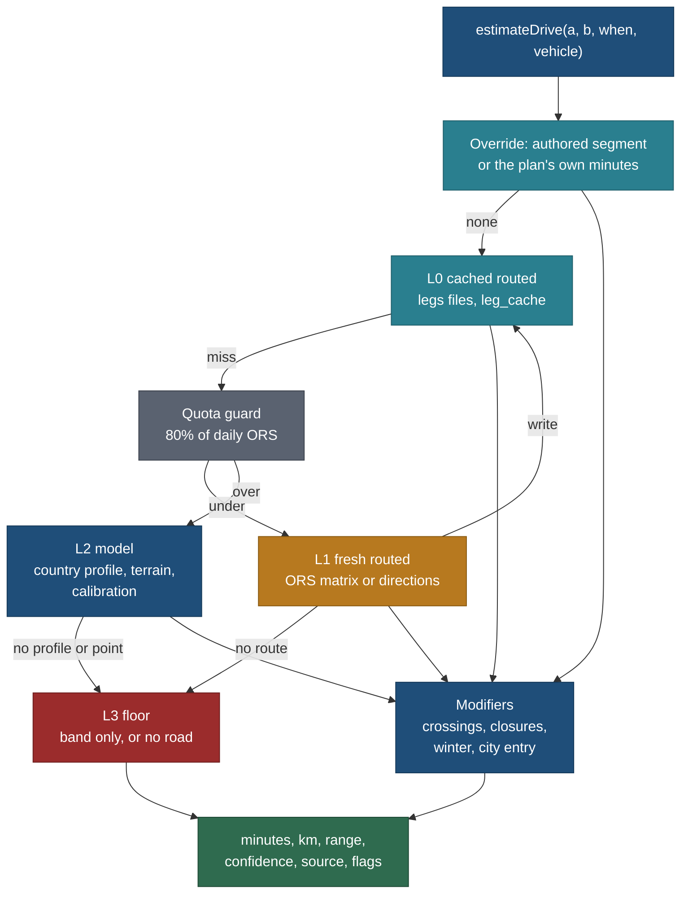

# Driving time model: distance and drive time anywhere, by layers

> **Amended 27 Oct 2026 (TB-FLOW):** the builder adds an explicit driving-per-day input (`driveDayMin`, default the pace's `driveLimitMin`) that sets the day-trip radius (half, capped at 2 h one way) and the "Also within your driving" suggestions ([FLOW.md](../design/trip-builder/FLOW.md) TF7, stage 4). Drive targets are a record's access point when it has one (metadata M14).

Status: **spec, planned only** (27 Oct 2026, travel-planner, Opus). No app code. Owner request of 27 Oct 2026; TODO row of
27 Oct 2026; BACKLOG 15.342; owner questions Q-DT1 to Q-DT5 (section 11). Part of the trip planner
([trip-builder.md](trip-builder.md)); it owns how every drive figure in the product is computed, labelled and stored.

Principles cited by number from [principles.md](../design/foundation/principles.md) (P1 to P9).

## The owner's request (27 Oct 2026, intent as given)

> I know mostly the driving distance, path and path calculation on the Google map, how driving things will be there,
> giving the estimation of the driving time based on the terrain and the road, because every country has their own, you
> know, per kilometre time average. All those things we have to think about: how much we have to find and how we have to
> structure the data. Those will be part of the trip planner.

Read as: the builder must give an honest drive distance and time between any two points in any country, accounting for
road class, terrain, the country's speed norms, seasons and closed passes, ferries, borders and towns; we decide what data
we keep, where it lives, how much of it we collect per country wave, and who maintains it.

## Relation to other pages

| Page | Relation | Changed there? |
|---|---|---|
| [trip-builder.md](trip-builder.md) 4.2, 4.10, 9.2 | Its "leg service" is this page's layered estimator. Its fallback "straight line × 1.42 plus the short-drive rule" is **superseded** by layer L2 (section 4); its `leg_cache` key "about 1 km cells" is **superseded** by section 5.6; TB-L grows by DT-L | Needed edit (section 10.3); not edited here (another agent owns it) |
| [trip-timeline.md](trip-timeline.md) 2.5 and D10 | The ladder (stored ORS, plan minutes, base matrix, straight line × 1.42) keeps its order; its last rung becomes `estimateDrive` L2 | Needed edit (10.3) |
| [nearby-and-regions.md](nearby-and-regions.md) 5.1 and Q57 | Bands stay (Q57 holds). The constants behind `bandOf` (`ROAD_FACTOR`, `SLOW_KMH`, `FAST_KMH`) are **superseded** by the per-country profile; MX (8.13) remains the batch routed path | Needed edit (10.3) |
| [trip-origin-and-nearest-airport.md](trip-origin-and-nearest-airport.md) OR7 | The drive, fly or both thresholds (6 h, 10 h) read `estimateDrive` with a hysteresis margin (6.5) | Needed edit (10.3) |
| [destination-data-coverage.md](destination-data-coverage.md) 4.2 | Its waves decide which country profiles, crossings and passes we collect when (section 8) | No |
| `source-strategy-osm-google.md` (being written in parallel) | Owns the OSM and Google storage rules. This page applies them: no Google value is stored, cached beyond its terms or used for calibration (section 3.3) | No (referenced by name) |
| [research/method/lanes/road-trips-and-legs.md](../../../research/method/lanes/road-trips-and-legs.md) | The research lane that fills sections 5.3 to 5.5 (passes, ferries, borders, slow segments) | Needed edit (10.3) |
| [short-trips.md](short-trips.md), [stay-bases-and-optimisation.md](stay-bases-and-optimisation.md) | Consumers: hub drive times, base comparison drive per day | No |

## 0. The decision in one paragraph

Drive figures come from **one server function, `estimateDrive`, over four layers**: a cached routed value (L0), a fresh
routed value from OpenRouteService within the free quota (L1), our own offline model built from a per-country speed
profile, a terrain class and calibration against our routed legs (L2), and a band-only floor where we have nothing (L3).
Crossings (ferries, borders), seasonal closures and a winter factor are applied on top of every layer. Every answer carries
its **confidence and source**, and the UI shows it honestly: routed times as "about 2 h 30", modelled times as bands in
lists and "about 2 h 30 ≈" with a range one tap away. We **measured** that today's single-formula estimate is off by 30% on
average and by 56% on 30 to 60 km mountain highway legs, that the error is mostly road shape rather than speed, and that a
legal-limit prior with a terrain class cuts the Canadian error to 17% but cannot fix short alpine hops (about 31%). So the
model is good enough to filter and rank (near mode, base shortlists, "about N days"), and routed values remain required for
day packing and the final plan. **Trade-off:** we accept free-flow times with no traffic in year one, and a model that is
honest about being rough, instead of paying for Google values we are not allowed to store.

## 1. What exists today (read 27 Oct 2026)

| Piece | Where | What it does | Gap |
|---|---|---|---|
| Straight-line estimate, timeline | `core/src/schedule/legs.ts` `estimateLeg` | line × 1.42 (+1.5 km under 60 km), 46 km/h under 60 km, 72 km/h above, +3 min, rounded to 5 | one formula for every country and terrain |
| Same rule as bands | `core/src/geo/bands.ts` `bandOf`, constants in `core/src/config/nearby.ts` | walk under 1.2 km, then the same arithmetic into `lt15`, `15-30`, `30-60`, `60-120` | duplicated constants (same numbers, two places) |
| The ladder | `resolveLeg` in `core/src/schedule/legs.ts` | stored ORS leg, else plan minutes, else estimate, else hub detour, else 10 min | no confidence beyond `estimate: true` |
| Stored routed legs | `data/schedules/legs/<trip>.json` (`trip-legs/2`), written by `web/scripts/legs-ors.mjs`, checked by `--check` | Dolomites (fetched 23 Oct) and Rockies (25 Oct): km, minutes, polyline | 2 of 14 trips |
| Unrouted pairs | `data/schedules/legs/canadian-rockies-2029.unrouted.json` | 8 Rockies pairs with the reason ("no road or path within reach", "over 5 times the straight line") | no model rule for "no road" |
| Research runs | `research/runs/DATA-D9R/ors-legs-2026-10-25.json` (65 directions, one 20-point matrix), `research/runs/rockies-bases-osrm-2026-10-25.json` (OSRM cross-check, 24 points) | evidence for the Rockies base plans | evidence, not stored legs |
| Cache table | `leg_cache` (migration 0003): `from_cell`, `to_cell`, `mode`, `seconds`, `metres`, `geometry`, `provider`, `computed_at`; RLS on, no write grant | nothing reads or writes it yet | key scheme and privacy undefined |
| Trip drive totals | `core/src/trips/drive.ts` | day and trip averages from timelines | consumer only |
| Relevance pairs | `core/src/relevance/derive.ts` `driveMin` input | "real drive minutes ... once it exists"; straight-line candidates held in `pair_pending` | waits for routed pairs |
| Quota | `core/src/quota` | counters and buckets | no ORS bucket yet (TB-L) |

## 2. Measured: how wrong is the naive model?

### 2.1 Method

A read-only script (no network) took every routed **drive** pair we hold, decoded the stored polyline's first and last
points as the true ends, and compared the routed minutes with (a) the straight line, (b) today's `estimateLeg` arithmetic
without its 5-minute rounding, and (c) candidate models. Pairs under 1.2 km straight (walks) were dropped; duplicate
directions were counted once. Data: Dolomites stored legs 33 (IT), Rockies stored legs 19, the D9-R ORS matrix 120 and
its base pairs 29 (CA). **201 pairs, 2 countries, both mountain regions; 168 are Rockies and the matrix and base pairs
overlap.** No urban, flat, ferry or border pair exists in our data yet. DT-K turns the script into `drive.ts calibrate`.

### 2.2 Results

| Slice | n | Road ÷ line, median (p10 to p90) | Routed speed, median | Naive bias, median | Naive mean error | p90 error | Within 20% |
|---|---|---|---|---|---|---|---|
| Italy, Dolomites | 33 | 1.82 (1.35 to 4.00) | 46 km/h | -1% | 30% | 52% | 39% |
| Canada, Rockies | 168 | 1.37 (1.13 to 1.89) | 72 km/h | +19% | 30% | 69% | 47% |
| All | 201 | 1.41 (1.14 to 2.08) | 70 km/h | +17% | 30% | 65% | 46% |

Bias by straight-line band (naive minus routed, median): Canada under 10 km +12%, 10 to 30 km +28%, **30 to 60 km +56%**
(n 26, only 15% within 20%), 60 to 150 km +9%, over 150 km +21%. Italy under 10 km -15%, 10 to 30 km -1%.

Worst cases: Lake Louise to Bow Lake, 33 km straight, routed 31 min, naive 66 min; Banff to Lake Louise, 50 km straight,
routed 48 min, naive 98 min. The rule drives the Trans-Canada and the Icefields Parkway at 46 km/h because the line is
under 60 km. This matches the nearby spec's own example (Whitby to Toronto, 88 min estimated against 45 to 60 min).

### 2.3 What the numbers say

| Finding | Evidence | Consequence |
|---|---|---|
| **The error is road shape, not speed.** Given the routed km, one speed per band predicts routed time within 4 to 10% above 10 km (Canada 30 to 60 km 7%, 60 to 150 km 5%, over 150 km 4%; Italy 10 to 30 km 7%) | speed-only test on routed km | a routed distance is worth more than any speed table; the model's biggest lever is the detour factor |
| **Detour depends on terrain and country.** 1.82 in the Dolomites, 1.37 in the Rockies, against a fixed 1.42 | table 2.2 | detour by terrain class, shrinking with distance |
| **Speed rises with distance.** Canada realised speed: 35 km/h under 10 km, 62 at 10 to 30, 72 to 74 above 30 | band medians | speed by distance band, not by a 60 km switch |
| **A legal-limit prior works where roads are sparse.** Model P (section 4.3) with Alberta's rural limit and a "mountain" class: Canada mean error 17%, p90 36%, bias -8%, 68% within 20% | prior test, no fitting | ship the prior for every country; calibrate where we have routed legs |
| **Short alpine hops resist any offline model.** Model P on the Dolomites: 31% mean, p90 55%; a curve fitted on Canada and applied to Italy: 40% | transfer test | in alpine areas the model filters and ranks only; packing needs routed values |
| **Engines disagree by about 10%.** OSRM against ORS on 45 Rockies pairs: time +9% median (-1% to +24%), distance +0.3% | OSRM cross-check | "routed" is itself ±10%; one engine per plan; show "about" |
| **Some points have no road.** 3 of 20 matrix points did not snap (Moraine Lake Road is closed to private vehicles; Sunshine Meadows; Sulphur Skyline); 8 Rockies pairs unrouted | D9-R note, unrouted file | the model must say "no road: shuttle or walk" from authored segments, not invent a time |
| **Bands agree 77%** (naive) and 76% (prior) with routed bands on these pairs | band test | bands are a fair list display; the error is concentrated in the 30 to 60 min band |

Gotcha: these numbers rest on two mountain regions. Urban entry, flat farmland, ferries and borders are unmeasured. The
first Ontario, Quebec and New York routed legs (wave 0) must be added to the golden set before the prior's urban and flat
parameters are trusted (DT-K acceptance).

## 3. Routing engines, terms and how each computes speed

### 3.1 Engines and services (read 27 Oct 2026)

| Engine or service | Licence or terms | Cost at under 100 users | May we store results? | Speed model | Traffic | Verdict |
|---|---|---|---|---|---|---|
| **OpenRouteService** hosted (HeiGIT) | engine GPL-3.0 (GitHub, v10.1.0, 14 Oct 2026); Standard plan "free for everyone" | Directions 2,000 a day / 40 a minute; Matrix 500 a day / 40 a minute; Optimization 500 a day ([plans page](https://openrouteservice.org/plans/), confirmed by search 27 Oct; the page did not render for a direct read). Matrix cap per request: 3,500 routes (forum, [thread 5331](https://ask.openrouteservice.org/t/matrix-api-3500-route-limit/5331); **unverified** on an official page) | yes, with attribution "© openrouteservice.org by HeiGIT, Map data © OpenStreetMap contributors" ([map-stack report](../../../research/reports/map-stack-2026-10-18.md)) | OSM `maxspeed` first, else road-type and surface defaults (`speed_limits/car.json`), then a reduction (a forum reading says × 0.9; **unverified**) ([forum](https://ask.openrouteservice.org/t/velocities-for-routing-profiles/1165/2)) | none: free-flow | **Primary, year one.** 500 matrix calls of up to 3,500 cells is far more than we need |
| **OSRM** self-hosted | BSD-2-Clause (v26.10.0, 1 Oct 2026); public demo is for light non-commercial use only | server cost only | yes (OSM, ODbL) | `car.lua`: motorway 90, trunk 85, primary 65, secondary 55, tertiary 40, unclassified and residential 25, service 15 km/h; tagged `maxspeed` × 0.8; country defaults (e.g. `ch` rural 80, `no` rural 80, motorway 110; default urban 50, rural 90, trunk 110, motorway 130); surface caps (gravel 40); turn penalty up to 7.5 s, U-turn 20 s; ferries from the OSM `duration` tag ([car.lua](https://github.com/Project-OSRM/osrm-backend/blob/master/profiles/car.lua), [way_handlers.lua](https://github.com/Project-OSRM/osrm-backend/blob/master/profiles/lib/way_handlers.lua)) | only if we load speed files | **Cross-check now (as D9-R did); the exit at about 1,000 users** (DT-X) |
| **Valhalla** self-hosted | MIT (3.9.1, 6 Oct 2026) | server cost only | yes (OSM) | road-class and density defaults; optional legal default speeds by country and urban or rural density (added in [PR 4739](https://github.com/valhalla/valhalla/pull/4739); config schema **unverified**); costing options for ferries and country crossings | historical and live only if loaded | second exit option; better seasonal and crossing costing, heavier to run |
| **GraphHopper** hosted | engine Apache-2.0; hosted Free plan 500 credits a day, "for non-commercial use only", Basic EUR 69 a month ([pricing](https://www.graphhopper.com/pricing/)) | free tier unusable if the site ever charges | not stated on the pricing page | custom models over OSM | paid add-on | **no** |
| **Google Routes API** | Compute Routes Essentials and Route Matrix Essentials 10,000 free a month each, then USD 5 per 1,000 ([pricing](https://developers.google.com/maps/billing-and-pricing/pricing)); "Routes API results displayed on a map must be shown on a Google Map"; only `place_id` may be stored indefinitely ([Routes policies](https://developers.google.com/maps/documentation/routes/policies), updated 23 Oct 2026); service terms 19.2 and 19.3 forbid use with a non-Google map and limit lat and lng caching to 30 days; terms 3.2.3(b) forbid other caching ([map-stack report](../../../research/reports/map-stack-2026-10-18.md) section "Google terms") | free within caps | **no** (durations are not a cacheable field) | road network plus "average, time-independent traffic" for `TRAFFIC_UNAWARE` ([traffic levels](https://developers.google.com/maps/documentation/routes/config_trade_offs)) | typical, and live with `TRAFFIC_AWARE` | **link-out only** (Google Maps URLs per leg, no key). Never stored, never a model input, never a calibration target |
| **Mapbox** Directions and Matrix | 100,000 requests and 100,000 matrix elements free a month, then USD 2 per 1,000 ([pricing](https://www.mapbox.com/pricing)); storage and non-Mapbox-map terms **not verified** | free | not verified | `driving` prefers fast roads; `driving-traffic` returns `duration_typical` "not taking into account live traffic" ([Directions docs](https://docs.mapbox.com/api/navigation/directions/)) | typical and live | **no** until its storage terms are read; it is the only typical-time source that might be storable |

### 3.2 Which give typical, not live, times

Google `TRAFFIC_UNAWARE` and Mapbox `duration_typical` are "typical" (historic averages). The open engines are free-flow:
posted or default speeds on an empty road, which is optimistic in towns and at busy hours and close to right on rural
highways (2.3: routed speed 72 km/h on Rockies highway legs with a 90 to 100 km/h limit). We use free-flow everywhere and
correct only what we can source: a city-entry allowance, a winter factor, crossing times (section 4.4).

### 3.3 Rules we apply (coordinate with `source-strategy-osm-google.md`)

1. Every stored drive value comes from an open engine (ORS now, our own OSRM later) or from our model, with its engine,
   profile and date. OSM-derived values carry the ODbL attribution on every surface that shows them.
2. No Google value enters a file, the database, a cache, a test fixture or a calibration. Visitors open Google Maps by
   link for live traffic and turn-by-turn.
3. The cache is never exported in bulk (P8); a plan's matrix goes only to the visitor who built it (trip-builder 4.10).
4. Our own observed drives (after-the-trip notes, F14) may become calibration data, dateless and with no household
   detail, labelled `observed`.

## 4. The model: four layers and three modifiers

### 4.1 The layers



| Layer | When | Confidence | Typical error (2.2, 2.3) | Shown as |
|---|---|---|---|---|
| Override | an authored segment (5.5) or the plan's own minutes (`basis: plan`) | `authored` | as sourced | "about 40 min" with the source one step away |
| L0 cached routed | a cache hit (legs file, `leg_cache` row younger than 180 days, same engine as the plan) | `routed` | ±10% engine spread, free-flow | "about 2 h 30" |
| L1 fresh routed | a miss, quota under the guard | `routed` | same | same |
| L2 model | no route available (quota guard tripped, batch prefilter, offline) | `modelled` | 17 to 31% mean today; per cell from calibration | a band in lists; "about 2 h 30 ≈" on one leg, range on tap |
| L3 floor | no point, no country profile, or the router says no road | `rough` or `none` | n/a | band only ("1-2 h ≈"), or "No road: shuttle or walk", or "Drive time unknown" |

### 4.2 Error budgets by use

| Use | Needs | Layers allowed | Budget | Rule |
|---|---|---|---|---|
| Near mode, "within 3 h" filter (trip-builder near mode) | recall: never drop a place that is really inside | L2 to filter, L1 for the survivors | no golden pair inside the limit excluded (recall 100% on the golden set) | filter on the **optimistic** side (estimate × 0.75, section 4.3), then route the top 40 by score; shown as a band until routed |
| "About N days" on the tray | rough total | L2 | ±30% | shown ≈ (trip-builder 4.3) |
| Base town shortlist (40 towns) | ranking | L2 | rank correlation with routed ≥ 0.8 on the golden set | then one L1 matrix towns × picks |
| p-median bases, day packing, `scheduleDay` | real minutes | L0 or L1; L2 only when the guard trips, every such leg ≈ | routed spread | a plan built on any L2 leg says "Some drive times are estimates" and offers "Refresh times" next day |
| Day header, trip cover, "driving needed per suggestion" | sum of legs | whatever the legs are | marked ≈ if any leg is L2 | "about 3 h 10 of driving" (P6) |
| Getting there: drive, fly or both (origin OR7) | a threshold decision | L2 then L1 | ±15% hysteresis | within 15% of 6 h or 10 h, offer both modes |
| Trip page, nearby rows on place pages | display | L0 (batch MX) else L2 band | as above | Q57 bands stay |

### 4.3 Layer L2, the model

For two points a and b with straight line d km (haversine, `core/src/geo`), in country c, terrain class t, for vehicle v:

```
detour(t, d) = D[t] × (1 + 0.35 × e^(-d / 10))            road km ÷ straight km; shorter hops wind more
road_km      = d × detour(t, d) × K_detour[c, t, band(d)]   K from calibration, 1.0 when uncalibrated
speed(c, d)  = V_rural[c] × R[band(d)] × K_speed[c, t, band(d)]
drive_min    = road_km ÷ speed × 60 + 2                     2 min to park and get going
range        = drive_min × [Q10, Q90] of the calibration cell (prior cell when uncalibrated)
bands        = under 10 km, 10-30, 30-60, 60-150, over 150 (straight line)
```

Starting parameters (the measured prior, section 2.3; DT-K refits them):

| Parameter | Value | Source |
|---|---|---|
| `R[band]` realisation of the rural legal limit | 0.45, 0.62, 0.75, 0.80, 0.82 | fitted on the Rockies, held for all |
| `D[t]` detour by terrain | flat 1.20, rolling 1.25, hilly 1.30, mountain 1.30, alpine 1.60, coastal-fjord 1.70, urban 1.35 | mountain and alpine measured; the rest priors to check in wave 0 |
| Prior range [Q10, Q90] | 0.88 to 1.53 of the estimate (Italy 0.74 to 1.70, Canada 0.90 to 1.48) | p10 and p90 of routed ÷ prior on the 201 pairs; the prior runs about 9% fast at the median |
| Near-mode keep factor | keep a candidate when estimate × 0.75 is within the limit | at 0.75 every golden pair within 60, 120, 180 and 240 min is kept (155 of 155 at 180 min; 0.80 loses one), at the cost of 25 to 30 extra pairs that routing then removes |
| `V_rural[c]` | the country's rural legal limit for cars (5.1), subdivision first (CA-AB 100, CA-ON 80, IT 90) | legal table |
| Unpaved share | when an area is marked `unpaved`, speed capped at 40 km/h on that share | OSRM surface cap |

When the country has no profile row, L2 falls back to `V_rural` 80 and terrain `hilly`, and the confidence drops to
`rough` (band only). The model is pure, deterministic and integer-rounded, like the rest of `core/` (trip-builder 4.11).

**Built (RB-008, 28 Oct 2026; review TB-R1).** The builder's estimates ran 25 to 40% long (Calgary to Banff 125 min, Toronto to
Dwight 217, a Toronto day trip with 0 places within 3 h). The cause was the points, not the factors: a catalogue row, a hub and an
airport carry a country only, and a Canadian point with no province has no rural limit, so the model fell back to 80 km/h on hilly
terrain. Two changes in `core/src/drive/model.ts`, numbers in `DRIVE_MODEL`:

- **Context from boxes.** A point that arrives without a subdivision or an area (`undefined`; `null` means "known to be none" and is
  never boxed) takes the area of the smallest area box that holds it, and the subdivision its area id names (`CA/AB/...`), else the
  smallest subdivision box (`contextOf`). The boxes are authored, optional `box` fields (`[west, south, east, north]`, 0.1 degree) on
  the subdivision rows of `countries.json` (CA-AB, BC, ON, QC) and every row of `areas.json`. On the golden set, bare points drive
  within 2% of the authored ones.
- **Motorway share.** `V(c, d) = (1 - W) × V_rural + W × V_motorway × Rm / R(d)`: a longer leg runs part of its way at the motorway
  limit (`motorwayShare` 0, 0, 0.2, 0.5, 0.85 along the band knots; `motorwayRealisation` Rm 0.92), halved when one end is on a
  motorway-free terrain (mountain, alpine, coastal-fjord) and none between two such ends. A prior; calibration refits each cell as
  before (all pairs: calibrated mean error 18.3%, was 18.6%).

Known pairs from bare points: YYC to Banff 105 min (ORS 102), to Canmore 91 (87), to Lake Louise 144 (139), to Jasper 301 (333),
Edmonton to Calgary 187 (165, 13% long), Toronto to Dwight 160 (the review's about 160), Calgary to Banff 103 (the review's about 90; ORS from the
airport 102). Pinned in `core/test/drive/context.test.ts`. Published days read stored legs and do not change. `golden-legs.json` was
already stale against `pairs --check` before this change (area labels moved in the capture world); not regenerated here.

### 4.4 Modifiers on every layer

| Modifier | Rule | Data | Applies to |
|---|---|---|---|
| **City entry** | +8 min for each end inside a town of 1 million or more, +4 for 250,000 to 1 million | towns layer population (GeoNames) | L2 only (the routers see the streets, not the congestion) |
| **Ferry** | crossing minutes + check-in (country default, else 20 min) + half the headway in the trip month | ferry route records (5.4); routers add only the sailing | when the routed directions show a ferry segment, or an authored region pair says "ferry needed" |
| **Border** | wait by country pair and direction (Schengen 0; CA-US default 20 min, holiday weekends flagged), plus a link to the live wait page | crossings table (5.4); live waits link only (CBP publishes hourly RSS, [bwt.cbp.gov](https://bwt.cbp.gov/), US government work) | when the two ends are in different countries |
| **Seasonal closure** | a leg whose route uses a road closed in the trip month is invalid: re-route with that segment avoided (L1), or flag "Closed in winter: route via X adds about N min ≈" | closure index from pass and road records with `season` (5.4) | L0, L1 (geometry) and L2 (authored region pairs) |
| **Winter** | speed × the country's winter factor in its winter months (for example NO and IS 0.85, mountain areas 0.80) | country profile (5.1) | all layers (routers are free-flow summer) |
| **Vehicle** | `car` excludes roads marked 4x4-only (Iceland F-roads) and hire-contract bans; `4x4` allows them with a warning | slow-segment table (5.5) | all layers |

Rest stops and fuel are **not** in drive time: `scheduleDay` already places rests (the household rule, a break at least
every 2 h), so adding them here would count them twice. The day view shows "about 3 h 10 of driving, plus breaks".

### 4.5 Calibration

1. Input: every routed pair from an open engine (legs files, `leg_cache` export by the server job, research runs), never
   Google, plus `observed` drives.
2. For each cell (country, terrain, band) compute routed ÷ modelled; store n, median, p10, p90.
3. Shrink toward 1.0 with weight n ÷ (n + 20) so a cell with 5 pairs moves the model only a little.
4. Write `data/reference/drive/generated/calibration.json` (generated, never edited); `drive.ts check` fails when a cell
   with n ≥ 30 still shows a median bias beyond ±15% (the profile is wrong, not the calibration) or when the golden mean
   error worsens by more than 3 points.
5. Cadence: weekly from the server's `leg_cache` once TB-L is live (an internal job, counts only in its log), and after
   every batch of routed legs.

### 4.6 Display (P2, P3, P6)

| Confidence | List row | One leg, day row | On tap (P2) |
|---|---|---|---|
| routed | "about 25 min" | "about 2 h 30 · 186 km" | "Route from OpenRouteService, without traffic. Open in Google Maps for live traffic" |
| modelled | "1-2 h ≈" | "about 2 h 30 ≈" | "Estimated: 2 h 10 to 3 h. Routed time when available" |
| authored | "about 40 min" | same | the source and date |
| rough | "1-2 h ≈" | "1-2 h ≈" | "Rough estimate: we have no road data here yet" |
| none | "No road" | "No road: Parks Canada shuttle" | the segment's note and link |

Rounding: under 1 h to 5 min, 1 to 4 h to 10 min, over 4 h to 15 min. Ferry, border and closure flags show as chips on
the leg (P6). Bands stay as Q57 decided.

## 5. Data we keep

### 5.1 `data/reference/drive/countries.json` (`drive-profile/1`, authored, sourced, versioned)

One row per ISO country, with optional subdivision rows where limits differ (CA provinces, US states, AU states).

| Field | Example (IT) | Rule |
|---|---|---|
| `cc`, `sub` | `IT`, null | ISO 3166-1 alpha-2; subdivision ISO 3166-2 |
| `side` | `right` | from OSM country relations `driving_side`, checked |
| `legal` | `{ urban: 50, rural: 90, expressway: 110, motorway: 130, unpaved: null }` | km/h for cars; from `legal-speeds.json` (5.2) or a national source |
| `legalSource` | Codice della Strada art. 142 comma 1, read 27 Oct 2026 ([Brocardi](https://brocardi.it/codice-della-strada/titolo-v/art142.html), updated 25 Apr 2026) | url, read date |
| `rain` | `{ motorway: 110, expressway: 90 }` | optional, display note only |
| `winter` | `{ months: [11,12,1,2,3], factor: 0.9, tyres: "required on signed roads 15 Nov to 15 Apr" }` | factor in the model; tyre text is the research lane's |
| `borderDefaultMin` | `{ "CH": 5, "FR": 0 }` | by neighbour; Schengen 0 |
| `ferryCheckinMin` | 20 | default when a route record has none |
| `calibrated` | `{ cells: 3, pairs: 33 }` | written by `calibrate` into the generated file, mirrored here as read-only info |
| `version`, `read` | 1, 2026-10-27 | bump on any change |

### 5.2 `data/reference/drive/legal-speeds.json` (generated import)

`drive.ts import-legal` reads the `legal_default_speeds.json` of
[osm-legal-default-speeds](https://github.com/westnordost/osm-legal-default-speeds) (code BSD-3-Clause; data derived from
the OSM wiki [Default speed limits](https://wiki.openstreetmap.org/wiki/Default_speed_limits), CC BY-SA 2.0) and writes
car limits per country and road type. Carries "Generated ... Do not edit" and its licence line; listed in
`data/reference/licences.json`. Because the data is share-alike, it stays a separate file; our profile cites it by value
(legal limits are facts) and the national source where we checked one (Q-DT3).

Wave 0 and trip-country values read from the wiki on 27 Oct 2026 (urban, rural, expressway, motorway, km/h; "i" marks a
column the reading inferred from a flattened table, to be confirmed by the import):

| Country | Urban | Rural | Expressway | Motorway | Side |
|---|---|---|---|---|---|
| CA-ON | 50 | 80 | n/a | 100 (posted) | right |
| CA-QC | 50 | 90 | n/a | 100 | right |
| CA-AB | 50 | 100 (provincial highway) | 80 urban highway | 110 (posted) | right |
| CA-BC | 50 | 80 | n/a | posted | right |
| US | by state | by state | by state | by state | right |
| IT | 50 | 90 | 110 | 130 | right |
| FR | 50 | 80 i | 110 | 130 | right |
| CH | 50 | 80 i | 100 | 120 | right |
| AT | 50 | 100 i | 100 | 130 | right |
| NO | 50 | 80 i | n/a | 110 | right |
| IS | 50 | 80 gravel i, 90 paved | n/a | n/a | right |
| AR | 40 to 60 | 110 i | 120 | 130 | right |
| CL | 50 | 100 | 120 | n/a | right |
| CR | 50 | 60 | n/a | n/a | right |
| GB | 30 mph | 60 mph | 70 mph | 70 mph | left |
| JP | 30 to 60 | 60 i | n/a | 100 | left |

Park roads are lower than the national table (Bow Valley Parkway 60 km/h, Icefields Parkway 90 with 60 sections; from
secondary sources, **unverified** with Parks Canada). The routers read the OSM `maxspeed` tags on those roads, so L0 and L1
are right; L2 uses the area's terrain class and, where needed, a slow segment (5.5).

### 5.3 `data/reference/drive/areas.json` (`drive-areas/1`, authored)

Terrain class per area id from the locations store's area index (no new geometry): `{ area: "dolomites", terrain:
"alpine", unpavedShare: 0, note }`. A point outside any listed area takes the country's default terrain. **No DEM in year
one**: section 2.3 shows the remaining error is road layout, which a terrain grade does not fix. If a later calibration
shows a terrain signal we miss, DEM ruggedness per area can be computed once from Copernicus GLO-90 (free, attribution to
DLR and Airbus required, [licence](https://documentation.dataspace.copernicus.eu/APIs/SentinelHub/Data/DEM/resources/license/License-COPDEM-30.pdf))
or SRTM (public domain, not re-read today).

### 5.4 Crossings and closures

| Data | Lives in | Why there |
|---|---|---|
| Ferry routes: ports, crossing minutes, frequency by month, vehicle booking offer | capture records (`place` subkind `ferry_route` per the road-trips lane; the booking is an `offer`) | they are things a visitor books and the trip page shows |
| Border crossings: point, hours, documents, live-wait link | capture records (`border_crossing`) | same |
| Pass and seasonal road closures: `season` pattern ("typically opens late May") | capture records (`pass`, `scenic_road`) and the seasons data | already modelled for some places |
| Country-pair border defaults, ferry check-in defaults | `countries.json` (5.1) | model parameters, not places |
| "Ferry needed" and "closed in winter" region pairs for L2 | `data/reference/drive/crossings.json` (`drive-crossings/1`, authored): `{ from: area, to: area, kind: "ferry", via: <ferry record ref> }` | L2 cannot see water or a closed pass |
| Closure index for the router | `data/reference/drive/generated/closures.json`, built by `drive.ts build` from the records | one read per request; never edited |

### 5.5 `data/reference/drive/segments.json` (`drive-segments/1`, authored per region)

Known slow, closed or restricted stretches with a source: Moraine Lake Road (closed to private vehicles; Parks Canada
shuttle from the Lake Louise Park and Ride), Icelandic F-roads (4x4 only, seasonal), Trollstigen (seasonal, length limit),
Stelvio and Gavia (seasonal). Each row: `{ id, refs | line, rule: "closed" | "4x4" | "slow" | "fixed", minutes | factor,
months, source, read }`. Authored by the research lane, validated by `drive.ts check`. The plan's own minutes stay in
`data/schedules/<trip>.json` (`basis: plan`) as today.

### 5.6 The leg cache (`leg_cache`, Postgres) and its keys

| Rule | Detail |
|---|---|
| Keys | `r:<public alias>` for catalogue points (never a dated trip folder id, per [public-ref-aliases.md](public-ref-aliases.md)); `t:<geonameid>` for towns; `g:<geohash 6>` (about 1.2 × 0.6 km) for any other public point |
| Visitor start | **never a key, never stored, never logged.** Routed from the exact point inside the request (one matrix row) and dropped; with the guard tripped, L2 from the exact point in memory (Q-DT4) |
| Household | a cell within `HOME_RADIUS_KM` of home (`core/src/privacy/home.ts` `nearHome`) is refused for writing |
| Columns added (additive migration, DT-L inside TB-L) | `profile` (`driving-car`), `engine` (`ors`, `osrm`), `engine_version`, `flags` (ferry, toll, unpaved, border), `hits`, `last_used`, `origin` (`seed` for stored legs the seed writes, `server` for routed rows; SEEDC 28 Oct 2026: a seed sync touches only `seed` rows, the prune only `server` rows) |
| Life | 180 days from `computed_at`; pruned by `last_used`; size reported by CAT-V; budget 100 MB |
| One engine per plan | a build uses cells of one engine; a different engine's row is re-asked, not mixed |
| Geometry | only for directions fetched at Review (trip-builder 4.10), simplified to 30 m like the legs files |

Sizing: a cold build asks at most two 40 × 40 matrices (3,200 cells, inside the 3,500 cap). The cells that matter are
bounded per region by (points + towns)²: a T2 region of about 150 points and 40 towns within a 150 km line is at most
about 36,000 pairs, about 5 MB with indexes. Twenty such regions are about 100 MB, 10% of Neon Free's 1 GB. At 10 builds a
day the ORS use is about 20 matrix calls of 500.

### 5.7 Files at a glance

| File | Authored or generated | Maintained by | Validator | Freshness |
|---|---|---|---|---|
| `data/reference/drive/countries.json` | authored | travel-researcher (Opus) from national sources; Sonnet fills from the import | `drive.ts check` (Zod schema `drive-profile/1`, sources and read dates present, side present) | 365 days |
| `data/reference/drive/legal-speeds.json` | generated (`import-legal`) | Haiku runs the import | `--check` byte compare | on upstream release |
| `data/reference/drive/areas.json` | authored | Opus researcher per wave | area ids exist; terrain in the vocabulary | 730 days |
| `data/reference/drive/crossings.json`, `segments.json` | authored | the road-trips lane | refs resolve; months valid; source present | 365 days (ferries), 1 year patterns |
| `data/reference/drive/generated/calibration.json`, `closures.json` | generated (`calibrate`, `build`) | job and `check-all` | `build --check` | each run |
| `core/test/fixtures/drive/golden-legs.json` | generated from the legs files and research runs | DT-K | count and hash pinned | each new batch of routed legs |
| `leg_cache` | database | the server leg service | grants, RLS, key grammar test | 180 days |

## 6. How the builder and the site use it

### 6.1 API

```ts
// core/src/drive/ (pure) and web/lib/server/legs.ts (TB-L, the only place that calls ORS)
type DriveConfidence = "routed" | "authored" | "modelled" | "rough" | "none";
interface DriveEstimate {
  minutes: number | null;          // null when there is no road
  km: number | null;
  range: [number, number] | null;  // modelled only
  confidence: DriveConfidence;
  source: "plan" | "segment" | "cache" | "ors" | "osrm" | "model";
  flags: ("ferry" | "border" | "closed-season" | "winter" | "unpaved" | "4x4" | "no-road")[];
  attribution: string | null;      // the ORS and OSM line when routed
}
estimateDrive(a: DrivePoint, b: DrivePoint, opts: { month?: number; vehicle?: "car" | "4x4"; allowRouting: boolean }): Promise<DriveEstimate>
estimateDriveMatrix(sources: DrivePoint[], targets: DrivePoint[], opts): Promise<DriveEstimate[][]>   // at most 40 × 40
modelDrive(a, b, opts): DriveEstimate   // L2 only, synchronous, no I/O: build-time pages, tests, the client re-flow
```

`DrivePoint` is `{ key?: "r:..." | "t:..." | "g:...", lat, lon, cc, area? }`; a point without `key` is never cached.
`estimateLeg` and `bandOf` keep their signatures and call `modelDrive`, so `resolveLeg`, the timeline and nearby rows
change only in their numbers (snapshots update in DT-1).

### 6.2 Where each consumer reads

| Consumer | Calls | Layers |
|---|---|---|
| Near mode candidates ("within 3 h from Toronto") | `modelDrive` over the near query's light rows (keep factor 0.75), then `estimateDriveMatrix` for the top 40 | L2 then L0 or L1 |
| Base suggestion | `modelDrive` to cut towns to 40, then one matrix towns × picks | L2 then L0 or L1 |
| Day packing and `scheduleDay` | the picks × picks matrix; the client re-flow reads it (trip-builder 4.10) | L0 or L1 |
| "Driving needed per suggestion", day headers, trip cover | sums of legs, ≈ if any modelled (`core/src/trips/drive.ts`) | inherited |
| Getting there (origin OR7) | `estimateDrive(origin, night-1 base)` with 15% hysteresis | L2 then L1 |
| Place page nearby rows, hub times (MX batch) | build-time batch through `web/scripts` with the same ORS client rules; `modelDrive` bands where no pair exists | L0 else L2 band |
| Relevance `driveMin` pairs | L0 only; `pair_pending` stays for modelled pairs | L0 |

No consumer reads a profile file in the browser; the client receives only numbers for the visitor's own picks (P8, P9).

### 6.3 Tests

| Test | Holds |
|---|---|
| Golden legs (201 pairs today) | L2 mean error ≤ 22% overall, Canada ≤ 20%, Italy ≤ 33%; no band with a median bias beyond ±15% for n ≥ 20; regression fails on +3 points |
| Near-mode recall | no golden pair whose routed time is within a limit (60, 120, 180, 240 min) is filtered out by the keep factor |
| Property tests | monotonic in distance within one country and terrain; symmetric unless a ferry, a one-way or a closure differs; never faster than the motorway limit; integer minutes; same input, same output |
| Privacy | `leg_cache` writes only `r:`, `t:` and `g:` keys; no key within 2 km of home; a request with a visitor start leaves no row and no log line with coordinates |
| Quota | guard tripped: a build returns, every new leg `modelled`, the plan shows the notice |
| Calibration | `calibrate` is idempotent; a cell with 5 pairs moves the model by at most 20% of its bias |
| Licences | `legal-speeds.json` and every routed surface carry their attribution lines |

## 7. How much we must collect, per wave

Waves are those of [destination-data-coverage.md](destination-data-coverage.md) 4.2.

| Wave | Countries | Profiles | Terrain areas | Ferries | Border pairs and crossings | Seasonal roads and passes | Slow segments |
|---|---|---|---|---|---|---|---|
| 0 | CA (13 subdivisions), US (51), IT | 67 rows, mostly imported | about 25 (Ontario cottage country, Algonquin, Niagara, Toronto, Montréal, Québec, Charlevoix, Laurentides, Adirondacks, Catskills, Green and White Mountains, Maine coast, Cape Cod, Berkshires, Rockies, Dolomites, Italian lakes, Aosta) | about 12 (Tobermory to South Baymouth, Tadoussac, Wolfe Island, Lake Champlain, Como and Maggiore car ferries) | CA-US: about 10 crossings (Ontario and Quebec to NY, VT, NH, ME) | about 25 | about 15 |
| 1 | 28 countries and 2 SARs (top 25 plus CH, IS, AR, CL, NO, CR) | 30 rows, imported then reviewed; left-hand traffic flagged (GB, JP, TH, MY, HK, MO) | about 40, only for the seven T1 countries | about 60 on trip routes (NO about 30, GR about 15, HR about 10, CL and AR about 6) | about 20 non-Schengen pairs (MX-US, TR-GR, TR-BG, HK-CN, MO-CN, AR-CL Andean passes) | about 40 (Alpine passes in CH, AT, FR, IT; Norwegian tourist roads; Andes) | about 30 |
| 2 and 3 | 75 countries at T0 | imported only; confidence `rough` until a region reaches T1 | none | none | country-pair defaults only | none | none |

Who: the import and fills are Haiku or Sonnet; terrain classes, ferries, crossings and passes are the road-trips lane
(travel-researcher, Opus), in the data seat beside the coverage waves. Refresh: legal limits yearly or on upstream
release; ferries and passes yearly as patterns; calibration weekly.

## 8. Phases and tasks

| Task | What | Model | h | Needs | Bundle and seat |
|---|---|---|---|---|---|
| DT-C | contracts: `drive-profile/1`, `drive-areas/1`, `drive-crossings/1`, `drive-segments/1` Zod schemas; `DriveEstimate` and `DrivePoint` types; key grammar; confidence vocabulary | Opus (shared contract) | 4 | TB-C in the same queue | D, B2 contract seat, before TB-L |
| DT-1 | `core/src/drive/` pure model (L2, modifiers, rounding, range); `estimateLeg` and `bandOf` delegate; `node core/bin/drive.ts estimate, explain`; golden fixture; snapshot updates | Sonnet, Opus review 1 | 8 | DT-C | D, B2 |
| DT-P0 | `import-legal` and `legal-speeds.json`; wave 0 `countries.json` (CA, US, IT with subdivisions), sources and read dates; `licences.json` entry | Sonnet 4, Opus review 1 | 5 | DT-C, Q-DT3 | D, data seat |
| DT-T0 | terrain classes and wave 0 `areas.json` (about 25) | Opus researcher | 3 | DT-C | D, data seat |
| DT-K | `drive.ts calibrate, check, build`; `calibration.json`; a `check-all` stage; adds the first Ontario, Quebec and New York routed legs (from MX or a 3-call ORS batch) to the golden set | Sonnet | 5 | DT-1 | D, B2 |
| DT-L | inside TB-L: key grammar, visitor-start rule, home refusal, additive `leg_cache` columns, prune, one-engine rule | Opus (privacy, shared contract) | 3 | DT-C, TB-L | D, B2 (TB-L 6 h becomes 9 h) |
| DT-S0 | closures index and winter factors in the model (Sonnet 3); wave 0 seasonal roads and passes research (Opus 5) | Sonnet, Opus researcher | 8 | DT-1 | D, data seat |
| DT-F0 | ferry and border modifiers (Sonnet 3); wave 0 ferries and CA-US crossings research (Opus 5) | Sonnet, Opus researcher | 8 | DT-1 | D, data seat |
| DT-UI | confidence labels, ranges on tap, chips, rounding in the builder and timeline rows | Sonnet | 1.5 | DT-1, TB-W1 | D, B1 (inside TB-W1) |
| DT-V | verifier: golden, privacy, quota-guard and display checks; screenshots 1440 and 390, light and dark, of a leg with each confidence | Sonnet | 1.5 | all above | D |
| **Wave 0 total** | | | **47** | | D |
| DT-W1 | wave 1: profiles reviewed (Sonnet 3, Opus 1), terrain for the seven T1 countries (Opus 4), ferries, borders and passes (Opus 18), recalibration (Sonnet 2) | mixed | 28 | wave 0 accepted, coverage wave 1 | G2, data seat |
| DT-W23 | waves 2 and 3: import only, `rough` confidence | Haiku 4, Sonnet 2 | 6 | DT-W1 | year two |
| DT-X | self-host OSRM (or Valhalla) spike: Geofabrik extracts, memory, cost, parity with ORS on the golden set | Opus | 4 | trigger: the 80% guard trips on 5 days in a month, or 1,000 users | later |
| **All** | | | **85** (75 in year one) | | |

No design review round of its own: the display is inside TB-W1 and its review (TB-R1). DT-UI follows P2, P3 and P6 and
adds no component.

## 9. Gotchas

- Longitude is positive east everywhere (`core/src/sun` rule); the model takes `{ lat, lon }` from `core/src/geo` only.
- `bandOf` exists twice by name (`core/src/geo/bands.ts` and `core/src/suitability/map.ts`); DT-1 changes only the geo one.
- ORS snapping: a point more than the search radius from a road returns no route (3 of 20 Rockies points). That is a
  `none` with a segment note, never a modelled number.
- Free-flow times look fast near cities. The city-entry allowance is a prior until wave 0 urban legs are measured.
- Mixing engines inside one plan makes base comparisons unfair by up to 24% (2.3).
- The legal table is CC BY-SA: never merge it into an authored file.

## 10. Verdict, edits and questions

### 10.1 Verdict

Build the layered estimator with ORS as the only router in year one, our own L2 model for everything the quota or the
batch cannot cover, and calibration against our own routed legs. It costs 47 h in bundle D (most of it beside TB-L in the
contract and data seats) and 28 h in G2 for wave 1. **Trade-off:** no traffic and no Google accuracy, and alpine estimates
stay rough (about 31%) until routed; in exchange every number is free, storable, explainable and labelled.

### 10.2 What it supersedes

- trip-builder.md 4.2: the fallback "straight line × 1.42 plus the short-drive rule"; 4.10: "about 1 km cells".
- nearby-and-regions.md 5.1: the constants `ROAD_FACTOR`, `ROAD_EXTRA_KM`, `SHORT_DRIVE_KM`, `SLOW_KMH`, `FAST_KMH`.
- trip-timeline.md 2.5 and D10: the last rung of the ladder.

### 10.3 Edits other pages need (for the coordinator; not made here)

| Page | Edit |
|---|---|
| trip-builder.md | pointers in 4.2 and 4.10 to this page; 9.2 TB-L 6 h to 9 h (DT-L); TB-W1 carries DT-UI 1.5 h; 10 risk row "ORS free tier" points to 5.6 |
| trip-timeline.md 2.5 | the last rung reads "`modelDrive`, driving-time-model.md 4.3" |
| nearby-and-regions.md 5.1 | "Superseded in part by driving-time-model.md 4.3: the constants move to the country profile; bands stay" |
| trip-origin-and-nearest-airport.md OR7 | 15% hysteresis at 6 h and 10 h (section 4.2) |
| research/method/lanes/road-trips-and-legs.md | Produces: `areas.json`, `crossings.json`, `segments.json` rows; ferry, border and pass records feed the closure index |
| data/schema/freshness.json | rows for the drive files (5.7) |
| MASTER-ORDER, RELEASE-PLAN, PLAN | DT tasks in bundle D and G2; a PLAN requirement row; owner questions Q-DT1 to Q-DT5 |
| `source-strategy-osm-google.md` | the rules of 3.3, and the legal table's CC BY-SA status |

## 11. Owner questions

| # | Question | Recommended |
|---|---|---|
| Q-DT1 | Calibrate and test only against open engines (ORS, OSRM) and our own observed drives, never against Google times? | **Yes.** Google's terms do not let us store its durations, so they cannot be a calibration target |
| Q-DT2 | Show routed times as "about 2 h 30", modelled times as bands in lists and "about 2 h 30 ≈" with the range one tap away? | **Yes.** It keeps Q57 and the ≈ convention |
| Q-DT3 | Import legal speed limits from osm-legal-default-speeds (data CC BY-SA 2.0) as a separate generated file with attribution, instead of authoring about 100 countries by hand (about 25 h)? | **Yes** |
| Q-DT4 | Route from the visitor's exact start inside the request, and never cache, store or log it? | **Yes.** One extra matrix row per build; nothing personal at rest |
| Q-DT5 | No traffic data in year one: free-flow times plus a city-entry allowance and a winter factor, no paid traffic API? | **Yes.** Live traffic stays a Google Maps link per leg |
