# Edit my trip: one editable trip, saved on the device and synced to the account

Status: **spec, planned only** (27 Oct 2026, travel-planner, Opus, task TRIP-EDIT-I). No app code. Owner feedback of
27 Oct 2026, two parts. TODO row of 27 Oct 2026; BACKLOG 15.349 to 15.352; owner questions Q-EM1 to Q-EM12 (section 11).

Principles cited by number from [principles.md](../design/foundation/principles.md) (P1 to P9). Rules from
[trip-scope-scenarios.md](../design/trip-scope-scenarios.md) (rules 1 to 9) and
[keep-from-live-site.md](../design/keep-from-live-site.md).

**Supersedes or amends** (each page carries a pointer note):

| Page | What changes |
|---|---|
| [navigation-and-mine.md](navigation-and-mine.md) N8, 4.1, 4.2 rules 2, 3, 6, 9, 10 (NAV-D, NAV-3) | Signed-in copies sync in bundle D, not after CUS-C; the doc is `plan-draft/1` (template mode), not `trip-custom/1`; the route is `/api/account/plans/merge`; same trip and start with different content keeps both; the account card line changes; Open carries the copy id (`mine=`) so changes save back |
| [trip-overview-and-customisation.md](trip-overview-and-customisation.md) 5.1, 5.5, 5.6 | The customised copy is the same document as a device copy and a builder plan: `plan-draft/1` with a `template` block. `trip-custom/1` is retired before any doc is stored. Customising no longer needs sign-in (Q-EM8) |
| [trip-builder.md](trip-builder.md) 2.4, 2.7, 15.1 ISO-6, ISO-7, 15.5 QI1 | One document and one table for copies and plans; "Open in the builder" converts a template-mode draft in place or into a new draft (still one way). If Q-EM2 is yes, the separate `plan_draft` table is not created |
| `core/src/schema/trip-custom.ts` header (code, changed only by task EM-C) | The delta shape moves into `plan-draft/1` |

## The owner's feedback (27 Oct 2026)

1. "The trip page seems not editable; already added items cannot be changed." Context: on `/mine/` the owner has
   **My trips 1** (a copy of the Canadian Rockies made with Copy to my trips) and **Favourites 2**. Trip pages show Edit
   buttons and a per-day "Version of Day N" menu.
2. (Screenshot of `/mine/?show=trips`, signed in as the owner.) "When a person is signed in, My trips must be synced to
   the server automatically." Today the account card says "Copies on this device move to your account when the planner
   opens", and the row carries the chip "On this device". The row reads "Canadian Rockies, 14 nights · Fri 25 Jun 2027 ·
   in 241 days · 15 days · 2 adults, 1 child".

## 0. Verdict: broken, or not built

**Mostly not built, with two real bugs and one wrong label.** Confirmed by running the code (a scratch vitest over
`web/lib/mine/copies.ts`, `web/lib/mine/rows.ts` and `core/src/trips/party.ts` on `main` 23070565), not by guessing.

| # | Kind | What happens | Where | Proof |
|---|---|---|---|---|
| B1 | **Bug** | **Change dates** (Mine row menu) changes the travellers but not the plan's profile. Remove the child from "2 adults, 1 child (6)": the row says "2 adults", but **Open** still plans for a family with a youngest of 6 | `changeDates` in `web/lib/mine/copies.ts` keeps `profile`; `openQuery` in `web/lib/mine/rows.ts` prefers `profile.youngest` and `profile.party` over `children` | After `changeDates(..., children: [])` the open query is `p=family-6&d=5C&add=5.pyramid-lake&view=day`; after `children: [12]` it is still `p=family-6` |
| B2 | **Bug** | A copy for adults only (or any party equal to the codec defaults) writes no party key, so **Open** lands in "device" mode and the party kept on this device (`travel.party`) replaces the copy's party. A "2 adults" copy opens as a family if the device keeps a family | `openQuery` drops default keys; `landingFor` in `core/src/trips/party.ts` applies the kept party when the query has no `p` or `a` | Query `view=day`; `landingFor` returns `{mode: "device", apply: {party: "family", youngest: 6, adults: 2}}` |
| B3 | Wrong label | Opening your own copy shows the party bar as **"Shared plan: family, youngest 6"**, because any `p=` in the URL is read as a shared link | `ProfileBar.tsx` landing (`/[?&](p|a)=/`) | Code path; no test pins the copy case |
| G1 | Not built (by decision N8) | **Changes made after Open are never saved to the copy.** Open goes to the public page `/trips/<slug>/?p=...&d=...&add=...`; a version swap, an added place or a party change rewrites the URL only. Back in Mine the copy is as it was. The only way to keep them is to Copy again and press Replace | `useTimeline.ts` writes the URL; nothing writes `travel.copies.local` except the copy sheet and Mine | navigation-and-mine N8: "No dated trip view for a device copy in v1" |
| G2 | Not built (CUS-1, REQ-E) | The plan's own stops cannot be removed, moved, reordered; days cannot be added or dropped; no notes, no title. Only places the visitor added can be removed | `Entry` `onRemove` only for `addedBy === 'visitor'` | trip-overview-and-customisation 5.2; Q96 (removal signed in only) |
| G3 | Not built (NAV-D, NAV-3, after CUS-C) | **Signed in, copies stay on the device.** `planner_draft` holds a title only; the merge (`planMerge`, `markMerged` in `core/src/schema/copies.ts`) is written but has no route, no migration and no caller | `0009_planner_draft.sql` (id, user_id, title, timestamps); nav 4.2 rule 6 | The account card sentence is that rule's text |

So nothing that was built is broken except B1 and B2 (and the B3 wording). The owner's expectation, "I copied it, it is
mine, I can change it and it follows my account", is a planned feature that sits in bundle F today.

### 0.1 What a person can actually change today

| Surface | Control | What it changes | Where it is kept |
|---|---|---|---|
| Public trip page, Days tab | **Plan it for · Edit** (party bar; also the sticky rail's **Edit**) | adults, children's ages, pace, walk limit, split day | the URL (`p`, `a`, `pace`, `walk`, `split`) and the device party `travel.party` |
| Public trip page, each day | **Version of Day N** menu (A, B, C; "Back to the version chosen for your settings"); "Changed for this day · Reset" | which version of that day is scheduled | the URL (`d=5C`) |
| Public trip page, each day | **Add a place to Day N** (other versions' items, the trip's stops at that base, places within 30 km with a page) and **Remove** on a place the visitor added | adds catalogue places to a day; the scheduler re-flows | the URL (`add=5.pyramid-lake`) |
| Public trip page | **Copy to my trips** (side sheet on desktop, bottom sheet on phone) | snapshots start date, travellers, the profile, versions and up to 30 added places into a copy | `travel.copies.local` (`copies/1`), one copy per trip, 20 per device |
| Mine › My trips row | **Open** | opens the public page with the copy's choices in the URL | nothing is written back (G1) |
| Mine › My trips row menu | **Change dates** | start date and travellers only (B1) | the copy, in place, with Undo |
| Mine › My trips row menu | **Add to calendar**, **Print**, **Remove** | files, print, removal with Undo | the copy |
| `/account/` (signed in) | titled drafts: New, rename, delete | a title with no content | `planner_draft` (live, Realtime signal) |

## 1. The decision in one paragraph

**There is one editable trip document, `plan-draft/1`, for a copy of one of our trips and for a plan from the trip
builder; one account table, `planner_draft`, extended with a `doc` column; one sync path; one list in Mine.** A copy is a
draft in **template mode**: it names the public trip it follows and holds only the person's changes (versions, added,
removed and moved places, days, notes, title, dates, party). A builder plan is a draft in **built mode** (picks, bases,
edits, the last build). "Open in the builder" turns a template draft into a built draft, one way. Signed in, every
draft lives in the account and the device keeps a cache and an outbox; signed out, it lives on the device. **Sync ships
first (bundle D, flag `accountTrips`)**, with a "changes save to your copy" bridge on the trip page; the full editor at
`/t/<id>/` (remove, move, reorder, days, notes, undo) follows as the folded CUS-1 and REQ-E work.

## Decisions

| # | Decision | Why | Trade-off |
|---|---|---|---|
| EM1 | **One document, `plan-draft/1`, two modes** (`template`, `built`), widened now; `trip-custom/1` retired | `trip-custom/1` and `plan-draft/1` are not stored anywhere yet (CUS-C's migration is not applied, FS-1 has not shipped), so this is the last free moment to merge them; one parser, one privacy rule, one sync path, one Mine list, one export of "my data" | Reverses ISO-6 ("never merged with copies"); a builder bug can now reach a copy's row. Mitigation: mode-specific server checks (EM-C rules R4, R5) and the builder refusing template drafts until converted |
| EM2 | **One table: `planner_draft` gains `doc`, `kind`, `source_trip`, `start`, `days`, `revision`** (migration slug `plan_doc`) | The table is live in production with RLS, cross-user tests, the content-free signal and the Account UI; a second table (`plan_draft`, bundle E) would delay sync by a bundle and give Mine two reads | Supersedes QI1's own table (if Q-EM2 is yes). The cap counts copies and plans together (50) |
| EM3 | **A copy follows its template** (a delta), it is not a snapshot | Our research fixes reach the person's copy (a corrected trail time, a closed road); the scheduler already re-flows from the template | A change can stop applying when we edit the published plan; it is listed, never dropped silently (5.6) |
| EM4 | **Signed in, the account is the truth; the device holds a cache and an outbox** | Works across devices; the device keeps working offline and on a flaky phone | Two places to reason about; the outbox needs a rebase (4.4) |
| EM5 | **Conflicts rebase the device's pending operations onto the server's latest document**, not whole-document last-write-wins | Two devices editing different days both keep their work; ops already exist with inverses (overview 5.5, `core/src/ops`) | More code than LWW; a rare true conflict (same day reordered on two devices offline) resolves to the later sync, with a notice |
| EM6 | **Sync before editing**: bundle D ships sync and the save-back bridge; the full editor follows | The owner's screenshot is about sync; the bridge removes G1 for the controls that already exist; both need no new renderer | Remove, reorder and days wait for the editor (EM-4) |
| EM7 | **No Realtime dependency**: refetch on focus, on `visibilitychange`, after each write and every 60 s while Mine or a copy is open | The `planner_draft_signal` ruling (HANDOVER item 5) is still open and blocks CUS-C; sync must not wait for it | Another device's change appears within a minute or on focus, not instantly. Realtime can be added later with no format change |
| EM8 | **Signed out, a device copy is fully editable** | It is private to the browser; the sign-in gate on editing was a server-cost choice (Q96) that no longer applies to device data | Q96 stands for public links: no `rm=` on `/trips/` |

```mermaid
flowchart LR
  classDef core fill:#1F4E79,stroke:#163A5A,color:#FFFFFF
  classDef data fill:#2A7F8F,stroke:#1E5F6B,color:#FFFFFF
  classDef ext fill:#B7791F,stroke:#8A5A12,color:#FFFFFF
  classDef sec fill:#9B2C2C,stroke:#6E1F1F,color:#FFFFFF
  classDef ok fill:#2F855A,stroke:#22603F,color:#FFFFFF
  classDef infra fill:#5A6772,stroke:#3E4850,color:#FFFFFF

  T["Public trip /trips/slug/"]:::core
  C["Copy to my trips"]:::core
  B["Trip builder /plan/"]:::core
  D[("plan-draft/1<br/>template mode or built mode")]:::data
  DEV["Device: travel.copies.local (now)<br/>travel.plans.local (EM-5)"]:::infra
  OUT["Outbox: pending ops<br/>with base revision"]:::infra
  API["/api/account/plans/**<br/>same-origin, verified session"]:::sec
  PG[("planner_draft.doc<br/>owner-predicate RLS")]:::data
  M["Mine › My trips"]:::ok
  E["Copy view: bridge now,<br/>/t/id/ editor later"]:::ok

  T --> C --> D
  B --> D
  D --> DEV
  D --> OUT --> API --> PG
  PG --> M
  DEV --> M
  M --> E --> OUT
```



## 2. The document: `plan-draft/1` with a template block

`core/src/schema/plan-draft.ts` gains optional keys. The file header allows optional keys in `/1` until the first draft
is stored (FS-1 or this spec's sync, whichever ships first); after that every new key is `plan-draft/2`.

| Key | Mode | Type | Holds | Private |
|---|---|---|---|---|
| `template` | template | object, absent in built mode | the delta on a public trip (below) | yes (household choices) |
| `start` | both | ISO date or absent | Day 1; absent for an undated plan ("No date" group) | yes |
| `party` | both | `"device"` (today) or `"trip"` (new) | where the travellers come from | |
| `travellers` | both, only when `party: "trip"` | `{ adults 1..12, children: age 0..17 [] max 12 }` | who is going on this trip | **yes, household data (section 7)** |
| `fromRef`, `gw` | both | as `trip-custom/1` reserved them | origin and airports (origin spec 10) | yes |

`template` (the old `trip-custom/1` delta, renamed fields kept so CUS, STY and REQ specs still read):

```jsonc
{
  "trip": "canadian-rockies-2029",        // public slug it follows (was planner_draft.source_trip)
  "rev": "2026-10-27.3",                  // the trip's content revision when last reconciled, or null
  "profile": { "party": "family", "youngest": 6, "pace": "standard", "adults": 2, "walk": null, "split": false },
  "window": null,                          // best-time window id (OVR)
  "overrides": { "5": "C" },               // per-day version
  "added":   [ { "op": "o-7", "day": 5, "ref": "place/pyramid-lake", "after": "d5-b-3" } ],
  "removed": [ { "op": "o-8", "day": 5, "item": "d5-b-moose-lake-loop" } ],
  "moved":   [ { "op": "o-9", "day": 6, "item": "d6-a-2", "toDay": 6, "after": "d6-a-4" } ],
  "days":    [ { "op": "o-10", "kind": "insert", "after": 7 } ],
  "notes":   { "trip": "Book the canoe early", "5": "Pack bear spray" },
  "maybe":   [ { "op": "o-11", "ref": "place/opal-hills" } ],
  "custom":  [],                           // REQ: stops we do not have, signed in only (requests 3, 4)
  "stays":   []                            // STY-2C: base operations
}
```

Rules (cross-field, in rule functions; never a bare `.parse`, as today):

| # | Rule |
|---|---|
| R1 | Template mode: `template` present; `picks`, `bases`, `edits` empty; `lastBuild` null; `seed` null; `where` is `{mode: "trip", cc, regions: []}` from the trip; `nights` the trip's nights plus or minus the `days` ops |
| R2 | Built mode: `template` absent (today's builder drafts are unchanged) |
| R3 | `party: "trip"` requires `travellers`; `party: "device"` forbids it (the builder's no-party rule stays for built drafts that never chose a party) |
| R4 | A builder route refuses a template draft (`409 TEMPLATE_DRAFT`, "Open in the builder" converts first) |
| R5 | The account routes validate the whole document on every write, at most 16 KB (copies today are under 4 KB; 30 added, 60 overrides, 40 moved, 10 day ops, notes 2,000 characters in all) |
| R6 | Ids in `added`, `removed`, `moved` are schedule ids (timeline 1.2) or public refs, never names, never `loc:` or `proto:` keys |
| R7 | Each op id is unique across the template block (undo, rebase) |

**Mapping a device copy (`copies/1`, shipped, stays readable forever):** `title`, `start`, `travellers` from
`adults` and `children`, `party: "trip"`, `template.trip` from `slug`, `profile`, `overrides`, `added` (op ids `o-1`..),
`rev`, `fromRef`, `gw`. This replaces `docOf` in `core/src/schema/copies.ts` (EM-C). The snapshot fields `days`, `cc`,
`photo` become columns of the row (light list, P8), not document keys.

## 3. The account table

Migration slug `plan_doc` (number at merge; it absorbs NAV-D's `draft-cap` and the column half of CUS-C's
`custom-draft`, so neither is written separately):

| Column | Type | Note |
|---|---|---|
| `doc` | jsonb null | `plan-draft/1`; null for the titled drafts made on `/account/` before this ships (shown as "Empty plan") |
| `kind` | text null, check in (`template`, `built`) | derived from the doc on write; for the list without reading `doc` |
| `source_trip` | text null | the template's slug; the list's photo and current title come from the catalogue by this slug |
| `start` | date null | for Upcoming, Past and No date without reading `doc` |
| `days` | int null | for line 3 of the row |
| `revision` | bigint not null default 0 | optimistic concurrency; bumped by the update trigger |
| `deleted_at` | timestamptz null | tombstone for 30 days, so a device that was offline learns of a removal (4.5) |

- The existing owner-predicate RLS (`0009`) covers the new columns; tests extend the cross-user suite to them.
- A cap trigger: at most 50 live rows per user (Q204), raced on the child branch (NAV-D's test, kept).
- `id` stays client-made (UUID v4): the merge and every offline create are idempotent on it.
- The content-free signal (`0010`) keeps firing on any change; it carries no content and EM7 does not depend on it.

## 4. Sync

### 4.1 Routes (`/api/account/plans/**`, ISO-1's namespace; same-origin guard and verified session on each, as `/api/account/drafts`)

| Method and path | Body | Answer | Notes |
|---|---|---|---|
| `GET /api/account/plans` | none | light rows: `id, title, kind, source_trip, start, days, revision, updated_at, deleted` (tombstones of the last 30 days) | never the doc (P8); at most 50 live rows |
| `GET /api/account/plans/{id}` | none | `{ revision, doc }` | 404 for another user's id (no existence leak) |
| `PUT /api/account/plans/{id}` | `{ base: revision or null, doc, title }` | `{ revision }`, or `409 { revision, doc }` | `base: null` creates (insert on conflict do nothing); a stale `base` returns the current row |
| `DELETE /api/account/plans/{id}` | `{ base }` | `{ revision }` or 409 | sets `deleted_at`; a purge job drops rows after 30 days |
| `POST /api/account/plans/merge` | the device's `copies/1` items (at most 20) | `{ inserted, already, both }` | replaces nav's `/api/account/copies/merge`; `planMerge` with rule M3 below |

Every write re-reads the trip title from the catalogue by `source_trip` and refuses a slug that is not a public, listed
trip (as NAV-3 planned). Bodies capped at 16 KB (one doc) and 84 KB (the merge). Rate limit: a new bucket `plans:write` in the existing
`quota_take` function (`0011_quota`, HMAC-keyed user id), 120 writes a minute a user.

### 4.2 Sign-in: the merge (automatic, idempotent)

Runs on `/mine/` and `/account/` (nav rule 1), whenever the device holds copies and a session exists (`needsMerge`):

| # | Rule |
|---|---|
| M1 | Idempotent on the copy id: `insert ... on conflict (id) do nothing returning id`. A crash between the write and emptying the device is safe |
| M2 | The device list is emptied only of ids the server confirmed (`markMerged`, unchanged) |
| M3 | **Same trip and same start as an account row:** identical content is skipped; **different content keeps both**, the device one titled "Canadian Rockies (from this device)". **Supersedes nav 4.2 rule 3** ("the account wins"), which would silently drop edits now that copies are editable |
| M4 | Over the 50 cap: the newest copies go first; the rest stay on the device with the chip "On this device" and the card line "3 trips did not fit in your account (50 at most)" |
| M5 | One toast, shared with favourites if FAV-2 ships in the same bundle: "2 trips added to your account". Nothing when nothing moved |
| M6 | Signed-out device copies that arrive later (copied while signed out on this device) merge on the next Mine or Account visit |

### 4.3 The device while signed in

| Key | Holds | Cleared |
|---|---|---|
| `travel.mine.acct.<h>` | the light rows and the docs of drafts opened on this device, for offline reading; `<h>` is the account hash already used by `merged` | at sign-out, at a user switch |
| `travel.mine.outbox.<h>` | pending operations per draft id, each with the base revision it was made on | after the server confirms; at sign-out only with the person's consent (4.6) |
| `travel.copies.local` | copies made while signed out, and copies over the cap | by the merge (M2) |

Writes go to the outbox first (the screen updates at once), then to the server. One worker per tab; the `storage`
event and a `BroadcastChannel('travel-mine')` keep tabs from sending the same op twice (the op id dedupes on rebase in
any case).

### 4.4 Conflicts and offline edits

1. Each edit is an operation with an id and an inverse: `setDates`, `setParty`, `setTitle`, `setVariant`, `addPlace`,
   `removePlace`, `moveItem`, `insertDay`, `dropDay`, `setNote`, `addMaybe`, `reset` (the first five exist today as
   URL changes; the rest arrive with EM-4).
2. The client applies pending ops to its cached doc and sends the whole doc with `base`.
3. A `409` returns the server's doc and revision. The client **rebases**: it re-applies its pending ops, in order, onto
   the server doc. An op whose target is gone (the place was removed on another device, the day was dropped) is
   skipped and listed. Then it sends again. At most three rounds, then "Not synced · Retry".
4. Field ops are last-write-wins by server arrival: dates, party, title, a day's version, a note.
5. Offline: edits stay in the outbox and the row shows "Not synced yet" (no error colour) until the device is online;
   then 2 and 3 run on `online`, focus and the 60 s tick.
6. A rebase that skipped something shows one notice on the copy: "1 change from this device was not applied: Moraine
   Lake was removed on another device." with **Show** (the list) and **OK**. Never silent (P4).

### 4.5 Removal across devices

Remove is a tombstone (`deleted_at`). A device that held the draft drops it from its cache on the next list read; an
outbox edit to a tombstoned draft is discarded with the notice "Canadian Rockies was removed on another device." and an
**Undo** that restores the row within 30 days (a `PUT` with `deleted_at` cleared).

### 4.6 Sign-out

| Situation | What happens |
|---|---|
| Outbox empty | Delete `travel.mine.acct.<h>` and the outbox; toast "Signed out. Your trips and favourites are in your account." (nav rule 8) |
| Outbox not empty | A dialog before signing out: "1 change to Canadian Rockies is not in your account yet." **Try again** (primary) · **Sign out and discard it** (danger) · Cancel first in tab order (foundation 4.4: irreversible, so it confirms). Offline: "You are offline" and the same choices |
| Session expired (not a sign-out) | Keep the outbox; the card says "Sign in again to finish saving 1 change"; on sign-in as the same account it drains; as a different account it is discarded after the same dialog |

Nothing of the account stays on the device after sign-out (shared computers, visitor spec V12). Copies made while
signed out on this device are not account data and stay.

### 4.7 Row states in Mine (the chips)

The foundation forbids "saved" for a copy (patterns 3.7: "The word 'saved' is never used for a copy"; it means the
wishlist and "Save to a trip"). The owner's four states are kept, in the foundation's words. Chips show only when they
say something; the quiet default is "in your account" (P6, P2).

| State | Chip (neutral, mono 12.5) | Row action | Screen reader (row name suffix) |
|---|---|---|---|
| Signed out | none (every row is on this device; the card says so) | Open | none |
| Signed in, in the account, nothing pending | **none**; the card line reads "Your trips are kept in your account." | Open | ", in your account" |
| Signed in, pending ops being sent, over 1 s | "Syncing" with the existing small spinner, reduced motion: no spin | Open | ", syncing" |
| Signed in, offline with pending ops | "Not synced yet" | Open | ", not synced yet, will sync when online" |
| Signed in, three rounds failed or the server refused | "Not synced · Retry" (the chip is a 44 px button, `--warn` text and icon, never colour alone) | Retry runs the round again; the menu adds "Keep on this device only" | ", not synced, retry button" |
| Signed in, a device copy not merged (over the cap, or the merge has not run) | "On this device" | Open; menu "Move to my account" when there is room | ", on this device only" |

Account card, signed in: "Your trips are kept in your account." (replaces "Copies on this device move to your account
when the planner opens", which **this spec supersedes**); with copies left over: "3 trips are on this device only:
your account holds 50."

## 5. Editing the copy

### 5.1 What can be edited, and when

| Edit | Signed out (device) | Signed in | Ships in | Task |
|---|---|---|---|---|
| Dates and travellers (fixes B1: the profile follows) | yes | yes, synced | D | EM-B, EM-2 |
| Who is going, pace, walk limit, split (party bar) saved to the copy | yes | yes | D | EM-3 |
| Swap a day's version | yes | yes | D | EM-3 |
| Add a place to a day, remove a place you added | yes | yes | D | EM-3 |
| Title | yes | yes | D | EM-3 |
| Remove any stop; move it to another day; reorder in a day | yes (Q-EM8) | yes | E or F | EM-4 (CUS-1 folded) |
| Add a day, drop a day | yes | yes | E or F | EM-4 (REQ-E folded) |
| Notes on the trip and on each day | yes | yes | E or F | EM-4 |
| Maybe list; Reset a day; Reset to the published plan | yes | yes | E or F | EM-4 |
| A stop we do not have (`custom`) | no | yes (requests 3, 4) | G | REQ |
| Base changes (`stays`) | no | yes | G | STY-2 |
| Undo and redo (⌘Z, ⌘⇧Z; the toast's Undo, 6 s) | yes | yes | D for D's edits | EM-3, EM-4 |

### 5.2 Where the copy is edited

**Bundle D, the bridge (EM-3).** Open from Mine goes to `/trips/<slug>/?mine=<id>&view=day` (no profile keys: the copy
supplies them, which also fixes B2 and B3). `mine` is a random id that means nothing on another device; the page loads
the copy only from this device's store or this account, so a forwarded link opens the plain public trip. When `mine`
resolves, a lazy chunk (not in the start bundle; the trip page has under 1 KB of start-JS headroom) shows the **copy
bar** and routes the page's existing edits (party bar, version menu, add and remove) to the copy instead of the URL.
`/trips/` stays public and cacheable: the page HTML is unchanged; only the client state differs (scenario rule 9 is kept
because the copy id is in the URL and a public URL never shows private data to anyone else).

**Later, the editor (EM-4).** `/t/<id>/` (overview 5.1; private, `noindex`, `no-store`) renders the same timeline and
overview components with edit actions on each entry and day. Mine's Open then goes there; the bridge's `mine=` link
redirects to it. One renderer, one document.

### 5.3 UX steps, phone (390 px)

1. Mine › My trips. The row shows the trip, the dates, the party and at most one chip (4.7). Tap the row.
2. The trip opens on Days with the **copy bar** under the header, sticky with the header (rule 1: name, photo, dates
   always visible): photo 32 px, "Your copy" kicker, the title, "Fri 25 Jun 2027 · 2 adults, 1 child", and a state word
   at the right ("In your account", "Syncing", "On this device", "Not synced · Retry"). The cover's **Copy to my trips**
   becomes **Change dates** (P7: the primary goal changed from copying to adjusting).
3. Tap **Version of Day 5**: the menu as today, with each version's consequence line. Pick "C: lakes, shorter walk".
   The day cross-fades (P5); the copy bar shows "Syncing" then returns to quiet; a toast "Day 5 now uses version C"
   with **Undo**.
4. Tap **Add a place to Day 5** → pick Pyramid Lake → the day re-flows with "moved 40 min later" marks (exists). Toast
   with Undo.
5. Tap the party bar's **Edit** → change children → the plan re-schedules; the copy's travellers and profile change
   together (B1 fixed at the source). The device party `travel.party` is **not** changed by a copy edit (a copy's party
   is the trip's own, Q-EM4).
6. (EM-4) Long-press or tap the entry's `⋯` (44 px): **Move to another day**, **Move up**, **Move down**, **Remove from
   Day 5**, **Add to Maybe**. Move opens a bottom sheet listing days with base and drive time; reorder on a phone uses
   the Move up and Move down actions, not drag (P4: no hidden gesture). Remove collapses the entry (200 ms) with Undo,
   no confirm (foundation 4.4).
7. (EM-4) Day header `⋯`: **Add a day after Day 5**, **Drop Day 5**, **Reset Day 5**, **Add a note**. Drop confirms
   only when the day holds a booking ("Drop Day 5 and its canoe booking?").
8. Back to Mine: the row shows the new line 3 if the party changed; no chip once synced.

### 5.4 UX steps, desktop (1440 px)

1. Mine row → the trip opens; the copy bar sits in the sticky header row beside the tab bar (one line: photo, "Your
   copy", title, dates and party, state word, **Change dates**, `⋯` with Export, Print, Remove).
2. Versions, add and party as on the phone, with keyboard: the version menu by arrow keys (exists), ⌘Z and ⌘⇧Z undo and
   redo inside the copy.
3. (EM-4) Hovering an entry shows a drag handle (6 dots, 24 px hit area 44 px) and the `⋯`; drag reorders within a day
   and across days in the Days list; the same moves exist in the menu and as Alt+↑ and Alt+↓ on a focused entry, with
   a live-region line "Moved Moraine Lake to position 2 of 5 on Day 5". A drop on another day re-flows both days and
   marks what moved.
4. (EM-4) Notes edit inline (foundation 4.3): click "Add a note" under the day title, serif 17 input, Enter saves, Esc
   reverts.
5. The overview tab (Stops) offers "Add to Day N" and "Remove from the plan" on each row in a copy (overview 5.2).

### 5.5 States

| State | What the copy view shows |
|---|---|
| Loading the copy (account, not cached) | the public timeline renders at once (server HTML); the copy bar shows a skeleton line; edits disabled for at most the fetch; then the copy's choices apply with one cross-fade |
| Copy not found (another device removed it, or a forwarded `mine=` link) | the public trip, and a notice "This copy is not on this device or in your account." with **Open Mine** |
| Offline | edits work; the bar says "Not synced yet"; the dashed offline banner only on the second failed attempt |
| Template changed since the copy's `rev` | a notice above Day 1: "We updated this trip on 3 Nov. 2 of your changes no longer apply: Moose Lake Loop was removed from the published plan." **Show** · **OK** (overview 5.4 last row) |
| Newer document (a newer app wrote `plan-draft/2`) | read-only, "This copy was changed by a newer version of the site. Reload to edit it." |
| Storage blocked, signed out | the copy lives for the tab; the bar says "This browser is not keeping data" (exists for the copy sheet) |
| Cap reached | Copy to my trips says so (exists); signed in the cap is 50 in the account |

### 5.6 Accessibility

- The copy bar is a `region` named "Your copy"; its state word is a polite live region that announces only changes of
  state (Syncing → In your account), never every keystroke.
- Every edit is reachable by keyboard and by a visible button; drag is never the only way (WCAG 2.5.7).
- Menus keep the `role="menu"` pattern of `VariantMenu`; focus returns to the trigger on Esc; after Remove, focus
  moves to the next entry, else the day heading.
- Phone targets 44 px; chips are text, never colour alone; the Retry chip is a real button.
- Reduced motion: no cross-fade, no spinner rotation; changes still announced.
- 200% text: the copy bar wraps to two lines; the state word stays visible.

## 6. Relation to the account profile (ACCT-P) and the builder

- **ACCT-P** (account profile and travellers; spec `docs/v2/features/account-profile-and-travellers.md` on branch
  `public/ACCT-P`, not written when this page was): the household's people live in the account profile. A trip copy
  keeps its **own** party (`party: "trip"`, `travellers`), because a trip's party differs from the household (a trip
  with friends, a parent staying home). When ACCT-P ships, the copy sheet and the party bar offer "My household" as a
  one-tap fill; the copy still stores the counts and ages it plans for, not a reference that silently changes when the
  profile changes. ACCT-P must state the same privacy class for ages as section 7 here. Before ACCT-P merges, its author
  reads section 7 and Q-EM4.
- **The builder** writes built-mode drafts into the same table and the same Mine list ("No date" group for undated
  plans). Its device list (`travel.plans.local`, `plan-drafts/1`) becomes the one device list in EM-5, which moves
  `travel.copies.local` into it once per device (as NAV-2C moved the legacy key). Until EM-5, the device has two lists
  and Mine reads both; the account has one.
- **ISO rules kept:** the builder's own route `/plan/`, its folders and flags; "Open in the builder" stays one way.
  **ISO rules changed:** ISO-6 (one document and one table, not two), ISO-7 (the conversion may replace the template
  draft in place, with Undo, or create a new draft; default new, Q-EM11).

## 7. Privacy (household data on the server)

| Field | Class | Where it may appear |
|---|---|---|
| `travellers.children` (ages), `profile.youngest` | household data (F17) | the owner's RLS row; the person's own device; the person's own export. Never logs (deny-list), never `/api/v1`, never an OG image, share text, analytics or feedback report |
| `start` | household data (when the house is empty) | same |
| `fromRef`, `gw` | household data (origin spec 10) | same |
| notes | personal | same; never sent to research or MCP without the private MCP's consent screen |

- The detector (`core/src/privacy/detect.ts`) already fails a public body with `travellers`, `fromRef`, `gw`, `added`;
  EM-C adds `template`, `notes`, `start` under a draft shape.
- Account deletion (F17) deletes the rows; the tombstone purge runs on the same job.
- The privacy page gets one paragraph: "When you are signed in, your trips, their dates and who is going (adults and
  children's ages) are kept in your account so you can open them on any device. Only you can read them. Delete a trip
  or your account to remove them."
- Owner choice (Q-EM4): store children's ages (recommended: the plan's fit checks need them), or only the youngest age.

## 8. Tasks, models, hours

Sync is the first build task. EM-B is a bug fix (not a feature) and ships first in the next patch because it is two
hours in files EM-2 later owns.

| # | Task | Model | Hours | Owns | Needs | Bundle |
|---|---|---|---|---|---|---|
| EM-B | Fix B1, B2, B3: Change dates rewrites the profile's party and youngest from the travellers; Open writes `p` and `a` always for a copy (no landing on the device party); the bar reads a copy's party as "Your copy" not "Shared plan" (until EM-3 replaces the mechanism) | Sonnet | 2 | `web/lib/mine/copies.ts`, `web/lib/mine/rows.ts`, `web/tests/mine/**`, one line in `ProfileBar.tsx` | none | next patch (BC or D) |
| **EM-C** | **Contract: `plan-draft/1` template mode and party, rules R1 to R7, copy → draft mapper (replaces `docOf`), the op set with inverses and `rebase`, route shapes (`core/src/schema/api/account-plans.ts`), detector keys; retire `trip-custom.ts` to a re-export** | **Opus** | **5** | `core/src/schema/plan-draft.ts`, `core/src/schema/copies.ts` (mapper only), `core/src/schema/trip-custom.ts`, `core/src/plan/ops.ts` (new), `core/src/schema/api/account-plans.ts` (new), `core/src/privacy/detect.ts` (keys), `core/test/**` for these | Q-EM1, Q-EM2 | **D** |
| EM-M | Migration `plan_doc`: columns, cap trigger 50, tombstone purge, RLS and cap-race tests on the child branch; `inventory.ts` | Opus | 3 | `core/src/db/migrations/<n>_plan_doc.sql`, `core/src/db/inventory.ts`, `core/test/db/**` | EM-C | D |
| EM-1 | Routes `/api/account/plans/**` (list, get, put, delete, merge) with guard, quota, 16 KB caps, catalogue title, 404 for others' ids; OpenAPI entries | Sonnet, Opus review | 6 | `web/app/api/account/plans/**`, `web/lib/server/plans.ts` (new), `web/tests/api/account-plans*` | EM-C, EM-M | D |
| EM-2 | Signed-in Mine: account list, the merge on `/mine/` and `/account/`, cache and outbox, rebase loop, chips and card line (4.7), Retry, sign-out dialog and unload, Change dates and Remove through sync, tombstones; flag `accountTrips` | Sonnet | 9 | `web/lib/mine/sync.ts` (new), `web/lib/mine/**`, `web/components/mine/**`, `web/app/mine/**`, the sign-out button's pre-check in `web/app/account/SignOutButton.tsx`, `web/lib/capabilities.ts` (append) | EM-1 | D |
| EM-E | Real-service E2E on the HTTPS preview: two browser contexts as one account (sync, conflict, offline, tombstone), sign-out with a pending op, merge idempotence, cross-user 404 | Sonnet | 3 | `web/tests/e2e/account-plans.spec.ts` | EM-2 | D |
| EM-S | Security and privacy review: RLS, the guard, caps, detector, logs, the privacy page line | Opus | 2 | review note only | EM-E | D |
| EM-3 | The bridge: Open with `mine=`, the lazy copy bar, the page's party, version and add edits routed to the copy's ops, Undo and ⌘Z, title edit, "Change dates" in the cover; start JS +0.2 KB at most | Sonnet | 7 | `web/components/trips/copy/**` (new), `web/lib/mine/open.ts` (new), mounts in `TripActions.tsx` and `ProfileBar.tsx` / `useTimeline.ts` (an injected state source, not a rewrite) | EM-2 | D |
| EM-RV | Design review (EM-2, EM-3) then verification: screenshots 1440 and 390, light and dark | Opus 1.5 + Sonnet 2 | 3.5 | review and verify notes | EM-3 | D |
| EM-4 | The editor at `/t/<id>/`: remove, move, reorder, add and drop a day, notes, Maybe, resets, overview row actions, redo; scheduler `removeItem`, `moveItem`, `insertDay`, `dropDay` (CUS-C and REQ-E-C core halves). **Folds CUS-1, CUS-2, REQ-E UI, REQ-E-C** | Opus 6 (core) + Sonnet 24 | 30 | `web/app/t/**`, `web/components/trips/custom/**`, `core/src/schedule/**` (serial) | EM-3; the CUS-R review | E if pulled, else F |
| EM-5 | One device list: `travel.copies.local` moved once into `plan-drafts/1` (`travel.plans.local`); caps unified (Q-EM12) | Sonnet, Opus review | 4 | `web/lib/mine/**`, `web/lib/plan/keys.ts` (the builder's one keys file, X-point) | EM-2, TB-C | E |

**Sync for the next bundle (D): EM-C, EM-M, EM-1, EM-2, EM-E, EM-S = 28 h; with the bridge EM-3 and EM-RV, 38.5 h; with
EM-B, 40.5 h.** EM-4 is mostly existing hours re-pointed (CUS-1 20, CUS-2 3, REQ-E UI 8, REQ-E-C 3 = 34 h planned
against 30 h here), so the train grows by about 11 h net.

### 8.1 Can sync ship in the next release?

**Yes, in bundle D, behind `accountTrips`, if the owner answers Q-EM1 to Q-EM3 by the time D's B2 seat starts its
contracts.** Reasons: the table and its RLS are live; the merge rule is written and tested in core; no Realtime is
needed (EM7); the one migration joins D's two (`intake`, `leg_cache_server_write`); the security review EM-S fits D's
FBK-S slot. It does **not** wait for CUS-C, the `planner_draft_signal` ruling, Q98 or the v0.11 preview, which block
customising, not syncing. If it is late, rule B3 ships it dark and turns it on in E.

Not as a patch to BC: a migration and a security review are bundle work (RELEASE-PLAN 0a.1 B4). **EM-B can be a patch.**

### 8.2 Order inside D

`EM-C` (B2 seat, Opus; after TB-C so the builder's `plan-draft.ts` is merged first, before FS-1 stores a draft) →
`EM-M` (migrations in D: `intake`, then `plan_doc`, then `leg_cache_server_write`; numbers at merge) → `EM-1` → `EM-2`
(B1 seat; `web/lib/mine/**` serial after WM-2, TB-W1 X6 and before WM-T) → `EM-3` (`web/components/trips/**` serial:
after the UXB round and R59-1) → `EM-E`, `EM-S`, `EM-RV` before D's T3.

## 9. Brief: EM-B (paste as is)

**Goal.** A copy opens exactly as the person set it: the party after Change dates, an adults-only copy on a device that
keeps a family party, and the party bar's words.

**Model.** Sonnet. **Branch.** `public/EM-B` from `main`, worktree
`git -c core.fsmonitor=false worktree add /Users/nks/workspace/travel-wt/EMB -b public/EM-B main`.

**You own:** `web/lib/mine/copies.ts`, `web/lib/mine/rows.ts`, `web/tests/mine/copies.test.ts`,
`web/tests/e2e/mine-trips.spec.ts`, and in `web/components/trips/timeline/ProfileBar.tsx` and `partyLogic.ts` only the
landing words for a copy.

**Do not touch:** `core/**`, `web/components/actions/CopySheet.tsx`, `useTimeline.ts`, any other
`web/components/trips/**` file, `docs/**` except this page's change log line.

**Steps.**
1. `changeDates`: when `adults` or `children` change, rewrite `profile.adults`, `profile.party` (`family` when children
   exist) and `profile.youngest` (min of the children's ages, null for adults only); keep pace, walk and split.
   `undoChange` restores the old item as today.
2. `openQuery`: for a copy always write the party keys (`p=adults` or `p=family-<y>`, and `a=<n>`), even when they equal
   the codec defaults, so `landingFor` takes the shared-link path and never applies `travel.party`. Pin with a test that
   `parseTimelineUrl(openQuery(c))` gives the copy's profile for adults-only, family and three adults.
3. Add `mine=1` to the copy's query (a marker only; EM-3 later puts the id there) and make the party bar read "Your
   copy: 2 adults, 1 child" instead of "Shared plan" when it is present. No storage read is added to the start chunk.
4. Unit tests for B1 and B2 as section 0 states them (the failing values first, then the fix).

**Acceptance.** (a) Change dates from "2 adults, 1 child (6)" to "2 adults" opens with `p=adults`; (b) an adults-only
copy opens as adults on a device whose `travel.party` is a family; (c) the bar shows "Your copy" for a copy and "Shared
plan" for a link without `mine=`; (d) trip start JS not larger than on `main` (`pnpm --dir web build` then `pnpm --dir web budget:report`, before and after).

**Verification.** `pnpm --dir web exec tsc --noEmit`; `pnpm --dir web test`; `pnpm --dir web exec playwright test
mine-trips party-bar`; screenshots of the trip opened from Mine at 1440 and 390, light and dark, into
`web/test-results/shots/` (not committed); `bash tools/check-all.sh` before hand-back. Free ports only; never 4477 or
4311.

**Commit.** Only your paths with `git -C <worktree> add <paths>`, never `-A`. Message `web(EM-B): a copy opens with its
own party`, ending with the project's Co-Authored-By trailer. Do not push or merge. Hand back: commit, test counts, the
budget numbers, the screenshots' paths, the model used.

## 10. Brief: EM-C (the first sync task; paste as is)

**Goal.** One editable trip document for copies and builder plans, and the contract the account sync routes and Mine
code against, before any draft is stored anywhere.

**Model.** Opus (shared contract). **Branch.** `public/EM-C` from `main` after TB-C merges (if TB-C has not merged,
stop and report).

**You own:** `core/src/schema/plan-draft.ts`, `core/src/schema/trip-custom.ts`, `core/src/schema/copies.ts` (the
mapper and its tests only), `core/src/plan/ops.ts` (new), `core/src/schema/api/account-plans.ts` (new),
`core/src/privacy/detect.ts` (keys only), `core/test/plan/**`, `core/test/schema/**` for these files,
`data/schema/generated/**` regenerated by the existing generator only.

**Do not touch:** `web/**`, `core/src/db/**` (EM-M), `core/src/schedule/**`, `core/src/catalogue/**`, any migration,
`docs/**` except this page's change log line.

**Steps.**
1. Add to `planDraft` the optional keys of section 2 (`template`, `start`, `travellers`, `fromRef`, `gw`) and widen
   `party` to `"device" | "trip"`. Keep every raw object strict and inside the JSON Schema subset.
2. Write rules R1 to R7 in `planDraftRules`; error paths never carry values.
3. Move the delta shape from `trip-custom.ts` into `plan-draft.ts` (`planTemplate`); leave `trip-custom.ts` as a
   re-export with a header saying it is retired by this spec.
4. Replace `docOf`/`copyToTripCustom`/`copyToDraftRow` with `copyToPlanDraft` and `copyToPlanRow` (row: `id`, `title`,
   `kind`, `source_trip`, `start`, `days`, `doc`); keep `planMerge` and `markMerged` and add rule M3 (identical content
   skipped, different content returned under `both` with the "(from this device)" title).
5. `core/src/plan/ops.ts`: the op set of 4.4 item 1 (pure functions on a draft, each returning the new draft and its
   inverse), `applyOps`, and `rebase(serverDoc, pending)` returning `{ doc, skipped }`. Property tests: apply then
   inverse is identity; rebase of non-overlapping ops from two devices keeps both.
6. `account-plans.ts`: Zod shapes for the five routes of 4.1 with the byte caps.
7. Detector keys: `template`, `notes`, `start` inside a draft shape.

**Acceptance.** Every existing `plan-draft` and `copies` test passes unchanged except the mapper tests you replace; a
`copies/1` item from `web/tests/mine/**` fixtures maps to a valid template draft; a built draft from the builder's
fixtures is unchanged byte for byte; `node core/bin/...` schema export and `bash tools/check-all.sh` clean.

**Verification.** `pnpm --dir core exec tsc --noEmit`; `pnpm --dir core test`; `pnpm --dir web exec tsc --noEmit` (no
web edits, but web imports these types); no UI, so no screenshots.

**Commit.** Your paths only, `git -C <worktree> add <paths>`, never `-A`; message `core(EM-C): one editable trip
document`, with the project's Co-Authored-By trailer. Do not push or merge. Hand back the commit, the test counts, the
schema diff summary and the model used.

The briefs for EM-M, EM-1, EM-2, EM-3, EM-E are written when Q-EM1 to Q-EM3 are answered, from the task table and
sections 3 to 5.

## 11. Owner questions (Q-EM1 to Q-EM12)

| ID | Question | Recommendation | Trade-off |
|---|---|---|---|
| Q-EM1 | One document for copies and builder plans: `plan-draft/1` with a template mode, retiring `trip-custom/1` before it is ever stored? | **Yes.** One format, one sync, one list, one export | Reverses ISO-6; a builder defect can reach a copy (mitigated by R4, R5 and per-mode tests) |
| Q-EM2 | One account table: extend `planner_draft` (live) instead of creating `plan_draft` in bundle E (QI1)? | **Yes.** Sync ships a bundle earlier, Mine reads one table | The 50 cap counts copies and plans together |
| Q-EM3 | Sync in bundle D behind `accountTrips`, decoupled from CUS-C, the `planner_draft_signal` ruling and Q98, with no Realtime (refetch on focus and every 60 s)? | **Yes** | Another device's change shows within a minute, not instantly |
| Q-EM4 | Store each trip's travellers in the account, children's ages included? | **Yes, ages included**, RLS-only, never logged or public, deleted with the trip or the account; the privacy page says so | Ages of children on our server. Alternative: the youngest age only, which weakens fit checks for older children (the walk limit, the age ceilings) |
| Q-EM5 | At sign-in, the same trip and start on the device and in the account with different changes: keep both? | **Keep both**, the device one titled "(from this device)" | A duplicate row the person removes by hand, against silently losing edits (nav rule 3 superseded) |
| Q-EM6 | Sign-out with changes not yet in the account: ask (Try again, or Sign out and discard)? | **Yes, ask** | One more dialog, only in that case |
| Q-EM7 | The quiet default: no chip when a trip is in the account; chips only for Syncing, Not synced yet, Not synced · Retry, On this device; and the words "In your account" rather than "Saved to your account" (the foundation bans "saved" for copies)? | **Yes** | The owner's "Saved to your account" appears as the card line "Your trips are kept in your account" instead of on every row |
| Q-EM8 | Let signed-out visitors edit their device copy fully (remove, reorder, days, notes)? | **Yes.** It is private to the browser; Q96 stays for public links (`rm=`) | More people edit without an account, so fewer reasons to sign up |
| Q-EM9 | In bundle D, the bridge (edits on the trip page save to the copy when opened from Mine), and the full editor at `/t/<id>/` later? | **Yes** | Remove, reorder and days wait for E or F; two entry routes for one copy until `/t/<id>/` replaces the bridge |
| Q-EM10 | Favourites sync (FAV-D 4 h, FAV-2 12 h, FAV-2E 3 h) in the same bundle, one toast? | **Yes, same bundle, own flag** | +19 h in D |
| Q-EM11 | "Open in the builder" from a copy: a new draft (the copy stays) rather than converting the copy in place? | **New draft** | Two rows for one trip until the person removes the copy |
| Q-EM12 | One device cap for copies and plans (20) and one account cap (50), replacing the builder's 10 device drafts? | **Yes** | A device holds up to 20 × 16 KB = 320 KB of drafts, under every browser's quota |

## 12. Acceptance (feature level)

| # | Check | Principle |
|---|---|---|
| A1 | Copy the Rockies signed out, sign in: the row is in the account with no chip; a second browser signed in as the same account lists it within 60 s or on focus | P3, P9 |
| A2 | Merge twice (reload during the merge): one row, no duplicate | P9 |
| A3 | Two contexts edit Day 5's version and Day 7's added place offline, then go online: both edits are in the account | EM5 |
| A4 | Remove on one device, edit on the other offline: the edit is discarded with the notice and Undo restores | P4 |
| A5 | Sign out with a pending op asks; after sign-out no `travel.mine.acct.*` or outbox key remains | privacy |
| A6 | Another user's `/api/account/plans/{id}` is 404; a privacy scan over every public route and export while drafts exist finds no draft field | privacy, P8 |
| A7 | Open from Mine and swap Day 5's version: back in Mine and after a reload the copy holds it; on another device too | G1 |
| A8 | B1 and B2 reproductions pass (section 0) | P4 |
| A9 | Trip start JS not larger than `main` + 0.2 KB; `/mine/` start JS within its budget; `/trips/` HTML unchanged | P1, P9 |
| A10 | Screenshots at 1440 and 390, light and dark: Mine with each chip state, the copy bar quiet and Not synced, the sign-out dialog | design review |

## 13. Gotchas

- **`plan-draft/1` must not be stored before EM-C lands.** If FS-1 (builder) stores a draft first, the template keys
  become `plan-draft/2` and the merge maps to `/2`. Order EM-C right after TB-C.
- **`trip-custom/1` is referenced by CUS, STY, REQ, ORG specs and briefs.** Those names stay as the template block's
  field names; the briefs read "the template block of `plan-draft/1`" from EM-C on.
- **The trip page's start JS has under 1 KB of headroom.** The copy bar and the op routing are a lazy chunk loaded only
  when `mine=` is in the URL; nothing new in the start chunk except reading one query key.
- **`travel.party` is the device's party for browsing; a copy's party is the trip's.** Editing a copy must not rewrite
  `travel.party`, and the landing rule must not apply `travel.party` to a copy (B2).
- **A `mine=` link is not a share link.** It opens nothing private elsewhere; Share on a copy shares the public URL
  without `mine=` and without profile keys unless the person chooses "with my settings" (household words never go in
  share text).
- **Realtime does not enforce RLS** (0009 comment). If Realtime is added later, the signal stays content-free.
- **The cap trigger and the merge race:** two tabs merging at once both see room; the trigger is the rule, the merge
  plan is a hint (NAV-D's race test is kept in EM-M).

## Change log

| Date | Change |
|---|---|
| 2026-10-27 | Created (travel-planner, Opus, TRIP-EDIT-I) from the owner's feedback and screenshot of 27 Oct: verdict (B1, B2 bugs, B3 label, G1 to G3 not built), one document and one table, sync in bundle D first, the bridge, the editor later, privacy, tasks EM-B to EM-5, briefs EM-B and EM-C, Q-EM1 to Q-EM12 |
