# Email sign-in and account emails: codes, magic links, verification, reset and notices

Status: **planned, 25 Oct 2026 (travel-planner, Opus); trimmed the same day to the owner's "shared sender first"
decision (next section): Phase 1 now, Phase 2 after a verified mail domain.** Nothing here is built. PLAN R-100 to
R-107, BACKLOG 15.100 to 15.107, TODO row of 2026-10-25, owner questions Q140 to Q149 (section 15).

Related: [google-and-apple-sign-in.md](google-and-apple-sign-in.md) (Google, linking rules L1 to L7, the return path,
`/privacy/`; not edited except a banner), [feedback-and-reports.md](feedback-and-reports.md) (confirm-link emails,
Resend, domain, mail budget; this page reuses its email design and takes over the shared mail module, section 12),
[F17 accounts, auth and privacy](F17-accounts-auth-and-privacy.md), [S01 sign-in](../ux/screens/S01-sign-in-and-consent.md),
[NEON-SETUP.md](../build/public-site/NEON-SETUP.md), [NEON-VERIFICATION.md](../build/public-site/NEON-VERIFICATION.md),
principles P1 to P9 in [principles.md](../design/foundation/principles.md), tokens in
[tokens.md](../design/foundation/tokens.md) and `web/app/themes.css`.

## The owner's request (25 Oct 2026, dictated, lightly cleaned)

> "I have already added the Resend API key (RESEND_API_KEY in the root .env.local). If someone is doing sign-up, and
> we have to add magic link sign-up or sign-in, that also we should do. Another part: username/password; if we have to
> send the account confirmation and everything, that we can do. We can design the email templates also, if that is
> required. Think about that and look into that part too."

Owner decisions given with the request (25 Oct): **no custom domain for now**, the site is served from
`https://travel-beta-tan.vercel.app`; **Apple sign-in is skipped**; **one environment only**: the production Neon
branch `br-soft-glade-b4mkqyvd` of project `damp-queen-64719841`, with Vercel on production values (a separate test
environment may come later); Google is already planned in the Google spec.

## Decision 25 Oct: shared sender first

Owner decision, 25 Oct 2026: the site will have about **20 to 30 users**. Neon's built-in shared sender carries
**every account email** for now; Resend carries **only notes to the owner**. Everything that needs our own sender
waits for a verified domain. This section overrides anything below that says otherwise; the sections below keep the
full design for Phase 2 and are marked where they changed.

| Mail | Phase 1 (now, no domain) | Phase 2 (after a verified domain) |
|---|---|---|
| Sign-up verification code (T1) | Neon shared sender, Neon's template | Neon through Resend SMTP (O-E4a); our template only if Q149 is yes |
| Password reset code (T4) | Neon shared sender, Neon's template | as above |
| Sign-in code (T2) | Neon shared sender, **only if EML-0 shows code sign-in works on Neon (U1) and M1 passes** | as above |
| Magic link (T3) | not offered (the shared sender cannot send links, N2) | yes (R-102) |
| Welcome, security notices, email changed (T5 to T7) | not sent | our templates through Resend (R-104) |
| Owner alerts: new report, new suggestion, takedown, auth sender trouble, caps hit | **Resend sandbox**, `onboarding@resend.dev` to `OWNER_EMAIL` only | Resend from `mail.<domain>` |
| Guest confirm links (feedback spec K3) | not sent: reporting and suggestions **require sign-in** in Phase 1 | yes (feedback spec, `guestIntake`) |

**Facts verified by the owner from Neon's docs, 25 Oct 2026.** Managed Better Auth is included on every Neon plan;
the Free plan covers up to 60,000 monthly active users. The shared sender is `auth@mail.myneon.app` with the name
"Neon Auth", meant for development and testing, rate-limited, with **no published numbers**. It sends verification
**codes** and password reset, not verification **links**; links need a custom provider. Custom SMTP changes only the
sender: Neon's default templates still go out. Our own wording needs webhooks (`send.otp`, `send.magic_link`). Codes
and links expire after 15 minutes. No resend limit is stated.

**Live config on both branches today:** shared provider, verification method `otp`, Require Verification false,
send on sign-up false, send on sign-in false. **Production does not change until EML-0 passes on the child branch**
(this includes O-E0, the Application Name, which was "now" in the first version). Two rules stay from the first
version unchanged: the **CVE-2026-67327 hard gate** (test M1 in EML-0; no code sign-in on production without it) and
**verification on only after the new card ships** (O-E1 follows EML-1, section 16).

**Phase 1 scope (R-100, R-101, R-105, part of R-106 and R-107).** The sign-in card with the code step; required
verification by code; reset by code; Turnstile and per-address limits sized for the shared sender (5.2); the minimal
mail module for owner alerts through the Resend sandbox (12); a "Sign-in emails" section on `/privacy/`. Nothing in
Phase 1 sends a visitor's address to Resend.

**Phase 2 scope (after a verified domain, Q148).** Resend custom SMTP as Neon's sender (O-E4a; the first step, about 10
minutes, and it alone unlocks links and our sender name); magic link (R-102); welcome and security notices (R-104);
designed templates, the mail tokens and the Neon webhook route (R-103, only if Q149 is yes); the rest of the mail
module, bounces and suppression (R-106); guest confirm links (feedback spec R-92).

**The minimal Phase 1 mail module** (EML-M, 1.5 h): `Mailer` interface; Resend adapter over `fetch` (3 s timeout,
`Idempotency-Key`); `outbox` adapter for tests, refused in production; a recipient guard that refuses any address
other than `OWNER_EMAIL` while `MAIL_FROM` is unset, so a bug can never mail a visitor from the sandbox; the address
normaliser (shared with the quota keys and intake); one `mail:alert` budget bucket; plain-text alert bodies only
(codes, counts, references; never visitor text or a visitor address). No HTML layout, no tokens, no UA coarsening, no
`X-Entity-Ref-ID`: those are Phase 2 (EML-M2, EML-TT, EML-T).

**Unknown shared-sender limits, handled by evidence, not load.** No load tests: they would run against production
(one environment), burn the shared sender's unknown project limit for real users and could mark the sender as abusive.
Instead: (1) EML-0 records what Neon answers when a limit is hit, if a normal spike run meets one (U4), and the
subject line of Neon's code mail; (2) our own caps sit well under any plausible limit (5.2: 30 sends a day for a
site whose real need is under 10); (3) the guard counts sends accepted, sends refused by Neon (429 or 5xx) and codes
verified per UTC day, hashes and counts only; (4) the owner gets one alert (Resend sandbox) on the first Neon refusal
of a day, on three send failures in an hour and when our global cap is hit; (5) `node core/bin/quota.ts stats`
prints the counters, and a week with at least 10 sends and fewer than half verified is the signal that mail is
landing in spam or not arriving, which is the trigger for Q148.

**User-visible copy for Phase 1 (exact).** On the code step, under the masked address:

> The email comes from Neon Auth (auth@mail.myneon.app), the service that runs our sign-in. If it isn't in your inbox
> within a minute, check your spam or junk folder.

On `/sign-in/reset/` after "Email me a code", the same two sentences. On `/privacy/` (EML-P): "Sign-in, confirmation
and password reset emails are sent by Neon, which runs our sign-in, from auth@mail.myneon.app under the name Neon Auth.
They use Neon's standard wording. We don't send these emails ourselves yet."

**Sender-name caveat.** Until Phase 2 the From line reads "Neon Auth <auth@mail.myneon.app>" and the wording is Neon's
default template; the Application Name "Trip Plans" (O-E0) appears only as the header inside it. We cannot change the
sender name, subject or body without custom SMTP (sender only) or webhooks (wording). Some people will not recognise
the sender, and some mail will land in spam; the copy above is the whole mitigation in Phase 1. iOS and macOS code
autofill depends on Neon's subject and body, which we do not control (EML-0 records whether it is offered).

**Effort after the cut** (section 13): Phase 1 about **28.5 agent hours** (Opus 23.5, Sonnet 5) and about 1 owner hour,
against about 53 hours in the first version's pre-domain set. Phase 2 about **42.5 agent hours** if Q149 (webhooks)
is yes, about **29 hours** if it is no (custom SMTP with Neon's templates; no webhook route, no T1 to T4, a plain
magic link), plus about 1.5 owner hours and about US$11 a year.

## Supersedes and amends

| What | Where | Now |
|---|---|---|
| "Planned: email magic link (with an email sender still to choose)" | F17 Sign-in item 1 | Specified here: email codes now, magic link after a mail domain exists, sent by our own templates through Resend |
| "Magic link opened on a different device: works and asks to confirm the device" | F17 Edge cases | Works on any device; the confirm step is the `/sign-in/link/` page (section 5.4). No device binding |
| Link "works for 1 hour, on this device or any"; primary action "Email me a sign-in link" | S01 wireframe and Primary action | 15 minutes, once. Before the domain the primary passwordless action is "Email me a code"; after it, "Email me a link" with "Send a code instead" |
| Q121 "turn on email OTP verification before Google ships" and task GSI-V2 | Google spec 5.2, 13, 15 | Answered by Q141 and delivered by EML-1 (the code step for every email flow). GSI-V2 is superseded |
| Google spec 8.2 and O-5: Preview on the child branch | Google spec 8 and 9 | Owner decision 25 Oct: one environment; Preview and Production both carry production values. The child branch is used only for spikes from localhost (Q147) |
| FBK-M owns `core/src/intake/mail/**` | feedback spec 10.3 | The shared mail module is `core/src/mail/**`, built by EML-M; FBK-M adds the intake templates and logic on top (section 12) |
| "Neon Auth custom SMTP: Later: point it at the same Resend account" | feedback spec 5.4 | Phase 2 first step (O-E4a): custom SMTP to Resend gives our sender name and unlocks links, with Neon's templates. Neon webhooks to our route only if Q149 is yes (section 6) |
| Mail budget 70 intake / 10 alerts / 20 Neon Auth | feedback spec 5.4 | Phase 1: Resend carries owner alerts only (section 9); auth mail is on Neon's sender. Phase 2: 60 intake / 10 alerts / 30 auth as the starting split, if Q144 is yes |
| Resend free "1 domain" | feedback spec 5.4 | 3 domains on the free plan (Resend pricing page, read 25 Oct 2026). No other number changes |
| This page's first version (same day): E4 webhooks as the plan after the domain; option B (custom SMTP) "No"; Q142, Q143 "register now", Q144 split as Phase 1 items; O-E0 "now"; EML-M, EML-T, EML-TT, EML-TR, EML-W before the domain; 53 h before the domain | this page | Owner decision 25 Oct (section above): Phase 1 uses the shared sender for all account mail and Resend's sandbox for owner alerts only; custom SMTP is the first Phase 2 step; webhooks and our templates are an owner choice (Q149); the domain is an owner choice (Q148); O-E0 waits for EML-0; Phase 1 is 28.5 h |
| Feedback spec: guests confirm by link from the start once a domain exists; owner alerts to `OWNER_ALERT_EMAIL` | feedback spec K3, 5.4, 6.7, 9.3 | Phase 1: reporting and suggestions require sign-in (no confirm mail); owner alerts use the variable the owner already set, `OWNER_EMAIL`. The guest design stays for Phase 2 |

## Decisions (recommended; the owner can overturn any in section 15)

| # | Decision | Why | Trade-off |
|---|---|---|---|
| E1 | **Passwordless first.** The sign-in card asks for the email only, then offers "Email me a code" (now) or "Email me a link" (after the domain); password is the second choice on the same card. Google sits above the email field | One field, no password to invent, and the same flow signs in or creates an account, so there is no "do I have an account?" question (P4, P7) and no enumeration on this path | People who like passwords take one more click |
| E2 | **Codes before links.** Before a mail domain exists, every email flow uses a 6-digit code sent by Neon's shared sender: verify at sign-up, sign in, reset password | Neon's shared sender can send codes, not links (Neon production checklist). Codes also survive mail scanners and work across devices | Typing 6 digits; the mail comes from "Neon Auth", not from us |
| E3 | **Email and password stays, with verification required.** Require Verification on, by code, on the production branch, after the code step ships | Closes the unverified-account takeover paths (CVE-2026-53516 for Google, CVE-2026-67327 for passwordless) and makes `emailVerified` meaningful for the feedback spec's K3 | Existing unverified accounts verify once at their next sign-in |
| E4 | **Phase 2, and only if Q149 is yes.** (First version: the plan after the domain. Now the first Phase 2 step is custom SMTP, O-E4a, which keeps Neon's templates.) **Our own templates, sent by us.** Once a domain is verified in Resend, Neon's `send.otp` and `send.magic_link` webhooks call our route, which renders our templates and sends through Resend. Not Neon custom SMTP | Neon has no template editor today (planned); custom SMTP keeps Neon's templates. The webhook is the only way to control subject, HTML, copy and links | Our route sits on the sign-in path: if it fails, sign-in mail fails (no fallback to Neon). Rollback is one CLI command (11.2) |
| E5 | **Phase 2, needs Q149 yes** (without webhooks Neon's mail links to Neon's verify URL and the code stays the scanner-safe fallback). **The magic link points at our confirm page, never at Neon.** The email carries `https://<site>/sign-in/link/#t=<token>`; the page asks for one button press and only then verifies | Mail scanners (Outlook Safe Links, Mimecast, Proofpoint) open every link; a one-time GET is used up before the person clicks. The fragment never reaches a server log | One extra tap; no JavaScript, no sign-in by link |
| E6 | **Phase 2** (Phase 1 sends plain-text owner alerts only). **One template source for every mail we send**, auth and intake: pure functions in `core/src/mail/templates/` that return subject, preheader, text and HTML, with colours generated from the design tokens | One look, one test suite, one preview script; CLI and routes share it | A small template system to own instead of a vendor's editor |
| E7 | **Abuse controls in our auth proxy.** Every browser auth call already passes `web/app/api/auth/[...path]/route.ts`; it gains quotas per address, IP and network, Turnstile on mail-sending calls, identical answers for known and unknown addresses, and a log deny-list | Neon's managed limiter is not documented and not configurable; the proxy is the one place we control | One database round trip per mail-sending call |
| E8 | **No user-supplied text in any auth mail**, not even the name | An attacker can sign up a victim's address with a "name" that is a phishing line; Neon's payload carries it | Mails say "Hi" to nobody; they read as plain notices |
| E9 | **No tracking, no images, no remote resources** in any mail | Privacy, deliverability, and no "load images?" prompt hiding the code | No open-rate data (we would not use it) |

## Research findings (checked 25 Oct 2026)

### Read-only state of the production branch (CLI 8.11.1, 25 Oct 2026)

| Setting | Value | Command |
|---|---|---|
| Email and password | enabled; verification method `otp`; Require Verification **false**; auto sign-in after verify true; send on sign-up false; send on sign-in false; Disable Sign Up false | `neon neon-auth config email-password get` |
| Email provider | `shared`, sender `auth@mail.myneon.app`, name "Neon Auth" | `config email-provider get` |
| Webhooks | disabled, no URL, no events, timeout 5 s | `config webhook get` |
| Plugins | `magic_link` disabled (`expires_in` 5, `disable_sign_up` false); `email_and_password` enabled; `organization` enabled; `phone_number` disabled; `allow_localhost` true | `plugins list`, `plugins get magic_link` |
| Trusted domains | `https://travel-beta-tan.vercel.app` | `domain list` |
| Google | a `standard` (own) client on both branches; Neon's shared credentials are gone (Google spec O-0 to O-3 done) | `oauth-provider list` |

The child branch `br-damp-breeze-b41mtvn5` has the same email settings and no trusted domain.
The root `.env.local` holds `RESEND_API_KEY`; a read-only call showed it is a **send-only restricted key** (it cannot
list domains), which is what we want for an app secret.

### Neon Managed Better Auth

| # | Fact | Source |
|---|---|---|
| N1 | Verification by **code** works with the shared or a custom provider; verification by **link** needs a custom provider. Links and codes expire after 15 minutes. Required: no sign-in until verified; optional: sign-in allowed, `emailVerified` stays false | Neon "Email verification" guide |
| N2 | Shared sender `auth@mail.myneon.app`: "rate-limited and does not support verification links", "suitable for development and testing". No numbers published. Password reset "works with shared or custom providers" | Neon "Auth production checklist" |
| N3 | Custom SMTP fields: host, port (465 SSL or 587 TLS), username, password, sender email, sender name; CLI `config email-provider update --type standard ...`; there is also `config email-provider test`. **A custom provider still sends Neon's default templates** | production checklist; CLI help |
| N4 | **No template editor yet** ("planned for a future release"). Default mails carry shared Neon branding with the Application Name as the header. Full control is through webhooks | Neon "Customize emails" guide |
| N5 | Webhooks `send.otp` and `send.magic_link` are **blocking** and **replace** Neon's built-in mail when subscribed. Payload: `otp_code`, `otp_type`, `expires_at`, `ip_address`, `user_agent` (OTP); `link_url`, `token`, `link_type`, `expires_at`, `ip_address`, `user_agent` (link); `user.email`, `user.name`, `user.email_verified`; `context.project_name`. Types listed: `sign-in`, `email-verification`, `forget-password` | Neon "Webhooks" and "Customize emails" guides |
| N6 | Webhook signature: Ed25519 detached JWS in `X-Neon-Signature`, key id in `X-Neon-Signature-Kid` (keys at `<NEON_AUTH_BASE_URL>/.well-known/jwks.json`), `X-Neon-Timestamp` in ms, `X-Neon-Event-Id`, `X-Neon-Delivery-Attempt` (1 to 3). Signing input is the base64url body joined to the timestamp. Reject timestamps older than 5 minutes (advice) | Webhooks guide |
| N7 | Delivery: per-attempt timeout 1 to 10 s (default 5), 15 s global, 3 attempts with no backoff; retries on 5xx, 408, 429 and network errors. If all fail, **the auth flow fails**; there is no fallback to Neon's mail. URL must be HTTPS, a hostname, no localhost, **no redirects**. No test events, logs or redelivery; use a tunnel locally. Disabling restores default delivery | Webhooks guide |
| N8 | `user.before_create` (blocking, fails closed) can refuse a sign-up with `{"allowed": false, "error_message": ...}`; `user.created` is non-blocking | Webhooks guide |
| N9 | Magic link: console toggle "Enable Magic Link", or API `PATCH .../auth/plugins/magic-link` with `enabled`, `expires_in` (minutes, 5 to 1440, default 5), `disable_sign_up`. Not in the CLI. SDK `signIn.magicLink({ email, callbackURL })` | Neon "Magic Link" guide; CLI `plugins get magic_link` |
| N10 | Email OTP supports sign-in, verification and password reset: `emailOtp.sendVerificationOtp({ email, type })`, `signIn.emailOtp`, `emailOtp.verifyEmail`, `forgetPassword.emailOtp`, `emailOtp.resetPassword`; too many attempts returns `TOO_MANY_ATTEMPTS` | Neon "Email OTP" guide |
| N11 | Password reset guide describes **link** reset (15 minutes) and says SDK reset methods are "not fully supported yet" | Neon "Password reset" guide |
| N12 | Trusted domains are needed for OAuth and email-verification redirects; Application Name is set per branch (Settings, Better Auth, Project Info); "Allow Localhost" should be off in production | production checklist |
| N13 | Our SDK `@neondatabase/auth` 0.7.0-beta bundles `better-auth` 1.7.6 client code with `magicLinkClient` and `emailOTPClient` (`/magic-link/verify`, `/email-otp/*` paths present in `dist/`) | `web/node_modules/@neondatabase/auth` |
| N14 | Managed Better Auth is included on every plan; the Free plan covers up to 60,000 monthly active users | Neon docs, read by the owner 25 Oct 2026 |
| N15 | No limit on resending a code or link is stated; the shared sender's rate limit has no published numbers | Neon docs, read by the owner 25 Oct 2026 |

### Better Auth (upstream)

| # | Fact | Source |
|---|---|---|
| B1 | `GET /magic-link/verify` with `token`, `callbackURL`, `newUserCallbackURL`, `errorCallbackURL`. Without `callbackURL` the call returns the session instead of redirecting. Tokens are consumed atomically on first use; reuse gives `INVALID_TOKEN`. Default expiry 300 s. Default `storeToken` is plain. `disableSignUp` false creates the user | Better Auth "Magic link" plugin page |
| B2 | Verifying a magic link for an existing account whose email was never confirmed **removes its password and revokes its sessions** (post-fix behaviour) | same page |
| B3 | **CVE-2026-67327** (GHSA-qq9h-g4jm-xgf3, CVSS 4.0 8.7): before 1.6.22 and 1.7.0-beta.10, with magic link or email OTP plus open email/password sign-up, an attacker who pre-registered a victim's address with a password kept access after the victim's first passwordless sign-in | NVD, OSV, Corgea advisory |
| B4 | Default rate limits: 100 requests per 10 s; `/sign-in/email` 3 per 10 s; magic link `{ window: 60, max: 5 }`; memory storage by default (unsuitable for serverless). Whether Neon applies these is not documented | Better Auth "Rate limit"; magic link page |

### Resend

| # | Fact | Source |
|---|---|---|
| R1 | Free plan: **3,000 emails a month, 100 a day**, 3 domains, 30-day logs, 1 webhook endpoint. Pro: US$20 a month, 50,000 a month, no daily cap | resend.com/pricing |
| R2 | At the daily cap the API answers 429 `daily_quota_exceeded`; free accounts get an `x-resend-daily-quota` header | Resend errors and quotas pages (cached copies, undated) |
| R3 | API rate limit: "10 requests per second per team" on the API introduction page; older pages say 2 per second. **Conflicting**; irrelevant at our volume | Resend API introduction; rate-limit page |
| R4 | `onboarding@resend.dev` "can only send emails to the email address associated with your Resend account" (403 otherwise) | Resend 403 knowledge-base page |
| R5 | Test recipients `delivered@`, `bounced@`, `complained@`, `suppressed@resend.dev` (with `+label`, except suppressed); they count against the quota | Resend "Send test emails" |
| R6 | SMTP: `smtp.resend.com`, user `resend`, password the API key; 465 or 2465 implicit TLS, 25, 587 or 2587 STARTTLS; needs a verified domain | Resend "Send with SMTP" |
| R7 | `Idempotency-Key` header (API; `Resend-Idempotency-Key` on SMTP), up to 256 characters, kept 24 h; reuse with another payload gives 409 | Resend "Idempotency keys" |
| R8 | Domain verification: an SPF `TXT` and a bounce `MX` on a `send` label, and a DKIM `TXT` (domains created after August 2026 may get `CNAME` records instead); copy exact values from the dashboard; fails after 72 h without records. Resend recommends sending from a subdomain | Resend "Managing domains", "Domains" |
| R9 | Open and click tracking are **off by default** for every domain | Resend "Tracking" |
| R10 | Webhook events include `email.sent`, `email.delivered`, `email.delivery_delayed`, `email.bounced`, `email.complained`, `email.failed`, `email.suppressed`; retries keep the same `svix-id` | Resend "Event types" |

### Domain and deliverability

| # | Fact | Source |
|---|---|---|
| D1 | Gmail, all senders: SPF or DKIM, valid PTR, TLS, spam rate below 0.3% (aim below 0.1%). Above 5,000 a day: SPF and DKIM, DMARC (`p=none` allowed), alignment, one-click unsubscribe for marketing | Google "Email sender guidelines" |
| D2 | Cloudflare Registrar `.com`: about US$10.46 a year at cost on 20 Oct 2026; the wholesale price rises on 1 Nov 2026 (about US$11.17 expected). Third-party trackers, not Cloudflare's own page | CostGoat, domainoffer.net |
| D3 | `*.vercel.app` gives no DNS control, so it can never be a mail domain | Vercel (known; not re-read) |
| D4 | Free subdomain services such as `is-a.dev` accept MX and TXT records by pull request (their guides cover Zoho and ImprovMX). Whether nested DKIM names and transactional sending are allowed is **not confirmed** | docs.is-a.dev guides |
| D5 | Mail scanners in corporate and school mail follow links and burn one-time tokens; the standard fix is a confirm page with an explicit action | Supabase discussion #41618; Stytch magic-link docs; laravel email-magic-link package |

### Not confirmed (each is an EML-0 spike check, section 13)

| # | Unknown | Why it matters |
|---|---|---|
| U1 | Sign-in by email code works on Neon although `plugins list` shows no `email_otp` entry (verification method `otp` implies the plugin) | E2 depends on it |
| U2 | Whether a sign-in code for an unknown address creates an account, and whether "Disable Sign Up" stops it | E1 and Q146 |
| U3 | **Whether Neon's server has the CVE-2026-67327 fix** (Better Auth 1.6.22 or later) | Hard gate for code sign-in and magic link (test M1) |
| U4 | The shared sender's real limits, and whether it sends magic links at all | Phase 1 capacity; E2 |
| U5 | Reset by code (`forgetPassword.emailOtp`, `emailOtp.resetPassword`) through our proxy, given N11 | E2 for reset |
| U6 | Whether all three types go through the two webhook events, and whether a link reset (if ever used) arrives as `send.magic_link` with `link_type: forget-password` | Template routing |
| U7 | Whether `GET /api/auth/magic-link/verify?token=` through our proxy, without `callbackURL`, sets our session cookie the way email sign-in does | E5; if not, the fallback in 5.4 |
| U8 | What sign-up answers for an existing address with Require Verification on (`USER_ALREADY_EXISTS` or a silent success) | Enumeration on the password path (7.4) |
| U9 | Code attempt limit and sign-in code expiry on Neon | Copy and lockout UX |
| U10 | Whether `neon neon-auth user create` makes a verified user | `neon-e2e.mjs` after E3 |
| U11 | Whether the Resend sandbox can send to `delivered@resend.dev` | Automated checks before the domain |
| U12 | The `user.created` `auth_provider` value for code and link sign-ups | Welcome mail trigger |
| U13 | Whether Vercel Deployment Protection covers the production alias (Neon's calls would get 401) | Webhook delivery |
| U14 | Whether Neon's own rate limiter (`/sign-in/email` 429 after 5 fast attempts, EML-0 R1) keys on the client or on our server: the SDK proxy forwards no client IP, so one visitor's mistakes could slow everyone (found in EML-Q, 25 Oct; a risk for EML-E, no workaround now) | Password sign-in for all visitors |

## 1. User stories

1. As a visitor, I want to type my email and get a code or a link, so that I can sign in or create an account without
   inventing a password.
2. As a visitor who prefers a password, I want to create an account with one, confirm my email with a code, and be
   signed in straight after.
3. As a user who forgot my password, I want a code by email to set a new one, without losing my drafts.
4. As a user, I want the email to arrive within a minute, to say clearly what it is for, and to work on my phone in
   light or dark mode.
5. As a user reading mail on my phone while my laptop shows the sign-in page, I want a code I can type there.
6. As a user at a company whose mail system opens every link, I want my sign-in link to still work when I click it.
7. As a user, I want to be told when my password, my sign-in methods or my email change, so that I notice if it was
   not me.
8. As someone whose address was typed into the form by a stranger, I want at most a few mails and an easy way to
   ignore them.
9. As the owner, I want to see every template before it ships, switch our own mail off in one command, and stay on
   free tiers.

## 2. Methods: which, in what order, and why

| Method | Works without a domain | Scanner-safe | Cross-device | Enable | Verdict |
|---|---|---|---|---|---|
| Email code (sign in or create account) | **yes** (Neon shared sender) | yes | yes | Neon email OTP (U1) | **Ship first** (R-100) |
| Email and password, verification by code required | yes | yes | yes | `--require-email-verification` | **Ship first** (R-101), keep for people who want it |
| Password reset by code | yes | yes | yes | Neon email OTP (U5) | **Ship first** (R-101) |
| Magic link | **no** (needs our sender) | only through our confirm page | the device that opens it signs in | console toggle, plus our webhook | **After the domain** (R-102) |
| Verification by link | no | needs a confirm page too | no | method `link` | **Not used**: the code is simpler and works everywhere |
| Google | yes | n/a | n/a | Google spec | As planned (R-81) |
| Apple | | | | | Skipped (owner) |
| Passkeys, MFA | | | | not offered by Neon today | Later (F17) |

**Recommendation:** email code and password with required verification now (Phase 1, shared sender), magic link once
the domain is verified (Phase 2), Google as planned. If EML-0 shows code sign-in does not work on Neon (U1), Phase 1
ships password plus verification and reset by code only, and the chooser shows "Use my password" and Google. One email-flow pattern everywhere: "we email you a 6-digit code"; the only link is the magic link.

### 2.1 Account linking across methods

One account per email address (Better Auth lowercases and trims). Rules, adding to Google spec L1 to L7:

| # | Situation | Result |
|---|---|---|
| A1 | Code or link for an address with a verified account | Signed in to it |
| A2 | Code or link for an address with an **unverified** password account | Signed in; the account becomes verified; its password is removed and its sessions revoked (B2). The person can set a new password. Requires U3 (test M1) |
| A3 | Code or link for an unknown address | New account, verified (if Q146 allows sign-up; otherwise the same "check your email" answer and no mail) |
| A4 | Password sign-up for an address that already has an account | No second account. Same answer as success; after the domain, an "You already have an account" notice goes to the address (T7c) |
| A5 | Password sign-in to an unverified account (after E3) | Refused with a fresh code sent (send on sign-in); the card switches to the code step |
| A6 | Passwordless user wants a password | Phase 1: `/sign-in/reset/` (a reset code, then the new password; whether Neon accepts a reset for an account with no password is not confirmed and EML-1 tests it). Later: Account, Ways to sign in, "Set a password" (EML-3) |
| A7 | Google with the same verified email | Google spec L1 (links). With E3 every password account is verified, so L2 refusals become rare |
| A8 | Change of email | Not offered in v1. When built (EML-C): a code to the current address and a code to the new one, then a notice to the old address (T6) |

All private rows are keyed by the Better Auth user id, so nothing moves on any link (Google spec 5.3).

## 3. The sign-in card

### 3.1 Layout and steps

One card, max 420 px, on `/sign-in/` and `/sign-up/` (the only difference is the heading and the default second
choice). P3: each step is one tap from the one before; P5: the step changes in place, the email stays visible with
"Change", focus moves to the new field.

```
Step 1 (both pages)                    Step 2a: code (default before the domain)
┌──────────────────────────────────┐   ┌──────────────────────────────────┐
│ Sign in                          │   │ Check your email                 │
│ [ G  Continue with Google      ] │   │ We sent a 6-digit code to        │
│ ───────────── or ───────────── │   │ n…@gmail.com  Change              │
│ Email                            │   │ It comes from Neon Auth, our      │
│ [ nitin@…                      ] │   │ sign-in service.  (until domain)  │
│ [ Continue                     ] │   │ Code [ _ _ _ _ _ _ ]              │
│                                  │   │ [ Sign in                      ] │
│ New here? The same steps create  │   │ Send a new code (in 0:42)         │
│ your account.                    │   │ Use my password instead           │
└──────────────────────────────────┘   └──────────────────────────────────┘

Step 2 chooser (after Continue)        Step 2b: password
┌──────────────────────────────────┐   ┌──────────────────────────────────┐
│ n…@gmail.com  Change             │   │ n…@gmail.com  Change             │
│ [ Email me a code              ] │   │ Password [                     ] │
│   (after the domain:             │   │ [ Sign in                      ] │
│    Email me a link, primary;     │   │ Forgot password?                  │
│    Send a code instead, link)    │   │ Email me a code instead           │
│ Use my password                  │   └──────────────────────────────────┘
└──────────────────────────────────┘
```

- Step 1 never reveals whether the address has an account. "Continue" only moves to the chooser; nothing is sent until
  the person picks a way.
- The chooser preselects the method used last on this browser (`localStorage` key `auth.lastMethod`: `code`, `link`,
  `password`, `google`; no address stored). A returning password user sees "Use my password" as the primary button.
- `/sign-up/` heading "Create an account"; the chooser shows "Email me a code" and "Create a password". The password
  branch asks for a name (optional) and a password (at least 8 characters, a show toggle), then the code step.
- `/sign-in/reset/` (new): email (prefilled from step 1 if present), "Email me a code", then code and new password in
  one step, then signed in to `/account/` (or `next`).
- Every successful path ends at `/account/?next=<sanitised>` and follows `next` there, using the Google spec's
  `return-path.ts` (7.4 there; built by EML-1 if it lands first).

### 3.2 Code entry

- One input: `inputmode="numeric"`, `autocomplete="one-time-code"`, `pattern="[0-9]*"`, `maxlength="6"`, mono font,
  44 px tall at 390; paste of "482 913" or "482913" accepted; submits itself at 6 digits.
- iOS and macOS Safari offer the code from Mail through `one-time-code`. In Phase 2 with our templates (Q149) the
  subject carries the code for sign-in and verification (section 8) so the suggestion appears; in Phase 1 it depends
  on Neon's default template, which EML-0 records.
- "Send a new code" is disabled for 60 s with a visible countdown (`aria-live="polite"` announces only when it becomes
  available, not every second).

### 3.3 States and copy

| State | Copy | Kind |
|---|---|---|
| Sent | "Check your email. We sent a 6-digit code to n…@gmail.com." | status |
| Sender note (Phase 1; exact copy in "Decision 25 Oct") | "The email comes from Neon Auth (auth@mail.myneon.app), the service that runs our sign-in. If it isn't in your inbox within a minute, check your spam or junk folder." | help text |
| Wrong code | "That code didn't work. Check it, or send a new one." | inline error |
| Too many tries | "Too many tries. Send a new code." | inline error; field cleared |
| Expired | "That code has expired. Send a new one." | inline error |
| Cooldown | "Send a new code (in 0:42)" | disabled link |
| Quota | "You've asked for several codes. Wait 15 minutes, or use your password or Google." | notice |
| Turnstile failed | "We couldn't confirm this browser. Please try again." | notice |
| Mail failed (Phase 1: Neon refused the send or our global cap is hit; Phase 2: webhook or provider down) | "We couldn't send the email. Try again shortly, or use Google." | notice |
| Password wrong | "We couldn't sign you in. Check your email and password." (unchanged) | urgent |
| Unverified at password sign-in | "Confirm your email first. We sent a code to n…@gmail.com." then the code step | notice |
| Link sent (after the domain) | "Check your email. Open the link on this device to sign in. It works once, for 15 minutes." "Send a code instead" | status |
| Offline | "You're offline. Sign-in needs a connection." | notice |
| Service down | "Sign-in is unavailable right now. Try again shortly." (unchanged) | notice |

The address is masked in the UI after step 1 (first letter, ellipsis, domain) so a shoulder-surfer or a screenshot of
the card shows less; the full address stays in the "Change" field.

### 3.4 Accessibility and budgets

- Real `<form>` per step; Enter submits; labels on every field; errors tied with `aria-describedby`; the step heading
  receives focus on change; reduced motion swaps steps without animation (P5).
- Targets 44 px (`--touch-min`) at 390 px; no horizontal scroll at 320 px.
- The card stays inside the lazy auth chunk (`AuthFormLazy.tsx`): public start JS +0 B; `budget.test.ts` and
  `place-size.test` unchanged (P8, P9). Turnstile loads only on the sign-in pages, on the first focus of the email
  field (section 7.3).

## 4. Flows

House colours: blue and teal for our app and data, amber for external services, red for security boundaries, grey for
infrastructure.

### 4.1 Phase 1: sign in or create an account with a code

```mermaid
sequenceDiagram
    autonumber
    box rgba(31,78,121,0.14) Our app on Vercel
    participant B as Browser (sign-in card)
    participant P as /api/auth proxy + guard
    participant Q as Neon Postgres (quota_bucket)
    end
    box rgba(183,121,31,0.18) External
    participant T as Cloudflare Turnstile
    participant N as Neon Managed Better Auth
    participant S as Neon shared sender
    end
    B->>P: POST /api/auth/email-otp/send-verification-otp {email, type sign-in} + x-turnstile-token
    rect rgba(155,44,44,0.10)
    P->>T: siteverify (secret, token, hostname, action auth_send)
    T-->>P: success
    P->>Q: quota_take(email hash, IP hash, network hash, global)
    Q-->>P: allowed
    end
    P->>N: forward
    N->>S: code mail (Neon template, Application Name "Trip Plans")
    N-->>P: 200
    P-->>B: 200 {status: true} (same body for every address)
    S-->>B: mail arrives; the person types the code
    B->>P: POST /api/auth/sign-in/email-otp {email, otp}
    rect rgba(155,44,44,0.10)
    P->>Q: quota_take(verify buckets)
    end
    P->>N: forward
    N-->>P: 200 + session cookie
    P-->>B: 200; then /account/?next=...
```

### 4.2 Password sign-up with required verification (any time)

```mermaid
sequenceDiagram
    autonumber
    box rgba(31,78,121,0.14) Our app
    participant B as Browser
    participant P as /api/auth proxy + guard
    end
    box rgba(183,121,31,0.18) External
    participant N as Neon Managed Better Auth
    participant M as Mail (shared sender, later our hook)
    end
    B->>P: POST /api/auth/sign-up/email {email, password, name} + Turnstile
    rect rgba(155,44,44,0.10)
    P->>P: Turnstile, quotas, body cap 4 KB
    end
    P->>N: forward
    alt new address
        N->>M: verification code (send on sign-up)
        N-->>P: 200, no session (Require Verification)
    else address already has an account (U8)
        N-->>P: 422 USER_ALREADY_EXISTS, or a silent 200
        P->>P: map to the same 200 body; after the domain, queue notice T7c
    end
    P-->>B: 200 -> code step "Check your email"
    B->>P: POST /api/auth/email-otp/verify-email {email, otp}
    P->>N: forward
    N-->>P: 200 + session (auto sign-in after verification)
    P-->>B: /account/
```

### 4.3 Phase 2, if Q149 is yes: our templates through the Neon webhook

```mermaid
sequenceDiagram
    autonumber
    box rgba(31,78,121,0.14) Our app on Vercel
    participant B as Browser
    participant P as /api/auth proxy + guard
    participant H as /api/hooks/neon-auth/
    participant Q as Neon Postgres
    end
    box rgba(183,121,31,0.18) External
    participant N as Neon Managed Better Auth
    participant R as Resend
    end
    box rgba(90,103,114,0.16) Inbox
    participant I as Mail client
    end
    B->>P: POST send code or link (Turnstile, quotas as 4.1)
    P->>N: forward
    N->>H: POST send.otp or send.magic_link (signed, attempt 1 of 3)
    rect rgba(155,44,44,0.10)
    H->>H: verify Ed25519 JWS (kid from JWKS), timestamp within 5 min, body cap 16 KB
    H->>Q: mail budget take (auth bucket) and event id seen?
    end
    H->>H: render template from core/src/mail (no user text; link built from SITE_ORIGIN)
    H->>R: POST /emails, Idempotency-Key = event id, 3 s timeout
    R-->>H: 200 {id}
    H-->>N: 204
    N-->>P: 200
    P-->>B: 200 {status: true}
    R->>I: mail from Trip Plans <no-reply@mail.DOMAIN>
    Note over H,N: Resend 5xx or timeout: H answers 503, Neon retries (same Idempotency-Key, no duplicate). All 3 fail: the auth call fails and the card shows "We couldn't send the email"
```

### 4.4 Phase 2, if Q149 is yes: magic link through the confirm page

```mermaid
sequenceDiagram
    autonumber
    box rgba(90,103,114,0.16) Inbox
    participant I as Mail client
    participant X as Mail scanner (Safe Links)
    end
    box rgba(31,78,121,0.14) Our app
    participant L as /sign-in/link/ (static page)
    participant P as /api/auth proxy + guard
    end
    box rgba(183,121,31,0.18) External
    participant N as Neon Managed Better Auth
    end
    X->>L: GET /sign-in/link/ (fragment never sent)
    L-->>X: static HTML; nothing happens
    I->>L: person opens https://SITE/sign-in/link/#t=TOKEN&n=/places/x/
    L->>L: read fragment, history.replaceState to drop it, show "Sign in" button
    I->>L: person presses Sign in
    rect rgba(155,44,44,0.10)
    L->>P: GET /api/auth/magic-link/verify?token=TOKEN, header x-travel-confirm: 1, same-origin fetch
    P->>P: refuse without the header or with Sec-Fetch-Site other than same-origin; refuse any callbackURL
    end
    P->>N: forward
    N-->>P: 200 session (token consumed atomically, B1)
    P-->>L: 200 + session cookie
    L->>L: go to sanitised next, or /account/
```

### 4.5 What the mail carries, per flow

| Flow | Event | Template | Carries |
|---|---|---|---|
| Sign in or create account by code | `send.otp`, `otp_type: sign-in` | T2 | code, expiry, coarse device |
| Verify after password sign-up, or at password sign-in when unverified | `send.otp`, `email-verification` | T1 | code, expiry |
| Reset or set a password | `send.otp`, `forget-password` | T4 | code, expiry, device |
| Magic link | `send.magic_link`, `sign-in` | T3 | our confirm URL with the token in the fragment |
| Welcome | our app, first verified visit to `/account/` | T5 | none beyond fixed copy |
| Security notices | our proxy, after a successful call | T7 | event, time, coarse device |
| Email changed | our app, EML-C (later) | T6 | masked new address, time |

Phase 1: only the first three exist, in Neon's own template from the shared sender. Phase 2 with Q149 no: the same three plus the magic link, still Neon's template, sent through Resend SMTP; welcome and notices are ours either way.

## 5. Security design

### 5.1 Threats and controls

| Threat | Control | Number |
|---|---|---|
| Pre-account hijacking through passwordless sign-in (B3) | Neon must have the fix (U3, test M1 is a hard gate before R-100 and R-102 ship); E3 also stops the attacker from signing in at all before the victim verifies | gate |
| Pre-account hijacking through Google (CVE-2026-53516) | Google spec L1 and L2; E3 makes new password accounts verified | gate there |
| Mail bombing a third party | per-address send caps and cooldown; Turnstile; no user text in mails; codes expire | Phase 1: 1 per 60 s, 4 per hour, 8 per 24 h per address (5.2) |
| Exhausting the shared sender's unknown limit, so nobody gets a code (Phase 1) | Turnstile on every send; a global cap far below any plausible limit; owner alert on the first Neon refusal of a day; password and Google keep working | 10 per hour, 30 per 24 h global |
| Code guessing | Neon attempt cap (U9; Better Auth default 3 per code); our verify buckets | 10 verify calls per hour per address, 20 per hour per IP |
| Password guessing | our per-IP and per-address buckets on `/sign-in/email`; no lockout (a lockout lets anyone lock out a victim) | 10 per 15 min per address, 20 per 15 min per IP |
| Scripted sign-ups | Turnstile on sign-up and every send call; per-IP sign-up bucket | 5 per hour, 20 per 24 h per IP |
| Enumeration | identical body and status for known and unknown addresses on every send call; passwordless step 1 asks nothing; sign-up existing-address mapped to success (U8); timing: the proxy waits for Neon in both cases (no early return on our side) | n/a |
| Scanners consuming links | E5: the token rides in the fragment of our page; the verify call needs a button press, a custom header and a same-origin fetch | n/a |
| Open redirect | links in mails are built only from `SITE_ORIGIN` and the token, never from `link_url`'s host or the request `Host`; `next` goes through `return-path.ts`; the proxy strips any `callbackURL` on verify; Neon trusted domains stay exact | n/a |
| Phishing through our sender | no user text (E8); fixed subjects; only our origin in links; From never changes | n/a |
| Forged webhook calls | Ed25519 signature with the key id from Neon's JWKS (cached 1 h, refreshed at most once a minute on an unknown key id); timestamp within 5 min; event id kept 24 h for replay checks; body cap 16 KB; HTTPS only | 5 min, 24 h |
| Duplicate mails on Neon retries | `Idempotency-Key` = Neon event id (R7) | 24 h |
| Session fixation by someone else's link | the link signs in to the account it was issued for; Account shows the address in full at the top | n/a |
| Secrets and codes in logs | log deny-list extended: `otp`, `otp_code`, `token`, `link_url`, `password`, email addresses, `x-turnstile-token`, `X-Neon-Signature`; route tests scan captured logs | n/a |
| Lock-screen exposure | the code appears in the subject for sign-in and verification only; never for password reset (T4) | n/a |
| A stolen session after a password reset | Better Auth revokes other sessions on reset (to confirm in EML-0) and T7a tells the user | n/a |

### 5.2 Quotas (fixed windows, UTC, in Postgres)

Phase 1 values, sized for the shared sender and about 30 users. Real need is under 10 sends a day; every cap sits well
below any plausible project limit on Neon's side, so a bot that passes Turnstile hits our cap (with our message and an
owner alert) before it hits Neon's (with an unknown failure for everyone). If EML-0 or monitoring finds the shared
sender's real limit, `auth:send:global` is set to at most half of it.

| Bucket | Key | Phase 1 limit | Phase 2 limit (after O-E4a) | On hit |
|---|---|---|---|---|
| `auth:send:addr` | HMAC of the normalised address | 1 per 60 s; 4 per hour; 8 per 24 h | 1 per 60 s; 5 per hour; 10 per 24 h | 429, `Retry-After`, quota copy |
| `auth:send:ip` | HMAC of the client IP (daily key) | 6 per hour; 20 per 24 h | 10 per hour; 30 per 24 h | 429 |
| `auth:send:net` | HMAC of the /24 or /48 | not in Phase 1 (the global cap covers it at this size) | 60 per 24 h | 429 |
| `auth:send:global` | none | 10 per hour; 30 per 24 h | the `mail:auth` share of the Resend budget (section 9) | 503 "We couldn't send the email" plus one owner alert a day |
| `auth:verify:addr`, `auth:verify:ip` | as above | 10 and 20 per hour | same | 429 |
| `auth:password:addr`, `auth:password:ip` | as above | 10 and 20 per 15 min | same | 429 "Too many attempts. Wait 15 minutes, or sign in with a code" |
| `auth:signup:ip` | as above | 5 per hour; 20 per 24 h | same | 429 |
| `auth:metric:sent`, `auth:metric:refused`, `auth:metric:verified` | none (counts per UTC day) | count only, never refuse | same | feeds the owner alerts and `quota.ts stats` (Decision 25 Oct) |

Normalising for the key only (shared with the feedback spec 5.2): lower-case, trim, strip `+tag`, strip dots for
`gmail.com` and `googlemail.com`, map `googlemail.com` to `gmail.com`. The IP comes from Vercel's `x-real-ip`
(Vercel overwrites it at its edge); a missing value buckets as `unknown` with the strictest limit. Numbers live only
in `core/src/config/auth-limits.ts` (CONS rule). At about 30 users no person reaches them.

### 5.3 Turnstile

- One Cloudflare Turnstile widget for the site (shared with the feedback spec), managed mode, hostnames
  `travel-beta-tan.vercel.app` and `localhost`; action `auth_send` for every mail-sending call and sign-up.
- The card sends the token in `x-turnstile-token`; the guard verifies it server side (`web/lib/server/turnstile.ts`,
  3 s timeout, checks `success`, `hostname`, `action`, single use) before forwarding.
- Not on code verify or password sign-in (no mail is sent; buckets cover them).
- Turnstile down: fail closed for sends, with the "couldn't confirm this browser" copy; Google and password still
  work. Local tests use Cloudflare's published test keys.

### 5.4 The magic link confirm page (Phase 2, Q149 yes)

- `/sign-in/link/` is static, `noindex`, no analytics, no third-party script. It reads `#t=` and `#n=`, replaces the
  URL to drop the fragment, and shows: heading "Sign in to Trip Plans", "You're signing in on this device.", the
  primary button "Sign in", and "Didn't ask for this? Close this page. Nothing happens until you press Sign in."
- On press: same-origin `fetch` of `/api/auth/magic-link/verify?token=` with `x-travel-confirm: 1`. Success: go to the
  sanitised `next` (or `/account/`). `INVALID_TOKEN` or expiry: "This link has expired or was already used." with
  "Send a new link" (back to `/sign-in/` with the chooser).
- Fallback if U7 fails (the proxy cannot set the session on this call): the button does a top-level navigation to
  Neon's verify URL with `callbackURL=/account/?next=...`, which returns through `proxy.ts`'s verifier exchange like
  Google does (Google spec F6). The email still links only to our page, so scanners never reach Neon's URL.
- Without JavaScript the page says "Turn on JavaScript to finish signing in, or sign in with a code." (S01 acceptance 5
  is met for rendering, not for the action; recorded trade-off.)
- Lifetime 15 minutes (`expires_in` 15), single use (B1). No device binding: binding to the requesting browser breaks
  "asked on the laptop, opened on the phone", which is the common case for links; the code is the cross-device answer.

### 5.5 The webhook route (Phase 2, Q149 yes)

`POST /api/hooks/neon-auth/` (trailing slash: the app uses `trailingSlash: true`, and Neon follows no redirects).
Node runtime, `Cache-Control: no-store`. Order:

1. Body cap 16 KB; read raw bytes.
2. Verify the signature (N6) with keys from `NEON_AUTH_JWKS_URL`; refuse attempts older than 5 minutes; refuse an
   event id already handled with a different outcome.
3. Accept only `send.otp` and `send.magic_link`; answer 204 to anything else (so a mis-ticked event never blocks).
4. Suppression check (bounced addresses, section 9) and the `auth` mail-budget bucket.
5. Render the template for the type (4.5); build links only from `SITE_ORIGIN`; refuse to send if `SITE_ORIGIN` or
   `MAIL_FROM` is unset in production (fail closed: an unset `SITE_ORIGIN` would link to the old Pages site).
6. Send through Resend with `Idempotency-Key: neon-<event id>` and a 3 s timeout.
7. 204 on success; 503 on timeout, 5xx or 429 (Neon retries); 500 on our own rendering error (no retry helps).
8. Log the event id, type and outcome code only.

Neon's per-attempt timeout is set to 8 s (O-E6) so a slow Resend call fits; three attempts stay inside Neon's 15 s
global limit only if each fails fast, which the 3 s Resend timeout ensures.

### 5.6 Privacy

- Mails carry no tracking, no images, no remote fonts (E9). Resend tracking stays off (R9).
- Stored: quota rows hold hashes and counts only, purged after 48 h; the webhook event-id table keeps ids for 24 h;
  `account_mail_state` (EML-N) holds `welcomed_at` per user under owner-predicate RLS.
- Phase 1: account mail is sent by Neon (sender, wording and logs are Neon's); Resend receives only owner alerts, which
  carry no visitor address or text. EML-P's "Sign-in emails" section on `/privacy/` (owned by GSI-P) says so in the
  exact words of "Decision 25 Oct". Phase 2: Resend keeps sent mail for 30 days (R1) and the section names it.
- The device line uses a coarse browser and OS from the user agent ("Safari on iPhone"); never the IP, never a place.

## 6. Where templates live, and what Neon forces

Neon cannot take custom templates (N4), and custom SMTP keeps Neon's templates (N3). The options:

| Option | Our design | Needs a domain | Failure mode | Effort | Verdict |
|---|---|---|---|---|---|
| A. Neon shared sender, default template | no (Neon branding, "Neon Auth" sender) | no | Neon's rate limit (unknown numbers); no links | 0 | **Phase 1** (owner decision 25 Oct), until the domain verifies |
| B. Neon custom SMTP to Resend | no; only the sender changes | yes | Resend down: Neon's mail fails | 10 min of owner config | **Phase 2 first step** (O-E4a; supersedes this page's first-version "No"): our sender name and links at once; Neon's design stays |
| C. Neon webhooks to our route, Resend API | **yes**: subject, HTML, text, links | yes | our route or Resend down: sign-in mail fails; rollback in one command | about 6 h (EML-W) plus templates (EML-T) | **Phase 2, owner choice Q149** (recommended: not at first) |
| D. Self-host Better Auth in the app | yes | yes | everything is ours | 40+ h, reverses R-58 | No |

Recommendation after the owner decision: A in Phase 1; B as soon as a domain verifies; C only when Neon's wording,
burnt magic links in scanned mailboxes, or the code-in-subject autofill become a real complaint (Q149). What C forces: our route is on the sign-in path; Neon's own sending is turned off for those two events by the
subscription itself; the route must answer within the timeout; mails for welcome and security notices are sent by our
app (Neon has no events for them); local development cannot receive Neon's webhooks without a tunnel (N7).

## 7. The domain problem, stated plainly

- **Without a domain, Resend delivers only to the owner's own Resend address** (R4). So no real visitor can receive a
  mail we send. `*.vercel.app` can never be a mail domain (D3).
- **What ships now (Phase 1):** R-100 and R-101 (codes through Neon's shared sender), R-105 (quotas, Turnstile, same
  answers), the minimal mail module for owner alerts (R-106 part), the privacy section, the owner setup that needs no
  domain (R-107 part).
- **What waits for a verified domain (Phase 2):** custom SMTP (O-E4a), the magic link, welcome and security notices,
  designed templates and the webhook (if Q149), bounces, and the feedback spec's guest confirm mails. Until then
  reporting and suggestions require sign-in.
- **Free options:** a subdomain of a domain the owner already owns costs nothing and works (`mail.<that domain>`).
  Free subdomain services (D4) are possible on paper but not recommended: shared reputation, unclear rules for
  sending, approval by pull request. Gmail SMTP with an app password was rejected in the feedback spec.
- **Recommendation (Q148, supersedes the first version's Q143 "register now"):** **no domain for now.** For about 30
  users the shared sender is enough. Register one (Cloudflare Registrar `.com`, about US$10.46 a year now, about
  US$11.17 after 1 Nov 2026, D2, or reuse one the owner owns; send from `mail.<domain>`) when any of these happens:
  people report codes in spam or missing (the `quota.ts stats` signal of the Decision section), the "Neon Auth" sender
  name puts people off, guest reporting without sign-in is wanted, or the magic link or notices are wanted. **The site
  can stay on `travel-beta-tan.vercel.app`:** the mail domain does not have to be the site domain. The cost of the
  mismatch: links in mail point to a different domain than the sender, a weak spam signal that goes away when the site
  moves to the domain (R-43, Q71).

## 8. The template set

**Phase 2.** Nothing in this section is built in Phase 1 (Neon's default template carries T1, T2 and T4). With Q149
no, only the layout, T5 and T7 are built (for the notices we send ourselves); T1 to T4 wait for Q149 yes, and T3 is
Neon's. One source (`core/src/mail/templates/`), one layout, six families. Each function takes typed, validated inputs (Zod)
and returns `{ subject, preheader, text, html }`. The brand name comes from `SITE_NAME` ("Trip Plans"); the host in
the footer from `SITE_ORIGIN`. Times read "Sun 25 Oct 2026, 14:32 UTC". The device line is "Requested from
{browser} on {os}." and is dropped when the user agent is unknown. Expiry minutes are computed from `expires_at`.
Copy follows the product voice: plain, short, sentence case, verbs on buttons, no exclamation marks, no "we're
excited", never pushy.

The common footer (text part; HTML uses the same words):

```
Trip Plans · travel-beta-tan.vercel.app
You're getting this because someone entered this address on Trip Plans. This mailbox is not read.
```

### T1. Confirm your email (code)

- Subject: `Confirm your email for Trip Plans: 482913`
- Preheader: `Enter this code within 15 minutes to finish creating your account.`

```
Confirm your email

Enter this code on Trip Plans to finish creating your account:

482913

It works once, for 15 minutes.

Didn't create an account? Ignore this email. Nobody can use this address on Trip Plans without the code.
```

### T2. Sign-in code

- Subject: `Sign in to Trip Plans: 482913`
- Preheader: `Your code works once, for 15 minutes.`

```
Your sign-in code

Enter this code on Trip Plans to sign in:

482913

It works once, for 15 minutes. If you don't have an account yet, this code creates one.
Requested from Chrome on macOS, Sun 25 Oct 2026, 14:32 UTC.

Didn't ask for this? Ignore this email. Nobody can sign in without the code.
```

### T3. Magic link

- Subject: `Your Trip Plans sign-in link`
- Preheader: `Open it on the device you want to sign in on. It works once, for 15 minutes.`

```
Sign in to Trip Plans

Open this link on the device you want to sign in on, then press Sign in:

[Sign in]  https://travel-beta-tan.vercel.app/sign-in/link/#t=...

It works once, for 15 minutes. If you don't have an account yet, it creates one.
Requested from Safari on iPhone, Sun 25 Oct 2026, 14:32 UTC.

Reading this on another device? Go back to the sign-in page there and choose "Send a code instead".

Didn't ask for this? Ignore this email. Nobody can sign in without the link.
```

### T4. Reset or set your password (code)

- Subject: `Reset your Trip Plans password` (variant "set": `Set a password for Trip Plans`)
- Preheader: `Use the code inside within 15 minutes.`

```
Reset your password

Enter this code on Trip Plans to choose a new password:

482913

It works once, for 15 minutes. Your current password keeps working until you set a new one.
Requested from Firefox on Windows, Sun 25 Oct 2026, 14:32 UTC.

Didn't ask for this? Ignore this email. Your password stays the same.
```

The code is not in the subject: a reset is the most sensitive request, and subjects show on lock screens.

### T5. Welcome (once per account, Q145)

- Subject: `Welcome to Trip Plans`
- Preheader: `What your account keeps, and how to sign in next time.`

```
Your account is ready

Your account keeps {account features that exist at send time, e.g. "your private trip drafts"} on every device
you sign in on. Everything else on Trip Plans works without signing in.

[Browse trips]  https://travel-beta-tan.vercel.app/trips/

Next time, sign in with an emailed code, a link, your password if you set one, or Google. You can change these on
your account page.

We don't send newsletters. You'll only hear from us about your account.
```

The feature line comes from a list in `core/src/config/mail.ts` updated when a feature ships; a test fails if it
names a capability whose flag is off.

### T6. Your email was changed (to the old address; ships with EML-C)

- Subject: `Your Trip Plans email was changed`
- Preheader: `If this wasn't you, act now.`

```
Your sign-in email was changed

The email for your Trip Plans account changed to n…@example.com on Sun 25 Oct 2026, 14:32 UTC.
Requested from Chrome on macOS.

Was this you? Nothing to do.
Wasn't you? Report it here, and we'll lock the account while we check:  [Report a problem]
```

"Report a problem" opens `/feedback/?reason=account` (the feedback spec's sheet). Until FBK ships, EML-C does not ship.

### T7. Security notices

| Variant | Subject | First line |
|---|---|---|
| T7a password changed or set | `Your Trip Plans password was changed` | "The password for your Trip Plans account was changed on {time}." |
| T7b Google added | `Google was added to your Trip Plans account` | "You can now sign in to Trip Plans with Google ({masked Google email})." |
| T7b' Google removed | `Google was removed from your Trip Plans account` | "Google can no longer be used to sign in to your Trip Plans account." |
| T7c account exists | `You already have a Trip Plans account` | "Someone tried to create a Trip Plans account with this email. You already have one." |

Body pattern (text part, T7a shown):

```
Your password was changed

The password for your Trip Plans account was changed on Sun 25 Oct 2026, 14:32 UTC.
Requested from Chrome on macOS.

Was this you? Nothing to do.
Wasn't you? Reset your password now. Resetting signs out every other device.

[Reset your password]  https://travel-beta-tan.vercel.app/sign-in/reset/
```

T7c ends: "If that was you, sign in instead: [Sign in]. If not, you can ignore this email; nothing changed." T7b adds
"To stop Google sharing your details with us, remove Trip Plans at myaccount.google.com/permissions."

Not in v1: "new sign-in from a new device" alerts (they need device tracking we do not keep; Q145).

### 8.1 HTML structure

| Part | Rule | Light colour (token) | Dark colour (token) |
|---|---|---|---|
| Document | `<!doctype html>`, `<html lang="en" dir="ltr">`, `<meta charset="utf-8">`, viewport, `<meta name="color-scheme" content="light dark">`, `<meta name="supported-color-schemes" content="light dark">`, `x-apple-disable-message-reformatting`, `<title>` = subject | | |
| Page | body background | `#F5F6F8` (`--bg`) | `#0F1620` (`--bg`) |
| Preheader | hidden `<span>` (display none, max-height 0, opacity 0) followed by `&#8199;&#65279;&#847;` filler so the client does not pull body text into the preview | | |
| Frame | one centred `<table role="presentation" width="600">` with `max-width:600px; width:100%`; single column; no nested layout tables beyond one level | | |
| Header band | wordmark "TRIP PLANS" as **text**, 13 px bold, letter-spacing 0.12em, padding 20 px 32 px | fill `#172230` (`--header`), text `#F4F6F8` (`--header-ink`) | fill `#0B1119` (`--header`), text `#F4F6F8` |
| Header rule | 3 px under the band (the navy header with the amber rule) | `#D9962B` (`--accent`) | `#D9962B` |
| Card | padding 32 px (24 px under 480 px), 1 px border, radius 8 px (`--r-3`) | fill `#FFFFFF` (`--surface`), border `#D8DEE5` (`--line`) | fill `#16202C` (`--surface`), border `#2A3A4C` (`--line`) |
| Heading | one `<h1>`, 22 px / 1.3, bold | `#172230` (`--ink`) | `#E7ECF1` (`--ink`) |
| Body text | 16 px / 1.5 | `#2B3746` (`--ink-2`) | `#C9D2DC` (`--ink-2`) |
| Code box | centred cell, 32 px mono bold, letter-spacing 0.25em, padding 16 px, 1 px border; selectable text, never an image | fill `#ECEFF3` (`--well`), text `#172230`, border `#D8DEE5` | fill `#0B1119` (`--well`), text `#E7ECF1`, border `#2A3A4C` |
| Button | bulletproof: a `<td>` with `bgcolor` and radius 8 px holding an `<a>` 16 px bold, padding 14 px 28 px, at least 44 px tall (`--touch-min`), full width under 480 px; one per mail | fill `#D9962B` (`--accent`), text `#241703` (`--accent-ink`) | same fill and text (contrast holds on both pages) |
| Fallback link | "Or paste this link into your browser:" then the URL, `word-break: break-all` | `#8A5300` (`--accent-text`) | `#E8A94A` (`--accent-text`) |
| Security notices | 4 px left rule on the card | `#A8341F` (`--crit`) | `#F28E80` (`--crit`) |
| Footer | 13 px / 1.45, padding 24 px 32 px, outside the card | `#4D5B6B` (`--muted`) | `#A3B0BE` (`--muted`) |
| Fonts | system stack `-apple-system, 'Segoe UI', Roboto, Helvetica, Arial, sans-serif`; code `ui-monospace, 'SF Mono', Menlo, Consolas, monospace`. No web fonts | | |

Contrast (light): ink on surface about 15:1; ink-2 on surface about 11:1; muted on surface about 6.9:1; accent-ink on
accent about 6.9:1; accent-text on surface about 6.3:1. All pass WCAG AA for their sizes. EML-TT records the measured
numbers for both themes.

Dark-mode tolerance: the dark block is a `@media (prefers-color-scheme: dark)` rule plus Outlook.com's
`[data-ogsc]` and `[data-ogsb]` selectors, all with `!important` on the few properties above. Clients that invert
colours themselves (Gmail apps, Outlook apps) get a design that survives inversion: no text in images, no logo image,
no light-on-light borders that vanish, the amber button readable either way. Colours never encode meaning alone.

Other rules: inline styles on every element (the `<style>` block is only for dark mode and the phone width);
`role="presentation"` on layout tables; descriptive link text; no ``, no `http://`, no URL that is not on
`SITE_ORIGIN` except `myaccount.google.com` in T7b; plain-text part always sent with the same words, links and code;
headers `Auto-Submitted: auto-generated` and a unique `X-Entity-Ref-ID` per mail (stops Gmail threading codes).
No `List-Unsubscribe` (transactional; there is nothing to unsubscribe from).

**Colours are generated, never typed.** `tools/theme_tokens.py --mail` writes `core/src/mail/tokens.generated.ts`
(light and dark hex values of the tokens above, "Generated ... Do not edit" header, `--check` mode in check-all).
`tokens.md` gains an "Email" section (EML-TT). CLAUDE.md's "colour lives only in `web/app/themes.css`" line needs a
coordinator edit to name this second generated output.

### 8.2 Preview and test

| Check | How | When |
|---|---|---|
| Local preview | `node core/bin/mail.ts preview --out <scratchpad dir>` writes every template and variant as `.html` and `.txt` with fixed sample inputs; open in a browser | every template change |
| Screenshots | `node web/scripts/mail-shots.mjs <dir>` renders each HTML in Playwright at 600 and 390 px, light and dark (`prefers-color-scheme` emulation), into `web/test-results/shots/mail/` (gitignored; copy elsewhere before review) | every template change |
| Snapshot tests | `core/test/mail/templates.test.ts`: file snapshots of text and HTML per template and variant | every run |
| Invariant tests | subject at most 60 characters; preheader 30 to 100; `lang="en"`; one `<h1>`; no `<img`, no `http://`, no `utm_`, no hosts other than `SITE_ORIGIN` (and the T7b exception); every colour in `tokens.generated.ts`; text part contains the code or link; no field from user input appears (planted name and address strings asserted absent) | every run |
| Real clients | `node core/bin/mail.ts send-sample --all` sends each template to the Resend account address through `onboarding@resend.dev` (refuses any other recipient until `MAIL_FROM` is set); the owner checks Gmail web and the Gmail app, Outlook.com and the Outlook app, Apple Mail on macOS and iOS, each in light and dark, and sends screenshots to the design review | EML-TR, then on any layout change |
| Spam score | mail-tester.com (free, a few tests a day) after the domain: SPF, DKIM and DMARC pass, score at least 9/10 | once at O-E5 |

Classic Outlook for Windows (Word engine) is not in the matrix unless the owner has it; the bulletproof button and
table layout are chosen so it degrades to a coloured cell with a link.

## 9. Mail budget, bounces and suppression

**Phase 1.** Two senders, two budgets, no split of the Resend allowance:

| Sender | Carries | Budget | Enforced by |
|---|---|---|---|
| Neon shared sender | every account mail (verification, reset, sign-in codes) | unknown limit (N2, N15); our cap 10 an hour, 30 a day | `auth:send:global` (5.2) |
| Resend sandbox (`onboarding@resend.dev`, to `OWNER_EMAIL` only) | owner alerts: new report, new suggestion, takedown, flood, auth sender trouble, any cap hit | **20 a day** (`mail:alert`), well inside Resend free's 100 a day; nothing else uses the account | `mail:alert` bucket in `quota_bucket` |

The first version's 60 / 10 / 30 split (Q144) and the feedback spec's 70 / 10 / 20 do not apply in Phase 1: no intake
mail and no auth mail touch Resend. At the alert cap the rest of the day's alerts are dropped and counted, and the next
alert says "N alerts were not sent yesterday"; the owner's queue (`intake.ts list`) stays the source of truth, so a
dropped alert loses nothing. Alerts are deduplicated per event kind and target per day (feedback spec 6.7). The GitHub
Actions secret `RESEND_API_KEY` and variable `OWNER_EMAIL` are not used by any Phase 1 task; the app reads both from
Vercel (O-E3).

**Phase 2.** With custom SMTP (O-E4a), Neon's account mail goes through Resend too, so the 100-a-day allowance is
shared again. Starting split: **auth 30 reserved, intake 60, owner alerts 10** (Q144, decided at the domain step), in
buckets `mail:auth`, `mail:intake`, `mail:alert`. Auth mail never waits on intake mail: at the intake cap, guests get
the paused notice and sign-in mail continues. Custom SMTP sends bypass our buckets (Neon talks to Resend directly), so
`auth:send:global` stays the auth cap and must stay at or below 30.

- Bounces and complaints (EML-B, Phase 2): one Resend webhook endpoint (the free plan has one) at
  `/api/hooks/resend/`, Svix signature checked, shared with intake. `email.bounced`: suppress every mail to that
  address for 30 days. `email.complained`: suppress notices (T5 to T7) for good; codes and links the person asks for
  still send. One suppression table `mail_suppression` (hash only) shared with the feedback spec's
  `intake_suppression` (FBK-C uses this one instead).
- Upgrade to Resend Pro (US$20 a month) only if a cap is hit on 3 days in a month.

## 10. Owner steps (placeholders only; never paste a secret into chat, the repo or a command line)

Pass any secret through `read -s` into a variable, pipe it, then `unset` it. `RESEND_API_KEY` lives only in the root
`.env.local` (ignored, mode 600) and in Vercel's encrypted environment. Boolean CLI flags are written `--flag=true`
and `--flag=false` (yargs syntax; the exact form is checked in EML-0 with `--help`).

**Phase 1 (no domain).** Nothing on the production branch changes until EML-0 passes on the child branch.

**O-E0 (after EML-0 passes, 2 minutes).** Neon console, project `damp-queen-64719841`, production branch: Settings,
Better Auth, Project Info, Application Name = `Trip Plans`, so Neon's code mails carry Trip Plans as their header.
(First version: "now". EML-0 may set it on the child branch to see how Neon renders it.)

**O-E1 (after EML-1 is deployed and approved, 2 minutes).** Turn on required verification by code:

```bash
neon neon-auth config email-password update --project-id damp-queen-64719841 --branch br-soft-glade-b4mkqyvd \
  --email-verification-method otp --require-email-verification=true \
  --send-verification-email-on-sign-up=true --send-verification-email-on-sign-in=true
neon neon-auth config email-password get --project-id damp-queen-64719841 --branch br-soft-glade-b4mkqyvd
```

Not before EML-1 is live: today's form has no code step, so new and unverified users would be stuck.

**O-E2 (any time, 10 minutes).** Cloudflare dashboard, Turnstile, add a widget (managed mode), hostnames
`travel-beta-tan.vercel.app` and `localhost`. One widget serves this spec and the feedback spec. Put the site key in
Vercel as `NEXT_PUBLIC_TURNSTILE_SITE_KEY` (not sensitive, so prebuilt deploys read it) and the secret as
`TURNSTILE_SECRET_KEY` (sensitive).

**O-E3 (before EML-Q deploys, 10 minutes).** Vercel project `travel`, Production and Preview (one environment, same
values). `RESEND_API_KEY` is already set in both (owner, 25 Oct); do not add it again.

```bash
openssl rand -base64 32 | vercel env add AUTH_QUOTA_SECRET production
openssl rand -base64 32 | vercel env add AUTH_QUOTA_SECRET preview
read -s E; printf %s "$E" | vercel env add OWNER_EMAIL production; printf %s "$E" | vercel env add OWNER_EMAIL preview; unset E
```

`OWNER_EMAIL` is today a GitHub variable only; the app reads it from Vercel, and it must be the address of the Resend
account (the sandbox delivers nowhere else, R4). Mark `AUTH_QUOTA_SECRET` and `OWNER_EMAIL` Sensitive in the dashboard
if the CLI does not offer it (check `vercel env add --help`; not confirmed here). Set
`SITE_ORIGIN=https://travel-beta-tan.vercel.app` (HANDOVER item 3 says it is not set yet; alert links depend on it).
Leave `MAIL_FROM` unset in Phase 1: unset means sandbox sender and owner-only recipients. Flags, non-sensitive:
`NEXT_PUBLIC_SIGN_IN_CODE=1` when EML-1 ships.

**Phase 2 (after a verified domain, Q148).**

**O-E4 (the domain, 30 minutes plus DNS time; Q148, then Q143 for which domain).**
1. Register `<domain>` at Cloudflare Registrar, or pick a domain you own.
2. Resend dashboard, Domains, Add `mail.<domain>`, region `us-east-1` (closest to Neon us-east-2 and Vercel iad1).
3. Copy the records Resend shows into Cloudflare DNS as "DNS only" (grey cloud): the bounce `MX` and SPF `TXT` on the
   `send.mail.<domain>` name, the DKIM record at the selector name Resend gives (TXT or CNAME, R8). Take names and
   values from Resend, not from this page.
4. Add DMARC at `_dmarc.<domain>`: `v=DMARC1; p=none; rua=mailto:<report address>`. Cloudflare's free DMARC
   Management can be the report address if the DNS is on Cloudflare (from knowledge, not re-read). After 30 clean
   days, `p=quarantine`.
5. Press Verify in Resend; wait for "Verified".
6. Create a new Resend API key: "Sending access", limited to `mail.<domain>`; replace `RESEND_API_KEY` in
   `.env.local` and Vercel; delete the old key.

**O-E4a (Neon custom SMTP through Resend, 10 minutes; the first Phase 2 switch).** Neon console, production branch,
Settings, Better Auth, email provider: custom SMTP with host `smtp.resend.com`, port 465, username `resend`, the
domain-limited Resend key as the password, sender `no-reply@mail.<domain>`, sender name `Trip Plans` (N3, R6). Use the
console, or the CLI (`config email-provider update --type standard ...`) only if it reads the password from stdin
(check `--help`); never put the key on a command line. Then `config email-provider test` and one code sign-in with your
own address. From here Neon's templates go out under our sender name, links work, and those sends count against
Resend's 100 a day (section 9). Rollback: set the provider back to `shared`.

**O-E5 (after O-E4, 5 minutes).** Vercel: `MAIL_FROM` = `Trip Plans <no-reply@mail.<domain>>`. Run
`node core/bin/mail.ts send-sample --all --to <your address>` (once EML-T exists) and one mail-tester.com check.

**O-E6 (only if Q149 is yes: switch our templates on, 15 minutes with the agent watching; after EML-W and EML-S2).**

```bash
neon neon-auth config webhook update --project-id damp-queen-64719841 --branch br-soft-glade-b4mkqyvd \
  --enabled=true --url https://travel-beta-tan.vercel.app/api/hooks/neon-auth/ \
  --enabled-events send.otp send.magic_link --timeout 8
neon neon-auth config webhook get --project-id damp-queen-64719841 --branch br-soft-glade-b4mkqyvd
```

Then sign in by code with your own address and with the test Gmail (Google spec Q119). Rollback (11.2) if either
fails.

**O-E7 (magic link, after O-E4a, O-E6 if Q149 is yes, and EML-2 are live).** Neon console, Settings, Better Auth, Magic Link: Enable, Link
Expiration 15 minutes, Allow New User Registration per Q146. Then Vercel `NEXT_PUBLIC_SIGN_IN_LINK=1` and redeploy the
approved commit (Q43).

**O-E8 (notices, after EML-N).** Vercel `AUTH_NOTICES=1`.

## 11. Rollout flags and rollback

### 11.1 Flags

| Flag | Variable | Server also needs | Off means |
|---|---|---|---|
| `signIn` (existing) | `NEXT_PUBLIC_SIGN_IN=1` | Neon Auth | as today |
| `signInCode` (new, Phase 1) | `NEXT_PUBLIC_SIGN_IN_CODE=1`, only with `signIn` | Neon email OTP (U1), M1 passed, Turnstile keys, `AUTH_QUOTA_SECRET` | the card shows password only, as today, plus the code step for verification once O-E1 is on |
| `signInLink` (new, Phase 2) | `NEXT_PUBLIC_SIGN_IN_LINK=1`, only with `signInCode` | magic link enabled in Neon, custom SMTP (O-E4a), the webhook on (O-E6) if Q149 is yes, `MAIL_FROM` | no link option; codes only |
| `authNotices` (new, server, Phase 2) | `AUTH_NOTICES=1` | `MAIL_FROM` | no welcome or security notices |
| Our templates (Phase 2, Q149) | Neon webhook config (O-E6) | `RESEND_API_KEY`, `MAIL_FROM`, `SITE_ORIGIN` | Neon's shared sender and template |

Guard: `signInCode` false forces `signInLink` false (`capabilities.test.ts`).

### 11.2 Rollback, fastest first

1. **Our mail breaks (Phase 2):** `neon neon-auth config webhook update ... --enabled=false` restores Neon's own sending at
   once (N7); if custom SMTP is the trouble, set the provider back to `shared` (O-E4a). Codes keep working through the shared sender; magic links stop (the shared sender cannot send them), so
   also set `NEXT_PUBLIC_SIGN_IN_LINK=0`.
2. **Code sign-in misbehaves:** `NEXT_PUBLIC_SIGN_IN_CODE=0` and redeploy; password and Google stay.
3. **Required verification locks people out:** `--require-email-verification=false` (O-E1 reversed).
4. **Quota or Turnstile bug blocks sign-in:** set the server variable `AUTH_GUARD=off` and redeploy (there is no
   runtime switch in v1); the guard then forwards without quotas or Turnstile. Use it only while a fix ships.

## 12. Alignment with the Google and feedback plans

| Shared piece | Built by | Used by | Note |
|---|---|---|---|
| `core/src/mail/**`: Phase 1 (EML-M) `Mailer` interface, Resend HTTP adapter (fetch, 3 s timeout, `Idempotency-Key`), `outbox` adapter for tests (refused when `VERCEL_ENV=production`), owner-only recipient guard, address normaliser, `mail:alert` budget, plain-text alerts; Phase 2 (EML-M2) the split budget, headers, UA coarsening, HTML parts | **EML-M**, then **EML-M2** | EML-Q (alerts), FBK-M (owner alerts in Phase 1; intake templates, receipts, outcomes in Phase 2), EML-W, EML-N, FBK-3 `notify` | FBK-M shrinks from 4 h to about 2 h and owns only `core/src/mail/templates/intake-*.ts` and intake logic |
| `core/src/mail/templates/layout.ts` and `tokens.generated.ts` (Phase 2) | EML-T (layout), EML-TT (tokens) | every template, intake included | one look for every mail |
| `web/lib/server/mailer.ts` (adapter selection from env, fail closed) | EML-M | EML-W, FBK-1 | the feedback spec named this file for FBK-M |
| `quota_bucket` table and `quota_take()` | **EML-Q** (migration, next free number) | auth guard, mail budget, FBK-C (intake buckets may sit on it; `intake_take()` keeps its own logic for open-at-once and per-target) | shared contract, Opus |
| `web/lib/server/turnstile.ts` | **EML-Q** | FBK-1 | the feedback spec listed it under FBK-1 |
| `mail_suppression` (Phase 2) | EML-B | FBK-C replaces `intake_suppression` with it | |
| `web/lib/auth/return-path.ts` | **EML-1** if it lands before GSI-1 (recommended order) | GSI-1, EML-2 | |
| `web/components/auth/**` card | **EML-1** | GSI-1 adds `ProviderButtons.tsx` into it | GSI-1's ownership of `AuthForm.tsx` becomes "the button slot" |
| `web/app/account/SignInMethods.tsx` | GSI-2 | EML-3 adds the email and password rows after GSI-2 merges | sequential, never parallel |
| `/privacy/` | GSI-P | EML-P (one section), FBK-2 (one section) | |
| Turnstile widget, `OWNER_EMAIL` in Vercel (Phase 1); domain, Resend domain, DNS, custom SMTP, `MAIL_FROM` (Phase 2) | owner, once: FBK-O and the O-E steps are the same work | both | R-95 and R-107 |
| Require Verification | O-E1 here | Google spec Q121 and L1; feedback K3 (verified accounts skip confirm, which is every Phase 1 sender: reporting requires sign-in until the domain) | GSI-V2 superseded by EML-1 |

Queue: EML-0 runs now (no code). EML-M, EML-Q and EML-1 ship **before GSI-1**, because required verification removes
most L2 refusals and makes Google linking safe. FBK work uses the shared module whenever it starts; in Phase 1 FBK
ships `reportForm` (signed in only) and owner alerts, and `guestIntake` waits for Phase 2.

## 13. Tasks

Every task: branch from `origin/main` in its own worktree under `<repo parent>/travel-wt/`; stage only owned paths with
`git -C <abs worktree> add <paths>` (never `-A`); message `<area>(<task>): ...` ending with
`Co-Authored-By: Claude <model> <noreply@anthropic.com>` for the model that did the work; do not push or merge. Run
`pnpm --dir web exec tsc --noEmit`, `pnpm --dir core exec tsc --noEmit`, the affected vitest suites and
`bash tools/check-all.sh`. UI tasks add Playwright screenshots at 1440x900 and 390x844 in light and dark to
`web/test-results/shots/` (not committed, not reviewed while e2e runs), then `travel-design-reviewer`, then
`travel-verifier`. Never touch `legacy/**`, `HANDOVER.md`, `docs/v2/PLAN.md`, `EXECUTION-PLAN.md`,
`web/lib/server/same-origin.ts` or `web/proxy.ts` (except where a task names it). Never put travel material in the
Obsidian vault. Secrets are set by the owner; never print them. Real-service checks run against the production branch
only with the owner's test inboxes, and delete their users afterwards (`neon neon-auth user delete`).

### 13.0 Phase 1 tasks (now, no domain): about 28.5 agent hours

| Task | Phase | Model | Effort | Goal | Owns | Must not touch | Depends on | Acceptance |
|---|---|---|---|---|---|---|---|---|
| EML-0 | 1 | Opus | 3 h + 20 min owner | Spike U1 to U13 on the child branch from `http://localhost:3000` (Q147), using the owner's test inbox; tests M1 (CVE-2026-67327 gate: unverified password account, then code sign-in, then the old password must fail) and M2 (magic link, only if the owner enables it on the child branch); also record Neon's code-mail subject and body, whether iOS offers the code, and what Neon answers if a send limit is met in a normal run (no load test) | the "EML-0 results" section at the end of this page; throwaway scripts in the scratchpad | `web/**`, `core/**`, production config | Q147 | each unknown answered with evidence; M1 passes, or code sign-in (R-100) stops with the evidence and Phase 1 ships password plus code verification and reset only |
| EML-M | 1 | Opus | 1.5 h | The minimal mail module (Decision 25 Oct): owner alerts through the Resend sandbox | `core/src/mail/{index,mailer,resend,outbox,address,alert}.ts`, `core/src/config/mail.ts`, `core/test/mail/{mailer,resend,address,alert}.test.ts`, `web/lib/server/mailer.ts` (plain `fetch`, no `package.json` change) | templates, routes, UI | none | adapter by env; `outbox` refused in production; 3 s timeout; idempotency header; 429 `daily_quota_exceeded` mapped to `quota`; any recipient other than `OWNER_EMAIL` refused while `MAIL_FROM` is unset; `mail:alert` stops at 20 a day and reports the dropped count next day; alert bodies hold no visitor text or address (planted strings asserted absent); normaliser cases from feedback 12; no secret in any thrown error |
| EML-Q | 1 | Opus | 6 h | The auth proxy guard and quotas at the Phase 1 values of 5.2, with sender monitoring | `web/app/api/auth/[...path]/route.ts`, `web/lib/auth/guard.ts` (new), `web/lib/server/turnstile.ts` (new), `web/lib/server/client-ip.ts` (new), `core/src/quota/**`, `core/bin/quota.ts` (`stats`), `core/src/config/auth-limits.ts`, `core/src/db/migrations/00NN_quota.sql` (next free number), `core/test/db/quota.test.ts`, `web/tests/auth/guard.test.ts`, `core/src/privacy/detect.ts` (deny-list keys only) | UI, `proxy.ts`, `same-origin.ts` | EML-0, EML-M | every Phase 1 bucket of 5.2 tested (20 parallel calls admit exactly the limit); Turnstile pass, fail, timeout, wrong hostname, wrong action, reuse; identical status and body for known and unknown addresses on every send path; Neon 429 or 5xx on a send counted, mapped to the "couldn't send" copy and alerted once a day; global cap alert once a day; `quota.ts stats` prints the three counters; captured logs hold no address, code or token; RLS on `quota_bucket` with no app-role read |
| EML-1 | 1 | Opus | 9 h | The passwordless-first card, code steps for sign-in, verification and reset, `/sign-in/reset/`, the Phase 1 sender note, return path, `neon-e2e.mjs` adapted to required verification | `web/components/auth/**` (`SignInCard.tsx`, `EmailStep.tsx`, `ChooserStep.tsx`, `CodeStep.tsx`, `PasswordStep.tsx`, `ResetFlow.tsx`, `TurnstileLazy.tsx`; `AuthForm.tsx` replaced), `web/app/sign-in/page.tsx`, `web/app/sign-up/page.tsx`, `web/app/sign-in/reset/page.tsx` (new), `web/lib/auth/return-path.ts` (new), `web/lib/auth/auth-errors.ts` (new), `web/lib/capabilities.ts` (append `signInCode`, `signInLink`), `web/app/account.css` (auth block), `web/tests/auth/**` (new files), `web/tests/e2e/auth-email.spec.ts`, `web/scripts/neon-e2e.mjs` | `proxy.ts`, `same-origin.ts`, `web/app/api/**`, `core/**` | EML-0, EML-Q | every Phase 1 state of 3.3 by route mocks, with the exact sender-note copy; keyboard-only walk; code paste and auto-submit; 60 s cooldown; the chooser without a link option; return-path 40+ hostile cases (Google spec 10.1); public start JS +0 B; shots of every step at 1440 and 390, light and dark; if U1 failed, the code sign-in option is absent and the rest passes |
| EML-S | 1 | Opus | 2 h | Independent security review of EML-Q, EML-1, EML-M and the Neon config before O-E1 | notes in section 18 | code | EML-1, EML-Q | no open high finding; every Phase 1 threat in 5.1 traced to a test |
| EML-R / EML-V | 1 | Opus / Sonnet | 2 h / 2 h | Design review of the card and `/sign-in/reset/`; verifier sweep including a first-use walk (P4) | review and verify notes | code | EML-1 | approved; sweep passes |
| EML-P | 1 | Sonnet | 1 h | "Sign-in emails" section on `/privacy/` with the exact Phase 1 words of "Decision 25 Oct" (Neon sends account mail; Resend carries owner alerts only; no tracking) | `web/app/privacy/page.tsx` (one section) | the rest of the page | GSI-P | section renders; words approved by the owner |
| EML-E | 1 | Sonnet | 2 h + 20 min owner | Real-service checks on production after O-E1: code sign-in, password sign-up with code, reset by code, unverified password sign-in gets a code, quota hit, an owner alert arrives, where the code mail lands in Gmail and Outlook (inbox or spam, recorded) | results in section 18; `web/scripts/neon-e2e.mjs` (new cases) | production config | EML-1, EML-S, O-E1 | every row passes; test users deleted |

Phase 1 total: **28.5 agent hours** (Opus 23.5: EML-0, M, Q, 1, S, R; Sonnet 5: EML-V, P, E), owner about 1 hour
(O-E0 to O-E3, EML-0 and EML-E checks). The first version's pre-domain set was about 53 hours.

### 13.0b Phase 2 tasks (after a verified domain, Q148): about 42.5 agent hours with webhooks, 29 without

| Task | Phase | Model | Effort (Q149 yes / no) | Goal | Owns | Must not touch | Depends on | Acceptance |
|---|---|---|---|---|---|---|---|---|
| EML-M2 | 2 | Sonnet | 2.5 h / 2.5 h | The rest of the mail module: split budget of section 9, headers `Auto-Submitted` and `X-Entity-Ref-ID`, UA coarsening, HTML parts | `core/src/mail/{budget,headers,ua}.ts`, their tests | templates, routes | EML-M, O-E4 | buckets and headers as 8.1 and 9; unknown UA drops the device line |
| EML-TT | 2 | Opus (`travel-design-reviewer`) | 1.5 h / 1.5 h | Mail tokens and the Email section of the foundation | `tools/theme_tokens.py` (`--mail`, `--check`), `core/src/mail/tokens.generated.ts` (generated), `docs/v2/design/foundation/tokens.md` (Email section), `tools/check-all.sh` (one `--check` line) | `web/app/themes.css` values, components | none | generated file matches tokens.json; contrast numbers recorded for both themes |
| EML-T | 2 | Sonnet | 8 h / 4 h | Templates (yes: T1 to T7, T6 behind EML-C; no: layout, T5, T7), preview and sample script, screenshots, tests | `core/src/mail/templates/**`, `core/bin/mail.ts`, `core/test/mail/templates.test.ts`, `core/test/mail/__snapshots__/**`, `web/scripts/mail-shots.mjs` | `core/src/mail/*.ts` outside templates, web UI | EML-M2, EML-TT | invariant tests of 8.2 pass; snapshots committed; shots at 600 and 390, light and dark; `send-sample` refuses foreign recipients |
| EML-TR | 2 | Opus (`travel-design-reviewer`) | 2 h / 1.5 h | Review the rendered set and the owner's client screenshots against 8.1, P4, P6, the voice | review note `docs/v2/build/public-site/review-EML-mail.md` | code | EML-T; owner's screenshots | approved, or fixes listed and re-reviewed |
| EML-W | 2, Q149 yes only | Opus | 6 h / 0 | The Neon webhook route | `web/app/api/hooks/neon-auth/route.ts`, `web/lib/server/neon-webhook.ts`, `core/src/db/migrations/00NN_hook_event.sql`, `web/tests/hooks/neon-auth.test.ts`, `web/tests/hooks/fixtures/**` | auth proxy route, UI | EML-M2, EML-T | signed fixtures from a test Ed25519 key: valid, wrong kid, tampered body, stale timestamp, replay; 204 only after Resend accepts; 503 on Resend 5xx and timeout; idempotency key = event id; fail closed without `SITE_ORIGIN` or `MAIL_FROM`; no code, token or address in logs; rehearsal on the child branch through a tunnel (Q147) passes for `sign-in`, `email-verification`, `forget-password` |
| EML-Q2 | 2 | Opus | 1.5 h / 1 h | Guard additions: `auth:send:net`, Phase 2 limits; on magic-link verify, `callbackURL` stripped and (yes only) `x-travel-confirm` required | the EML-Q files | UI | EML-Q, O-E4a | new cases pass; the Phase 1 tests still pass |
| EML-2 | 2 | Opus | 5 h / 3 h | Magic link: chooser option, "Check your email" state; yes: `/sign-in/link/` confirm page and the 5.4 fallback if U7 failed; no: Neon's link with `callbackURL=/account/?next=`, and "Send a code instead" always shown | `web/app/sign-in/link/page.tsx` (yes only), `web/components/auth/LinkStep.tsx` (new), `web/components/auth/ChooserStep.tsx` (link option), `web/tests/auth/link.test.tsx`, `web/tests/e2e/auth-link.spec.ts` | guard, hook route | O-E4a; EML-W live (O-E6) if yes; M2 | yes: a GET of the emailed URL (curl) leaves the token valid, press consumes it, reuse shows the expired state, fragment gone from history; both: shots at 1440 and 390, light and dark |
| EML-N | 2 | Opus | 5 h / 5 h | Welcome and security notices | `web/lib/auth/notices.ts` (new), one hook call in `web/app/api/auth/[...path]/route.ts`, `web/app/api/account/welcome/route.ts` (same-origin POST, `getUser`), `core/src/db/migrations/00NN_account_mail_state.sql`, `web/tests/auth/notices.test.ts` | templates, UI beyond one call on `/account/` | EML-Q, EML-T, O-E5 | T5 once per account (a second call sends nothing); T7a, T7b, T7c after successful calls only; failure to send never fails the user's action; respects suppression and the auth budget |
| EML-B | 2 | Sonnet | 3 h / 3 h | Resend webhook for bounces and complaints, shared suppression | `web/app/api/hooks/resend/route.ts`, `core/src/db/migrations/00NN_mail_suppression.sql`, tests | | O-E5 | Svix signature checked; bounce suppresses 30 days; complaint suppresses notices |
| EML-3 | later (not domain-bound; cut from Phase 1) | Opus | 3 h / 3 h | Account, Ways to sign in: Email (codes, links), Password (Set a password, Change password). Until then `/sign-in/reset/` is the way to set or change a password | `web/app/account/SignInMethods.tsx` (rows only), `web/tests/account/sign-in-methods-email.test.tsx` | GSI-2's Google rows | GSI-2, EML-1 | set and change by code work in tests; 44 px targets at 390 |
| EML-S2 | 2 | Opus | 1.5 h / 1 h | Security review of EML-W (if built), EML-Q2, EML-2, EML-N and the custom SMTP config | notes in section 18 | code | the Phase 2 tasks built | no open high finding |
| EML-R2 / EML-V2 | 2 | Opus / Sonnet | 1 h / 1 h | Design review and verifier sweep of the link option and pages | review and verify notes | code | EML-2 | approved; sweep passes |
| EML-E2 | 2 | Sonnet | 1.5 h / 1.5 h + 20 min owner | Real-service checks after O-E4a (and O-E6): code and link sign-in, same and second device, expired and reused link, scanner GET (yes only), notices, rollback drill (provider back to `shared`; webhook off and on if yes), mail-tester score | results in section 18; `web/scripts/neon-e2e.mjs` (new cases) | production config beyond the drill | EML-2, EML-N | every row passes; test users deleted |
| EML-C | later | Opus | later | Change email (code to both addresses, T6 to the old one) | with F17 settings | | FBK-2, F17 settings | |

Phase 2 total with webhooks (Q149 yes): **42.5 agent hours** (Opus 26.5, Sonnet 16). Without (Q149 no): **29 hours**
(Opus 17, Sonnet 12). Owner about 1.5 hours (O-E4, O-E4a, O-E5, O-E7, O-E8, O-E6 if yes, client screenshots) and
about US$11 a year for a `.com`.

| | Phase 1 | Phase 2, Q149 no | Phase 2, Q149 yes | First version (all) |
|---|---|---|---|---|
| Agent hours | 28.5 | 29 | 42.5 | about 72 |
| Opus / Sonnet | 23.5 / 5 | 17 / 12 | 26.5 / 16 | 45 / 24 (as stated then) |
| Owner | about 1 h | about 1.5 h | about 1.5 h | about 2.5 h |

### 13.1 Build order

```mermaid
flowchart LR
  classDef core fill:#1F4E79,stroke:#163A5A,color:#FFFFFF
  classDef data fill:#2A7F8F,stroke:#1E5F6B,color:#FFFFFF
  classDef ext fill:#B7791F,stroke:#8A5A12,color:#FFFFFF
  classDef gate fill:#9B2C2C,stroke:#6B1E1E,color:#FFFFFF
  classDef infra fill:#5A6772,stroke:#3E4850,color:#FFFFFF

  subgraph P1["Phase 1: now, no domain"]
    S0["EML-0 spike<br/>gate M1"]:::gate
    O0["O-E0 app name<br/>O-E2 Turnstile<br/>O-E3 env"]:::infra
    M["EML-M minimal<br/>mail module"]:::data
    Q["EML-Q guard, quotas,<br/>sender monitoring"]:::core
    C1["EML-1 code card"]:::core
    S["EML-S security<br/>EML-R, EML-V, EML-P"]:::gate
    V1["O-E1 Require<br/>Verification"]:::infra
    E1["EML-E real checks"]:::gate
  end
  subgraph P2["Phase 2: after a verified domain (Q148)"]
    DOM["O-E4 domain<br/>O-E4a custom SMTP<br/>O-E5"]:::ext
    M2["EML-M2, EML-TT,<br/>EML-T, EML-TR"]:::data
    W["EML-W webhook<br/>(Q149 yes)"]:::core
    ON["O-E6 webhook on<br/>(Q149 yes)"]:::infra
    L["EML-Q2, EML-2<br/>magic link"]:::core
    N["EML-N notices<br/>EML-B bounces"]:::core
    E2["EML-S2, EML-E2"]:::gate
  end

  S0 --> O0 --> Q
  M --> Q --> C1 --> S --> V1 --> E1
  E1 --> DOM
  DOM --> M2 --> W --> ON --> L
  DOM --> L
  M2 --> N
  L --> E2
  N --> E2
```



Ships in Phase 1: R-100 and R-101 in full (R-100's code sign-in only if U1 and M1 pass), R-105 at the Phase 1
values, R-106's minimal module, R-107's no-domain steps. Everything else waits for the domain.

## 14. Testing plan

| Layer | Checks | Failure paths |
|---|---|---|
| Core unit | template invariants (8.2); address normaliser; budget buckets; UA coarsening; link builder (origin only from `SITE_ORIGIN`, token only in the fragment, `next` sanitised) | planted user name and address never rendered; unknown UA drops the device line |
| DB (child branch only) | `quota_take` atomic under 20 parallel calls; window rollover; purge after 48 h; RLS: app role cannot select hashes | every denial asserted |
| Route | guard per endpoint (5.2, 5.3); webhook route (5.5); notices; logs scanned | Turnstile down; Neon 5xx; Resend 429 and 5xx; body over cap |
| Component | card steps, chooser memory, code input, cooldown, banners, focus | offline; chunk load failure falls back to a plain notice |
| E2E (mocked network) | every state of 3.3 and 5.4; keyboard only; screen-reader names; 1440 and 390, light and dark | |
| Real service | EML-0 on the child branch; EML-E on production with the owner's inboxes (Phase 1); EML-E2 with one rollback drill (Phase 2). No load tests against the shared sender (Decision 25 Oct) | |
| Mail clients | 8.2 matrix by the owner | |

Gap stated honestly: automated real-service tests cannot read a code from an inbox. They stop at "Neon accepted" in
Phase 1 and "Neon accepted, Resend accepted" in Phase 2 (and `delivered@resend.dev` if U11 allows); typing the code is the owner's 5-minute manual check. A test-only
mailbox or code capture in production is refused: it would be a back door.

## 15. Open questions for the owner (Q140 to Q149)

| # | Question | Recommendation | Trade-off |
|---|---|---|---|
| Q140 | Passwordless first: one email field, then "Email me a code" now and "Email me a link" after the domain, with password as the second choice? | **Yes** | Password users take one more click |
| Q141 | Turn on required email verification by code on production (answers Q121), right after the new card ships? | **Yes** | Existing unverified accounts confirm once at their next sign-in |
| Q142 | Our own templates through Neon webhooks and Resend, instead of Neon custom SMTP (Neon's templates, our sender)? | **Superseded by Q149** (owner decision 25 Oct: shared sender now; custom SMTP is the first Phase 2 step) | |
| Q143 | Once Q148 is yes: do you already own a domain whose `mail.` subdomain we can use? If not, register one `.com` at Cloudflare (about US$10.46 a year now; same as Q132), keeping the site on `travel-beta-tan.vercel.app` | **Reuse one if you have it; otherwise register one** (first version said "register now"; Q148 now decides when) | About US$11 a year; links and sender on different domains until the site moves |
| Q144 | Phase 2 only: Resend free daily split auth 30 reserved, intake 60, alerts 10 (amends the feedback spec's 70/10/20); Pro (US$20 a month) only if a cap is hit on 3 days in a month? Phase 1 needs no split (section 9) | **Yes, at the domain step** | Fewer intake mails a day |
| Q145 | Which notices: welcome once, password changed or set, Google added or removed, "you already have an account", email changed (when change-email ships); no new-device alerts in v1? | **Yes, as listed** | A few more mails per account; no device alerts |
| Q146 | May a code or link create a new account (open sign-up, ties to Q67, Q103, Q120), with the planner gated by role? Neon's `user.before_create` webhook can add an allowlist later | **Yes** | More accounts to hold |
| Q147 | May spikes and the webhook rehearsal use the existing child branch from localhost and a free tunnel, with no deployed test environment? | **Yes** | A second Neon branch's config to keep in step during the test only |
| Q148 | A mail domain: yes or no, and when? | **No domain for now.** About 30 users do not need one. Register (or reuse) one when codes are reported in spam or missing, the `quota.ts stats` signal fires (a week with 10 or more sends and fewer than half verified), the "Neon Auth" sender name puts people off, or guest reporting, the magic link or notices are wanted | Phase 1 mail comes from "Neon Auth" in Neon's wording and some lands in spam; guests must sign in to report |
| Q149 | After a domain: Neon webhooks to our route with our own templates (EML-W, EML-T, 13.5 h more), or custom SMTP with Neon's templates only? | **Custom SMTP only at first** (O-E4a, 10 minutes); add webhooks only if Neon's wording, magic links burnt by mail scanners, or missing code autofill become a real complaint | Neon's wording stays; the magic link goes to Neon's URL, so scanned work mailboxes may find it used up (the code is the fallback) |

## 16. Gotchas

- **No production change before EML-0 passes.** That includes the Application Name (O-E0).
- **The shared sender's limits are unknown and shared by every visitor.** A bot that passes Turnstile could exhaust
  it for everyone; our global cap (30 a day) is the guard. Never load-test it: there is one environment.
- **The sandbox mails only the Resend account's own address.** `OWNER_EMAIL` in Vercel must be that address, or every
  owner alert fails with 403 (R4). The recipient guard refuses anything else before the network call.
- **`OWNER_EMAIL` is a GitHub variable today, not a Vercel one.** The app cannot read GitHub variables; O-E3 adds it.
- **Custom SMTP sends bypass our Resend buckets** (Phase 2): Neon talks to Resend directly, so only
  `auth:send:global` bounds them.
- **Order matters for O-E1.** Turning on required verification before the code step is live strands every new and
  unverified user at "Account created".
- **`neon-e2e.mjs` signs up synthetic `@travel-e2e.invalid` users with a password.** After O-E1 they are unverified
  and cannot sign in; EML-1 adapts the script (CLI-created users, U10).
- **The webhook URL needs the trailing slash.** `trailingSlash: true` turns `/api/hooks/neon-auth` into a 308, and
  Neon follows no redirects, so every mail would fail.
- **The webhook has no fallback.** When subscribed, Neon sends nothing itself; if our route fails three times, the
  person sees an error. Keep the rollback command at hand during O-E6.
- **The sandbox sends only to your own address.** Switching the webhook on before the domain breaks sign-in mail for
  everyone else.
- **`SITE_ORIGIN` unset means links to the old site.** `web/lib/site.ts` falls back to `nks-travel.pages.dev`; the
  mail module refuses to send in production without it.
- **Neon's shared sender says "Neon Auth".** Until the domain, the card tells people what to look for.
- **Local development hits production.** One environment: a sign-in from `localhost:3000` uses the production branch
  (allow-localhost is on) and, after O-E6, its mails go through the production webhook route. Use the owner's
  addresses only.
- **Preview deploys carry production values.** Our own notices sent from a preview are real mails; previews never
  receive Neon webhooks (the URL is the production alias).
- **Deployment Protection.** If Vercel protection ever covers the production alias, Neon's calls get 401 (U13).
- **Code in the subject** shows on lock screens; it is limited to sign-in and verification codes, which expire in 15
  minutes and are useless without the open sign-in page.
- **Neon's Better Auth version is not ours to pin.** Re-run M1 whenever Neon's changelog mentions magic link, email
  OTP or linking.
- **Resend counts test sends.** Samples and test recipients use the 100-a-day cap.
- **Hex in templates** must come from `tokens.generated.ts`; a typed hex in `core/src/mail/templates/` fails the
  invariant test.
- **Mail apps cache dark-mode rendering differently.** Gmail's app inverts on its own; never rely on the dark media
  query alone.

## 17. Sources (read 25 Oct 2026 unless stated)

- Neon: [Customize emails](https://neon.com/docs/auth/guides/customize-emails),
  [Webhooks](https://neon.com/docs/auth/guides/webhooks), [Email verification](https://neon.com/docs/auth/guides/email-verification),
  [Magic Link](https://neon.com/docs/auth/guides/plugins/magic-link), [Email OTP](https://neon.com/docs/auth/guides/plugins/email-otp),
  [Password reset](https://neon.com/docs/auth/guides/password-reset), [Production checklist](https://neon.com/docs/auth/production-checklist),
  [Auth docs index](https://neon.com/docs/auth/llms.txt). The pages carry no update dates.
- Neon CLI 8.11.1: `neon neon-auth config email-password|email-provider|webhook --help`, `plugins get --help`;
  read-only `get` and `list` on both branches.
- `@neondatabase/auth` 0.7.0-beta in `web/node_modules` (bundles `better-auth` 1.7.6 client code).
- Better Auth: [Magic link plugin](https://www.better-auth.com/docs/plugins/magic-link),
  [Rate limit](https://www.better-auth.com/docs/concepts/rate-limit).
- CVE-2026-67327: [NVD](https://nvd.nist.gov/vuln/detail/CVE-2026-67327), [OSV](https://osv.dev/vulnerability/CVE-2026-67327),
  [Corgea](https://corgea.com/advisories/vulnerabilities/CVE-2026-67327). CVE-2026-53516: Google spec section 17.
- Resend: [Pricing](https://resend.com/pricing), [SMTP](https://resend.com/docs/send-with-smtp),
  [403 on resend.dev](https://resend.com/docs/knowledge-base/403-error-resend-dev-domain),
  [Test emails](https://resend.com/docs/dashboard/emails/send-test-emails),
  [Idempotency keys](https://resend.com/docs/dashboard/emails/idempotency-keys),
  [Managing domains](https://resend.com/docs/dashboard/domains/manage-domains),
  [Domains](https://resend.com/docs/dashboard/domains/introduction), [Tracking](https://resend.com/docs/dashboard/domains/tracking),
  [Webhook event types](https://resend.com/docs/dashboard/webhooks/event-types),
  [API introduction](https://resend.com/docs/api-reference/introduction), [Errors](https://resend.com/docs/api-reference/errors)
  and [Account quotas](https://resend.com/docs/knowledge-base/account-quotas-and-limits) (cached, undated).
- Google: [Email sender guidelines](https://support.google.com/a/answer/81126).
- Domain prices: [CostGoat Cloudflare domains](https://costgoat.com/pricing/cloudflare-domains) (20 Oct 2026),
  [domainoffer.net](https://domainoffer.net/tld/co/cloudflare).
- Free subdomains: [is-a.dev Zoho guide](https://docs.is-a.dev/guides/zoho-mail.md),
  [is-a.dev ImprovMX guide](https://docs.is-a.dev/guides/improvmx/).
- Mail scanners: [Supabase discussion 41618](https://github.com/orgs/supabase/discussions/41618),
  [Stytch magic links](https://stytch.com/docs/b2b/guides/magic-links/overview),
  [email-magic-link-for-laravel](https://laravel-news.com/package/pushery-email-magic-link-for-laravel).

Not verified this session: Cloudflare's own Registrar price page; Cloudflare DMARC Management as a free report
address; the exact Resend DNS record names for a new domain (they come from the dashboard); Microsoft's own Safe Links
documentation; whether Neon applies Better Auth's default rate limits.

## 18. Spike, review and check results

EML-0 writes its results in the last section of this page. EML-S, EML-E and, in Phase 2, EML-S2, the EML-W rehearsal
and EML-E2 append dated entries here, each test with pass or fail.

## Change log

| Date | Change |
|---|---|
| 2026-10-25 | First version from the owner's request of 25 Oct (magic link, password confirmation, templates, Resend key added; no custom domain, Apple skipped, one environment). R-100 to R-107, BACKLOG 15.100 to 15.107, Q140 to Q147 |
| 2026-10-25 | Owner decision "shared sender first" (about 20 to 30 users): new Decision section; Phase 1 (shared sender for all account mail, Resend sandbox for owner alerts only, 28.5 h) and Phase 2 (after a verified domain: custom SMTP first, then magic link, notices, and templates plus webhooks only if Q149, 29 or 42.5 h); quotas resized for the shared sender; budgets per sender; O-E0 waits for EML-0; `OWNER_EMAIL` in Vercel; Q142 superseded, Q143 and Q144 re-scoped, Q148 and Q149 added; reporting requires sign-in in Phase 1 |

## EML-0 results (25 Oct 2026, child branch, Opus)

Evidence: [EML-0-spike.md](../../../research/runs/EML-0-spike.md); owner steps:
[EML-0-spike-wait.md](../../../research/runs/EML-0-spike-wait.md). Gate M1: **version evidence passes, behavioural
test OWNER NEEDED** (W2); R-100 and R-102 stay gated until it passes.

| # | Result | Evidence |
|---|---|---|
| U1 | FOUND in part; OWNER NEEDED for a real sign-in | `/sign-in/email-otp` and `/email-otp/*` exist on Neon and through our proxy (400 validation, `INVALID_OTP`); a send writes a `sign-in-otp` code row. A successful code sign-in needs W2 |
| U2 | FOUND in part; OWNER NEEDED | A code is issued to an unknown address (no user row at send). **Disable Sign Up does not stop the send** (password sign-up is refused with `EMAIL_PASSWORD_SIGN_UP_DISABLED`). Whether the verify creates an account, with or without the flag: W2 |
| U3 | FOUND (indirect); OWNER NEEDED for M1 | The server's public OpenAPI schema matches upstream `better-auth` 1.7.0-rc.2 or later (strings absent from all 1.6.x and 1.7.0-beta.9), after both fixed versions; `revokeUnprovenAccountAccess` and `requireLocalEmailVerified` are in every 1.7.0-rc. Neon could patch its fork, so M1 still runs |
| U4 | NOT FOUND | Not probed (no bursts to the shared sender). Codes are sent; links need the console toggle (W4) |
| U5 | FOUND in part; OWNER NEEDED | `/email-otp/request-password-reset` answers `{"success":true}` for known and unknown addresses alike, and writes a `forget-password-otp` row only for the known one; `/email-otp/reset-password` exists; wrong code `INVALID_OTP`. Success and session revocation: W2 |
| U6 | FOUND from docs only | `send.otp` types sign-in, email-verification, forget-password; `send.magic_link` the same three. The server also accepts OTP type `change-email`, which the webhook guide does not list. Not enabled |
| U7 | NOT FOUND | Magic link is off: 404 on Neon and through the proxy (W4) |
| U8 | FOUND | Require on: 200 `{"token":null,...}` for an existing address, **but `role` is `null` there and `"user"` for a real new account**, so EML-Q must replace the body. Require off: 422 `USER_ALREADY_EXISTS_USE_ANOTHER_EMAIL`. Also: Require on writes a verification code at sign-up even with "send on sign-up" off |
| U9 | FOUND | 3 wrong codes, then 403 `TOO_MANY_ATTEMPTS` and the code is deleted. **Codes expire after 5 minutes** (row TTL 300 s for all types; Neon's guide says 15). Expired: `OTP_EXPIRED`; none issued: `INVALID_OTP`. Codes stored hashed |
| U10 | FOUND | `user create` makes `emailVerified` false, a `credential` account with no password, no session |
| U11 | NOT FOUND | Out of bounds: the key is only in the production env file (W6) |
| U12 | NOT FOUND | Guide lists `auth_provider` credential, google, github, vercel; needs the EML-W rehearsal |
| U13 | OWNER NEEDED | The production alias answers `DEPLOYMENT_NOT_FOUND`; check the Vercel setting (W5) |

Also found: `/sign-in/email` answers 429 with `x-retry-after: 10` on the 5th quick attempt; a session cookie is set
before verification when it is not required; addresses with surrounding spaces get 400 (the proxy should trim); the
Neon Auth OpenAPI reference (`/open-api/generate-schema`, `/reference`) is public. The 5-minute code expiry changes
N1 and the "15 minutes" in the T1, T2 and T4 copy; the CLI has no setting for it. Links keep their own `expires_in`
(5 to 1440 minutes).


### EML-0 live session addendum (25 Oct 2026, owner present, 3 codes)

- **M1 (CVE-2026-67327): PASS** on the child branch: a code sign-in on an address that already has an unverified password account removes the password, ends the attacker's session, verifies the address and refuses a reused code. The code sign-in path may ship (Phase 1 gate satisfied for this CVE; L1, the Google linking gate, is still open).
- **U5: reset by code works but does not revoke earlier sessions.** EML-1 must revoke other sessions after a reset (for example through our own sign-out of all sessions) or the owner accepts the risk. New owner decision.
- **U2: Disable Sign Up does NOT stop sign-in by code from creating an account.** Any invite-only or planner gate must be our own server-side check; do not rely on the Neon flag. Open sign-up by code is therefore the real behaviour in Phase 1 (Q146 yes becomes a fact, not a choice).
- Details and evidence: `research/runs/EML-0-spike-wait.md` (W2 result).

## EML-M and EML-Q build notes (25 Oct 2026, Opus, branch `public/EML-1`)

Built as specified in section 13 and "Decision 25 Oct", with these differences and findings:

- **Session revocation after a reset by code** (EML-0 W2): Neon Auth's revoke endpoints need a session of the user, which the reset
  flow does not have, so the guard deletes the account's `neon_auth.session` rows created before the reset, over the app's existing
  pooled (owner) connection, only after Neon answered 200 to `/email-otp/reset-password` (`web/lib/auth/revoke.ts`). Verified on the
  child branch: the old cookie's `get-session` is null at once; a later session survives. The app's own session-data cookie can show
  the old device signed in for up to about 5 minutes. The current browser's session is revoked too, so EML-1 signs in after a reset.
  A failed delete still answers 200 (the password is already changed) and alerts the owner (`auth-revoke-failed`).
- **Environment names** (coordinator, 25 Oct): the spec's `TURNSTILE_SECRET_KEY` (server) and
  `NEXT_PUBLIC_TURNSTILE_SITE_KEY` (widget) of O-E2. The quota HMAC secret is `AUTH_QUOTA_SECRET` (O-E3).
- **Sign-up** takes from the per-IP sign-up bucket and also from the per-address and global send buckets (with Require Verification on
  it sends a code), so a second sign-up for one address within 60 s answers 429.
- **Turnstile test secrets** answer hostname `example.com` and no action (probed 25 Oct), so the guard skips those two checks for
  them and refuses them in production.
- **Blocked in v1** (404 before Neon): `/reset-password` (link reset), `/change-email`, `/email-otp/change-email`,
  `/email-otp/request-email-change`; `type: change-email` on the send route is a 400.
- **Answers for EML-1** are listed at the top of `web/lib/auth/guard.ts` (`RATE_LIMITED`, `TURNSTILE_FAILED`, `SEND_FAILED`, ...).
- **Finding: Neon's limiter sees our server, not the visitor.** The SDK proxy forwards no client IP, so Neon's `/sign-in/email` 429
  (5 fast wrong passwords, EML-0 R1) is likely keyed on the Vercel function's address and could slow every visitor at once. Our
  per-address and per-IP buckets sit in front of it; not confirmed with load (no load tests, Decision 25 Oct). Recorded as unknown
  U14 below, a risk for EML-E; no workaround now (coordinator, 25 Oct).
- **Copy:** codes expire after **5 minutes** on Neon (EML-0 U9), not 15; EML-1's card copy and any Phase 1 text must say 5.
- **Deploy order:** EML-Q fails closed without `TURNSTILE_SECRET_KEY` and a token, and today's `AuthForm` sends no token, so EML-Q and
  EML-1 deploy together, after O-E2, O-E3 and migration 0011 on production (owner approval).

## EML-1 build notes (25 Oct 2026, Opus, branch `public/EML-1`)

Built for Phase 1 as sections 3 to 5 say, with these differences and findings:

- **Flags live in `web/lib/auth/flags.ts`, not `web/lib/capabilities.ts`.** The capabilities object is imported by the client
  header on every page; a new property would grow every page's start JS, and the trip and place pages have almost no headroom.
  The sign-in pages are server pages and pass the flags to the lazy card as props. The rule "no link without the code option" is
  tested there.
- **The card calls `/api/auth/*` with plain `fetch`**, not the Better Auth browser client: it needs the guard's `code`,
  `Retry-After` and the `x-turnstile-token` header. A success is followed by a full page load to the checked `next`
  (`web/lib/auth/return-path.ts`, Google spec 7.4) or `/account/`, so the account page needs no change to follow `next` for
  code and password sign-in (Google still returns through `/account/`, GSI-1).
- **No name at sign-up** (rule E8): the card sends `name: ''` and has no name field.
- **Reset signs in again.** The guard's revocation signs out this browser too, so after `/email-otp/reset-password` the card signs
  in with the new password; if that fails it shows "Your password is set ... sign in with your new password".
- **Reset for an account with no password (A6):** upstream Better Auth 1.7.6 `resetPasswordEmailOTP` creates a `credential`
  account when none exists (and marks the address verified), so `/sign-in/reset/` is also how a code-only user sets a first
  password. Not confirmed live on Neon's fork: it needs a real code (EML-E).
- **Copy:** every expiry line says 5 minutes. "Or use Google" is left out of the quota and send-failure copy until GSI-1 adds
  the button. A wait under 90 s reads "Please wait a minute, then try again." (a second sign-up within 60 s).
- **Turnstile** loads on the first focus of the email field, renders "interaction-only" and hands out one token per call.
- **Not covered by e2e:** the card with `NEXT_PUBLIC_SIGN_IN_CODE` off (unit-tested through the flags only); the real widget and
  real codes (owner, EML-E).
