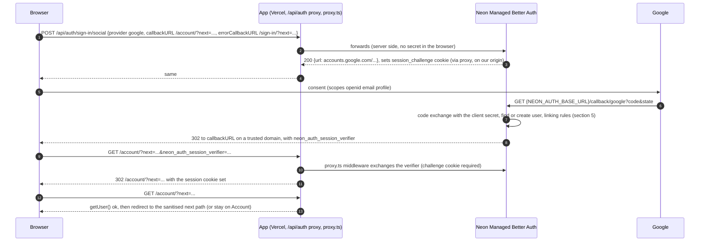

# Google and Apple sign-in on Managed Better Auth

Status: **planned, 25 Oct 2026 (model: Opus).** Nothing here is built. PLAN R-81 to R-85, BACKLOG 15.81 to 15.85,
TODO row of 2026-10-25, owner questions Q117 to Q124 (section 15).

> **Amended 25 Oct 2026 by [email-sign-in-and-account-emails.md](email-sign-in-and-account-emails.md):** Q121 and GSI-V2 are delivered there (EML-1, O-E1); one environment replaces the child-branch Preview of 8.2 and O-5; EML-1 lands first and owns the sign-in card and `return-path.ts`, and GSI-1 adds the Google button into it.

Related: [F17 accounts, auth and privacy](F17-accounts-auth-and-privacy.md) (sign-in, export, delete; amended by
this page, see "Supersedes"), [visitor-suggestions-and-favourites.md](visitor-suggestions-and-favourites.md) (favourites
sync and suggestion intake need sign-in; not edited), [NEON-SETUP.md](../build/public-site/NEON-SETUP.md) and
[NEON-VERIFICATION.md](../build/public-site/NEON-VERIFICATION.md) (what exists), [HANDOVER.md](../../../HANDOVER.md)
items 2 and 3 (the blocked real-service E2E and the Vercel preview), PLAN R-51, R-58, R-61, Q66 to Q69.

## The owner's request (25 Oct 2026, dictated)

> "Also add one plan for adding sign-up with Google and Apple too, which should work with Better Auth."

## Supersedes

- **F17, Edge cases, "A user signs in with Google using the same email as a magic-link account: linked to the same
  user."** Replaced by section 5 here: Google links to an existing account only when that account's email is
  verified. An unverified email/password account is never linked implicitly (a known Better Auth account-takeover
  path, section 7.1). F17 carries a pointer.
- **F17, Sign-in item 1, "Planned: Google sign-in".** Specified here. Magic link and passkeys stay in F17.
- Laundry list Q66's recommendation "email link plus Google" is unchanged; this page delivers the Google half.

## Decisions (recommended; the owner can overturn any of them in section 15)

| # | Decision | Why | Trade-off |
|---|---|---|---|
| G1 | **Google first, on Neon Managed Better Auth, with no app-side auth server.** The browser calls `signIn.social({ provider: 'google' })` through the existing `/api/auth/*` proxy | Neon supports Google as a managed provider today; free; no new service, no new secret in the app | We cannot tune Better Auth options Neon does not expose (linking flags, profile mapping, social sign-up switch) |
| G2 | **Apple is not built now.** Neon Managed Auth does not offer Apple (CLI 8.11.1 accepts only `google`, `github`, `vercel`; the Neon OAuth guide lists the same three). Apple would also cost **USD 99 a year** (Apple Developer Program) against R-4 (free tiers) | Doing Apple today means leaving Managed Better Auth for a self-hosted Better Auth server, a reversal of R-58 | iPhone users who prefer "Hide my email" use Google or email instead. Owner decides (Q117) |
| G3 | **Email and password stays.** Google is an extra button, not a replacement | Existing accounts, and people without Google | Two ways in to explain; the copy keeps it to one line |
| G4 | **Same verified email means one account; unverified never links.** Adding Google to an unverified password account is only possible while signed in, from Account | Closes pre-account hijacking (CVE-2026-53516) | A few users see "sign in with your password first" once |
| G5 | **Scopes are `openid email profile` only.** No Google API access, no offline access, no refresh token use | Smallest data; no Google verification beyond branding | Nothing else can be built on these tokens later without a new consent |
| G6 | **One flag per provider** (`signInGoogle`, later `signInApple`), each only with `signIn` | Google can be rolled back alone | One more build flag |
| G7 | **The Google client secret lives only in Neon's provider config** (and the owner's password manager). The app gets no new secret | The OAuth code exchange happens on Neon's endpoint, not ours | Rotating it is a Neon CLI step, not a Vercel variable |
| G8 | **A stable HTTPS preview origin** (a `vercel alias` on `*.vercel.app`, free) before any OAuth test off localhost | Per-deployment preview URLs change; Neon trusted domains need an exact origin | One alias command per preview deploy, until a git-connected branch domain or the custom domain exists (Q118) |

## Research findings (checked 25 Oct 2026)

Verified (source in section 17, read on 25 Oct 2026 unless stated):

| # | Fact | Source |
|---|---|---|
| F1 | Neon Managed Better Auth supports Google, GitHub and Vercel as OAuth providers. Apple is not offered | Neon "Set up OAuth" guide; `neon neon-auth oauth-provider add --help` (CLI 8.11.1, choices `google`, `github`, `vercel`) |
| F2 | Google has **shared development credentials** owned by Neon; the consent screen shows Neon's name and logo; Neon says they are not for production | Neon OAuth guide; CLI caution text |
| F3 | **Both our branches already have Google enabled with the shared credentials** (`oauth-provider list` on production `br-soft-glade-b4mkqyvd` and child `br-damp-breeze-b41mtvn5`: `google shared`). Neither has a trusted domain | CLI, read-only, 25 Oct |
| F4 | The redirect URI registered with Google is **Neon's** endpoint, `{NEON_AUTH_BASE_URL}/callback/google`, per branch (each branch has its own base URL). The app's `callbackURL` is where the user lands after Neon, and is not registered with Google | Neon OAuth guide and troubleshooting page |
| F5 | Neon redirects only to **trusted domains** (protocol, no trailing slash, `www` separate). Localhost on any port is pre-approved; `127.0.0.1` is not (matches HANDOVER item 2's 403). Wildcards like `https://*.my-app-preview.vercel.app` are allowed | Neon "Configure domains" guide |
| F6 | After the provider round trip, Neon returns to `callbackURL` with `neon_auth_session_verifier`; the SDK's **middleware** exchanges it for the session cookie when the `__Secure-neon-auth.session_challenge` cookie is present. Our `web/proxy.ts` runs that middleware only on `/account/:path*` | `@neondatabase/auth` 0.7.0-beta, `dist/server-*.mjs` (`exchangeOAuthToken`, `processAuthMiddleware`) |
| F7 | Production branch email/password config: enabled, verification method OTP, **Require Verification: false**, Disable Sign Up: false | `neon neon-auth config email-password get`, read-only, 25 Oct |
| F8 | Better Auth links an OAuth sign-in to an existing user with the same email when the provider says the email is verified, or the provider is in `trustedProviders`. Options: `disableImplicitLinking`, `allowDifferentEmails`, `updateUserInfoOnLink`, `allowUnlinkingAll`; `linkSocial` and `unlinkAccount` for a signed-in user; the last method cannot be unlinked by default | Better Auth "Users and accounts" |
| F9 | **CVE-2026-53516** (GHSA-g38m-r43w-p2q7, published 7 Jul 2026, CVSS 8.3): before better-auth 1.6.11, implicit linking ignored the local row's `emailVerified`, so an attacker who pre-registered the victim's email with a password kept access after the victim's first Google sign-in. `requireEmailVerification` alone does not mitigate. 1.6.11 refuses implicit linking to an unverified local user (`requireLocalEmailVerified`, default true). A related advisory covers magic link and email OTP (fixed 1.6.22 and 1.7.0-beta.10) | GitLab advisory; SecureLayer7 write-up |
| F10 | Google: an app requesting only `openid`, `email` and `profile` skips the test-user list, the unverified-app warning and the 7-day authorisation expiry of Testing status. The 100-user cap applies only to sensitive or restricted scopes | Google Cloud help "Manage app audience" |
| F11 | Google **brand verification** is needed only to show the app name and logo on an External, published consent screen. It needs a homepage and privacy policy on a domain verified in Search Console. Automated check in minutes, manual 2 to 3 business days | Google "Submit for brand verification" (updated 2026-08-19) |
| F12 | Google button rules: light theme fill `#FFFFFF`, 1 px stroke `#747775`, text `#1F1F1F`; dark fill `#131314`, stroke `#8E918F`, text `#E3E3E3`; neutral fill `#F2F2F2`. Text "Sign in with Google", "Sign up with Google" or "Continue with Google". Font Google Sans Medium 14/20. Standard-colour "G", never recoloured or monochrome. Padding 12 / 10 / 12 px on web. At least as prominent as other third-party buttons | Google "Sign in with Google branding guidelines" (updated 2026-07-07) |
| F13 | Apple Developer Program: **USD 99 a year** | developer.apple.com/programs |
| F14 | Apple web setup: an App ID with the capability, a Services ID (the client id), a key (`.p8`, downloadable once), the team id; website domains and return URLs on the Services ID (10 URLs for an individual membership); no domain file upload needed. The client secret is an ES256 JWT that expires in at most six months and must be re-generated. Return URLs must be HTTPS; localhost is not accepted | Apple "Configure Sign in with Apple for the web"; Better Auth Apple page |
| F15 | Apple sends the email only on the first authorisation; there is no user-info endpoint. Mail to `privaterelay.appleid.com` addresses bounces unless every sending domain or address is registered with Apple and passes SPF or DKIM (32 sources for an individual membership) | Better Auth Apple page; Apple "Configure private email relay service" |

Not confirmed (each is a GSI-0 spike check, section 13):

| # | Unknown | Why it matters | How GSI-0 settles it |
|---|---|---|---|
| U1 | **Which Better Auth version Neon's managed server runs, and whether it has the 1.6.11 linking fix** | If not, Google sign-in opens the takeover path in F9 | Probe on the child branch (10.3 test L1). If it links, Google does not ship until Neon confirms a fix |
| U2 | Whether Neon exposes any linking option (`disableImplicitLinking`, `trustedProviders`) | Decides whether section 5 is enforced by Neon or only by the probe | CLI and console have none today; ask Neon support |
| U3 | Whether social sign-up can be turned off separately from email sign-up | Q67 invite-only cannot be enforced at the auth layer without it | CLI shows "Disable Sign Up" under email-password only; test it with Google on the child branch |
| U4 | Whether Neon passes Better Auth error codes (`access_denied`, `account_not_linked`, `email_doesn't_match`, `unable_to_link_account`, `signup_disabled`) to `errorCallbackURL` | The error states in 4.6 depend on them | Trigger each and record the URL |
| U5 | Whether Neon's Google flow sends PKCE (`code_challenge`) and `state` | Section 7 assumes both | Read the `Location` of the sign-in response (10.2 test R1) |
| U6 | What Neon stores in `neon_auth.user` and `neon_auth.account` for a Google user (picture URL, access, refresh and id tokens) and whether `travel_app` has any grant on them | Privacy (section 6) and the token blast radius | Query as the owner role on the child branch; `has_table_privilege` checks for `travel_app` |
| U7 | What hostname Google's consent screen shows (the app name, or the Neon redirect domain) and whether brand verification is possible when the redirect URI is on `neon.tech` | Trust and Q122 | Screenshot on the child branch with the owner's own client |
| U8 | Whether a partial-label wildcard such as `https://travel-*-nitin27mays-projects.vercel.app` works in Neon trusted domains | Section 8 prefers exact aliases anyway | Not needed if G8 holds |
| U9 | Whether Better Auth's account-delete endpoint is enabled on Neon | F17 delete (section 6.4) | Call it on a test user on the child branch |
| U10 | Apple: name only on the first authorisation and `response_mode=form_post` when name or email is requested | Only if Apple is ever built | Apple's page did not render; widely documented but not read this session |
| U11 | Whether Vercel "Protection Bypass for Automation" is available on Hobby | Automated checks against a protected preview | Check in the Vercel project settings at GSI-E |

## 1. User stories

1. As a visitor, I want to create an account with Google in two taps, so that there is no password to make up.
2. As a returning user who signed up with Google, I want "Continue with Google" to sign me straight back in.
3. As a user who signed up with email and password, I want to add Google later from Account, and keep my drafts and
   favourites, so that I can stop typing a password.
4. As a user, I want to see which ways I can sign in and remove one, as long as one remains.
5. As a user, if I cancel the Google screen or something fails, I want a plain message and my place kept, so that I can
   try again or use email.
6. As a visitor who pressed "Sign in" from a place or a favourite toast, I want to come back to that page afterwards.
7. As the owner, I want Google's screen to show this site, not "Neon", before the site is public, and I want to switch
   Google off in one step if something goes wrong.
8. (Deferred, Q117) As an iPhone user, I want "Continue with Apple" with a hidden email.

## 2. Recommendation and order

**Ship Google. Do not ship Apple now.**

| Option | Cost a year | Works on Managed Better Auth | Effort | Verdict |
|---|---|---|---|---|
| Google on Neon | 0 | yes (F1) | about 26 agent-hours plus 1.5 h of owner steps | **Do it** |
| Apple on Neon | USD 99 (F13) | **no** (F1) | blocked | Wait for Neon to add it |
| Apple by self-hosting Better Auth in the Next.js app | USD 99, plus our own session tables, secrets and the six-month JWT rotation | not managed: replaces Neon Auth for every method, reverses R-58, moves auth secrets into Vercel | 40+ agent-hours and a migration of existing users | **No**, not for under 100 users |

Order, each step ending with review and verification:

1. **O-0 (owner, 5 minutes, now):** remove Neon's shared Google credentials from the **production** branch (F3), so
   nothing can create production accounts through a Neon-branded consent screen before we ship. The child branch
   keeps them for the spike.
2. **GSI-0 spike (Opus):** on the child branch, localhost, shared credentials. Settles U1 to U7 and U9. A failed L1
   (silent link to an unverified account) stops the plan.
3. **Owner steps O-1 to O-5 (section 9):** Google Cloud project, two clients, provider config per branch, trusted
   domains, the stable preview alias.
4. **GSI-T** (brand tokens, design reviewer), **GSI-1** (buttons, flow, errors, return path), **GSI-2** (Account:
   ways to sign in), **GSI-P** (privacy page), in that order.
5. **GSI-S** (security review), **GSI-E** (real-service checks on the HTTPS preview alias), design review, verifier.
6. Production: owner approval of a named commit (Q43), then `NEXT_PUBLIC_SIGN_IN_GOOGLE=1` in Production.

Queue position: after R-61's preview is verified (HANDOVER item 3), and **before FAV-2** (favourites sync), so sync
launches with both ways in (Q124). GSI-0 can run earlier: it needs no deploy.

## 3. How the flow works



Rules that follow from F4 to F6:
- **`callbackURL` is always `/account/`** (with an optional `next`), because only `/account/*` runs the verifier
  exchange in `web/proxy.ts`. Do not widen the matcher to make other landing pages work; use `next` (section 7.4).
- **Google never sees our origin.** Its redirect URI is the Neon branch endpoint, always HTTPS. So local HTTP,
  per-deployment preview URLs and the production domain need **no Google change**; they need Neon trusted domains
  and `SITE_ORIGIN` only.
- **`errorCallbackURL` is `/sign-in/`** (or `/sign-up/`, whichever page started) with the same `next`.

## 4. The sign-in UI

### 4.1 Where the buttons sit

| Screen | What changes | Principle |
|---|---|---|
| `/sign-in/` | "Continue with Google" first, full width; a divider "or"; the email form below, unchanged; "New here? Create an account" stays | P7 (one obvious way in), P3 |
| `/sign-up/` | The same button with the same label (one label for both pages, so nobody wonders whether they already have an account); divider; the email form | P4 |
| `/account/`, signed out | Unchanged: Sign in and Create an account | P3 |
| `/account/`, signed in | New section "Ways to sign in" (GSI-2, section 5.3) | P6 |
| Header, toasts ("Sign in to keep them") | Unchanged; they link to `/sign-in/?next=<current path>` | P5 (back where you were) |

No popup, no One Tap, no Google script on public pages: the 90% never sign in (P7), and the place and trip pages have
no byte budget to spare (19 B headroom on place HTML). The button lives in the lazy auth chunk only (start JS +0 B on
every public page; `budget.test.ts` unchanged).

### 4.2 The button against the product palette

Google's rules (F12) win for this one control; the product palette (amber accent, slate neutrals, no green, no purple)
stays everywhere else.

| Element | Light theme | Dark theme | Why |
|---|---|---|---|
| Fill, stroke, text | Google light: white, 1 px `#747775`, `#1F1F1F` | Google dark: `#131314`, 1 px `#8E918F`, `#E3E3E3` | Allowed themes; both sit calmly on `--surface` and `--bg`; neither competes with the amber primary |
| Logo | Google's standard-colour "G" from Google's own asset, unmodified | same | Recolouring is forbidden. The "G" includes Google's green; that is Google's mark, not our palette, and the no-green rule does not apply to third-party marks |
| Label | "Continue with Google", 14/20, medium weight | same | One of Google's three allowed labels; works for new and returning users |
| Font | System sans stack (`system-ui, -apple-system, 'Segoe UI', Roboto, sans-serif`) | same | Google asks for Google Sans, which we cannot self-host under its licence. Deviation recorded; the alternative is Google's pre-rendered image button, which fails WCAG 1.4.5 (images of text). GSI-R rules on it |
| Shape and size | Radius 8 (ours; Google allows rectangle), height 42 on desktop, 46 on phone (our input heights), padding 12 / 10 / 12 | same | Lines up with the inputs below it |
| States | Hover: fill `--surface-2` at 60% over the brand fill is **not** allowed (it changes Google's colour); use the ring and a 1 px darker stroke only. Focus: our focus ring. Pressed: translateY(1px). Loading: label kept, a 16 px spinner replaces the "G", `aria-busy` | same | Keeps Google's colours intact |

Colour values become tokens in `tools/theme_tokens.py` (`--brand-google-fill`, `--brand-google-stroke`,
`--brand-google-ink`, per theme), generated into `web/app/themes.css`. `web/tests/no-hex.test.ts` forbids hex
anywhere else. The "G" is `web/public/brand/google-g.svg` rendered as ``, so its
colours never pass through our CSS. This is a foundation change: GSI-T, by `travel-design-reviewer`, adds a "Third-party
brand marks" entry to `docs/v2/design/foundation/tokens.md` and `components.md` 2.1.

### 4.3 Copy

| Place | Text |
|---|---|
| Button | Continue with Google |
| Divider | or |
| Under the button, `/sign-up/` only | We get your name and email from Google, nothing else. (link: How we use it, to `/privacy/`) |
| Pending | label stays; spinner; the email form is disabled until the browser leaves |
| Account, section title | Ways to sign in |
| Account, rows | Email and password · Google (`email shown`) |
| Account, actions | Add Google · Remove |

No "we" in errors beyond what the existing form already says; sentence case; verbs first (components.md 2.1).

### 4.4 Phone (390 px)

Full-width button, 46 px tall, 16 px side margins as the form, the divider then the form. The button sits above the fold
on a 390 x 844 screen with the keyboard closed. No horizontal scroll at 320 px (label stays on one line: "Continue with
Google" fits at 14 px in 288 px).

### 4.5 Accessibility

- A real `<button type="button">`, text label visible, logo `alt=""` (decorative).
- Contrast: Google's light and dark pairs exceed 4.5:1 for the label; the stroke exceeds 3:1 against `--surface` and
  `--bg` in both themes (GSI-R measures and records the numbers).
- Focus order: Google button, then email, password, submit, the alternate link.
- Errors from the redirect land in the existing focused banner (`role` and focus as `AuthForm` does today), announced
  on load.
- Reduced motion: no motion beyond the spinner.
- The flow leaves the site; the button does not say "opens in new window" because it does not.

### 4.6 Error states

Mapped in one module (`web/lib/auth/oauth-errors.ts`) from the `error` query parameter Neon appends to
`errorCallbackURL` (U4 confirms the codes; unknown codes fall back to the last row).

| Case | Code (expected) | Banner | Kind | Then |
|---|---|---|---|---|
| User pressed Cancel on Google | `access_denied` | You cancelled Google sign-in. You can try again or use your email. | notice | buttons ready |
| Email scope refused or no email returned | `email_not_found` or similar | Google did not share your email, so we could not sign you in. Try again and allow email, or use your email below. | notice | |
| Email already has a password account that is **not verified** | `account_not_linked` | An account with this email already exists. Sign in with your password, then add Google from your account page. | notice | email field prefilled only if Neon returns it (never from the URL) |
| Linking from Account, Google email differs | `email_doesn't_match` | That Google account uses a different email. Use the Google account for the email on this account. | notice | stays on Account |
| Linking refused, Google already on another account | `account_already_linked_to_different_user` or `unable_to_link_account` | That Google account is already used by another account here. | notice | |
| Sign-up closed (if Q67 or Q120 says invite-only and U3 allows it) | `signup_disabled` | New accounts are by invitation for now. Everything on this site works without one. | notice | links: Trips, Places |
| Origin not trusted, misconfiguration, Neon down, verifier exchange failed | anything else, or a 5xx | Sign-in is unavailable right now. Try again shortly. | notice | log a code (never the URL with the verifier) |

Never echo the raw `error` or `error_description` text into the page (reflected content).

## 5. Account linking policy

### 5.1 Rules

| # | Situation | Result |
|---|---|---|
| L1 | Google email matches an existing account whose email is **verified** | Signed in to that account; Google added to it (implicit link) |
| L2 | Google email matches an existing account whose email is **not verified** | **Refused** with `account_not_linked` (4.6). Never linked, never a second account with the same email |
| L3 | No account with that email | New account, `emailVerified` true from Google |
| L4 | Signed in, "Add Google" from Account, Google email equals the account email | Linked (`linkSocial`), regardless of the local verification flag, because the user proved both |
| L5 | Signed in, Google email differs | Refused (`allowDifferentEmails` stays false) |
| L6 | Remove a method | Allowed only while another method remains (Better Auth default). Removing Google never deletes data |
| L7 | Google account later changes its email | The link stays keyed by Google's `sub`; the account email is not changed by linking (F8: `email` and `emailVerified` never change on link) |

L1 and L2 depend on Neon's server having the 1.6.11 behaviour (U1). GSI-0 test L1 is a hard gate.

### 5.2 Closing the gap for existing password accounts

Today nobody's password email is verified (F7: Require Verification false). Under L2 every existing password user who
tries Google first is refused once, then can link from Account (L4). That is the safe outcome. To make L1 the normal
path for new users, recommend turning on **Require Verification** (OTP code, which works with Neon's shared mailer)
before Google ships (Q121). That adds a code step to email sign-up in `AuthForm` (a separate small task, GSI-V2, only if
Q121 is yes).

### 5.3 Drafts, favourites and later methods

All private rows (`planner_draft`, planned `account_favourite`, `visitor_submission`, `trip-custom` copies) are keyed by
the Better Auth user id. Linking adds an `account` row to the same user, so **nothing moves and nothing merges**.
Consequences:

- A user who links Google keeps every draft and favourite.
- A user refused under L2 who instead makes a second account under another email (or, later, an Apple relay address)
  has two accounts with separate data. There is no merge tool in v1; the answer is "sign in with the first account and
  add Google there". A merge tool waits for F17 export and import.
- Favourites merge-on-sign-in (visitor-suggestions 4.4) is method-blind: it runs on any confirmed session, so Google
  sign-in triggers it the same way. No change to that spec.

## 6. Privacy

### 6.1 What we ask for and what is stored

| Data | Asked | Stored where | Used by the app |
|---|---|---|---|
| Email, verified flag | `email` scope | `neon_auth.user` (Neon-managed) | sign-in identity; shown on Account |
| Name | `profile` scope | `neon_auth.user.name` | the name on Account; editable later (F17 settings) |
| Google subject id | `openid` | `neon_auth.account.account_id` | linking only |
| Profile photo URL | comes with `profile` | likely `neon_auth.user.image` (U6) | **never read, never rendered, never copied**; no avatar from it (the header avatar stays the initial) |
| Access, id and refresh tokens | issued by Google | likely `neon_auth.account` (U6) | never read; we call no Google API |

No offline access is requested; no Google API is called; nothing is shared with Google beyond the sign-in itself.

### 6.2 Rules

- The app reads only `id`, `email`, `name` from the session (`SessionUser` today). A test pins that `image` is not
  read anywhere in `web/` (GSI-1).
- `travel_app` must have **no** privilege on `neon_auth.account` (tokens). GSI-0 checks it; a core DB test pins it
  (GSI-S adds the case to the owner's DB test list, not a migration).
- Logs carry no email, name, Google subject, token, verifier or full callback URL (extend the F17 deny-list; a log-scan
  test covers the new routes).
- `/privacy/` (new, GSI-P, public and indexable): what is collected for each way in, why, where it is held (Neon,
  region us-east-2), how long, how to export and delete, the Google line "We use Google only to confirm who you are;
  we receive your name, email and profile photo link, and we do not use the photo." Google requires this page for a
  published consent screen with branding (F11). It is a plain-words page, not legal advice, like `/terms/`.

### 6.3 Apple (only if Q117 is yes)

Private relay addresses are real addresses for us: they count as verified, they never link to an account under a
different real email (two accounts result), and our mail to them bounces unless the sending domain is registered with
Apple (F15). We would send no mail until a sender exists (Q104 stays "no email"). The name arrives once (U10): stored at
first sign-in, never asked again from Apple.

### 6.4 Export and delete

F17 15 and 16 apply unchanged and gain one line each: export lists the ways to sign in (provider name and the date
added, never tokens); delete removes the Better Auth user with its `account` rows (U9 checks the endpoint) and tells the
user to remove the app at myaccount.google.com/permissions if they want Google to forget the grant.

## 7. Security

### 7.1 Threats and controls

| Threat | Control | Owner of the control | Test |
|---|---|---|---|
| Pre-account hijacking (F9): attacker registers victim's email with a password; victim later uses Google | Neon's server refuses implicit links to unverified rows (U1); Q121 verification for new password accounts | Neon; GSI-0 gate | 10.3 L1 |
| Login CSRF and code injection | `state` and PKCE on the Google leg (U5); the challenge cookie plus verifier exchange on ours (F6) | Neon, SDK | 10.2 R1, R3 |
| Open redirect via `callbackURL` | Neon trusted domains (exact origins only) | owner (O-4) | 10.2 R2 |
| Open redirect via our `next` | sanitiser, 7.4 | GSI-1 | 10.1 table |
| Forged cross-site POSTs to `/api/auth/*` | Better Auth's origin check against trusted origins; cookies SameSite=Lax | Neon, SDK | 10.2 R4 |
| Forged POSTs to `/api/account/*` | existing `sameOrigin()` (unchanged) | built | existing 73 route tests |
| Token theft from our DB role | no `travel_app` grant on `neon_auth.*` | GSI-0, GSI-S | 6.2 |
| A rogue Vercel app trusted by Neon | never `https://*.vercel.app`; only our exact alias or our own domain | owner (O-4) | domain list review in GSI-S |
| Account creation spam through Google | bounded by Google accounts; per-account quotas already planned for intake (R-74); admission by Q120 | | |
| Brute force on sign-in endpoints | Better Auth's built-in limiter on Neon (assumed, not confirmed); Vercel Hobby's single rate-limit rule stays reserved for GB-A-9 (`/api/v1/*`) | Neon | none now; note in GSI-S |
| Leaked verifier in logs or analytics | `proxy.ts` strips it with a 302 before any page renders; no analytics on `/account/`; logs never print URLs | SDK, GSI-1 | log-scan test |

### 7.2 Origins, cookies and the same-origin guard

- `web/lib/server/same-origin.ts` does not change. It guards `/api/account/*` only. The OAuth return is a top-level
  GET to `/account/`, which the guard never sees; the `/api/auth/*` proxy relies on Better Auth's own origin check.
  Do not add `sameOrigin()` to `/api/auth/*` in this work (it would also block Neon's form-posted flows if Apple ever
  arrives).
- Cookies are the SDK's `__Secure-neon-auth.*`: Secure, HttpOnly, SameSite=Lax, host-only (no `Domain` attribute).
  Keep host-only on the final domain so the preview alias and production never share a session. Do not set a cookie
  domain.
- `SITE_ORIGIN` must be set per Vercel environment before any OAuth test (HANDOVER item 3).
- `127.0.0.1` is not a Neon trusted origin (F5) and is not added: local OAuth uses `http://localhost:3000` only.

### 7.3 Per-environment allowlists

| Allowlist | Local | Preview | Production |
|---|---|---|---|
| Google client redirect URIs | child branch callback | child branch callback (preview uses the child branch, 8.2) | production branch callback |
| Neon trusted domains | none (localhost pre-approved) | `https://<preview-alias>.vercel.app` on the child branch | the production origin on the production branch; "Allow localhost" off once local work moves to the child branch |
| `SITE_ORIGIN` | `http://localhost:3000` | the preview alias | the production origin |

### 7.4 The return path (`next`)

`web/lib/auth/return-path.ts`, one pure function used by the sign-in pages (to build `callbackURL`) and the Account page
(to follow it):

1. Accept only a string of at most 512 characters, decoded once.
2. It must start with exactly one `/`; reject `//`, `/\`, any `\`, any scheme (`:` before the first `/`), control
   characters, `%2F%2F` after decoding, and `/api/`.
3. Parse with `new URL(value, 'https://placeholder.invalid')` and require the origin to stay the placeholder.
4. Allow only these prefixes: `/`, `/trips/`, `/places/`, `/globe/`, `/favourites/`, `/suggest/`, `/t/`, `/account/`.
5. Anything else becomes `/account/`. Never echo the rejected value.
6. The Account page redirects only after `getUser()` returns a user.

## 8. Environments

### 8.1 What works where

| Environment | Origin | Neon branch | Google | Apple (if ever) |
|---|---|---|---|---|
| Local | `http://localhost:3000` | child (`srv-migrate-verify`, or a new `auth-dev` branch) | yes: Google redirects to Neon's HTTPS endpoint, and localhost is pre-approved | redirect would also be Neon's HTTPS endpoint, so localhost would only matter for trusted domains; untestable today because Neon has no Apple |
| Preview | a stable alias, for example `https://travel-preview-nks.vercel.app` (Q118) | child | yes, after O-4 and `SITE_ORIGIN` | n/a |
| Production | `*.vercel.app` production alias until the custom domain (R-43, Q71) | production | yes, after O-3 and approval | n/a |

### 8.2 Why the preview uses the child branch

HANDOVER item 3 records that Preview currently carries the production Neon values. OAuth tests create real users, so
Preview should point at the child branch's `NEON_AUTH_BASE_URL`, `NEON_AUTH_COOKIE_SECRET` and database values (owner
step O-5). Production users never mix with test users; the five synthetic `e2e+...@travel-e2e.invalid` users already in
production stay as they are (cleanup is a separate owner choice).

### 8.3 The stable preview origin

Vercel preview URLs change per deployment (`travel-<hash>-nitin27mays-projects.vercel.app`). Neon needs an exact
trusted origin. Options:

| Option | Cost | Needs | Verdict |
|---|---|---|---|
| `vercel alias set <deployment-url> travel-preview-<name>.vercel.app` after each preview deploy | free | one command per deploy; the alias name must be free | **Now** |
| A git branch domain (`travel-git-<branch>-...vercel.app`) | free | a git-connected project (not set up; HANDOVER item 3 prefers prebuilt deploys) | later |
| `preview.<custom-domain>` | the domain (R-43) | Q71 name, DNS | with the custom domain |
| Wildcard `https://*-nitin27mays-projects.vercel.app` in Neon | free | U8 unconfirmed | no: trusts every preview of every project in the team |

Vercel Authentication stays on for previews. A manual tester signed in to Vercel in the same browser completes OAuth
normally. Automated checks use `vercel curl` or the protection-bypass header (U11).

## 9. Owner steps

Secrets never go into chat, the repo, `.env*` files or a shell history. Pass the client secret through a variable read
with `read -s`, then `unset` it. Every value below in angle brackets is a placeholder.

**O-0. Remove Neon's shared Google credentials from production (now, 5 minutes).**

```bash
neon neon-auth oauth-provider delete --project-id damp-queen-64719841 --branch br-soft-glade-b4mkqyvd --provider-id google
neon neon-auth oauth-provider list   --project-id damp-queen-64719841 --branch br-soft-glade-b4mkqyvd   # expect: none
```

**O-1. Google Cloud project (20 minutes).** In the Google Cloud console, signed in with the account chosen in Q119:
1. Create project `travel-auth` (no billing account needed).
2. Google Auth Platform, Branding: app name (the site name), user support email, developer contact email. Leave the
   logo empty until brand verification (Q122).
3. Audience: User type **External**. Publishing status: press **Publish app** (F10: with only the three basic scopes
   there is no test-user list and no 7-day expiry either way; publishing avoids a later surprise).
4. Data Access: add only `openid`, `.../auth/userinfo.email`, `.../auth/userinfo.profile`. Nothing else.
5. Authorised domains: add the production domain when it exists (R-43). Not `vercel.app`, which you cannot verify.

**O-2. Two OAuth clients (10 minutes).** Clients, Create client, type **Web application**:

| Client | Authorised redirect URIs | Authorised JavaScript origins |
|---|---|---|
| `travel-dev` | `<CHILD_NEON_AUTH_BASE_URL>/callback/google` | none (the browser never talks to Google from our page) |
| `travel-prod` | `<PROD_NEON_AUTH_BASE_URL>/callback/google` | none |

Get each base URL with `neon neon-auth status --project-id damp-queen-64719841 --branch <branch-id>` (the "Base URL"
line; no trailing slash before `/callback`). Store each client id and secret in your password manager. Download nothing
else.

**O-3. Register each client on its Neon branch (5 minutes).**

```bash
# child branch: replace the shared credentials with travel-dev
read -s GOOGLE_SECRET   # paste the travel-dev secret, press Enter
neon neon-auth oauth-provider update --project-id damp-queen-64719841 --branch br-damp-breeze-b41mtvn5 \
  --provider-id google --oauth-client-id <TRAVEL_DEV_CLIENT_ID> --oauth-client-secret "$GOOGLE_SECRET"
unset GOOGLE_SECRET

# production branch: add travel-prod (after GSI-0 passes; O-0 removed the shared one)
read -s GOOGLE_SECRET   # the travel-prod secret
neon neon-auth oauth-provider add --project-id damp-queen-64719841 --branch br-soft-glade-b4mkqyvd \
  --provider-id google --oauth-client-id <TRAVEL_PROD_CLIENT_ID> --oauth-client-secret "$GOOGLE_SECRET"
unset GOOGLE_SECRET

neon neon-auth oauth-provider list --project-id damp-queen-64719841 --branch <branch-id>   # expect: google custom
```

**O-4. Trusted domains (5 minutes).**

```bash
neon neon-auth domain add https://<preview-alias>.vercel.app --project-id damp-queen-64719841 --branch br-damp-breeze-b41mtvn5
neon neon-auth domain add https://<production-origin>        --project-id damp-queen-64719841 --branch br-soft-glade-b4mkqyvd
neon neon-auth domain list --project-id damp-queen-64719841 --branch <branch-id>
```

Exact origins only, `https://`, no trailing slash, `www` separately if used. Never `https://*.vercel.app`. Realtime's
allowed origins need the same two entries (HANDOVER item 3), in `neon.ts` or the Neon console.

**O-5. Vercel (15 minutes).** In the `travel` project settings, Environment Variables:
- Preview: replace the auth and database values with the child branch's (8.2); set `SITE_ORIGIN` to the preview alias.
- Production: set `SITE_ORIGIN` to the production origin.
- Both: `NEXT_PUBLIC_SIGN_IN_GOOGLE` = `0` now (a build flag, not a secret; mark it non-sensitive so prebuilt deploys
  read it, HANDOVER item 3). Flip to `1` per environment when its checks pass.
- After each preview deploy: `vercel alias set <deployment-url> <preview-alias>.vercel.app`.

No Google secret goes to Vercel or GitHub. GitHub Actions secrets get nothing new (no workflow reads them yet).

**O-6. Production switch-on (after approval, Q43).** Set `NEXT_PUBLIC_SIGN_IN_GOOGLE=1` in Production, deploy the
approved commit, run the manual checklist 10.4 once on production with your own Google account.

**O-7. Branding before public announcement (Q122).** When the custom domain exists: verify it in Search Console, add it
under Authorised domains, set homepage, privacy policy (`/privacy/`) and logo, press Verify branding.

## 10. Testing

### 10.1 Unit (vitest, `web/tests/auth/`)

- `return-path.test.ts`: at least 40 cases: allowed prefixes; `//evil.example`, `/\evil`, `\\evil`, `/%2F%2Fevil`,
  `https://evil`, `javascript:alert(1)`, `/api/auth/sign-out`, control characters, 513 characters, double encoding,
  `/trips/../api/x`; each returns the input or `/account/`.
- `oauth-errors.test.ts`: every code in 4.6 maps to its banner; unknown codes, empty and very long values map to the
  service banner; no input text appears in the output.
- `capabilities.test.ts` extension: `signInGoogle` is false unless both `NEXT_PUBLIC_SIGN_IN=1` and
  `NEXT_PUBLIC_SIGN_IN_GOOGLE=1`.
- `no-image-read.test.ts`: no file in `web/` reads `user.image` (static scan).

### 10.2 Route and component tests

- Sign-in and sign-up pages render the Google button only with the flag; the button calls `signIn.social` with
  `provider: 'google'`, `callbackURL` `/account/?next=...` (sanitised), `errorCallbackURL` the starting page.
- R1 (against the child branch, scripted, no browser): `POST /api/auth/sign-in/social` returns a URL on
  `accounts.google.com` whose query has the `travel-dev` client id, `redirect_uri` equal to the child callback,
  `scope` exactly `openid email profile` (order free), a `state`, and a `code_challenge` with method `S256` (U5).
- R2: the same call with `callbackURL` `https://evil.example/` is refused by Neon.
- R3: `GET /account/?neon_auth_session_verifier=x` without the challenge cookie sets no session.
- R4: `POST /api/auth/sign-in/social` with `Origin: https://evil.example` is refused.
- `proxy.ts` matcher still lists `/account/:path*` (a pin, so nobody narrows it and breaks the exchange).
- Banner rendering from `?error=` for each 4.6 row, focused on load.

### 10.3 Real-service checks (GSI-0 on localhost, GSI-E on the HTTPS preview alias)

Google blocks scripted logins, so the consent step is done by a person with a dedicated test Google account
(Q119; not the owner's main account). Everything around it is scripted (`web/scripts/oauth-redirect-check.mjs`, R1 to
R4 above).

| Test | Steps | Pass |
|---|---|---|
| L1 linking gate | Email sign-up with the test account's Gmail address and a password (unverified), sign out, Continue with Google with that account | Refused (`account_not_linked` or equivalent); the password account has no Google `account` row; no session for it. **Fail stops the plan** |
| L3 new user | Continue with Google with an unused test account | New user, `emailVerified` true, lands on Account |
| L4 link from Account | Signed in with password, Add Google, same email | Google listed; sign out; Continue with Google opens the same account with the same drafts |
| Cancel | Press Cancel on Google | `/sign-in/` with the cancel banner |
| Return path | From `/places/<slug>/` press Sign in, complete Google | back on `/places/<slug>/` |
| Remove | Remove Google while a password exists; try to remove the last method | first works; second refused |
| Delete (U9) | Delete the test user | user and accounts gone |

**The blocked `neon-e2e.mjs` (HANDOVER item 2):** a local `next start` is `production`, so `sameOrigin()` refuses
HTTP and every draft POST gets 403; `next dev` loops on `/account/`. OAuth does not change that. The HTTPS preview alias
is the fix for both: GSI-E runs `neon-e2e.mjs` and the OAuth checks there, against the child branch. Do not loosen the
guard. GSI-0 runs on `next dev` at `http://localhost:3000` because it only needs the sign-in round trip and Account's
first render, not the draft writes; if the `/account/` loop in `next dev` blocks even that, GSI-0 moves to the preview
alias and waits for R-61.

### 10.4 Manual checklist (owner, before each environment's flag goes to 1)

1. Desktop Chrome, Safari, Firefox: new user, returning user, cancel, return path.
2. iPhone Safari and Android Chrome at 390 px: button above the fold, consent, return.
3. Light and dark themes: button colours as 4.2; focus ring visible.
4. Keyboard only: Tab to the button, Enter, complete, land focused on Account's heading.
5. Screen reader (VoiceOver): "Continue with Google, button"; banner read on error.
6. Account: Ways to sign in lists both methods after linking.
7. Consent screen shows the expected name or hostname (record a screenshot, U7).

Verification evidence for every UI task: `tsc --noEmit`, the vitest suites above, and Playwright screenshots of
`/sign-in/`, `/sign-up/` and `/account/` at 1440 x 900 and 390 x 844, light and dark, into
`web/test-results/shots/google-sign-in/` (gitignored; copy elsewhere before review, per the screenshots rule).

## 11. Rollout flag and rollback

| Flag | Build variable | Server also needs | Off means |
|---|---|---|---|
| `signIn` (existing) | `NEXT_PUBLIC_SIGN_IN=1` | Neon Auth | as today |
| `signInGoogle` (new) | `NEXT_PUBLIC_SIGN_IN_GOOGLE=1`, only with `signIn` | Google configured on the Neon branch (not checkable from the app; the owner's step O-3) | no button; email only; Account shows existing Google links read-only with no "Add Google" |
| `signInApple` (reserved) | `NEXT_PUBLIC_SIGN_IN_APPLE=1` | Apple on the branch | not built |

Rollback, fastest first:
1. Set `NEXT_PUBLIC_SIGN_IN_GOOGLE=0` and redeploy: the button disappears. Existing Google users still sign in only if
   the provider stays configured, so step 2 is a separate decision.
2. `neon neon-auth oauth-provider delete --provider-id google --branch <branch>`: Google sign-in stops at Neon. Users
   with only Google lose access until they set a password through "Forgot password" (OTP works with Neon's shared
   mailer). Count them first: `select count(*) from neon_auth.account a where provider_id = 'google' and not exists
   (select 1 from neon_auth.account b where b.user_id = a.user_id and b.provider_id = 'credential')` as the owner role
   (U6 confirms the column names).
3. Rotate the Google client secret (Google console, then O-3 `update`) if a leak is suspected.

## 12. Who may sign in (Q66, Q67, Q103)

- **Q66** (methods): this page answers "Google: yes; Apple: not now". Magic link and passkeys stay open in F17.
- **Q67** (admission) is still open, and Google makes it sharper: one click creates an account. Neon's "Disable Sign
  Up" sits under email-password; whether it also stops Google sign-up is U3. If it does not, invite-only cannot be
  enforced at the auth layer and must be an app check (a role or allowlist on `app_user`, F17 4), which is the same
  gate Q98 and Q103 already need for customisation and the planner.
- **Recommendation (Q120):** open sign-up for the light account features (favourites sync, suggestions, trip requests),
  as Q103 recommends, with the planner and customisation gated by role or invite. Email sign-up is already open on
  production (F7), so Google adds no new class of user, only fewer passwords.

## 13. Tasks

Models follow CLAUDE.md: auth and linking are security-sensitive, so Opus; well-specified UI and checks are Sonnet.
Every UI task ends with `travel-design-reviewer`, then `travel-verifier`.

| Task | What | Model | Owns (may edit) | Must not touch | Effort | Depends on | Acceptance |
|---|---|---|---|---|---|---|---|
| O-0 | Remove shared Google from production | owner | Neon config | | 5 min | none | `oauth-provider list` on production shows none |
| GSI-0 | Spike on the child branch, localhost, shared credentials: U1 to U7, U9; tests L1, L3, R1 to R4; record results in section 18 of this page | Opus | this page (section 18 only); a throwaway script under the scratchpad, not the repo | `web/**`, `core/**`, Neon production branch, every other doc | 3 h + 20 min owner (consent clicks) | O-0 | Section 18 filled; L1 passes or the plan is stopped with the evidence |
| O-1 to O-5 | Google project, clients, Neon provider and domains, Vercel env, preview alias | owner | consoles | | 1 h 15 min | GSI-0 pass; Q118, Q119 | `oauth-provider list` shows `custom` on both branches; `domain list` shows the exact origins |
| GSI-T | Brand tokens and the third-party mark rule | Opus (`travel-design-reviewer`) | `tools/theme_tokens.py`, generated `web/app/themes.css`, `docs/v2/design/foundation/tokens.md`, `components.md` 2.1, `web/public/brand/google-g.svg` (Google's asset, unmodified) | any component | 1 h | GSI-0 | tokens generated; `no-hex.test.ts` passes; contrast numbers recorded |
| GSI-1 | Button, flow, errors, return path | Opus | `web/lib/capabilities.ts` (append `signInGoogle`), `web/components/auth/ProviderButtons.tsx` (new), `web/components/auth/AuthForm.tsx`, `web/app/sign-in/page.tsx`, `web/app/sign-up/page.tsx`, `web/app/account/page.tsx` (follow `next` only), `web/lib/auth/return-path.ts` (new), `web/lib/auth/oauth-errors.ts` (new), `web/app/account.css`, `web/tests/auth/**` (new), `web/tests/e2e/auth-google.spec.ts` (new, network mocked) | `web/lib/server/same-origin.ts`, `web/proxy.ts`, `web/lib/auth/server.ts`, `web/app/api/**`, `core/**`, favourites and suggestion files, `legacy/**`, HANDOVER, EXECUTION-PLAN | 8 h | GSI-T | 10.1 and 10.2 pass; start JS +0 B on public pages; screenshots at 1440 and 390, light and dark |
| GSI-2 | Account: Ways to sign in (list, Add Google, Remove) | Opus | `web/app/account/SignInMethods.tsx` (new), `web/app/account/page.tsx` (mount), `web/app/account.css`, `web/tests/account/sign-in-methods.test.tsx` (new) | as GSI-1 | 4 h | GSI-1 | L4, L5, L6 in tests with a mocked client; last method cannot be removed; 44 px targets at 390 |
| GSI-V2 | Email OTP verification step in `AuthForm` | Sonnet | `web/components/auth/AuthForm.tsx`, `web/tests/auth/otp.test.tsx` | as GSI-1 | 4 h | Q121 yes; GSI-1 | sign-up shows the code step; resend limited; owner flips Require Verification on the child branch first |
| GSI-P | `/privacy/` page and footer link | Sonnet (copy by Opus planner, owner approves) | `web/app/privacy/page.tsx` (new), `web/components/shell/SiteFooter.tsx` (one link), `web/lib/sitemap.ts` (one entry), `web/tests/shell/privacy-page.test.ts` (new) | everything else | 2 h | none | page renders in the public build with sign-in off; listed in the sitemap; footer link on every page |
| GSI-S | Independent security review of GSI-1, GSI-2 and the Neon configuration | Opus | review notes appended to this page, section 18 | code | 2 h | GSI-1, GSI-2, O-4 | no open high finding; domain lists exact; `travel_app` has no grant on `neon_auth.*` |
| GSI-E | Real-service checks on the HTTPS preview alias, plus the blocked `neon-e2e.mjs` | Sonnet | `web/scripts/oauth-redirect-check.mjs` (new), results in section 18 | the origin guard | 3 h + 30 min owner | GSI-S; R-61 preview verified; O-5 | R1 to R4 scripted pass; 10.3 table pass; `neon-e2e.mjs` passes on HTTPS |
| GSI-R, GSI-VF | Design review, then verifier | Opus, Sonnet | review notes | code | 1.5 h, 1.5 h | GSI-E | approved; 10.4 checklist ticked; shots at 1440 and 390, light and dark |
| APL-0 | Re-plan Apple | Opus | this page | | 2 h | Q117 yes and Neon offers Apple | a section 14 update with real steps |

Total: about 26 agent-hours (30 with GSI-V2; APL-0 not counted), plus about 2 hours of owner time.

## 14. Apple, if the owner says yes later

What it would take once Neon offers Apple (watch the Neon changelog and the CLI's `--provider-id` choices):
1. Apple Developer Program, USD 99 a year, individual enrolment (10 website URLs, 32 relay email sources).
2. App ID with Sign in with Apple; Services ID (the client id) with the site domain and the return URL Neon gives
   (expected `{NEON_AUTH_BASE_URL}/callback/apple`, HTTPS, so localhost is never involved); a key (`.p8`, kept in the
   password manager) with its key id; the team id.
3. A client-secret JWT valid at most six months (F14): a calendar reminder to regenerate it, or Neon generating it from
   the key if its config takes the key (unknown).
4. Same button rules in Apple's terms (black, white or outlined, "Continue with Apple"), equal prominence with Google.
   App Store guideline 4.8 (Apple must be offered where other social sign-ins are) applies to App Store apps, not to
   this website.
5. Private relay (6.3), name only once (U10), no linking across different emails (5.1 L5).
6. Test only on the HTTPS preview alias or production.

Without Neon support, the only route is a self-hosted Better Auth server in the app, rejected in section 2.

## 15. Open questions for the owner

| # | Question | Recommendation | Trade-off |
|---|---|---|---|
| Q117 | Build Sign in with Apple at all? | **Not now.** Neon Managed Auth has no Apple provider, and it costs USD 99 a year against free tiers (R-4). Revisit when Neon adds Apple and either an iPhone app exists or users ask | iPhone users who want "Hide my email" use Google or email |
| Q118 | Stable preview origin: a free `vercel alias` on `*.vercel.app` now, or wait for the custom domain (R-43, Q71)? | **Alias now** (`travel-preview-<name>.vercel.app`), custom domain for production later | One alias command per preview deploy |
| Q119 | Which Google account owns the Google Cloud project, and which account is the test account? | Your personal Google account (not a work account) as owner, with a second owner for recovery; a separate new Gmail account for tests | Two accounts to look after |
| Q120 | Does sign-up open to the public now (Q67, Q103)? | **Yes for the light account features**, planner and customisation gated by role or invite. Email sign-up is already open on production | More accounts to hold; the role gate must ship before customisation |
| Q121 | Turn on email verification (OTP code) for email and password sign-up before Google ships? | **Yes**, so new password accounts can link Google safely (L1) | One code step on email sign-up; Neon's shared mailer is rate-limited (fine under 100 users) |
| Q122 | Launch Google with an unbranded consent screen, or wait for the custom domain and brand verification? | **Unbranded for the preview and family use; branded before any public announcement** | Until then Google's screen may show a Neon hostname (U7), which looks less trustworthy |
| Q123 | Remove Neon's shared Google credentials from production today (O-0)? | **Yes, now** | None: no screen uses them |
| Q124 | Google before or after favourites account sync (FAV-2)? | **Before**, right after the R-61 preview is verified, so sync launches with both ways in | FAV-2 starts about 3 working days later |

## 16. Gotchas

- **Google's redirect URI is Neon's, not ours.** Registering `https://<our-site>/api/auth/callback/google` (the
  Better Auth self-hosted path) gives `redirect_uri_mismatch`. Use `{NEON_AUTH_BASE_URL}/callback/google`, per branch,
  no slash before `/callback`.
- **The verifier exchange only runs where `proxy.ts` runs.** A `callbackURL` of `/` or `/trips/` returns with a
  verifier nobody exchanges, and the user looks signed out. Always `/account/` plus `next`.
- **Shared credentials are on by default.** Both branches had Google enabled with Neon's app on 25 Oct. Any new branch
  probably does too; check `oauth-provider list` after creating one.
- **`127.0.0.1` fails.** Only `localhost` is pre-approved by Neon. Use `http://localhost:3000`.
- **`__Secure-` cookies on HTTP localhost** work in Chrome and Firefox; Safari's handling of Secure cookies on
  localhost has varied by version. Test local OAuth in Chrome.
- **Secrets on the command line.** `--oauth-client-secret <value>` lands in shell history; use `read -s` and a
  variable (section 9).
- **Hex literals.** Google's colours must be tokens from `tools/theme_tokens.py`; `no-hex.test.ts` fails on a literal
  in a component. The "G" is an SVG file, not inline markup.
- **The "G" has green in it.** That is Google's mark and cannot be recoloured; the no-green palette rule covers our
  colours, not third-party logos. Reviewers should not flag it.
- **Apple and Google differ on email.** Apple may give a relay address and only once; Google gives the real address
  every time. Never assume a second provider's email matches the first.
- **Rolling back the provider locks out Google-only users** until they reset a password (section 11).
- **Vercel Authentication** on the preview means an automated check needs a bypass; a manual tester must be signed in
  to Vercel in the same browser.
- **Prebuilt deploys inline `NEXT_PUBLIC_*` at build.** A sensitive-marked flag pulls as a placeholder (HANDOVER item
  3), so `NEXT_PUBLIC_SIGN_IN_GOOGLE` must be non-sensitive or exported in the shell before `vercel build`.
- **Neon's managed Better Auth version is not ours to pin.** A Neon update can change linking behaviour; re-run test L1
  whenever `@neondatabase/auth` or Neon's changelog mentions linking.

## 17. Sources (read 25 Oct 2026)

- Neon, Set up OAuth: https://neon.com/docs/auth/guides/setup-oauth
- Neon, Configure domains: https://neon.com/docs/auth/guides/configure-domains
- Neon, Production checklist: https://neon.com/docs/auth/production-checklist
- Neon CLI 8.11.1 help: `neon neon-auth oauth-provider add|update|delete --help`, `neon neon-auth domain add --help`; read-only `oauth-provider list`, `domain list`, `config email-password get`, `status` on both branches
- `@neondatabase/auth` 0.7.0-beta in `web/node_modules` (README, `dist/server-*.mjs`)
- Better Auth, Users and accounts (account linking): https://www.better-auth.com/docs/concepts/users-accounts
- Better Auth, Google: https://www.better-auth.com/docs/authentication/google
- Better Auth, Apple: https://www.better-auth.com/docs/authentication/apple
- CVE-2026-53516: https://advisories.gitlab.com/npm/better-auth/CVE-2026-53516/ and https://securelayer7.net/lab/cve-2026-53516-better-auth-oauth-auto-link-account-takeover
- Better Auth magic link and email OTP pre-account hijacking (CVE-2026-67327): https://corgea.com/advisories/vulnerabilities/CVE-2026-67327 (secondary source, not read in full)
- Google, Manage app audience: https://support.google.com/cloud/answer/15549945
- Google, Brand verification: https://developers.google.com/identity/protocols/oauth2/production-readiness/brand-verification
- Google, Sign in with Google branding guidelines: https://developers.google.com/identity/branding-guidelines
- Apple Developer Program: https://developer.apple.com/programs/
- Apple, Configure Sign in with Apple for the web: https://developer.apple.com/help/account/capabilities/configure-sign-in-with-apple-for-the-web/
- Apple, Configure private email relay service: https://developer.apple.com/help/account/capabilities/configure-private-email-relay-service/
- Vercel CLI, alias: https://vercel.com/docs/cli/alias

Apple's Human Interface Guidelines page and "Incorporating Sign in with Apple into other platforms" did not render; the
Apple button and first-authorisation details in section 14 are not confirmed from Apple directly (U10).

## 18. Spike, review and check results

Empty until GSI-0. GSI-0, GSI-S and GSI-E append dated entries here: each unknown U1 to U11 with its answer and
evidence, each test with pass or fail.
