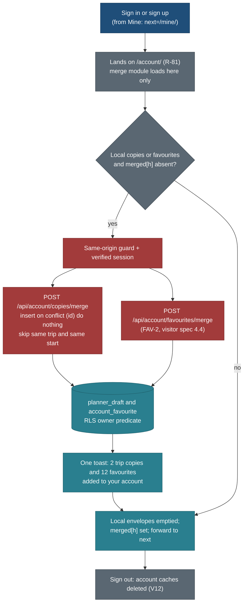

# Navigation and "Mine": the phone bar, the header, and one home for a visitor's own things

> **Amended 25 Oct 2026 (trip origin and nearest airport):** `copies/1` gains optional private `from` (an origin reference) and `gw` (`{in, out}`), reserved in NAV-C (+0.25 h); a copy row in Mine shows "from <city>". The origin is never in a public payload. See [trip-origin-and-nearest-airport.md](trip-origin-and-nearest-airport.md) sections 8 and 10 (PLAN R-204, R-205).

> **Amended 26 Oct 2026 (bundle A):** [briefs-bundle-A.md](../build/briefs-bundle-A.md) is the build authority for NAV-1 and NAV-2. It supersedes here: the ACCT-PH mechanism in "What exists today", N12, section 6 and the first gotcha (no `useSignedIn` or `header-session.ts` was built; NAV-1's real removal list is in that brief, D8); NAV-1's "+0 B" start-JS rule and the CSS-mask requirement (now at most +160 B, masks only when chrome headroom is short, D5); the badge's envelope read (two raw keys, D6); the `/favourites/` redirect in `next.config` (a page, D7); acceptance 1 gains `/sign-up/`, 44 px phone header targets and the home search fix at 320 px (D8); the legacy move (NAV-2C, D9); the copy snapshot props (D10).

Status: **spec, planned only** (25 Oct 2026, travel-planner, Opus). Requirements PLAN R-160 to R-164, BACKLOG 15.160 to
15.169, owner questions Q200 to Q207. Nothing here is built. Phase 1 needs no backend.

**Owner answers, 25 Oct 2026:** Q200 to Q207 are all answered yes. **Q203 changed:** sign-in is on the Mine page **and also** a
small person icon in the phone header, so the phone header gains one icon (brand, search, sign-in, theme). N6, section 1.1,
the 320 px fit check, the header budget (section 6) and the NAV-1 brief below are updated for it. The ACCT-PH interim
bottom-bar slot is unaffected: NAV-1 still replaces it 1:1 with Mine.

Related: [visitor-suggestions-and-favourites.md](visitor-suggestions-and-favourites.md) (R-70 to R-75: favourites on this
device, then synced), [trip-overview-and-customisation.md](trip-overview-and-customisation.md) (R-65: the private copy in
`planner_draft`, opened at `/t/<id>/`), [feedback-and-reports.md](feedback-and-reports.md) (the footer entry "Report or
suggest"), [public-trips-dateless.md](../design/public-trips-dateless.md) ("Picking dates"), foundation
[components.md](../design/foundation/components.md) 1.1, 1.4, 2.9, 5.5, 6.1 and [patterns.md](../design/foundation/patterns.md)
1.1, 3.7, principles P1 to P9 in [principles.md](../design/foundation/principles.md).

## The owner's questions (25 Oct 2026)

1. On phones there is no sign-in or create option in the header. (The interim builder task ACCT-PH, branch
   `public/ACCT-PH`, adds a fifth bottom-bar item "Sign in" / "Account".)
2. Without signing in, when someone copies a trip or anything, they should see "My favourites" or "My trips" (copies, own
   plans). Also visible on mobile.
3. Should the phone get a three-dots "More" menu with the secondary items? Should Globe move into More, or stay a main
   item? Consider desktop too.
4. One page "My plans" plus one page "Favourites", or a single page with sections or tabs? How does it work signed out
   (device-local, R-70) and signed in (synced, R-71)? Where does a copied trip live, and what happens to it at sign-in?

## What exists today (checked on `main` 61e8b92)

| Thing | State | Where |
|---|---|---|
| Phone bottom bar | Trips · Places · Globe · Search, 4 items, 56 px | `web/components/shell/BottomBar.tsx`, `web/app/app.css` 67-82 |
| Phone header | brand, search icon, theme toggle; the header Sign in is hidden below 640 px (`.header-tools .header-signin { display: none }`, `app.css` 77). **To change (Q203):** it shows as an icon below 640 px | `SiteHeader.tsx`, `app.css` 77 |
| ACCT-PH (in progress, uncommitted) | fifth item "Sign in" to `/sign-in/`, "Account" to `/account/` when signed in, through `lib/auth/header-session.ts`; bar grid becomes auto-flow | `public/ACCT-PH` worktree |
| Desktop header | Trips · Places · Globe; search, theme, Sign in or the avatar menu (Account, Sign out) | `SiteHeader.tsx`, `AccountNav.tsx`, `AccountMenu.tsx` |
| Copy to my trips | the sheet saves a `CopyDraft` (slug, start, adults, children's ages, timeline profile, overrides, additions) to `localStorage` key `travel:v1:copy-drafts`, one per trip, no cap, no schema version | `web/lib/export/draft.ts`, `web/components/actions/CopySheet.tsx` |
| **Where a visitor finds that copy** | **nowhere.** `listDrafts` has no caller. The done step says "Keeping copies in an account comes with the planner" and links to `/sign-in/` | defect: the primary action of P7 writes data the visitor can never see again |
| Own plans (signed in) | titled drafts in `planner_draft` (create, rename, delete, live) listed on `/account/` | `web/app/account/AccountDrafts.tsx` |
| Favourites | planned only: hearts, `/favourites/`, local envelope then account sync | visitor spec 3, 4 |
| Foundation | public bar "Trips · Places · Globe · Sign in"; signed in outside a trip "Home · Trips · Places · Globe · Me"; inside a trip "[photo] Plan · Today · Bookings · More"; desktop: "keep four tabs or fewer", "don't hide tabs behind More on desktop" | components 1.1, 1.2, 1.4; patterns 1.1 |
| Usage data | none. A Cloudflare Web Analytics beacon is built in and off (`NEXT_PUBLIC_CF_BEACON_TOKEN` unset) | `web/tests/analytics.test.ts` |

## Recommendation

**One personal hub called "Mine", one bottom-bar slot, no More menu on the public site.**

- Phone bar: **Trips · Places · Globe · Search · Mine**. Mine takes the slot ACCT-PH gives "Sign in". Five items at 320 px
  are 62 px each, above the 56 px minimum.
- `/mine/` is one page with two tabs, **My trips** and **Favourites**, each with its count, plus a one-line account card
  at the top (Sign in and Create an account when signed out; the email and an Account link when signed in).
- Signed out, everything on Mine lives in this browser; signed in, it lives in the account, and the browser's lists merge
  into it once, on the page the sign-in lands on.
- A copied trip is a row in Mine › My trips. It opens the public trip with the visitor's choices restored, and offers
  Add to calendar, Print, Change dates and Remove.
- Globe stays a main item on phone and desktop. It is the product's discovery view and its showcase; a More sheet would
  hide the one feature the owner calls major, to make room for items the footer already carries.
- A More sheet is specified (section 7) for the planner stage, when Home needs a slot; it is not built now.

Trade-off: the visitor's account, settings and lists share one tab, so a person who only wants to sign in taps Mine
first; and a public site with a sixth destination later (Home) must then move Globe into More.

## Decisions

| ID | Decision | Why | Trade-off |
|---|---|---|---|
| N1 | **One hub, `/mine/`, with tabs My trips and Favourites**, not two pages | One slot in a five-slot bar; one place to remember ("my things"); both counts at a glance (P3); both lists are small, local and the visitor's own (P9 allows it) | A longer page; deep links need `?show=` |
| N2 | **The bar label is "Mine"** with the `layers` icon (the icon of "Copy to my trips") | "My trips" would sit beside "Trips" and read as the same thing; "Saved" is banned (it means the owner's wishlist on the globe and "Save to a trip" in the planner, visitor spec 3); "Me" (foundation) reads as account only, and most visitors never sign in. `layers` is already in `Icon.tsx`, so no new path ships in every start chunk | A new word; the reviewer may prefer another (Q200) |
| N3 | **Phone bar Trips · Places · Globe · Search · Mine; no More sheet now** | Five fit at 320 px; Search is the 90%'s first action (P7) and the bottom is thumb reach; every secondary item (About the data, Terms, Privacy, Report or suggest, units) is already in the footer of every page, and the theme toggle is in the header | Sign in is also in the header (N6), so the bar need not carry it |
| N4 | **Globe stays a main item** on phone and desktop | The globe is the discovery view and the owner's showcase (product direction, keep-from-live-site); the home cover leads into it; with no usage data, the product reason wins | Globe is the heaviest page on a phone in the field (T2); it loads only when tapped |
| N5 | **Desktop header: tabs Trips · Places · Globe; right cluster Search, Theme, Mine, Sign in or avatar** | Mine is personal, not a catalogue section, so it sits with the account controls; three tabs stay under the four-tab rule | One more control in the cluster; icon-only from 640 to 899 px |
| N6 | **Sign-in on phone is in two places (owner, Q203, 25 Oct):** the account card at the top of Mine, and a small person icon in the 56 px phone header (icon only, `aria-label` "Sign in"; "Account" when signed in) | The owner wants the usual top-right place to work on a phone as well as the Mine card; the header already renders the sign-in link and CSS hides it below 640 px, so showing it as an icon costs no JS | The phone header gets a fourth element (brand, search, sign-in, theme) and must still fit at 320 px (1.1); two routes to one action |
| N7 | **Copies are a versioned device envelope `copies/1`**, one per trip (re-copy asks to replace), 20 per device | Today's key has no version, no id and no cap; an id per copy makes the sign-in merge idempotent | A visitor cannot hold two date variants of one trip on one device in v1 |
| N8 | **No dated trip view for a device copy in v1.** Open goes to the public trip with the saved profile restored by the existing URL codec; dates live in the row and in the exports | No new renderer, no trip start JS; the private copy at `/t/<id>/` (CUS-1) is the dated view later | The opened page shows Day 1 to N, not the visitor's dates |
| N9 | **The sign-in merge runs on `/account/` and `/mine/` only**, never from the header on every page | The trip page has 2 B of start JS headroom; sign-in always lands on `/account/` first (R-81: `callbackURL` is `/account/` with a sanitised `next`), so the merge runs there before forwarding | A visitor who signs in elsewhere sees the merge only when that landing runs, which it always does |
| N10 | **Badges: a small accent dot, never a count**, on Mine after a save or copy on this device, until Mine is opened | `--crit` count discs are reserved for urgent items (tokens 3.1); a count of favourites is not urgent | No at-rest number on the bar |
| N11 | **`/account/` keeps account settings only**; the draft list moves to Mine › My trips | One list of a person's trips; Account is identity, ways to sign in, connected apps, export and delete | Two pages to change in one task |
| N12 | **ACCT-PH is interim and is replaced 1:1 by Mine** in the same slot; its `ACCOUNT_LINKS` and the bar's use of `useSignedIn` are removed | The bar no longer needs session state (Mine's label never changes), which saves start JS. The header icon (N6) reuses the session read `AccountNav` already makes on every page | ACCT-PH's work is short-lived |

## 1. Navigation map

### 1.1 Phone (below 640 px)

```
320 px                                                      390 px
┌────────────────────────────────────┐                       ┌──────────────────────────────────────────┐
│ TRIP PLANS       [search][user][◐]  │ 56 px header          │ TRIP PLANS              [search][user][◐] │
└────────────────────────────────────┘                       └──────────────────────────────────────────┘
               ... page ...                                                 ... page ...
┌──────┬──────┬──────┬──────┬───────┐                       ┌───────┬───────┬───────┬───────┬────────┐
│Trips │Places│Globe │Search│ Mine• │ 84 px incl. 26 inset   │ Trips │Places │ Globe │Search │ Mine • │
└──────┴──────┴──────┴──────┴───────┘ 62 px per item          └───────┴───────┴───────┴───────┴────────┘ 76 px per item
```

| Slot | Item | Goes to | Current when | Why here |
|---|---|---|---|---|
| 1 | Trips | `/trips/` | `/trips/**` | same order as the desktop tabs (P4) |
| 2 | Places | `/places/` | `/places/**` | as above |
| 3 | Globe | `/globe/` | `/globe/**` | discovery view (N4) |
| 4 | Search | opens the header search dialog (unchanged) | never (a button) | the 90%'s first action in thumb reach |
| 5 | Mine | `/mine/` | `/mine/**`, `/account/**`, `/sign-in/**`, `/sign-up/**` | bottom right is the right thumb's easiest corner; the account lives under it |

Rules: items 56 px minimum height and width, icon 22 px, label mono 11.5 (`--t-chip`), `--header-mute`; current item
`--header-ink` with the icon in `--accent`; 8 px between hit areas comes from the grid. The bar hides while a bottom sheet
is above half height and while the keyboard is open (components 1.4, unchanged). At 200% text the labels wrap to two
lines inside the 56 px item; they never truncate.

**The phone header gains one icon (owner, Q203):** brand, search, **sign-in**, theme. The sign-in icon is the `user` glyph
already in `Icon.tsx` (no new path), 44 px target, `aria-label` "Sign in" linking to `/sign-in/` when signed out;
signed in it keeps the glyph with `aria-label` "Account" and links to `/account/` (no avatar menu on a phone). It is the
existing `AccountNav` element, today hidden below 640 px, shown as icon only: the same session read as now, so no new
start JS. `aria-current="page"` on `/sign-in/`, `/sign-up/` and `/account/`.

320 px fit check (assumes the 14 px phone `--margin` and the 8 px gap `--s-2` between tools; NAV-1 measures the real
widths and fixes the arithmetic if it differs):

| Part | Width |
|---|---|
| Content width (320 minus 2 x 14) | 292 px |
| Three icon targets at 44 px with two 8 px gaps | 148 px |
| Gap between brand and tools (`--s-3`) | 12 px |
| Left for the brand | 132 px, and "TRIP PLANS" in the header mono needs about 100 px |
| Spare | about 32 px |

If the measured brand plus tools exceed 292 px at 320, the brand text shrinks one step (`--t-chip`) before any icon
shrinks below 44 px; the targets never drop under 44 px (accessibility section) and the icons never wrap to a second
row.

### 1.2 Desktop and tablet (640 px and wider)

```
1440 px
┌─────────────────────────────────────────────────────────────────────────────────────────────────────────┐
│ TRIP PLANS   Trips   Places   Globe                                  [search] [◐] [▤ Mine•] [Sign in]    │ 60 px
└─────────────────────────────────────────────────────────────────────────────────────────────────────────┘
signed in:                                                             [search] [◐] [▤ Mine•] (N)         
                                                                                         avatar menu: Account · Sign out
```

| Width | Tabs | Right cluster |
|---|---|---|
| 900 px and wider | Trips · Places · Globe | Search · Theme · **Mine** (icon and label) · Sign in, or the avatar |
| 640 to 899 px | Trips · Places · Globe | Search · Theme · Mine (icon only, `aria-label="Mine"`) · Sign in, or the avatar |

The avatar menu stays exactly Account and Sign out (review I2); Mine is a visible link, so it is not repeated there. The
Mine link is current (`aria-current="page"`) on `/mine/**`.

### 1.3 Where every secondary item lives (why no More now)

| Item | Phone | Desktop |
|---|---|---|
| Sign in, Create an account | header person icon (Sign in); Mine, account card | header Sign in; Mine, account card |
| Account settings | Mine, account card, "Account" link | avatar menu, Account |
| Theme | header toggle | header toggle |
| Units | footer (every page) | footer |
| About the data, Terms and copyright, Privacy | footer | footer |
| Report or suggest | footer (context-aware, feedback spec 1.4) | footer |
| Home | the brand | the brand |

Nothing is left for a More sheet to hold on the public site.

### 1.4 How this replaces ACCT-PH

ACCT-PH stays merged and working until NAV-1 lands. NAV-1 then changes the fifth item's label to "Mine", its target to
`/mine/`, its icon to `layers`, and removes the session read from the bar. The phone paths to sign in become the header person icon (one tap, N6) or Mine, then
"Sign in" on the account card (two taps, both in thumb reach). Signed in, Mine shows the email and an "Account" link.

## 2. The Mine page (`/mine/`)

### 2.1 Layout

```
390 px, signed out, two copies and five favourites
┌──────────────────────────────────────────┐
│ MINE                                     │ page head, --t-page
│ ┌──────────────────────────────────────┐ │
│ │ Kept in this browser only.  Sign in › │ │ account card, one line, 48 px, --surface, 1 px --line
│ └──────────────────────────────────────┘ │
│ [ My trips 2 | Favourites 5 ]            │ segmented control (2.9), role=tablist
│                                          │
│ UPCOMING                              2  │ group head
│ ┌──┐ Dolomites                         ⋯ │ row 56 px: photo 52x38, name --t-row,
│ └──┘ Sat 3 Jul 2027 · 14 days · in 251 d │ mono 12.5 meta, countdown neutral
│      2 adults, 1 child · On this device  │ status chip
│ ┌──┐ Canadian Rockies                  ⋯ │
│ └──┘ ...                                 │
│                                          │
│ Copies stay in this browser. Clearing    │ notice (5.4, --info-soft), snoozable
│ browser data or switching devices loses  │
│ them. [Sign in] [Got it]                 │
└──────────────────────────────────────────┘
```

Desktop: the same order in the 1,280 px content column; My trips rows as a 2-column card list from 1,024 px; Favourites
as in the visitor spec (card grid with filters).

### 2.2 Sections and what each answers

| Part | Signed out | Signed in | Principle |
|---|---|---|---|
| Account card | "Kept in this browser only." with **Sign in** and **Create an account** (both with `next=/mine/`) | "Signed in as a@b.com" with **Account** | P3, P4 |
| Tabs | My trips (n) · Favourites (n) | same | P3 |
| My trips | device copies (section 3) | account drafts and customised copies, plus any device copies not yet merged | P2, P6, T1 |
| Favourites | the visitor spec's list (4.2), filters All · Places · Trips with counts, Kind, Country, sort, pages of 48 | the account list (visitor spec 4.4) | P1, P4 |
| Notice | the device-only notice (copy in section 9), snoozable | none | V2 of the visitor spec |

The default tab is the one with the most recent activity (last copy or last heart); with nothing on either, My trips.
`?show=trips` or `?show=favourites` selects a tab and is kept with `replaceState`; toasts link straight to the right tab.

### 2.3 My trips rows

| Field | Source | Shown as |
|---|---|---|
| Photo | the trip's light row (cached on the copy at copy time: `title`, `photo`, `days`, `cc`) | 52 x 38, identity ring when signed in (scenario rule 3) |
| Name | snapshot | `--t-row` |
| Dates | `start` + `days` | "Sat 3 Jul 2027 · 14 days" |
| Countdown | today against `start` | "in 251 days" `--muted`; "now" during the trip; past copies move to Past |
| Party | `adults`, children's ages | "2 adults, 1 child"; never in a URL, never sent anywhere signed out |
| Where it lives | envelope or account | chip "On this device" or "In your account" |
| Primary action | | **Open**: signed out, `/trips/<slug>/` with the copy's profile encoded by `core/src/schedule/profileCodec.ts` (`p`, `pace`, `a`, `walk`, `split`, `d`, `add`); signed in with a customised copy, `/t/<id>/` |
| Row menu | | Add to calendar (ICS from the copy's dates), Print, Change dates (reopens the copy sheet prefilled), Remove (toast with Undo) |

Groups: **Upcoming** (start in the future, soonest first), **No date** (signed-in own plans without dates), **Past**
(collapsed, count shown). At most 20 device copies and 50 account drafts, so no pagination is needed (P1: groups and
counts carry the scale).

### 2.4 Empty states (components 6.1)

| Case | Glyph | Title | Line | Primary | Secondary |
|---|---|---|---|---|---|
| My trips, empty | `layers` | No trips copied yet | Open a trip and choose Copy to my trips. It stays here with your dates. | **Browse trips** | none |
| Favourites, empty | heart (lazy chunk) | No favourites yet | Tap the heart on a place or a trip to keep it here. | **Browse places** | Browse trips |
| Storage blocked | `warn` | This browser is not keeping data | Copies and favourites last until you close this tab. Sign in to keep them. | **Sign in** | none |
| Account list failed (signed in) | `warn` | We couldn't load your trips. | Showing what this device holds. | **Try again** | none |
| A copied trip no longer listed | inline on the row | "No longer listed" | | **Remove** | none (never removed silently) |

### 2.5 Badge

A 7 px `--accent` disc with a 2 px `--header` ring at the top right of Mine's icon, on phone and desktop:

- set when a copy or a favourite is added on this device (key `travel.mine.seen` is older than the newest item);
- cleared when `/mine/` is opened;
- the item's accessible name becomes "Mine, new items"; the dot itself is `aria-hidden`;
- no count, ever, until the planner's urgent rule applies (later: a dated copy whose booking window opens within 7
  days may show the `--crit-fill` count of tokens 3.1).

If NAV-1 cannot fit the dot inside the trip start-JS budget (section 6), the dot is dropped, not the budget raised.

## 3. Copies without an account

### 3.1 The envelope `copies/1`

Key `travel.copies.local` in `localStorage`, validated by a Zod schema in `core/src/schema/copies.ts` on every read; a bad
or newer envelope is left untouched and the list shows the error state (as the favourites envelope, visitor spec 4.2).

```json
{ "schema": "copies/1",
  "items": [ { "id": "6f1c0a52-8d0e-4b7e-9a51-2c3d4e5f6a7b", "slug": "dolomites-july-2027",
    "title": "Dolomites", "days": 14, "cc": "IT", "photo": "/img/trips/dolomites/cover-400.webp",
    "start": "2027-07-03", "adults": 2, "children": [6],
    "profile": { "party": "family", "youngest": 6, "pace": "standard", "adults": 2, "walk": null, "split": false },
    "overrides": { "5": "C" }, "added": [ { "day": 5, "placeSlug": "pyramid-lake" } ],
    "copiedAt": "2026-10-25T14:02:11Z" } ],
  "noteSeen": null, "snoozedUntil": null, "merged": {} }
```

| Rule | Value | Why |
|---|---|---|
| Id | UUID v4 made on the device at copy time | the sign-in merge is idempotent on it |
| One per trip | a second copy of the same slug asks "You already have a copy from Sat 3 Jul 2027. Copy again to replace it." with **Replace** and Cancel | N7 |
| Cap | 20 copies per device | each is under 2 KB; 20 is far above any real use at under 100 users |
| Size | at most 4 KB per copy (at most 30 additions, 60 overrides) | keeps the envelope under 80 KB |
| Snapshot fields | `title`, `days`, `cc`, `photo` only, from the light row the trip page already has | P8: no facts, links, times or suitability |
| Private fields | `adults`, `children`, `profile.youngest` | household data; stays on the device until a signed-in merge to an RLS table |

### 3.2 Moving the old key

On the first read, `web/lib/mine/copies.ts` reads `travel:v1:copy-drafts`, gives each draft an id and the snapshot from a
`resolveRefs` call (visitor spec 4.5; until FAV-C ships, from the slug alone with "Trip" as a placeholder title that the
row refreshes on open), writes `travel.copies.local`, and only after that write succeeds deletes the old key. A failed
write keeps the old key, so nothing is lost.

### 3.3 Storage unavailable, private windows, eviction

As the visitor spec 4.3, through one shared probe (`web/lib/mine/storage.ts`, used by favourites too):

| Case | Behaviour |
|---|---|
| `localStorage` throws | the copy is held in memory for this tab; the copy sheet's done step leads with **Add to calendar** and says "This browser is not keeping data, so this copy lasts until you close this tab. The calendar file keeps your dates." |
| Private window that allows storage | normal; the done step's device note covers it |
| Safari clears script storage after about 7 days without a visit | named in the Mine notice |
| Quota exceeded | in memory, notice once |
| Another tab | the `storage` event re-reads the envelope; Mine and the badge update |

`navigator.storage.persist()` is not called (Firefox prompts).

### 3.4 The copy sheet after this change

| Step | Today | After NAV-2 |
|---|---|---|
| Footer note (form) | "Keeping copies in an account comes with the planner. The calendar and print files work now." | signed out: "Kept in this browser. Sign in to keep it on every device."; signed in before CUS-C: "Kept in this browser for now; copies move to your account when the planner opens." |
| Done step | Done, "About the planner" link to `/sign-in/` | **Open in Mine** (primary), the export list, Done |
| Toast | "Copied Dolomites · 14 days from Sat 3 Jul · Undo" | "Copied Dolomites to Mine · 14 days from Sat 3 Jul" with **Undo**; the bar dot appears |
| A copy already exists | silently replaced | the replace prompt of 3.1 |

The date and traveller steps are OVR-1's (the window week); NAV-2 changes only the footer note, the done step and the
toast.

## 4. Signed in: sync and the merge

### 4.1 Where things live

| Thing | Signed out | Signed in, before CUS-C | Signed in, after CUS-C |
|---|---|---|---|
| Device copies | `travel.copies.local` | `travel.copies.local`, chip "On this device" | merged into `planner_draft` (4.2), then the account list |
| Own plans | none | `planner_draft` (titled drafts, today's AccountDrafts) | same, plus customised copies |
| Favourites | `travel.fav.local` | local until FAV-2; then the account | the account (`account_favourite`) |
| Opening a copy | public trip with the profile | same | `/t/<id>/` (CUS-1) |

### 4.2 The merge, once per device and account



Rules:

1. The merge module (`web/lib/mine/sync.ts`) is imported only by `/account/` and `/mine/`. No public page loads it (N9).
2. Copies map to `planner_draft` rows: `id` from the copy, `title` the trip title, `source_trip` the slug, and a
   `trip-custom/1` doc carrying `profile`, `overrides`, `added`, plus two optional fields `start` (ISO date) and
   `travellers` (`{ adults, children[] }`). These two fields are a change to the CUS-C contract; NAV-C writes them into
   CUS-C's schema if CUS-C has not merged, or files the change against it if it has.
3. A local copy whose `source_trip` and `start` equal an account draft's is skipped (the account wins) and counted.
4. Over the account's 50-draft cap, the newest local copies go first; the toast says "18 added. Your account holds up to
   50 trips."
5. Re-running is a no-op; a crash between the server write and emptying the envelope is safe.
6. Before CUS-C exists, copies are not merged; the account card says "Copies on this device move to your account when
   the planner opens." Favourites merge when FAV-2 ships. Each part ships on its own.
7. The combined toast is shown once; when only one part ran, it names only that part.
8. Sign-out deletes both account caches; device lists were emptied by the merge, so a shared computer shows nothing of
   the previous person (visitor spec V12). Toast: "Signed out. Your trips and favourites are in your account."
9. No Realtime for copies beyond what `planner_draft` already has (the existing content-free signal).

### 4.3 What changes on `/account/`

The draft list (`AccountDrafts`) moves to Mine › My trips as the "Your plans" rows, with New plan, rename and delete
unchanged. `/account/` keeps identity, ways to sign in (R-82), connected apps (R-152), export and delete (F17), the
favourites section of the visitor spec (count, Export, Remove all) and a link "Your trips and favourites" to `/mine/`.
Its metadata description becomes "Your account settings."

## 5. Globe

| Question | Answer | Why |
|---|---|---|
| Main item or under More on phone? | **Main item**, slot 3 | discovery view and showcase; five slots fit; nothing else needs the slot now |
| Desktop? | **Header tab**, unchanged | room for three tabs; "don't hide tabs behind More on desktop" (components 1.2) |
| When could it move? | At the planner stage, when signed-in Home needs a bar slot (section 7) | Home is a working view; for a planner user it beats a discovery view |
| What evidence would change this? | Page views per path from the Cloudflare Web Analytics beacon, cookieless and free, on the Vercel production address (Q205). If Globe is under 5% of phone page views after four weeks while Mine is used, move it into More at the planner stage; if it is over 15%, keep it even then | there is no usage data today; decide on numbers, not taste |

## 6. Budgets (P8, P9)

| Budget | Today | Rule for NAV | How |
|---|---|---|---|
| Trip page start JS, 200 KB gzipped | 2 B headroom (coordinator, 25 Oct) | **at most +0 B against the ACCT-PH baseline** | the bar loses `useSignedIn` and `ACCOUNT_LINKS` (ACCT-PH) and gains one constant item; the dot is one `localStorage` read in the bar's existing effect. The phone header icon (Q203) is the existing `AccountNav` element shown by CSS, so it adds no JS; if NAV-1 finds it needs any, it is the icon that stays and the dot that goes. NAV-1 measures first; if the net is above 0 B, the dot goes |
| Phone header width (Q203) | brand, search, theme | **brand, search, sign-in, theme inside 292 px at 320 px** | the 320 px fit check in 1.1; icon-only, `user` glyph already shipped; no layout shift (the element exists in the DOM today) |
| Place HTML, +25% median cap | 19 B headroom in the sign-in-on build | **at most +0 B in both builds** | the bar item replaces ACCT-PH's (shorter label); in the public build, where ACCT-PH renders nothing, the bar's four inline SVG icons move to CSS mask images in `app.css` (served once and cached), which frees roughly 1 KB of HTML per page, more than the new item costs. The desktop Mine link renders after hydration (0 server bytes); `.header-tools` reserves its width in CSS so nothing shifts |
| `/mine/` route chunk | new | 30 KB gzipped for both panels | static noindex shell; panels are client components over at most 520 local items (the visitor's own data, P9) |
| Favourites panel | visitor spec 7 (25 KB for `/favourites/`) | counted inside the 30 KB | FAV-1 builds a panel, not a page |
| Merge module | new | 0 B on public pages | imported by `/account/` and `/mine/` only |
| More sheet (later) | not built | 0 B at start | a dynamic import on the first tap; the button itself replaces an item, it never adds one |

P8: copies and favourites carry snapshot fields only (name, kind, country, photo path, days). P9: Mine reads the device
envelopes and the account routes through `web/lib/mine/**`; no component reads storage directly, and no catalogue bulk
load is added.

## 7. The More sheet (specified for the planner stage; not built now)

When signed-in Home (`/home`) ships, the signed-in phone bar becomes **Home · Trips · Places · Mine · More**, and More
holds Globe and the planner's secondary areas; Search stays as the header icon and `/`. The public signed-out bar stays as section 1.1. The
in-trip bar keeps foundation 1.4 (**[photo] Plan · Today · Bookings · More**). Owner question Q207.

| Property | Rule |
|---|---|
| Trigger | the fifth item, label "More", icon three dots; `aria-haspopup="dialog"`, `aria-expanded` |
| Container | bottom sheet (components 5.5) at half height, `role="dialog"`, `aria-modal="true"`, labelled "More" by its heading |
| Rows | 56 px, icon 22, label serif 15.5, one-line hint mono 11.5 (Globe: "Explore by map"); Globe first |
| Focus | moves to the sheet heading on open; Tab stays inside; Esc, the scrim and swipe down close; focus returns to the More item |
| Bar | stays visible at half height; hides only above half (1.4) |
| Motion | 260 ms rise `--e-out`, 200 ms close `--e-in`; reduced motion: 120 ms fade |
| Desktop | no More; tabs stay visible (components 1.2) |
| Current state | More shows as current when the page is one of its rows |

## 8. Accessibility

- Bar: `nav` labelled "Main, bottom"; each item a link with visible text; `aria-current="page"` on the current one;
  Search stays a `button` with `aria-haspopup="dialog"`.
- Mine tabs: the segmented control as `role="tablist"` with two `tab`s (`aria-selected`, `aria-controls`), arrow keys
  move, Home and End jump; each tab's name includes its count ("My trips, 2").
- Rows: the row's link name is "Dolomites, from Sat 3 Jul 2027, 14 days, on this device"; the row menu is the existing
  `Menu` (components 5.2) labelled "Actions for Dolomites"; Remove announces through the toast's polite live region and
  Undo is reachable by Tab before the toast leaves.
- Account card: the Sign in and Create an account links are the first focusable controls in `main`.
- Targets: every control 44 px or more; bar items 56 px; 8 px between targets.
- The device notice is a banner (5.4) with Got it as a snooze, never a plain close.
- Reduced motion: tab switches and the dot do not animate.
- Contrast: all colour from `web/app/themes.css` tokens (`--header`, `--header-ink`, `--header-mute`, `--accent`,
  `--surface`, `--line`, `--info-soft`, `--muted`); no literal colours, no green or purple.

## 9. Copy

| Where | Text |
|---|---|
| Bar and header link | Mine |
| Page title | Mine |
| Account card, signed out | "Kept in this browser only." **Sign in** · **Create an account** |
| Account card, signed in | "Signed in as a@b.com" **Account** |
| Account card, signed in before CUS-C | "Copies on this device move to your account when the planner opens." |
| Device notice | "Your trips and favourites are kept in this browser only. Clearing browser data, using a private window or switching devices loses them, and some browsers clear site data after a few weeks without a visit. Sign in to keep them in your account." **Sign in** · **Got it** |
| Copy toast | "Copied Dolomites to Mine · 14 days from Sat 3 Jul" **Undo** |
| Replace prompt | "You already have a copy from Sat 3 Jul 2027. Copy again to replace it." **Replace** · Cancel |
| Cap reached | "You have 20 trip copies on this device, the most we keep. Remove one to copy another." |
| Merge | "2 trip copies and 12 favourites added to your account." |
| Sign out | "Signed out. Your trips and favourites are in your account." |
| Session-only | "This browser is not keeping data, so this copy lasts until you close this tab. The calendar file keeps your dates." |

## 10. Build tasks

Every task: branch from `origin/main` in its own worktree (`/Users/nks/workspace/travel-wt/v2-<TASK>`); stage only owned
paths with `git -C <abs worktree> add <paths>` (never `-A`); message `<area>(<task>): ...` ending with the session's
Co-Authored-By trailer; do not push or merge. Run `pnpm --dir web exec tsc --noEmit`, `pnpm --dir core exec tsc
--noEmit`, the affected vitest suites, `place-size.test`, `budget.test` and `boundary.test` in the public and the
sign-in-on builds, and `bash tools/check-all.sh`. UI tasks take Playwright screenshots at 1440x900 and 390x844 (and the
bar at 320x640) in light and dark into `web/test-results/shots/` (not committed), then `travel-design-reviewer`, then
`travel-verifier`. Never touch `legacy/**`, `data/**`, `HANDOVER.md`, `docs/v2/PLAN.md`, or files another active lane
owns (`web/components/trips/**` while OVR or R-59 run).

| Task | Agent, model | Effort | Goal | Owns | Must not touch | Acceptance |
|---|---|---|---|---|---|---|
| NAV-F | travel-design-reviewer, Opus | 1.5 h | Foundation text: components 1.1 (right cluster with Mine), 1.4 (public bar Trips · Places · Globe · Search · Mine; the dot; signed-in bar after Home in 7), patterns 1.1 table rows and 3.7 (visitors' copy lands in Mine); review the wireframes of sections 1 and 2 | `docs/v2/design/foundation/components.md` (1.1, 1.4), `patterns.md` (1.1, 3.7) | code | foundation agrees with this spec; any change the reviewer makes is written back here |
| NAV-C | travel-builder, Opus | 3 h | Contracts: `copies/1` envelope and the legacy-key move; the shared storage probe; mapping to `trip-custom/1` with `start` and `travellers`; merge rule as property tests; privacy detector keys `copiedAt`, `travellers` | `core/src/schema/copies.ts` (new), `core/src/schema/trip-custom.ts` (two optional fields, only if CUS-C has not merged; otherwise a written request to its owner), `core/src/privacy/detect.ts` (two keys), `core/test/schema/copies.test.ts` | `web/**` | envelope round-trips; a newer envelope is left untouched; merge is idempotent, dedupes same trip and start, honours the cap; the detector fails on a planted `travellers` |
| NAV-1 | travel-builder, Sonnet | 5.5 h | Shell: the fifth item becomes Mine (replacing ACCT-PH), **the phone header sign-in icon (Q203, N6, 1.1: show `.header-signin` as the `user` icon below 640 px, "Account" when signed in, 44 px target, brand shrink rule if 320 px overflows)**, bar icons as CSS masks, the desktop Mine link after hydration, the dot, `/mine/` shell with the account card, tabs and empty states, `/favourites/` redirect to `/mine/?show=favourites`, `mine` capability | `web/components/shell/BottomBar.tsx`, `SiteHeader.tsx` (the cluster mount only), `web/components/shell/MineLink.tsx` (new), `web/app/app.css` (bar and cluster rules), `web/app/mine/**` (new), `web/lib/mine/storage.ts` (new), `web/lib/config/product.ts` (remove `ACCOUNT_LINKS`), `web/lib/capabilities.ts` (append `mine`), `web/next.config.*` (the one redirect), `web/tests/shell/**`, `web/e2e/mine-shell.spec.ts` | `web/components/trips/**`, `web/components/actions/**`, `web/app/account/**` | five items at 320 px each at least 56 px wide; the phone header shows brand, search, sign-in and theme with no overflow or wrap at 320, 390 and 640-1 px, each target at least 44 px, the icon links to `/sign-in/` signed out and `/account/` signed in, and is hidden or replaced by the avatar from 640 px; Mine current on `/mine/`, `/account/`, `/sign-in/`; place HTML and trip start JS at or under the ACCT-PH baseline in both builds; no layout shift when the desktop link mounts (CLS 0 in the e2e); keyboard and screen-reader walk |
| NAV-2 | travel-builder, Sonnet | 6 h | My trips, signed out: rows, groups, Open with the profile codec, Add to calendar, Print, Change dates, Remove with Undo; the copy sheet's footer note, done step, toast and replace prompt; cap 20; storage fallback; legacy-key move | `web/lib/mine/copies.ts` (new), `web/components/mine/**` (new), `web/lib/export/draft.ts` (becomes a shim over `copies.ts`), `web/components/actions/CopySheet.tsx` (footer note, done step, toast only; after OVR-1 merges or before it starts, never in parallel), `web/tests/mine/**`, `web/e2e/mine-trips.spec.ts` | `web/components/trips/**`, the copy sheet's date and traveller steps | copy a trip, find it in Mine after reload; Open restores the profile; ICS uses the copy's dates; storage blocked shows the session note; the old key moves once and is deleted only after a good write; a second tab updates |
| NAV-R1, NAV-V1 | travel-design-reviewer Opus; travel-verifier Sonnet | 2 h + 2 h | Review against P1 to P9, T1, T2 and this spec; independent verification | review note `docs/v2/design/shell/review-nav-1.md`; verify note | code | approved; sweep passes at 320, 390 and 1440, light and dark |
| FAV-1 (re-scoped) | travel-builder, Sonnet | 12 h (was 14) | As the visitor spec, but the list is the Favourites panel in `/mine/`, not a page | `web/components/mine/Favourites*.tsx` instead of `web/app/favourites/**`; the rest as there | as there | as there, plus the panel inside the 30 KB `/mine/` chunk |
| NAV-D | travel-builder, Opus | 2 h | Database: client-made draft ids accepted on insert, a 50-draft cap trigger (`P0001 drafts_cap`), RLS and cap-race tests on the child branch; migration slug `draft-cap`, number at merge (R-146) | `core/src/db/migrations/00NN_draft_cap.sql`, `core/src/db/drafts.ts` (insert with id), `core/test/db/drafts-cap.test.ts`, NEON-MIGRATIONS row | `web/**` | child branch: cap holds under 20 parallel inserts; user B cannot read or insert A's ids |
| NAV-3 | travel-builder, Sonnet | 6 h | My trips, signed in: account drafts and customised copies in Mine, the draft list moved off `/account/`, `/api/account/copies/merge`, the merge module on `/account/` and `/mine/` with one toast shared with FAV-2, sign-out unload | `web/app/api/account/copies/**` (new), `web/lib/mine/sync.ts` (new), `web/components/mine/Plans*.tsx` (moved from `web/app/account/AccountDrafts.tsx`), `web/app/account/page.tsx`, `web/tests/mine/sync*.test.ts`, route tests | `web/components/shell/**` | route tests: 401, user switch, cross-origin 403, idempotent re-run, cap; the merge never loads on a public page (`boundary.test`) |
| NAV-E | travel-builder, Sonnet | 2 h | Real-service E2E on the HTTPS preview (R-61) | `web/scripts/neon-e2e.mjs` (new cases) | everything else | copies and favourites made signed out appear after sign-up; a second context of the same user sees them; sign-out clears the browser; user B sees none |
| NAV-R2, NAV-V2 | travel-design-reviewer Opus; travel-verifier Sonnet | 2 h + 2 h | Review and verify NAV-3 | notes | code | approved; sweep passes |
| NAV-M (later) | travel-design-reviewer Opus 1 h; travel-builder Sonnet 4 h | 5 h | The More sheet and the signed-in bar of section 7 | at that time | | as section 7 |

Total now: **phase 1 about 20 h** (NAV-F, NAV-C, NAV-1, NAV-2, NAV-R1, NAV-V1; no backend), **phase 2 about 14 h**
(NAV-D, NAV-3, NAV-E, NAV-R2, NAV-V2), FAV-1 2 h smaller, NAV-M 5 h later. Opus: 10.5 h (NAV-F, NAV-C, NAV-D, two
reviews); Sonnet: the rest.

### 10.1 Order

| Step | Tasks | Needs |
|---|---|---|
| 0 | ACCT-PH merges as it is (interim) | its own review |
| 1 | NAV-F, then NAV-C (parallel: docs and core are disjoint) | step 0; Q200 to Q204 answered or accepted |
| 2 | NAV-1 | NAV-C (storage probe), ACCT-PH baseline measured |
| 3 | NAV-2 | NAV-1; OVR-1 merged or not started |
| 4 | NAV-R1, NAV-V1 | NAV-2 |
| 5 | FAV-C, FAV-1 into Mine (visitor spec step 1) | step 4; OVR-0 for the trip-page heart |
| 6 | CUS-C, then NAV-D | the overview spec's order |
| 7 | FAV-D, FAV-2, NAV-3, NAV-E, NAV-R2, NAV-V2 | R-61 HTTPS preview; Neon Auth trusted origins |
| later | NAV-M | signed-in Home |

Recommended queue position (Q206): step 1 to 4 right after ACCT-PH merges, because Copy to my trips today writes a copy
the visitor can never find.

## 11. Acceptance criteria (feature level)

1. At 320 px the bar shows Trips · Places · Globe · Search · Mine, each at least 56 px wide, and Mine is current on
   `/mine/`, `/account/` and `/sign-in/`. The phone header shows brand, search, a sign-in icon and theme without overflow;
   one tap on the icon reaches `/sign-in/`.
2. Signed out, a visitor copies a trip, reloads, and finds it in Mine › My trips; Open restores the chosen party, pace,
   variants and additions; Add to calendar uses the chosen dates.
3. A visitor with a copy from before NAV-2 finds it in Mine after the update; the old key is gone only after a good write.
4. With storage blocked, the copy sheet and Mine say the copy lasts until the tab closes, and the calendar file works.
5. Place HTML and trip start JS are at or under the ACCT-PH baseline in the public and the sign-in-on builds.
6. Signed in after CUS-C, local copies and favourites land in the account once, with one toast; a second run adds
   nothing; sign-out leaves nothing of the account in the browser.
7. `/account/` shows no draft list; Mine does.
8. No exported page, `/api/v1` body or catalogue file contains a copy, a party or a favourite (privacy test).

## 12. Owner questions (Q200 to Q207, all answered 25 Oct 2026)

| ID | Question | Recommendation | Trade-off |
|---|---|---|---|
| Q200 | Label for the personal hub: "Mine", "Me" (foundation today) or "You"? | **Mine** (ANSWERED 25 Oct 2026: yes, Mine.) | A new word; "Me" reads as account only, and most visitors never sign in |
| Q201 | One page `/mine/` with tabs My trips and Favourites, rather than `/favourites/` and `/my-trips/`? | **Yes** (ANSWERED 25 Oct 2026: yes.) | Deep links need `?show=`; `/favourites/` redirects |
| Q202 | No More sheet on the public site now; Globe stays in the phone bar and the desktop header? | **Yes** (ANSWERED 25 Oct 2026: yes.) | If the planner adds Home, Globe moves then (Q207) |
| Q203 | On phones, sign-in lives on the Mine page only (nothing new in the phone header)? | **ANSWERED 25 Oct 2026, changed:** sign-in is on the Mine page **and also** a small person icon in the phone header (N6, 1.1) | Two routes to one action; the phone header gets one more icon and a 320 px fit check |
| Q204 | One device copy per trip (re-copy replaces after a prompt), 20 copies per device, 50 trips per account? | **Yes** (ANSWERED 25 Oct 2026: yes (1 copy per trip, 20 per device, 50 per account).) | Two date variants of one trip need the planner |
| Q205 | Turn on the Cloudflare Web Analytics beacon (cookieless, free) on the Vercel production address to count page views per path, and judge Globe and Mine after four weeks? | **Yes** (ANSWERED 25 Oct 2026: yes. Turning the beacon on needs the Cloudflare token or a dashboard step and is an owner action (TODO row), not done by an agent.) | A third-party script on every page, named in the privacy page; one token to set |
| Q206 | Queue NAV phase 1 (about 20 h, no backend) right after ACCT-PH merges, ahead of the rest of the closure queue? | **Yes** (ANSWERED 25 Oct 2026: yes, NAV phase 1 runs next after ACCT-PH merges.) | Closure items wait about two working days |
| Q207 | At the planner stage, signed-in bar Home · Trips · Places · Mine · More, with Globe first in More? | **Yes, confirmed then with the Q205 numbers** (ANSWERED 25 Oct 2026: yes, decided at Home time against the Q205 analytics.) | One more tap to the globe for signed-in phone users |

Conflicts flagged, not changed: the foundation's "Me" and public "Sign in" bar item (components 1.4, patterns 1.1) wait
for NAV-F; Q67 (who may sign up) still governs signed-in features; Q68 (guest planning) is not decided here, though copies
on the device are a narrow form of it (no editing beyond the timeline choices); the CUS-C contract gains two optional
fields (rule 4.2.2).

## 13. Gotchas

- **The trip page has 2 B of start JS headroom.** Anything new in `BottomBar.tsx` or `SiteHeader.tsx` is paid on every
  trip page. Measure before and after; remove ACCT-PH's session read first.
- **The place page has 19 B of HTML headroom** (sign-in-on build). The desktop Mine link must render after hydration; in
  the public build the bar's new item must be paid for (icon masks).
- **`listDrafts` has no caller today.** Copies made since L5 exist only in `travel:v1:copy-drafts`; NAV-2 must move them,
  never drop them.
- **Never call favourites or copies "saved".** It is the owner's wishlist word (visitor spec 3).
- **Children's ages are household data.** They stay on the device or in an RLS table; never in a URL (the profile codec
  carries only the youngest age band the visitor picked on the public page), a log, `/api/v1` or an export other than
  the visitor's own.
- **Sign-in lands on `/account/` first** (R-81); the merge runs there. Do not add it to `AccountNav`, which runs on
  every page.
- **ACCT-PH changes `.bottom-bar` to grid auto-flow.** Keep it; five items rely on it.
- **`/t/<id>/` never lives under `/trips/`** (overview spec gotcha); Mine links to it only for signed-in customised
  copies.

## Supersedes and amends

| What | Where | Now |
|---|---|---|
| ACCT-PH's fifth item "Sign in" / "Account" | `public/ACCT-PH`; components 1.4 as ACCT-PH edits it | interim; replaced by Mine in the same slot (NAV-1) |
| Public bar "Trips · Places · Globe · Sign in"; signed-in bar "... · Me" | components 1.4; patterns 1.1 | Trips · Places · Globe · Search · Mine (public); the signed-in bar of section 7 later; NAV-F rewrites the foundation |
| `/favourites/` as its own page; the account menu "Favourites" link; the merge started from `AccountNav` on a confirmed session | visitor spec 3, 4.4 step 1, 7, 15 (FAV-1) | the Favourites tab of `/mine/` (`/favourites/` redirects); the visible Mine link; the merge on `/account/` and `/mine/` only |
| Visitors' copy sheet footer "Sign in to save it" / "Keeping copies in an account comes with the planner" | patterns 3.7; L5 brief step 1; `CopySheet.tsx` | the device note and "Open in Mine" (3.4) |
| The draft list on `/account/` | `web/app/account/page.tsx` | Mine › My trips (4.3) |

## Change log

| Date | Change |
|---|---|
| 2026-10-25 (later) | Owner answered Q200 to Q207: all yes, Q203 changed (sign-in also as a phone header icon). Updated N3, N6, N12, the phone header section and 320 px fit check, the header budget, the NAV-1 brief and acceptance 1; Q205 beacon is an owner action |
| 2026-10-25 | First version from the owner's four questions of 25 Oct: decisions N1 to N12, the phone and desktop maps, the Mine page, copies on the device (`copies/1`), the sign-in merge, Globe, budgets, the later More sheet, tasks NAV-F to NAV-M, questions Q200 to Q207 |
