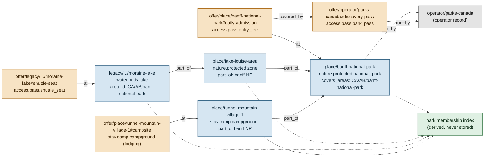

# Protected areas: one standard record for every park, its entry requirements and everything inside it

Status: **spec only, planned** (26 Oct 2026, travel-planner, Opus). No app code, no new HTML. Owner request of 26 Oct 2026,
with four additions the same day (links, reuse across trip kinds, the park as a hub, the park record's structure).
BACKLOG 15.290 to 15.294; TODO row of 26 Oct 2026; questions QP1 to QP6 (section 14).

Supersedes, for protected areas: the one-off Rockies fixes proposed in [D8R-rockies-bookings.md](../../../research/runs/D8R-rockies-bookings.md)
(the six proposal records are reshaped in section 11, not loaded as written), the proposed BACKLOG row 15.223d (absorbed by
PA-X and PA-W, section 12), and the authored `ext.area.pass` suitability field as a second home of the same fact (section 4.6).
It builds on, and does not replace: the capture contract ([capture-contract.md](../../../research/method/capture-contract.md)
2.4, 2.5, 3.2, 3.3, 3.5), the type tree (`data/vocab/types.json`), the property registry
(`core/src/schema/capture/properties.ts`), the booking window shape (`core/src/schema/capture/records.ts` `windowSpec`), the
book-by engine (`core/src/bookings/bookBy.ts`), the export wording (`core/src/export/bookings.ts`), AREA-2's areas and the
trip page's Bookings and Summary tabs ([trip-and-places-ux-fixes.md](trip-and-places-ux-fixes.md) 3.5, 3.6).

## 0. The decision in one paragraph

A protected area (national, state or provincial park, conservation area, reserve, forest, dark-sky site, and a gated zone
inside one) is **one place record** of type `nature.protected.*`. Everything a visitor must hold or book to enter it, or a
zone of it, is an **access offer** whose `at` names the park or the zone: entry fee, park pass, vehicle permit, timed
entry, day-use permit, shuttle seat, backcountry permit; campsite bookings are the existing lodging offers on campground
places inside the park. Each requirement carries its own window, cost, validity, channel, cancellation and link, written
once. A **system pass** (one pass for many parks) is one offer on the operator, and each park's fee says it is
`covered_by` that pass. Everything inside the park joins it by `part_of` or by the park's `covers_areas`, so the park is the
hub of its members and the members inherit its requirements by derivation. A trip never writes a requirement: its stops and
nights say which parks it enters on which days and how (day visit, front-country nights, backcountry nights), and the Book
ahead rows, book-by dates and the park line are derived. **Trade-off:** six small contract additions and one new relation,
against the alternative of per-trip booking notes that rot and cannot serve a day trip, a camping weekend and a backcountry
plan from the same data.

## 1. Owner requests, traced

| # | Owner, 26 Oct 2026 | Where |
|---|---|---|
| O1 | Every park, anywhere, is one standard thing in the data | 2, 4 |
| O2 | It carries the details of entry: pass, timed entry, booking, permit, fee, shuttle, anything else; requirements and windows hang on the park | 3, 4.2 |
| O3 | Replaces the Rockies-only fixes; passes get `summary` on offers, `access_cost` not applicable on a pass; Banff NP and Lake O'Hara become place records; the Moraine and Lake Louise shuttle is one row per ridden day; rental car stays a plain task row | 5, 6.3, 11 |
| O4 (add. 1) | Official links per park and per requirement type, stored once; licence rules | 4.4, 9.3 |
| O5 (add. 2) | One park's data serves a day trip, a camping weekend and a backcountry plan; the plan says what it does in the park and the rows derive | 6.1, 6.2, 7 |
| O6 (add. 2) | A worked camping weekend; camping properties versus what `stay.camp.*` has | 7 |
| O7 (add. 3) | The park is the hub of its lakes, routes, trails, viewpoints, beaches, campgrounds, wildlife spots, visitor centres and activities; park page variant; plan-a-visit; discovery both ways; fill order; phases | 2.3, 8, 10, 12 |
| O8 (add. 4) | The park record's structure: field table, hierarchy examples, ingestion, query contract, fixtures | 4, 2.4, 9, 6.5, 13 |

## 2. Data shape

### 2.1 Records and directions



| Link | Direction | Stored on | Why this direction |
|---|---|---|---|
| requirement to park or zone | offer `at` place (existing relation) | the requirement | the contract's offer rule (2.4): an offer names its place; the park's list of requirements is derived, like `reached_by`, so it is stored once |
| requirement to the road it controls | offer `on` route (existing) | the requirement | a toll or a road-closure shuttle is "on" the road (Tre Cime toll already does this) |
| fee to the system pass that covers it | offer `covered_by` offer (**new relation**, named in contract 3.3 as an A property but never added) | the fee | one park adds one ref; a pass that covers 80 parks never lists 80 refs |
| park or zone to its managing authority | `run_by` (existing, widened from offers to `nature.protected` places) | the park | the operator record holds the authority's URL, terms and reservation portal once |
| member to park or zone | `part_of` (existing containment relation) | the member | containment, as the contract defines it (2.5) |
| park to the areas that are the park | `covers_areas` (**new field**, `nature.protected` places only) | the park | every record whose `area_id` is a covered area is a member with no edit to that record (section 2.3) |
| campsite booking to campground | lodging offer `at` campground place (existing) | the offer | campgrounds are places with points and members of the park |

No record stores the reverse of any link. The membership index, the park's requirement list and "inside this park" on a
member are computed in core, once per build, behind the data boundary (P9).

### 2.2 `area_id` and AREA-2: where the area hierarchy fits and where it does not

AREA-2 made park-shaped areas in the locations store (`CA/AB/banff-national-park`, `CA/AB/jasper-national-park`,
`CA/BC/yoho-national-park`, `CA/BC/kootenay-national-park`, `CA/AB/kananaskis-country`, `CA/ON/algonquin-provincial-park`,
`IS/northeast/vatnajokull-national-park` and others). Most Rockies records already carry one of them as `area_id`.

| Case | Area fits? | Membership by |
|---|---|---|
| A Canadian national or provincial park whose area exists (Banff, Jasper, Yoho, Kootenay, Algonquin) | yes | `covers_areas` on the park: every record with that `area_id` is a member, no edits |
| A US park: members carry the county as `area_id` (Zion: `US/UT/washington-county`) | no: a county holds things outside the park | explicit `part_of` on each member |
| A park across two regions (Yellowstone: three states) | no: an area belongs to one region (`areas.region_id`) | explicit `part_of`; the park's own `area_id` is the region holding its main entrance |
| A sub-area (Lake Louise area, the Lake O'Hara gated zone) | no: areas are one level | a `nature.protected.zone` place, `part_of` the park; members `part_of` the zone |
| An area that is wider than the park (Kananaskis Country holds several provincial parks and the Canmore edge, AREA-2 medium confidence) | partly | `covers_areas` on `place/kananaskis-country` (the conservation pass is for the whole area); each provincial park inside is its own record with explicit `part_of` members |
| A record placed by the 10 km rule into the wrong area | no | an explicit `part_of` wins over `covers_areas`; a record may say `part_of` a different park to override |

**Rule:** explicit `part_of` wins; `covers_areas` fills the rest; never geometry. We do not hold park boundaries as
polygons (ODbL share-alike on OSM boundaries, P9 no bulk loads, T5 honest maps), and a point-in-polygon test at the edge
of a park is the kind of silent error T5 forbids. `osm_ref` on the park names the boundary relation for links and a later
server-side check only.

### 2.3 The park as a hub (membership)

Members are every place, route and offer whose `part_of` chain reaches the park, every record whose `area_id` is in the
park's `covers_areas`, and every offer `at` or `on` any of those. Kinds that join without new types:

| Member | Type ids (existing) |
|---|---|
| Lakes, beaches, rivers | `water.body.*`, `water.swim.*` |
| Canoe routes and rentals | water routes, `water.paddle.*` offers |
| Trails and hikes | `nature.trail.*`, `nature.trek.*` routes |
| Viewpoints, summits, landforms | `nature.viewpoint`, `nature.summit`, `nature.landform.*` |
| Campgrounds, backcountry sites, huts | `stay.camp.*`, `stay.mountain.*` |
| Wildlife spots | `nature.wildlife.*` |
| Visitor centres, trailheads, parking | `access.*`, `culture.*` places |
| Programmes and guided offers | experience offers (`culture.tour.guided_tour` and the like) |

Discovery runs both ways: the park page lists members by kind (section 8), and every member's page carries one line
"In Banff National Park: entry fee applies (Discovery Pass covers it)" derived from the nearest park or zone up its chain,
plus the member's own requirements (Moraine Lake's shuttle). A trail page that "needs a day pass" says so by derivation,
never by a copied fact.

### 2.4 Hierarchy examples (real shapes, refs as they would be written)

**A. National park with sub-areas: Banff NP > Lake Louise area > Moraine Lake.**

| Record | Type | Key fields |
|---|---|---|
| `place/banff-national-park` | `nature.protected.national_park` | `covers_areas: ["CA/AB/banff-national-park"]`, `run_by: operator/parks-canada`, `area_id: CA/AB/banff-national-park`, links official, hours_rates, conditions |
| `place/lake-louise-area` | `nature.protected.zone` (new leaf) | `part_of: [place/banff-national-park]` |
| `legacy/canadian-rockies-sept-2029/sights/moraine-lake` | `water.body.lake` | `part_of: [place/lake-louise-area]` (one edit; it is already a member of the park through its area) |
| `offer/place/banff-national-park#daily-admission` | `access.pass.entry_fee` (new leaf) | `at: [park]`, `covered_by: [offer/operator/parks-canada#discovery-pass]`, `entry.needed_for: [day, overnight_front, overnight_back]` (the trans-park highway exemption is an `exemptions` row `through_traffic`) |
| `offer/legacy/canadian-rockies-sept-2029/sights/moraine-lake#shuttle-seat` | `access.pass.shuttle_seat` (exists, CS7) | `at: [moraine-lake, lake-louise]`, `window` fixed_date with `then` rolling 2 days 08:00 |
| `offer/place/lake-louise#parking` | `access.park` offer (exists) | window `on_arrival`; row kind "check" |

**B. Provincial park with an operating season, separate campgrounds and day-use areas** (Ontario-style shape; section 7
works it as a weekend).

| Record | Type | Key fields |
|---|---|---|
| `place/<park>` | `nature.protected.state_provincial_park` | `season` (operating, for example May to October), `hours` (gate), `run_by: operator/<provincial agency>` |
| `place/<park>-<name>-campground` (x2) | `stay.camp.campground` | `part_of: [park]`, `camp` block (site kinds, food storage) |
| `place/<park>-main-beach` | `water.swim.beach.lake_beach` | `part_of: [park]` (the day-use area) |
| `offer/place/<park>#daily-vehicle-permit` | `access.pass.vehicle_permit` (new leaf) | `covered_by: [offer/operator/<agency>#annual-day-use-pass]`, `exemptions: [{who: camper}]` |
| `offer/place/<park>#day-use-reservation` | `access.pass.day_use_permit` | `entry.required: some_days` (peak weekends), window rolling |
| `offer/place/<park>-<name>-campground#campsite` (x2) | `stay.camp.campground` offer, lodging | window rolling N days at a time; `camp` block on the place, price rows per site kind |

**C. A park system with one pass for many parks.**

| Record | Type | Key fields |
|---|---|---|
| `operator/parks-canada` (exists) | operator | url, terms_url |
| `offer/operator/parks-canada#discovery-pass` | `access.pass.park_pass` | no `at` (exempt, QP1), `run_by`, `entry.valid: {span: 12, unit: month, from: purchase}`, price rows (adult, senior, family) |
| each park's `#daily-admission` | `access.pass.entry_fee` | `covered_by: [the pass]` |

The same shape holds for a US national pass (`offer/operator/<federal agency>#annual-pass`) and an annual provincial or
state pass. A pass that covers only some fees (a vehicle pass that does not cover a campsite) is simply absent from the
campsite's `covered_by`.

**D. A park straddling two jurisdictions.** One managing authority: one record, `area_id` the region of the main entrance,
members by explicit `part_of`, `regions` derived from members for the area chain. Two authorities across a border
(Waterton Lakes NP and Glacier NP): two park records, each with its own requirements, joined by `combo_with`; a joint
designation (an international peace park, a World Heritage Site) is a relevance `signals.designations` row on each, never
a third park record.

**E. A park with a gated sub-area: Lake O'Hara in Yoho NP.**

| Record | Type | Key fields |
|---|---|---|
| `place/yoho-national-park` | `nature.protected.national_park` | `covers_areas: ["CA/BC/yoho-national-park"]` |
| `place/lake-ohara` | `nature.protected.zone` | `part_of: [yoho]`, point at the lake (the points runner, from OSM), suitability `access_season` with `via: shuttle`, relevance `access_cost: shuttle_only, permit_lottery` derived (4.6) |
| `offer/place/lake-ohara#day-use-bus` | `access.pass.shuttle_seat` | window `lottery` (`opens_from`/`opens_to` 03-01 to 03-31 as a pattern), `then` rolling with `closes_days_before: 1`, `closes_time: 15:30` |
| trails in the zone | routes | `part_of: [place/lake-ohara]`; they inherit "needs the O'Hara bus or a 22 km walk" by derivation |

Lake O'Hara is modelled as the zone, not the lake, because the bus, the lodge, the campground, the hut and the trails all
belong to the gated area. The lake itself becomes a member record when a page needs it.

## 3. Entry requirements: what each states

### 3.1 Kinds (country-neutral)

Each kind is a type leaf; a new kind is one entry in `types.json` (contract 8.1). Two leaves are new.

| Kind (owner's list) | Type id | Typical unit | Example (shape only) |
|---|---|---|---|
| Entry fee | `access.pass.entry_fee` (**new**) | person or vehicle, per day or a few days | a national park's daily admission |
| Pass (multi-park or annual) | `access.pass.park_pass` (exists) | person, family or vehicle, months | a national annual pass |
| Vehicle or parking permit | `access.pass.vehicle_permit` (**new**) | vehicle, per day or year | a conservation-area vehicle pass, a provincial daily vehicle permit |
| Timed entry | `access.pass.timed_entry` (exists) | vehicle or person, a slot | a road or park with entry slots |
| Day-use permit or reservation | `access.pass.day_use_permit` (exists) | vehicle or person, a day | a popular trail or beach with a daily cap |
| Backcountry or wilderness permit | `access.pass.backcountry_permit` (exists) | person per night, or group | an overnight permit by zone |
| Shuttle seat | `access.pass.shuttle_seat` (exists) | person, a ride | a road closed to private cars |
| Lift pass | `access.pass.lift_pass` (exists) | person | unchanged; not a park requirement unless the lift is the only way in |
| Campsite reservation | `stay.camp.*` lodging offer (exists) | site per night | front-country, group, RV, walk-in |
| Parking that cannot be booked | `access.park` offer (exists) | vehicle | a paid lot that fills before sunrise: a "check" row |

"Lottery", "launch day" and "monthly batch" are **window rules**, not kinds: a lottery for a day-use permit and a lottery
for a backcountry permit are the same rule on different kinds.

### 3.2 What a requirement carries

| What (owner's list) | Field | New? |
|---|---|---|
| Kind | `type` | 2 leaves new |
| Which park, zone or road | `at`, `on` | no |
| Who runs it | `run_by` | no |
| What it is, in our words | `summary` (capture home on offers) | home new (5.1) |
| Who it applies to | `entry.needed_for` (visit modes), `entry.unit`, `entry.required` | yes, in `entry` |
| Season it is in force | `season` | no |
| Hours it is in force (timed entry only 07:00 to 16:00) | `hours` | no |
| Cost with currency | `price` rows (`amount`, `currency`, `per`, ages) | `per` gains `person_night`; rows gain `residency` |
| Free for some (children free) | a price row with amount 0 and its age band | no |
| Exemptions a price row cannot say (residents, pass holders, campers, through traffic) | `entry.exemptions` | yes |
| How and where to get it | `entry.channel`; links `booking`, `official` | channel new |
| Booking window | `window` with `rule` fixed_date, rolling, monthly_release, lottery, same_day, anytime, on_arrival | window gains 6 optional keys (5.1) |
| Change and cancel | `entry.change`, `entry.cancel` | yes |
| Validity | `entry.valid` | yes |
| Proof (carry, display, plate registered) | `entry.proof` | yes |
| Capacity cap | `entry.quota` | yes |
| A pass that covers it | `covered_by` | yes (relation) |

### 3.3 Visit modes

`needed_for` uses four country-neutral modes. A trip derives its mode per park per day (6.1); a requirement applies when
its modes include the trip's.

| Mode | Meaning |
|---|---|
| `day` | in the park in daylight, sleeping outside it |
| `overnight_front` | a night at a front-country campground, lodge or hotel inside the park |
| `overnight_back` | a night at a backcountry site, hut or zone reached on foot or by water |
| `through` | crossing on a through road without stopping |

## 4. The park record, field by field

Freshness classes are those of `data/schema/freshness.json` (prices 120 days, hours 180, booking windows 365, closures 7
and never trusted, geography never stale, summaries 730). Source lanes: F official land manager, O operator, D reference
(Wikidata, OSM, GeoNames), X computed, ours. Marks: R required tier, R? required when the trigger holds, A optional.

### 4.1 Park (`nature.protected.*` place)

| Field | Registry property | Value and units | Mark | Source lane | Freshness | Validator |
|---|---|---|---|---|---|---|
| Name | `name` | as signed by the authority | R | F | summaries | non-empty |
| Local names | `names` | `{lang: name}` | A | F, D | summaries | |
| Type | `type` | `nature.protected.{national_park, state_provincial_park, conservation_area, nature_reserve, forest, dark_sky_site, zone}` | R | ours | | E_CAP_TYPE |
| Point | `point` | the main visitor centre, or the authority's own map point; `[lon, lat]` 5 decimals | R | D (OSM), F | geography | E_PLACE_* as today |
| Area | `area_id` | the smallest area holding the main entrance | R | derived (AREA) or authored | geography | E_PLACE_AREA |
| Areas that are the park | `covers_areas` (**new**) | area ids | A (R? when an area named after the park exists: W_PARK_AREA) | ours | geography | each id exists in the store; only on `nature.protected` |
| Parent | `part_of` | a zone's park; a provincial park inside a wider conservation area | R for a zone, else A | ours | geography | a zone without `part_of` is E_PARK_ZONE |
| Managing authority | `run_by` (widened to these places) | operator ref | R | F | | operator exists |
| Wikidata, OSM boundary | `wikidata`, `osm_ref` | QID; `relation/<id>` | R, A | D | geography | as today |
| Summary | `summary` (relevance `why`) | our words | R | ours | summaries | |
| Relevance | `class_key` (new class `park/protected-area`), `draw`, `standing`, `distinction`, `easy_payoff`, `weather`, `signals.designations` | relevance/1 | R | ours, D | as today | W_TIER_REQUIRED |
| Operating season | `season` | season rows | R? `operates` (staffed or gated) | F | hours | |
| Access season | suitability `access_season` (area profile) | rows with `via` | R | F | hours | |
| Gate hours, standing closures | `hours` (incl. `closures`) | K9 | R? when gated | F | hours; closures 7 | |
| Entry | `access_cost` (relevance) | **derived** from incoming requirement offers when any exist; else authored, `no_limit` when nothing is needed | R | F | prices | W_ENTRY_TWO_HOMES when authored and derived disagree |
| Links | `links` | `official` R, `hours_rates` (fees page) R? when a fee exists, `conditions` (alerts and closures) R, `status` A, `booking` A (the authority's reservation portal), `map_sheet` A, `accessibility` A | R | F | booking windows | `official` R; link-only platforms refused (E_CAP_LINK_ONLY) |
| Facilities | suitability area profile `toilets`, `water`, `food`, `signal`, `picnic` | as today | A (toilets R by contract 3.5) | F | hours | |
| Kids and time | `kid_note`, `on_site_min`, `hazards` (area profile) | as today | R | F, ours | hard limits | |
| Wildlife rules | `ext.wildlife.*` on members, hazard `wildlife` on the park | as today | R? `wildlife_area` | F | hard limits | |
| Members, requirements, camping, activities | none stored | derived (2.3) | | | | |
| Sources, read dates | `src`, `read` on every Val; source rows | | R | | per field | E_CAP_SRC |
| Row meta | `meta` (RowMeta v1) | run id, origin | | | | as today |

New on the park: `covers_areas` and `run_by` on a place. Everything else already exists.

### 4.2 Entry requirement (`access.pass.*` offer)

| Field | Registry property | Value and units | Mark | Source lane | Freshness | Validator |
|---|---|---|---|---|---|---|
| Ref | | `offer/<park, zone or place ref>#<slug>`, or `offer/operator/<slug>#<slug>` for a system pass | R | | | E_CAP_REF (resolver accepts the operator form, 5.1) |
| Type, layer | `type`, `layer` | `access.pass.*`, `offer` | R | ours | | E_CAP_LAYER |
| Name | `name` | as the authority names it | R | F, O | summaries | |
| Summary | `summary` (**capture home on offers**) | our words, at most 200 characters | R | ours | summaries | W_TIER_REQUIRED |
| Where | `at`, `on` | park, zone or place; road route | R (`at`), A (`on`) | ours | | E_PLACE_ORPHAN unless a `park_pass` with `run_by` (QP1) |
| Authority | `run_by` | operator ref | R | F, O | | |
| Entry | `entry` (**new**, Val) | section 5.1 | R | F, O | prices (cost parts), booking windows (cancel, channel) | E_ENTRY_* |
| Season in force | `season` | season rows; `{from: 01-01, to: 12-31, status: open}` for all year | R | F, O | hours | |
| Hours in force | `hours` | K9 | R? `operates` for timed entry | F, O | hours | |
| Cost | `price` | rows; amount 0 for a free band; `per` incl. `person_night`; `residency` | R | F, O | prices | currency ISO 4217 |
| Window | `window` | `windowSpec` plus the 6 new keys | R? `bookable` | F, O | booking windows | E_WINDOW_* |
| Covered by | `covered_by` (**new relation**) | offer refs of passes | A | F | prices | target is an `access.pass.park_pass` or a lodging offer (camper exemption form) |
| Booking page | `book_url` (RIS-H home) and link `booking` | URL | R? reservable | F, O | booking windows | |
| Links | `links` | `official` R, `booking` R? reservable, `terms` A, `hours_rates` A | R | F, O | booking windows | |
| Access cost | `access_cost` | **N** (the offer is the cost) | N | | | |
| Relevance, suitability, media | | N (contract 3.3, offer: access) | N | | | |

### 4.3 Camping (`stay.camp.*` place and its lodging offer)

What exists: `stay.camp.{campground, backcountry_site, glamping, rv_park}`, layers place and offer, offer class lodging,
marks `season` R, `hours` R, `price` R, `window` A, the stay suitability profile, `check_in_out` in the registry with no
home (RIS-H gives it one). What is missing, and new:

| Need | Field | On | Value | Mark |
|---|---|---|---|---|
| Site types | `camp.site_kinds` | campground place | `[{kind: tent, rv_unserviced, rv_electric, rv_full, walk_in, group, roofed, backcountry, boat_in; count?; max_people?; max_vehicles?; reservable: all, part, none}]` | R |
| Maximum stay | `camp.max_stay_nights` | lodging offer | integer | A |
| First come, first served share | `camp.site_kinds[].reservable` | place | as above | in site kinds |
| Food storage | `camp.food_storage` | place | `lockers, hang, canister_required, none_stated` | R? `wildlife_area` |
| Fire rules | not stored as a fact | | the park's `conditions` link (fire bans change daily, closures class); fire rings are a facility (`camp.fire_rings` bool, A) | link R |
| Bear and wildlife rules | park hazard `wildlife`, member `ext.wildlife.*` | existing | | existing |
| Check-in and check-out | `check_in_out` | lodging offer | `{in: hh:mm, out: hh:mm}` | R (home from RIS-H) |
| Reservation window | `window` | lodging offer | rolling, fixed_date (a launch day), lottery | R? reservable (mark change A to R? on `stay.camp`) |
| Price per site kind | `price` rows with `note` naming the site kind, or `per: night` | lodging offer | | R |
| Backcountry quota and per person per night | `entry.quota`, `price.per: person_night` on the backcountry permit | permit offer | | R |

`camp` is one new Val block on `stay.camp.*` places (and `max_stay_nights` on the offer); it is a new property set for one
category, so it lands in P3, not P1.

### 4.4 Links: stored once

| Link | Lives on | Kind (existing `CAP_LINK_KIND`) |
|---|---|---|
| The park's own page | park | `official` |
| Fees page | park | `hours_rates` |
| Alerts, closures, fire bans | park (and a zone when it has its own page) | `conditions` |
| Road or trail status page | park or route | `status` |
| The authority's reservation portal | operator record (`url`) and the park as `booking` | `booking` |
| The booking page of one requirement (day pass, timed entry, vehicle permit, campsite, backcountry permit, shuttle) | that requirement | `booking`, and `book_url` |
| Terms, cancellation policy | operator `terms_url`, or the requirement | `terms` |

No new link kind. A trip never stores a link to a park or a requirement: the trip page reads them through the requirement.
Licence: facts in our words, a quote of at most 300 characters as provenance, link to everything else
([sources-and-licences.md](../../../research/method/sources-and-licences.md) 4); link-only platforms are refused as sources.

### 4.5 Gaps and honest rendering

The existing states apply unchanged (`SUIT_STATE`: value, none_stated, searched_none, not_applicable, gap, no_limit).

| State | On a park page | On a trip's Bookings tab |
|---|---|---|
| No requirement offers and `access_cost` not answered | Entry block: "Entry not checked yet" (one line in the safety tier, because a missing permit can stop a visit: P2 safety exception) | the park line says "Entry not checked yet for Yoho National Park" |
| `access_cost: no_limit` (sourced) | "No entry fee or permit" with the read date | no row |
| A requirement with `window: searched_none` | the row shows cost and "Booking window not published; book as early as possible (checked <date>)" | row kind booking, rule null, that note |
| A requirement with `none_stated` price | "Price not published (checked <date>)" | price absent |
| `not_applicable` | not drawn | not drawn |

`node core/bin/capture.ts gaps --tier required --type nature.protected` and `--type access.pass` list incomplete parks and
requirements; the gap budget (`data/capture/gap-budget.json`) counts them with every other record. A half-filled park renders
what it has, its safety-tier gaps as rows, and the rest in the one "Not checked yet" block (R-265).

### 4.6 Two homes removed

| Fact | Old home | New rule |
|---|---|---|
| "This park needs a pass, permit or timed entry" | suitability `ext.area.pass` (authored) | derived from the requirement offers (P2, PA-DV); authored values kept until then, and a warning when they disagree |
| The park's `access_cost` | relevance, authored | derived when requirement offers exist (timed_entry from `timed_entry`, day_permit from `day_use_permit`, permit_lottery from a lottery window, shuttle_only from a shuttle seat on a zone with no private access, daily_cap from `entry.quota`), so Plan B (relevance 3.17) keeps working; authored only for parks with no offers |
| An entrance fee as `price` on the park place (Zion, Bryce, Arches, Canyonlands, Yellowstone, Grand Teton, Mount Rainier, Watkins Glen, White Mountain NF) | the place | moved to an `access.pass.entry_fee` offer (contract 3.2 already says "places with a fee: an access or ticket offer") |

## 5. Contract diff (shared contract: Opus, one author, PA-C)

### 5.1 The smallest diff

| # | File | Change | Why |
|---|---|---|---|
| C1 | `core/src/schema/capture/records.ts` | `summary: z.string().min(1).max(200).optional()` on `capRecord`, allowed on offers only (validator) | Q-D8R-1 (a): passes have no relevance record |
| C2 | same | `entry: val(entrySpec).optional()`; `entrySpec` below | the requirement's own facts |
| C3 | same | `windowSpec` gains `opens_from`, `opens_to` (MM-DD, the yearly band of a launch day or lottery), `month_lead_days` (monthly_release), `closes_days_before`, `closes_time`, `share_pct`, `then` (one windowSpec without `then`) | the two-phase shuttle, the lottery's leftover seats, "apply in March" without a year (D8-R findings) |
| C4 | same | `covered_by: z.array(ref).optional()`; `covers_areas: z.array(z.string().min(1)).optional()` | 2.1 |
| C5 | same | `priceRow` gains `residency?: "resident" \| "national" \| "foreign"`; `PRICE_PER_V2` gains `person_night` (enums.ts) | resident and foreign prices; backcountry fees |
| C6 | `core/src/schema/enums.ts` | `CAP_RELATION` gains `covered_by` | relations list |
| C7 | `core/src/schema/capture/properties.ts` | `summary` home by layer: capture `summary` on offers, relevance `why` elsewhere (a `homeByLayer` field on `PropertyDef`, read by the engine); new properties `entry` (group access, value object, display rest!, home capture), `covered_by` (relations, layers offer), `covers_areas` (identity, layers place); `run_by` layers gain place | registry is the one list of properties |
| C8 | `data/vocab/types.json` | `access.pass` marks: `summary: R`, `access_cost: N`, `entry: R`, drop `parks_for` and `point` R (an offer inherits its place's point); leaves `access.pass.entry_fee`, `access.pass.vehicle_permit`, `nature.protected.zone`; `nature.protected` marks gain `covers_areas: A`, `run_by: R` | data, not code |
| C9 | `data/vocab/relevance-classes.json` | class `park/protected-area` | `nature.protected` points at `park/*`, and only `park/urban` exists |
| C10 | `core/src/validate/capture.ts`, `codes.ts` | E_ENTRY_SCHEMA (entry on a non-access type), E_ENTRY_COVER (`covered_by` target is not a pass or lodging offer), E_WINDOW_THEN (`then` nested or on an `anytime` rule), E_PARK_ZONE (zone without `part_of` a park), E_PARK_AREA (unknown area in `covers_areas`), W_PARK_AREA (an area named after the park exists and is not covered), W_ENTRY_TWO_HOMES (P2); E_PLACE_ORPHAN exempts `access.pass.park_pass` with `run_by` and at least one incoming `covered_by`; the ref resolver accepts `offer/operator/<slug>#<product>` | 4.1, 4.2 |
| C11 | `core/src/capture/engine.ts` | `access_cost` on a `nature.protected` record is firm when an incoming requirement offer exists | a park with requirements is not a gap |

`entrySpec` (sketch, strict object; every key country-neutral):

```ts
const VISIT_MODE = ["day", "overnight_front", "overnight_back", "through"] as const;
export const entrySpec = z.strictObject({
  required: z.enum(["always", "in_season", "some_days", "advised"]),
  needed_for: z.array(z.enum(VISIT_MODE)).min(1),
  unit: z.enum(["person", "vehicle", "group", "site", "boat"]),
  valid: z.strictObject({ span: int.min(1), unit: z.enum(["hour", "day", "night", "month", "year", "entry", "slot"]), from: z.enum(["purchase", "first_use", "slot_start", "calendar"]) }).optional(),
  channel: z.array(z.enum(["online", "phone", "gate", "visitor_centre", "on_board", "machine"])).min(1),
  proof: z.enum(["carry", "display", "plate_registered", "id_check"]).optional(),
  exemptions: z.array(z.strictObject({ who: z.enum(["resident", "pass_holder", "camper", "through_traffic", "disability", "indigenous", "school_group", "other"]), note: z.string().max(200).optional() })).optional(),
  change: z.strictObject({ allowed: z.enum(["free", "fee", "no"]), until_hours: int.min(0).optional(), note: z.string().max(200).optional() }).optional(),
  cancel: z.strictObject({ refund: z.enum(["full", "partial", "none"]), until_hours: int.min(0).optional(), note: z.string().max(200).optional() }).optional(),
  quota: z.strictObject({ per: z.enum(["day", "night", "slot"]), note: z.string().max(200).optional() }).optional(),
});
```

Generated files rebuild from these (`data/schema/generated/**`, `data/schema/capture/*`, `research/types/*` by
`capture.ts build`). No Neon migration in P1: the catalogue tables load capture JSON through the RIS loader; RIS-L's
mapping gains the new keys (a note to the RIS-L owner, not a new migration while the catalogue is files).

### 5.2 Export and API contract (PA-X, Opus)

`BookRuleInput` (core/src/export/bookings.ts, and `CategoryItem.bookRule` in core/src/schema/api/trip.ts) gains a kind
and the month band; old rows (rolling only) read as `kind: "rolling"`.

```ts
export interface BookRuleInput {
  kind?: "rolling" | "fixed_date" | "monthly_release" | "lottery" | "same_day" | "anytime" | "on_arrival"; // absent = rolling
  daysBefore: number;           // rolling, same_day; 0 otherwise
  dayN: number | null;
  time: string | null;
  tz: string | null;
  months?: [number, number] | null;      // from opens_from/opens_to: "usually in March"
  monthLeadDays?: number | null;         // monthly_release
  closes?: { daysBefore: number; time: string | null } | null;
  then?: Omit<BookRuleInput, "then"> | null;
}
export interface ExportBooking { name: string; rule: string | null; note: string | null; day: number | null; ref: string;
  kind: "booking" | "pass" | "check" | "task"; park: string | null; link: string | null }
```

| Rule kind | `bookRuleText` wording |
|---|---|
| rolling | "Opens 2 days before Day 10 at 08:00 local" (unchanged) |
| fixed_date | "Opens on a launch day each year, usually in April, at 08:00 local" |
| lottery | "Lottery: apply usually in March" + then: "; seats left after the draw until 15:30 the day before Day 9" |
| monthly_release | "Opens in a monthly batch about 35 days before the month, at 09:00 local" |
| same_day | "Opens on Day 4 at 07:00 local" |
| anytime | "Buy any time before Day 1" or, with `closes`, "Buy by 23:59 on Day 12" |
| on_arrival | "Pay on arrival" |

"Usually" is fixed wording for a month band read in one season (T3: a pattern shows its age). `ExportFile` and the
OpenAPI `exportModel` get a model `version` bump (15.223c item 3 asks for one before go-live). The CSV's Kind column takes
the four row kinds.

## 6. Trip, places, Book ahead, export, API

### 6.1 Park visits (derived)

`parkVisits(trip, index)` in core: for each park or zone, the days with a stop that is a member, the nights whose base is a
member, and the mode per day: `overnight_back` when the base is a `stay.camp.backcountry_site` or `stay.mountain.*` member;
`overnight_front` when the base is any other member; else `day`. A park entered only by driving through it is invisible to
this rule; the optional stored override (`park_visits`, written by an op, P3 only, QP4) covers drive-through, a campground
chosen before a base exists, and backcountry nights. Public trips stay dateless: visits are day numbers.

### 6.2 Entry needs (derived)

`entryNeeds(visits, index)` gives, for each park and zone visited, the requirements whose `needed_for` includes a visited
mode and whose season overlaps the trip's months, as rows:

| Row kind | When | Book ahead wording |
|---|---|---|
| booking | window rule fixed_date, rolling, monthly_release, lottery or same_day | the rule (5.2), then the note |
| pass | entry fee, park pass or vehicle permit with window `anytime` | "Buy any time before Day 1"; the park line names the pass that covers it |
| check | `on_arrival`, an unbookable parking offer, a `conditions` link, a route rule such as `group_min` | "No reservation; lot fills before sunrise" |
| task | a trip's own row with no catalogue record (rental car) | the trip's own note; never derived |

**One row per ridden day** (owner decision on the shuttle, generalised): a requirement whose window is `rolling` or
`same_day` and whose `valid.span` is at most one day gives one row per day used, each with its own Day N in the rule.
Everything else gives one row with the list of days.

**Park line** (Summary tab, Bookings tab header, print): "Banff National Park, days 3 to 6 and 9 to 11: entry fee each day,
or the Discovery Pass covers it (also Jasper, Yoho and Kootenay on this trip)". A cost comparison ("the pass is likely
cheaper") appears only when both prices are per the same unit (family or vehicle) and the day count is known, never per
party, never as a claim without comparable bands (the stay-bases silence rule; QP5).

### 6.3 The Rockies Book ahead rows, before and after

| Today (legacy note) | After P1 | Kind |
|---|---|---|
| pass-discovery | park line + "Parks Canada Discovery Pass: buy any time before Day 1" | pass |
| shuttle-moraine-lakelouise (days 8 to 11) | Day 10 row and Day 11 row: "Opens on a launch day each year, usually in April, at 08:00 local; then 2 days before Day 10 at 08:00 local" | booking (2 rows) |
| moraine-private-access | Roam Super Pass row: monthly batch | booking |
| lake-ohara-bus (optional, day 9) | lottery row | booking |
| kananaskis-pass (12 to 15) | "Kananaskis Conservation Pass: buy by 23:59 on Day 12" | pass |
| lakelouise-lakeshore-parking | "No reservation; lot fills before sunrise; shuttle holders park free at the Park and Ride" | check |
| johnston-canyon, yoho-valley-road, wildlife-orders, closures-after-labour-day | check rows from the park's `conditions` link and the route's access season | check |
| larch-valley-group | check row from the route's `group_min` | check |
| icefields-parkway, maligne-cruise, jasper-skytram | unchanged experience offers; booking with rule null and the note | booking |
| calgary-rental-car | the trip's own row | task |

Until TD-3/TD-4 move the Rockies rows into `data/trips/`, a small map `data/trips/booking-refs.json` (shape as
`stop-refs.json`: legacy booking id to requirement ref) lets the export drop a legacy row a derived row replaces. It is
deleted with TD-4.

### 6.4 Where it shows (P2, P3, P6, T1)

| Surface | What | Principle |
|---|---|---|
| Park page | "Entry and bookings" first under the cover, at rest: chips per requirement ("Entry fee", "Timed entry May to Oct", "Backcountry permit"), each opening in place to cost, window, validity, cancel, link | P2 safety exception, P3, P6 |
| Member page (trail, lake) | one line in the safety tier: "In Banff National Park: entry fee applies (Discovery Pass covers it)" + the member's own requirements | P6, T1 |
| Trip Summary tab | the park line per park (UXB-C's `summary.parks` gains days and needs) | P3 |
| Trip Bookings tab | rows grouped by kind (Book first, Book ahead, Passes, On the day: check), counts only of booking rows ("5 to book ahead"), check rows listed below and never counted | P1, P4 |
| Day row | the existing booking-due marker; a check chip on the day a check applies | P6 |
| Print and CSV | Kind column; park line above the rows | T2 |
| API | 6.5 | P9 |

### 6.5 Query contract (read models)

Each question is answered from the park alone through the data boundary (`web/lib/public` and the `CatalogueStore`), with
the privacy rules unchanged: no party, no dates on public trips, no household data, per-item detail only (P8).

| Question | Read model | Where |
|---|---|---|
| What do I need to enter on day X as a day visitor, a camper, a backcountry camper? | `PlaceLookup.entry: EntryBlock`; `entryFor(entry, {mode, month})` in core filters `requirements` by `neededFor` and season | `getPlace(slug)`, `/api/v1/places/{slug}` |
| What must I book and by when? | `EntryRequirement.window` (rule text with Day N when a trip asks), `entryNeeds(visits)` on a trip | `getTrip(slug)` `bookings`, `/api/v1/trips/{slug}` |
| What can I do here with kids in month Y? | the places list filtered by the new `park` facet plus the existing `kid`, `season`, `effort`, `k` facets | `listPlaces({facets: {park, kid, season}})`, `countPlaces`, `/api/v1/places?park=` |
| What is closed? | stored standing rules (`access_season`, `hours.closures`, a zone's shuttle-only access) plus the `conditions` link; live closures are never stored (closures class, 7 days, untrusted) | `EntryBlock.closures` |
| Which parks does this trip enter, when, and what covers them? | `TripSummary.parks[]` | `getTrip(slug)` |

```ts
interface EntryBlock {
  park: { slug: string; name: string; kind: "national" | "state_provincial" | "conservation" | "reserve" | "forest" | "dark_sky" | "zone"; parent: { slug: string; name: string } | null };
  authority: { name: string; url: string } | null;
  state: "requirements" | "none_needed" | "not_checked";
  requirements: EntryRequirement[];          // the park's and, on a member page, its own
  links: { official: string | null; fees: string | null; alerts: string | null; booking: string | null };
  closures: { text: string; read: string }[]; // standing rules only
  read: string | null;                       // the oldest read date of what is shown (T3)
}
interface EntryRequirement {
  ref: string; name: string; kind: "entry_fee" | "park_pass" | "vehicle_permit" | "timed_entry" | "day_use_permit" | "backcountry_permit" | "shuttle_seat" | "campsite" | "parking";
  summary: string | null; neededFor: VisitMode[]; required: "always" | "in_season" | "some_days" | "advised";
  season: { from: string; to: string }[] | null; unit: string; price: PriceRow[] | null;
  window: { rule: string; text: string } | null; valid: string | null; channel: string[];
  coveredBy: { ref: string; name: string }[]; exemptions: string[]; cancel: string | null;
  scope: { slug: string; name: string } | null; link: string | null; read: string | null; basis: string | null;
}
interface TripPark { slug: string; name: string; days: number[]; nights: number[]; modes: VisitMode[]; needs: { name: string; kind: ExportBooking["kind"]; text: string }[]; coveredBy: string | null }
```

The `park` facet reads a server-side membership index; the list row keys (P8 allowlist, pinned by test) do not change.

## 7. Worked example: a camping weekend from the same records

A generic Ontario-style provincial park, "Lakeview Provincial Park" (illustrative values, not research), with the records of
2.4 B. Three plans, one data set:

| Plan | Trip data | Derived visits | Derived rows |
|---|---|---|---|
| Day trip, Saturday | Day 1: the beach and a trail (both members) | Lakeview, day 1, `day` | day-use reservation (peak weekend, `some_days`): "Opens 5 days before Day 1 at 07:00 local"; daily vehicle permit: "Buy any time before Day 1, or at the gate" (covered by the annual day-use pass) |
| Camping weekend, Friday to Sunday | base nights 1 and 2 at North Campground (member); Day 2 the trail; Day 3 the beach | Lakeview, days 1 to 3, `overnight_front` | campsite: "Opens 150 days before Day 1 at 07:00 local" (one row: the stay is one booking); vehicle permit: no row, exemption `camper` (the campsite permit covers the vehicle); day-use reservation: no row (its `needed_for` is `day` only); check: "Fire bans change daily: check the park's alerts" (the `conditions` link); the campground's food storage shows on the campground row ("Food lockers"), not as a booking |
| Two backcountry nights | override `park_visits`: nights 1 and 2 `overnight_back` at interior site zones | Lakeview, days 1 to 3, `overnight_back` | backcountry permit: "Opens 150 days before Day 1 at 07:00 local", price per person per night, `quota` per night; parking at the access point: check |

Nothing above is written per trip. The same park and campground records serve all three; changing the plan changes the rows.

## 8. The park page (variant of the place page; spec only, a UXB-style follow-up)

No new HTML: the park page is the place page template (`web/app/places/[slug]`, the UXB-7 type templates) with a park
variant, built in P2 after UXB-7. Primary action (P7): "Plan a visit" (P3), until then "Save to a trip".

| Section, in order | Content | Data |
|---|---|---|
| Cover | name, kind, authority, area chain, one summary line, draw badge | park record |
| Entry and bookings | at rest, as 6.4 | `EntryBlock` |
| Things to do | members grouped by kind with counts (Trails 33, Lakes 12, Viewpoints 9, Activities 15), at most 6 per group at rest with "Show all" into the places list pre-filtered (`?park=banff-national-park&k=trail`), filters season, kids, effort, duration from the list's own facets | membership index, `listPlaces` |
| Where to stay or camp | campgrounds and huts that are members, each with its booking window; towns outside the park from the stay-bases data where the trip has it | members `stay.*` |
| Getting there | gateway towns and airports (ORG), drive times from the existing legs, transit and shuttles | existing |
| Seasons and closures | operating and access seasons, gate hours, standing closures, the alerts link | park record |
| Sources | read dates and sources, one step away | as today |

Reviewers check P1 at 10,000 members (paged lists, counts, no bulk load), P2 (entry at rest), P5 (sections open in place),
P8 (no member list bigger than one page in the HTML).

**Plan a visit (P3).** Three chips on the park page: Day, Weekend, Two or three days. A choice sets URL state `visit=` and
(1) filters the entry block to the requirements that mode triggers, (2) pre-selects members by draw, season fit and the
visitor's kids setting on this device, at most 6 for a day and 12 for a weekend, (3) offers "Save to a trip" (the existing
copy and Mine flow, bundle A) or, signed in, "Start a trip from these" through the customise draft (CUS, bundle F) and
the add-a-place panel (v0.17, bundle G). No planner is invented here: the output is a pre-selection handed to flows that
exist.

## 9. Research method

### 9.1 The checklist per park (becomes `research/method/kinds/protected-area.md`, PA-M)

1. Identity: name as signed, type, Wikidata QID, OSM boundary relation, the authority (operator record; create it once per
   system), point at the main visitor centre.
2. Area: does an area named after the park exist? Set `covers_areas`; else plan `part_of` on members. Zones: one
   `nature.protected.zone` per gated or separately managed sub-area.
3. Links: official, fees, alerts, status, reservation portal; per requirement its booking page.
4. Entry state: is any fee, pass, permit, timed entry, reservation or shuttle needed, for which visit modes, in which
   season and hours? If none, store `access_cost: no_limit` with the source.
5. For each requirement: kind, `needed_for`, `required`, unit, price rows (ages, residency, amount 0 for free bands),
   exemptions, validity, channel, proof, window (rule, opens time and zone, month band, then-phase, closes), change and
   cancel, quota, `covered_by` passes, a quote of at most 300 characters as provenance.
6. Camping (when a plan camps): campgrounds as member places with `camp` facts; each campground's booking offer.
7. Run record: every field tried, `searched_none` with the pages tried, `ask` for questions to the authority; one request
   at a time per host, the project user agent.
8. Close: `validate.ts --all`, `capture.ts run --check`, `gaps --budget --check`, `sources.ts check`.

### 9.2 How it generalises (pointers for later lanes; to verify at research time, not researched now)

| Country or system | Authority and portal to read | Kinds to expect | Licence note |
|---|---|---|---|
| Canada, national | Parks Canada park pages, fees pages, reservation service | entry fee, system pass, shuttle, lottery, front-country launch days, backcountry permits | OGL-Canada open data; page text is facts only |
| Canada, provincial | each agency (Alberta Parks and Kananaskis, BC Parks, Ontario Parks, Sepaq) | vehicle permits, day-use reservations at busy parks, rolling campsite windows, backcountry permits | facts only |
| USA, national | NPS park pages, the federal reservation portal | entry fee per vehicle, national annual pass, timed entry, lotteries for permits | NPS mostly public domain; the portal's terms decide crawling (single-page reads only) |
| USA, state | each state agency and its booking vendor | day-use fees, annual state passes, rolling campsite windows | facts only |
| Iceland | Vatnajökull NP, Þingvellir, landowner parking operators | parking fees, few permits, F-road seasons | facts only |
| Argentina | the national parks administration and park pages | entry fee with resident and foreign prices, registration for treks | facts only |
| Italy | regional and national parks, toll-road operators, municipalities | mostly free; tolls and timed access on specific roads; lift passes | facts only |
| China | national parks and scenic areas | real-name timed tickets, daily caps, combined shuttle tickets | check terms and access from our region; facts only |

### 9.3 Ingestion, conflicts and refresh

| Step | How |
|---|---|
| Write | one lane file per country, `data/capture/catalogue/PA-<cc>.json` (`capture/1`), for parks, zones, requirements and system passes; trip lane files keep trip-only records; a run record in `data/capture/runs/`; sources in the file's `sources`, rebuilt into `data/sources/registry.json` |
| Validate | `validate.ts --all` (E_ENTRY_*, E_WINDOW_THEN, E_PARK_*), `capture.ts run --check`, `gaps --budget --check` (only goes down) |
| Two sources disagree on a fee | the official source wins by basis precedence (official_rule, official_info over operator_info over community); the run record holds `outcome: conflict` with both sources; never two values in one Val |
| A window that moves each year | store the rule with `opens_from`/`opens_to` and `applies_to` of the season read; the page says "usually in March"; the booking-windows freshness class (365 days) puts it on the backlog before the next season |
| An official re-read of a pinned (migrated) value | `capture_supersedes` (9.7), never an edit of the pinned file |
| Annual refresh | `core/src/sources/cadence.ts` and `freshness.json`: prices 120 days, windows 365, hours 180; `entry` joins the prices class (cost parts) and booking-windows (channel, cancel); a per-country refresh run before each season |

Data fill order: (1) the minimal viable park (identity, area, authority, links, entry requirements) for every park a trip
enters; (2) campgrounds, when a plan camps; (3) members by the existing per-type checklists (`research/types/*`) through the
existing lanes (trails, lakes, sights, adventure, stays), with no bulk research now.

## 10. Phases

| Phase | Scope | Bundle | Why there |
|---|---|---|---|
| P1 | entry standard and links: contract, export contract, membership and visits in core, fixtures, Rockies data, wiring into the Bookings and Summary tabs | **C** | UXB-6 (Bookings tab) and UXB-C (summary parks) are in C; the Rockies bookings show "7 to book, 0 dated" until P1 lands; C's data window has about 12 h spare |
| P2 | membership facet and the park page variant, derived `access_cost` and `ext.area.pass`, US fee migration | **E** | after UXB-7's place templates (C); beside OVR's overview lists |
| P3 | plan a visit, camping block, park visits override, an Ontario pilot | **G** | needs customise (F) and own stops (v0.17, G) |

## 11. Migration of existing records

| Record | Action | Task |
|---|---|---|
| D8-R proposal `offer/place/banff-national-park#parks-canada-admission` | split: one `access.pass.entry_fee` per park (Banff, Jasper, Yoho, Kootenay), each citing its own fees page, `covered_by` the Discovery Pass; the pass becomes `offer/operator/parks-canada#discovery-pass` | PA-R-CA |
| D8-R proposal `#conservation-pass` on kananaskis-lakes-day-use | `offer/place/kananaskis-country#conservation-pass`, `access.pass.vehicle_permit`, `at` a new `place/kananaskis-country` (`nature.protected.conservation_area`, `covers_areas: [CA/AB/kananaskis-country]`) | PA-R-CA |
| D8-R proposal `#roam-super-pass` | stored as proposed, `window.rule: monthly_release` with `month_lead_days`, `entry` block, `summary` | PA-R-CA |
| D8-R proposal `place/lake-ohara#day-use-bus` | stored on `place/lake-ohara` (zone, `part_of` Yoho), lottery with `then` | PA-R-CA |
| D8-R proposal `#frontcountry-campsite` | stored on Banff NP as a lodging offer with `fixed_date` and the month band; Interlakes stays a proposal until a plan camps there | PA-R-CA |
| CS7 `#shuttle-seat` (Moraine Lake) | `entry`, `summary`, `window` gains the launch-day phase and `then`; pinned values untouched (additions only) | PA-R-CA |
| `offer/place/lake-louise#parking` | `entry` with `needed_for: [day]`, `required: in_season`; window `on_arrival` | PA-R-CA |
| New places | `place/banff-national-park`, `place/jasper-national-park`, `place/yoho-national-park`, `place/kootenay-national-park`, `place/kananaskis-country`, `place/lake-louise-area`, `place/lake-ohara` with relevance records (class `park/protected-area`); points by the points runner (Overpass, one at a time) | PA-R-CA |
| Store places with the same name (Mount Robson PP, the US parks) | the capture record is the identity; slug takeovers are checked with `slugs.ts --check` (AREA-2 lesson) | PA-R-CA, PA-MUS |
| Mis-typed Rockies records (`kananaskis-lakes-day-use` as nature_reserve, `lake-magog`) | not in P1; a typed fix rides PA-MUS's review or the D10 split | later |
| US park places with `price` (9 records in BA-us) | moved to `#entrance-fee` offers, `covered_by` the national annual pass offer | PA-MUS (P2) |
| Tre Cime toll (Dolomites) | `entry` and `summary` added; proves the shape outside Canada | PA-R-CA (0.5 h) |

## 12. Tasks

Models per CLAUDE.md: shared contracts Opus; well-specified builds Sonnet; reviews never below the writer.

| Id | Task | Seat, model | h | After | Files owned | Acceptance |
|---|---|---|---|---|---|---|
| PA-C | Capture contract diff C1 to C11, generated files, validator codes, focused tests | B2, **Opus** (shared contract) | 7 | none | `core/src/schema/capture/records.ts`, `properties.ts`, `core/src/schema/enums.ts`, `core/src/validate/capture.ts`, `codes.ts`, `core/src/capture/engine.ts`, `data/vocab/types.json`, `data/vocab/relevance-classes.json`, generated schema files, `core/test/capture/entry*.test.ts` | the six D8-R proposals, reshaped per 11, validate with no relevance record; access offers report no `access_cost` gap; each new code has a failing and a passing case |
| PA-FX | Fixtures: four synthetic parks (13) and their tests | B2, Sonnet | 3 | PA-C | `core/test/fixtures/protected-areas/**`, `core/test/parks/fixtures.test.ts` | all four parse and validate; every row of 4.1 and 4.2 appears in at least one fixture |
| PA-X | Export and API contract: `BookRuleInput` kinds, `bookRuleText` wordings, `ExportBooking.kind/park/link`, model version, CSV Kind | B2, **Opus** (shared contract) | 4 | PA-C | `core/src/export/bookings.ts`, `core/src/export/types.ts`, `core/src/schema/api/trip.ts`, `core/src/schema/api/export.ts`, `core/test/export/bookings*.test.ts` | each wording of 5.2 pinned; old rolling rows unchanged (parity test) |
| PA-D | Core: membership index, `parkVisits`, `entryNeeds`, `entryFor` | B2, Sonnet | 5 | PA-C, PA-FX | `core/src/parks/**` (new), `core/test/parks/*.test.ts` | fixtures give the rows of 7 and 6.3; one row per ridden day; check rows never counted |
| PA-R-CA | Rockies data: section 11 rows for Canada and the Tre Cime toll; run record; sources | data seat, **Opus** researcher | 6 | PA-C | `data/capture/catalogue/PA-ca.json` (new), `data/capture/canadian-rockies-2029/CS7.json` (additions), `data/capture/dolomites-2027/CS7.json` (additions), `data/relevance/catalogue/PA-ca.json`, run record, `research/trips/canadian-rockies-sept-2029/bookings.md` section | `validate --all`, `run --check`, `gaps --budget --check` green; required tier complete on the 7 new places and every requirement |
| PA-W | Wire the trip page and export: derived rows and park line into the Bookings and Summary tabs, `data/trips/booking-refs.json`, kinds in print and CSV | B1, Sonnet | 4 | PA-X, PA-D, PA-R-CA, UXB-6, UXB-1 | `web/lib/public/trips.ts`, `web/components/trips/tabs/BookingsPanel.tsx`, `web/components/trips/summary/**` (park line only), `data/trips/booking-refs.json` | Rockies: rows of 6.3; Dolomites unchanged except kind; "5 to book ahead" count excludes checks |
| PA-M | Method: `research/method/kinds/protected-area.md` from 9.1, capture-contract 3.3 and 3.5 rows, kinds README row | travel-planner, Opus | 1.5 | PA-C | those docs | links resolve (`relink.py check`) |
| PA-R1, PA-V1 | Design review and verifier of P1 | Opus 1.5, Sonnet 1.5 | 3 | PA-W | review and verify notes | no P2, P6 or T1 breach; screenshots 1440 and 390, light and dark |
| **P1** | | | **33.5** | | | |
| PA-N | Park page variant note and wireframes at 390 and 1440 (section 8) | travel-design-reviewer, Opus | 3 | P1, UXB-7 | `docs/v2/design/park-page/**` | owner approves (gate G-PA) |
| PA-Q | Store and API: `park` facet in `listPlaces` and `countPlaces`, `PlaceLookup.entry`, OpenAPI | B2, **Opus** (shared contract) | 4 | PA-D | `core/src/catalogue/store.ts`, `core/src/schema/api/place.ts`, `core/src/query/**`, `web/app/api/v1/places/**` schemas only | P8 row-key test unchanged; a 10,000-place synthetic list filters by park under budget |
| PA-2 | Park page and member line | B1, Sonnet | 10 | PA-N, PA-Q | `web/components/places/park/**` (new), `web/lib/public/places.ts` (entry join) | sections of 8; member pages show the park line; no new client bulk load |
| PA-DV | Derive park `access_cost` and `ext.area.pass`; W_ENTRY_TWO_HOMES | B2, Sonnet | 2 | PA-D | `core/src/relevance/derive.ts`, `core/src/capture/engine.ts`, tests | Plan B results unchanged on the Rockies |
| PA-MUS | US fee migration (9 parks) and the national pass offer | data seat, Sonnet, Opus 0.5 review | 2.5 | PA-C | `data/capture/catalogue/PA-us.json`, `BA-us.json` edits | price off the place; fees `covered_by` the pass |
| PA-R2, PA-V2 | Review and verify P2 | Opus 2, Sonnet 2 | 4 | PA-2 | notes | as P1 |
| **P2** | | | **25.5** | | | |
| PA-N3 | Plan-a-visit note | travel-design-reviewer, Opus | 2 | P2 | design note | owner approves |
| PA-3C | Camping contract (`camp` block, `max_stay_nights`, `stay.camp` window mark) and `park_visits` override op | B2, **Opus** | 3 | P2 | `records.ts`, `properties.ts`, `types.json`, `core/src/ops/**` (one op), `core/src/schema/trip.ts` | fixture B passes with campgrounds; the op returns its inverse |
| PA-3 | Plan a visit on the park page; hand-off to Mine, CUS and the add-a-place panel | B1, Sonnet | 8 | PA-N3, PA-3C, CUS-1, v0.17 | park components, `useTripUrl`-style URL state | section 7 rows reproduced from the page for all three plans |
| PA-R-ON | Pilot: Algonquin Provincial Park (in the catalogue) minimal park, two campgrounds, backcountry permit | data seat, **Opus** researcher | 4 | PA-3C | `data/capture/catalogue/PA-ca.json` additions | required tier complete |
| PA-R3, PA-V3 | Review and verify P3 | Opus 2, Sonnet 2 | 4 | PA-3 | notes | as P1 |
| **P3** | | | **21** | | | |
| **All** | | | **80** | | | |

Bundle effect: C grows by 33.5 h (to about 214 h; 18 h build in B1 and B2, 6 h data within C's spare, the rest reviews
and docs); E by 25.5 h; G by 21 h. Rows: BACKLOG 15.290 (umbrella), 15.291 (P1), 15.292 (P2), 15.293 (P3), 15.294 (questions).

### 12.1 Brief rules for every PA build task

Goal and owned files as the table; must not touch `legacy/**`, `data/locations/**` by hand, generated files except by their
tool, any other lane's files. Steps: read this page section by section named in the task, the capture contract 3.2 and 3.3,
P1 to P9. Verification: `pnpm --dir core exec tsc --noEmit` and `pnpm --dir web exec tsc --noEmit` where touched; the focused
tests named in the row (TEST-STRATEGY T1, not the full chain); UI tasks Playwright screenshots at 1440 and 390 in light and
dark into `web/test-results/shots/` (gitignored). Commit: one commit per task, `core(PA-C): ...`, `data(PA-R-CA): ...`,
`web(PA-W): ...`; `git -C <worktree> add <owned paths>`, never `-A`; the project trailer. Delete any `node_modules` or
`.next` a worktree created.

## 13. Test plan

**Fixtures before research** (PA-FX), in `core/test/fixtures/protected-areas/`, synthetic names, real shapes:

| Fixture | Shape it proves |
|---|---|
| F1 national park with a zone | area membership by `covers_areas`; a zone with `part_of`; a two-phase shuttle (`fixed_date` then `rolling`); a lottery bus with `closes`; an entry fee `covered_by` a system pass on the operator; a front-country campsite `fixed_date` |
| F2 provincial park with seasons | operating season and gate hours; two campgrounds with `camp` facts (P3); a day-use reservation `some_days`; a vehicle permit with a `camper` exemption and an annual pass; a backcountry permit `person_night` with a quota |
| F3 straddling national park | members by explicit `part_of` with county `area_id`s; two regions; timed entry with hours in force; an entry fee per vehicle valid 7 days; a permit lottery |
| F4 a park with no fee and a half-filled one | `access_cost: no_limit`; resident and foreign price rows; a toll road timed slot with `cancel.until_hours`; a requirement with `window: searched_none` and `price: none_stated` |

| Test file | Checks | Task |
|---|---|---|
| `core/test/capture/entry-schema.test.ts` | each fixture parses; strict keys; `then.then` refused | PA-C |
| `core/test/capture/entry-validate.test.ts` | E_ENTRY_SCHEMA, E_ENTRY_COVER, E_WINDOW_THEN, E_PARK_ZONE, E_PARK_AREA, W_PARK_AREA, orphan exemption | PA-C |
| `core/test/capture/entry-completeness.test.ts` | access offers have no `access_cost` gap; `summary` read from capture on offers and from `why` elsewhere; a park with requirements has a firm `access_cost` | PA-C |
| `core/test/parks/membership.test.ts` | F1 by area, F3 by `part_of`, explicit wins, zones roll up, no geometry | PA-D |
| `core/test/parks/needs.test.ts` | section 7's three plans and 6.3's Rockies rows; one row per ridden day; checks not counted; the pass line only with comparable units | PA-D |
| `core/test/export/bookings-kinds.test.ts` | every wording of 5.2; rolling parity with today's rows | PA-X |
| `web` unit test on the trip adapter | Rockies and Dolomites rows and kinds; `booking-refs.json` drops replaced legacy rows | PA-W |
| P8 row-key test (existing) | unchanged after PA-Q | PA-Q |
| Privacy (existing detectors) | no party or household text in any export or EntryBlock | PA-W, PA-2 |

## 14. Owner questions (QP1 to QP6)

Answered by the owner on 26 Oct 2026, one at a time: all six as recommended.

| Q | Question | Recommended | Trade-off |
|---|---|---|---|
| QP1 | A system pass (Discovery Pass, a national or provincial annual pass) is one offer on the operator with no `at`, and each park's fee says `covered_by` it; E_PLACE_ORPHAN exempts it? | **Yes** | one validator exception, against listing every park on the pass |
| QP2 | Park membership is explicit `part_of` first, then the park's `covers_areas`; never boundary geometry? | **Yes** | US and straddling parks need `part_of` on each member (research cost), against silent edge errors and ODbL share-alike on boundaries |
| QP3 | Book ahead rows get four kinds (booking, pass, check, task); check rows are listed but never counted "to book"? | **Yes** | a bigger Bookings tab, against hiding the parking and closure checks that can stop a day |
| QP4 | Park visits are derived from stops and bases; a stored `park_visits` override (drive-through, backcountry nights, a campground before a base) comes only in P3, written by an op? | **Yes** | a drive-through without a stop shows no pass row until P3 |
| QP5 | The "pass is likely cheaper" line appears only when both prices are per the same unit (family or vehicle) and the day count is known, never per party? | **Yes** | some trips get "covers it" without a saving claim |
| QP6 | P1 rides bundle C (+33.5 h), P2 bundle E (+25.5 h), P3 bundle G (+21 h)? | **Yes** | C grows to about 214 h; the alternative (P1 in E) leaves the Rockies Bookings tab at "0 dated" through two bundles |

Decided here without a question (reversible): Lake O'Hara is a zone, not the lake (2.4 E); the Ontario pilot is Algonquin
Provincial Park, already in the catalogue; new park records live in per-country catalogue lane files.

## 15. Conflicts with existing decisions

| Decision or page | Conflict | Resolution |
|---|---|---|
| Registry: `summary` homed in relevance `why` for every layer | access offers have no relevance record (contract 3.3) | `summary` homed on capture for offers (C1, C7); Q-D8R-1 option (a) as the owner chose |
| Contract 2.4: every offer names its place | a system pass belongs to no single place | QP1 exemption |
| Suitability `ext.area.pass` | second home of "needs a pass" | derived in P2 (4.6) |
| Relevance `access_cost` on parks | authored beside requirement offers | firm by derivation in P1 (C11), derived values in P2 |
| US park places carry `price` | contract 3.2 puts a fee on an offer | PA-MUS (P2) |
| D8-R proposal: one admission record for four parks at Banff | each park has its own fees page and source | one fee per park plus one pass (11) |
| Proposed 15.223d | not a BACKLOG row; its contract half is PA-X, its wiring PA-W | absorbed; 15.223b's data half is PA-R-CA |
| UXB-C: trip summary parks from designation lines | parks become records with days | UXB-C ships as designed; PA-W adds days and needs to `summary.parks` |
| AREA-2 areas are one level and one region | sub-areas and straddling parks | zones and `part_of` (2.2) |
| BACKLOG 15.223b says the rows land with TD-3/TD-4 | P1 lands before TD-3/TD-4 | interim `data/trips/booking-refs.json`, deleted at TD-4 |

## Gotchas

- `stay.camp` window mark is A today; P3 makes it R? on reservable sites. Until then a campground without a window is not
  a tier gap.
- `then` on a window is one level only. A three-phase release (rare) keeps its third phase in `fallback` text.
- Kananaskis Country's area includes the Canmore edge (AREA-2 medium confidence, ORPH-7 question 1): records there are
  members of `place/kananaskis-country` until Canmore gets its own area; the conservation pass applies only at provincial
  sites, so the requirement's `summary` says so.
- A capture record named exactly like a store place can take over its slug (AREA-2): run `slugs.ts --check` after every
  new park record.
- Never compute book-by dates for public trips; rules stay relative to Day N (public trips are dateless).

## Change log

- 26 Oct 2026: written (travel-planner, Opus), with the owner's four additions of the same day folded in.
