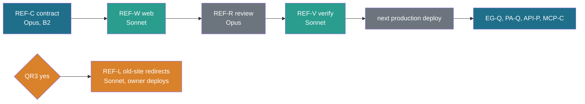

# Public ref aliases: no month and year in any public id

Status: **spec, planned** (REF-ALIAS-SPEC, travel-planner Opus, 27 Oct 2026). Tasks REF-C, REF-W, REF-V, REF-R, REF-L, REF-D
(section 9). BACKLOG 15.335. Owner questions QR1 to QR4 (section 11).

Source: owner ruling of 27 Oct 2026 on M2 of the contract-stack review
([review-contract-stack-2026-10-27.md](../build/review-contract-stack-2026-10-27.md) M2): capture refs that embed a dated trip
folder (`legacy/canadian-rockies-sept-2029/...`) must not be public. Refs get a public alias without the month, and the privacy
detector learns the pattern and fails on it.

**Supersedes:**
- [property-display-matrix.md](property-display-matrix.md) assumption E6 ("ids stay the capture refs; no new id scheme"), in part:
  public ids are the capture refs with the month removed from a dated folder segment. Internal ids are unchanged.
- Owner Q74 / D-B2 as written in `core/src/schema/api/common.ts` ("the capture ref verbatim"): the public `ref` is the capture
  ref through `publicRef()` (section 4). For every ref with no dated folder the two are identical.
- The review's either/or in M2 is settled as "private". PA-X's removal of `tripDetail.legacyUrl` and the comment at
  `core/src/parks/line.ts:8` were right.

Unchanged: [entity-graph.md](entity-graph.md) 4.4 rule 1 (a ref is opaque and stable, a rename is an alias) and the CLAUDE.md
gotcha "never rewrite capture refs". This spec adds a public alias and does not rewrite any stored ref.

## 1. Gotchas first

| # | Finding | Consequence |
|---|---|---|
| G1 | **The source repository `nitin27may/travel` is public** (GitHub API `private: false`, page answers 200 without login, `main` pushed at `7ba7efd2`). It holds every dated folder name, `legacy/<folder>/index.html` pages with full calendar dates ("1 Feb 2027", "11 Mar 2027"), `research/trips/README.md` with trip dates, and the git history | Aliasing the site hides the month from visitors and search engines, not from anyone who opens the repository. RELEASE-PLAN 7.4 still says "PUBLIC-AUDIT decides whether the repository goes public": that audit has not run. QR2 |
| G2 | **The old live site `nks-travel.pages.dev` links eight dated folders from its home page** (`/canadian-rockies-sept-2029/`, `/patagonia-feb-mar-2027/`, ...), and those pages print full dates | The largest public exposure today. Frozen until go-live (7.11); old Cloudflare deployments keep their paths. QR3 |
| G3 | **Production v0.1 (`travel-beta-tan.vercel.app`) already serves the dated ref.** `/places/banff-gondola/` has 7 hits; `/api/v1/places/banff-gondola/` has 15 `ref` values and one `refSlugs` key with `legacy/canadian-rockies-sept-2029/...` | This is a fix to production, the same class as PRIV-TD. It is urgent, and it goes ahead of the next contract task (section 8) |
| G4 | A naive detector pattern has a real false positive: a third-party source link, `https://on-top.ca/Outings/2022/Indefatigable-Bench-July-2022.html`, on a public place page | The rule skips absolute URLs to hosts that are not ours (section 6.1). Without this the first build after REF-C fails |
| G5 | Turning the detector rule on before the alias is applied turns K7 (contract kit) and the web privacy tests red on real data | REF-C and REF-W merge as one stack. `main` never holds one without the other (STACK-REVIEW S1 rule: run every task's checks on the merged tree) |
| G6 | `resolve` must not become an oracle. If `?ref=legacy/canadian-rockies-jan-2029/sights/bow-lake` answered "unknown" but `...-sept-2029/...` answered "current", twelve requests would reveal the month | A dated internal ref given as input answers exactly like any unknown string (section 5.3) |

## 2. What is sensitive, and where the line sits

| Form in an id | Example | What it tells a reader | Ruling |
|---|---|---|---|
| Full dates | `26 Feb - 11 Mar 2027` | when the household is away, to the day | private since 18 Oct ([public-trips-dateless](../design/public-trips-dateless.md)); scrubbed by `dateless.ts` |
| **Month and year** | `canadian-rockies-sept-2029`, `patagonia-feb-mar-2027` | the month the household plans to travel (or travelled). Combined with any slip of the home town, it is a window when the house is empty | **private (owner, 27 Oct 2026)**: this spec |
| Season and year | `vermont-fall-2026` | a season the public season band already states | public |
| Year only | `canadian-rockies-2029` (every public trip slug) | a year. With the public season band ("valid late February to mid-March") a reader can infer roughly the month | public (current slugs) |

**The honest gap.** A year in the slug plus the season band on the page is close to month and year. The line is still the right one,
for three reasons:
1. The page frames the season as when the trip works ("valid late Feb to mid-Mar"), not as when we go. A dated folder name says
   "we go in September 2029".
2. Moving the line to "no year" renames all 14 public trip slugs and their URLs, the sitemap and the slug registry history, for
   little gain.
3. The bigger exposures are G1 and G2, not the year.

**Recommendation:** keep the line at month and year. A year alone, or a season with a year, stays public. QR1 lets the owner move it.

The line in one sentence: **no public output holds a calendar month (or a pair of months) next to a year inside an identifier, a
path, a key or a URL of ours.** Prose dates are already handled by `dateless.ts`. This spec covers ids.

## 3. Inventory: every surface where a dated ref or folder name can appear

Evidence was gathered on 27 Oct 2026. Sources: `git grep` on `main` at `7ba7efd2`; the staged build `.site/` (built 11 hours
earlier, the production-shaped export view); `web/out` (21 Oct); and production v0.1 probed with curl.

Of the 14 legacy folders, eight carry a month: `algonquin-muskoka-oct-2026`, `canadian-rockies-sept-2029`,
`chamonix-mont-blanc-sept-2028`, `costa-rica-feb-2027`, `dolomites-july-2027`, `niagara-day-aug-2026`, `patagonia-feb-mar-2027`,
`quebec-sept-2026`. In data, only two appear inside record refs:
- `canadian-rockies-sept-2029`: 5,860 occurrences, 233 distinct ref strings;
- `dolomites-july-2027`: 5 occurrences.

| # | Surface | State | Evidence | Fixed by |
|---|---|---|---|---|
| S1 | Place page HTML: element ids (`Sections.tsx:150` `idOf`), React keys, props | **leak** | 80 place pages in `.site/`; 588 tokens, including `offer-legacy-canadian-rockies-sept-2029-...` ids; production `banff-gondola` 7 hits | REF-W (adapter alias) |
| S2 | RSC payloads (`index.txt`, `__next.*.txt`) | **leak** | 240 files in `.site/places/` | REF-W |
| S3 | `GET /api/v1/places/{slug}` (`placeDetail.ref`, section `ref`, `judgedRef`, access `ref`, relation links, `refSlugs` keys) | **leak** | production: 15 `ref` values, 1 key | REF-C `publicStore`, wired by REF-W |
| S4 | `GET /api/v1/places` rows (`placeRow.ref`), `nearby` rows, `movedPlace.ref`, `resolve` answer `ref` | **leak on next deploy** (the v0.1 rows have no `ref` yet; the current contract adds it) | `common.ts:28`, `place.ts:84,494,539`, `nearby.ts:115,135` | same |
| S5 | Exports: the `json` model (`exportLine.ref`, `placeLine.ref`, `exportBooking.ref`), and GPX, KML, CSV text | **leak** where an exported line or booking comes from a Rockies record | `export.ts:83,129`, `place.ts:270` | same (exports go through `respond`) |
| S6 | Trip pages, trip API, `legs` | clean | 0 hits on `.site/trips/*` and on production trip pages; PA-X removed `legacyUrl`; `PublicTrip.legacyUrl` stays server-side for `folderOf` | guarded by the scan (6.2) |
| S7 | Sitemap, search index (`web/public/search`), OG images, globe data (`web/public/globe`, `globe-data`), static JS chunks | clean | 0 hits in `.site/` and on production | guarded by the scan |
| S8 | Hosted MCP (MCP-C, MCP-G, bundle H): `exposure.ts` marks `refSlugs` and relation properties `mcp: public` | **future leak**: its tools derive from the API | `exposure.ts:51`, [mcp/tools-v1-from-api.md](../mcp/tools-v1-from-api.md) | MCP-C uses `publicStore` (stated in its brief by REF-D) |
| S9 | Local stdio MCP `core/bin/mcp.ts` | not public: the owner's research tool, which must see real refs to write records | | stays internal |
| S10 | Favourites (`favourites/1` in `localStorage`, `account_favourite` later), visitor copies, drafts | **future**: they store the public `ref` they were given | `core/src/schema/favourites.ts:70,80` | they receive aliases from S3/S4; REF-V counts dated refs in production account rows (expected 0) |
| S11 | `web/data-snapshots/snapshot-report.json` (dated refs in `where`) | not served (a build report, outside `public/`) | | repository only (G1) |
| S12 | `data/catalogue/slugs.json` keys, `data/catalogue/graph/*.json`, `data/trips/{covers,base-points,stop-refs}.json`, `web/lib/public/slugs.ts` `TRIP_SLUGS` | not served; read server-side | `.site/_next/static` 0 hits | the scan proves no client chunk carries them |
| S13 | Old live site `nks-travel.pages.dev` and its old deployments | **leak, largest** | home page links eight dated folders; pages print full dates | QR3, REF-L |
| S14 | The public GitHub repository and its history | **leak** | G1 | QR2 |
| S15 | Validator examples suggest a dated trip id (`core/src/validate/trip.ts:31,44` "niagara-day-aug-2026") | invites new dated ids | | REF-C: `E_SLUG` refuses month and year |

Already public and fine: the public trip slugs (`canadian-rockies-2029`, `patagonia-2027`, ...), which carry the year only.

## 4. The alias

### 4.1 Grammar and derivation

A **folder alias** maps one dated legacy folder name to the same name with its month token or tokens removed:

```
alias(F) = F with /-(MONTH)(-(MONTH))?(?=-(19|20)\d\d$)/ removed
MONTH    = jan|january|feb|february|mar|march|apr|april|may|jun|june|jul|july|aug|august|sep|sept|september|oct|october|nov|november|dec|december
```

| Folder | Alias |
|---|---|
| `algonquin-muskoka-oct-2026` | `algonquin-muskoka-2026` |
| `canadian-rockies-sept-2029` | `canadian-rockies-2029` |
| `chamonix-mont-blanc-sept-2028` | `chamonix-mont-blanc-2028` |
| `costa-rica-feb-2027` | `costa-rica-2027` |
| `dolomites-july-2027` | `dolomites-2027` |
| `niagara-day-aug-2026` | `niagara-day-2026` |
| `patagonia-feb-mar-2027` | `patagonia-2027` |
| `quebec-sept-2026` | `quebec-2026` |

Every alias equals that trip's pinned public slug in `TRIP_SLUGS` today, so a public ref names a trip by the name the site already
shows. A folder with no month (`iceland-ring-road`, `usa-southwest-rockies`, `vermont-fall-2026`, ...) is its own alias.

**`publicRef(s)`**: replace every whole-token occurrence of a pinned dated folder name in the string `s` with its alias. A token
boundary is any character outside `[a-z0-9]`, so the name is found inside `legacy/<F>/...`, `part/legacy/<F>/...#top`,
`offer/legacy/<F>/...#ticket`, `trip/<F>`, and a hyphen-folded element id `offer-legacy-<F>-...`. Strings without a dated folder
are returned unchanged. Every current page ref that is not a Rockies or Dolomites record is untouched, so no other public id
moves.

**`privateRef(s)`** (server-side only): the inverse, applied only after the layer prefix `legacy/`. The string
`legacy/<alias>/` becomes `legacy/<F>/`, including inside a `part/` or `offer/` wrapper. `trip/<alias>` is **not** inverted:
`trip/canadian-rockies-2029/...` is a real data-trip ref, and the `trip/<F>` keys in `base-points.json` are folder keys that are
never looked up from public input.

Properties, each pinned by a test:
- **total**: every ref in data has an alias;
- **injective**: `publicRef` maps distinct refs to distinct strings over every ref in `data/capture`, `data/suitability`,
  `data/relevance` and `data/catalogue/graph`;
- **invertible**: `privateRef(publicRef(r)) === r` for every `legacy/` ref;
- **idempotent**: `publicRef(publicRef(s)) === publicRef(s)`.

### 4.2 Stability: pinned, never recomputed

The table lives in the slug registry and is pinned at first write. The rule above writes an entry once. After that, the stored
alias is what counts, even if the rule or the trip's slug later changes. A later rename of the trip slug `canadian-rockies-2029`
(`slugs.ts rename`) does **not** change the folder alias. Public refs are ids, and ids never move (entity-graph 4.4 rule 1).

### 4.3 Where the mapping lives: one source of truth

`data/catalogue/slugs.json` gains one section, `trips.folderAliases`, with eight entries. It is written only by
`node core/bin/slugs.ts` and is "read by the dataset builder and the stores, never served" (the file's own note).

| Rule in `slugs.ts build --check` (runs in check-all) | Error |
|---|---|
| An existing entry changed or removed | `E_SLUG_ALIAS_PINNED` |
| An alias still matches the dated pattern (6.1) | `E_SLUG_ALIAS_DATED` |
| Two folders share an alias, or an alias equals another legacy folder's name | `E_SLUG_ALIAS_COLLIDE` |
| A dated legacy folder (in `legacy/MANIFEST.json`, or seen in a `legacy/<F>/` ref) has no entry | `E_SLUG_ALIAS_MISSING` (`build` writes it by the rule) |

`TRIP_SLUGS` in `web/lib/public/slugs.ts` stays the folder-to-trip-slug map for trip pages. A test asserts that each
`folderAliases` value equals `TRIP_SLUGS[F]` at the time it is pinned. It warns, and does not fail, if a later trip rename makes
them differ.

**No per-ref generated file.** A list of 233 ref-to-alias pairs would be a second copy of a pure function. The test in 4.1
enumerates them instead. Trade-off: a reviewer cannot read the full list in a diff. The test's failure message prints any pair it
rejects.

## 5. The exposure change

### 5.1 One function at each public boundary

Internal code keeps internal refs everywhere: the graph index, joins, sidecars, Neon `entity.id`, the seed and the validator.
`publicRef` is applied at the two data boundaries (P9) that produce public output, and nowhere else:

| Boundary | Where | What it covers |
|---|---|---|
| B1 `publicStore(store)` | new `core/src/catalogue/public-store.ts`: wraps every `CatalogueStore` method. Results go through `aliasDeep`, which rewrites string values **and object keys**. Ref-valued inputs go through 5.3 | every `/api/v1` body (`respond`), exports, `resolve`, and the hosted MCP when MCP-C builds on the store; both stores (JSON and Postgres), so the contract kit compares like with like |
| B2 the page adapter | `web/lib/public/index.ts`: the exported getters (place, trip, lists) return `aliasDeep(model)` | place and trip pages, RSC payloads, element ids and React keys (they are built from model fields), print and ICS views, and build-time files derived from the adapter |

Because keys are aliased together with values, `refSlugs[ref]` lookups in `PlacePage.tsx` and `summary.ts` stay consistent. In-page
anchors built from ids use the same aliased ref, so `#offer-legacy-canadian-rockies-2029-...` links still land.

### 5.2 What the contract says

| Contract item | Becomes |
|---|---|
| `apiPlaceRef`, `apiRef` (`common.ts`) | description: "public ref: the capture ref with any dated folder replaced by its alias (public-ref-aliases 4)". The regex refuses a dated folder (negative lookahead on the 6.1 pattern), so a schema parse in any test fails on a leaked ref. OpenAPI is regenerated (`openapi.ts --check`) |
| `favRef` (`schema/favourites.ts`) | the same refusal |
| `refSlugs` (`place.ts:533`, `exposure.ts` row `P`) | unchanged shape; keys are public refs |
| Relation properties (`part_of`, `covered_by`, `at`, ...; review S4) | unchanged by this spec. API-P still projects them as `{ slug, name }` (S4). Where a ref survives, it is public by B1 |
| Hosted MCP inputs and outputs | public refs only; `get_place`, `gap_report {ref}` and every ref input take the alias. MCP-C's brief names `publicStore` |
| Local stdio MCP, `ops.ts`, `capture.ts`, `graph.ts` | internal refs, unchanged |

### 5.3 Resolving a public ref on the server

`fromPublicInput(s)`, in `public-store.ts` and server-only:
1. If `s` matches the dated pattern (6.1), return "unknown". The answer is the same row shape, status and work as for a random
   string, so it is not an oracle (G6). Visitors never held a dated ref through a supported feature: favourites and copies are not
   live in production v0.1.
2. Otherwise return `privateRef(s)` and look it up as today.

`privateRef` and the folder table are imported only by server modules. The web module that reads the registry carries
`import 'server-only'`, and the output scan (6.2) fails if any client chunk holds a dated folder name.

### 5.4 Existing public URLs and ids

| What | Today | Handling |
|---|---|---|
| Place and trip URLs on v2 (`/places/<slug>/`, `/trips/<slug>/`) | undated | unchanged; no redirects needed. Only ids and keys inside the pages change |
| `ref` values served by production v0.1 (S3) | dated | they change to the alias at the next deploy. No known consumer: favourites and copies are not live, and the API has no registered clients. No redirect; a dated ref given as input answers "unknown" (5.3) |
| Search engines on v2 | they index visible text and URLs; the dated token sits in ids and RSC only | a recrawl replaces it; no removal request needed |
| Old site paths `nks-travel.pages.dev/<dated folder>/` (S13) | live, indexed, with full dates | QR3: a redirect-only deployment (301 from each legacy folder and its sub-paths to the v2 trip page), then delete the old Cloudflare deployments. Wayback copies cannot be recalled |
| `web/redirects.json` | holds no dated folder (the review's probe) | if REF-L adds legacy-folder redirects, they go in the old site's `_redirects` (not served as a file), never in a served v2 file |

## 6. The detector and the tests

### 6.1 The rule in `core/src/privacy/detect.ts`

```ts
/** A month (or two) next to a year inside an id, path, key or URL of ours (owner, 27 Oct 2026; public-ref-aliases 6.1). */
const M = "jan(?:uary)?|feb(?:ruary)?|mar(?:ch)?|apr(?:il)?|may|june?|july?|aug(?:ust)?|sept?(?:ember)?|oct(?:ober)?|nov(?:ember)?|dec(?:ember)?";
export const DATED_FOLDER = new RegExp(`(?<![a-z0-9])[a-z0-9]+(?:-[a-z0-9]+)*-(?:${M})(?:-(?:${M}))?-(?:19|20)\\d\\d(?![0-9])`, "i");
```

- `textHits` reads it on every string. **Before testing, it removes absolute `http(s)://` URLs whose host is not one of ours**
  (`OWN_HOSTS`: `nks-travel.pages.dev`, `travel-beta-tan.vercel.app`, the configured site origin; one list in
  `web/lib/config/product.ts`, passed in as `opts.ownHosts`, with the two current hosts as the default). G4's third-party link is
  skipped; a link to our old site's dated folder still fails.
- The key loop checks `DATED_FOLDER.test(k)`, with the path omitting the key, the same as `ORIGIN_REF` for `refSlugs`.
- Strings are also tested after `decodeURIComponent`, so `legacy%2Fcanadian-rockies-sept-2029` fails.
- The JSON-in-string walk (export bodies) already applies.
- Hit text: "a dated trip folder (month and year)". It never prints the value.

Everything that already calls `privacyHits` gets the rule with no further wiring: `respond()` (fails closed), K7 in the contract
kit, the MCP-public body check, and the web privacy tests.

### 6.2 Tests

| Test | Owner task | Checks |
|---|---|---|
| `core/test/catalogue/alias.test.ts` (new) | REF-C | 4.1 properties over all real refs; the eight pinned pairs; idempotence; `trip/<alias>` not inverted |
| `core/test/catalogue/slugs*.test.ts` | REF-C | the four `E_SLUG_ALIAS_*` errors on fixtures; the real registry passes |
| `core/test/privacy/detect.test.ts` | REF-C | hits: a raw ref, the `part/` and `offer/` wrappers, a hyphen-folded id, upper case, URL-encoded, a map key, inside a JSON export string, an own-host URL. No hit: the on-top.ca URL, `vermont-fall-2026`, `canadian-rockies-2029`, `2029-09` |
| `core/test/schema/*` | REF-C | `apiPlaceRef`, `apiRef` and `favRef` refuse a dated ref; `openapi.ts --check` |
| `core/test/favourites/resolve.test.ts` | REF-C | an alias resolves; a dated internal ref answers byte-for-byte like an unknown string |
| `core/test/catalogue/contract/*` (K7) | REF-C | green on both stores through `publicStore` |
| `core/test/validate/*` | REF-C | `E_SLUG` refuses a trip id with month and year |
| `web/tests/data/dated-refs-output.test.ts` (new) | REF-W | over `builtOutDir()` (html, RSC `.txt`, `_next/static` js, json, xml, svg), `web/public/**`, and the body of every `/api/v1` endpoint for every place and trip slug plus every export format per trip: 0 `privacyHits` of the new kind, and **0 case-insensitive occurrences of any pinned dated folder name** (the exact list from the registry, no URL exemption). The pattern catches future names; the exact list catches the known ones with no false negatives |
| `web/tests/data/origin-refs.test.ts` | REF-W | every page ref is public (`publicRef(r) === r`) and still distinct (431) |
| e2e `places` | REF-W | an in-page anchor to an offer row on `banff-gondola` scrolls to the row |

The R1 and AU audit greps (`audit-R1-output.md` "Dates" line) gain the 6.1 pattern. REF-D makes that edit.

## 7. Principles

| Principle | How this spec meets it |
|---|---|
| P8 protect the catalogue | no new public file; the alias table is server-only; no bulk list of refs is published |
| P9 server-ready | one function at the two existing data boundaries (store and adapter); no client-side map; no new client bulk load |
| P1, P2, P3, P6, P7 | no visible change; ids and keys only |
| P4 no manual | nothing to learn: URLs are unchanged |
| P5 smooth | in-page anchors keep working (acceptance A8) |
| T3 trust | unchanged |

## 8. Order against the contract chain

The shared contract files are `common.ts`, `favourites.ts`, `detect.ts` and `slugs.ts`, plus a new core file. MASTER-ORDER 4.3
says one author at a time, in the B2 seat.

- **Slot:** REF-C is the **next B2 contract task**, ahead of REQ-RF-C, EG-Q and OVR-Ca in 4.3 row 4. Reasons: it fixes a
  production leak (G3), like PRIV-TD in row 2; it is small; and EG-Q, PA-Q, API-P and MCP-C all publish more refs (review: "M2
  blocks API-P and PA-Q").
- **REF-W** starts in the web seat from REF-C's branch. It must not overlap a web lane that edits `web/lib/public/index.ts`,
  `web/lib/server/store.ts` or `web/lib/public/slugs.ts`. UXB-3 is in flight: check its file list first, and start after it merges
  if they share a file.
- **One stack:** REF-C, then REF-W, merged together. The merge runs `check-all`, `capture.ts build --check`,
  `graph.ts build --check`, `openapi.ts --check`, and core and web vitest on the merged tree (G5).
- **Then:** REF-R (review), REF-V (verify), then the next production deploy. After that, EG-Q, PA-Q, API-P, PA-W and MCP-C build
  on `publicStore` and inherit the rule.
- PA-W is not blocked: it fills `tripDetail.parks` with names and slugs, never refs.



## 9. Tasks

| Task | What | Model | Hours | Depends on |
|---|---|---|---|---|
| REF-C | Contract: `alias.ts`, `public-store.ts`, `folderAliases` and its checks, detector rule, schema refusals and OpenAPI, resolve input, `E_SLUG` dated rule, `common.ts` comment (Q74 wording) | Opus (shared contract) | 4 | none; next in the B2 seat |
| REF-W | Web: the adapter wrap, the store wrap, a `server-only` registry read, the output-scan test, the `origin-refs` update, the anchor e2e, screenshots, budget report | Sonnet | 5 | REF-C (same stack) |
| REF-R | R4 review of the stack (privacy) | Opus | 1 | REF-W |
| REF-V | Fresh build; the scan; a local `next start` curl sweep of every endpoint and slug; count dated refs in production account rows (read-only); production probe after deploy | Sonnet | 1.5 | REF-R |
| REF-L | If QR3 is yes: the old site's `_redirects`, generated from `TRIP_SLUGS` (each legacy folder and its sub-paths, 301 to the v2 trip page). The owner deploys it and deletes the old deployments (O-REF1). No `publish.sh` deploy mode is run by an agent | Sonnet | 2 | QR3, v2 go-live host fixed |
| REF-D | Docs: PLAN R row and the Q74 note; MASTER-ORDER 4.3 slot; the MCP-C brief names `publicStore`; the R1/AU audit grep; features/README row; CLAUDE.md gotcha line "dated refs never leave the server; the public form is `legacy/canadian-rockies-2029/...`" (owner edits CLAUDE.md) | Haiku | 0.5 | this spec |

Total: **14 h** (Opus 5, Sonnet 8.5, Haiku 0.5). REF-L is conditional (2 of the 14).

## 10. Briefs

### 10.1 REF-C (Opus, B2 seat)

**Goal.** Public ids never hold a month next to a year. Add the alias, the server-side resolver, the pinned table, the detector
rule and the schema refusal, without rewriting any stored ref.

**Owns:**
- `core/src/catalogue/alias.ts` (new)
- `core/src/catalogue/public-store.ts` (new)
- `core/src/catalogue/slugs.ts`, `core/bin/slugs.ts`
- `data/catalogue/slugs.json` (through `slugs.ts` only)
- `core/src/privacy/detect.ts`
- `core/src/schema/api/common.ts`
- `core/src/schema/favourites.ts`
- `core/src/favourites/resolve.ts`
- `core/src/validate/trip.ts` (the `E_SLUG` rule and its example strings)
- the generated OpenAPI file that `openapi.ts` writes
- tests under `core/test/{catalogue,privacy,schema,favourites,validate}/` named in 6.2

**Must not touch:**
- `web/**`, `legacy/**`
- `data/capture/**`, `data/suitability/**`, `data/relevance/**`, `data/catalogue/graph/**` (refs stay as they are)
- `core/src/catalogue/store.ts`, `core/src/schema/api/{place,trip,export}.ts`
- `core/src/schema/capture/properties.ts`, `core/src/schema/exposure.ts`
- `research/**`, the notes vault

**Steps:**
1. Write `alias.ts`: `DATED_FOLDER_RE`, `aliasOfFolder`, `publicRef`, `privateRef`, `aliasDeep` (values and keys). These are pure
   functions that take the folder table.
2. Add `trips.folderAliases` and the four `E_SLUG_ALIAS_*` checks to `slugs.ts`. Run `slugs.ts build`, then
   `build --check`.
3. Write `public-store.ts`: wrap every `CatalogueStore` method (output `aliasDeep`; ref inputs through `fromPublicInput`, 5.3).
4. In `detect.ts`, export `DATED_FOLDER`, read it in `textHits` (after the not-ours URL strip and a decode) and on keys, and add
   `opts.ownHosts`.
5. Add the dated refusal to `apiRef`, `apiPlaceRef` and `favRef`. Rewrite the Q74 comment. Regenerate OpenAPI.
6. Make `resolve.ts` treat a dated input as unknown.
7. Add the `E_SLUG` dated rule and fix the example strings.
8. Run the tests in 6.2. The contract kit K7 runs through `publicStore`.

**Acceptance:**
- A1 (4.1 properties)
- A2 (the four registry errors)
- A3 (detector hit and no-hit lists)
- A4 (schema refusal, `openapi.ts --check`)
- A5 (K7 green on both stores)
- A7 (no oracle)
- A11 (`E_SLUG`)

**Verification:**
- `pnpm -r exec tsc --noEmit`
- core vitest
- `bash tools/check-all.sh`
- `capture.ts build --check`, `graph.ts build --check`
- No UI change, so no screenshots in this task.

**Commit:**
- Branch `public/REF-C` from `main`.
- `git -C <worktree> add <owned paths>`; never `-A`.
- Message `core(REF-C): public ref aliases, no month and year in any public id`, with the trailers `Co-Authored-By`,
  `Task: REF-C`, `Model: opus`.
- Do not merge alone (G5).

### 10.2 REF-W (Sonnet, web seat)

**Goal.** Every page and API body is public by construction, and a test over the built output proves it.

**Owns:**
- `web/lib/public/index.ts` (the getters return `aliasDeep`)
- `web/lib/server/store.ts` (`publicStore(getStore())`)
- `web/lib/public/slugs.ts` (reads the folder table through a `server-only` module)
- `web/tests/data/dated-refs-output.test.ts` (new)
- `web/tests/data/origin-refs.test.ts`
- one e2e spec for the anchor
- `web/tests/data/place-html-baseline.json`, only if the median falls (a ratchet down, never up)

**Must not touch:**
- `core/**` (ask REF-C for any change)
- `web/components/**`, unless an id is built from something other than the model (expected: none; `Sections.tsx` reads
  `o.ref`, which is already aliased)
- `legacy/**`, `data/**`

**Steps:**
1. Wrap the adapter getters and the store.
2. Run a fresh `pnpm --dir web build`. Grep `.next` served files and confirm 0 dated names.
3. Write the output-scan test (6.2) and update `origin-refs`.
4. Write the anchor e2e.
5. Run `budget:report` before and after, in both builds.
6. Take screenshots.

**Acceptance:**
- A6 (the scan)
- A8 (anchors and screenshots)
- A9 (the place HTML median is not up)
- A10 (all checks on the merged REF-C+REF-W tree)

**Verification:**
- `tsc`; web and core vitest; check-all.
- Playwright screenshots of `/places/banff-gondola/` and `/places/johnston-canyon/` at 1440 and 390, light and dark, saved to
  `web/test-results/shots/` (gitignored). Expect them to match the pre-change shots.
- Quote the `privacyHits` count from the scan.

**Commit:**
- Branch `public/REF-W` from `public/REF-C`.
- Add only owned paths; never `-A`.
- Message `web(REF-W): pages and API serve public refs only`, with the trailers and `Model: sonnet`.

### 10.3 REF-V (Sonnet, verifier)

Fresh clone of the merged stack, then:
1. Run the full check chain.
2. On a local `next start`: curl every `/api/v1` endpoint for every slug and every export format. Run the same output scan
   independently with the exact folder list.
3. Run read-only SQL counts of dated refs in production `planner_draft`, copies and favourites rows. Report counts only, never
   values.
4. After the owner deploys, probe production the same way (G3's two URLs must show 0).

Hand back the counts.

## 11. Owner questions

| Id | Question | Recommended answer | If the other answer |
|---|---|---|---|
| QR1 | Keep the line at **month and year** (private), with a year alone and a season with a year (`vermont-fall-2026`) public? | **Yes.** The page's season band already says the season; dropping the year renames 14 public URLs for little gain | "No year either": add TRS-Y (rename 14 trip slugs, retire the old ones in the registry, 301s; about 4 h Sonnet + 1 h Opus) before go-live |
| QR2 | The source repository is **public now** and holds every dated folder, full dates in `legacy/*.html` and `research/trips/README.md`, and the history. Make it **private** until PUBLIC-AUDIT has run? | **Yes, private now.** It is the only step that closes the larger leak today. CI on a private repository costs about 10 to 15 minutes a run against the free 2,000 a month (RELEASE-PLAN 7.4). Going public later means a scrubbed history (a fresh repository from a cleaned tree), because a rename does not remove history | Keep it public: accept that this spec protects visitors and search engines only, and record the accepted risk in PLAN section 1 Privacy |
| QR3 | Replace the old site with a **redirect-only deployment** (301 from each legacy folder to its v2 trip page) and **delete the old Cloudflare deployments**, as soon as REF-W is in production, rather than at go-live? | **Yes.** The v2 trip pages are dateless and live today. The old pages print full dates, and old deployments keep their paths until deleted | Leave it to go-live (7.11): the full dates stay public until then |
| QR4 | Does a dated ref given as input (`resolve`, the future MCP) answer "unknown" rather than mapping to the alias? | **Yes, "unknown".** Mapping it would let a stranger test months one by one (G6). No visitor holds a dated ref through a supported feature | Map it: accept the oracle, and limit it with the `/api/v1` rate limit only |

## 12. Change log

| Date | Change |
|---|---|
| 2026-10-27 | First version (REF-ALIAS-SPEC): inventory S1 to S15, alias grammar, pinned table, `publicStore` and adapter boundaries, detector rule with the not-ours URL exemption, tests, order (next in B2), tasks REF-C to REF-D (14 h), QR1 to QR4 |
