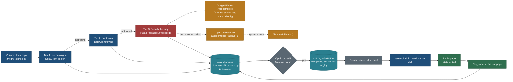

# Requests and custom places: what a visitor can ask for, and what they can add to their own copy

Status: **spec, planned only** (25 Oct 2026, travel-planner, Opus). Requirements PLAN R-170 to R-177, BACKLOG 15.170 to
15.179, owner questions Q210 to Q218 (**all answered 25 Oct 2026: Q210 changed, Google Places is the primary place search, ORS and Photon the fallback; Q211 to Q218 yes, as recommended**). Nothing here is built. This page is a **gap analysis first**: most of what the owner
asked for is already specified, and this page links to it rather than repeating it. It adds only what is missing.

Related, and the authority for everything this page links to:
[visitor-suggestions-and-favourites.md](visitor-suggestions-and-favourites.md) (R-70 to R-75),
[feedback-and-reports.md](feedback-and-reports.md) (R-90 to R-96, the one intake model),
[trip-overview-and-customisation.md](trip-overview-and-customisation.md) (R-62 to R-67, CUS-C, `trip-custom/1`),
[navigation-and-mine.md](navigation-and-mine.md) (R-160 to R-164, `copies/1`, Mine),
[stay-bases-and-optimisation.md](stay-bases-and-optimisation.md) (R-76 to R-80, the `stays` operations),
[mcp/auth-and-sign-in.md](../mcp/auth-and-sign-in.md) section 14 (R-150 to R-156, access levels, the owner as admin),
[L5-copy-export-share.md](../build/public-site/L5-copy-export-share.md) (copy, export, share),
[nearby-and-regions.md](nearby-and-regions.md) section 6 (the smart trip builder, R-38),
[F06](F06-plan-document-lists-and-days.md) (the planner's add box and custom items),
[map-stack-2026-10-18.md](../../../research/reports/map-stack-2026-10-18.md) (Google terms), principles P1 to P9 in
[principles.md](../design/foundation/principles.md).

> **Fields amended 25 Oct 2026:** what each request form asks (trip, place, improve, report, custom-stop suggestion),
> the Where block, the detail score and the research-ready brief are in [request-intake-fields.md](request-intake-fields.md)
> (PLAN R-190 to R-196). Sections 2.3 and 2.4 here stay; 2.3's "What we already have" also works by region there.

## The owner's request (25 Oct 2026, a reviewer asked whether these exist)

> A. Request a new trip ("plan India for 15 days, where should I go"). B. Request an enhancement to an existing trip
> (change days, add a stop, more detail). C. Request more detail for an existing location or trail. D. Request a missing
> location, trail, hike or activity to be added, to a trip or on its own. E. Customising a copied trip (reorder, drop, add,
> change dates) and copying a trip; personal flavour after copying. F. While customising, add something that is not in
> our list: first pick from our places, trails and hikes; if not found, a Google Maps style predictive place search lets
> the visitor add it to their own copy anyway. G. Whatever the visitor adds that we do not have goes to an admin queue as
> a suggestion for approval; once approved (via the `location` and `research` skills) it becomes available to everyone;
> the submitted details (name, coordinates, link, note) seed the research. H. The admin side: queue, dedupe, approve,
> reject, merge, notify the requester, credit rules, and how MCP admin levels and the owner-as-admin decision fit.
> I. Any other flow worth listing.

## 1. Traceability: what exists, what is partial, what is missing

Checked on `main` 5eb5beb. "Exists" means specified with a task, not built; nothing in this table is built yet except
the copy sheet (L5).

| Item | Verdict | Evidence (row and spec section) | What is missing | Filled by (this page) |
|---|---|---|---|---|
| **A. Request a new trip** | **PARTIAL** | R-73 and BACKLOG 15.73: "Ask us to plan a trip" with destination, length, months, party chips, note ([visitor spec](visitor-suggestions-and-favourites.md) 5.2); R-91 makes it type `trip` in the one intake model and lets confirmed guests ask ([feedback spec](feedback-and-reports.md) 1.1, Q137); status in the account (feedback 3.5, 7.4); clustering by normalised destination and country (visitor 5.3). Self-serve "where should I go" is the smart trip builder, R-38, planner phase ([nearby spec](nearby-and-regions.md) 6) | (1) The visitor asking "where should I go" gets nothing back at once: the form answers "exists" only for an exact trip name. (2) A country-level destination ("India") is not mapped to a country code, so requests for one country do not cluster. (3) The expectation that we do not reply with personal advice is not written down | Section 2.3: the sent step shows "What we already have in India" (public trips and places, light rows); the destination resolves to a country; Q217 records "no personal advice" |
| **B. Request an enhancement to an existing trip** | **PARTIAL** | R-91 reports on `trip`, `trip_day`, `trip_stop` with reason `missing_info` (feedback 1.2, 1.3); the trip day menu entry (feedback 1.4) | Enhancement is not a problem. The reasons list has no "a longer version", "a shorter version", "add this stop", "another season" or "more detail on this day". Reports are triaged as defects (feedback 7.2), not as research demand | Section 2.1: a fifth intake type `improve` ("Suggest an improvement") with its own reasons, entry points and demand clusters |
| **C. More detail for a location or trail** | **PARTIAL** | R-91 reason `missing_info` on `place`, `trail`, `offer`, with the section preselected from the nearest `h2[id]` (feedback 1.4); "Not checked yet" markers stay visible (P2, PLAN section 1 Honesty) | No "ask us to check this" path from a gap; requests for detail are not counted per section, so they cannot feed the DATA batch order | Section 2.2: `improve` with reason `more_detail` and a section picker built from the page's own headings (+0 B); demand counts per target and section in `intake.ts stats --demand` |
| **D. Missing location, trail, hike or activity** | **PARTIAL** | R-72 "Suggest a place", kinds trail, lake, waterfall, viewpoint, sight, activity, town, stay, other (visitor 5.1); R-91 type `place`, trail preselected from a trail context (feedback 1.1); public duplicates answered, private never revealed (visitor 5.3, PRIV1) | "To a trip": a suggestion cannot name the trip and day it is for. A suggestion has no machine-readable source id, so research starts from a typed name | Section 2.4: optional `for_trip`, `for_day` and `source_ref` on the `place` type |
| **E. Copy and customise a copied trip** | **PARTIAL** | Copy with dates, travellers, profile, variants, additions (L5, `CopySheet.tsx`); device copies in Mine with Change dates and Remove (R-162, [nav spec](navigation-and-mine.md) 3); signed-in customised copy at `/t/<id>/` with add, remove, move to another day, Maybe, variant, window, reset, undo and autosave (R-65, [overview spec](trip-overview-and-customisation.md) 5.2 to 5.6); stays tweaks (R-79, [stay spec](stay-bases-and-optimisation.md) 8.2) | Reorder within a day; add or drop a whole day (the trip's length); a private note on a day or a stop; a title for the copy inside the copy; change the start date from inside `/t/<id>/` (the `start` field exists since NAV-C, no control) | Section 3: four operations added to `trip-custom/1` (`moved`, `days`, `notes`, `title`) and their UI (REQ-E) |
| **F. Add something not in our list** | **MISSING** (catalogue part PARTIAL) | Catalogue additions from the overview's Also researched and Nearby scopes and the timeline's "Add to Day N" (overview 5.2, 5.3); `trip-custom/1` `added` holds "catalogue refs, never names" (overview 5.6); "Only places are added" (overview 5.2); the planner's add box with "Add as my own" is F06 item 4, planner era | (1) No search box in the copy to add **any** public catalogue place, only the two scoped lists. (2) No custom stop: nothing outside the catalogue can enter a copy. (3) No predictive map search and no provider decision for one | Section 4: a three-tier picker (our catalogue, our towns, then a map search through our server), the `custom` operation, and the provider decision: openrouteservice autocomplete with Photon as fallback, never Google Places, never Nominatim for type-ahead |
| **G. Additions go to an admin queue, then to everyone** | **PARTIAL** | The intake queue, `intake.ts brief` to `research/inbox/`, the `research` then `location` skill, `added` with the public ref (visitor 9.1, 9.2; feedback 7.2, 8); a pin is a hint only (visitor 6.5); visitor text fenced as untrusted (R-96) | No link from a custom stop to a suggestion; no rule for when a custom stop becomes a suggestion (privacy: a home or a friend's cabin); the picked map object's OSM id is not carried into the brief as a lookup key; the requester's copy is not offered our catalogue page once the place is added | Section 5: opt-in rules by category, `source_ref` in the brief, the upgrade offer in the copy (client-side; no admin write into private drafts) |
| **H. The admin side** | **PARTIAL** | Queue and states (feedback 2.3, 7.1), dedupe against public and private (visitor 5.3, feedback 6.3), approve and reject (`decide`), merge as `duplicate` and `--cluster` (feedback 7.1, 7.5), notify (outcome mail Phase 2, account status Phase 1; R-94), credit: none in public (Q107), console later (INT-5); the owner is the admin by verified email `nitin27may@gmail.com`, role on the user id, bootstrap by CLI (MCP spec 14.2a); capability `review` already names "visitor submissions" (MCP spec 5.1) | Dedupe by OSM id; a `--from custom` view; who the admin is for the console (INT-5 and PHO-1 say "F17 roles", MCP-G builds the owner role: two names for one thing); no MCP tool reads the intake queue; no private credit line for the requester | Section 6: one owner role for CLI, console and MCP; dedupe by `source_ref`; MCP intake tools later (REQ-M, `owner_admin` only, no contacts); "You suggested this" in the requester's own list |
| **I. Other flows** | mostly **EXISTS** | Report wrong data (R-91), duplicates and spam (R-74, R-93), rate limits (R-74, R-93), status tracking (feedback 3.5), outcome mail (R-94, Phase 2), privacy takedowns (feedback 6.6), export and delete (F17, feedback 5.2), withdraw (feedback 2.3) | A link from Mine to "Your requests"; an address warning on custom stops; deleting a custom stop with a linked suggestion; "me too" is implicit only | Section 7: one line each, with a recommendation |

## Decisions

| ID | Decision | Why | Trade-off |
|---|---|---|---|
| RQ1 | **A fifth intake type `improve` ("Suggest an improvement")**, not more report reasons | A request for more is research demand, not a defect: different copy, quotas, triage and outcome words (P4); the union in FBK-C is not built yet, so it costs one branch now and a migration later | One more branch to test in `submissionInput` |
| RQ2 | **No personal trip advice.** A trip request is a vote for research (visitor 5.2); the sent step shows what we already have for that destination | One person runs this; personal replies do not scale and set an expectation we cannot meet | A visitor asking "where should I go" gets our catalogue, not an opinion |
| RQ3 | **Custom stops live only in the signed-in private copy** (`trip-custom/1` operation `custom`), never in device copies (`copies/1`) | The copy is RLS-protected and per user; device copies are snapshots and Q68 (guest planning) is open; the geocoder runs behind a per-account quota | Signed-out visitors cannot add a place we do not have |
| RQ4 | **The picker searches our catalogue first, then our towns, then the map**, and the map tier is an explicit step ("Not in our list? Search the map"), not every keystroke | P7: the catalogue is the product; it saves the free geocoder quota; it keeps the honest data first | One more tap for places we do not have |
| RQ5 | **Map search provider (owner, 25 Oct, Q210): Google Places Autocomplete through our server is primary; openrouteservice, then Photon, is the switchable fallback; never Nominatim for type-ahead** (section 4.3). Supersedes the first draft's "never Google Places" | Best coverage of shops and restaurants for 10 to 20 users inside Google's free monthly usage; the owner accepts a billing account. Google's terms still hold: store only `place_id`, no Google names or coordinates in our data, no Google results on MapLibre maps, research never takes coordinates from Google | A billing account with a capped exposure; Google rows have no distance, category or point; two sets of terms; the fallback keeps the feature alive if Google causes trouble |
| RQ6 | **A custom stop is the visitor's data; a suggestion is a separate intake item** created only through the opt-in in section 5.1 | Privacy: a home, a friend's cabin or a private meeting point must never reach our queue by default | Some real places are not suggested because the box was unticked |
| RQ7 | **Opt-in default by category:** ticked for public points of interest (nature, trails, viewpoints, parks, sights, attractions), unticked and hidden for addresses, houses, streets and lodging | Honours the owner's "whatever the visitor adds goes to the queue" for public places; never sends an address | A rule table to keep; a public place mis-tagged as an address is not suggested |
| RQ8 | **The point in a copy never comes from Google; it may come from the visitor or from OSM (fallback, ODbL). The catalogue's point never comes from the geocoder.** Research re-derives every point from an allowed source; the `place_id` or OSM id from the picker is a lookup key, not a value | The research rule (every point has a `point_source`; never from Google; the visitor is never the source) stands; an OSM id is still a much better seed than a typed name | Research still has to read OSM itself |
| RQ9 | **The upgrade to our page is offered in the copy, never applied by the admin.** When the linked suggestion becomes `added` or a public `duplicate`, the copy shows "Use our page" | No admin or job ever writes into a person's private draft (RLS owner predicate, F17 two walls) | The visitor must accept once |
| RQ10 | **One owner role for the CLI, the console and MCP**: the `app_user` owner row bootstrapped by MCP-G's CLI from the verified `OWNER_EMAIL` account (MCP spec 14.2a) | "F17 roles" in INT-5 and PHO-1 and "admin role" in MCP-G are the same thing; one row, one bootstrap, one audit | INT-5 and PHO-1 wait on MCP-G's bootstrap, not on the whole of F17 |
| RQ11 | **The CLI stays the admin tool until the console;** MCP intake tools come after MCP-3 and MCP-S, at `owner_admin`, without contact data | The CLI works today on the owner's connection; MCP adds a remote attack surface to the most sensitive table (contacts) | The owner moderates from the Mac until then |
| RQ12 | **No public credit** (Q107 stands); the requester sees "You suggested this" in their own list | No PII in public output, no spam incentive | Contributors get no public recognition |



## 2. Requests: the gaps in A to D

### 2.1 `improve`: suggest an improvement (B)

One new branch in FBK-C's `submissionInput` union and one new card in the sheet's step 1 ([feedback spec](feedback-and-reports.md)
2.2). Everything else (guards, email, quotas, states, CLI, brief safety) is the feedback spec, unchanged.

| Target kind | Reasons, most likely first | Extra field |
|---|---|---|
| `trip` | `add_stop` (A stop we should add), `longer_version` (A longer version), `shorter_version` (A shorter version), `other_season` (A version for another season), `more_detail` (More detail), `other` | `add_stop`: a name (2 to 120) or a public place ref chosen from the catalogue search inside the sheet; `longer_version` and `shorter_version`: a length chip (day trip, weekend, 3 to 5 nights, about a week, two weeks or more; visitor 5.2); `other_season`: month chips |
| `trip_day` | `add_stop`, `more_detail`, `other` | as above; "Which stop?" is not asked |
| `trip_stop` | `more_detail`, `other` | none |
| `place`, `trail`, `offer` | `more_detail`, `other` | section (2.2) |
| `stay_base` | `more_detail`, `other` | none |

- Note: 0 to 1,000 characters, optional for `more_detail` with a section and for `add_stop` with a catalogue ref, required
  (10 or more) otherwise. At most 1 URL.
- States: as reports (feedback 2.3). `fixed` shows as **Done** with the page link; `added` (a stop now in the trip) as
  **Added**; `no_change` as **Not this time** with a fixed reason (not enough sources yet, out of scope, the plan is full).
- Cluster key: `(target_ref, reason, section or day_n)`. Ten requests weigh the same as one for content (K8), but the
  count orders the owner's research list (2.2).
- Quotas: the report buckets of feedback 6.2 (per sender per target 2 to 5 a day; open at once 5 to 25).
- Copy: card "Suggest an improvement: a stop to add, more detail, a longer or shorter version"; sheet title "Suggest an
  improvement"; sent "Thanks. Requests like this decide what we research next. We can't do every one."

### 2.2 More detail on a place or trail (C)

- Entry: the existing place entries (feedback 1.4: the sources-line link, the footer); the sheet offers **Report a
  problem** and **Suggest an improvement**. Choosing More detail shows a section picker built **in the browser** from the
  page's existing `h2[id]` headings, with the section nearest the top of the viewport preselected. No new server bytes on
  the place page (+0 B; 19 B of headroom, visitor spec 18).
- No per-marker "Ask us" link on each "Not checked yet" line: it would cost bytes on every gap and add noise (P2). The
  section picker marks sections that hold a "Not checked yet" line with the honesty marker's label, read from the DOM.
- Owner view: `intake.ts stats --demand` lists open `more_detail` clusters by target and section with counts, so the
  coordinator can turn a cluster into a DATA batch row ([briefs/DATA.md](../build/public-site/briefs/DATA.md); feedback 7.2
  "many reports on one area").

### 2.3 Trip requests answer with what we have (A)

- The destination field resolves on the client through the existing parser (`/api/v1/parse`) to a country, region, town
  or area when it can; the resolved `cc` is stored in the existing `country` column so requests for one country cluster
  (visitor 5.3). Unresolved text is kept as typed.
- The sent step (feedback 3.1 step 4) adds one block when the destination resolved: **"What we already have in India"**:
  up to 3 public trips and 3 places through `DataClient` (`trips` and `places` list methods with the country filter,
  light rows, P8), each a link; and, when nothing matches, "We have nothing in India yet. Your request counts." No new
  endpoint, no bulk load (P9).
- The form's intro says what a request is (visitor 14, unchanged) and, new: "We don't reply with personal advice."

### 2.4 A missing place, for a trip or on its own (D)

Three optional fields on the `place` type, added in FBK-C before the intake migration exists:

| Field | Rule | Set by |
|---|---|---|
| `for_trip` | a public trip ref that resolves (`resolveRefs`); else dropped, same answer (PRIV1) | the sheet when opened from a trip page or a copy |
| `for_day` | 1 to 60, only with `for_trip` | the day menu, or the custom stop's day |
| `source_ref` | `osm:node/<id>`, `osm:way/<id>`, `osm:relation/<id>`, `geonames:<id>` or `pelias:<gid>`, at most 120 characters, pattern-checked, never fetched by the route | the custom stop's picker (5.1); never typed by a visitor |

`kind_hint` keeps the visitor spec's list; "hike" maps to `trail`, an operator activity to `activity`. When `for_trip`
is set and the place is added, the owner decides whether the trip's plan or its Also researched scope gains it; the
requester's copy gets the upgrade offer either way (5.3).

## 3. Customising a copy: the gaps in E

What exists stays as written (overview 5.2 to 5.6, nav 3 and 4, stays 8). Four operations are added to `trip-custom/1`,
validated by the same Zod schema in CUS-C, each with an inverse for undo (overview 5.5):

```jsonc
{
  "schema": "trip-custom/1",
  "title": "Rockies with the Shahs",                          // 1 to 80, the copy's own name; default the trip title
  "moved": [ { "op": "o-12", "item": "d5-b-3", "day": 5, "after": "d5-b-1" } ],    // reorder in a day or across days
  "days":  [ { "op": "o-13", "kind": "insert", "after": 6 },                     // a free day after Day 6
             { "op": "o-14", "kind": "drop", "day": 11, "items": "maybe" } ],    // its items go to Maybe, never lost
  "notes": [ { "op": "o-15", "on": "day:5", "text": "Pack the bear spray" },
             { "op": "o-16", "on": "item:d5-b-3", "text": "Ask about the shuttle" } ],
  "custom": [ /* section 4.4 */ ]
}
```

| Action | Where (in `/t/<id>/`) | Effect and warnings |
|---|---|---|
| Reorder in a day | drag handle on the timeline entry (dnd-kit, tech.md) and the keyboard "Move up" and "Move down" in the entry menu | the scheduler re-flows the day; fixed-time entries (a booked slot, `pinned`) do not move and the move is refused with the reason ("Spirit Island cruise is booked for 10:00") |
| Add a day | "Add a free day after Day 6" in the day menu | days renumber; later dates shift by one in exports; the stays evaluator counts one more night at that base ([stay spec](stay-bases-and-optimisation.md) 9.4) and says so |
| Drop a day | "Remove Day 11" in the day menu, with a confirm naming what moves | its items go to Maybe; bookings on that day are listed ("This day holds a booking: Maligne Lake cruise"); days renumber; undo |
| Notes | "Add a note" on a day header and in an entry menu; at most 500 characters, 100 notes per copy | private, shown only in the copy and the visitor's own exports and print |
| Title | the copy's header, inline rename (`plan_draft.title` is the stored copy; `title` in the doc keeps exports in step) | Mine › My trips shows it |
| Change dates | the copy's header date chip opens the copy sheet's date step (OVR-1 owns that step), writing `start` (NAV-C field) | sun times, closures and booking windows re-run, as on the public page |

Rules: every operation is one step in undo; a stale revision re-applies on conflict (overview 5.5); the existing "2 of
your changes no longer apply" message (overview 5.4) covers moved and noted items that disappear from the template. A
day count change never edits the public trip. The F12 conversion later maps `days` and `notes` onto `trip_item` and day
rows; nothing needs reshaping.

## 4. Adding a place we do not have (F)

### 4.1 The picker

One **Add a place** control on each day of the copy and in the overview's toolbar (inside the copy only). It is a side
sheet on desktop and a bottom sheet on phone (components 5.1, 5.5), in its own lazy chunk.

```
Desktop 1440, the copy of the Rockies, Day 5 (side sheet, 460 px)
┌──────────────────────────────────────────────┐
│ ADD A PLACE · DAY 5 · JASPER               ✕ │
│ [ pyramid                                 ]  │  focus on open; 16 px text
│                                              │
│ OUR PLACES                                   │  tier 1: catalogue, as you type
│  ▣ Pyramid Lake · lake · 7 km N · 15-30 min ≈│  photo thumb, kind, band from the base
│  ▣ Pyramid Island trail · trail · 7 km N     │
│ OUR TOWNS                                    │  tier 2: towns layer
│  ◦ (none)                                    │
│ ──────────────────────────────────────────── │
│ Not in our list?  [ Search the map ]         │  tier 3 only on this press
│                                              │
│ Add "pyramid" as my own stop, no location    │  always available
└──────────────────────────────────────────────┘

After "Search the map"
│ ON THE MAP                       near Jasper │
│  ◦ Pyramid Lake Road, Jasper, AB             │  address-like: no suggestion (5.1)
│  ◦ Pyramid Stables, Jasper, AB               │  Google rows: text only, no distance, no map
│  ◦ Pyramid Mountain, Jasper, AB              │
│ Powered by Google                            │  provider credit, always under the list
│ (OSM results: © OpenStreetMap contributors)  │  shown instead when a fallback answered
```

```
Phone 390, bottom sheet at full height, after picking "Pyramid Stables"
┌──────────────────────────────┐
│ ▬▬                           │
│ ADD TO DAY 5                 │
│ Pyramid Stables              │  name, editable (2 to 120)
│ Location: not set  [Set it]  │  drop a pin, paste lat, lon, or pick an OSM match
│ Time there  [ 1 h ▾ ]        │  default 1 h; 15 min to 8 h
│ After  [ Maligne Canyon ▾ ]  │
│ Link (optional) [          ] │  https only
│ My note (optional) [       ] │  private
│ [x] Suggest this place to    │  RQ7 default by category
│     Trip Plans so others can │
│     find it. We never share  │
│     your trip or your note.  │
│ [ Add to Day 5 ]   Cancel    │
└──────────────────────────────┘
```

| Tier | Source | Through | When | Shows |
|---|---|---|---|---|
| 1. Our places | the public catalogue (places of every kind, trails and activities included) | `DataClient` search (`/api/v1/search`, existing), light rows, at most 8 | as you type, 150 ms debounce, 2 characters | name, kind, band from the day's base (nearby spec 5.1), thumbnail when one exists |
| 2. Our towns | the towns layer (GeoNames, `data/reference/towns/**`, META-2) | `DataClient` towns (`/api/v1/towns`, existing) | as you type, with tier 1 | town, region |
| 3. The map | Google Places Autocomplete; ORS then Photon as fallback (4.3) | `POST /api/account/geocode` (new, signed in only) | only after **Search the map**, then as you type with 300 ms debounce, 3 characters | Google rows: text and Google attribution, no map, no distance. Fallback rows: name, OSM category, distance from the day's base, OSM credit |
| No location | the visitor's typed text | none | always | "Add '<text>' as my own stop, no location" (F06 item 4's wording) |

- Ranking in tier 3: the request carries a location bias of the day's base point and a region restriction to the trip's
  countries (Google `locationBias` and `includedRegionCodes`; ORS `focus.point` and `boundary.country`), so "Pyramid"
  near Jasper does not return Egypt.
- Setting a location on a Google-picked stop: "Set it" offers drop a pin on the copy's map, paste "lat, lon", or "Find on
  OpenStreetMap" (the same name through ORS or Photon, whose points we may store). Without one the stop shows "Add a
  location" and no pin (4.2).
- A pasted map link (Google, Apple, OSM) in the box is parsed **by pattern on the client** for "lat, lon" (visitor 6.5),
  never fetched by the server (V9). It creates a custom stop with `source.provider: "pasted"`. A Google-derived point may
  sit in the visitor's own copy (it is their data) but is never sent as a point in a suggestion: the suggestion carries it
  as the existing pin hint only (visitor 6.5).
- PRIV1: tier 1 and tier 2 search only public rows, so a place on the owner's private list is never shown or confirmed.

### 4.2 Effect on the day

A custom stop is scheduled like any added item (overview 5.4) with three honest differences: its time is the visitor's
choice (default 1 h); its suitability chips read "Not checked" and fit warnings (`W_FIT`, `W_CEILING`) are not computed
for it; its leg uses the straight-line band first and the ORS leg path when routed values exist (TRP2b). A stop with no
location appears in the day list with "Add a location" and no pin, as F06 says for custom items. On the trip map (Google,
Q51) a custom stop is our overlay (map-stack: our content on a Google map is allowed), drawn with a hollow pin and the
label "Your stop".

### 4.3 Provider decision: Google Places first, openrouteservice and Photon as the fallback

**Owner decision, 25 Oct 2026 (Q210, changed from the first draft):** Google Places is the primary place search for
custom stops. The user count is 10 to 20 and Google gives a free monthly allowance, so the owner accepts a billing
account in exchange for the best coverage of shops, restaurants and small attractions. openrouteservice (ORS)
autocomplete with Photon behind it is the fallback if Google causes trouble (cost, terms, outage, quota). This
supersedes the first draft's "never Google Places" (RQ5). Nominatim stays research-only.

| | **Google Places Autocomplete (New)** | openrouteservice autocomplete (Pelias) | Photon (photon.komoot.io) | Nominatim (OSMF) |
|---|---|---|---|---|
| Role | **primary** | fallback 1 | fallback 2 | research only (never type-ahead) |
| In the repo now | no; needs a Google Cloud project, billing account and a Places API (New) key | yes: `ORS_API_KEY`, server-side, used for legs; check-all fails if it reaches client output | no | yes, `tools/locations.py`, one request a second under a lock |
| Cost at our size | free monthly usage per SKU, then per-request billing; a billing account and card on file. **Unverified detail:** Google's pricing page (updated 2026-10-23, read 25 Oct through a page summary) lists Autocomplete Requests (Essentials) at 10,000 free a month and does not mention a USD 200 monthly credit; REQ-G0 re-confirms on the page itself | $0: free Standard plan, about 1,000 autocomplete requests a day and 100 a minute (separate from directions; REQ-G0 re-checks) | $0, "fair use", throttled, no SLA | $0 |
| May we keep the results | **no, except `place_id`** (Places policies; map-stack: no Places coordinates in our store; 30-day lat/lng cache only). Names, addresses, coordinates and types are not stored | yes: OSM (ODbL), GeoNames, OpenAddresses, Who's On First, with credit (REQ-G0 confirms against current ORS terms) | yes, OSM data under ODbL with credit | yes, with credit |
| Map rule | **Google results are not shown on our MapLibre maps** (globe, planner map). They appear as a list with Google attribution, or on a Google map | none | none | none |
| Attribution | Google attribution shown with the list ("Powered by Google" per the current Places policy) | "© OpenStreetMap contributors" and the ORS line | OSM | OSM |
| Type-ahead allowed | yes | yes | yes | no |
| Key exposure | **server-side key** in our route; never in the browser, never in the repo; stored in Vercel | server proxy only | no key | no key |
| Fit with research | **none: research may never take a name, point or fact from Google.** `place_id` is a lookup key the owner may open by hand in Google, nothing more | good: OSM id is a direct lookup key (Overpass) | good | good |

**Recommendation (owner's choice, Q210): Google Places Autocomplete through our signed-in server route, ORS then Photon as
the automatic and switchable fallback.** Trade-offs: a Google Cloud billing account and card on file with a real, if
capped, exposure; Google rows carry no distance, category or point (we do not fetch Place Details, because its
coordinates cannot be stored); a Google-picked stop therefore needs a location from the visitor or an OSM match to get a
pin or a leg; two sets of terms to follow.

#### Google constraints (visible on purpose; each is a test or a review check)

| Rule | How it is kept |
|---|---|
| Store only `place_id` | the copy and the queue hold `source: { provider: "google", id: <place_id> }` and nothing else from Google. No Google name, address, coordinate, rating or type in `plan_draft.doc`, `visitor_submission`, logs or the catalogue. The privacy test greps fixtures for a Google-shaped payload |
| No Google names or coordinates in our data | the stop's `name` is the visitor's own text: prefilled with what they typed in the search box, editable, never Google's returned string. The point is entered by the visitor (drop a pin, paste coordinates) or taken from an allowed source (an OSM match from the fallback, our towns layer); see the storage table. REQ-G0 asks whether prefilling the picked suggestion's main text counts as storing Google content; until it says yes, the prefill is the typed text |
| Not on MapLibre maps | the tier 3 list is text only, with Google attribution under it. A Google row never gets a pin on the globe, the planner or any MapLibre map. On the copy's Google trip map (Q51) a stop shows only if it has a visitor-given point; no runtime Place Details lookup in v1 |
| Research never takes coordinates from Google | unchanged and now louder: the brief for a Google-picked suggestion carries `place_id` as an unchecked hint and the visitor's typed name; research finds the place in OSM or an official source itself, and `point_source` can never be Google |
| Billing account, restricted key, hard cap, alerts | see the cost control table below; REQ-G0 sets them up as an owner action |
| Secrets | the key is server-side only (Vercel project environment `GOOGLE_PLACES_API_KEY`); never committed, never in a public repo, never in client output (check-all extends the existing `ORS_API_KEY` check to this name) |
| Guards and kill switch | the guards below stay; `GEOCODE_ENABLED=0` hides tier 3 entirely; `GEOCODE_PROVIDER=ors` skips Google without a code change |

#### Cost control (Google)

| Control | Value | Note |
|---|---|---|
| Key restriction | restrict to the Places API (New) only. A referrer restriction applies to browser keys; our key is used from the server, so the restriction that works is by API, plus the route's own origin check | the owner asked for referrer and API restriction; referrer is only meaningful if a browser key is ever used, which this design avoids |
| Hard cap | a per-day request quota on the Places API in the Cloud console, set to the global bucket below, so Google itself refuses beyond it | a billing budget alone only sends alerts and does not stop spend; the quota is the hard stop |
| Budget and alerts | a budget on the billing account (suggested USD 5 a month) with alerts at 50, 90 and 100 percent to the owner's email | alerts are late by hours; the quota is the real cap |
| Our own cap | global 300 Google requests a day (about 9,000 a month, under the 10,000 free Autocomplete Requests figure) and per account below | above it the route silently falls to ORS |
| No sessions, no Details | Autocomplete is called per request with no Place Details call, so the session SKU is not used and no Details SKU is billed | if REQ-G0 finds a Details call is needed (for example to refresh a `place_id`), its free allowance is 5,000 to 10,000 a month depending on fields; read the page again then |

**Fallback switch.** The route reads `GEOCODE_PROVIDER` (`google` default, then `ors`, then `photon`). Fallback is automatic
on a Google error, a 429, a timeout, a billing or quota refusal, or our own daily cap; the owner switches by changing the
variable in Vercel (no code change). The response says which provider answered, so the UI shows the right credit line.
When ORS or Photon answers, rows carry OSM ids and points, which may be stored (storage table).

Limits and guards (numbers in `core/src/config/geocode.ts`, CONS rule):

| Guard | Value | Why |
|---|---|---|
| Who | signed-in accounts only; `sameOrigin`; the session user id, never the body (as drafts) | RQ3; keeps the quota for real people |
| Per account | 60 requests an hour, 100 a day to Google (`quota_bucket`, EML-Q); 200 a day across all providers | one person planning hard uses about 40 a session |
| Global | 300 a day to Google; then 900 a day to ORS (100 below its free ceiling); then Photon; above Photon's throttling, "Map search is busy; add it as your own stop" | never pay beyond the cap, never fail silently |
| Per request | query 3 to 80 characters, NFC, control characters stripped (visitor 6.4); 5 results; 3 s timeout | P8 light rows |
| Cache | per-instance memory cache of normalised query, country and rounded focus (2 decimals) for 10 minutes, text of Google rows held in memory only, never in a database | cuts repeat keystrokes; nothing to purge; Google content is not persisted |
| Logs | query text never logged (it can be an address); counts, provider and result codes only (`safeError`) | privacy |
| Kill switch | `GEOCODE_ENABLED=0` hides tier 3 and the route answers `not_available` | the owner can turn it off without a redeploy of code |

What each place stores (rows that assumed provider data may be stored are now split by provider):

| Data | The visitor's copy (`plan_draft.doc`, RLS owner) | The admin queue (`visitor_submission`, only when 5.1's box is ticked) | The public catalogue |
|---|---|---|---|
| Name | yes, **the visitor's own text** (typed, or edited in the field; 2 to 120). Never a Google-returned string. For an ORS or Photon pick the prefill may be the OSM name (ODbL, with credit) | yes (the existing `name`), the same text | only after research, through the `location` skill, in our words |
| Point | **Google pick: none from Google.** The visitor may drop a pin, paste "lat, lon", or accept an OSM match; stored as `lat`, `lon` at 5 decimals with `point_origin: "visitor" \| "osm"`. ORS or Photon pick: the OSM point. Else none | as a hint only: the existing `pin_lat`, `pin_lon` at 4 decimals, sent only when `point_origin` is `visitor` or `osm`; never derived from Google | re-derived by research from OSM or an official source, with `point_source` |
| Provider id | yes: `source: { provider, id }`; for Google the `place_id` (the one thing we may store) | yes: `source_ref` (2.4), the research lookup key: a `place_id` for Google, an OSM id otherwise | research may record an OSM id as a source; a `place_id` never |
| Category | **Google pick: not stored** (the Google types are read once for the opt-in default in 5.1, then dropped). ORS or Photon pick: the OSM category | as `kind_hint`, mapped, only when it came from OSM or the visitor | the type from `types.json` |
| Link | yes, https only, at most 500 | yes (the existing `link`) | research checks it (R-96) |
| The visitor's note | yes, private (at most 280) | **no**; a separate optional "Note to us" (at most 500) only | never |
| Trip, day, time there, order | yes | `for_trip` and `for_day` only (public trip structure, no dates) | no |
| Dates, travellers, party profile | in the copy already (household data) | **never** | never |
| Anything else from Google APIs (names, addresses, coordinates, ratings, photos, types, reviews) | never | never | never |

### 4.4 The `custom` operation

```jsonc
{ "op": "o-20", "day": 5, "after": "d5-b-3",
  "name": "Pyramid Stables", "kind": "leisure",
  "point": { "lat": 52.93210, "lon": -118.10124 },             // or null
  "source": { "provider": "ors", "id": "osm:way/123456789" },   // google (id = place_id) | ors | photon | towns | pasted | none
  "point_origin": "osm",                                        // visitor | osm | towns; never google
  "minutes": 60, "link": null, "note": "Pony ride for the kids",
  "suggestion": "FB-4K7Q-M2D9" }                                 // set when 5.1 sent one; else absent
```

At most 30 custom stops per copy; the 64 KB doc cap holds. A custom stop is never a base: changing where the trip stays
to a town the visitor types still waits for the planner (stay spec 8.3, unchanged). Privacy detector keys `customStop`
and `minutes` with `source` are added (CUS-C) so a custom stop that ever reaches `/api/v1`, an exported public page or a
sitemap fails closed.

## 5. From a custom stop to the catalogue (G)

### 5.1 When a custom stop becomes a suggestion

| Picked as | Box default | Shown |
|---|---|---|
| Tier 3 result in a public category (natural, peak, water, waterfall, viewpoint, park, protected area, trail or path relation, tourism attraction, museum, historic, leisure attraction, ski and outdoor activity). For a Google row the category is read once from Google's type list to set the default and is not stored; no types answer means unticked | **ticked** | yes |
| Tier 3 result that is an address, house, street, building without a public category, or lodging (hotel, cabin, rental) | unticked | **hidden**, with the line "This looks like an address. It stays in your trip only." |
| A pasted link or a stop with no location | unticked | yes |
| Tier 1 or 2 (already ours) | n/a | no box |

- Sending uses the feedback route as a `place` submission with `for_trip` (the copy's `source_trip`), `for_day`,
  `source_ref`, the pin hint and the "Note to us"; it goes through every guard of feedback 6.1. A signed-in account with a
  verified email needs no Turnstile and no confirm mail (feedback K3, layer 6), so this works in Phase 1 with no mail
  domain. An unverified account's suggestion waits for the domain (Phase 2), and the box says "We'll send this once your
  email is confirmed."
- Over the per-account intake quota the stop is still added to the copy; the box reports "We've had enough suggestions
  from you today; this stop is saved in your trip."
- Untick later: the stop's menu "Stop suggesting this" withdraws the submission while it is `new` (feedback 2.3).
  Deleting the stop asks "Also withdraw your suggestion?" (default yes while `new`; once researching it stays).

### 5.2 How the submitted details seed research

`intake.ts brief` (FBK-3) adds, for a submission with `source_ref`:

~~~
Visitor-picked map object, not checked: osm:way/123456789 (via openrouteservice); category leisure
  or: Google place_id ChIJ... (unchecked lookup key; no Google name, point or fact is in this brief or may be used)
Name as the visitor wrote it: "Pyramid Stables"
Point hint (visitor's pick or OSM, never Google, never a point_source): 52.9321, -118.1012, 6 km N of the Jasper base of trip canadian-rockies-2029, Day 5
  or: none given
Asked by 3 accounts (cluster)
Task: find the place in OSM through Overpass (one runner, under the lock) or an official source; research to Draft
level for its kind; add through the location skill; record the OSM id or official source, never the visitor and never
Google.
~~~

Rules from feedback 8 apply unchanged: visitor text fenced as untrusted; links opened only from official domains or on
the owner's go; no contact data, account id or dates in the brief; the claim is a hypothesis.

### 5.3 The upgrade offer

When the requester opens their copy, the copy reads their own submissions (`/api/account/submissions/read`, feedback
9.2) for the custom stops that carry `suggestion`. When one is `added` or a public `duplicate`, the stop shows:
**"Pyramid Stables is now on Trip Plans. Use our page?" [Use it] [Keep mine]**. Use it replaces the `custom` operation
with an `added` operation carrying the public ref in one undoable step and keeps the stop's day, order, time and note.
Nobody but the visitor writes to the copy (RQ9). Keep mine dismisses the offer for that stop.

## 6. The admin side (H)

| Need | Exists | Added here |
|---|---|---|
| Queue | `intake.ts list`, takedowns first, clusters, `--include-unconfirmed` (feedback 7.1) | `--type improve`, `--from custom` (submissions with `source_ref`), a `for_trip` column |
| Dedupe | public duplicates at submit, private ones in `show` only, clusters by target and reason, same sender appends (visitor 5.3, feedback 6.3) | exact `source_ref` match first. At submit (FBK-1's insert, the partial index of section 10): against open submissions (cluster; `seen_count` counts distinct accounts). In the queue (REQ-A, `show`): against public capture records that carry the same OSM id (today the id sits in free-text point provenance such as "OSM way 1125504165", so REQ-A parses it; after RIS-N's structured `capture-points/2` it reads the field); a hit is decided `duplicate` with the public ref and the copy offers the swap (5.3). No new catalogue store method: at submit, tier 1 has already shown our matching places first. Then `norm_name` plus country within 500 m of the pin. A match with the owner's private list is never revealed (PRIV1) |
| Approve | `brief`, `research` then `location` skill at Draft level, `added --ref` (visitor 9.2) | `added` on a cluster closes every linked submission; each requester's copy gets the upgrade offer (5.3) |
| Reject | `decide --to rejected` with a fixed note (feedback 7.4) | fixed notes for custom-stop suggestions: "private or not a public place", "outside our areas", "already listed under another name" (then `duplicate` with the ref) |
| Merge | `duplicate` of a public ref or another submission; `--cluster`; MCP `merge_entities` for catalogue entries, always approved on the site (MCP spec 14.3, Q198) | none |
| Notify | account list Phase 1; outcome mail when asked, Phase 2 (R-94); no mail says "already on our list" | the Mine link and dot (7, row 3); the upgrade offer (5.3) |
| Credit | none in public (Q107) | "You suggested this" on the requester's own list row once `added` (RQ12) |
| Who is admin | MCP spec 14.2a: the account with the verified email `nitin27may@gmail.com` (`OWNER_EMAIL`), role stored on the user id, bootstrapped once by an MCP-G CLI, never by a request | RQ10: the same `app_user` owner row gates the INT-5 console and PHO-1; the CLI keeps using the owner database connection and needs no role |
| MCP | `owner_admin` holds `review` and `admin`; `review` already names visitor submissions (MCP spec 5.1); `review_queue` and `decide` cover changesets (R-128) | later (REQ-M): `list_submissions`, `show_submission`, `brief_submission`, `decide_submission` at `owner_admin` only, annotated (R-155), visitor text fenced (MCP spec 6.5), never `intake_contact` (the app role has no grant to it), not on the public endpoint |

## 7. Other flows (I)

| Flow | State | Recommendation |
|---|---|---|
| Report wrong data | exists (R-91) | no change |
| "Me too" on a request | implicit: same-target clusters and `seen_count` (feedback 6.3, visitor 5.3) | keep it implicit and private; no public request board or vote counts (V8, K11); the owner sees the counts in `stats --demand` |
| Status tracking | exists: `/account/submissions/` (feedback 3.5) | add a "Your requests" link on Mine's account card and the Mine accent dot when a state changes (nav N10 rules: a dot, never a count) (REQ-1) |
| Notice when done | account status now; outcome mail after a mail domain (R-94, Q148) | plus the upgrade offer in the copy (5.3); no push or SMS |
| Duplicates | exists | plus `source_ref` dedupe (6) |
| Spam | exists (R-74, R-93) | custom-stop suggestions only from verified accounts, inside the intake buckets; geocoder quotas are separate (4.3) |
| Rate limits | exists | plus the geocode buckets (4.3) |
| Remove or correct private data | exists: takedowns (feedback 6.6), `forget`, F17 export and delete | deleting a custom stop or the copy removes it from the database row at once (RLS delete); account delete cascades drafts and nulls `submitter_id` (visitor 11) |
| A private address in a stop | new | the address rule of 5.1; the geocode query is never logged |
| Edit a sent request | not offered | keep it so: withdraw and send again (one fewer state to secure) |
| The published trip changes after a copy | exists (overview 5.4) | custom stops are never dropped by a template change; moved and noted items that disappear are listed |
| Follow a trip for updates | not planned | later, with mail (Phase 2); not day one |
| Ask for a correction to someone else's copy | n/a | copies are private; there is nothing public to correct |

## 8. Privacy and security

| Risk | Control |
|---|---|
| A custom stop reaches public output | it lives only in `plan_draft.doc` under the owner predicate; `/t/<id>/` is noindex, `private, no-store`, never under `/trips/`, and another user's id is a 404 (overview 5.7); detector keys (4.4); the privacy scan over every public page, `/api/v1` body and export while drafts with custom stops exist |
| A home address reaches the queue | opt-in default by category (5.1); the "Note to us" is separate from the private note; PII redaction on intake text (visitor 6.4) |
| The private wishlist leaks through the picker or dedupe | tiers 1 and 2 are public rows only; private matches answer like any other (PRIV1) |
| Google content in our store | Google is the primary search, so this is a live risk: only `place_id` is stored (4.3 table); no Google name, address, point or type in the copy, the queue, logs or the catalogue; a privacy test greps for Google-shaped payloads; a pasted Google link is parsed for a point only into the visitor's own copy and travels to the queue only as the existing pin hint, which research never stores (visitor 6.5) |
| Google results on a MapLibre map | the tier 3 list is text only; a review check and a test that no Google row reaches a MapLibre source |
| An unexpected Google bill | restricted key, a Cloud console daily quota as the hard cap, our own 300 a day, budget alerts, a kill switch and `GEOCODE_PROVIDER=ors` (4.3) |
| The Google or ORS key leaks | server route only; secrets in Vercel; check-all fails if `GOOGLE_PLACES_API_KEY` or `ORS_API_KEY` reaches client output or the repo |
| Quota exhaustion by one account | per-account and global buckets; ORS then Photon fallback; then "add as your own stop" |
| Prompt injection through a stop name or note | names and notes in briefs are fenced as untrusted (feedback 8); MCP returns fenced text (MCP spec 6.5) |
| An admin edits a person's copy | no path exists: no admin route or job writes `plan_draft` rows of another user (RQ9) |

## 9. Budgets (P8, P9)

| Budget | Rule | How |
|---|---|---|
| Place HTML (+25% median, 19 B headroom) | **+0 B** | the `improve` card and the section picker live inside the lazy sheet chunk; the picker reads headings from the DOM |
| Trip start JS (public page) | **+0 B** | nothing here mounts on `/trips/...`; Add a place exists only in `/t/<id>/` |
| Sheet chunk (18 KB gzipped, feedback 3.4) | at most +2 KB | one more branch and the sent-step block |
| Add a place chunk | at most 14 KB gzipped | lazy on first press; no map library (the copy's map is already loaded) |
| Geocode answers | 5 rows, light fields only (Google rows: id and display text) | P8; the visitor's own query, not a catalogue load (P9) |
| Copy doc | at most 64 KB (CUS-C), 30 custom stops, 100 notes | Zod caps |

## 10. Data and API deltas

| Contract | Owner task | Change |
|---|---|---|
| `core/src/schema/api/submission.ts` (FBK-C, not built) | FBK-C, +1.5 h | branch `improve` (2.1); `place` gains `for_trip`, `for_day`, `source_ref` (2.4); `IMPROVE_REASONS`; the intake migration (still unapplied) gains three nullable columns `for_trip`, `for_day`, `source_ref` and an index `(source_ref) where source_ref is not null` |
| `core/src/schema/trip-custom.ts` (CUS-C, not built) | CUS-C, +2 h | `title`, `moved`, `days`, `notes`, `custom` (3, 4.4); detector keys |
| `core/src/schema/api/geocode.ts` (new) | REQ-G | `geocodeInput { q, focus?: {lat, lon}, countries?: cc[] }`, `geocodeHit/1 { label, source: { provider: "google" \| "ors" \| "photon", id }, plus for ors and photon only: name, category, lat, lon, distance_km? }` (a Google hit has no point, name or category fields at all, so none can be stored by mistake), `provider` on the response, result codes `ok`, `rate_limited`, `not_available`, `busy`; listed nowhere public (an `/api/account/*` route, outside OpenAPI, as today) |
| Scheduler | REQ-E | `moveItem`, `insertDay`, `dropDay` beside CUS-1's `removeItem`, pure functions in `core/src/schedule/`, each returning its inverse |

No catalogue store method changes; tiers 1 and 2 use the existing `search` and `towns` methods.

## 11. Phased cut, sizes, models and order

### 11.1 The cut

| Phase | Ships | Tasks | Needs | Effort |
|---|---|---|---|---|
| **Day one (R1 of this spec): requests, signed in** | `improve` type (B, C), trip requests answer with what we have and cluster by country (A), place suggestions in a trip context (D, fields only), "Your requests" from Mine, demand stats | FBK-C +1.5 h (Opus), FBK-3 +2 h (Sonnet), REQ-1 6 h (Sonnet), REQ-R1 2 h (Opus), REQ-V1 2 h (Sonnet) | FBK-C, FBK-1, FBK-2, FBK-3 and NAV-1 merged; `reportForm` on; signed-in verified senders only (no mail domain, Q148) | **13.5 h** (Opus 3.5, Sonnet 10) |
| Phase 2: richer copies and custom stops without a map search | reorder in a day, add and drop a day, notes, title, change dates in the copy (E); Add a place with tiers 1 and 2 and "add as my own" (F, no external search) | CUS-C +2 h (Opus), REQ-E 3 h core (Opus) + 8 h UI (Sonnet), REQ-P 5 h (Sonnet), REQ-R2 2 h (Opus), REQ-V2 2 h (Sonnet) | CUS-1 merged (R-65's own gates: phase 1 owner preview, R-61 HTTPS preview, the `plan_draft_signal` ruling) | **22 h** (Opus 7, Sonnet 15) |
| Phase 3: map search and the queue loop | tier 3 search (F), opt-in suggestions, seeding and the upgrade offer (G), `source_ref` dedupe and the custom view in the CLI (H) | REQ-G0 3 h (Opus; Google terms and cost cap check plus the fallback switch), REQ-G 2 h contract (Opus) + 6 h (Sonnet; the Google adapter is added), REQ-S 8 h (Sonnet), REQ-L 3 h (Sonnet), REQ-A 3 h (Sonnet), REQ-R3 2 h (Opus), REQ-V3 2 h (Sonnet) | phase 2; EML-Q's `quota_bucket`; FBK-3 | **29 h** (Opus 7, Sonnet 22) |
| Later | MCP intake tools (H) | REQ-M 2 h (Opus) + 4 h (Sonnet) | MCP-3, MCP-S, MCP-E | 6 h |

Total about 64.5 h now (Opus 17.5, Sonnet 47) plus 6 h later.

**Explicitly out of day one:** custom stops of any kind; any external place search (Google included; it arrives in phase 3 after the REQ-G0 spike);
copy edits beyond CUS-1; guest (signed-out) requests until a mail domain (Q148, Q132); custom stops in device copies
(RQ3, Q68 open); a public request board or votes; photo uploads (K7); personal trip advice (RQ2); MCP intake tools
(RQ11); following a trip for updates.

### 11.2 Order

| Step | Tasks | After |
|---|---|---|
| 1 | FBK-C with the +1.5 h widening; CUS-C with the +2 h widening | the feedback and overview specs' own order; widen before either migration is applied |
| 2 | FBK-1, FBK-2 (unchanged) | FBK-C |
| 3 | REQ-1, then REQ-R1 and REQ-V1; FBK-3 with its +2 h | FBK-2 and NAV-1 merged |
| 4 | REQ-E (core first, then UI), REQ-P, then REQ-R2 and REQ-V2 | CUS-1 merged; never in parallel with CUS-2 on `web/app/t/**` |
| 5 | REQ-G0, then REQ-G, REQ-S, REQ-L; REQ-A in parallel (CLI and `core/bin/` are disjoint from `web/`) | step 4; EML-Q |
| 6 | REQ-R3 and REQ-V3 | step 5 |
| later | REQ-M | MCP-3, MCP-S |

### 11.3 Rules for every task here

Branch from `main` in its own worktree: `git -C /Users/nks/workspace/travel worktree add
/Users/nks/workspace/travel-wt/v2-<TASK> -b public/<TASK> main`. Stage only owned paths with
`git -C /Users/nks/workspace/travel-wt/v2-<TASK> add <paths>` (never `-A`); message `<area>(<TASK>): ...` ending with
`Co-Authored-By: Claude <model> <noreply@anthropic.com>` for the model that did the work; do not push or merge. Verify
with `pnpm --dir web exec tsc --noEmit`, `pnpm --dir core exec tsc --noEmit`, the affected vitest suites,
`place-size.test`, `budget.test` and `boundary.test` in the public and the sign-in-on builds, and
`bash tools/check-all.sh`. UI tasks take Playwright screenshots at 1440x900 and 390x844 in light and dark (theme set
through the site's control) into `web/test-results/shots/` (gitignored, never reviewed while e2e runs), then
`travel-design-reviewer`, then `travel-verifier`. Never touch `legacy/**`, `data/**` (research writes data through its
own lanes), `HANDOVER.md`, `docs/v2/PLAN.md`, `EXECUTION-PLAN.md`, `web/app/themes.css` (colour comes only from the
generated tokens; no green), or files another active lane owns. Never put travel material in the Obsidian notes vault.
Secrets are set by the owner in Vercel; never print them. Read P1 to P9 in
[principles.md](../design/foundation/principles.md) first and cite them in the hand-back. Record the model used in the
hand-back.

### 11.4 Briefs

**FBK-C widening (+1.5 h, travel-builder, Opus; inside FBK-C, same owned files).**
Goal: the intake contract carries `improve` and the three `place` fields before the intake migration is written.
Owns: FBK-C's files (feedback 10.3). Must not touch: `web/**`. Steps: add the `improve` branch and `IMPROVE_REASONS` per
target kind (2.1); add `for_trip`, `for_day`, `source_ref` to `place` with the rules of 2.4; extend the migration with
three nullable columns and the partial index; extend `my_submission` with `type = improve` shown states. Acceptance:
union round-trips; an `improve` without a required note is 400; a `source_ref` outside the five patterns is 400; a
private `for_trip` is dropped and the answer is identical (test); DB tests on the child branch only.

**CUS-C widening (+2 h, travel-builder, Opus; inside CUS-C).**
Goal: `trip-custom/1` carries `title`, `moved`, `days`, `notes`, `custom`. Owns: CUS-C's files. Must not touch: `web/**`.
Steps: Zod for each operation with caps (30 custom, 100 notes, 500 and 280 characters, 64 KB doc); inverse descriptors;
detector keys `customStop`, `minutes`. Acceptance: property tests (apply then inverse is identity); a doc over a cap is
rejected; the detector fails on a planted `customStop`.

**REQ-1: requests UI, signed in (6 h, travel-builder, Sonnet).**
Goal: day-one requests (2.1 to 2.3, the Mine link). Owns: `web/components/intake/improve/**` (new), the `improve` card
and sent-step block inside `web/components/intake/**` (after FBK-2 merges), the section picker
`web/components/intake/SectionPicker.tsx` (new), one link line in `web/components/mine/AccountCard*.tsx` (after NAV-1),
`web/e2e/intake-improve.spec.ts`, `web/tests/intake-ui/improve*.test.tsx`. Must not touch: `core/**`, routes,
`web/components/trips/**`, `web/components/places/**` beyond the mount lines FBK-N named. Steps: the step-1 card; the
reason radios per target; length and month chips (reuse the trip-request chips); the section picker from `h2[id]`;
the sent-step "What we already have" block through `DataClient` list methods; the Mine "Your requests" link and dot.
Acceptance: place HTML and trip start JS unchanged in both builds; sheet chunk at most +2 KB; e2e: open from a trip day,
send `add_stop` with a catalogue ref, see it in `/account/submissions/`; "India" shows up to 3 trips and 3 places or the
empty line; keyboard-only walk; screenshots of every new state at 1440 and 390, light and dark.

**FBK-3 widening (+2 h, travel-builder, Sonnet; inside FBK-3).**
Goal: the CLI knows `improve` and demand. Owns: FBK-3's files. Steps: `list --type improve`; `stats --demand` (open
clusters by target, reason, section or day, with distinct-account counts); brief format for `improve`. Acceptance: CLI
tests against the child branch; a planted injection stays inside the fence.

**REQ-E: copy edits (3 h core on Opus, then 8 h UI on Sonnet, travel-builder).**
Goal: section 3. Owns (core): `core/src/schedule/moveItem.ts`, `insertDay.ts`, `dropDay.ts` (new, beside CUS-C's `removeItem`),
`core/test/schedule/{move,days}*.test.ts`. Owns (UI): the copy's day and entry menus and header in `web/app/t/**` and the
copy's component folder that CUS-1 creates (the OVR brief does not name it; this page calls it `web/components/custom/**`,
and every REQ task uses whatever folder CUS-1 actually created), after CUS-1 and CUS-2 merge; `web/e2e/custom-edits.spec.ts`. Must not
touch: `web/components/trips/**` (public), `web/components/actions/CopySheet.tsx` (reuse its date step by import),
`core/src/stays/**` (call the evaluator, do not change it). Steps: pure scheduler functions with inverses; drag and the
keyboard move with pinned entries refused; add and drop a day with the confirm naming what moves; notes; title; the
date chip. Acceptance: each operation undoes to the identical doc; a pinned entry is never moved; dropping a day lists
its bookings and moves items to Maybe; reload keeps every change; another user's copy is a 404; screenshots at 1440 and
390, light and dark.

**REQ-P: Add a place, tiers 1 and 2 (5 h, travel-builder, Sonnet).**
Goal: 4.1 without tier 3. Owns: `web/components/custom/AddPlace*.tsx` (new), `web/lib/custom/picker.ts` (new),
`web/e2e/custom-add-place.spec.ts`. Must not touch: `core/**`, `web/app/api/**`. Steps: the lazy sheet; tier 1 through
the existing `DataClient` search; tier 2 through `towns`; bands from the day's base; "add as my own"; pasted-link
parsing by pattern (reuse the visitor spec 6.5 parser in core if FBK-C built it); the custom stop form (time, after,
link, note). Acceptance: chunk at most 14 KB; no request outside `DataClient`; a private place never appears (fixture);
a pasted link makes a stop with `provider: pasted`; screenshots at 1440 and 390, light and dark.

**REQ-G0: Google terms and cost cap check, plus the fallback switch (3 h, travel-researcher or travel-planner, Opus; docs and owner steps only).**
Goal: confirm 4.3 before any code. Owns: `docs/v2/build/public-site/REQ-G0-geocoder.md` (new). Must not touch: code,
`web/`, `core/`, any `.env` file. Steps: (1) read the current Google Places API policies and the Places API (New)
pricing page; record the free monthly usage for Autocomplete Requests and for Place Details, the date of the page, and
whether any monthly credit still exists (the 25 Oct read says 10,000 free Autocomplete Requests a month and no USD 200
credit; state "unverified" for anything you cannot read on the page itself). (2) Settle the two open terms questions:
may the visitor-confirmed name be prefilled from the picked suggestion's main text (4.3), and how long may a `place_id`
be kept before it must be refreshed. (3) Write the owner's setup steps: Cloud project, billing account, Places API (New)
enabled, API key restricted to that API, a daily quota on the API equal to the global cap, a budget with alerts at 50,
90 and 100 percent, the key placed in Vercel as `GOOGLE_PLACES_API_KEY` and never in the repo. These are owner actions;
do not create a key or touch billing. (4) Specify the switch: `GEOCODE_PROVIDER` order, the automatic fallback
conditions, the response `provider` field. (5) Run 30 sample queries (two per trip region plus 4 addresses) once,
sequentially, against ORS and Photon only, with the ORS key from `web/.env.local`, never printing it; measure precision
at 5 for named outdoor places and p95 latency; run the Google comparison only after the owner has created the key, and
never save Google's responses. Acceptance: a go or no-go for Google with the pricing and terms read dated; the setup
steps; the fallback numbers; if Google is a no-go the note names ORS as primary and says what changes.

**REQ-G: the geocode route (2 h contract on Opus, then 6 h on Sonnet, travel-builder).**
Goal: `POST /api/account/geocode` (4.3). Owns: `core/src/schema/api/geocode.ts`, `core/src/config/geocode.ts`,
`core/src/geocode/**` (normaliser, category map, Google, Photon and ORS adapters as pure parsers; the Google adapter
returns `place_id` and display text only and drops every other field), `web/app/api/account/geocode/route.ts`,
`web/lib/server/geocode.ts`, `web/tests/geocode/**`. Must not touch: UI files, `/api/v1/**`, OpenAPI. Steps: contract;
adapters with a 3 s timeout; the buckets on `quota_bucket`; the provider order and automatic fallback; the memory
cache; `GEOCODE_ENABLED` and `GEOCODE_PROVIDER`; no query in logs. Acceptance: route tests for 401, cross-origin 403, each
bucket (429 with `Retry-After`), a Google failure or cap falls to ORS, ORS to Photon, all failing answers `busy`, kill
switch answers `not_available`, `GEOCODE_PROVIDER=ors` never calls Google; a Google fixture's name, address and point
are absent from the route output and from every log line; neither key in client output (check-all covers both names).

**REQ-S: tier 3 and the opt-in (8 h, travel-builder, Sonnet).**
Goal: 4.1 tier 3 and 5.1. Owns: `web/components/custom/MapSearch*.tsx`, `web/components/custom/SuggestBox.tsx` (new),
`web/lib/custom/suggest.ts`, `web/e2e/custom-map-search.spec.ts`. Must not touch: `core/**`, routes. Steps: the
"Search the map" step; results with the credit line; the category rule for the box; sending through the feedback
route's `place` branch with `source_ref`, `for_trip`, `for_day`; the address line; over-quota copy. Acceptance: an
address result shows no box; a peak result is ticked; the credit line is always visible under results; the stop saves
even when the suggestion is refused; screenshots at 1440 and 390, light and dark.

**REQ-L: link and upgrade (3 h, travel-builder, Sonnet).**
Goal: 5.1 withdraw-on-delete and 5.3. Owns: `web/components/custom/UpgradeOffer.tsx` (new), `web/lib/custom/upgrade.ts`,
tests. Steps: read own submissions on open; offer on `added` or public `duplicate`; Use it swaps `custom` for `added` in
one undoable step; delete asks to withdraw while `new`. Acceptance: e2e with a stubbed `added` state; undo restores the
custom stop; no admin path writes the doc (grep test on routes).

**REQ-A: admin CLI for custom suggestions (3 h, travel-builder, Sonnet).**
Goal: section 6 rows Queue, Dedupe, Approve, Reject. Owns: `core/bin/intake.ts` (after FBK-3 merges),
`core/test/intake/cli-custom.test.ts`. Must not touch: `web/**`. Steps: `--from custom`; `source_ref` dedupe against
public capture records' OSM ids and open submissions; cluster close on `added`; the fixed reject notes; the brief block
of 5.2. Acceptance: CLI tests against the child branch; a private-list match never shows in any visitor-facing state.

**REQ-M (later): MCP intake tools (2 h contract on Opus, 4 h on Sonnet).** Goal: section 6 row MCP. Owns: at that time,
the MCP tool files named by MCP-3. Acceptance: tools absent below `owner_admin`; no contact field in any result; fenced
text; annotations set (R-155).

**Reviews.** REQ-R1, REQ-R2, REQ-R3 (`travel-design-reviewer`, Opus, 2 h each) against P1 to P9, T1 to T5, this page and
the foundation; REQ-V1, REQ-V2, REQ-V3 (`travel-verifier`, Sonnet, 2 h each), an independent sweep at 1440 and 390 in
light and dark plus a first-use walk (P4).

## 12. Acceptance criteria (feature level)

1. A signed-in visitor on the Rockies trip sends "Suggest an improvement · A stop we should add" for Day 5 with Pyramid
   Lake picked from our catalogue in two steps; it appears in `intake.ts list --type improve` and in their account.
2. "Ask for a trip · India · two weeks" shows up to three public trips and three places in India, or "We have nothing in
   India yet", with no new endpoint called.
3. In their copy, the visitor reorders Day 5, adds a free day after Day 6, drops Day 11 (its items move to Maybe),
   writes a note, renames the copy and changes the start date; each step undoes; reload keeps them all.
4. The visitor searches "pyramid" in Add a place: our places first; after Search the map, Google suggestions as text
   with Google attribution (no map pin, no distance); picking Pyramid Stables adds it to Day 5 under the visitor's own
   typed name with no location until they set one (pin, coordinates or an OSM match); the stored stop holds only the
   `place_id` from Google; an address result offers no suggestion. With `GEOCODE_PROVIDER=ors`, the same search shows OSM
   results near Jasper with the OSM credit and a point.
5. With the box ticked, the owner sees the suggestion with `source_ref`, `for_trip` and a cluster count; after
   research and `intake.ts added`, the visitor's copy offers "Use our page", and accepting keeps the day, order, time
   and note.
6. No public page, `/api/v1` body, export, sitemap or log contains a custom stop, a note, a copy title or a geocode
   query (privacy test and log scan).
7. Place HTML and public trip start JS are unchanged in both builds.
8. With `GEOCODE_ENABLED=0`, tier 3 is hidden and "add as my own" still works.

## 13. Owner questions (Q210 to Q218, all answered 25 Oct 2026)

| ID | Question | Recommendation | Trade-off |
|---|---|---|---|
| Q210 | Map search provider for custom stops. **ANSWERED 25 Oct 2026 (changed): Google Places is the primary place search (10 to 20 users, free monthly usage); openrouteservice then Photon is the fallback if Google causes trouble; Nominatim for research only.** | **Decided by the owner** | A billing account with a capped exposure; Google rows carry no point; Google terms to follow (4.3) |
| Q211 | Custom stops become suggestions by default for public points of interest, never for addresses or lodging, with the box always visible? | **Yes** (ANSWERED 25 Oct 2026: yes, as recommended.) | A mis-tagged public place is not suggested; a few more queue items |
| Q212 | Custom stops only in the signed-in copy, not in device copies? | **Yes** (Q68 stays open; ANSWERED 25 Oct 2026: yes, as recommended.) | Signed-out visitors cannot add a place we do not have |
| Q213 | A new request type "Suggest an improvement" (a stop, more detail, a longer or shorter version, another season) rather than more report reasons? | **Yes** (ANSWERED 25 Oct 2026: yes, as recommended.) | One more branch in the intake contract |
| Q214 | Copy edits beyond CUS-1 (reorder in a day, add and drop a day, notes, title, dates) right after CUS-1, as REQ-E? | **Yes** (ANSWERED 25 Oct 2026: yes, as recommended.) | About 11 h more before customisation is called done |
| Q215 | Once a suggested place is added, offer the requester "Use our page" in their copy, never change it for them? | **Yes** (ANSWERED 25 Oct 2026: yes, as recommended.) | One tap for the visitor |
| Q216 | Keep the CLI as the admin tool; MCP intake tools later at `owner_admin` only, after MCP-3 and MCP-S; one owner role (MCP-G's bootstrap) for console and MCP? | **Yes** (ANSWERED 25 Oct 2026: yes, as recommended.) | Moderation stays on the Mac until then |
| Q217 | No personal replies to "where should I go"; show what we already have and count the request? | **Yes** (ANSWERED 25 Oct 2026: yes, as recommended.) | Some visitors want advice we will not give |
| Q218 | Keep no public credit (Q107); show "You suggested this" to the requester only? | **Yes** (ANSWERED 25 Oct 2026: yes, as recommended.) | No public recognition |

Conflicts flagged, not changed: Q67 (who may sign up) still governs every signed-in part; Q68 (guest planning) is not
decided (RQ3 keeps custom stops out of device copies either way); Q98 (who may customise, invite-only) gates phases 2
and 3; Q148 (no mail domain now) keeps day one to verified signed-in senders.

## 14. Gotchas

- **Nominatim forbids type-ahead.** Its usage policy lists autocomplete as unacceptable use. `tools/locations.py` uses it
  for research at one request a second under a lock; never wire it to a search box.
- **Google Places content may not sit near a MapLibre map** and may not be stored beyond `place_id`; the copy has both a
  Google trip map and MapLibre elsewhere. Google rows are a text list with attribution. Use a separate key for Places,
  not the Maps JS key, so each restriction and quota stands alone.
- **A budget is not a cap.** Google billing budgets only alert. The hard stop is the daily quota on the API in the Cloud
  console plus our own 300 a day.
- **Do not call Place Details to get a point.** Its coordinates cannot be stored; the pin comes from the visitor or OSM.
- **The Google, ORS and Photon keys are server-only.** check-all fails if either key reaches `web/.next/static`; keep every call in the route.
- **ORS quotas are per endpoint** (autocomplete separate from directions); count them separately in `quota_bucket`.
- **A geocode query can be a home address.** Never log it, never cache it in the database, never send it to the queue.
- **`added` items use catalogue refs; custom stops do not.** Never put a name-only item in `added` (overview 5.6); use
  `custom`.
- **A custom stop is not a base.** Changing where the trip stays to a typed town still waits for the planner (stay 8.3).
- **Widen FBK-C and CUS-C before their migrations are applied.** After that, every change here is a new migration
  (numbers at merge, R-146).
- **The 19-byte place budget.** The section picker reads the DOM; never add a data attribute to every section to help
  it.
- **Pasted Google links.** The point may stay in the visitor's own copy; it never becomes a suggestion's point or a
  research value.

## Supersedes and amends

| What | Where | Now |
|---|---|---|
| "Only places are added" and "added items use catalogue refs, never names" | [overview spec](trip-overview-and-customisation.md) 5.2, 5.6 | still true for `added`; a separate `custom` operation holds stops we do not have (4.4), signed in only; banner added there |
| Intake types report, place, trip, feedback | [feedback spec](feedback-and-reports.md) 1.1, 9.1 | plus `improve`; `place` gains `for_trip`, `for_day`, `source_ref`; banner added there |
| "A pasted URL is fetched for title and coordinates (Google Maps links, operator pages, OSM links)" | [F06](F06-plan-document-lists-and-days.md) item 4 | no server fetch of a pasted link (visitor spec V9); a map link is parsed by pattern on the client, and a Google-derived point stays in the person's own plan only; banner added there |
| "Find a place by name: our catalog first, then Photon/Nominatim" | [tech.md](../design/tech.md) map stack row 3 | catalogue, then towns, then Google Places autocomplete (owner, Q210) with openrouteservice and Photon as fallback; Nominatim only for research (its policy forbids type-ahead); banner updated there |
| "Geocoding: Nominatim" | [04-stack.md](../04-stack.md) | still the research resolver; interactive search is Google first with the OSM fallback, section 4.3 here; row updated there |
| This page's first draft: "never Google Places" (RQ5, 4.3, the out-of-day-one list) | this page, 25 Oct | replaced by the owner's answer to Q210 the same day: Google primary, ORS and Photon fallback, Google terms kept (4.3) |
| The trip request's free-text destination and the place suggestion's free-text "where" (via visitor 5.1, 5.2) | this page 2.3, 2.4 | structured fields of [request-intake-fields.md](request-intake-fields.md) section 2; the sent step lists what we have by region when one is chosen |
| INT-5 and PHO-1 "after F17 roles" | visitor spec 9.3, overview 6.3 | the owner role of MCP-G's bootstrap is enough for the owner (RQ10); other roles still wait for F17 |

## Change log

| Date | Change |
|---|---|
| 2026-10-25 (owner answers, ANSWERS-2) | Owner answered Q211 to Q218: all yes, as recommended, no changes. Section 13 heading and status cells marked answered; nothing else changed |
| 2026-10-25 (later) | Owner answered Q210 (changed): Google Places is the primary place search, ORS then Photon the fallback. Section 4.3, RQ5, RQ8, the storage table, the custom operation, the brief, the privacy and budget rows, REQ-G0 (now Google terms and cost cap check plus the fallback switch, 3 h), REQ-G (6 h), acceptance 4, gotchas and Q210 rewritten. Q211 to Q218 stay open |
| 2026-10-25 | First version from the owner's request of 25 Oct (items A to I): traceability against R-62 to R-67, R-70 to R-75, R-90 to R-96, R-150 to R-156, R-160 to R-164; decisions RQ1 to RQ12; the `improve` type, trip-request answers, place fields, copy edits, custom stops, the provider decision, the queue loop, the admin side; tasks REQ-1, REQ-E, REQ-P, REQ-G0, REQ-G, REQ-S, REQ-L, REQ-A, REQ-M and widenings of FBK-C, CUS-C, FBK-3; questions Q210 to Q218 |

Sources checked 25 Oct 2026: [Nominatim usage policy](https://operations.osmfoundation.org/policies/nominatim/)
(autocomplete is unacceptable use; 1 request a second; attribution), [Photon](https://photon.komoot.io/) (fair use,
throttled, no availability promise), [Google Places API policies](https://developers.google.com/maps/documentation/places/web-service/policies)
(place IDs may be stored; other content not; Places results on a map must be on a Google map; Google logo without a map),
[Google Places session pricing](https://developers.google.com/maps/documentation/places/web-service/session-pricing)
(a session ends with Place Details; abandoned sessions bill per request), [openrouteservice plans](https://openrouteservice.org/plans/)
and [terms](https://openrouteservice.org/?p=940) (free Standard plan; geocode autocomplete about 1,000 a day and 100 a
minute; credit line; data from OSM, OpenAddresses, GeoNames, Who's On First), [Google Maps Platform pricing](https://developers.google.com/maps/billing-and-pricing/pricing)
(page dated 2026-10-23, read 25 Oct through a page summary: Autocomplete Requests Essentials 10,000 free a month,
Session Usage unlimited, Place Details Essentials 10,000 and Pro 5,000 free a month; no USD 200 credit mentioned).
Not verified: the exact current ORS quota numbers and whether its terms limit storing geocode results; the Google
figures above are from a summary of the pricing page, not the page itself, and the current attribution wording and the
`place_id` refresh period (REQ-G0 checks all of these).
