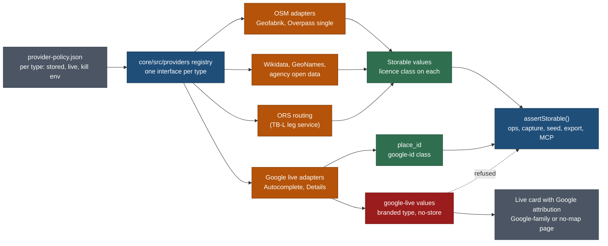

# Source strategy: OpenStreetMap and Google side by side, chosen per data type

Status: **planned only (docs), 27 Oct 2026.** Task SOURCES-SPEC, planner (Opus). Nothing here is built.
Owner questions Q-SRC1 to Q-SRC6 are open (section 10). Not legal advice; the terms were read on the date given and
are quoted in short phrases only.

Related pages, referenced and not repeated:
- [destination-data-coverage.md](destination-data-coverage.md): tiers T0 to T3, waves, the source verdicts (5.1), the ODbL
  analysis (5.2) and the gazetteer pipeline. This page refines 5.1 and 5.2; it does not edit them (section 9 lists the edits).
- [trip-builder.md](trip-builder.md): the builder and its leg service (TB-L, `leg_cache`, ORS).
- [requests-and-custom-places.md](requests-and-custom-places.md) 4.3: Google Places Autocomplete for custom stops (Q210),
  the `place_id`-only storage rule, the fallback chain and the cost caps. Kept as is; this page generalises it.
- [trip-origin-and-nearest-airport.md](trip-origin-and-nearest-airport.md) 8.1: origin privacy (OR9).
- [stay-bases-and-optimisation.md](stay-bases-and-optimisation.md): base towns, never property names.
- [research/reports/map-stack-2026-10-18.md](../../../research/reports/map-stack-2026-10-18.md): the one-map-family-per-page rule.
- [research/method/sources-and-licences.md](../../../research/method/sources-and-licences.md),
  [capture-contract.md](../../../research/method/capture-contract.md) 9.2 and the point rule (T5),
  [relevance.md](../../../research/method/relevance.md) R6.
- [design/foundation/principles.md](../design/foundation/principles.md) P1 to P9.

## 0. The answer in plain words

**Yes, partly.** We can run OpenStreetMap-derived data and Google side by side with a choice per data type, but the two
are not interchangeable, so the choice is not symmetric:

- **OSM (and the other open sources) can be stored.** It feeds the catalogue, the builder engine, MapLibre maps, exports
  and MCP, under ODbL with attribution, kept as a separable layer.
- **Google can only be used live, on the visitor's action, and shown next to Google's own branding.** Nothing Google
  returns may enter our dataset except the `place_id`. Google content may not be drawn on or near our MapLibre maps
  (Places UI Kit is the one exception), may not feed our engine's calculations, may not be cached in shared pages, and
  may not reach MCP or a language model.

So "choose per type" works as: **one stored provider per type (never Google), plus an optional live provider per type
(sometimes Google), each behind one adapter with a kill switch.** The per-type choice also happens to be exactly how
OSM's own Collective Database guideline lets us keep OSM's share-alike away from our own facts (3.2).

**Trade-off:** Google's better business data (hours, names, photos, ratings) stays a live, display-only extra and never
improves the stored catalogue or the builder's confidence. In return, the catalogue stays ours to keep, export and serve
through MCP, the cost stays at zero inside the free monthly allowances, and Google can be switched off without losing
data.

## 1. Owner request, traced

> "Look into both: if you can combine OSM data along with Google side-by-side, so that we can choose, per TYPE, which
> one to use at which time: look into that and then answer." (owner, 27 Oct 2026)

| Part of the request | Where answered |
|---|---|
| Can OSM and Google be combined side by side | 0, 2, 3 |
| Choose per type | 5 (the matrix), 7 (the adapter layer and policy file) |
| "At which time" (stored now vs looked up live) | 6 |
| What our own rules allow | 4 |
| Cost, privacy, controls | 7.5, 7.6 |
| What to build, when | 8 |

## 2. Google Maps Platform: what the terms allow (read 27 Oct 2026)

Sources: [Terms of Service](https://cloud.google.com/maps-platform/terms) (last modified 26 Aug 2026),
[Service Specific Terms](https://cloud.google.com/maps-platform/terms/maps-service-terms) (last modified 15 Oct 2026),
[EEA Terms](https://cloud.google.com/terms/maps-platform/eea) (26 Aug 2026),
[Places API policies](https://developers.google.com/maps/documentation/places/web-service/policies) (updated 23 Oct 2026),
[pricing](https://developers.google.com/maps/billing-and-pricing/pricing) (updated 23 Oct 2026),
[Place Photos (New)](https://developers.google.com/maps/documentation/places/web-service/place-photos) (23 Oct 2026),
[Places usage and billing](https://developers.google.com/maps/documentation/places/web-service/usage-and-billing).

### 2.1 Rules that decide the design

| Clause | What it says (short) | Consequence for us |
|---|---|---|
| ToS 3.2.3(a) No scraping | no "pre-fetch, index, store, reshare, or rehost"; no bulk download of geocodes, directions, matrix results or places information; no "copy and save business names, addresses, or user reviews" | no Google value in `data/`, Postgres, logs, seeds, exports or the repository; no bulk ID matching jobs |
| ToS 3.2.3(b) No caching | only as the Service Specific Terms allow | nothing Google in ISR or CDN-cached HTML, the PWA cache, PMTiles or `leg_cache` |
| ToS 3.2.3(c) No creating content | includes "use latitude/longitude values from the Places API as an input for point-in-polygon analysis" and using Google content to "train, test, validate or fine-tune" AI models | Google points never go through `derive-area`, park containment, `nearby`, the builder's scoring, bases or day packing; Google content never enters an agent prompt, MCP output or eval |
| ToS 3.2.3(d) No re-creating Google products | no use "in a listings or directory service"; the product must have "substantial, independent value" | the catalogue may not become a Google-backed place directory; Google stays an extra on pages whose value is our research |
| ToS 3.2.3(e) No use with non-Google maps | not "with or near a non-Google Map"; e.g. no Places content on a non-Google map | Google content only on pages whose map family is Google, or with no map at all. Our globe, places list, builder and planner maps are MapLibre |
| ToS 3.2.3(g) Search integrity | no modifying the Core Services' search results | Google autocomplete rows are shown as returned: no re-ranking, filtering or merging into our rows (our rows may sit above, apart) |
| ToS 4 (ii), (iii) End-user data | do not give Google any end user's personally identifiable information, nor any European end user's personal data; notify users before combining their location with another provider's data; do not obtain or cache a user's location without "express, prior, revocable consent" | never send a home, a typed starting city, coordinates of a device, an email or an account id to Google |
| Service terms 3 Google ID caching | "Customer may cache ... place_id from Places API, Directions API ... and Routes API" | `place_id` is the one storable value (Places policies: "store place ID values indefinitely") |
| Service terms 14 Places API | 14.1 may be used without a Google map; 14.2 not "in conjunction with a non-Google map"; 14.3 lat/lng cached up to 30 days, then deleted | a live Places answer may show as a text card with the Google Maps logo on a page with no map or a Google map |
| Service terms 15 Places UI Kit | 15.1 usable "with or without any map, including a non-Google Map"; prevails over 3.2.3(e); 15.3 no caching or exporting, must make clear what is Google content | **the only sanctioned way to show Google place content beside a MapLibre map** (a Google-rendered element; we never touch its data) |
| Service terms 19 Routes API | 19.2 not with a non-Google map; 19.3 lat/lng cached up to 30 days | Google drive times may never feed our MapLibre maps, `leg_cache` or the engine |
| Service terms 6 Geocoding API | 6.2 not with a non-Google map; 6.3.2 lat/lng and address may be cached indefinitely only for the requesting end user, "logically isolated", never across users | a user's own geocoded point could live in their own copy, but never in shared data; we do not need it (5, row 15) |
| Service terms 13 Places Aggregate API | POI counts cached 30 days, only to compute a "substantially transformed" value that cannot substitute for the counts | possible future "stay supply" band; not now (5, row 7) |
| Places policies: attribution | Google Maps logo (or the text "Google Maps" when space is short) wherever Google data shows without a map; attributions not obscured; photos and reviews credit the author (avatar, name, link) | one `GoogleAttribution` component; our credit chip never covers it |
| Place Photos | "You cannot cache a photo name. Also, the name can expire"; `authorAttributions` must be shown | no Google photo in galleries, OG images, share cards or the photo tab |
| EEA terms | apply only when the **billing account address** is in the EEA (or a project integration after 8 Jul 2025 under it). The EEA text has no "non-Google map" or "re-creating" clause; scraping, caching and content creation bans remain | assumed: the owner's billing address is in Canada, outside the EEA, so the global terms apply (SRC-O confirms). Even under EEA terms the storage bans would stand, so the design does not change |

### 2.2 Prices and free monthly allowances (pricing page, 23 Oct 2026; USD per 1,000 above the free cap)

| SKU | Free each month | Then | Our use |
|---|---|---|---|
| Autocomplete Requests | 10,000 | 2.83 | custom-stop search (REQ-G, Q210) |
| Autocomplete Session Usage | unlimited (sessions that end in Place Details are not charged for the keystrokes) | | with a session token per search |
| Place Details Essentials (IDs Only) | unlimited | | refreshing a stored `place_id` |
| Text Search Essentials (IDs Only) | unlimited | | not used (no bulk ID matching) |
| Place Details Essentials | 10,000 | 5.00 | live card: address, location (display only) |
| Place Details Pro | 5,000 | 17.00 | live card with opening hours or Google rating (Q-SRC6, not now) |
| Place Details Enterprise | 1,000 | 20.00 | not used |
| Place Details Photos | 1,000 | 7.00 | not used |
| Text Search Pro, Nearby Search Pro | 5,000 | 32.00 | not used |
| Places UI Kit Query | 10,000 | 1.00 | a later option for "food and stays near this base" |
| Places UI Kit Pro | 5,000 | 5.00 | same |
| Places Aggregate API | 5,000 | 10.00 | not now |
| Compute Routes Essentials, Route Matrix Essentials | 10,000 each | 5.00 | not used; ORS stays |
| Geocoding | 10,000 | 5.00 | not used |
| Dynamic Maps (Maps JavaScript API) | 10,000 | 7.00 | the Google trip map (already wired, `tripPageFamily`) |
| Embed | unlimited | | fallback place map |

Billing applies the highest SKU of any field in the field mask ("billed at the highest SKU applicable"), so every call
names its field mask in code and a test pins it. Under 100 users the expected bill is **USD 0**; the controls in 7.6 make
any spend a deliberate owner choice.

**Not verified here:** which UI Kit SKU each element bills (Query vs Pro) and whether transit routing in the Routes API is an
Essentials or Pro SKU. Task SRC-O confirms both before either is used.

## 3. OpenStreetMap and ODbL: what triggers share-alike, and how per-type choice avoids it

Sources (OSMF board-endorsed guidelines, read through the wiki source 27 Oct 2026):
[Collective Database](https://osmfoundation.org/wiki/Licence/Community_Guidelines/Collective_Database_Guideline_Guideline) (2016),
[Horizontal Map Layers](https://osmfoundation.org/wiki/Licence/Community_Guidelines/Horizontal_Map_Layers_-_Guideline) (2014),
[Produced Work](https://osmfoundation.org/wiki/Licence/Community_Guidelines/Produced_Work_-_Guideline) (2014),
[Substantial](https://osmfoundation.org/wiki/Licence/Community_Guidelines/Substantial_-_Guideline),
[Geocoding](https://osmfoundation.org/wiki/Licence/Community_Guidelines/Geocoding_-_Guideline),
[ODbL 1.0](https://opendatacommons.org/licenses/odbl/1-0/),
[Nominatim policy](https://operations.osmfoundation.org/policies/nominatim/),
[Overpass commons](https://dev.overpass-api.de/overpass-doc/en/preface/commons.html), [Geofabrik](https://download.geofabrik.de/).

### 3.1 The triggers

| Question | Answer |
|---|---|
| Is our bulk use Substantial? | Yes. The guideline's insubstantial bar is under 100 features, one-off, and "repeated small extractions" count as one. Per-country gazetteer runs are systematic |
| Is our public site or API a Produced Work? | Rendered pages and map images are Produced Works (no share-alike on them, attribution required). A published result "intended for the extraction of the original data" is a database: `/api/v1`, MCP list tools, CSV and GPX exports are database use. They make the OSM-derived part Publicly Used |
| What gets share-alike | the **Derivative Database**: the OSM data plus anything that has been merged with it. Our separate datasets (words, suitability, relevance, plans) do not, if the combination is a **Collective Database** |
| When is it a Collective Database | "so long as the data used for a particular data type is either all OSM or all non-OSM within the same regional cut". A non-OSM property may reference OSM features by id (the guideline's restaurant phone numbers example) |
| What breaks it | mixing OSM and non-OSM values **for the same data type in the same regional cut**; filling gaps in our list from OSM ("all cemeteries not found in the OpenStreetMap data"); merging and de-duplicating our list with OSM's (the guideline's proprietary restaurant list example) |
| Geocoding results | single results are insubstantial and may be stored with our data; a collection becomes a substantial extract if it is used as a general database |

### 3.2 What this means for our dataset

The owner's "choose per type" is the same unit the OSMF uses. We adopt it as the rule:

**R-ODbL-1. One stored provider class per (data type, property, regional cut).** The regional cut is the country (ISO 3166-1).
For each data type and property the policy file (7.3) says `osm` or `non-osm` for that country. The validator fails a
country where one property mixes the two.

**R-ODbL-2. Identity and geometry are one ODbL layer, by declaration.** Points, tracks, `osm_ref`, the de-duplicated
identity of gazetteer places (Wikidata and OSM candidates merged in DC-2) and ORS-derived legs are published as one
ODbL layer per country, whatever their individual source. Wikidata (CC0), public-domain and our own pins may be included
under ODbL; CC BY and OGL values keep their attribution lines inside it. This is simpler and safer than proving per type
that no point was compared with OSM.

**R-ODbL-3. Our facts layer is non-OSM by construction.** Summaries, suitability, relevance, entry rules, booking windows,
durations, base plans and trip plans are keyed by our ref, may hold an `osm_ref` as a reference, and never take a value
from an OSM tag. Where an OSM tag is the only evidence (opening hours, fee, `wheelchair`), that property is OSM for the
whole country (R-ODbL-1) and lives in the ODbL layer, or it is researched from an official source for every record of
that type in that country.

**Effect on destination-data-coverage 5.2:** its coordinate order ("Wikidata when its point is within 250 m of the OSM
feature, else official, else OSM") compares each Wikidata point with OSM and mixes sources inside one country. Under
R-ODbL-2 that is fine, because the whole point layer is ODbL anyway; without R-ODbL-2 it would make the point layer a
Derivative Database. Its per-value `licence` flag stays and gains the policy check (section 9).

### 3.3 OSM tag quality by type (taginfo, worldwide, read 27 Oct 2026)

| Feature | Objects | name | wikidata | opening_hours | wheelchair | website | fee |
|---|---|---|---|---|---|---|---|
| `tourism=viewpoint` | 265,603 | 34% | 1% | 0% | 4% | 1% | 1% |
| `waterway=waterfall` | 89,803 | 40% | 3% | 0% | 0% | 0% | |
| `tourism=attraction` | 255,828 | 88% | 14% | 4% | 7% | 9% | 2% |
| `tourism=camp_site` | 163,472 | 68% | 0% | 3% | 3% | 23% | 17% |
| `tourism=hotel` | 455,524 | 91% | 5% | 4% | 8% | 29% | |
| `amenity=restaurant` | 1,628,518 | 93% | 0% | 24% | 9% | 20% | |

Read: OSM is strong for **where** (points, trailheads, viewpoints, trail relations, parking) and for **counts** of lodging
and food near a town; it is weak for **hours, accessibility and fees**, which we must research from official pages
anyway. Worldwide shares hide regional variation (Europe is denser than North America); DC-1's run notes record the
shares per country.

### 3.4 Usage policies

| Service | Rule | Our use |
|---|---|---|
| Geofabrik extracts | free, updated daily, ODbL; no published rate policy on the index page | bulk source: one download at a time (DC 5.3) |
| Overpass (public) | about 10,000 requests and 1 GB a day per user; 429 when out of slots | single features only, one runner |
| Nominatim (OSMF) | 1 request a second; autocomplete forbidden; bulk discouraged; results must be cached | research single lookups only (unchanged) |
| openrouteservice Standard | directions 2,000 a day (40 a minute), matrix 500 (40), autocomplete 1,000 (100), per the plans page as summarised by search; the page did not render for a direct read | stored routing and matrices; fallback search (Q210) |

## 4. Our own rules: what changes and what must not

### 4.1 Must not change

| Rule | Where | Why it stays |
|---|---|---|
| Google is never the source of a stored value; a coordinate of unknown origin is treated as Google-derived | capture-contract 9.2; point rule T5 (`coord_src` is osm, wikidata, official or manual) | ToS 3.2.3(a) to (c) |
| No ratings, review counts, ranks or popular times from Google, AllTrails, Tripadvisor or Komoot as signals | relevance R6, `E_REL_LINK_ONLY_SRC`, `E_REL_COPIED_RATING` | terms and honesty; fame comes from Wikidata and pageviews |
| The export guard rejects third-party map data | `core/src/export/licence.ts` (`FOREIGN`) | exports are database use |
| One map family per page | `web/lib/map/registry.ts`, `families.test.ts` | ToS 3.2.3(e) |
| Keys server-only (except the browser Maps JS key, referrer-restricted) | check-all key scan | cost and abuse |
| Nominatim never for type-ahead | requests 4.3 | Nominatim policy |
| AllTrails, Komoot and the rest are link only | capture-contract 9.2 | their terms |
| The household home point never leaves the household's own data | `core/src/privacy/home.ts`, OR9 | privacy |
| Research never takes a name, point or fact from Google; `place_id` is an unchecked hint | requests 4.3, RQ8 | ToS 3.2.3(a) |

### 4.2 Would change (each tied to a question)

| Rule today | Proposed | Question |
|---|---|---|
| sources-and-licences 3: Google "never store" | add the exception: `place_id` may be stored as a lookup key on a copy, a request, **and a catalogue record**, refreshed with the free IDs-only call after 12 months | Q-SRC5 |
| destination-data-coverage 5.2: per-value OSM flag, "keep OSM in its own files" | R-ODbL-1 to R-ODbL-3: one provider class per type, property and country; the identity and geometry layer published as ODbL per country | Q-SRC1 |
| requests 4.3: Google rows are text only and never near MapLibre | unchanged for custom stops; add Places UI Kit as the only allowed Google element on a MapLibre page, behind a flag, for later | Q-SRC6 |
| no rule on live Google content outside custom-stop search | new class `google-live` (7.2): fetched per request on a user's action, `Cache-Control: private, no-store`, never in ISR, never on MapLibre, never into the engine, MCP or a model | Q-SRC2 |
| no Google budget beyond the 300-a-day Places cap | one budget for every Google SKU (7.6) | Q-SRC3 |

## 5. Per-type matrix

Legend: **S** may store, **C** cache only briefly, **D** display, **X** derive (feed our calculations or maps).
"Live" means fetched at runtime on the visitor's action and never stored. Cost is at our size (under 100 users).

| # | Data type the builder needs | Options and what each allows | Quality | Recommended stored provider | Live provider (optional) | Fallback |
|---|---|---|---|---|---|---|
| 1 | Place identity and coordinates | Wikidata CC0 (S D X); OSM ODbL (S D X, ODbL layer); agency open data (S D X, attribution); our research (S D X); Google: `place_id` S, lat/lng C 30 days, D on Google map only, never X | Wikidata good for famous places, centroids for big features; OSM best for trailheads, viewpoints, parking; Google best for businesses | **Wikidata QID plus OSM point**, in the ODbL identity layer (R-ODbL-2) | none | official open data, then a manual pin |
| 2 | Categories (our 324 types) | Wikidata P31 and OSM tags mapped by `source-type-map.json` (S); Google `types` (D only) | OSM tags precise for nature and outdoor; P31 noisy | **OSM tags and P31, mapped**; type is our judgement | none | researcher sets the type |
| 3 | Trails, routes, geometry | OSM `route=hiking` relations (S D X); agency open data (OGL, public domain); AllTrails and similar (link only); Google: nothing for trails | OSM good where mapped; official lists authoritative for names, distances, closures | **official where published, else OSM**, chosen per country (R-ODbL-1) | none | link out to AllTrails or the agency |
| 4 | Viewpoints | OSM `tourism=viewpoint` (S D X; 34% named); Wikidata (famous ones) | many unnamed points; payoff needs research | **OSM** points; relevance from Wikidata and pageviews | none | |
| 5 | Parks and entry rules | Wikidata, NPS (PD), Parks Canada (OGL), EEA CDDA (CC BY), OSM `boundary=protected_area`; WDPA forbidden; rules from official pages | identity good; rules only official | **Wikidata and agency open data** for identity and boundaries; **our research** for rules (protected-area-entry) | none | OSM boundary in the ODbL layer |
| 6 | Campsites | RIDB and Parks Canada (government data); OSM `tourism=camp_site` (68% named, 17% fee); Google (D) | official best for bookable sites | **agency data where open, else OSM** per country | none | booking-site link |
| 7 | Lodging near a base: counts, names, prices, availability | counts: OSM `tourism=hotel`, `guest_house`, `hostel`, `motel`, `chalet` (S X, ODbL); Google Places Aggregate (C 30 days, transformed only); names: OSM (S) but stay-bases forbids property names in public output; prices and availability: nobody free (link only) | OSM counts under-count in North America | **OSM counts as a band** (none, few, plenty) in the ODbL layer; no names; no prices | Places UI Kit "stays near this base" behind a flag, later (Q-SRC6) | a link to a hotel search for the base town |
| 8 | Restaurants | OSM `amenity=restaurant` (93% named, 24% hours); Google (D live) | OSM fine for "is there food in town"; Google better for choosing | **OSM count band per base town** only; the catalogue lists no restaurants (out of scope) | Places UI Kit, later (Q-SRC6) | a Google Maps search link (Maps URLs, no key) |
| 9 | Opening hours | official pages (S, our research); OSM `opening_hours` (S, ODbL, 0 to 24% present); Google Place Details Pro (D live only, never X) | official most reliable; OSM stale; Google fresh for businesses | **our research from official pages** for parks, sights, lifts, visitor centres | Google hours as a live card on a Google-family or no-map page (Q-SRC6) | "Check before you go" with the official link |
| 10 | Ratings and popularity | Wikidata sitelinks, pageview dumps (CC0), official visitor counts; Google, Tripadvisor, AllTrails (never, R6) | open signals are proxies | **Wikidata and pageviews** (DC 5.4) | none (R6) | |
| 11 | Photos | Wikimedia Commons (per-file licence, link with credit); agency public domain; Google Place Photos (D live only, author credit, photo name not cacheable, 1,000 free then 7.00) | Commons thin for small places | **Commons and agency PD** (D5c method) | none | "No licensed photo yet" |
| 12 | Drive times and route geometry | ORS (OSM-based; stored today in `leg_cache` and trip legs); self-hosted OSRM or Valhalla on Geofabrik; Google Routes (C 30 days, never on MapLibre, never X) | ORS has no live traffic; good for planning bands | **ORS**, the builder's leg service (TB-L) | none; the visitor's own Google Maps app via a Maps URL for traffic on the day | straight-line estimate marked ≈, then self-hosted OSRM |
| 13 | Transit | GTFS feeds (open, per agency, varied licences); Google Routes transit (live, Google map only; SKU not verified) | GTFS patchy outside cities | **region transit notes** by research (T2) | none | a Google Maps transit link (Maps URLs) |
| 14 | Flights and airports | OurAirports (PD); fares: no free source | good for airports | **OurAirports** (ORG-D) | none | a flight-search link, no fares (OR8) |
| 15 | Geocoding a user's starting city | our towns layer (GeoNames CC BY) and airports through `/api/v1/origins`; Photon or ORS (ODbL); Google Geocoding (per-user cache allowed by 6.3.2, but the city is personal data) | towns layer covers places with 1,000 people or more | **towns layer and airports, our server only**; nothing leaves our server | none (Q-SRC4) | Photon, then free text |
| 16 | Autocomplete in the UI | our catalogue (server search); Google Autocomplete (live, `place_id` only stored); ORS and Photon (ODbL) | Google best for businesses and addresses | **our catalogue first** | **Google Autocomplete** for custom stops only (Q210, unchanged) | ORS, then Photon |

### 5.1 Where Google may appear, in one list

| Surface | Google allowed | How |
|---|---|---|
| Custom-stop search (signed in) | yes, Autocomplete text rows | requests 4.3 as specified |
| Trip page with the Google trip map | yes, our content on Google's map; a live Place Details card on click (Q-SRC6) | the page family is `google-js` |
| Place page | only if its family is Google, or the card renders with no map | `placePageFamily` decides; default MapLibre means no Google card |
| Builder, planner, globe, places list, scratch map | no Google data; Places UI Kit only, behind a flag, later | MapLibre pages |
| Directions, transit, "open in Google Maps" | yes, as links | Maps URLs, no key, nothing stored |
| Catalogue, seeds, Postgres catalogue tables, exports, sitemap, OG images, MCP, agent prompts | **never**, except `place_id` | section 7 enforcement |

## 6. "At which time": stored now vs live on demand

| Moment | Allowed providers | Rule |
|---|---|---|
| **Research and gazetteer runs** (offline, by agents and scripts) | Wikidata, Geofabrik OSM, GeoNames, OurAirports, agency open data, official pages, ORS | never Google, not even to check a point (9.2 unchanged) |
| **Build time and ISR** (pages cached for everyone) | stored data only | no live provider call; HTML that every visitor shares may not hold Google content |
| **Builder engine** (`POST /api/v1/plan/build`) | stored data and ORS through `leg_cache` | no Google input (3.2.3(c)) |
| **Visitor action, live** (a click, a search) | Google Autocomplete, Place Details Essentials (and Pro only if Q-SRC6), Places UI Kit (later) | per request, `no-store`, the field mask fixed in code, a `place_id` the only thing written back, and only to the visitor's own copy or a request |
| **Owner research by hand** | Google Maps in a browser for orientation | the researcher re-derives every value from an allowed source (unchanged) |

## 7. Architecture: one adapter per data type

### 7.1 Shape

### 7.2 Licence classes (one per value)

| Class | Sources | Store | Export and MCP | MapLibre | Engine input |
|---|---|---|---|---|---|
| `own` | our research, words, judgements | yes | yes | yes | yes |
| `cc0` | Wikidata, pageview dumps | yes | yes | yes | yes |
| `pd` | OurAirports, NPS | yes | yes | yes | yes |
| `attrib` | GeoNames CC BY, OGL-Canada, OGL-Ontario, CC BY 4.0 agencies, EEA | yes | yes, with its line | yes | yes |
| `odbl` | OSM, Geofabrik, ORS legs, Overture ODbL themes | yes, ODbL layer | yes, with attribution; the layer offered as ODbL | yes | yes |
| `link` | AllTrails, Tripadvisor, booking sites | the URL only | the URL only | no | no |
| `google-id` | `place_id` | yes; refresh after 12 months with the free IDs-only call | no (internal key; a Maps URL may carry it) | no | no |
| `google-live` | everything else from Google | **never**; memory of one request; lat/lng never kept | never | never (UI Kit excepted) | never |

### 7.3 Contract

- `data/vocab/provider-policy.json` (authored, small): per data type of section 5, the ordered stored providers, the live
  provider or none, the kill-switch env name, the daily cap, and per country the OSM or non-OSM class per property
  (R-ODbL-1). A change is one reviewed entry (P1).
- `core/src/providers/`: one TypeScript interface per data type (`PlaceIdentity`, `TrailGeometry`, `Routing`,
  `PlaceSearch`, `PlaceLive`, `Geocode`, `Photos`, `OpeningHours`, `StaySupply`), Zod-validated outputs carrying
  `provider`, `licence`, `run` or `requested_at`. Existing pieces become adapters, not rewrites: the builder's leg service
  (TB-L) implements `Routing`; REQ-G's `core/src/geocode/**` implements `PlaceSearch`; the gazetteer fetchers (DC-1)
  implement `PlaceIdentity`.
- `google-live` is a branded type. The persistence boundary (`assertStorable`) is called by ops writes, capture writes,
  the seed loader, `CatalogueStore` writes, the export guard and the MCP `respond()` guard; it rejects `google-live`
  and any value without a licence class.
- **Provenance:** capture/1 values keep `src`, `on`, basis; DC-C's per-value `licence` takes the classes above; the sources
  registry (`data/sources/registry.json`) gains `licence_class` and `storable` per host, and `capture.ts build --check`
  fails a value whose source host is not storable.

### 7.4 Enforcement (each is a test or a check-all stage)

| Check | Catches |
|---|---|
| validator `E_SRC_NOT_STORABLE` | a stored value from a `google-live` or `link` source |
| validator `E_ODBL_MIXED` | one property mixing OSM and non-OSM values in one country (R-ODbL-1) |
| repository and seed scan for Google shapes (`ChIJ` ids outside `google-id` fields, `googleapis.com` photo or place URLs, `maps.app.goo.gl` coordinates) | leaks into data, fixtures, logs |
| route test: every `/api/v1/live/*` response has `Cache-Control: private, no-store` and no ISR | shared caching |
| map test: a MapLibre source rejects any feature whose licence is `google-*` (extends the page-family registry) | 3.2.3(e) |
| field-mask test per Google call, against a pinned allow list | SKU creep |
| MCP and export tests: `google-*` values absent | 3.2.3(a), (c) |

### 7.5 Privacy

- Google receives only what the visitor typed into a Google-branded search box (custom stops) or a `place_id` the visitor
  clicked. Calls go from our server with our key, so Google sees no visitor IP or cookie from us (the Google trip map in
  the browser is the exception, already named on `/privacy/`).
- **Never sent to Google:** the household home point or town, a visitor's starting city or origin (OR9), device
  coordinates, emails, account ids, trip dates, party ages. The starting city is resolved by our towns layer and airports
  only (row 15). This also keeps us inside ToS 4 (no personal data of European users to Google).
- Autocomplete `locationBias` uses the trip's region or the base, never the visitor's position.
- `/privacy/` names each live provider and what it receives (an edit for GSI-P's page, listed in section 9).

### 7.6 Cost controls

| Control | Setting |
|---|---|
| Keys | a server key restricted to Places API (New) (and Routes only if ever enabled); the existing browser key for Maps JS restricted by HTTP referrer to our domains and to Maps JavaScript API only; never one key for both |
| Hard caps | Cloud console per-API daily quotas at about the free monthly allowance divided by 30 (Autocomplete 300 a day, Place Details Essentials 300, Pro 150 only if enabled); quotas are the hard stop |
| Our caps | `quota_bucket` per account and global per SKU; above the cap the adapter falls to the next provider in the policy |
| Budget | a billing budget with alerts at 50, 90 and 100% of USD 10 a month (Q-SRC3); a budget alerts, it does not stop spend |
| Kill switches | `PROVIDER_<TYPE>=off\|<name>` per type, plus the existing `GEOCODE_ENABLED` and `GEOCODE_PROVIDER` |
| Session tokens | one per Autocomplete session, closed by the Place Details call or dropped |

## 8. Tasks, hours and where they fit

| Id | What | h | Model | Depends on | Slot |
|---|---|---|---|---|---|
| SRC-0 | This spec | done | Opus | | docs |
| SRC-C | Contract: `provider-policy.json` and its Zod schema, licence classes, `assertStorable`, `E_SRC_NOT_STORABLE`, `E_ODBL_MIXED`, registry `licence_class` and `storable` | 6 | Opus (shared contract) | DC-C (same seat, same pass), Q-SRC1, Q-SRC2 | B2 contract seat, right after DC-C |
| SRC-A | `core/src/providers/` interfaces, registry, kill switches, quota hooks; TB-L, REQ-G and DC-1 code against it | 8 | Opus 2 (interfaces), Sonnet 6 | SRC-C | before TB-L and DC-1 (bundle D, first slice) |
| SRC-T | enforcement checks of 7.4 in check-all and the test suites | 4 | Sonnet | SRC-A | same stack as SRC-A |
| SRC-L | ODbL layer export per country (identity, geometry, OSM-class properties), the About the data statement, the changelog of layer builds | 4 | Sonnet 3, Opus 1 | SRC-C, DC-L | with DC-L |
| SRC-AU | Audit today's 504 records: points and properties per source class per country; list mixes R-ODbL-1 would flag | 2 | Haiku 1, Opus 1 | SRC-C | data seat, before wave 0 |
| SRC-O | Owner steps and checks: key split, per-API quotas, USD 10 budget, UI Kit and transit SKU confirmation; merges REQ-G0's terms part | 1 | Opus | Q-SRC3 | with REQ-G0 (saves 1 h there) |
| SRC-G | Live place card: `GET /api/v1/live/place/{place_id}` (Essentials mask; Pro only if Q-SRC6), `GoogleAttribution` component, Google-family pages only | 7 | Sonnet 6, Opus review 1 | SRC-A, Q-SRC6 | bundle G (builder P2), only if Q-SRC6 is yes |
| **Total** | | **32** (25 without SRC-G) | | | |

Net change to the program: +24 h (SRC-O replaces 1 h of REQ-G0). SRC-A removes duplicate adapter scaffolding from TB-L,
REQ-G and DC-1; their hours are left unchanged here until their authors confirm.

## 9. Edits other pages need (not made here)

- **destination-data-coverage.md:** 5.1 Google row: "never a stored value; live display only through the provider policy
  (source-strategy-osm-google 6)"; 5.2: add R-ODbL-1 to R-ODbL-3 and say the identity and geometry layer is ODbL by
  declaration; 6.1 per-value `licence` uses the classes of 7.2; 9.1 DC-C and DC-L name SRC-C and SRC-L as companions.
- **trip-builder.md:** TB-L implements the `Routing` interface (SRC-A); 7 adds "no Google input to the engine".
- **requests-and-custom-places.md:** 4.3 points here for the general rule; REQ-G implements `PlaceSearch`; REQ-G0 loses its
  terms check to SRC-O.
- **research/method/sources-and-licences.md 2 and 3:** the licence classes; the `place_id` exception if Q-SRC5 is yes;
  Places UI Kit noted.
- **research/method/capture-contract.md 9.2:** "a Google `place_id` is a key, never a value" (no change to the ban).
- **mcp/product.md:** a red line: no `google-*` value in any MCP output.
- **PLAN:** a requirement row "per-type source policy: stored providers open, Google live only" (SRC-*).
- **MASTER-ORDER:** SRC-C in contract order 4.3 after DC-C; SRC-A before TB-L and DC-1; SRC-G in bundle G.
- **RELEASE-PLAN:** the Google budget line in the owner checklist.
- **The `/privacy/` page spec (GSI-P):** the live-provider list of 7.5.
- **features/README.md:** a row for this page.

## 10. Owner questions

| ID | Question | Recommendation | Trade-off |
|---|---|---|---|
| Q-SRC1 | Choose the stored provider per data type, property and country (OSM or not, never mixed), and publish the identity and geometry layer of each country as ODbL? | **Yes** | our points and merged identities are open to anyone under ODbL; our words, judgements and plans stay ours. Without it, every merge with OSM risks share-alike over more of our data |
| Q-SRC2 | Use Google only live, on the visitor's action, with `place_id` the only stored value; never in the catalogue, the engine, cached pages, exports, MCP or a model? | **Yes** | Google's better business data never improves the stored catalogue or the builder; in return nothing can force a purge and Google can be switched off |
| Q-SRC3 | A Google budget of USD 10 a month with per-API daily quotas near the free allowance as the hard stop, and kill switches per type? | **Yes** | a heavy day falls back to ORS and Photon instead of spending |
| Q-SRC4 | Never send a starting city, origin or home to Google; resolve starting cities with our towns layer and airports only? | **Yes** | a small town missing from the towns layer needs free text or the nearest town; no third party learns where a visitor lives |
| Q-SRC5 | Allow a `place_id` on catalogue records, obtained only by a visitor's pick or a researcher's single lookup (no bulk ID matching), for better Google Maps deep links? | **Yes** | one more key to refresh yearly (free); bulk matching would be cheap but cannot be checked without reading Google's names and points |
| Q-SRC6 | Show Google opening hours, ratings or photos live in year one (a Place Details Pro card on Google-family pages, or Places UI Kit for food and stays near a base)? | **No, not in year one**; revisit after builder P2 | visitors check hours and food on Google Maps themselves through our links; a yes adds SRC-G (7 h) and Pro SKUs (5,000 free a month, then USD 17 per 1,000) |

## 11. Sources read for this page (27 Oct 2026)

- Google Maps Platform Terms of Service, 26 Aug 2026: https://cloud.google.com/maps-platform/terms
- Google Maps Platform Service Specific Terms, 15 Oct 2026: https://cloud.google.com/maps-platform/terms/maps-service-terms
- Google Maps Platform EEA Terms of Service, 26 Aug 2026: https://cloud.google.com/terms/maps-platform/eea
- Places API policies, updated 23 Oct 2026: https://developers.google.com/maps/documentation/places/web-service/policies
- Google Maps Platform pricing, updated 23 Oct 2026: https://developers.google.com/maps/billing-and-pricing/pricing
- Place Photos (New), 23 Oct 2026: https://developers.google.com/maps/documentation/places/web-service/place-photos
- Places usage and billing (field masks, sessions): https://developers.google.com/maps/documentation/places/web-service/usage-and-billing
- OSMF licence guidelines (Collective Database, Horizontal Map Layers, Produced Work, Substantial, Geocoding), wiki source: https://osmfoundation.org/wiki/Licence/Community_Guidelines
- ODbL 1.0: https://opendatacommons.org/licenses/odbl/1-0/
- Nominatim usage policy: https://operations.osmfoundation.org/policies/nominatim/
- Overpass API commons: https://dev.overpass-api.de/overpass-doc/en/preface/commons.html
- Geofabrik downloads: https://download.geofabrik.de/
- openrouteservice plans (via search summary): https://openrouteservice.org/plans/
- taginfo API (counts in 3.3): https://taginfo.openstreetmap.org/

**Not verified:** the ORS quotas by a direct read (the page is a script app); the Places UI Kit SKU per element; the
Routes API transit SKU; Geofabrik's rate policy (not on the index page). SRC-O confirms the Google items before use.

## 12. Gotchas

- **A budget is not a cap.** Only per-API quotas stop spend.
- **Field masks set the price.** One Pro field in an Essentials call bills the whole call as Pro.
- **ISR is caching.** A server component that calls Google inside a cached page breaks 3.2.3(b) for every visitor.
  Live calls live in uncached route handlers or the client.
- **Point-in-polygon is named.** Even a transient Google point may not be tested against our areas or parks.
- **"Near" a non-Google map.** A Google card in a side panel beside a MapLibre map counts. Places UI Kit is the only
  exception, and its data must still never be read by our code.
- **Search integrity.** Do not filter or re-rank Google autocomplete rows; show ours separately above them.
- **De-duplicating against OSM is a merge.** The gazetteer's dedupe (DC-2) makes the merged identity ODbL, which is why
  R-ODbL-2 declares the whole identity and geometry layer ODbL.
- **A photo name expires.** Never store or share a Google photo URL; it also cannot go into an OG image.
- **EEA terms follow the billing address, not the visitor.** Moving billing would not lift the storage bans.

## Change log

| Date | Change |
|---|---|
| 2026-10-27 | First version (SOURCES-SPEC, planner, Opus): Google terms and prices read and dated; ODbL triggers from the OSMF guidelines; R-ODbL-1 to R-ODbL-3; OSM tag quality by type from taginfo; rules kept and changed; per-type matrix of 16 data types; stored vs live timing; provider adapter layer with licence classes and enforcement; tasks SRC-C to SRC-G (32 h); Q-SRC1 to Q-SRC6. Refines destination-data-coverage 5.1 and 5.2 (edits listed in 9, not made); generalises requests-and-custom-places 4.3 without changing it |
