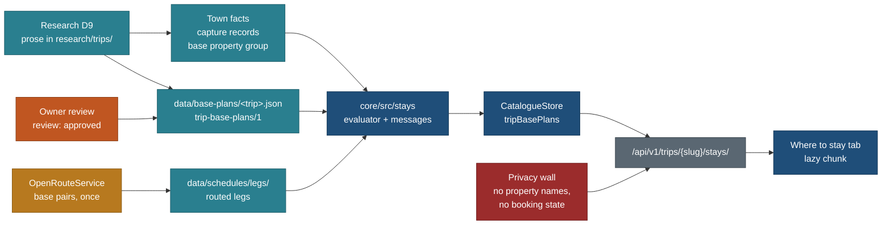
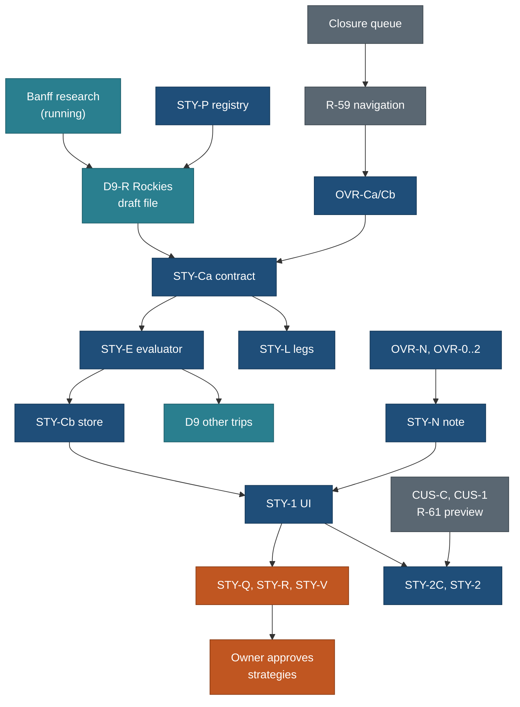

# Stay bases and stay optimisation (where to stay, fewer moves, lower cost)

Status: spec, 25 Oct 2026, written by travel-planner (Opus) from the owner's request of the same day. Nothing here is
built. Tracked as PLAN R-76 to R-80, BACKLOG 15.76 to 15.80, TODO row 2026-10-25. Research batches: DATA D9-R and D9 in
[build/public-site/briefs/DATA.md](../build/public-site/briefs/DATA.md), prompts in
[DATA-AGENT-PROMPTS.md](../build/public-site/briefs/DATA-AGENT-PROMPTS.md). Owner questions Q109 to Q116 (section 18).

**Relation to other pages (read with them; this page does not edit them):**

| Page | What this page adds or refines | Changed there? |
|---|---|---|
| [trip-overview-and-customisation.md](trip-overview-and-customisation.md) (R-62 to R-67) | Its **Stays** tab (3.2) becomes **Where to stay**: bases, nights, strategies and town guidance. Its rule "Stays shows bases and nights only. Lodging ideas never appear" still holds for property names; town-level guidance is added (section 6 defines the line). Its `trip-custom/1` delta gains `stays` operations (section 8.3) | No. The coordinator adds a one-line pointer in its 3.2 (flagged, section 16) |
| [TRIP-NAVIGATION-PLAN.md](../build/public-site/TRIP-NAVIGATION-PLAN.md) (R-59) section 3 | Authored strategies reuse the same base-change recomputation; a public strategy is read-only and precomputed, which R-59 does not cover (section 16 C2) | A "Related" pointer only |
| [trip-timeline.md](trip-timeline.md) | The scheduler runs a strategy as a patched schedule input: bases per day, day order, legs. The 30 km nearby rule (3.7) follows the strategy's bases. No scheduler rule changes | No |
| [F02](F02-trip-creation-and-trip-types.md) (base strategy question), [F12](F12-templates-reuse-and-adaptation.md) (drop a base reachable as a day trip) | The evaluator in section 9.4 is the one F02 drafting and F12 adaptation call later | No |
| [F06](F06-plan-document-lists-and-days.md), [F08](F08-reservations-and-wallet.md) | A booked stay sets the night base in the planner; a strategy is only a proposal there, never a booking | No |
| Privacy rule "no stay ideas" (PLAN section 1, HANDOVER rules, PRIV1) | Kept. Section 6 defines exactly what is public base guidance and what is a private stay choice | No |

## The owner's request (25 Oct 2026, dictated, lightly cleaned)

> One more research. For the Rocky Mountains, should we just create 3 bases: 1 Jasper, 2 Golden, and then Banff, so that
> returning to Calgary is easy? Another point: should we also suggest that Canmore is a good option if you want to save
> some money compared with Banff and Lake Louise Village; those are close. Research those, because in the stays we can
> add these notes so it is clear that they can explore more stay options, and that gives them the option to not check in
> and check out many times in the trip; they can also decrease the number of check-ins and check-outs. That is a
> suggestion to find optimised stays, and we also need to think about how we display this properly on our trip details
> page.

Follow-up:

> I have asked my research agent to research Banff, but this is applicable to all trips: there should be a good way to
> tweak and show different stay options if the user would like to keep fewer bases, and how those messaging
> optimisations can be suggested. Think about it, and also add these to the plan. Do not miss it.

## Decisions

| # | Decision | Why | Trade-off |
|---|---|---|---|
| D1 | Every trip has one **default base plan** (the plan as written) and **0 to 3 alternative strategies**, each researched data with sources, never generated text at render time | The owner wants alternatives for every trip; data keeps them honest and reviewable (T3) | Research time per trip (about 1 to 6 h); trips with no good alternative show none |
| D2 | A strategy is **bases and nights** (plus an optional day order), and the numbers (check-ins, moves, drive per day, cost range) are **derived** by one evaluator in core, never typed by hand | Hand-typed totals drift the moment a leg is re-routed | A contract and an evaluator before any UI (STY-C, STY-E) |
| D3 | **Town facts live on the town's capture record** (a new `base` property group on settlement types); the strategy file holds only what is specific to the trip | The method already defines `attrs.base.*` (research/method/lanes/stays.md, kinds/town.md) but the property registry has no base properties; one home per fact | A registry change (Opus) before D9 can write town facts as records |
| D4 | Strategy data lives in a per-trip sidecar `data/base-plans/<trip-id>.json` (`trip-base-plans/1`), like `data/seasons/` | The 14 trips are legacy-backed; `data/trips/<id>/trip.json` exists only for data trips and is written only through ops; folds into `trip.json` at TD-4 | One more per-trip file until TD-4 |
| D5 | **Public, read-only, no login:** a visitor picks a strategy and a per-base swap through the URL (`st=`, `sw=`), and sees the days, map and totals change. **Signed in:** move a night, merge two bases, save | Public site first (product direction); edits need storage (R-65, R-59 section 3) | Visitors cannot share a hand-edited base plan, only a researched one |
| D6 | Messages ("Two fewer check-ins ...") come from **fixed rules over the data** (section 5), at most two at rest per trip, and are silent when a claim has no source | Never pushy, never invented; a gap is never a yes | Some useful ideas stay hidden until research sources them |
| D7 | **No property names in public output** (hotels, apartments, rentals). Public guidance is town level: why stay, why not, lodging mix, a dated price band, check-in pattern, minimum-stay rules, booking lead time, official directory links | Owner rule recorded in the Dolomites stay research and PLAN section 1; P8 | Visitors still search for the hotel themselves (Q109) |
| D8 | Where to stay is the overview's **Stays tab** plus one line at rest in the trip strip; it is a **lazy chunk**; trip start JS +0 B, place HTML +0 B | Start JS is at 199.2 of 200 KB; place HTML has 19 B headroom | One more click before the comparison shows |
| D9 | Strategies may **reorder whole days** (the Rockies "Jasper first" needs it), but never items inside a day; every plan item lands on a day or in a `left_out` list with a reason | The scheduler never reorders items; whole-day moves are the only way to put Jasper first; nothing vanishes silently (R-59) | More research per strategy; Q112 |
| D10 | A strategy is public only when its `review` is `approved` (the owner or the `trip` skill after owner approval) | The first Rockies comparison changes how the trip reads; the owner sees it before visitors do | One more owner step per trip |



## 1. User stories

| # | As | I want | So that | Principles |
|---|---|---|---|---|
| U1 | a visitor reading the Rockies trip | to see how many times this plan checks in and out, and where | I know the cost of the plan in packing days before I copy it | P3, P6 |
| U2 | a visitor | to see 1 to 3 other ways to stay (fewer moves, lower cost, one base) with honest plus and minus points | I choose the plan that suits my family, not only the author's | P2, T3 |
| U3 | a parent | to compare the ways side by side on my phone: stays, moves, extra driving, cost | I decide in one screen, at a glance | P3, T2 |
| U4 | a visitor | to pick a way and see each day change: the base, the extra drive, a missed slot | I trust the comparison because the days agree with it | P5, T1 |
| U5 | a visitor | to know that a nearby town (Canmore) usually costs less than Banff, with how much further it is | I can look for cheaper stays without losing the plan | T3 |
| U6 | a visitor | official places to look for stays in each base town | I can explore more stay options myself | P7 |
| U7 | a signed-in planner | to move a night or merge two bases in my copy, with the days re-flowed and undo | the plan fits my party's tolerance for driving versus packing | P5, R-65 |
| U8 | the owner | the alternatives to appear only after I approve them, and no hotel names or booking state ever on the public site | the public page stays honest and private | PRIV1 |

## 2. Concepts and counts

| Term | Meaning | How it is counted |
|---|---|---|
| Base | a town or place where the party sleeps one or more nights (a settlement record, or a hut or campground record for a planned hut or campsite night) | one per stay |
| Stay | consecutive nights at one base | a base used twice (Lake Louise, nights 3 and 8 to 11) is two stays |
| Check-ins | number of stays | equals stays |
| Moves | packing days between stays | stays minus 1 (the arrival and departure legs are not moves) |
| Gateway | where the trip starts and ends (an airport, a station, a city) | `in` and `out`; different values mean an open jaw |
| Strategy | a full set of stays for nights 1 to N, with an optional day order | 1 default plus 0 to 3 alternatives |
| Swap | "Instead of town A, town B" for one base, inside any strategy that uses A | at most one per base, at most 3 per trip |
| Drive added | per day, the change in road minutes and km against the default for the same day content | from routed legs, else the timeline 2.2 ladder, marked ≈ |
| Cost range | nights × the town's price band for the picked window's month | only when both bands are comparable (9.3); else "Cost not compared yet" |

## 3. Worked example: the Canadian Rockies

### 3.1 The plan as written (default)

From `legacy/canadian-rockies-sept-2029/data/itinerary.json` (`base_id` per day) and `data/schedules/canadian-rockies-2029.json`
(base points). 15 days, 14 nights, Calgary airport in and out.

| Stay | Base | Nights | Days it serves |
|---|---|---|---|
| 1 | Banff | 1-2 | 1 arrival, 2 |
| 2 | Lake Louise village | 3 | 3 (Johnston Canyon, Marble Canyon on the way) |
| 3 | Jasper | 4-7 | 4 (Icefields Parkway north), 5, 6, 7 |
| 4 | Lake Louise village | 8-11 | 8 (Parkway south), 9 (Yoho), 10, 11 (Moraine) |
| 5 | Kananaskis Village | 12-14 | 12, 13, 14, 15 departure |

**5 check-ins, 4 moves, Lake Louise twice, one 1-night stay.** Day 1 is about 90 min from the airport and Day 15 about
70 min back (matrix values; see the honesty note below).

### 3.2 The candidates

| Id | Label (public) | Stays (nights) | Check-ins / moves | Day order | Origin |
|---|---|---|---|---|---|
| `as-planned` | As planned | Banff 2 · Lake Louise 1 · Jasper 4 · Lake Louise 4 · Kananaskis Village 3 | 5 / 4 | as written | the plan |
| `fewer-moves` | Fewer moves, same route | Banff 3 · Jasper 4 · Lake Louise 4 · Kananaskis Village 3 | 4 / 3 | as written | rule M2 (one-night stop) |
| `three-bases` | Three bases, Jasper first | Jasper 4 · Golden 4 · Banff 6 | 3 / 2 | reordered (3.4) | the owner's proposal |
| `three-bases-canmore` | Three bases, lower cost | Jasper 4 · Golden 4 · Canmore 6 | 3 / 2 | as `three-bases` | the owner's Canmore point |

Swaps any strategy may use: `canmore-for-banff` (Canmore instead of Banff), `golden-for-lake-louise` (Golden instead of
Lake Louise village), `canmore-for-kananaskis` (Canmore instead of Kananaskis Village). Rejected and shown only as a
one-line "checked, does not fit" in the tab: **one base** (no single town reaches the Jasper days inside a day-trip
limit: Canmore to Jasper is 235 min ≈ each way in the matrix).

The cap is three alternatives, so an **open jaw** (fly into Edmonton, out of Calgary) is not a fourth strategy: it is a
`requires` note on `three-bases` that answers its main minus (the long Day 1), with its own gaps (one-way rental fee:
no published fee found, a forum says "from nothing to several hundred dollars"; research/trips/canadian-rockies-sept-2029/logistics-stays.md
section 3).

### 3.3 What each one changes, honestly

**Honesty note.** Every drive value in this section is from the legacy matrix
(`legacy/canadian-rockies-sept-2029/data/bases.json` `drive_times_min`), which the research lane itself marks as
estimates rounded to 5 min with no routing source, except Calgary-Banff about 90 (Rome2Rio), Banff-Lake Louise about 40
(Canadream) and Lake Louise-Jasper 232 km (icefieldsparkway.com). They are shown here only to frame the research. D9-R
replaces them with routed legs (ORS) before anything is published, and the evaluator computes the totals. **No price in
this section is a researched value; none is published until D9-R sources it.**

| Strategy | Plus (to verify in D9-R) | Minus (to verify in D9-R) |
|---|---|---|
| Fewer moves | One check-in fewer; no 1-night stay; Lake Louise once (nights 8-11); Day 3 becomes a day trip from Banff with the same stops | Day 4 starts in Banff, about 35 min ≈ longer on the longest drive day (Banff-Jasper 210 against Lake Louise-Jasper 175); Day 3 adds the drive back to Banff (not in the matrix: a gap) |
| Three bases, Jasper first | Two fewer check-ins (3 against 5); Lake Louise never twice; the last 6 nights near the airport (Banff-Calgary about 90 min); no move on the last day | Day 1 is Calgary to Jasper, about 5 h ≈ non-stop (matrix 300) after a flight, so the Parkway's northbound stops do not fit that day; Lake Louise and Moraine days from Golden add about 55 min ≈ each way (Golden-Lake Louise 60 against a few minutes from the village); the 06:30 Moraine shuttle means leaving Golden before about 05:30 ≈; Kananaskis days from Banff add about 65 min ≈ each way to Kananaskis Village; Golden is in British Columbia (child booster rule differs from Alberta: research marks the BC rule "verified weak"); several more hours of driving across the trip in exchange for two fewer check-ins (the evaluator gives the number) |
| Three bases, lower cost | As above, plus Canmore is 25 min ≈ closer to Kananaskis than Banff and outside the park (no pass needed to sleep there; a pass is still needed to enter the park each day); the research notes more condos with kitchens and full supermarkets | Banff-area days add about 25 min ≈ each way; "usually costs less than Banff" is a claim D9-R must source from operator or official figures with the month and year; until then the tab says "Cost not compared yet" |
| Swap Canmore for Banff (inside As planned) | Same plan, likely lower cost (to source), kitchens common | Day 2 (Sunshine) and Day 3 add about 25 min ≈ each way |
| Swap Golden for Lake Louise village | Lower cost likely (to source); more services than the village | Lake Louise and Moraine days add about 55 min ≈ each way; the early shuttle start |

What the research says already, all to be re-read and dated by D9-R: Canmore "cheaper than Banff, quieter, more family
condos with kitchens, big groceries, 25 min to Banff, central to Kananaskis" (bases.json, status VERIFIED for the facts,
price only as one undated snapshot); Banff "priciest; summer-style crowds through mid-September"; Lake Louise village
"few restaurants, thin groceries, high prices"; Golden "INFERENCE" for every field; Jasper "constrained and expensive
post-fire, occupancy about 96% in summer 2026 (search summary), book 9 to 12 months ahead (INFERENCE)"; Golden, Field,
Radium and Invermere observe Mountain time, Valemount and Mount Robson Pacific (INFERENCE, to verify).

### 3.4 Day map for "Three bases, Jasper first" (proposed shape; D9-R confirms or rejects)

| New day | Night base | Content from plan day | What changes (matrix ≈, to be routed) |
|---|---|---|---|
| 1 | Jasper | 1 (arrival, airport groceries) | Calgary to Jasper about 5 h ≈ non-stop; plan Day 4's Parkway stops do not fit after a flight |
| 2-4 | Jasper | 5, 6, 7 | none |
| 5 | Golden | 8 (Parkway south: Athabasca Falls, Columbia Icefield, Saskatchewan Crossing) | ends in Golden, about 80 min ≈ longer than ending at Lake Louise |
| 6 | Golden | 9 (Yoho) | about 15 min ≈ each way more (Golden-Field 40 against Lake Louise-Field 25) |
| 7 | Golden | 10 (Lake Louise lakeshore, gondola) | about 55 min ≈ each way more |
| 8 | Golden | 11 (Moraine shuttle, canoe) | about 55 min ≈ each way more; early start against the pinned 06:30 shuttle (S_FIXED_MISSED check) |
| 9 | Banff | 3 (Johnston Canyon, Marble Canyon), driven east | a transfer day, Golden to Banff about 100 min ≈ plus stops |
| 10 | Banff | 2 (Sunshine) | none |
| 11 | Banff | 12 (Canmore, Grassi Lakes, Nordic Centre) as a day trip | about 25 min ≈ each way to Canmore |
| 12-13 | Banff | 13, 14 (Kananaskis lakes, Highwood Pass) | about 65 min ≈ each way more to Kananaskis Village, then the plan's legs |
| 14 | Banff | 4's Parkway stops that need daylight (Bow Lake, Peyto) as a day trip | a new out-and-back; leg not in the matrix (gap) |
| 15 | out | 15 (Troll Falls), then the airport | Banff to Calgary about 90 min ≈ against 70 from Kananaskis Village; the Troll Falls detour is a gap |

`left_out` must list every plan item that no longer fits (for example Day 4 northbound stops that do not move to Day 14),
each with a reason. The validator rejects a strategy that loses an item silently (E_BP_LOST).

### 3.5 What D9-R must answer for the Rockies (with sources and read dates)

1. Base points for Golden and Canmore (OSM or Wikidata), and the D1/ST-1 ruling for the Kananaskis Village and Lake
   Louise points before any routing.
2. Routed legs (ORS, through STY-L) for every base to each day's first and last stop under each strategy, and base to base,
   Calgary airport to each base, Edmonton airport to Jasper.
3. Town price bands for September (the plan's window) and for each D7 window month if D7 has landed: Banff, Canmore,
   Lake Louise village, Golden, Jasper, Kananaskis Village; basis `operator_sample` (at least 5 operator rate pages, the
   property list kept in the private research note) or `official_stat` (tourism board or provincial figures). No OTA
   prices. A town with no basis is `searched_none`.
4. Typical check-in and check-out times per town (operator sample), minimum-stay rules on long weekends, booking lead
   time (sourced, else gap).
5. Golden: time zone, the BC child-seat rule from the current ICBC or BC government text, Kicking Horse Canyon status,
   distance to the Moraine Lake Park and Ride and the first shuttle departure for the window.
6. Park pass rules: needed to sleep in Banff, Lake Louise, Jasper; not needed in Canmore or Golden, but needed to enter
   the parks each day (from Parks Canada).
7. Jasper lodging capacity after the 2024 fire, from the municipality or Parks Canada, dated; fallbacks Hinton and
   Valemount as swaps only if they pass the day-trip limit.
8. The open jaw: one-way rental fee policy from at least two rental operators' terms (a policy, not a quote), and whether
   Edmonton to Calgary one-way is offered.

## 4. How the same model fits the other trips

| Trip (capture id) | Default stays (from the plan) | Check-ins / moves | Likely alternatives for D9 to test | Likely silence |
|---|---|---|---|---|
| Dolomites (`dolomites-2027`) | San Candido 4 · Cortina 4 · Ortisei 4 · Bolzano 1 (prototype trip data) | 4 / 3 | **Three bases, lower cost**: San Candido 4 · San Vito di Cadore 4 · Selva or Santa Cristina 5 (no 1-night Bolzano, Ötzi as a stop on the way out, about 15 min ≈ more each way on four central days); **Two bases**: Alta Pusteria 7 · Val Gardena 6 (one move, central days 45 to 60 min each way). Town rules that become messages: South Tyrol residences often take 7-night Saturday-to-Saturday stays in July (operator-sourced in the private research); guest cards depend on the base's region (Südtirol Guest Pass, Val Gardena Mobil Card; none in the Veneto); ZTL in Cortina and Ortisei centre | none |
| Chamonix (`chamonix-mont-blanc-2028`) | Les Praz 3 · optional Refuge du Lac Blanc 1 · Argentière 4 | 3 / 2 (2 / 1 without the hut) | **One base** in the valley (Argentière or Chamonix 8 nights): the valley is short and the guest card covers the Servoz-Vallorcine trains (buses discounted, not free); the hut night stays a planned overnight, not a base | none |
| Iceland (`iceland-ring-road-2027`) | about 10 campsites in 11 nights, camper van | about 10 / 9 | none: sleeping at a campsite is the law for a van, and moving is the trip | **silent** (S2); the tab shows nights per campsite and the September closures, which are a D7/D8 question |
| Patagonia (`patagonia-2027`) | Buenos Aires 1 · Ushuaia 4 · El Chaltén 4 · El Calafate 2 · Buenos Aires 2 | 5 / 4, set by flights | test one: El Calafate nights folded into El Chaltén (Perito Moreno as a day trip) is likely over the day-trip limit; the two Buenos Aires stays are flight constraints | probably silent with "checked, does not fit" |
| Utah (`utah-five-parks`) | Springdale 3 · Bryce 1 · Torrey 2 · Moab 3 · Salt Lake City 1 | 5 / 4 | **Fewer moves**: Springdale 3 · Bryce 2 · Moab 4 · SLC 1 (Capitol Reef on the Bryce-to-Moab day); gateway-town swaps (for example a town outside Springdale) only with sourced bands | none |
| Algonquin (`algonquin-muskoka-2026`) | Dwight area 2 | 1 / 0 | none | **silent** (S1: one base, 2 nights) |
| Vermont (`vermont-fall-2026`) | Hyde Park 3 | 1 / 0 | none | **silent** (S1) |
| Later, no capture yet: Norway (10 bases in 14 nights), Switzerland (Lucerne 4 · Wengen 5 · Zermatt 5), Costa Rica | | | Norway is the strongest M2 case (four 1-night stays); after its capture exists | |

For the six summary trips (no schedule days), a strategy shows stays, moves and base-to-base drive only; per-day effects
read "Day-by-day effects need this trip's days; not planned yet."

## 5. Optimisation messages

### 5.1 Rules that detect a suggestion

Each rule reads the default plan, the approved strategies and swaps, the town facts and the evaluator's results. All
are pure functions in `core/src/stays/messages.ts`, with a fixed id so tests and the CLI can say which rule fired.

| Rule | Fires when | Example (illustrative wording; numbers come from the evaluator) |
|---|---|---|
| M1 Repeat town | the default has two stays in one town, and an approved strategy has one | "Lake Louise twice in this plan. Fewer moves keeps one stay there: one check-in fewer." |
| M2 One-night stop | a 1-night stay that is not at a gateway, and an approved strategy absorbs it adding at most 60 min ≈ to any one day | "One night in Lake Louise. A third night in Banff saves a check-in and adds about 35 min to Day 4." |
| M3 Lower cost nearby | a swap whose town is within 30 min ≈ of the replaced town, with a lower price band of the same basis, month and year | "Canmore, about 25 min from Banff, usually costs less: CAD a to b a night against c to d (2026 rates)." |
| M4 Fewer check-ins | an approved strategy cuts check-ins by 2 or more, keeps every must-do item and adds at most 90 min ≈ on any one day | "Three stays instead of five: two fewer check-ins, about 55 min more on 4 days." |
| M5 Easier last day | the default's last base is over 2 h ≈ from the gateway out, and a strategy brings it under 90 min | "Last night about 90 min from the airport instead of 2 h 30." |
| M6 Minimum stay | a stay is shorter than a sourced minimum-stay rule for the town in the window | "Many apartments here take 7-night stays in July. A 4-night stay has fewer options." |
| M7 Gateway option | an approved open-jaw note exists | shown in the tab only, never at rest |

### 5.2 When to stay silent

| Rule | No message when |
|---|---|
| S1 | the trip has one stay, or 0 to 3 nights (short trips) |
| S2 | the vehicle is the stay (camper) or the trip is hut to hut |
| S3 | the strategy drops or cannot reach a must-do item, pushes a day over the cap where the default did not, or misses a pinned slot. It stays in the tab with its minus, never at rest |
| S4 | a clause has no source: a cost claim without comparable bands, a drive claim on straight-line legs only. The clause is dropped; if nothing is left, the message is dropped |
| S5 | two messages are already shown at rest for this trip (cap 2, one per base) |
| S6 | the strategy or swap is `review: draft` |
| S7 | the text would name a property, a budget, booking state, a person or who travelled (the privacy scan fails the build, not the message) |

### 5.3 Wording rules (product voice)

- Lead with what changes for the visitor, then what it costs, then who it suits: "Two fewer check-ins · about 55 min more
  on 4 days · suits families who prefer fewer packing days."
- At most 140 characters at rest; the detail is one click away (P3).
- Offer, never instruct: "could", "keeps", "adds", "saves". Never "should", "must", "best", "cheapest", "only",
  exclamation marks, urgency ("book now"), or percentages without a base.
- Every estimate carries ≈ and the Estimate chip; money is a range with currency and the year it applies to ("2026
  rates"); a crowd or cost word comes from a source or says "not checked".
- Never "we", "our family", "we stayed". Public text says who a plan suits, never who travelled.
- Avoid the phrases the household detector catches (`stay idea`, `stay choice`, `stay pick`, `booked`) even in neutral
  copy; use "way to stay", "base", "stay".

### 5.4 Where messages appear

| Place | What | Rule |
|---|---|---|
| Trip strip, at rest | one line: "5 stays · 4 moves · Other ways to stay (3)" plus at most two messages | server-rendered, at most 0.5 KB |
| Where to stay tab | every message for the trip, each beside the base or strategy it is about | in the lazy chunk |
| Day rows | nothing until a strategy is picked; then a chip on each changed day ("Base: Golden · +55 min ≈ each way") | P6: the fact where the decision is made |
| Never | banners, pop-ups, toasts, a modal on load, email | P4, never pushy |

## 6. Public base guidance and private stay choices (the privacy line)

| Public (may appear on the site, in `/api/v1` and exports) | Private (never in public output) |
|---|---|
| Base towns, nights per stay, check-in and move counts, strategies and swaps with plus and minus | Named hotels, apartments, rentals, lodges as places to stay, and any shortlist |
| Who a strategy suits ("families who prefer fewer packing days") | Who travelled, the party, ages, the household budget (for example a per-night ceiling) |
| Town facts: why stay, why not, lodging mix ("condos with kitchens common"), parking, groceries, park-pass rule, time zone, guest card | Which property the household chose, held or booked; confirmation codes; prices paid; cancellation dates |
| A town price band with basis, sample size, month and year it applies to, and read date | The operator pages behind an `operator_sample` band (kept in the private research note; the public provenance names the method and the count) |
| Typical check-in and check-out times as a town pattern; minimum-stay rules as town or region rules | The household's preferred strategy, its draft, or "we chose" notes |
| Booking lead time per town ("book 9 to 12 months ahead"), sourced | Booking state per night (to book, held, booked) |
| Official accommodation directories (tourism board, Parks Canada campground reservations) as links | Links to a specific listing |
| A planned hut or public campground night as a named place (subject to Q110), without booking state | The household's stay ideas in research prose (`stays.md` files stay in `research/`) |

Enforcement: the `trip-base-plans/1` validator rejects any `stay.room.*` or `stay.self.*` ref (E_BP_PROPERTY) and runs
the privacy scan (E_PRIVACY); `respond()`'s detector adds the keys `property`, `listing`, `budget`, `booked`, `held`;
the public-output audit (STY-Q) scans every trip page, `/api/v1/trips/*/stays/` and every export.

## 7. On the trip details page

### 7.1 At rest (no click)

The trip-at-a-glance strip already names the base under each day. It gains one line above it (P3, P6):

```
Where to stay: 5 stays · 4 moves · Lake Louise twice            Other ways to stay (3)
Three stays instead of five: two fewer check-ins, about 55 min more on 4 days.
```

"Other ways to stay (3)" opens the trip overview on the **Stays** tab (`view=all&tab=stays`), labelled **Where to stay**
inside. With no approved alternatives the line reads "Where to stay: 5 stays · 4 moves" and links to the same tab.

### 7.2 The Where to stay tab, desktop (1440)

```
[Day by day]  [Trip overview]                                       Export trip  Copy with my dates
Trails 33   Sights 30   Activities 15   Bookings 17   Stays 5   Food 4   Getting around 9

Where to stay                                    Way to stay: [As planned][Fewer moves][Three bases][Lower cost]
                                                 Swaps: Canmore for Banff v                    Show on map
+----------------------+-------+-------+-------------------+---------------------+------------------------+
| Way to stay          | Stays | Moves | Drive vs planned  | Cost vs planned     | Suits                  |
| As planned           |   5   |   4   | -                 | -                   | shortest daily drives  |
| Fewer moves          |   4   |   3   | +35 min ≈ (Day 4) | not compared yet    | one less packing day   |
| Three bases          |   3   |   2   | +x h ≈ over 6 days| not compared yet    | fewest packing days    |
| Lower cost (Canmore) |   3   |   2   | +x h ≈ over 6 days| lower: a to b ≈     | fewer moves, budget    |
+----------------------+-------+-------+-------------------+---------------------+------------------------+
Checked, does not fit: one base (Jasper days would be about 4 h each way).       Sources (9) · Read Oct 2026

Three bases, Jasper first: days reordered. Day 1 drives Calgary to Jasper.        [Show these days]
 + Two fewer check-ins; no move on the last day            - Day 1 about 5 h ≈ after a flight
 + Last 6 nights 90 min ≈ from the airport                  - Lake Louise days +55 min ≈ each way from Golden
 2 more                                                      3 more

Bases for this way                                                              (map: Bases mode, numbered)
+-- 1 Jasper · nights 1-4 · Days 1-5 ------------------------------------------------------------+
| Why: closest to Maligne, Robson, Miette. Why not: fewer rooms after the 2024 fire; book early   |
| Lodging: hotels, cabins, campgrounds · CAD a-b a night (2026 rates, 6 operator pages) ≈         |
| Check-in from about 15:00-16:00, out by 11:00 (pattern) · Park pass needed to stay              |
| Look for stays: Tourism Jasper directory · Parks Canada campgrounds                             |
| Instead of Jasper: Hinton (1 h ≈ east), cost not compared yet                                   |
+--------------------------------------------------------------------------------------------------+
...
```

(Illustrative layout and wording; `x`, `a`, `b`, `c`, `d` stand for values the evaluator and D9-R produce. Nothing in
the block is a researched fact.)

- The way-to-stay control is the Segmented control (components 2.9), `role="radiogroup"`, one segment per approved
  strategy, "As planned" first and default. It sets `st=` (7.6).
- The comparison is a Data table (components 4.2), five columns, numbers right-aligned, a "-" for the default row.
- Plus and minus use the window card anatomy of the overview spec 2.1: at most two at rest, "N more" expands in place
  (P5), "Sources (n)" one step away (T3), a plus glyph and a minus glyph with text, never colour alone, no green.
- **Show these days** switches to Day by day with `st=` set and scrolls to Day 1 (P5: context kept, the way back is the
  same control or "Back to As planned" in the banner).
- **Show on map** switches the existing trip map to its Bases mode (components 2.9 "All days / Day 03 / Bases"): numbered
  base pins with nights, base-to-base lines, the gateway pin. One map family per page: no second map.

### 7.3 Phone (390)

```
Where to stay
5 stays · 4 moves · Lake Louise twice
< As planned | Fewer moves | 3 bases | Lower cost >    (segments scroll; 40 px; picked first after a pick)

               Stays  Moves  Drive ≈     Cost
As planned       5      4     -           -
Fewer moves      4      3    +35 min     not compared
3 bases          3      2    +x h        not compared
Lower cost       3      2    +x h        lower ≈
Checked, does not fit: one base.

Three bases, Jasper first
+ Two fewer check-ins
- Day 1 about 5 h ≈ after a flight
2 more · Sources (4)
[Show these days]  [Map]

1 Jasper · nights 1-4                     >   (row opens the base card in place)
2 Golden · nights 5-8                     >
3 Banff · nights 9-14                     >
```

- The comparison is a 4-column compact table with the strategy name as the row header; "Suits" moves into the strategy
  detail below it. Text at least 13 px; tap targets 44 px; no horizontal scroll inside the table.
- Base cards open in place (P5), one at a time; the map is the existing "Map" bottom sheet in Bases mode.
- Nothing opens as a modal.

### 7.4 Per-day effects (Day by day with a strategy picked)

- A banner at the top of the days: "Showing: Three bases, Jasper first. Days reordered. Back to As planned." (components
  5.4, the info banner; the only banner this feature adds, and only after the visitor picked a strategy).
- The trip strip and day rail show the strategy's bases.
- Each changed day gets one chip in its header: "Base: Golden · +55 min ≈ each way" or "Moved from Day 9". The diff
  inside the day reuses the 3.7 "Add to this day" pattern: entries that moved say "moved 40 min later"; new warnings
  (`W_DRIVE_LIMIT`, `S_DAY_CAP`, `S_FIXED_MISSED`, `W_EARLY`) show on the entry with numbers.
- Per-stop and whole-day directions (R-59 parts 1 and 2) start and end at the strategy's bases. Never a new base label
  with the old base's route (R-59 section 3).
- Nearby candidates (overview 5.3, the 30 km rule) use the strategy's bases.
- Copy with my dates carries `st` and `sw` into the copy; the print view and the dated ICS name the way to stay.

### 7.5 Links into the overview's Stays tab

The overview spec's Stays tab is this tab. Its count ("Stays 5") counts stays of the picked strategy. The Base filter of
the overview (3.4) lists the picked strategy's bases. Rows in other tabs ("Day 5 · family version") follow the
strategy's day numbers when `st` is set.

### 7.6 URL state

`st=<strategy id>` (default omitted), `sw=<swap id>[,<swap id>]`. Parsed by `core/src/schedule/profileCodec.ts` after `w`
and before `view`. An unknown or unapproved id falls back to the default without an error (timeline 3.8). A swap that does
not apply to the picked strategy is ignored and the tab says so once.

### 7.7 Size, JS and loading budgets (P8, P9)

| Budget | Limit | How |
|---|---|---|
| Trip page start JS | +0 B against `main` before the lane (199.2 of 200 KB today) | the tab, the comparison and the base cards are one dynamic chunk under `web/components/trips/stays/**`, loaded on the first open of the Stays tab, on "Other ways to stay", or on a direct load with `st`/`sw`; the scheduler engine is the existing lazy chunk |
| Stays chunk | at most 10 KB gzipped | no new dependencies; the table and segments are existing components |
| Trip HTML at rest | at most +0.5 KB | the one line and at most two messages |
| Place HTML | +0 B | town `base` properties do not render on place pages in this lane (Q88 ruling first; section 19) |
| API response | at most 32 KB raw for one trip (Rockies estimate about 10 KB, 3 KB gzipped) | one trip per request; no list endpoint |
| Map | no second map instance | Bases mode of the existing map |

## 8. Tweaking a base plan

### 8.1 Signed out (public, read-only)

| Action | How | Stored |
|---|---|---|
| Choose a way to stay | the segmented control | URL `st` only |
| Swap one base (Canmore for Banff) | the swap menu in the tab, or "Instead of Banff" in the base card | URL `sw` only |
| Compare | the table; "Show these days" | nothing |

Moving a night or merging bases is not offered signed out (Q111): it is an edit, like removal (Q96).

### 8.2 Signed in (the customised copy, R-65)

| Action | Where | Effect |
|---|---|---|
| Choose and keep a way to stay | Where to stay tab in `/t/<id>/` | stored in the copy |
| Move a night | base card menu "Move night 3 to Banff" (only to an adjacent stay) | the evaluator re-runs; day 3 and 4 legs change; warnings with numbers; undo |
| Merge two bases | base card menu "Stay in Golden instead of Lake Louise for nights 8-11" (any two stays, adjacent or the same town twice) | the merged stay's days become day trips from the kept base; conflicts listed; undo |
| Swap a town | as public, then kept | stored |
| Reset | "Back to the published way to stay" | clears the `stays` operations |

Every change preserves selected activities, their order, pinned slots and split-lane meet-ups (R-59 section 3), and
lists what no longer fits, never dropping it silently.

### 8.3 Mapping onto `trip-custom/1` (overview spec 5.6)

The delta gains one list, `stays`, validated by the same Zod schema (task STY-2C, an extension of CUS-C):

```jsonc
{
  "schema": "trip-custom/1",
  "stays": [
    { "op": "s-1", "kind": "strategy", "id": "three-bases-canmore" },
    { "op": "s-2", "kind": "swap", "id": "canmore-for-banff" },
    { "op": "s-3", "kind": "move_night", "night": 3, "to": "banff" },
    { "op": "s-4", "kind": "merge", "from_stay": 4, "into": "golden" }
  ]
}
```

Base ids are the trip's base ids; towns are refs. A base that is not in the trip's base-plans file (a town the visitor
types) is not allowed until the planner's F06 tables exist. Later, F12 "Use this trip" materialises the stays as
`trip_night_base` placeholders (F08) with "book a stay in Golden, 4 nights, about N days ahead" tasks; a booked stay then
overrides the strategy for its nights.

## 9. Data model and where it lives

### 9.1 What lives where (no duplicated facts)

| Fact | Home | Why there |
|---|---|---|
| A town's why stay / why not, lodging mix, price band, check-in pattern, minimum stay, lead time, groceries, parking, park pass, time zone, guest card, official directories | the town's capture record (`settlement.*`, `base` property group, STY-P), lane file `data/capture/<trip>/BS.json` with sidecar provenance | trip-independent; Banff is the same town in any trip |
| The town's point | `data/capture/points.json` (D1) | one point per record |
| A property's check-in, min stay, rates (research only, never public) | `stay.*` capture records only if the owner allows (Q109), else research prose | the property layer exists in the type tree |
| Which towns this trip may use, the default stays, strategies, swaps, day maps, plus and minus, `left_out`, `requires`, review state | `data/base-plans/<trip-id>.json` (`trip-base-plans/1`) | trip-specific |
| Road minutes and km between bases, base and stops | `data/schedules/legs/<trip-id>.json` (`trip-legs/2`, extended pairs, STY-L) | the one routed-legs store |
| Counts, drive per day, deltas, totals, cost ranges, messages | derived by `core/src/stays` at request time; never stored | no drift |

### 9.2 `trip-base-plans/1`

```jsonc
{
  "schema": "trip-base-plans/1",
  "trip": "canadian-rockies-2029",
  "researched": "2026-10-27",                 // provenance date, not a travel date
  "agent": "travel-researcher", "model": "opus",
  "nights": 14,                               // must equal the trip's nights
  "gateway": { "in": "calgary-airport", "out": "calgary-airport" },
  "bases": {                                  // every base any strategy uses; ids are the schedule's base ids where they exist
    "banff":              { "ref": "place/banff" },
    "lake-louise":        { "ref": "place/lake-louise-village" },
    "jasper":             { "ref": "legacy/canadian-rockies-sept-2029/sights/jasper-townsite" },
    "kananaskis-village": { "ref": "place/kananaskis-village" },
    "golden":             { "ref": "place/golden" },
    "canmore":            { "ref": "place/canmore" },
    "calgary-airport":    { "ref": "place/calgary-international-airport", "gateway": true }
  },
  "default": "as-planned",
  "sources": [ { "id": "src-0501", "url": "https://parks.canada.ca/...", "publisher": "Parks Canada", "read": "2026-10-27" } ],
  "strategies": [
    {
      "id": "as-planned", "label": "As planned", "kind": "planned", "review": "approved",
      "suits": "Shortest daily drives",
      "stays": [ { "base": "banff", "nights": [1, 2] }, { "base": "lake-louise", "nights": [3] },
                 { "base": "jasper", "nights": [4, 7] }, { "base": "lake-louise", "nights": [8, 11] },
                 { "base": "kananaskis-village", "nights": [12, 14] } ]   // [first, last] night, inclusive
    },
    {
      "id": "three-bases", "label": "Three bases, Jasper first", "kind": "fewer_moves", "review": "draft",
      "suits": "Families who prefer fewer packing days and accept longer drives to Lake Louise",
      "stays": [ { "base": "jasper", "nights": [1, 4] }, { "base": "golden", "nights": [5, 8] }, { "base": "banff", "nights": [9, 14] } ],
      "day_map": [                              // optional; omitted = the plan's order
        { "n": 1, "from": 1 }, { "n": 2, "from": 5 }, { "n": 3, "from": 6 }, { "n": 4, "from": 7 }, { "n": 5, "from": 8 },
        { "n": 14, "from": 4, "keep": ["bow-lake", "peyto-lake"], "note": "Parkway stops as a day trip from Banff" }
      ],
      "left_out": [ { "item": "glacier-skywalk", "from_day": 4, "why": "no room on the arrival day", "src": [] , "basis": "our_inference" } ],
      "plus":  [ { "text": "Two fewer check-ins than the plan", "factor": "moves", "basis": "computed" } ],
      "minus": [ { "text": "Day 1 drives Calgary to Jasper after a flight", "factor": "drive", "basis": "computed" } ],
      "requires": [ { "text": "Open jaw: fly into Edmonton to shorten Day 1", "factor": "gateway", "basis": "operator", "src": ["src-0510"], "on": "2026-10-27" } ],
      "unknown": [ { "text": "One-way rental fee Edmonton to Calgary", "searched": "2026-10-27", "tried": "two rental operators' terms; fee by quote only" } ]
    }
  ],
  "swaps": [
    { "id": "canmore-for-banff", "replace": "banff", "with": "canmore", "review": "draft",
      "plus":  [ { "text": "Kitchens and full supermarkets common", "factor": "lodging", "basis": "official", "src": ["src-0520"], "on": "2026-10-27" } ],
      "minus": [ { "text": "About 25 min further from Banff's sights", "factor": "drive", "basis": "computed" } ] }
  ],
  "checked_not_fit": [ { "kind": "one_base", "text": "No single town reaches the Jasper days inside a day-trip limit", "basis": "computed" } ]
}
```

Refs above other than the Jasper one are illustrative: those town records do not exist yet (section 12); D9-R creates
them and uses the refs the capture contract assigns.

Factors: `moves`, `drive`, `cost`, `lodging`, `access`, `rules` (park pass, child seats, ZTL, time zone), `gateway`,
`crowds`, `services`. `basis`: `computed` (from the evaluator; the text names the numbers it uses, filled at render),
`official`, `operator`, `community`, `our_inference` (with a `note`), as the windows file.

### 9.3 Town base facts (registry properties, task STY-P)

A `base` group in `core/src/schema/capture/properties.ts` on `settlement.*` types (applicability `A`, never required, so
no existing record fails), mirroring research/method/lanes/stays.md section 3:

| Key | Value | Display |
|---|---|---|
| `base_why`, `base_why_not` | text, at most 120 characters each | Where to stay |
| `base_lodging` | list of lodging types present (`hotel`, `motel`, `apartment`, `cabin`, `campground`, `hostel`, `hut`) with a note | Where to stay |
| `base_price_band` | `{ currency, low, high, unit, month, pattern_year, basis: operator_sample \| official_stat, n, read }`; `unit` is `night_room_sleeps_4` or `night_two_bedroom` | Where to stay |
| `base_check_in_out` | `{ in_from, out_by, basis, n }` as a town pattern | Where to stay |
| `base_min_stay` | rules by month and holiday weekend, or `none_stated` | Where to stay |
| `base_lead_time` | `{ months_ahead, basis, src }` | Where to stay |
| `base_pass` | park or guest pass needed to sleep here, and what it covers | Where to stay |
| `base_groceries`, `base_parking`, `base_tz` | relation with minutes; free, paid, ZTL; IANA zone from a source | Where to stay |
| `base_directories` | official accommodation search links | Where to stay |

Display is "Where to stay" only, never the place page in this lane. **Comparable bands** for a cost figure: same
currency, unit, month and `pattern_year`, both `official_stat`, or both `operator_sample` with n of at least 5. Then the
strategy cost difference is a range (low of the cheaper against high of the dearer, and the reverse), rounded to 50 and
marked ≈. Otherwise the cost cell is "not compared yet" and the bands are shown side by side.

### 9.4 The evaluator (`core/src/stays/evaluate.ts`, task STY-E)

Pure and deterministic; the same function serves the API, the CLI, the client engine and later F02 and F12.

1. Resolve the base for every night from `stays`; Day 1 starts at the gateway `in`, Day N ends at the gateway `out`;
   day n starts at night n-1's base and ends at night n's base.
2. Day content from `day_map` (identity when absent); `keep` limits a day to the listed items.
3. Day kind: arrival, departure, transfer (start base differs from end base), normal.
4. Legs: replace `base` and `next-base` with the strategy's bases; take routed legs, else the timeline 2.2 ladder (plan,
   matrix, straight line), each leg with its basis. A missing routed pair is `W_BP_UNROUTED` and its numbers show ≈.
5. Run `scheduleDay` per day at the requested profile; collect warnings.
6. Derive: stays, check-ins, moves, repeated towns, 1-night stays, drive per day (min, km) and delta against the default
   for the same content, longest day, early starts, items in `left_out`, cost range (9.3).
7. Return `BasePlanSummary` per strategy and `DayEffect[]` for the picked strategy.

CLI `node core/bin/stays.ts eval --trip <id> [--strategy <id>] [--profile family-6]` prints the comparison and per-day
deltas; `stays.ts messages --trip <id>` prints every rule, whether it fired, and why it stayed silent; `stays.ts --check`
runs in check-all.

### 9.5 Validator rules (`core/src/validate/basePlans.ts`)

| Rule | Error |
|---|---|
| Every strategy covers nights 1 to N exactly once; `nights` equals the trip's nights | `E_BP_NIGHTS` |
| `default` names one strategy, kind `planned`, whose stays equal the plan's bases per night | `E_BP_DEFAULT` |
| 0 to 3 alternatives; at most 3 swaps; one swap per base | `E_BP_COUNT` |
| `day_map` is a permutation of the plan's days (with `keep` subsets); every plan item is on a day or in `left_out` | `E_BP_DAYMAP`, `E_BP_LOST` |
| Every plus, minus, `requires` and `left_out` entry has `src` (registry) or `basis` `computed` or `our_inference` with a note | `E_BP_SRC` |
| No calendar date in any text (`DATE_TEXT`); years only as `pattern_year` or "2026 rates" | `E_BP_DATE` |
| No `stay.room.*` or `stay.self.*` ref anywhere; privacy scan passes | `E_BP_PROPERTY`, `E_PRIVACY` |
| Base refs resolve to settlement, hut, campground or gateway records of this trip or the catalogue | `E_FK` |
| Text at most 120 characters | `E_BP_LONG` |
| A routed pair is missing for a strategy leg | `W_BP_UNROUTED` |

### 9.6 Later folds

- **TD-4:** the file becomes a `base_plans` table in `trip.json` (public columns: everything above; `review` read as a
  gate). The allowlist in `data/trips/README.md` section 3 must classify it then (flagged for TD-1/TD-4).
- **SRV-0:** loaded into the serving tier like `data/seasons/`; the evaluator runs on the server unchanged.

## 10. API surface (P8, P9)

| Layer | Method or route | Returns |
|---|---|---|
| `CatalogueStore` | `tripBasePlans(slug, { profile?, window? })` | the trip's approved strategies and swaps, town guidance (allowlisted keys), each strategy's `BasePlanSummary`, the messages that fired |
| `CatalogueStore` | `tripBasePlanDays(slug, strategy, { swaps?, profile?, window? })` | `DayEffect[]` and the schedule-input patch (bases per day, day order, legs keys) for the client engine |
| Route | `GET /api/v1/trips/{slug}/stays/` and `GET /api/v1/trips/{slug}/stays/{strategy}/` | the two above; `Cache-Control` as the other trip routes |
| Route | `GET /api/v1/trips/{slug}/legs/?st=<id>` | the existing legs route, with the strategy's extra pairs under public stop keys |
| `DataClient` | `tripBasePlans`, `tripBasePlanDays`; `tripLegs(slug, { strategy })` | the only way components read it |
| StaticAdapter | a prerendered per-trip file with the same contract | the fallback |

Light rows: the town guidance carries only the keys in 9.3 plus name, ref and point; never research notes, sources'
private lists, or properties. Caps: one trip per request; no endpoint lists base plans across trips; 32 KB raw per
response. Contract changes go through the API lane (one author, Opus) and append to `core/src/schema/api/trip.ts`.

## 11. Admin and research workflow

1. **Research (DATA D9)** writes prose to `research/trips/<folder>/stay-bases.md` (public-safe sections and a section
   headed "Private: not for public output" for any named property), town facts to `data/capture/<trip>/BS.json` (after
   STY-P), and the strategies to `data/base-plans/<trip>.json` with `review: draft`.
2. **Check:** `node core/bin/stays.ts eval` and `messages`, then the validator (after STY-C; before it, by hand against
   9.5, said so in the run note).
3. **Owner review:** the first file per trip is read by the owner on a preview; the `trip` skill sets `review: approved`
   per strategy on the owner's word. Draft strategies never reach public output.
4. **Freshness:** price bands and check-in patterns 365 days, minimum-stay and lead time 365 days (stays lane section 8);
   a stale band shows its read date and, past freshness, "Cost not compared yet".
5. **Later (F16):** a "Ways to stay" panel in the admin console to approve, hide or reword a strategy, writing through a
   changeset with audit, after SRV-0 and F17 roles.

## 12. Data gap analysis (measured 25 Oct 2026)

| Need | Rockies | Dolomites | Chamonix | Utah | Patagonia | Iceland, Algonquin, Vermont |
|---|---|---|---|---|---|---|
| Default stays readable | yes (`itinerary.json` base per day; schedule has 5 base points) | yes (prototype bases per night; schedule has no base points) | from PLAN prose only | from PLAN prose only | from PLAN prose only | from PLAN prose |
| Settlement records for the base towns | 1 of 7 (Jasper Townsite, as a sight); Banff, Lake Louise village, Kananaskis Village, Golden, Canmore, Calgary: none | 9 town records exist (San Candido, Dobbiaco, Cortina, San Vito, Ortisei, Selva, Santa Cristina, La Val, Bolzano) | Les Praz, Vallorcine; Argentière none | Main Street Moab only | town walks, not bases | Huntsville (not Dwight); Hyde Park |
| Base facts as properties | none (no `base` group in the registry) | none | none | none | none | none |
| Drive between bases | 16-town matrix, estimates (4 pairs sourced) | logistics.md section 7, private prose | prose | prose | flights | none |
| Routed legs touching a base | 0 (27 stop-to-stop pairs, 0 base pairs) | 40 place pairs | none | none | none | none |
| Town price bands | 2 undated snapshots (Canmore, Banff), 14 gaps | private prose with 2027 operator rates for two properties (cannot be published as such) | none | none | "hotel prices" listed as a gap | none |
| Check-in patterns, minimum stay | none | 7-night Saturday-to-Saturday rule, operator-sourced (private prose) | none | none | none | none |
| Stay capture records | 0 | 5 hut places (Auronzo, Lavaredo, Locatelli, Nuvolau and Averau, Scotoni) and 3 hut lodging offers | 0 (Lac Blanc hut none) | 0 | 0 | 0 |

(Counts from `data/capture/*/migrated.json` and `CS7.json` by type, `data/schedules/legs/*.json`, the legacy Rockies
`bases.json`, and the research files named, 25 Oct.)

## 13. Research batches (detail in DATA.md D9)

| Batch | What | Files it owns | Model | Effort | Starts |
|---|---|---|---|---|---|
| D9-R | Rockies: the 7 base towns' facts, points, the 4 strategies and 3 swaps, the day map for three bases, the open-jaw note, gaps | `data/base-plans/canadian-rockies-2029.json`, `research/trips/canadian-rockies-sept-2029/stay-bases.md`, `research/runs/DATA-D9-canadian-rockies-2029.md`, `data/capture/runs/DATA-D9-*.json`; after STY-P: `data/capture/canadian-rockies-2029/BS.json` and its sidecars | Opus researcher | 6 h | on the owner's go (Q115); waits for the Banff agent's hand-back so it builds on it, not beside it |
| D9-R legs | ORS routing of the strategy pairs | `data/schedules/legs/canadian-rockies-2029.json` through the script | Sonnet builder runs STY-L's script (ORS key, sequential) | 1 h | after STY-L |
| D9 | Dolomites (2.5 h), Utah (2 h), Chamonix (1.5 h), Patagonia (1 h), Iceland, Algonquin, Vermont (0.5 h each, to confirm silence) | the same files per trip | Opus | about 8.5 h | after STY-C freezes the shape |
| D9-H | gap counts, `src` resolution, overlap checks | none | Haiku `explorer` | 1 h | inside each batch |

## 14. What the Banff research agent should add (so its output fits)

The agent is writing under `research/trips/canadian-rockies-sept-2029/`. Ask it to end its file with one section per town
(Banff first, then whichever of Lake Louise village, Canmore, Golden, Jasper, Kananaskis Village and Calgary it covered),
in this order, each value with source URL, read date and VERIFIED / INFERENCE / GAP:

1. Town name, OSM node or Wikidata id for the centre point, elevation with source, time zone with source.
2. Why stay here, why not: one line each, at most 120 characters, our words.
3. Lodging mix: which types exist (hotel, motel, apartment or condo, cabin, campground, hostel) and the official
   directory URL (tourism board, Parks Canada campground reservations).
4. Price band: currency, low and high per night for a room sleeping 4 or a two-bedroom unit, the month and the year the
   rates apply to, the basis (operator pages or an official statistic) and the sample size n. No OTA prices.
5. Check-in from and check-out by as a pattern across the operator pages read (with n).
6. Minimum-stay rules (long weekends, peak months) or "none stated".
7. Booking lead time with a source, or GAP.
8. Park pass: needed to sleep here or not; what it covers.
9. Groceries (nearest full supermarket and minutes), parking (free or paid, rate and year), local transit (Roam routes
   and season).
10. Drive minutes and km to each other candidate base and to Calgary airport, marked as published (with source) or
    INFERENCE; ORS routing comes later through STY-L.
11. For Canmore against Banff and Lake Louise village: the cost comparison stated only as the two bands side by side with
    their bases, never "X% cheaper" unless a source says it.
12. Gaps: what was searched and not found, with the date.

Named hotels, rentals and their rates go in a separate section titled **"Private: not for public output"**, and the
public sections must not depend on them except through the band's sample count. No party, ages, budget or booking state
anywhere in the file. Do not write `data/**` from that task; D9-R transcribes.

## 15. Build tasks, order, models and estimates

| Task | What | Agent | Model | Effort | After |
|---|---|---|---|---|---|
| STY-P | `base` property group on settlement types in the property registry; `capture.ts build`; method docs point at it | `travel-builder` | Opus (shared capture contract) | 2 h | now possible; before D9-R writes `BS.json` |
| STY-Ca | `trip-base-plans/1` Zod schema and validator codes; `tripBasePlans`, `tripBasePlanDays` store methods, Zod allowlist, routes, OpenAPI, contract cases; `tripLegs` strategy parameter; detector keys | `travel-builder` (API lane, one author) | Opus (shared contract) | 5 h | OVR-Ca (same `trip.ts` file, append only); D9-R draft file exists |
| STY-E | `core/src/stays/evaluate.ts`, `messages.ts`, `core/bin/stays.ts`, tests on the Rockies and Dolomites files | `travel-builder` | Opus (new abstraction used by public pages, CUS and F12) | 6 h | STY-Ca |
| STY-L | `web/scripts/legs/pairs.ts` adds base-plan pairs; `legs-ors.mjs --check` covers them; run for the Rockies | `travel-builder` | Sonnet | 3 h | STY-Ca; D1/ST-1 base points ruled |
| STY-Cb | Implement STY-Ca in `JsonStore`, `StubStore`, StaticAdapter, routes, `DataClient` | `travel-builder` | Sonnet | 5 h | STY-E |
| STY-N | Design note: the at-rest line, Where to stay tab, segments, compact table, base cards, banner, day chips, phone | `travel-design-reviewer` | Opus | 3 h | OVR-N |
| STY-1 | UI: the tab in the overview chunk, `st`/`sw` in the codec, per-day chips through the lazy engine, Bases mode hook-up, trip-strip line; budgets of 7.7 | `travel-builder` | Sonnet | 14 h | STY-Cb, STY-N, OVR-2 merged |
| STY-Q | Public-output privacy audit for this feature (pages, API, exports) | `travel-design-reviewer` or an Opus audit agent | Opus | 2 h | STY-1 |
| STY-R | Design review against P1-P9, T1-T5 | `travel-design-reviewer` | Opus | 3 h | STY-1 |
| STY-V | Independent verification, screenshots 1440 and 390, light and dark | `travel-verifier` | Sonnet | 3 h | STY-R |
| STY-2C | `trip-custom/1` `stays` operations (Zod), inverse ops | `travel-builder` | Opus (shared contract) | 2 h | CUS-C |
| STY-2 | Signed in: keep a way to stay, move a night, merge bases, undo, through R-59 section 3 recomputation | `travel-builder` | Sonnet | 10 h | CUS-1, R-59 part 3, STY-2C |
| STY-2V | Review and verification of STY-2 (real-service E2E on the HTTPS preview) | reviewer, verifier | Opus 2 h, Sonnet 3 h | 5 h | STY-2 |

Total build about 63 h (Opus about 25 h, Sonnet about 38 h); research about 16.5 h (Opus 15.5 h, Haiku 1 h).



Queue position: the research (D9-R) is data only and can run in the data seat now, after the Banff agent hands back. The
code waits for the closure queue, R-59 and the OVR contract (owner rule: one item at a time), so STY-Ca follows OVR-Ca and
STY-1 follows OVR-2. STY-P is a small registry change that can run in the gap before OVR if the owner wants D9-R to write
records early (Q115).

## 16. Conflicts with existing decisions (flagged, not changed)

| # | Existing decision | Where | Conflict | Proposal |
|---|---|---|---|---|
| C1 | "Stays shows bases and nights only. Lodging ideas never appear (privacy rule: no stay ideas on the public site)" | overview spec 3.2 | This feature adds town guidance, strategies and price bands to the Stays tab | Keep the rule for properties; the coordinator adds to 3.2: "Where to stay (bases, ways to stay, town guidance) is specified in stay-bases-and-optimisation.md; property names still never appear" |
| C2 | R-59 section 3: "The current public template is not an editable personal itinerary. Do not claim existing base selection already triggers recomputation. Implement this against the real planner operation/data contract after the backend work" | TRIP-NAVIGATION-PLAN 3 | The public strategy switcher recomputes days without the planner backend | Not a breach: public strategies are authored, read-only and computed by a pure evaluator with no stored edit; the visitor's own edits (move a night, merge) stay signed in, after the backend, as R-59 says. R-59 part 3 and STY-E share the evaluator; whichever lands first owns `core/src/stays/` |
| C3 | R-59 3 distinguishes "one base for the whole trip, a base for a day range, an overnight base change" as visitor edits | same | Strategies are whole-trip; one-base is usually "checked, does not fit" for long trips | Strategies cover the whole-trip case as data; day-range and overnight changes are the signed-in `move_night` and `merge` ops (8.2) |
| C4 | The scheduler never reorders (schedules README, timeline) | trip-timeline, data/schedules/README.md | "Three bases, Jasper first" reorders whole days | Whole-day reorder only, inside the strategy's `day_map`; items inside a day keep their authored order (Q112) |
| C5 | DATA brief "Do not touch `data/schedules/**`" | DATA.md | D9-R needs routed base legs | Legs are written only by STY-L's script, run by a builder, not by the researcher |
| C6 | PRIV1 and PLAN section 1 "no stay ideas" | PLAN, HANDOVER | none if section 6 holds | Section 6 is the definition; no change to the rule |
| C7 | Place-size budget (19 B headroom, Q88) | HANDOVER risks | New `base` properties on town records could render on town place pages through the registry display | STY-P sets display to "Where to stay" only; rendering them on place pages waits for the Q88 ruling |
| C8 | `base.set` replaces all bases | data/trips/README.md gotchas | A strategy written into `trip.json` would replace the plan's bases | Strategies never go through `base.set`; they stay in the sidecar until TD-4 adds a table |

## 17. Acceptance criteria (feature level)

| # | Check | Principle |
|---|---|---|
| A1 | The Rockies trip page shows "Where to stay: 5 stays · 4 moves · Lake Louise twice" at rest, server-rendered, at most 0.5 KB added | P3, P6 |
| A2 | The Stays tab shows the approved strategies with stays, moves, drive and cost columns; every plus and minus opens a dated source or a computed note; "Cost not compared yet" where bands are not comparable | T3 |
| A3 | Picking "Three bases" sets `st=three-bases`, reorders the days with the banner, changes the trip strip, the per-day chips, the map's Bases mode, per-stop and day directions, and survives reload and a shared link | P5, R-59 |
| A4 | The evaluator's counts equal a hand count on fixtures (Rockies 5/4, 4/3, 3/2; Dolomites 4/3, 3/2, 2/1); per-day deltas equal the routed legs; a missing pair shows ≈ and `W_BP_UNROUTED` | honesty |
| A5 | Every message shown matches a rule id in `stays.ts messages`; Algonquin, Vermont and Iceland show none; no message makes a cost claim without comparable bands | D6 |
| A6 | A privacy scan over every trip page, `/api/v1/trips/*/stays/`, legs and exports finds no property name, budget, booking state or household data; a fixture with a `stay.room.hotel` ref fails the validator | PRIV1, P8 |
| A7 | Trip start JS is not larger than on `main` before the lane; the stays chunk is at most 10 KB gzipped; place HTML is unchanged | P9 |
| A8 | The API returns one trip's data per request, allowlisted keys only (contract test), at most 32 KB | P8 |
| A9 | A draft strategy never appears publicly; approving it makes it appear without code changes | D10 |
| A10 | Signed in: keep "Lower cost", move night 3 to Banff, merge Lake Louise into Golden, see warnings, undo all three, reload and see the saved state; another user's copy is a 404 | P5, R-65 |
| A11 | Screenshots at 1440 and 390 in light and dark: the at-rest line, the tab with the comparison, a strategy picked in Day by day with chips, a base card open, the map in Bases mode | design review |
| A12 | First-use walk (P4): a visitor with no help finds "Other ways to stay", compares, picks one and returns to "As planned" | P4 |

## 18. Open owner questions (Q109 to Q116)

| ID | Question | Recommendation | Trade-off |
|---|---|---|---|
| Q109 | Keep property names (hotels, apartments, rentals) out of public output, showing town guidance and official directory links only? | Yes, keep the rule | Visitors still search for the hotel themselves; nothing household-adjacent can leak |
| Q110 | May a planned hut night or public campground night (Chamonix Lac Blanc, Iceland campsites) be named on the public page, without booking state? | Yes: they are public catalogue places the plan depends on | A hut name hints at what the author booked; no state is shown |
| Q111 | Signed out: choose a researched strategy and swap by URL; moving nights and merging bases only signed in? | Yes (consistent with Q96) | A visitor cannot share a hand-edited base plan |
| Q112 | Allow strategies that reorder whole days (the Rockies "Jasper first"), never items inside a day? | Yes, with `left_out` for anything that no longer fits | More research per strategy; a reordered plan reads differently from the author's |
| Q113 | Price band basis: accept an operator sample (at least 5 operator rate pages, dated, the list kept private) as a public "≈" band, or official statistics only? | Accept the operator sample, labelled Estimate | Provenance shows the method and count, not the hotels (T3 is weaker); official statistics alone would leave most towns blank |
| Q114 | Your three-base Rockies plan (Jasper, Golden, Banff): an alternative beside the published plan, or the new default? | Alternative first; decide on the default after D9-R's routed numbers | The published plan keeps five check-ins until you decide |
| Q115 | Start D9-R (Rockies, 6 h Opus) after the Banff agent hands back, and STY-P (2 h Opus) in the gap before OVR so D9-R can write records? | Yes to both | Uses this week's Opus allowance before R-61 finishes |
| Q116 | At rest, one line in the trip strip plus at most two messages, never a banner or pop-up? | Yes | Some visitors will not open the tab and never see the comparison |

## 19. Gotchas

- **The Rockies matrix is not routing.** `bases.json` drive minutes are estimates (4 pairs sourced); no number from it is
  published. Route the strategy pairs first (STY-L), after the base-point ruling (D1, ST-1: Kananaskis about 2 km, Lake
  Louise about 4 km off Wikidata).
- **Base ids differ between stores.** The schedule uses `calgary-airport`, `kananaskis-village`; the legacy file uses
  `calgary`, `kananaskis-village`. The base-plans file uses the schedule's ids and refs; join by ids, never by names.
- **Golden is in British Columbia.** Child-seat rules differ from Alberta (the research marks the BC rule weakly
  verified); a strategy that crosses a provincial or park line changes rules, and the minus must say so.
- **Time zones near the border.** Golden is reported as Mountain time (unverified); Valemount and Mount Robson are
  Pacific. Sun times use the base's zone from `core/src/sun`; the R1 Mount Robson time-zone marker applies.
- **Pinned slots and early bases.** The Moraine shuttle is a pinned 06:30 slot; from a base 60 min away the scheduler's
  back-pressure produces a 05:xx start or `S_FIXED_MISSED`. Show it; never move the slot.
- **The Icefields Parkway is driven twice either way.** It is the only road between Jasper and Lake Louise; do not claim
  a strategy "saves the Parkway".
- **Price bands depend on the window.** A September band says nothing about late June; with `w` set, show the band for
  that month or "not compared yet".
- **Place HTML has 19 bytes of headroom.** Town `base` properties must not render on place pages until Q88 is ruled.
- **Start JS has under 1 KB of headroom.** Everything in this feature is lazy; measure with `web/tests/budget.test.ts`
  before and after.
- **The household detector.** Copy such as "stay pick" or "hotel booked" trips `HOUSEHOLD_TEXT`; use the wording rules in
  5.3.
- **Private research next door.** `research/trips/dolomites-july-2027/stays.md` and `stays-august.md` hold named
  properties and a household budget. D9 may read them for town-level conclusions only and must cite public sources
  for anything it publishes.
- **The Banff agent is writing now.** Do not write under `research/trips/canadian-rockies-sept-2029/` until it hands back;
  D9-R builds on its file.
- **`base.set` replaces all bases.** Never write a strategy into `trip.json` through it.

## Change log

| Date | Change |
|---|---|
| 2026-10-25 | First version from the owner's request of the same day: decisions D1 to D10, the Rockies worked example (four ways to stay, three swaps, the Jasper-first day map), the other trips, message rules M1 to M7 and silence rules S1 to S7, the privacy line, the trip page design, tweaks, `trip-base-plans/1`, the town `base` properties, the evaluator, the API, the gap analysis, batches D9-R and D9, the Banff agent checklist, tasks STY-P to STY-2V, conflicts C1 to C8, questions Q109 to Q116 |
