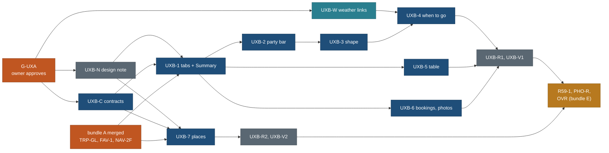

# Trip page and places page: UX fixes from the owner's live review (26 Oct 2026)

Status: **design APPROVED by the owner 26 Oct 2026 (gate G-UXA passed, ANSWERS-6); build not started, queued in bundle C behind TRP-GL and NAV-2F/FAV-1.** Written 26 Oct 2026 by travel-planner (Opus 5.5) on
`public/UX-FEEDBACK-PLAN` from `main` ae3f3be7. Nothing here is built. No product code, no `web/` change and no new HTML
come from this page. The owner approved the designs and answered section 14 on 26 Oct 2026 (rule C of the owner's 26 Oct instruction); implementation starts when the section 12 dependencies merge.

Tracked as PLAN R-260 to R-266, BACKLOG 15.275 to 15.289, owner questions Q293 to Q302, TODO row 2026-10-26.
Wireframes (390 and 1440, real data): [design/trip-page/ux-feedback-wireframes-2026-10-26.md](../design/trip-page/ux-feedback-wireframes-2026-10-26.md).
Principles are cited by number from [principles.md](../design/foundation/principles.md) (P1 to P9, T1 to T5).

**Amends (each page carries a banner):**
- [trip-overview-and-customisation.md](trip-overview-and-customisation.md) 2.1 and 3.3: the "[Day by day] [Trip overview]"
  toggle and the overview's Bookings sub-tab become page tabs (section 3 here); the SeasonBand redesign of 2.1 starts from
  section 6 here, and OVR-1 fills its window slot.
- [trip-timeline.md](trip-timeline.md) 3.1 (the party selector), 3.10 ("whole-trip timeline: every day with span"), the
  "Who is going / Youngest" controls: replaced by sections 4 and 5 here. 3.8 gains `a=<n>` (1 to 12) and the `view` values
  of section 3.4.
- [design/place-page-sections.md](../design/place-page-sections.md) and principles P2's "empty place sections stay visible"
  (18 Oct, already amended by Q273): replaced by the hide-empty rule of section 8.
- [build/AUDITS-AFTER-RELEASE.md](../build/AUDITS-AFTER-RELEASE.md) FA-6: the gap-row collapse moves earlier (UXB-7, bundle
  C); FA-6 keeps the field-audit removals.
- Foundation [patterns.md](../design/foundation/patterns.md) 3.4 and 3.6 and [components.md](../design/foundation/components.md)
  4.2: amended only by the design note UXB-N, written by `travel-design-reviewer`. This page does not edit the foundation.

## Contents

0. Summary and the rules of this task
1. The owner's asks, verbatim, and the traceability table
2. Decisions
3. Trip page information architecture: tabs and the Summary (owner's most important item)
4. The trip's shape: replacing "The trip at a glance"
5. "Plan it for": a collapsed party bar with each child's age
6. When to go: the best-time section and weather links
7. Table view for the days
8. The places page: what to show when data is blank
9. The Kind filter on phones (reference only)
10. Data needs
11. What this removes
12. The plan: placement, tasks, order, conflicts, budgets
13. Briefs
14. Owner questions
15. Gotchas

## 0. Summary and the rules of this task

The owner reviewed the live site (https://travel-beta-tan.vercel.app, release v0.1) on 26 Oct 2026 and found the trip page
hard to read as a whole and the place pages full of blanks. One decision carries most of the answer: **the trip page gets
five tabs, Summary, Days, Stops, Bookings and Photos, with the Summary first.** The Summary answers "what are we doing"
(provinces, parks, bases, how many trails and bookings, highlights with photos, when to go, the trip's shape). The days get
a Table view. The party box collapses to one line ("2 adults · 1 child (7) · Standard") with an Edit pencil and an age for
each child. The place page drops empty sections and gathers every gap into one "Not checked yet" block, with a smaller
template for the 83 basics-only pages.

Rules the owner set for this task (26 Oct): (A) one numbered list of every ask, quoted, with a traceability table, nothing
missing; (B) the Canadian Rockies trip as the test case for every design, with its real data, and how the Dolomites and an
overview trip degrade; wireframes at 390 and 1440, design documents only; (C) no change to the app until the owner approves.

## 1. The owner's asks, verbatim, and the traceability table

### 1.1 The asks

Source messages: (M1) the review of 26 Oct with screenshots 8 to 11; (M2) the coordinator's relay of the same day, item 7;
(M3) the owner's instruction on how to deliver. Quotes are verbatim; bracketed words are the coordinator's context.

| Id | Ask (verbatim) | From |
|---|---|---|
| UXF-1 | "Trip at a glance not helping much" | M1 (1), shot 8 |
| UXF-2 | "also it should be collapsible." | M1 (1) |
| UXF-3 | "family setting should be also collapsible" | M1 (2), shot 9 |
| UXF-4 | "on collapse it should show like 2 adult 1 child or 2 children after collapsible on bar" | M1 (2) |
| UXF-5 | "but edit pencil to update anytime" | M1 (2) |
| UXF-6 | "for child it will ask age for each child." | M1 (2) |
| UXF-7 | "this section [This plan is valid for / best time] also need better design" | M1 (3), shot 10 |
| UXF-8 | "recommended time to visit" | M1 (3) |
| UXF-9 | "also we can link weather link? not sure just a thought" | M1 (3) |
| UXF-10 | "but need a proper design this section too." | M1 (3) |
| UXF-11 | "in this view [By day] can we add one table view, which will show table for each day in chronological order, think about this." | M1 (4), shot 11 |
| UXF-12 | "I am not happy with places page, so many meta data are blank" | M1 (5) |
| UXF-13 | "does not make sense of that page, we need to think about it." | M1 (5) |
| UXF-14 | "on mobile when using filter Kind not able to scroll and see all options" | M1 (6) |
| UXF-15 | "these UI/UX experiences are very important" (coordinator's relay of the owner) | M1 |
| UXF-16 | "In trip details we are missing a summary of what we are doing" | M2 (7) |
| UXF-17 | "for example for the Canadian Rockies trip we are visiting 4 provinces/3 Canadian parks and the names of them" | M2 (7) |
| UXF-18 | "then highlights of the trip (Lake Louise, Moraine Lake etc.)" | M2 (7) |
| UXF-19 | "that should be somewhere properly, maybe a tab." | M2 (7) |
| UXF-20 | "Photos maybe a tab instead of down the page." | M2 (7) |
| UXF-21 | "Then Bookings (all activities) can be one tab." | M2 (7) |
| UXF-22 | "Think over how easily a user should be able to filter and find the details, instead of just day by day" | M2 (7) |
| UXF-23 | "and finding how many bookings they have to do, how many trails they have to do etc." | M2 (7) |
| UXF-24 | "We have the category view which is good" | M2 (7) |
| UXF-25 | "but we need to check what we need to keep as tabs, so they know about Summary, Booking, Photos etc" | M2 (7) |
| UXF-26 | "think about which tabs are actually useful." | M2 (7) |
| UXF-27 | "Use the Canadian Rockies trip (canadian-rockies-2029) as the TEST CASE for every design: fill the designs with its REAL data ... and show how the Dolomites (full) and one overview trip ... degrade." | M3 (B) |
| UXF-28 | "Present designs as wireframes in the spec ... at 390 px and 1440 px for: trip page tab bar and each kept tab, Summary tab, Plan-it-for collapsed/expanded with children ages, best-time section, glance replacement, Table view, Places page by type." | M3 (B) |
| UXF-29 | "Do NOT start making changes to the app: this task ends with the spec, the plan rows and the owner's questions; implementation starts only after the owner approves the design." | M3 (C) |
| UXF-30 | "First compile ONE complete numbered list of EVERY ask ... Quote each ask verbatim ... add a traceability table ... nothing may be missing" | M3 (A) |

### 1.2 Implicit findings (second pass over the screenshots and the built pages)

These were not said, but the owner's screenshots show them, and fixing the asks without them would leave the page wrong.

| Id | Finding | Seen in | Fixed in |
|---|---|---|---|
| UXF-I1 | The glance's version column says "The plan's day" on 12 of 14 Dolomites rows: a label that says nothing | shot 8 | 4.2 |
| UXF-I2 | "Worth the journey" wraps to three lines in the glance's flag column | shot 8 | 4.2 |
| UXF-I3 | The 06 / 12 / 18 clock scale and the dark drive-share segment are never explained | shot 8 | 4.2 (removed) |
| UXF-I4 | The party appears twice with two edit words: "Planned for Adults · Standard" in the box and "Adults · Standard · Edit" in the sticky bar | shots 9, 11 | 5.2 |
| UXF-I5 | With "Adults only", the Youngest stepper reads "no children" and looks broken | shot 9 | 5.3 (stepper removed) |
| UXF-I6 | "Valid for Mid-July to end of August" in the cover stats repeats the section heading below it | shots 9, 10 | 6.2 (stat becomes Best time) |
| UXF-I7 | Month chips J F M A M J J A S O N D: three letters repeat (J, M, A), so the strip is ambiguous | shot 10 | 6.2 |
| UXF-I8 | The weather cards leave Daylight alone on a second row | shot 10 | 6.2 (four equal cards) |
| UXF-I9 | Every note in the season section carries a warning triangle, including "Lagazuoi tunnels need a headlamp" | shot 10 | 6.2 (warn glyph only for closures and hazards) |
| UXF-I10 | The "Suggested times" banner sits between the season and the glance, far from the times it explains | shot 10 | 3.2 (moves to the top of Days) |
| UXF-I11 | In By day the category chips (Stays 4, Trails 10...) look like controls but are counts only | shot 11 | 3.2 (chips live in Stops; Summary cards are links) |
| UXF-I12 | The Day 01 header shows "05:29-05:43 · 20:52-21:04" with only a sun glyph; "sunrise" and "sunset" are not written | shot 11 | 3.2 (UXB-1 adds the words) |
| UXF-I13 | "no walking" on a transfer day reads oddly | shot 11 | 3.2 ("No walk planned") |
| UXF-I14 | The Rockies cover says "Drive a day about 1 h 40", but the glance's daily drives sum to 29 h 45 over 15 days (about 2 h) | built page | 4.7 |

### 1.3 Earlier owner asks that touch this work (cross-reference only)

| Ask | Where it is | Relation |
|---|---|---|
| Phone back-to-top button (R-120) | TOTOP, done | the tab bar is sticky; the button must stay above it and hide under open editors (UXB-1 acceptance) |
| Mine, copies and favourites on this device; phone bar (R-200s, navigation-and-mine.md) | NAV-1, NAV-2 merged; NAV-2F running; FAV-1 open in bundle A | the party store and the copy sheet (section 5); Mine's Open adds `view=day` (3.4) |
| Family default youngest 10 (R-121, FAMAGE10) | done | kept: a child with no age plans as 10 (5.3) |
| Best time to go, trip overview, customise (R-62 to R-67) | OVR (bundle E), CUS (bundle F) | section 3.7 conflicts; OVR-1 fills section 6's slot; OVR-2 fills the Stops tab |
| Collapse non-safety "Not checked yet" rows (Q273, yes) | FA-6, bundle F | pulled to bundle C as part of UXB-7 |
| The UI and UX audit at the end (R-230s, v0.22) | bundle J | these fixes ship before it; UA-T will re-check them |

### 1.4 Traceability: ask, spec section, task

| Ask | Answered in | Task |
|---|---|---|
| UXF-1 | 4.1, 4.2 (replace with the trip's shape) | UXB-3 |
| UXF-2 | 4.3 (collapsed by default, remembered per trip) | UXB-3 |
| UXF-3 | 5.2 | UXB-2 |
| UXF-4 | 5.2 (party words) | UXB-2, UXB-C |
| UXF-5 | 5.2 (pencil Edit, always in the bar and the sticky rail) | UXB-2 |
| UXF-6 | 5.3 (an age select per child) | UXB-2 |
| UXF-7, UXF-10 | 6.2 | UXB-4 |
| UXF-8 | 6.2 (Best time hero, month strip with best and also-good months) | UXB-4; OVR-1 later |
| UXF-9 | 6.3, 6.4 (link out to national weather services; no runtime calls) | UXB-W (data), UXB-C, UXB-4 |
| UXF-11 | 7 | UXB-5 |
| UXF-12, UXF-13 | 8 (evidence 8.2, design 8.3 to 8.6) | UXB-7, UXB-N |
| UXF-14 | 9 | KIND-FILTER-FIX (running; not in this plan) |
| UXF-15 | 2 (D13), 12.5 (review gates), every brief's acceptance | UXB-N, UXB-R1, UXB-R2, UXB-V1, UXB-V2 |
| UXF-16, UXF-19 | 3.2, 3.5 (Summary tab, default) | UXB-1, UXB-C |
| UXF-17 | 3.5 (provinces and parks with names) | UXB-C, UXB-1 |
| UXF-18 | 3.5 (highlights with photos and day links) | UXB-C, UXB-1 |
| UXF-20 | 3.2 (Photos tab) | UXB-6 |
| UXF-21 | 3.2, 3.6 (Bookings tab) | UXB-6 |
| UXF-22 | 3.3 (filters inside tabs, with counts) | UXB-1 (Summary links), OVR-2 (Stops filters, bundle E) |
| UXF-23 | 3.3, 3.5 (count cards: "33 trails", "7 to book ahead") | UXB-1, UXB-6 |
| UXF-24 | 3.2 (By category kept as the Stops tab) | UXB-1; OVR-2 |
| UXF-25, UXF-26 | 3.1, 3.2 (each candidate judged; five kept) | UXB-N, UXB-1 |
| UXF-27 | wireframes, every frame; 3.5 table of trip states | this spec |
| UXF-28 | wireframes W1 to W10 | this spec |
| UXF-29 | section 0; 12 (gate G-UXA: owner approval before any UXB build) | coordinator |
| UXF-30 | 1.1 to 1.4 | this spec |
| UXF-I1 to I3 | 4.2 | UXB-3 |
| UXF-I4, I5 | 5.2, 5.3 | UXB-2 |
| UXF-I6 to I9 | 6.2 | UXB-4 |
| UXF-I10 to I13 | 3.2 | UXB-1 |
| UXF-I14 | 4.7 | UXB-C (one figure for both) |

## 2. Decisions

| # | Decision | Why | Trade-off |
|---|---|---|---|
| D1 | **Five page tabs: Summary · Days · Stops · Bookings · Photos.** Table is a view inside Days; Map stays a companion column (desktop) and sheet (phone); Stays, Notes and Weather are sections or filters | Each kept tab answers one question for at least two personas (3.1); five labels fit 390 px; the owner named Summary, Bookings and Photos | Five is the upper end at 320 px, where the strip scrolls |
| D2 | **Summary is the default tab; the last tab is remembered per trip on this device** | The 90% visitor (P7) first asks "what is this trip"; scenario rule 2 says each trip remembers its last tab | Links without `view` now open the Summary, not the days; Mine's Open adds `view=day` |
| D3 | **Page tabs ride the existing `view` key** (`summary` default, `day`, `table`, `all`, `bookings`, `photos`); OVR's `tab=` stays the sub-tab inside Stops | One key for the page's view, no clash with OVR's `tab` | `view` now has six values; the codec keeps unknown values falling back to the default |
| D4 | **"The trip at a glance" is replaced by "The trip's shape"**: a bases ribbon, a one-line count summary and an expandable per-day table (driving, on foot, notes in words); the clock chart goes | The chart answered "when does each day start and end", which no persona asked; the owner said it is not helping | The visual of day spans is gone; start and end times stay in each day's header |
| D5 | **"Plan it for" collapses to one line with a pencil Edit**, collapsed by default, state remembered on the device | UXF-3 to UXF-5; P2, P3 | A first-time visitor sees the party as a sentence, not as controls |
| D6 | **The party is adults (1 to 12) and children with an age each (0 to 17, at most 8)**, kept on the device only (`travel.party`); the URL carries only the youngest band and the adult count | UXF-6; household data never goes into a URL (navigation-and-mine.md 2.3) | A shared link cannot carry the other children's ages; the receiver sees "youngest 6" |
| D7 | **When to go leads with a "Best time" hero**, a three-letter month strip with best and also-good months as pattern and word, four equal cards (temperature, rain and snow, daylight, crowds), then other weeks (OVR-1) and weather links | UXF-7, UXF-8, findings I6 to I9 | The best-week hero needs a windows file: 1 of 14 trips today; the rest show their season label |
| D8 | **Weather: link out to national weather services; no weather API call from the page** | Free, licence-safe, no visitor data leaves the page; Open-Meteo's free API is non-commercial only and a runtime call would send visitors' IP addresses to a third party | No numbers from a live forecast on the page |
| D9 | **Table view: one real `<table>` per day, chronological; 6 columns on desktop, 3 on phones (no sideways scroll)**; "Stops only" equals the CSV rows | UXF-11; P3, T2; components 4.2 forbids page-level sideways scroll | Phones fold kind, place and notes into a second line of the What cell |
| D10 | **Place pages: draw only what is known.** A section with no value is not drawn; every gap goes into one "Not checked yet" block at the end, one line per section; safety gaps keep their own row; basics-only pages get a smaller template | 13,561 "not checked yet" phrases across 431 pages; 92% of full pages show more blanks than facts (8.2); Q273 already said yes to collapsing | Missing data is less visible per fact; research progress shows in the completeness chip and the block |
| D11 | **Everything ships in bundle C**, after bundle A's trip-page and place-page tasks merge; nothing is added to bundle A | A's first deploy already waits for Mine; TRP-GL and FAV-1 still own the files these tasks need | The owner sees the fixes one bundle later than "next deploy" |
| D12 | **No net trip start JS**: every new trip-page control renders on the server or loads in a lazy chunk; the party editor, the shape's rows, the table, Bookings filters and Photos are chunks | Headroom is about 460 B on the trip start chunk | One extra request on first use of each lazy part |
| D13 | **Quality bar (UXF-15):** an owner-approved design (this page and the wireframes) before build, a foundation note before code, a design review and a verifier pass after each round, and the Rockies at 320, 390 and 1440 in light and dark as the acceptance set | The owner said these experiences are very important | About 12 of the 67 hours are review and verification |

## 3. Trip page information architecture: tabs and the Summary

This is the owner's most important item (M2). It sets the frame the other trip-page items live in.

### 3.1 What each candidate tab answers, per persona

Personas: **V** a visitor on a phone deciding whether this trip is for them (the 90%, P7); **P** a planner copying the
trip to plan their own dates; **G** a group member checking logistics before or during the trip.

| Candidate | Question it answers | V | P | G | Verdict |
|---|---|---|---|---|---|
| Summary | What are we doing, where, how hard, when, and what is special? | **Main question** | first look before copying | quick refresher | **Keep, default tab** |
| Itinerary (By day) | What do we do on Day 5, in order, at what time? | second | **main work** | **main use** in the field | **Keep, as "Days"** |
| Table | All of Day 5's stops and times in one grid | rarely | checks and copies times | prints it | **A view inside Days** (List or Table), not a tab: same question as Days |
| By category (Places, Trails, Stays) | How many trails, sights, activities, and which suit us? | browses trails | filters, removes | rarely | **Keep, as "Stops"** (the owner: "the category view which is good") |
| Bookings | What must we book, by when, and where? | "how much admin is this?" | **must-do list** | checks status | **Keep** |
| Photos | What does it look like? | **yes** | rarely | no | **Keep** (owner's ask); omitted when the trip has no gallery |
| Map | Where is everything? | glance | routes the days | navigation | **Not a tab**: the map is a companion of Days, Stops and Bookings (desktop column, phone sheet); a tab would separate it from the list it explains (P5) |
| Stays | Where do we sleep? | yes | yes | yes | **Not a tab**: the bases ribbon in Summary answers it at a glance; the Stays chip in Stops lists them (OVR 3.2, "Where to stay") |
| Notes ("Know before you go") | What could go wrong? | yes | yes | yes | **Not a tab**: trip-level notes in Summary (safety at rest, P2), day notes in each day |
| Weather | What will it be like? | yes | yes | yes | **Not a tab**: part of When to go in Summary, links out (section 6) |

Five tabs (D1). Fewer was considered: folding Photos into Summary's highlights gives four, but the owner asked for Photos
as a tab and the gallery has 41 Rockies photos, too many for the Summary.

### 3.2 The tabs and what moves where

| Tab | Holds | Moved from | Server or lazy |
|---|---|---|---|
| **Summary** (default) | What you will do (lead line), count cards, Highlights, When to go (section 6), The trip's shape (section 4), Who it suits, Know before you go | new; season band and glance move here from above the days | server-rendered HTML; the shape's expanded rows are a lazy chunk |
| **Days** | the "Suggested times" banner (moved from above the glance, I10), the sticky day rail, the day cards as today, the List or Table switch (section 7) | "In this trip" By day | as today (start chunk); Table is a lazy chunk |
| **Stops** | the six category chips with counts and, from OVR-2, the overview's filters and scopes | "In this trip" By category | lazy (`CategoryView` since OVR-0; OVR-2 later) |
| **Bookings** | every booking of the trip, grouped by day, with its rule and note; counts | the overview's Bookings sub-tab (OVR 3.2), the export's `bookings` (TRP-GL-C) | server-rendered from the export model |
| **Photos** | the gallery by section, credits | "Photos" section at the end of the page | lazy (`LazyGallery`) |

The "In this trip" heading, the "Group the trip: By day / By category" segment and the always-visible category chips in By
day are removed (I11). "Take this plan with you" stays at the end of every tab. Small fixes inside Days (UXB-1): the sun
range reads "Sunrise 05:29 to 05:43 · Sunset 20:52 to 21:04" (I12); "no walking" reads "No walk planned" (I13).

Wireframe: W1.

### 3.3 Filters inside the tabs, with counts (UXF-22, UXF-23)

The two questions the owner named are answered at rest, before any filter: the Summary's count cards say "33 trails" and
"7 to book ahead", and each card is a link into the filtered tab.

| Question | At rest (Summary) | One click | Filters there |
|---|---|---|---|
| How many trails? | "33 trails, 186.5 km, all versions" | Stops, Trails chip | from OVR-2: Effort, Duration, Booking, Day, Base (area), Suits (fits your party, stroller, wheelchair, dogs), Season fit, Kind |
| How many bookings? | "7 to book ahead; none has a published opening date yet" | Bookings | Day, Kind only when there are more than 12 bookings (P1: no filter bar for 7 rows) |
| What suits a 7 year old? | "Whole family on 14 days" in Who it suits | Stops with Suits = fits your party | OVR-2 |
| What is special? | Highlights, 13 places | Stops filtered to "Worth the journey" | OVR-2 adds the relevance filter value |
| Which days are hard? | The trip's shape: "4 long drive days" | the shape's list filtered to those days | none needed |

Counts update as filters change (P4), with one "Clear all". Until OVR-2 ships (bundle E), the Stops tab is today's
By category view with chip counts and no filters; the Summary's links then open the right category section.

### 3.4 The tab bar

**Layout.** W1. 48 px row under the party bar, sticky under the header (`--z-sticky`, `--bg`), labels `--t-tab`, counts
in mono `--t-meta` `--muted` on desktop only, the current tab `--ink` with `--t-tab-current-weight` and a 3 px `--accent`
underline. Touch targets 44 px (`--touch-min`). Phone: labels only, one row at 390 if it fits (builder measures), a
horizontal snap row with a 24 px right fade at 320 with the current tab scrolled into view. A tab with no content is not
drawn (W1 "tabs by trip state"); a trip with only a Summary has no tab bar.

**Keyboard and screen reader.** ARIA tabs (APG): `role="tablist"` labelled "Trip sections"; each tab a `button` with
`role="tab"`, `aria-selected`, `aria-controls`; roving `tabindex`; Left and Right move and activate (automatic activation;
lazy panels show `role="status"` "Loading the table" while their chunk loads, with `aria-busy` on the panel); Home and End;
Tab moves into the panel. Each panel is `role="tabpanel"` with `aria-labelledby`. Switching moves focus to the tab, not
the panel; a deep link (a highlight's "Day 11") moves focus to the day's heading.

**URL.** The `view` key (D3): omitted = `summary`; `day`; `table`; `all` (Stops; `category` stays an alias); `bookings`;
`photos`. A `#day-N` hash with no `view` opens Days. `view` stays outside the profile codec (useTripUrl owns it); the
codec's keys (`p`, `pace`, `a`, `walk`, `split`, `d`, `add`) and OVR's `w` apply on every tab. Switching tabs uses
`pushState` (Back returns to the previous tab, P5); scrolling inside a tab uses `replaceState` as today. Mine's Open link
(`web/lib/mine/rows.ts` `openQuery`) adds `view=day`, because a copy is opened to read its days.

**Default and memory.** First visit: Summary. Afterwards, the last tab for that trip is restored when the URL has no
`view` and no `#day-N` (URL first, then the remembered tab, then Summary). Stored in `travel.tripui` (section 10.2) through
`web/lib/storage/safe.ts`; storage blocked means Summary every time, silently.

**No script.** Panels render on the server with `hidden` on all but the default; a `<noscript>` style un-hides them and
the tabs become in-page links, so a script-less reader gets the whole page in order.

**Print.** Printing prints the Summary and the Days (List, or Table when Table is the current view), never the Photos.

**Motion (P5).** The panel swaps without animation; the underline slides in `--d-fast` with `--e-std`; reduced motion
jumps. Scroll: switching keeps the tab bar where it is on screen (the page scrolls so the bar stays at its sticky line),
never a jump to the top.

### 3.5 The Summary: content, data and trip states

Wireframe: W2. Order: What you will do · count cards · Highlights · When to go · The trip's shape · Who it suits and Know
before you go.

| Block | Rockies (real data, 26 Oct) | Data source | Rule |
|---|---|---|---|
| Lead line | "15 days through Alberta and British Columbia, in four national parks (Banff, Jasper, Yoho, Kootenay) and two provincial parks (Peter Lougheed, Mount Robson), all in the Canadian Rocky Mountain Parks World Heritage Site" + the trip's standfirst | admin-1 from the linked places' area chains (Alberta 29, British Columbia 6 of 35); parks from their designation lines | a region or park is named only when a linked place lies in it; names in the order of first appearance in the days |
| Count cards | 4 bases, 14 nights · 33 trails, 186.5 km (all versions) · 28 sights · 15 activities · 7 to book ahead, none dated · 41 photos | export stops (distinct by place), place glance facts, export bookings, gallery | a total is shown only with its coverage ("climb known for 27 of 33") |
| Highlights | 13 "Worth the journey" places; 8 cards at rest: Moraine Lake (Day 11), Lake Louise (3, 10), Peyto Lake Lookout (4), Maligne Lake and Spirit Island (5), Athabasca Glacier (4, 8), Takakkaw Falls (9), Johnston Canyon (3), Larch Valley to Sentinel Pass (11) | relevance anchor badge; photo: the place's own (D5c in bundle C) else the trip gallery section that names it, else the kind glyph and "No licensed photo yet" | at most 8 at rest; P8: light card data only |
| When to go | section 6 | season, windows | |
| The trip's shape | section 4 | timelines, bases | |
| Who it suits | Moderate · from about 6 · whole family on 14 days, adults' hike on 1 · [Plan it for your party] | trip effort, ageFit, the profile line | the button opens the party editor (5.3) |
| Know before you go | 3 at rest from the trip's booking and season notes; safety rules (Larch Valley group of four, Moraine Lake road) always at rest | export bookings notes, season notes | P2 safety exception |

**By trip state** (14 public trips: 2 full, 6 summary, 6 overview):

| State | Trips | Summary shows | Omitted |
|---|---|---|---|
| full | Rockies, Dolomites | everything above | nothing |
| summary | Utah, Iceland, Patagonia, Chamonix, Algonquin, Vermont | lead with regions and parks (Utah: Utah; Arches, Bryce Canyon, Canyonlands, Capitol Reef and Zion national parks, Dead Horse Point and Goblin Valley state parks; Iceland: six regions, Vatnajökull, Snæfellsjökull, Þingvellir), counts, highlights where relevance exists, When to go, the shape without times (condensed: parts of the day) | count cards with no data |
| overview | Costa Rica, Norway, Switzerland, New Hampshire, Niagara, Quebec | nights, country from the region, the season file, gallery sections as highlights without day links, "This plan has not been converted to days yet" | regions and parks (no linked places), counts, shape, bookings |

Degrade frames for the Dolomites and Costa Rica: W2.

### 3.6 The Bookings tab

Wireframe: W7. Rows from the export model's `bookings` (TRP-GL-C, merged): name, day, rule (`bookRuleText`), note
(`publicBookingNote`), ref. Grouped by day now; by booking group (Book first, Book ahead, On the day, Not checked) once
OVR-2 serves `tripItems(tab=bookings)`. Header counts: "7 to book · 0 with a published opening date". Price only when held;
otherwise one line "Prices: not checked yet for these 7", never a column of blanks. A row links to its stop's place page
and the official booking link when the stop has one. Rockies: 7 rows, all `rule: null`; Dolomites: 3 rows, Tre Cime
"Opens 30 days before Day 3". The UI-NOTES row about " local" with no time is fixed in core's `bookRuleText` by UXB-6
(its parity test with the print kept).

### 3.7 Conflicts with other planned work

| Work | Conflict | Resolution |
|---|---|---|
| OVR (bundle E): OVR-N, OVR-Ca/Cb, OVR-1, OVR-2, OVR-3 | OVR-2 planned its own "[Day by day] [Trip overview]" toggle and a Bookings sub-tab; OVR-1 redesigns the SeasonBand | the tab shell lands first (bundle C); OVR-N adopts it; OVR-2 renders into the Stops panel and later swaps the Bookings panel's source to `tripItems`; OVR-1 fills section 6's "Other weeks" slot and the hero's window. OVR spec banner added |
| CUS (bundle F): customise a copy | edit affordances live in Days and Stops; the party feeds `trip-custom/1` `travellers` | CUS reads `travel.party` at sign-in merge (navigation-and-mine 4.2 already merges device data); no tab change |
| TRP-GL (bundle A, not merged) | owns `web/styles/timeline.css` and a timeline component | every UXB trip task starts after TRP-GL and TRP-GL-F merge |
| NAV-2F (running) and FAV-1 (bundle A) | CopySheet, Mine rows; place-page heart | UXB-2 starts after NAV-2F; UXB-7 after FAV-1 |
| Table view vs export | must not reword times | one core function, `printTime` (section 7.4) |
| R59 (bundle C): links beside every stop | touches day entries and place links | UXB-1 before R59-1 on the trip page; UXB-7 before R59's place-page parts (12.3) |
| PHO-R (bundle C): photos on place pages, owner-approved re-baseline | same place-page files and the S13 baseline | UXB-7 merges first and frees bytes; PHO-R's re-baseline covers the photo only |

## 4. The trip's shape: replacing "The trip at a glance" (UXF-1, UXF-2)

### 4.1 What the old chart answered, and what it should

Today's chart draws each day's span on a 05:00 to 23:00 clock with the drive share shaded, a version column, the drive
time and flags. It answers "what time does each day start and end", which no persona asks of the whole trip. The
questions the three personas ask of the whole trip are: where do we sleep and for how long; which days are long drives;
which days have something to book; which days are the highlights; where are the warnings; which are light days.

### 4.2 Design

Wireframe: W5. Lives in the Summary.

- **Bases ribbon**: one segment per stay, width by nights, name and nights in text ("Jasper townsite · 4 nights"); no
  colour per base; `--surface-2` with `--line-2` dividers. Rockies: Banff 2 · Lake Louise village 1 · Jasper townsite 4 ·
  Lake Louise village 4 · Kananaskis Village 3 (+ the flight home on Day 15).
- **Count line**, each phrase a button that expands the list filtered to those days: "15 days · 4 long drive days · 5 days
  with a booking · 8 highlight days · 6 days with a warning". Rockies: long drives Days 1, 4, 5, 8; bookings Days 1, 4, 5,
  10, 11; highlights Days 3, 4, 5, 8, 9, 10, 11, 14 (Day 5 holds the Spirit Island cruise); warnings Days 2, 4, 7, 10, 12, 13.
- **Expanded list**: a real table, caption "The trip's shape, 15 days", columns Day · Base and plan · Driving · On foot ·
  Notes. Driving is a bar (`--ink-2` on `--well`) scaled to the trip's longest drive day with the value written beside it;
  On foot is the day's `walkKm` for the current party; Notes are words: Long drive (2 h 30 or more), Book n, Highlight,
  Warning n, Light day (on foot under 2 h and driving under 1 h, not a travel day), Flight home, Changed.
- **Removed**: the clock bar and its 06 / 12 / 18 scale (I3), the drive-share segment, the version column (I1; a version
  shows only as a note when the party's version differs from the main one), the three-line "Worth the journey" wrap (I2).
- A row opens Days at that day (P5).

### 4.3 States

| State | Default | Remembered | Shows |
|---|---|---|---|
| Collapsed | yes, every width | per trip, `travel.tripui` | ribbon + count line + "Show all 15 days" |
| Expanded | after a click on the button or a count phrase | per trip | the table (filtered when a count phrase was used, with "Show all days") |

Button: `aria-expanded`, `aria-controls`; the table grows in `--d-base`, reduced motion jumps.

### 4.4 Phone

W5 390: the ribbon shortens a name only when it does not fit its segment (decided per segment from the name's length: up to 6 letters needs
56 px, 10 needs 96, 16 needs 140, longer 200; the short form is initials for two or more words, up to 6 letters whole for one word, else 4 letters and a
full stop; a segment under 48 px shows its nights only; full names in the list). A trip with more than 6 stays, or a stay under 7% of the nights (12% on
a phone), adds a names line under the ribbon ("Reykjavik 1 · Selfoss 1 · ..."). The count phrases read short on a phone ("4 long drives"). The expanded list is one
three-line row per day (day and base and drive; the title; walking and notes, e.g. "1.9 km on foot · Long drive · Book 2"), the whole row a link named with its day, base and plan.

### 4.5 Data

Timelines (already on the page), `model.days[].base`, the export bookings by day, the relevance anchor per day (as today's
flags), warnings. No new data. The collapsed ribbon and count line are server-rendered from the default profile; the
expanded rows render on the client from the current profile in a lazy chunk.

### 4.6 Removes

`TripTimeline.tsx`'s clock strip, `stripDomain`, the tick gradient and the "The trip at a glance" heading.

### 4.7 One drive figure (I14)

The cover stat "Drive a day" and the shape must say the same thing. UXB-C makes the adapter compute the average from the
default timelines' `totals.driveMin` (Rockies: 29 h 45 over 15 days, about 2 h); the cover reads it. If the figure is
meant to exclude travel days, both say so ("about 1 h 50 on touring days").

## 5. "Plan it for": a collapsed party bar with each child's age (UXF-3 to UXF-6)

### 5.1 Today

One card with Who is going (Adults only, Family), a Youngest stepper (disabled reading "no children" for adults), Pace,
and More (Adults 1 or 2+, Longest walk, Split). The copy sheet separately asks adults, the number of children and each
child's age, and pushes only the youngest back to the page.

### 5.2 Collapsed bar (default)

Wireframe: W3. One 56 px row: "PLAN IT FOR  2 adults · 1 child (10) · Standard pace" with "Plan as written: family from
about 6" on the right on desktop and a pencil **Edit** button (44 px). The words come from one function shared with Mine's
rows (`partyText` extended): "1 adult", "2 adults", "1 child (7)", "2 children (7, 10)", "1 child (age not set)". After a
change, **Reset** appears beside Edit. The sticky day rail on Days says the same words ("2 adults, 1 child · Standard ·
Edit"; on a phone the pace is truncated first) and its Edit opens the same editor (I4: one edit word, one editor).

### 5.3 Editor (expanded)

- Adults stepper 1 to 12; Children stepper 0 to 8; one age select per child ("Child 1 age", 0 to 17, 0 reads "under 1");
  Pace segmented with its one-line note; More: Longest walk, Split days (when the trip has split days).
- **No "Adults only / Family" toggle and no Youngest stepper** (I5): children 0 means adults; the youngest is the lowest
  age entered.
- Adding a child appends its select and moves focus to it; until an age is chosen the plan uses 10 (FAMAGE10) and the line
  says "age not set, planning for 10".
- The profile line (aria-live) under the controls says what the plan now is, as today.
- "Kept on this device only. Ages never go into a link you share; a shared link carries the youngest age."
- Inline, never a modal (timeline 3.1). Grows from the bar in `--d-base`; Done or Escape closes it and returns focus to
  Edit.

### 5.4 Where the party lives

| Piece | Where | Why |
|---|---|---|
| Adults and children's ages | `travel.party` on the device (`{ v: 1, adults, children: number[] }`), through `safe.ts` | household data: never in a URL, never sent signed out (navigation-and-mine 2.3) |
| What the plan uses | the profile: `p=family-<youngest>`, `a=<adults>` in the URL | shareable, reproducible |
| Collapsed or open | `travel.tripui` (one device key, section 10.2) | UXF-3 |

**Landing rule (Q295).** A trip opened with no profile keys in the URL applies the device party after hydration and the
bar says "Your party"; "Plan as written" returns to the trip's default. A URL with profile keys wins and the bar offers
"Use my party (2 adults, 2 children)" (W3, shared link state).

**Codec change (Q296).** `a` widens from "1 or omitted" to `a=1` to `a=12`, default 2 omitted; the scheduler still treats
2 or more as "can split". Old links (`a=1`) mean the same. Children's ages never enter the codec.

**The copy sheet and the codec stay consistent.** The sheet prefills adults and every child's age from `travel.party`
(not only the youngest); editing travellers in the sheet updates `travel.party`, and the page's profile follows its
youngest and adult count (today's `registerYoungest` widens to a party). `copies/1` keeps `adults` and `children[]` per
copy, unchanged; Mine's Open writes `p` and `a` from the copy (rows.ts `openQuery`), never ages.

### 5.5 Data and budget

No new server data. The collapsed bar is in the start chunk (small); the editor (steppers, selects, segmented, switch)
moves to a lazy chunk loaded on Edit, which frees bytes from today's `ProfileBar` (D12).

### 5.6 Removes

The "Who is going" segment, the Youngest stepper, the "Planned for" line in the card head (the bar says it), the "Change"
button.

## 6. When to go: the best-time section and weather links (UXF-7 to UXF-10)

### 6.1 Data we have

| Data | Coverage | Fields |
|---|---|---|
| Trip season (`trip.season`: seed or `data/seasons/`) | 14 of 14 trips have a label; weather tiles where written | months, label, why, tempC, rain, daylight, notes, basis |
| Windows (`data/windows/<trip>.json`, `trip-windows/1`) | 1 of 14 (Rockies: 4 windows, 22 sources, read 25 Oct) | verdict, crowd level, plus and minus, affects, unknown |
| Climate source | Rockies windows cite Environment and Climate Change Canada 1991-2020 normals and Parks Canada's Banff weather page | url, publisher, read date |
| Forecast links | none stored | (UXB-W) |

### 6.2 Design

Wireframe: W4. In the Summary.

1. **Hero:** "Best time for this plan" + the window in `--t-trip` `--accent-text` + one sentence. Rockies after OVR-1:
   "Second week of September: after the Labour Day weekend, with the first larch colour late in the trip". Before OVR-1
   (bundle C to E): the season label "Early to late September" and its why. The cover stat becomes **BEST TIME** (I6).
2. **Month strip** with three-letter names on desktop (I7) and letters plus a legend on phones (each cell has its month and
   state as text for screen readers): **best** (solid `--ink` fill), **also good** (hatched pattern), **the plan's months**
   (outlined, when no windows file says "best"), **avoid** (crossed, only with a sourced reason), plain for "not researched
   for this plan". Pattern and word, never colour alone; no green.
3. **Four equal cards** (I8): Temperature, Rain and snow, Daylight, Crowds. Crowds comes from the default window's crowd
   level with its basis; with no windows file: "Crowds: not checked" (honesty rule 2.4 of the overview spec).
4. **Other weeks that work:** one line per other window (verdict, crowd, one plus, one minus); OVR-1 adds "Plan for this
   window" (`w=`). With no windows file: "Other weeks have not been researched yet."
5. **Worth knowing:** the season notes, the info glyph for advice and the warn glyph only for a closure or a hazard (I9).
6. **Weather:** "Forecast: Banff, Jasper, Lake Louise, Kananaskis (Environment Canada) · Climate averages 1991-2020
   (Environment Canada)", links opening in a new tab with the publisher named.

Phone: the cards are a 2 x 2 grid; "Other weeks" and "Worth knowing" collapse to a counted disclosure, except that a
hazard line stays visible at rest (P2).

### 6.3 Weather sources evaluated (UXF-9)

| Option | Cost and licence | Privacy | Verdict |
|---|---|---|---|
| **Link out** to the national weather service: forecast for each base town and the climate normals page (Environment and Climate Change Canada, NOAA NWS and NCEI, Météo-France, MeteoSwiss, Provincia di Bolzano Meteo and ARPAV Veneto, Veðurstofa Íslands, MET Norway (yr.no), Instituto Meteorológico Nacional (Costa Rica), SMN Argentina and DMC Chile) | free; we store a link only | nothing is sent from our page; the visitor chooses to leave | **Recommended now** |
| Open-Meteo forecast API from the browser | free tier is non-commercial only (sites with ads or subscriptions are commercial), under 10,000 calls a day, data CC BY 4.0 (terms read 26 Oct 2026) | each page view sends the visitor's IP address to Open-Meteo: a new third-party call on page load, a privacy-page change | **No** |
| Open-Meteo historical (ERA5) at build time: monthly normals per base, stored as data with the credit "Open-Meteo, CC BY 4.0" | free under the non-commercial terms; attribution needed | none at run time | **Later, if the owner wants numbers (Q298)**; values would carry the Estimate chip because they are our computation from a model |
| A paid weather API | breaks the free-tier rule (product direction) | | No |

What may be stored: the URL, publisher and read date of each link (P8: links are already public data). What is fetched on
the client: nothing. No visitor data is sent anywhere by this section.

### 6.4 Data needed

> **Update 26 Oct (UXB-W, UXB-WL).** The weather links live in `data/reference/weather-links.json` (`weather-links/1`, validated by `core/src/validate/weatherLinks.ts`, read as sources by `sources.ts build`), not on capture `conditions` links (owner, 26 Oct). Non-English national pages stay and the label names the language; mountain and aurora rows show in When to go as a small secondary row. UXB-C needs no weather field on the trip summary; UXB-4 reads the reference file through a web adapter (no zod in the browser chunk).

Per trip, per base: one forecast link from the national service; per trip: one climate normals link (the Rockies already
has it in its windows sources). Research task **UXB-W** (data seat, about 30 bases on 14 trips). Shape (UXB-C decides the
exact contract): a light `weather: { climate: Link | null; forecasts: { base: string; link: Link }[] }` on the trip
payload, read from the base places' `conditions` links whose publisher is a national weather service (the link checklist
already has the `conditions` kind) and the trip's climate source. Never in a public bulk file.

### 6.5 Removes

The "This plan is valid for" heading and the single-letter strip on desktop; the uneven weather grid; the warn glyph on
advice lines.

## 7. Table view for the days (UXF-11)

### 7.1 Design

Wireframe: W6. Days tab, `[List | Table]` segmented (`view=table`), and `Show [Everything | Stops only]` (`rows=stops`,
remembered). One table per day, in day order, each with a caption "DAY 04 · Lake Louise to Jasper townsite · 07:30 to 19:00
· 2 h 55 driving". Rows in the timeline's chronological order; drive legs are indented rows of kind "drive".

| Column (desktop) | Content | Phone (under 640 px) |
|---|---|---|
| Time | the timeline's time worded as the page and the print word it ("~08:45", "about 19:30", "Morning" on a condensed plan) | column 1 |
| What | the entry title; links to the place page | column 2, line 1 |
| Kind | kind word ("trail", "lake", "drive", "meal") | column 2, line 2 |
| Where | area or base | column 2, line 2 |
| Takes | duration; for a drive "55 min · 42 km" | column 3 |
| Notes, book | booking text (`bookAhead`), Highlight, warning text, slot | column 2, line 3 |

**Phone: three columns, no sideways scroll (D9, Q299).** Kind, where and notes fold into extra lines of the What cell;
the same `<table>` is kept, so screen readers hear a table. From 640 px the three extra cells are real and the folded lines
are `aria-hidden`.

### 7.2 Accessibility

Real table semantics: `<caption>`, `<th scope="col">`, the time cell `<th scope="row">`; one table per day so a screen
reader's table list is the day list; the sticky header row stays inside each table. Keyboard: the table is not a grid
widget (no arrow-key cell focus); links inside are in tab order.

### 7.3 Print and export

"Print this table" prints the tables (print CSS: repeat the header row per page; one day never splits across a page
when it fits). Export uses the existing Export menu: its CSV equals the table with "Stops only" (same rows, same times,
same booking words).

### 7.4 One source for times

Rows come from the timeline the page shows (`publishTimeline`'s display timelines); the time text comes from core
`printTime` (`core/src/export/plan.ts`), which the CSV and the print already use. A parity test pins: for Rockies Day 4
and Dolomites Day 3 at the default and at `p=family-6&pace=relaxed`, the "Stops only" rows equal `forTimeline`'s CSV rows
(day, time, name, book ahead).

### 7.5 Data and budget

No new server data. The table is a lazy chunk loaded on the first Table choice or a direct `view=table` (D12).

## 8. The places page: what to show when data is blank (UXF-12, UXF-13)

### 8.1 Today

Every place page renders every section of its template. Since Q273's partial work, many sections end with a line "Not
checked yet: a, b, c", and single rows still say "Not checked yet" in the glance and in rows. The 83 basics-only pages use a
smaller template that still draws every section header with a gap line and five link tabs that each say "not checked yet".

### 8.2 Evidence (measured 26 Oct 2026)

Method: the built pages of `main` (`web/.next/server/app/places/*.html`, built 26 Oct 11:17 from the commit before
ae3f3be7, whose change touched no place output), parsed by section (`<section class="ps">` with its `<h2>`). **Blank items
named** = each item in a "Not checked yet: a, b, c" line plus each single "Not checked yet" value; **filled facts** =
labelled values shown (glance values, labelled rows without a gap, `<dt>` rows, titled notes, the season grid, the route
profile, a link list, similar-nearby rows). Photos counted separately.

**All 431 place pages** (434 built, 3 redirects):

| Measure | Value |
|---|---|
| "not checked yet" phrases on the pages | **13,561**; median 26 per page; most 78 (Sulphur Mountain switchback trail) |
| Templates | 348 full, 83 basics |
| Research level shown | Basics only 124 · Early research 233 · Partly checked 74 · Checked 0 |
| Full pages with more blank items than filled facts | **321 of 348 (92%)**; median 30 blank items to 12 filled facts |
| Share of a full page's sections with nothing filled | median **50%** |
| Pages with a licensed photo | **60 of 431 (14%)**; 0 of the 35 places linked from the Rockies trip |
| Pages linked from a public trip | 289 (all full template); 0 of the 83 basics pages |

**By section, full pages (348):**

| Section | Pages with it | Blank items | Filled facts | Pages where it has nothing filled |
|---|---|---|---|---|
| Who it suits | 346 | 3,920 | 1,823 | 47 |
| Facilities | 346 | 1,318 | 136 | 243 |
| Glance (top facts) | 348 | 1,159 | 1,486 | 68 |
| When to go | 348 | 1,142 | 238 | 156 |
| Before you go | 348 | 873 | 197 | 200 |
| How to get there | 348 | 654 | 259 | 226 |
| Links | 348 | 549 | 348 | 0 |
| Options and prices | 296 | 446 | 90 | 246 |
| The route (trails) | 144 | 423 | 72 | 72 |
| Nearby, worth adding | 348 | 309 | 111 | 269 |
| At this place / On this route / With this you can also | 348 | 359 | **0** | **348 (all)** |
| Facts and sources | 348 | 11 | 465 | 227 |

**By kind, full pages:** Trail 116 pages, 43.9 blank items and 26.9 filled facts a page; Viewpoint 34, 25.4 and 11.0; Lake
30, 28.6 and 13.2; Town 25, 15.8 and 5.6; Area 22, 22.4 and 7.6; Waterfall 22, 29.5 and 9.3.

**Sample of 20 pages across types:**

| Page | Kind | Template | Level | Sections | Sections with nothing filled | Blank items named | Filled facts | "Not checked yet" on page | Photo | In a trip |
|---|---|---|---|---|---|---|---|---|---|---|
| arches-national-park | Area (park) | full | Partly checked | 11 | 5 | 23 | 9 | 18 | yes | yes |
| castle-provincial-park | Provincial park | full | Basics only | 11 | 9 | 30 | 2 | 41 | no | yes |
| arrowhead-provincial-park | Area (park) | basics | Basics only | 8 | 8 | 6 | 1 (point) | 17 | no | no |
| maligne-lake-and-spirit-island | Lake | full | Early research | 11 | 5 | 25 | 15 | 25 | no | yes |
| lago-di-braies | Lake | full | Partly checked | 12 | 3 | 20 | 53 | 18 | no | yes |
| barrier-lake | Lake | basics | Basics only | 9 | 9 | 10 | 1 (point) | 22 | no | no |
| adolf-munkel-weg | Trail | full | Early research | 12 | 2 | 35 | 48 | 24 | no | yes |
| parker-ridge | Trail | full | Early research | 12 | 2 | 39 | 34 | 27 | no | yes |
| tre-cime-di-lavaredo-loop | Trail | full | Partly checked | 12 | 2 | 33 | 63 | 24 | no | yes |
| akureyri | Town (city) | basics | Basics only | 7 | 7 | 7 | 1 (point) | 18 | no | no |
| cortina-dampezzo | Town | full | Early research | 10 | 6 | 16 | 7 | 20 | no | yes |
| castelrotto | Town | basics | Basics only | 8 | 8 | 7 | 1 (point) | 17 | no | no |
| seceda-ridge | Viewpoint | full | Early research | 12 | 3 | 33 | 44 | 34 | no | yes |
| ashlar-ridge | Viewpoint | basics | Basics only | 9 | 9 | 10 | 1 (point) | 22 | no | no |
| banff-gondola | Gondola (offer) | full | Early research | 12 | 6 | 27 | 22 | 35 | no | yes |
| bow-river-float-raft | Float (offer) | full | Basics only | 11 | 6 | 44 | 7 | 57 | no | yes |
| jasper-wildlife-tours | Wildlife tour (offer) | full | Basics only | 11 | 7 | 39 | 7 | 59 | no | yes |
| bonaventure-island | Area (island) | full | Partly checked | 10 | 5 | 25 | 7 | 22 | no | no |
| capri | Area (island) | full | Partly checked | 10 | 6 | 27 | 5 | 25 | yes | no |
| skogafoss | Waterfall | full | Early research | 11 | 7 | 34 | 8 | 35 | no | yes |

What the numbers say: the problem is not only missing research. Pages repeat the same fact up to three times (Adolf
Munkel's distance in the glance, in "Effort and time", and in "Facts and sources"), draw sections that have never held a
value on any page ("At this place you can also"), and list each gap where the eye expects a fact. The best-researched
pages (Tre Cime, 63 facts) still show 24 "not checked yet" phrases.

### 8.3 Information hierarchy: by what is known

Order on every place page (W10):
1. **Identity:** breadcrumb, kind and area, name, summary when held, the relevance badge, the completeness chip
   ("Early research · 30 of 32", one click to "What is not checked").
2. **Primary actions** (P7): Directions to the right point, Save to a trip, Export, Share, the heart.
3. **Glance:** only facts we hold, 6 to 8, per the type template (8.5). A glance fact never repeats in a section row;
   the row holds its provenance.
4. **Context, always available even on basics pages:** the map with the point's honesty line, "In <trip> · Day n" for each
   public trip that uses it, Nearby places (the existing near method, 30 km), the official link when held.
5. **Type sections** in the template's order, each drawn only when it has at least one value **or a safety gap**.
6. **Not checked yet** block: one line per section, "When to go: best weeks, best time of day, snow-free window",
   `--t-small` `--muted`, at the end of the page before Facts and sources.
7. **Facts and sources:** a collapsed drawer listing sources and read dates; it does not repeat values.

### 8.4 The hide-empty rule (Q300)

- A **non-safety** gap is never a row: its name goes to the block (Q273 yes, now applied to whole sections).
- A **safety** gap keeps its own row where the decision is made (P2 exception): minimum age, height or weight limits,
  closures, permits and timed slots that must be booked, the main hazards (exposure, tides, river crossings, wildlife).
  The list of safety fields is the registry's `safety` mark (UXB-C reads it; if the mark does not exist, the brief's
  step 0 lists the fields from principles P2 and the request goes to the field-audit owner).
- A section with zero values and no safety gap is **not drawn**, and its header disappears from the section index.
- A link tab with no links is not drawn; the block says "Links: official, booking, conditions".
- "At this place / On this route / With this you can also" is not drawn until a value exists (0 of 348 pages today).
- Basics-only pages (the completeness level `basics`) use the compact template: identity, actions, map, nearby, trips, and
  one "Not researched yet" line naming the type's key facts (W10 Akureyri).
- The completeness chip is the honest state: "Basics only", "Early research · n of m", "Partly checked · n of m",
  "Checked" (the existing `levelWord`), with "What is not checked" one click away, listing every gap by section.

### 8.5 Type templates

The table in W10 ("Type templates") is the specification: glance facts (at most 8, only when held) and section order for
Trail, Lake, Viewpoint and summit, Waterfall and canyon, Town, Park and area, Island, Offer. Offers always show their
Limits section (safety) at rest, with gaps as rows.

### 8.6 Research priority hook

Which blanks to fill first, per type, in this order: (1) safety fields; (2) the type's glance facts; (3) a licensed photo;
(4) the rest. The data seat orders its batches by that rule, using the DATA-PLAN tasks that already exist:

| Type | First blanks to fill (from the measurements) | DATA-PLAN task, bundle |
|---|---|---|
| Trail (116 pages, 43.9 blanks each) | surface, child time, trailhead and starts-at, track | D3 (C), TRK-1 (C) |
| Offer (lifts, tours, rentals) | minimum age, height or weight, hours, price, booking window | OFR-1 (C) |
| Lake, viewpoint, waterfall | access walk, parking and fee, season, best time of day | D10-RO, D10-DO (C); L8 |
| Town, park, area | entry or pass, season, getting there | STO-1 (D); L8 |
| All | a licensed photo or a dated "No licensed photo yet" | D5c (C), L3 (D) |

`capture.ts gaps --trip` already lists gaps per record; UXB-7's acceptance publishes the per-type counts so DATA-PLAN 5's
scoreboard can track "blank items per page" by bundle.

### 8.7 Budget

Place HTML S13 headroom is 113 B. This work removes bytes (empty sections, repeated values, empty link tabs), so it frees
headroom. The baseline moves once, at UXB-7's merge, owner-approved (as Q273 and FA-6 planned), measured with
`budget:report` before and after.

### 8.8 Removes

Empty sections; per-fact "Not checked yet" rows for non-safety fields; "Not checked yet" in the glance; repeated values in
"Effort and time" and "Facts and sources"; the five empty link tabs on basics pages; the "Photos" section with no photo
(one line in the header band instead).

## 9. The Kind filter on phones (UXF-14)

Being fixed now by a builder on branch `public/KIND-FILTER-FIX` (worktree `travel-wt/v2-KINDFIX`). Not duplicated here.
Its acceptance, for cross-checking: at 320 and 390 in light and dark, the Kind menu on `/places/` scrolls to its last
option with touch and keyboard, the page behind does not scroll, and the menu stays inside the viewport above the phone
bottom bar. UXB-V2 re-checks it on the places pages after UXB-7.

## 10. Data needs

### 10.1 New or changed contracts (UXB-C, Opus)

| Contract | Change | Size |
|---|---|---|
| Profile codec (`core/src/schedule/profileCodec.ts`) | `a=1..12` (was `a=1` only) | none |
| Trip payload (`core/src/schema/api/trip.ts`, adapter `web/lib/public/trips.ts`) | `summary`: regions (name, place count), parks (name, kind: national, provincial, state, nature, WHS), distinct counts per category, trail totals with coverage, bookings count and dated count and earliest rule, highlights (slug, name, days, photo ref) at most 13, photo count; `driveAvgMin` from timelines (4.7); no `weather` field: weather links are in `data/reference/weather-links.json` (6.4 update, UXB-WL) | target under 2 KB per trip |
| Device keys | `travel.party` (5.4); `travel.tripui` (10.2) | |
| Place page model (`web/lib/public/sections.ts`) | a `safety` flag per field from the registry; section `hasValue` | none |

### 10.2 Device storage

| Key | Shape | Holds | Cap |
|---|---|---|---|
| `travel.party` | `{ v: 1, adults: 1..12, children: (0..17)[] max 8 }` | household party | one |
| `travel.tripui` | `{ v: 1, partyOpen: boolean, trips: { [slug]: { tab, shapeOpen, rows } } }` | UI state | 30 trips, least recently used dropped |

Both go through `web/lib/storage/safe.ts`. Storage blocked: defaults every time, no error. The privacy page gains one
line: "Your party (adults and children's ages) and which tab you last opened are kept in this browser only."

### 10.3 Research

UXB-W (weather links), and the existing C-bundle batches that the Summary and the place pages display: D5c (photos),
D3, D10-RO, D10-DO, OFR-1 (8.6).

## 11. What this removes (one list)

- Trip page: the "In this trip" heading and the By day / By category segment; the category chips in By day; the clock-span
  glance with its scale, drive-share segment and version column; the "Who is going" segment and Youngest stepper; "Planned
  for" and "Change" in the party card; "This plan is valid for" and the single-letter month strip on desktop; the uneven
  weather grid; the warn glyph on advice; the end-of-page Photos section.
- Place page: empty sections; non-safety gap rows; glance gaps; repeated values; empty link tabs; the empty Photos section;
  "At this place you can also" until it has values.

## 12. The plan

### 12.1 Gate

**G-UXA: the owner approves this page and the wireframes and answers Q293 to Q302.** No UXB task starts before it (UXF-29). **Passed 26 Oct 2026:** the owner approved this page and the wireframes and answered Q293 to Q302, yes as recommended (Q302: Stops).
Changes the owner asks for go into this page first (change log), then the briefs.

### 12.2 Placement

**Bundle C** (D11, Q301). C is built in seat B1 (public web UI) and already carries place-page and trip-page work (LST2b,
R-59, PHO-R). These tasks go first in C's B1 queue because R59-1 and PHO-R build on the same files. Nothing goes into
bundle A: its first deploy waits for Mine, and TRP-GL and FAV-1 still own the files. Bundle C's total rises from 180.5 h
to about 247.5 h.

### 12.3 Tasks

| Task | What | Seat | Model | h | Needs | Owns (summary; full list in the brief) |
|---|---|---|---|---|---|---|
| UXB-N | Design note and foundation text: tabs pattern, collapsible section, party bar, data table on phones, place templates and the hide-empty rule | R | Opus | 4 | G-UXA | `docs/v2/design/trip-page/ux-fixes-note.md`, foundation `patterns.md` 3.4 and 3.6, `components.md` 1.2 and 4.2 |
| UXB-C | Contracts: codec `a`, trip `summary`, `driveAvgMin`, `weather`, device keys, place `safety` and `hasValue` | B2 | Opus | 4 | G-UXA | core codec and schemas, `web/lib/public/trips.ts`, `sections.ts` model only, `web/lib/storage/keys.ts` (new) |
| UXB-W | Weather links for every base of the 14 trips and a climate link per trip | D | Opus (researcher) | 3 | G-UXA | `data/capture/**` link fields for base places, run note |
| UXB-1 | Tab shell and the Summary tab (server-rendered), Days tab moves, small Days fixes (I10, I12, I13) | B1 | Sonnet | 8 | UXB-N, UXB-C, TRP-GL merged | `TripPlan.tsx`, `web/app/trips/[slug]/page.tsx`, new `trips/tabs/**`, `trips/summary/**`, `useTripUrl.ts` |
| UXB-2 | Party bar collapsed, editor lazy, per-child ages, the device party, copy sheet and Mine Open | B1 | Sonnet | 6 | UXB-1, NAV-2F merged | `timeline/ProfileBar.tsx`, `timeline/PlanBar.tsx` (label), new `timeline/PartyEditor.tsx`, `CopySheet.tsx` travellers block, `web/lib/mine/rows.ts`, `web/lib/export/timelineState.ts` |
| UXB-3 | The trip's shape replaces the glance | B1 | Sonnet | 5 | UXB-1 | `timeline/TripTimeline.tsx` (rewritten as `summary/TripShape.tsx` + lazy rows) |
| UXB-4 | When to go | B1 | Sonnet | 4 | UXB-1, UXB-W | `SeasonBand.tsx` (becomes `summary/WhenToGo.tsx`), `components/ui/SeasonStrip.tsx`, `TripCover.tsx` stat |
| UXB-5 | Table view | B1 | Sonnet | 6 | UXB-1 | new `timeline/DayTables.tsx` (lazy), its CSS, parity test |
| UXB-6 | Bookings and Photos tabs; `bookRuleText` " local" fix | B1 | Sonnet | 4 | UXB-1 | new `trips/tabs/BookingsPanel.tsx`, `PhotosPanel.tsx`, `TripEnd.tsx`, `core/src/export/bookings.ts` (one function) |
| UXB-R1, UXB-V1 | Review and verify the trip page round | R, V | Opus, Sonnet | 3 + 3 | UXB-1 to UXB-6 | notes only |
| UXB-7 | Places page: hide-empty, gap block, basics template, dedupe, type templates | B1 | Sonnet | 10 | UXB-N, UXB-C, FAV-1 merged | `web/components/places/**`, `web/lib/public/sections.ts` (render rules), place baseline re-measure |
| UXB-R2, UXB-V2 | Review and verify the places round (with the Kind filter re-check) | R, V | Opus, Sonnet | 2 + 2 | UXB-7 | notes only |
| UXB-F | Fixes from both reviews | B1 | Sonnet | 0 to 3 | R1, V1, R2, V2 | the files of the task fixed |
| | **Total** | | | **67** | | |

Models follow the complexity table (CLAUDE.md): contracts and design are Opus; builds with a brief are Sonnet; reviews are
never below the model that wrote the work.

### 12.4 Order

UXB-2, UXB-3 and UXB-4 run one after another because they edit the trip's top area; UXB-5 and UXB-6 touch disjoint
files and can run beside them in a second B1 worktree if the coordinator has one. UXB-7 runs in parallel with the trip
tasks (disjoint files). Critical path: G-UXA, UXB-C 4, UXB-1 8, UXB-2 6, UXB-3 5, UXB-4 4, UXB-R1 and V1 6, fixes up to 3:
about 36 agent hours.

### 12.5 Budgets

| Budget | Today | Rule for these tasks |
|---|---|---|
| Trip start JS, gzip | about 460 B headroom (coordinator, 26 Oct, after bundle A's spend) | every UXB trip task ends at or above the headroom it started with; the tab shell, the party bar and the shape move code out (editor, rows) to pay for themselves; Table, Stops, Bookings filters and Photos are lazy chunks; measured with `budget:report` in both builds |
| Trip HTML | not budgeted | Summary adds about 4 to 6 KB of server HTML; Bookings panel about 1 KB; report the Rockies and Dolomites sizes before and after |
| Place HTML S13 median | 113 B headroom | UXB-7 must lower it; one owner-approved re-baseline at its merge |
| Shell chrome | caps from bundle A | no shell change |

### 12.6 Conflicts and file ownership

See 3.7. In addition: `web/styles/timeline.css` is shared by UXB-1 to UXB-5; each task appends its own block with a
comment heading and never edits another task's block; new styles that belong to the tabs or the Summary go in new files
(`trips/tabs/tabs.css`, `trips/summary/summary.css`). OVR-N (bundle E) must read UXB-N before it is written.

## 13. Briefs

**Common to every brief.** Paste the block "Common to every brief" from
[build/briefs-bundle-A.md](../build/briefs-bundle-A.md) section 6, with these changes: branch from the bundle C
integration branch the coordinator names (`public/BUNDLE-C`), or from `main` once bundle A is merged; screenshots at
**1440x900, 390x844 and 320x640, light and dark**, of `/trips/canadian-rockies-2029/` (every tab, the party bar collapsed
and open, the shape collapsed and open, the Table view on Day 4), `/trips/dolomites-2027/` and `/trips/costa-rica-2027/`
(Summary), and for UXB-7 the 20 sample pages of section 8.2; saved to `/Users/nks/workspace/travel-wt/shots-<TASK>/`. T1
gates: `pnpm --dir web exec tsc --noEmit` and `pnpm --dir core exec tsc --noEmit` with 0 errors; the vitest files the task
adds or changes and the suites its brief names; one public build and one sign-in-on build with `budget:report` before and
after; its own Playwright specs on Chromium and WebKit iPhone. Commit only owned paths with `git -C <worktree> add
<paths>`, never `-A`; message `<area>(<TASK>): <what>` with principles cited by number and the Co-Authored-By trailer of
the model that did the work. Never touch `legacy/**`, `HANDOVER.md`, `CLAUDE.md`, the plan pages, `web/app/themes.css`, or
another task's files. No green, no purple, tokens only. UI issues outside the task go to
[build/UI-NOTES.md](../build/UI-NOTES.md).

### 13.1 UXB-N: design note and foundation text (reviewer, Opus, 4 h)

- **Goal.** Turn sections 3 to 8 and the wireframes into the foundation's words so builders do not invent patterns.
- **Owns.** `docs/v2/design/trip-page/ux-fixes-note.md` (new); `docs/v2/design/foundation/patterns.md` 3.4 and 3.6;
  `docs/v2/design/foundation/components.md` 1.2 (trip tabs for the public page), 4.2 (data table on phones), a new
  "collapsible section" entry in 6.
- **Must not touch.** Any code; this spec (send changes to the planner).
- **Steps.** 1. Read this page, the wireframes, principles, keep-from-live-site and trip-scope-scenarios. 2. Write the
  public trip tabs (labels, counts, sticky, phone scroll, ARIA). 3. The collapsible section pattern (button, states,
  remembered, motion). 4. The party bar and party words. 5. The data table on phones (three columns, folded lines). 6. Place
  page: hierarchy, hide-empty, safety gaps, the gap block, the basics template, type templates. 7. Check every token named
  exists in `web/app/themes.css`; if a pattern fill for "also good" months needs a token, request it (do not add it).
- **Acceptance.** Each of P1 to P9 and T1 to T5 cited where it applies; no new colour; the owner's 26 Oct asks UXF-1 to
  UXF-26 each mapped to a pattern line.
- **Commit.** `design(UXB-N): trip tabs, Summary, party bar, table on phones, place templates (P2, P3, P4, P5, P6)`.

### 13.2 UXB-C: contracts (B2, Opus, 4 h)

- **Goal.** Every number and list the Summary, the party bar, When to go and the place templates show comes through one
  adapter, light, tested (P8, P9).
- **Owns.** `core/src/schedule/profileCodec.ts` and its tests; `core/src/schema/api/trip.ts` (summary, weather,
  `driveAvgMin`); `web/lib/public/trips.ts` (summary builder); `web/lib/public/sections.ts` (model fields `safety`,
  `hasValue` only, no rendering); `web/lib/storage/keys.ts` (new: `travel.party`, `travel.tripui` with Zod schemas and
  readers over `safe.ts`); `web/tests/data/trip-summary.test.ts` (new); `web/tests/data/boundary.test.ts` (allowlist keys);
  OpenAPI regeneration if the API exposes the trip payload.
- **Must not touch.** Components, CSS, `data/**`.
- **Steps.** 1. Codec: accept `a=1..12`, write `a=<n>` when not 2; tests for old links. 2. Summary builder: regions from
  linked places' area chains; parks from designation lines (national, provincial, state, nature park, WHS); distinct counts
  per category; trail totals with coverage counts; bookings count, dated count, earliest rule; highlights (relevance anchor,
  at most 13, with days and a photo ref: place photo, else a gallery section whose normalised name equals the place's,
  else null); photo count; `driveAvgMin` from default timelines (4.7). 3. Weather: from base places' `conditions` links
  whose publisher is in a small allowlist of national services (written in the brief's test) plus the trip's climate
  source. 4. Device keys with schemas, the 30-trip cap, and blocked-storage defaults. 5. Place model: `safety` from the
  registry mark (or the P2 list, step 0), `hasValue` per section.
- **Acceptance.** Rockies summary equals section 3.5's table (2 provinces with 29 and 6 places; 4 national and 2
  provincial parks; 33 trails, 186.5 km, climb for 27; 28 sights; 15 activities; 7 bookings, 0 dated; 13 highlights);
  Dolomites (3 regions; 2 nature parks; 10 trails, 94.0 km; 3 bookings, 1 dated); Costa Rica summary with no regions and no
  counts; summary under 2 KB serialised for each of the 14 trips; the boundary allowlist test pins the keys; no household
  key ever in the payload (privacy scan).
- **Commit.** `core(UXB-C): trip summary, weather links, drive average, party and trip UI keys, codec adults (P8, P9)`.

### 13.3 UXB-W: weather links (data seat, Opus researcher, 3 h)

> **Update 26 Oct.** Weather links live in `data/reference/weather-links.json` (not on capture records); UXB-WL added the schema, the validator and the sources registry reading. The UXB-C brief (10.1) has no weather contract to build: it keeps only the trip summary, drive average, party and trip UI keys and codec adults.

- **Goal.** One national-service forecast link for each base of the 14 trips, and one climate normals link per trip.
- **Owns.** The base places' link fields in `data/capture/<trip>/` through the capture tools (never by hand), a run note
  in `research/runs/`.
- **Steps.** Follow `research/README.md` link rules; one runner per service; the publisher is the national service; read
  date recorded; a base with no national forecast page gets a dated `searched_none`.
- **Acceptance.** `capture.ts run --check` green; every base of the 8 trips with days has a forecast link or a dated gap;
  the Rockies climate link is the ECCC normals already cited.

### 13.4 UXB-1: tab shell and the Summary (B1, Sonnet, 8 h)

- **Goal.** The five tabs and the Summary of section 3 (W1, W2) on every trip, without spending trip start JS (P2, P3, P4,
  P5, P7).
- **Owns.** `web/components/trips/TripPlan.tsx`, `web/app/trips/[slug]/page.tsx`, `web/components/trips/useTripUrl.ts`,
  new `web/components/trips/tabs/**` and `web/components/trips/summary/**` (except TripShape and WhenToGo, which UXB-3 and
  UXB-4 own), `web/components/trips/TripCover.tsx` (stat label only), a new block in `web/styles/timeline.css`,
  `web/tests/e2e/trip-tabs.spec.ts` (new), `web/tests/trips/tabs-url.test.ts` (new).
- **Must not touch.** `ProfileBar.tsx`, `TripTimeline.tsx`, `SeasonBand.tsx`, `CategoryView.tsx`, `CopySheet.tsx`,
  `core/**`, `web/lib/public/**`.
- **Steps.** 1. Tab shell (ARIA tabs, keyboard, sticky, phone scroll, URL `view` values and precedence, remembered tab,
  `hidden` panels with the `<noscript>` fallback, print rule). 2. Summary panel as a server component from `trip.summary`:
  lead, count cards (links), highlights (8, phone snap row), Who it suits, Know before you go; slots for WhenToGo and
  TripShape (render today's SeasonBand and TripTimeline there until UXB-3 and UXB-4). 3. Days panel: move the times banner
  to its top; "Sunrise ... · Sunset ..." words; "No walk planned". 4. Stops panel: today's lazy CategoryView; Bookings and
  Photos tabs drawn only when UXB-6 lands (behind a constant until then). 5. Mine's Open adds `view=day` (coordinate: the
  line in `web/lib/mine/rows.ts` is UXB-2's; leave a request).
- **Acceptance.** W1 and W2 match at 1440, 390, 320 in light and dark for the Rockies, the Dolomites and Costa Rica; tabs by
  trip state as W1's table; Left and Right, Home and End work and focus stays on the tab; `#day-11` from a highlight opens
  Days with the day heading focused; Back returns to the previous tab; storage blocked still loads (the SAFE-STORAGE getter
  test); the back-to-top button stays above the tab bar; trip start JS headroom at or above the value at branch start.
- **UXB-N notes (26 Oct).** Per [uxb-components-2026-10-26.md](../design/trip-page/uxb-components-2026-10-26.md) 1, 2, 9 and components 1.6, 3.6, 3.7: tabs in a new `web/components/ui/PageTabs.tsx` (owned by UXB-1); **manual activation** (Enter or Space; arrows move focus; focus prefetches the chunk) instead of automatic; side padding 4 px under 360, 8 px to 639, 12 px from 640, so five tabs fit one row at 320 (scroll only as the overflow fallback); current underline `--accent-text`, not `--accent`; counts from 640 px; count cards are whole-card links with no inner button. Pending owner Q303 (one sticky row on phones), Q304 (no Days count), Q305 (print adds Bookings), Q306 (phone highlights as a 2 x 2 grid).
- **Commit.** `web(UXB-1): trip tabs and the Summary (P2, P3, P4, P5, P7)`.

### 13.5 UXB-2: the party bar (B1, Sonnet, 6 h)

- **Goal.** Section 5 (W3): one collapsed line with Edit, an editor with each child's age, one party for page and sheet
  (P2, P3, T4).
- **Owns.** `web/components/trips/timeline/ProfileBar.tsx`, new `timeline/PartyEditor.tsx` (lazy),
  `timeline/PlanBar.tsx` (label and Edit only), the travellers block of `web/components/actions/CopySheet.tsx` (extract it
  to `web/components/actions/Travellers.tsx`, shared), `web/lib/mine/rows.ts` (`openQuery`: `a=<n>`, `view=day`),
  `web/lib/mine/copies.ts` (`partyText` extension), `web/lib/export/timelineState.ts` (register a party, not only the
  youngest), its block in `web/styles/timeline.css`, `web/tests/e2e/party-bar.spec.ts` (new).
- **Must not touch.** `core/**` (UXB-C did the codec), `TripPlan.tsx` beyond the one prop it needs (request it from UXB-1's
  owner if missing), Mine's components.
- **Steps.** 1. Collapsed bar and party words. 2. Editor: steppers, per-child selects, pace, More; focus rules; lazy chunk.
  3. Landing rule and the shared-link offer. 4. `travel.party` read and write through UXB-C's keys. 5. Copy sheet prefill
  and write-back. 6. Mine's Open.
- **Acceptance.** W3 frames; "2 adults · 2 children (7, 10) · Standard" after setting them; the URL then holds
  `p=family-7` and no ages; a reload keeps the party; a shared link with `p=family-6` shows "Shared plan" and the offer;
  the copy sheet opens with both ages; Escape closes the editor and focus returns to Edit; trip start JS headroom not lower
  than at branch start.
- **UXB-N notes (26 Oct).** Per [uxb-components-2026-10-26.md](../design/trip-page/uxb-components-2026-10-26.md) 4 and components 2.12: a shared `web/components/ui/Stepper.tsx` (new, owned by UXB-2) for adults and children here and in the copy sheet (at a bound `aria-disabled`, never `disabled`); ages stay native selects; the copy sheet's adults go from 1 to 12 (today 1 to 10). The editor open and close is a live disclosure (components 6.4).
- **Commit.** `web(UXB-2): party bar with each child's age, kept on this device (P2, P3, T4)`.

### 13.6 UXB-3: the trip's shape (B1, Sonnet, 5 h)

- **Goal.** Section 4 (W5) replaces the glance (P2, P3, P6).
- **Owns.** `web/components/trips/timeline/TripTimeline.tsx` (removed or reduced), new
  `web/components/trips/summary/TripShape.tsx` (server ribbon and count line) and `TripShapeRows.tsx` (lazy), its CSS block,
  `web/tests/trips/shape.test.ts` (new).
- **Steps.** 1. Ribbon from bases. 2. Count line with the 2 h 30 long-drive rule, light-day rule, booking days, highlight
  days, warnings. 3. The expanded table, filterable by a count phrase. 4. Remembered state. 5. Remove the clock strip.
- **Acceptance.** Rockies count line reads "15 days · 4 long drive days · 5 days with a booking · 8 highlight days · 6 days
  with a warning" at the default party; the expanded table is a `<table>` with a caption; no "The plan's day" anywhere; a
  row opens Days at that day.
- **UXB-N notes (26 Oct).** Per [uxb-components-2026-10-26.md](../design/trip-page/uxb-components-2026-10-26.md) 3 and components 6.4: the shape and each count phrase are live disclosure buttons; print shows the ribbon and the count line, not the per-day table.
- **UXB-3F notes (27 Oct).** Review `review-uxb-3-2026-10-27.md`: Light day only on a timed, known, ordinary day (not condensed, first, last, check-in, check-out or flight; every trail and visit counted on foot, a boat, errands, a hot spring and the car pick-up not); one set of ribbon fit rules and the names line (owner Q310, option B); the first open moves state inside a transition so the body grows without a fallback.
- **Commit.** `web(UXB-3): the trip's shape replaces the clock chart (P2, P3, P6)`.

### 13.7 UXB-4: when to go (B1, Sonnet, 4 h)

- **Goal.** Section 6 (W4) (T1, T3, P6).
- **Owns.** `web/components/trips/SeasonBand.tsx` (moved to `summary/WhenToGo.tsx`), `web/components/ui/SeasonStrip.tsx`,
  `web/components/trips/seasonText.ts`, its CSS block, `web/tests/trips/when-to-go.test.tsx` (new).
- **Steps.** Hero; month strip with names and states; four cards with "Crowds: not checked"; other weeks from windows
  (read through the summary payload only if UXB-C exposed it; else the gap line); worth knowing with the right glyph;
  weather links.
- **Acceptance.** W4 frames for the Rockies, the Dolomites and Costa Rica; month cells announce "September, best for this
  plan"; no colour-only state.
- **UXB-N notes (26 Oct).** Per [uxb-components-2026-10-26.md](../design/trip-page/uxb-components-2026-10-26.md) 5 and components 4.7: three-letter months from 340 px content width (also at 390, where W4 allowed letters), 6 x 2 with in-cell words under 340 px; "also good" and "avoid" are 6 px foot bands (`--line-2` hatch, `--ink-2` cross-hatch), never stripes behind a label; an ordered list with hidden full names after a summary line, replacing `role="img"`.
- **Commit.** `web(UXB-4): when to go, with the best time first and weather links (T1, T3, P6)`.

### 13.8 UXB-5: Table view (B1, Sonnet, 6 h)

- **Goal.** Section 7 (W6) (P3, T2).
- **Owns.** new `web/components/trips/timeline/DayTables.tsx` (lazy), `web/styles/day-tables.css` (new),
  `web/tests/trips/table-parity.test.ts` (new), `web/tests/e2e/trip-table.spec.ts` (new).
- **Steps.** Tables per day from the displayed timelines; `printTime` for times; Everything or Stops only; phone folding;
  print CSS.
- **Acceptance.** Parity test of 7.4; at 320 and 390 no horizontal scroll; screen reader table list equals the days; print
  preview of Rockies Day 4.
- **UXB-N notes (26 Oct).** Per [uxb-components-2026-10-26.md](../design/trip-page/uxb-components-2026-10-26.md) 6 and components 4.6: sticky head only from 640 px; Takes never wraps; print uses the six columns.
- **Commit.** `web(UXB-5): table view of each day (P3, T2)`.

### 13.9 UXB-6: Bookings and Photos tabs (B1, Sonnet, 4 h)

- **Goal.** Sections 3.2 and 3.6 (W7, W8) (P3, P6, T1).
- **Owns.** new `web/components/trips/tabs/BookingsPanel.tsx`, `PhotosPanel.tsx`; `web/components/trips/TripEnd.tsx`
  (gallery section removed); `core/src/export/bookings.ts` (`bookRuleText`: "local" only after a time) and its parity test.
- **Acceptance.** Rockies: 7 rows grouped by day, "0 with a published opening date", one prices line; Dolomites: "Opens 30
  days before Day 3"; Photos grouped by section with "Nearby, not in this plan" labels.
- **UXB-N notes (26 Oct).** Per [uxb-components-2026-10-26.md](../design/trip-page/uxb-components-2026-10-26.md) 7 and 8, components 4.5: no filter row on Bookings while a trip has 12 or fewer (W7's "[Day v] [Kind v]" over 7 rows is dropped); in Photos each tile shows its credit line at rest; the tab drawn from 6 photos if the owner says yes to Q307.
- **Commit.** `web(UXB-6): Bookings and Photos tabs (P3, P6, T1)`.

### 13.10 UXB-7: places page (B1, Sonnet, 10 h)

- **Goal.** Section 8 (W10): only what is known, one gap block, safety gaps at rest, a basics template, type templates
  (P2, P3, P6, P8).
- **Owns.** `web/components/places/**`, `web/components/places/sections/**`, `web/lib/public/sections.ts` (render rules;
  UXB-C owns the model fields), `web/app/places/[slug]/page.tsx`, `web/tests/data/place-html-baseline.json` (one
  re-baseline), `web/tests/places/hide-empty.test.ts` (new), `web/tests/e2e/place-page.spec.ts` (its assertions).
- **Must not touch.** The places list (`web/app/places/page.tsx`, the Kind filter), `core/**`, `data/**`.
- **Steps.** 1. Hierarchy and glance dedupe. 2. Hide-empty with the safety exception. 3. The gap block. 4. Basics
  template. 5. Type templates. 6. Re-run section 8.2's measurement script (kept in the brief's notes) and report the new
  numbers.
- **Acceptance.** On the 20 sample pages: no section without a value or a safety gap; at most one "Not checked yet" block
  per page plus safety rows; no value repeated; S13 median lower than before; the measurement re-run shows the drop.
- **UXB-N notes (26 Oct).** Per [uxb-components-2026-10-26.md](../design/trip-page/uxb-components-2026-10-26.md) 10, components 6.4 and 6.5, patterns 3.11: "What is not checked" is a link to `#not-checked`, not a popover; Facts and sources is a native `details`; a single link group renders as a plain list, not a one-tab tablist.
- **Commit.** `web(UXB-7): place pages show what is known, gaps in one block (P2, P3, P6, P8)`.

### 13.11 Reviews and verification

UXB-R1 (Opus, 3 h) writes `docs/v2/design/trip-page/review-uxb-2026-xx-xx.md` against P1 to P9, T1 to T5 and every ask
UXF-1 to UXF-26; UXB-V1 (Sonnet, 3 h) writes `docs/v2/build/public-site/verify-UXB.md` with the screenshot set, a
first-use walk (P4), keyboard and VoiceOver passes and the budget numbers. UXB-R2 and UXB-V2 do the same for UXB-7 and
re-check the Kind filter. UXB-F applies their must lists.

## 14. Owner questions (answered 26 Oct 2026: yes, as recommended)

| Q | Question | Recommendation | Trade-off |
|---|---|---|---|
| Q293 | Five trip tabs, **Summary · Days · Stops · Bookings · Photos**, with Table inside Days and the map beside the lists? | **Yes** (ANSWERED 26 Oct 2026: yes, as recommended.) | 320 px phones scroll the tab row |
| Q294 | Summary as the default tab, and the last tab remembered per trip on this device? | **Yes** (ANSWERED 26 Oct 2026: yes, as recommended.) | Links without `view` open the Summary; Mine opens Days |
| Q295 | Apply the party kept on this device to any trip opened without party settings in its link? | **Yes, with "Plan as written" one click away** (ANSWERED 26 Oct 2026: yes, as recommended.) | A visitor may not notice the page is planned for their party; the bar says "Your party" |
| Q296 | Let shared links carry the exact number of adults (`a=1` to `a=12`)? Children's ages stay out of links | **Yes** (ANSWERED 26 Oct 2026: yes, as recommended.) | Slightly more in a link; no household detail beyond a count |
| Q297 | Replace "The trip at a glance" with "The trip's shape" (bases ribbon, counts, per-day table), collapsed by default? | **Yes** (ANSWERED 26 Oct 2026: yes, as recommended.) | The visual of each day's start and end is gone from the overview |
| Q298 | Weather as links to national weather services only, with no weather API calls from the page; build-time climate numbers from Open-Meteo later only if you want numbers? | **Links only now** (ANSWERED 26 Oct 2026: yes, as recommended.) | No live forecast on the page |
| Q299 | Table view on phones as three columns with folded lines, no sideways scroll? | **Yes** (ANSWERED 26 Oct 2026: yes, as recommended.) | Kind, place and notes are on extra lines, not columns |
| Q300 | Place pages: hide sections with no value, keep safety gaps as rows, gather all other gaps in one block, and a smaller template for basics-only pages; pull this from FA-6 (bundle F) into bundle C? | **Yes** (ANSWERED 26 Oct 2026: yes, as recommended.) | Missing data is less visible per fact |
| Q301 | All of this in bundle C (about 67 h, first in C's UI queue), nothing added to bundle A? | **Yes** (ANSWERED 26 Oct 2026: yes, as recommended.) | You see it one bundle later than the next deploy |
| Q302 | Call the category tab **"Stops"** (not "By category" or "Places")? | **Stops** (ANSWERED 26 Oct 2026: as recommended.) | "Stops" is not a perfect word for stays; "Places" would clash with the site's Places section |

## 15. Gotchas

- **`view` default changes.** Today `view` omitted means the days. After UXB-1 it means the Summary. Every e2e spec and
  every link that expects the days without `view` must add `view=day` or a `#day-N` hash; UXB-1 lists them.
- **Highlights need photos that do not exist yet as place photos.** 0 of the Rockies' 35 linked places has its own licensed
  photo; the Summary falls back to the trip gallery by name. D5c (bundle C) is what makes this right; ship order inside C
  should put D5c before T3.
- **Trail totals across versions are not what a party walks.** "186.5 km" is every trail in the plan, all versions. The
  card says "all versions"; what the current party walks is in the shape's On foot column.
- **The Rockies bookings have no opening rules.** All 7 are notes. The Bookings tab must not look broken: the header says
  "0 with a published opening date" and each note stands in the When column.
- **The gallery is regional, not the plan.** Rockies' gallery includes Waterton Lakes and Mount Assiniboine, which the
  plan does not visit; label them "Nearby, not in this plan".
- **Party storage is household data.** It must never be read into the export, the share text, a URL, analytics or a
  feedback report. The privacy scan test from the copies work applies to `travel.party`.
- **Hidden panels and the scroll spy.** The day scroll spy must run only when Days is the visible tab, or it rewrites the
  hash while the Summary is on screen.
- **The basics template and the "Basics only" level do not match today.** 124 pages read "Basics only" (85 of them on the
  full template), and 44 of the 83 basics-template pages read "Early research". After UXB-7 the template follows the
  level, so the page set that changes layout is larger than the 83 basics pages; UXB-7 reports the moves.

## Change log

| Date | Change |
|---|---|
| 2026-10-26 | Written by travel-planner (Opus) from the owner's live review (screenshots 8 to 11), item 7 and the delivery instruction. Planned only; R-260 to R-266, BACKLOG 15.275 to 15.289, Q293 to Q302 |
| 2026-10-26 (owner answers, ANSWERS-6) | Owner approved the design and answered Q293 to Q302: all yes, as recommended (Q302: Stops). Status line, section 12.1 (G-UXA passed) and section 14 marked answered; implementation queued in bundle C. Nothing else changed |
| 2026-10-26 (UXB-N) | travel-design-reviewer (Opus) wrote the component note [uxb-components-2026-10-26.md](../design/trip-page/uxb-components-2026-10-26.md) and the foundation entries (components 1.6, 2.12, 3.6, 3.7, 4.6, 4.7, 6.4, 6.5; patterns 3.10, 3.11). "UXB-N notes" lines added to briefs 13.4 to 13.10; nothing restructured. Proposed changes for the owner: Q303 to Q307 (note section 13) |
