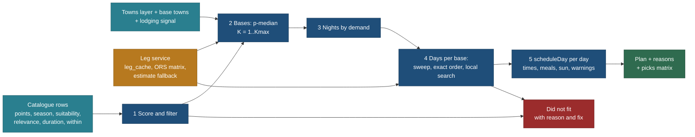

# Trip builder: build your own trip, from a country or from home

> **Amended 27 Oct 2026 (TB-FLOW, [design/trip-builder/FLOW.md](../design/trip-builder/FLOW.md)):** the step lists of 2.1 and 2.2 are superseded by FLOW's stages (Kind, Start, Where, Pick, Days and driving, then the plan, then Review and prepare): the first build lands in the editor, bases and checks are lines at its top, getting there is a card on Day 1 and the last day (review TB-N2 M1). Items the person moves or adds are "Placed by you" and stay on rebuild (`edits[].placed`). QB1 to QB10 are decided as recommended with QB9 no, and QB3 "research later" (owner, 27 Oct 2026; FLOW TF15, section 10). The account table is one `plan_draft` table for copies and plans, made by renaming `planner_draft` in EM-M (FLOW TF12). Stage 7 (the editor) is one action layer for copies and plans, at `/t/<id>/` once task ED ships (FLOW TF9: amends ISO-1 and ISO-2, new extension point X10 `web/app/t/[id]/` mounting `web/components/plan/editor/**`). `plan-draft/1` gains optional `driveDayMin`, near-mode `where.regions`, `identity`, `edits[].placed` (TB-C2) and top-level `notes` (EM-C). The `/plan/` editor mount is removed in the same task (ED) that mounts `/t/[id]/` (owner, F-Q2). Per-location data: [trip-builder-location-metadata.md](trip-builder-location-metadata.md).

> **Amended 27 Oct 2026 (edit my trip, TRIP-EDIT-I; pending Q-EM1 and Q-EM2):** one document and one table for copies and plans. ISO-6 is superseded: copies and customised trips are `plan-draft/1` in template mode, stored with builder drafts in `planner_draft.doc` (the separate `plan_draft` table of QI1 and TB-SY is not created); builder routes refuse a template draft until "Open in the builder" converts it (ISO-7 kept, one way). `plan-draft/1` gains optional `template`, `start`, `travellers` and `party: "trip"` in task EM-C, which must land before FS-1 stores a draft. See [edit-my-trip.md](edit-my-trip.md) 2, 3, 6.

Status: **spec, planned only** (27 Oct 2026, travel-planner, Opus). No app code, no new HTML. Owner request of 27 Oct
2026, recorded as **the target state of the whole application**. TODO row of 27 Oct 2026; BACKLOG 15.340; owner
questions QB1 to QB10 (section 11). Wireframes: [design/trip-builder/](../design/trip-builder/README.md) (phone and
desktop, separate).

Principles cited by number from [principles.md](../design/foundation/principles.md) (P1 to P9, T1 to T5).

## The owner's request (27 Oct 2026, intent as given)

> Someone comes and says "I want to visit Italy" (or Canada). The app first asks for the regions: one or more (Northern
> Italy, Southern Italy; for bigger countries several groups). Within the chosen regions, if there are 30 sites, they
> start choosing what they want to visit: filters on top (sightseeing, trails, hikes, adventure: rafting, bungee jumping),
> pick places and activities. They choose the number of days. The app must work out at which step the base is chosen and
> show it. Our algorithm then puts everything in proper order by location and builds the itinerary, and also suggests
> where the bases should be (base 1, base 2; consider hotels and locations). The user can choose their starting city, and
> the app shows how they get there (flights), the path, car rental, and in some basic scenarios public transport. They
> build their own trip; it is not just "copy an existing trip". The same experience for day trips and short trips: someone
> in Ontario says how many hours they will drive (3 or 4 h at most), how many nights, and nearby places appear (up to New
> Jersey): they choose Algonquin, a state park in New York or a Quebec park, and create a custom plan. Mobile must be a
> mobile-native experience and desktop a desktop-native one, using the full real estate of each.

## Relation to other pages

| Page | Relation | Changed there? |
|---|---|---|
| [nearby-and-regions.md](nearby-and-regions.md) section 6 (the smart trip builder, lanes SB1 and SB2, phase P1) | **Superseded by this page.** Its first screen, ranking rule (6.2: visible parts, a gap is never a yes) and guest-first rule are kept and extended; its single-base flow becomes near mode and step 5 here; its lanes SB1 and SB2 are replaced by the TB tasks (section 9) | Yes: a one-line pointer at the top of its section 6 |
| BACKLOG 8.5 and 8.6 | Their lanes SB1 and SB2 become the TB tasks; 8.6 (theme sentence) is TB-P5a | Needed edit (section 12) |
| [F02](F02-trip-creation-and-trip-types.md) entry points 1 and 2 ("Plan a trip", "Day trip from home") and the intent sheet | This page is the public, guest-first form of both; the type profiles stay as written | Needed edit: a pointer |
| [F07](F07-day-checks-drafting-and-route-optimising.md) "Fill this day", "Draft my days", "Reorder to cut driving" | The engine of section 4 is their public, guest-first implementation; F07's check codes run on its output | Needed edit: a pointer |
| [stay-bases-and-optimisation.md](stay-bases-and-optimisation.md) | Its evaluator (STY-E, 9.4) scores the builder's base sets; its town base facts (STY-P) feed the lodging signal; its privacy line (D7: no property names) holds | No |
| [trip-origin-and-nearest-airport.md](trip-origin-and-nearest-airport.md) | Step 7 is its ladder and its one picker (OR11 names "later the trip builder" as the third home) | No |
| [short-trips.md](short-trips.md) | Near mode uses its hubs, its night classes (K1) and its outing frame; household origin never public (K5) | No |
| [trip-overview-and-customisation.md](trip-overview-and-customisation.md) (customise, feature v0.15) | Customise stays the way to tweak one of our trips; "Open in the builder" turns a copy into a builder draft (section 4.5) | No |
| [requests-and-custom-places.md](requests-and-custom-places.md) (REQ) | Empty regions link to "Ask us"; signed-in drafts may hold own stops (REQ-E) | No |
| [navigation-and-mine.md](navigation-and-mine.md) | Mine gains "My plans" for builder drafts (`plan-draft/1`) | Needed edit |
| [destination-data-coverage.md](destination-data-coverage.md) (being written in parallel) | Owns which countries and regions get researched and when; this page states only what the builder needs (section 8.3) and does not repeat the plan | No |
| [world-map-scratch.md](world-map-scratch.md) (being written in parallel) | Owns the world map and gamification; this page offers one hook (a draft marks its countries "planned") | No |
| [entity-graph.md](entity-graph.md), [protected-area-entry.md](protected-area-entry.md) | The `within` facet scopes picks to a park; park requirements become Book ahead rows and constraints | No |

## 0. The decision in one paragraph

The builder is one flow of eight steps (where, regions, discover and pick, days and pace, bases, build, getting there,
review) with a **near mode** for day trips and short stays that asks "from where, how far, how many nights" first and
skips the regions. **Bases are suggested after the picks, never asked before them**, because a base is the answer to
"where do my picks cluster"; a visitor who already knows ("we stay in Ortisei") can pin a town at any step and the
engine treats it as fixed. The engine is a **deterministic, explainable decomposition**: score the candidates, choose
bases as a p-median facility-location problem on drive times, share nights by demand, pack each base's days as a small
team-orienteering problem with time windows, then hand every day to the existing scheduler (`core/src/schedule`) for
times, meals, sun and warnings. It **runs on the server** behind `CatalogueStore`, with ORS matrices cached in the
existing `leg_cache` table and straight-line estimates when the free quota runs out. Drafts are **local-first** like
Mine, synced to `planner_draft` after sign-in, and shared by a URL that carries public refs only. **The first shippable
slice is near mode plus single-base trips (P1, about 58 h, bundle D)**, because it reuses the near API, the towns layer
and the scheduler that exist today. The full country-and-regions builder with algorithmic bases (P2 and P3) lands in a new
bundle G2 before the MCP bundles. **The binding constraint is data, not code:** today we hold 504 capture records, 69 of
Italy's 77 sit in the Dolomites, and Ontario has 4.

## Decisions

| # | Decision | Why | Trade-off |
|---|---|---|---|
| TB1 | **One flow, two modes.** Trip mode (country, regions) and near mode (start point, drive limit, nights) share every step from Discover on | The owner asked for "the same experience" for both; one engine, one UI | Near mode shows steps it skips (Regions, sometimes Bases) as done, not hidden |
| TB2 | **Bases after picks, pin any time** | Facility location needs demand points; asking first forces a guess most visitors cannot make. Pins serve the visitor who already knows | One extra step for the visitor who knows; the pin control is on step 1 and step 5 |
| TB3 | **Days after picks, pre-filled from them**, with a live "about N days" on the tray while picking | The owner's order; the estimate turns the day count into an informed choice (P3) | The estimate is ≈ until routed times arrive |
| TB4 | **Deterministic decomposition, no general solver**: p-median for bases, largest-remainder for nights, cluster-first then route (TOPTW-lite) per base, then `scheduleDay` | Up to 40 picks and 4 bases: exact enough, explainable, testable with golden fixtures, pure TypeScript in `core/` | Not provably optimal across bases and days at once; we never claim "optimal", only "shortest we found" with the numbers |
| TB5 | **The engine runs on the server; the client re-flows edits locally** with the picks matrix the build returned | The ORS key never ships (nearby non-goal); P9 one data boundary; no client bulk load. Local re-flow keeps drag and drop instant | A cold build waits for ORS (budget 4 s with progress) |
| TB6 | **Candidates are light rows, paginated, scoped to the chosen regions or the drive band** (40 per page) | P8: the builder must not become a bulk export of the catalogue | Ranking over many pages needs server ordering, which the store already does |
| TB7 | **Local-first drafts** (`plan-draft/1` on the device, 10 drafts), synced to `planner_draft` when signed in; party data never in the URL | Same rule as Mine and copies (navigation-and-mine N7); most visitors never sign in | Drafts are lost if the browser clears storage; the review step says so |
| TB8 | **Starting from a trip is a seed, not a fork**: "Start from this trip" copies picks, days and the default base plan into a draft with each day locked; unlocking hands it to the engine | The owner: "they build their own trip; it is not just copy an existing trip". Locks keep the researched order until the visitor lets go | Customise (v0.15) and the builder overlap; section 4.5 draws the line |
| TB9 | **Honest gaps**: a region with no researched places is shown greyed with "Ask us"; the builder never pads with unresearched places (Q60 stands) | T3; a padded list looks complete and is not | Thin regions look thin; that is the truth and a research signal |
| TB10 | **Getting there is link-out and notes**: airport choice and open jaw from the origin spec, flights as a search link with no fares, car hire as notes, public transport only where a region note says it works | No free fare, rental or transit-routing API exists that we can store (OR8); T5 | Visitors book elsewhere; we say so plainly |
| TB11 | **Phone and desktop are designed separately** on shared components and identical URL keys | Owner: native on each, not one layout stretched | Two sets of e2e screenshots and reviews per UI task |
| TB12 | **Lodging signal without names**: a per-town count of places to stay from OpenStreetMap plus our town base facts; never a property name in public output | Owner: "consider hotels"; stay-bases D7 privacy line | A count is a proxy for availability, not availability; shown as such |
| TB13 | **Route `/plan/`** (reserved in PLAN R-38), behind the capability flag `planBuilder` | One home, one flag, ships dark when late (RELEASE-PLAN B3) | None |
| TB14 | **One country per trip-mode draft in v1; near mode crosses borders** (Ontario, New York, Quebec) | Regions and gateways are per country; a drive band is not | A two-country trip (Dolomites plus Innsbruck) needs near mode or waits (section 10) |

## 1. User stories

| # | As | I want | So that | Principles |
|---|---|---|---|---|
| U1 | a visitor who says "Italy" | to choose Northern Italy, east, see what we hold there, and pick what suits us | I build my own trip rather than adopt someone else's | P7, P4 |
| U2 | a parent | filters for activity, effort, age, season and time on site, with counts | I see only what fits my party in my month | P4, T1, T4 |
| U3 | a visitor with 9 picks | to know how many days they need before I choose | I choose the length with my eyes open | P3 |
| U4 | a visitor | suggested bases with why, and other ways (one base, three bases) with the cost in moves and driving | I trade packing against driving knowingly | P2, P6 |
| U5 | a visitor | a day-by-day plan in a sensible order that I can move, swap, drop and lock | the plan is mine and still works | P5 |
| U6 | a visitor | to be told what did not fit and why, with one fix | nothing vanishes silently | T3 |
| U7 | someone in Toronto | "within 3 h, 2 nights" to show Algonquin, a New York state park and a Quebec park | I plan a weekend in minutes | P3, T2 |
| U8 | a visitor | my starting city to set the airport, the open jaw and day 1 | the first and last days are real | T5 |
| U9 | a phone user in a car park | the whole flow with one thumb | I can plan on the move | T2 |
| U10 | a desktop user | list, map, filters and my plan on screen at once, with drag and drop and keys | I compare without opening and closing panels | P3, P5 |

## 2. The experience, step by step

### 2.1 Trip mode

| # | Step | The visitor decides | What the app shows | Engine call | Skippable? |
|---|---|---|---|---|---|
| 1 | **Where** | a country (or a region, park or town, resolved by the parser to its country and a pre-ticked region); or "Travel from home instead" (near mode); or "Start from one of our trips" (seed, 4.5); optionally a pinned base | the country on a map, our trips there, the visitor's drafts | `parse` (exists) | no |
| 2 | **Regions** | one or more region groups or regions (multi-select) | groups with counts of researched places; empty ones greyed with "Ask us" | `planRegions` (counts) | yes when the country has one group (Iceland, Switzerland today) |
| 3 | **Discover and pick** | filters (kind, activity, effort, kids, season, time on site, `within` a park); picks; "must see" on some | ranked light rows with reason chips; map; the tray with "about N days" | `planCandidates` | no (at least 1 pick) |
| 4 | **Days and pace** | days (pre-filled from the picks), pace, moves preference (fewer moves, balanced, shorter drives), month, party | the estimate, spare days ("we will suggest more near your bases") | none (client arithmetic on the rows) | days pre-filled |
| 5 | **Bases** | accept the suggestion, change nights, swap a town, pin, or pick one of the "other ways" | lettered bases, rings, why, compare table (moves, drive per day, cost when comparable) | `planBases` | auto-accepted when only one sensible base exists |
| 6 | **Build** | move, swap, drop, lock, add a suggested place, rebuild | days with times, legs, Book ahead, warnings, "Did not fit" | `planBuild`; edits re-flow on the client | no |
| 7 | **Getting there** | starting city or airport; same airport or open jaw | arrival and departure airports, flight search link, car hire notes, transit note where it applies; day 1 and day N reshaped | `planBuild` with `from` (arrival and departure days) | yes ("Getting there not worked out" stays visible) |
| 8 | **Review** | save to Mine, copy link, calendar, PDF | the summary, Book ahead, Did not fit | none | n/a |

### 2.2 Near mode (day trips and short stays)

| # | Step | The visitor decides | Notes |
|---|---|---|---|
| 1 | **From where, how far, how many nights** | a public hub (Toronto, Hamilton, Ottawa, Montréal; short-trips 4.1), an airport, or "Use my location" (rounded, device only); one-way drive limit 1, 2, 3 or 4 h; nights 0 to 5 | OR6: 0 to 3 nights keep the hub default; 4 and 5 nights are allowed here because a cottage week from home has a base (short-trips K2) |
| 2 | (Regions skipped) | | the drive band replaces regions; it crosses provinces, states and countries |
| 3 | **Discover and pick** | as trip mode; sorted by drive time; bands until routed (Q57) | candidates come from the near query around the start point, capped at the band |
| 4 | **Nights and pace** | pre-filled from step 1 | |
| 5 | **Base** | one suggested base for 1 to 5 nights; none for 0 | the town that minimises driving to the picks, from the towns layer and our base towns |
| 6 | **Build** | as trip mode | the outing frame applies: leave by, home by (short-trips 2.3) |
| 7 | (Getting there is the drive from the start point) | | shown on day 1 and the last day |
| 8 | **Review** | as trip mode; "Add to calendar" is the primary action for 0 to 3 nights (P7) | |

### 2.3 Where the base is chosen, and why there

Three options were weighed:

| Option | For | Against | Verdict |
|---|---|---|---|
| Before picks, as a guess | Simple; matches booking-first travellers | Most visitors cannot name a base for a country they have not planned; a wrong base biases the candidate list | Rejected as the default; kept as an optional pin |
| After picks, as a suggestion | The base follows what they want to see; explainable ("covers 5 of your picks") | One more step | **Adopted** |
| Both: a guess before, a suggestion after | Covers both kinds of visitor | Two concepts for one thing confuse first use (P4) | Adopted only as "pin a town" (a constraint), never as a second suggestion |

The suggestion is recomputed when picks, days, pace or the moves preference change, but never overrides a pinned or
locked base. On desktop, steps 4 and 5 share one screen so the effect of days and pace on bases is visible as it
changes (wireframe D4).

### 2.4 State model: what is stored where

> **Amended 27 Oct 2026 (ACCT-P, [account-profile-and-travellers.md](account-profile-and-travellers.md) 5.5):** for a signed-in person the device party
> is seeded from the account's saved travellers. The rule here is unchanged: the draft names `party: "device"`, the build
> reads `readParty()`, the POST body carries ages, and no builder code reads the account table.

| State | Where | Who sees it | Notes |
|---|---|---|---|
| The draft: mode, country, regions, picks (with must flags), days, pace, moves preference, month, pinned and accepted bases, locks, edits to the order, `from` | `localStorage` key `travel.plans.local`, envelope `plan-draft/1`, at most 10 drafts and 16 KB each | the visitor, on this device | validated by Zod in `core/src/schema/plan-draft.ts` on every read; a bad or newer envelope is left untouched (as `copies/1`) |
| The party (adults, children's ages, walk limits) | the device's profile (the trip page's party bar store), referenced by the draft, never copied into the URL | the visitor | sent to the build route in the POST body only; not logged, not cached |
| The origin | the device choice `origin/1` (O3) or the draft's `from` (an airport code, a hub id, or a rounded point that never leaves the device) | the visitor | OR9: a share link carries an airport code or a hub, never a town |
| The last build (times, legs, warnings, reasons) | stored with the draft on the device | the visitor | lets the plan open offline; recomputable at any time, so never authoritative |
| Signed in | **Superseded by 15.1 ISO-6:** a `plan_draft` table of its own, `doc` = `plan-draft/1` (was: a `planner_draft` row with a new `doc_kind` column) | the account, under owner-predicate RLS | the sign-in merge is idempotent on the draft id, like copies (NAV-D) |
| Share link | the URL keys of 2.5 | anyone with the link | the recipient's device rebuilds the same plan (the engine is deterministic) with their own party |
| Server | nothing per visitor; `leg_cache` holds drive times between ~1 km cells, which are not personal | n/a | the build route stores no draft and logs only counts |

No household data (home point, names, birthdays) enters the builder. The household privacy guard
(`core/src/privacy/home.ts`) still scrubs any point within its radius from public output, and the start point of near mode
is never a public value.

### 2.5 URL

`/plan/` with keys that map onto server query parameters (P9):

| Key | Meaning | Example |
|---|---|---|
| `m` | mode: `trip` or `near` | `m=trip` |
| `cc` | country (trip mode) | `cc=IT` |
| `rg` | region groups or regions, comma list | `rg=it-ne` or `rg=IT/veneto,IT/trentino-alto-adige` |
| `from`, `r`, `n` | near mode: hub id or airport code; drive limit in minutes; nights | `from=hub-toronto&r=180&n=2` |
| `p` | picks: public slugs (public-ref-aliases rules: no month or year), `!` suffix for must | `p=lago-di-braies!,seceda,tre-cime-loop` |
| `f` | filters, as the Places keys (`kind`, `kids`, `season`...) | reused from `lib/entities/url.ts` |
| `d`, `pace`, `mv`, `mo` | days, pace, moves preference, month | `d=10&pace=standard&mv=fewer&mo=7` |
| `b` | bases: towns-layer id and nights, `@` for pinned | `b=it-21-ortisei@:5,it-25-cortina:4` |
| `o` | only the days the visitor edited: day number and the ordered picks | `o=2:seceda.siusi;7:tre-cime-loop` |
| `gw` | arrival and departure airport override (origin spec 10) | `gw=VCE.MUC` |
| `s` | the step on screen | `s=6` |

Only public slugs and ids appear; a 40-pick link is about 900 characters. Party, home and device location never appear.
A link from an older build that names a slug we have since renamed resolves through the slug registry; an unknown slug
becomes a "We could not find 1 place" line, never an error page.

### 2.6 Starting from one of our trips (template) versus from scratch

| | From scratch | From one of our trips |
|---|---|---|
| Entry | step 1 | "Start from this trip" on a trip page (secondary to "Copy with my dates", P7) or step 1's trip cards |
| Picks | chosen by the visitor | the trip's stops that are catalogue places (parts, offers and meals are not picks) |
| Days and bases | from the engine | the trip's days and its default base plan (`trip-base-plans/1`), each base pinned |
| Order | from the engine | the authored order, every day locked |
| What changes when the visitor edits | everything re-flows | only unlocked days re-flow; "Unlock all and rebuild" hands the whole plan to the engine |
| Attribution | none | `seed: <trip slug>` on the draft; the review says "Started from our Dolomites trip" |

### 2.7 Relation to customise (v0.15) and requests (REQ)

- **Customise** is a delta on one of our trips (`trip-custom/1`): swap a variant, add or drop a place, keep the trip's
  shape. **The builder** makes a new plan. A customised copy gains "Open in the builder" (signed in, after TB-SY), which
  seeds a draft from the copy as 2.6 does; the copy is untouched. The builder never writes `trip-custom/1`.
- **Requests:** an empty or thin region shows "Ask us to research it", which opens the trip request form (REQ-F1)
  pre-filled with the country, the regions and the picks; "Suggest a place" (REQ-F2) appears on the candidate list's
  empty state. Signed-in drafts may hold own stops (REQ-E, v0.17) as `custom` picks: routed and scheduled, never shown to
  anyone else, never used for base suggestions' lodging signal.

## 3. Phone-native and desktop-native design

The frames are in [design/trip-builder/wireframes-phone.md](../design/trip-builder/wireframes-phone.md) (P1 to P9) and
[wireframes-desktop.md](../design/trip-builder/wireframes-desktop.md) (D1 to D8). The design index
([README.md](../design/trip-builder/README.md)) holds the table of what changes between the two, the shared components,
nine foundation additions (A1 to A9), accessibility, performance budgets and slow or offline behaviour. In short:

| | Phone (390) | Desktop (1440) |
|---|---|---|
| Structure | one step per screen, stepper header, primary action in the bottom bar | step rail; filters, list, map and tray (or outline, day, map) on screen at once |
| Map | a bottom sheet with three snap points; the list is the default | always visible, fluid, linked to hover and selection |
| Picking | "+" on each card, swipe as a shortcut, tray as a peek bar | checkbox per row, drag into the tray column, Space |
| Editing | item sheet: Move to day, Swap, Lock, Drop; long-press reorder inside a day | drag between days on the outline, hover tools, keys (`M`, `L`, `S`, `J`/`K`, `R`) |
| Budgets | `/plan/` start JS at most 90 KB gzip; map chunk on first map open | same start budget; map chunk after first paint |

Steps 4 and 5 are two screens on phone and one on desktop: the only structural difference in the flow.

## 4. The algorithms

### 4.1 Known approaches, briefly, and what we adopt

| Family | What it solves | Source | Adopt? |
|---|---|---|---|
| Orienteering problem (OP) | pick a subset of scored places and a route under a time budget | Vansteenwegen, Souffriau, Van Oudheusden, "The orienteering problem: a survey", EJOR 2011 | **Yes, as the model of one day**: picks have scores (must, want, maybe), the day has a budget |
| Team OP with time windows (TOPTW) | several routes (days) with opening windows | Vansteenwegen et al., iterated local search for the TOPTW, Computers & OR 2009 ([reimplementation notes](https://thesis.eur.nl/pub/30280)) | **Yes, simplified**: days of one base are the "team"; windows are season, hours and daylight; insertion plus a deterministic local search instead of a randomised shake |
| Tourist trip design problem (TTDP) | the family of the above for tourists: preferences, durations, hours, daily time | Gavalas et al., "A survey on algorithmic approaches for solving tourist trip design problems", Journal of Heuristics 20(3), 2014 ([record](https://api.openalex.org/works/doi:10.1007%2FS10732-014-9242-5)) | Used as the checklist of constraints we must honour |
| OP with hotel selection (OPHS) | multi-day trips where each night's hotel is chosen | Divsalar, Vansteenwegen, Cattrysse, IJPE 145, 2013 ([record](https://ideas.repec.org/a/eee/proeco/v145y2013i1p150-160.html)); memetic algorithm, EJOR 237(1), 2014 ([record](https://ideas.repec.org/a/eee/ejores/v237y2014i1p29-49.html)) | **The right model, not the right method for us**: exact OPHS and memetic search are heavy and non-deterministic. We decompose: choose bases first (p-median), then days |
| p-median facility location, Teitz-Bart vertex substitution | choose K sites minimising total distance to demand points | Teitz and Bart, Operations Research 16(5), 1968 | **Yes, for bases**: deterministic greedy start plus interchange |
| Clustering (k-means, agglomerative) | group places | standard | Used only inside a base to seed days (sweep by bearing), not to pick bases: clusters ignore towns and lodging |
| VRP solvers: VROOM (ORS optimization endpoint), Google OR-Tools | vehicle routing with time windows | [VROOM](https://github.com/VROOM-Project/vroom); [OR-Tools routing](https://developers.google.com/optimization/routing) | **Not now.** VROOM via ORS costs quota (500 a day) and does not do bases, sun or meal rules; OR-Tools is C++/Python outside our TypeScript core. Kept as a cross-check in tests if a golden fixture disagrees with intuition |

### 4.2 The pipeline



All five stages are pure functions in `core/src/plan/` (new): `score.ts`, `bases.ts`, `nights.ts`, `pack.ts`,
`explain.ts`, plus `feasible.ts` for the honest outputs. Stage 5 is the existing `scheduleDay` (no change to it). The leg
service is an interface; the server implementation reads `leg_cache`, asks ORS for missing cells, and falls back to the
timeline's estimate (straight line × 1.42 plus the short-drive rule, `core/src/config/nearby.ts`).

### 4.3 Stage 1: candidate scoring and shortlisting

Each candidate gets **a score with visible parts**, in the order of nearby 6.2 (draw, fit, season, theme, distance). The
parts are integers so ties are exact and the order is reproducible.

| Part | Input (exists?) | Points |
|---|---|---|
| Draw | relevance badge (`data/relevance`, yes) | worth the journey 40, worth a detour 25, local 10, unknown 15 |
| Fit | suitability for the party (`suitsProfile`, yes): pass, unknown, fail | pass 30, unknown 10, **fail removes it from the default list** (shown under "Not for your party", with the reason) |
| Season | `season` months, access season, windows (partly) | in season 20, shoulder 8, unknown 8, **closed removes it** (shown under "Closed in July") |
| Theme | tags and type against the chosen filters (yes) | each matched theme 10, at most 20 |
| Distance | drive band from the region centroid (trip mode) or the start (near mode) | under 30 min 10, 30-60 min 6, 60-120 min 3, beyond the limit removed in near mode |
| Data quality | completeness tier (yes) | required tier 5, below it 0 |

Rules: a gap is never a yes (an unknown never outranks a known pass on the same constraint); a pick the visitor made is
never removed by scoring, only flagged; "Why this order?" lists the parts in words. Paged 40 rows at a time, sorted by
score then name then ref.

**The "about N days" estimate** on the tray: Σ (visit duration from `resolveDuration`, or the type's rule) plus a drive
allowance of 2 × the band midpoint per pick when no base exists yet, divided by the pace's day cap (`dayCapMin`), rounded
up, plus arrival and departure days in trip mode. Shown ≈.

### 4.4 Stage 2: suggesting bases

**Candidate base towns** (at most 40): towns-layer rows (GeoNames, population of 1,000 or more) inside the chosen regions
plus 30 km, our base towns (`trip-base-plans/1` bases and settlement records), and pinned towns. Pre-filtered by how many
picks lie within the day-trip radius in straight line; ties by population then id.

**Day-trip radius:** half the pace's daily drive limit (`PACE_RULES.driveLimitMin`: relaxed 180, standard 240, full 360),
capped at 120 min one way, so 90, 120 and 120 min.

**Objective, for a given number of bases K** (minutes; smaller is better):

```
cost(B) = Σ_picks  2 × drive(base_of(pick), pick)                       // round trips from the assigned base
        + Σ_moves  drive(base_i, base_i+1)                              // transfers, ordered gateway in -> out
        + M × (K - 1)                                                   // packing and check-in per move
        - L × Σ_bases lodging_class(base)                               // lodging signal, small
subject to: every must pick within the day-trip radius of its base (else a must is "too far": section 4.7)
            K <= Kmax = min(4, floor(nights / 2)); a base gets at least 2 nights unless nights < 2K
            pinned bases are in B
```

`M` comes from the moves preference: fewer moves 240, balanced 120, shorter drives 60. `L` is 15 minutes per lodging
class step (classes 0 to 3 from the lodging signal, 4.8), so lodging breaks near ties and never overrules geography.

**Solve:** for each K from 1 to Kmax, a greedy start (add the town that lowers cost most, ties by id) and Teitz-Bart
interchange until no swap improves; pick the K with the lowest cost, and keep the best one-base and the best K+1 as the
"other ways" (wireframe D4). Base order: all permutations with the arrival gateway fixed first and the departure gateway
last (K ≤ 4, at most 24). Size: 40 towns × 40 picks; a few thousand cost evaluations; well under 50 ms.

**Reuse:** each suggested set is turned into a `trip-base-plans/1`-shaped strategy and run through the stays evaluator
(STY-E, stay-bases 9.4) for the comparison numbers and the messages, so the trip page's Where to stay and the builder say
the same thing in the same words. Until STY-E is built (bundle E), P1 has only K = 1 and needs no evaluator.

### 4.5 Stage 3: nights per base

Demand of base b = Σ over its picks (visit duration + round-trip drive) ÷ the day cap, plus 0.5 for each move day that
starts or ends there. Nights are shared by the largest-remainder method with the floor of 2 per base, then the
arrival and departure days are placed at the first and last bases. Spare days go to the base with the highest demand and
are offered as "spare day: suggestions near A" (the engine proposes the top unpicked candidates within the radius, never
adds them silently).

### 4.6 Stage 4: packing and ordering days

For each base, with its D days and assigned picks:

1. **Fixed first:** locked items keep their day and position; items with a booked slot or a single open weekday go to a
   day that satisfies them.
2. **Seed:** sort the remaining picks by bearing from the base (a sweep), cut into D groups balanced by demand. On a move
   day, the picks within 30 min of the straight line between the two bases go on that day first.
3. **Order each day exactly:** Held-Karp dynamic programming for up to 10 stops (base to base, or base to next base),
   2-opt beyond that.
4. **Improve:** first-improvement local search over relocate and swap moves between days of the same base, accepting a
   move only if it reduces total drive or fixes a violated window (season, hours, daylight, the day cap); at most 200
   moves, scanned in ref order, so the result is the same on every run.
5. **Drop if needed:** while a day exceeds its cap, drop the lowest-scored non-must item to "Did not fit" with its
   reason.

Then each day goes through `scheduleDay` with the party profile: leave by, meals (dinner rule), rests, sun anchors
(`core/src/sun`, positive east longitudes), and the 16 day-check warnings (`W_DAYLIGHT`, `W_HOURS`, `W_PACE`,
`W_DRIVE_LIMIT`, `W_FIT` and the rest). The builder shows them; it never hides one.

**Kid pace profiles** are not new: `ageRules` and the family caps (`capFamilyMin`, `capToddlerMin`) already change visit
times and day caps; the builder passes the party through.

### 4.7 Feasibility and honest "cannot fit" outputs

| Code | When | Words | One fix offered |
|---|---|---|---|
| `TB_TOO_FAR` | a pick is beyond the day-trip radius of every base in the plan | "Too far from your bases: 2 h 40 from Cortina ≈" | "Add a base near it" (reruns with K+1) or "Drop" |
| `TB_CLOSED` | closed or out of season in the chosen month | "Closed in July (opens 20 Jun on the operator's page)" | "Change month" or "Drop" |
| `TB_FIT` | fails the party's limits | "Needs age 12; youngest is 6" | the family variant if one exists, else "Drop" |
| `TB_TIME` | the days are full | "No room: days 2 to 5 are at the standard pace's limit" | "Add 1 day" (the engine reruns and confirms it fits) or "Swap with ..." |
| `TB_BOOKING` | a window has passed for the month | "Lift slots for July sold out in past years by mid June" (only with a source) | none; shown as a warning |
| `TB_UNKNOWN` | the record lacks the fact needed to place it (no point) | "We do not have a location for this yet" | "Ask us" |

"Add N days" is computed, not guessed: the engine reruns with nights + 1, + 2 and + 3 and offers the smallest that fits
every must pick, or says "Even 3 more days do not fit X: it is too far from your other picks."

### 4.8 Lodging signal and base data we have or lack

| Signal | Source | Have today | Use |
|---|---|---|---|
| Town population | GeoNames in the towns layer | 12,152 rows in 24 country parts (Italy 4,381; Canada 381) | candidate base filter and a weak proxy |
| Lodging count within 3 km | OpenStreetMap `tourism=hotel, guest_house, motel, hostel, chalet, apartment, camp_site, alpine_hut` counts per candidate town, computed once per region by a script (task TB-BL) | none | lodging class 0 (none) to 3 (many); shown as "Many places to stay listed on OpenStreetMap", never a name (D7, ODbL credit on the about page) |
| Town base facts (why stay, price band, minimum stay, lead time) | stay-bases 9.3, task STY-P and research D9 | 0 towns (no registry group yet); 1 base plan (Rockies) | the "why" panel and the cost row when comparable |
| Hotel availability and prices | none (no free API; property names are private) | none | **not used**; the review says "Check availability before you book" |

### 4.9 Explainability

Every base, day and left-out item carries reasons built by `explain.ts` from the numbers the engine used:

- **Why this base:** "Closest town to 4 of your 5 western picks (avg 35 min ≈, longest 55 min)"; "Bolzano would add 25
  min a day and cover no more picks"; "Many places to stay listed on OpenStreetMap"; "Venice airport 2 h 30 ≈".
- **Why this day:** "Seceda and Alpe di Siusi are 20 min apart; together they save 50 min of driving."
- **Why this order:** "Morning lift before the afternoon cloud" only when a source-backed best-time fact exists; otherwise
  "Shortest drive order."
- No reason is ever invented. A reason without a number or a source is not shown.

### 4.10 Where it runs, and what it costs

| Part | Runs | Why |
|---|---|---|
| Candidate query and scoring | server (`CatalogueStore.planCandidates`, `GET /api/v1/plan/candidates`) | P8 light rows, P9 one boundary; cacheable by query |
| Bases, nights, packing, first schedule | server (`planBases`, `planBuild`, `POST /api/v1/plan/build`, uncached, private) | needs the ORS key and the leg cache |
| Re-flow after an edit (move, swap, drop, lock) | client: `core/src/plan/repack.ts` plus the scheduler bundle, with the picks × picks matrix the build returned | instant; the matrix covers only the visitor's own picks (at most 40 × 40 numbers, about 6 KB), so it is not a bulk load |
| "Rebuild", new picks, new bases | server again | new matrix cells |

**ORS free tier** (Standard plan, [openrouteservice.org/plans](https://openrouteservice.org/plans/)): directions 2,000
a day, matrix 500 a day, both 40 a minute, optimization 500 a day. A cold trip build needs at most 2 matrix calls (towns ×
picks, picks × picks; at most 40 × 40 each, inside the per-request cap, which TB-L confirms before building) and no
directions call; day polylines for the map and export are fetched only at Review, at most 15 directions calls per plan,
cached. Cached cells live in the existing `leg_cache` table (migration 0003: `from_cell`, `to_cell`, mode, seconds,
metres, geometry, provider) keyed by about 1 km cells, kept 180 days. A daily counter in the existing quota module
(`core/src/quota`) stops new ORS calls at 80% of each quota; the rest of the day uses estimates marked ≈. At under 100
users, the expected load is tens of matrix calls a day.

### 4.11 Determinism and tests

- **Deterministic:** no randomness, no clock (the month is an input), integer minutes, every sort ends on the ref. The
  same draft and the same leg cells give the same plan, which is why the share link needs no order (2.5).
- **Golden itineraries on real trips** (fixtures with frozen matrices in `core/test/fixtures/plan/`):

| Fixture | Input | Must hold |
|---|---|---|
| Rockies, 14 nights | the trip's stops as picks, family pace, September | K = 3 or 4; bases within {Banff or Canmore, Lake Louise, Jasper, Golden}; total drive within 10% of the evaluator's figure for the researched "three bases" strategy; no must pick dropped |
| Dolomites, 13 nights | the trip's stops, July | 2 bases, one in Val Gardena (Ortisei or Selva), one at Cortina or the Pusteria valley; Tre Cime and Braies on base B days |
| Quebec City, 7 days | the 5 places within 100 km, October | K = 1 at Quebec City; spare days offered, not filled |
| Algonquin, 2 nights from the Toronto hub | Lake of Two Rivers, Oxtongue Lake, Arrowhead | one base in the Dwight or Huntsville area; leave by and home by set |
| Day trip, 0 nights | two places within 2 h | no base step; drive both ways on the one day |
| Infeasible | a must pick 400 km from the rest, 5 days | `TB_TOO_FAR` with "Add a base near it"; nothing else moves |

- **Property tests:** every pick ends on a day or in Did not fit (none lost); locked items never move; a rebuild never
  increases total drive for the same bases; adding a day never drops a pick that fitted before.
- **Performance test:** 40 picks, 40 towns, 14 nights under 300 ms of engine time on the CI runner (excluding ORS).

### 4.12 What it reuses

| Built or planned | Used for |
|---|---|
| `CatalogueStore.near` and `/api/v1/near` (built), LST2b and LST2c (bundle C) | near-mode candidates, distance chips |
| towns layer `data/reference/towns/` and `/api/v1/towns` (built) | candidate base towns |
| `core/src/schedule` (`scheduleDay`, `resolveLeg`, `PACE_RULES`, `ageRules`), `core/src/checks` (16 warning codes), `core/src/sun` | stage 5 and every warning |
| `core/src/geo` (`haversineKm`, `bandOf`) | estimates and bands |
| `web/scripts/legs-ors.mjs` patterns (sequential, key never printed, attribution) | the server leg service's ORS client rules |
| stays evaluator STY-E (bundle E), base facts STY-P | base comparison and messages |
| origin ladder and picker ORG (bundle C) | step 7 |
| entity graph `within` facet EG-Q (bundle E) and park requirements PA (C to G) | "within a park" filter; Book ahead rows |
| `copies/1`, Mine (bundle A), NAV-D merge (bundle F) | the draft envelope pattern, My plans, sign-in merge |
| `planner_draft` (migration 0009) and CUS-C's `doc` column (bundle F) | signed-in drafts |
| smart-search parser (`/api/v1/parse`) | step 1 resolution; theme sentences later (P5) |

## 5. API surface (P8, P9)

| Layer | Method or route | Returns | Caps |
|---|---|---|---|
| `CatalogueStore` | `planRegions(cc)` | region groups, regions, counts of researched places | one country |
| `CatalogueStore` | `planCandidates(q)` (`q`: regions or near centre and radius, filters, party band, month, page) | light rows (the P8 allowlist plus duration band and score parts) | 40 per page; no endpoint lists across countries |
| `CatalogueStore` | `planBuild(draft, party)` | bases, nights, days with entries, legs (no polylines until Review), warnings, Did not fit, reasons, the picks matrix | at most 40 picks, 21 days, 4 bases; 48 KB gzip |
| Routes | `GET /api/v1/plan/regions/{cc}`, `GET /api/v1/plan/candidates`, `POST /api/v1/plan/build` | the above | rate limit: 30 builds an hour per IP, the existing quota keys |
| `DataClient` | the three methods | the only way components read it | |

Contracts are appended to `core/src/schema/api/` by the one contract author (MASTER-ORDER 4.3), with the OpenAPI export.

**Superseded in part by 15.1 ISO-5:** the three methods live on a separate `PlanService` (`core/src/plan/service.ts`) that
consumes `CatalogueStore`; `store.ts` gains no `plan*` method. The routes, caps and `DataClient` methods above stand.

## 6. Accessibility, performance, offline

See the design index sections 5 to 7. Feature-level checks: every drag has a keyboard and a menu path; the map is never
required; `/plan/` start JS at most 90 KB gzip; trip start JS and place HTML budgets unchanged (+0 B: the only trip-page
addition is a "Start from this trip" link inside the existing copy sheet, which is lazy).

## 7. Privacy and catalogue protection (P8, OR2, OR9)

| Rule | How it is enforced |
|---|---|
| Party data (adults, children's ages) never in a URL, a log or a cached response | POST body only; `Cache-Control: no-store` on `/plan/build`; privacy detector keys added by TB-C; a test plants a party field in a share URL and fails |
| No home point | near mode starts from a public hub, an airport, or a device location that never leaves the device as a point (the build receives the nearest towns-layer id or an airport code instead) |
| No property names | the lodging signal is a count; base facts follow stay-bases D7 |
| No bulk | candidates 40 light rows a page, scoped to regions or a drive band; the build returns only the visitor's own picks; rate limit 30 builds an hour per IP |
| Server output never varies by the visitor's origin on cached routes | `/plan/regions` and `/plan/candidates` vary only by public query keys; the origin applies inside the uncached build |

## 8. Readiness audit (measured 27 Oct 2026 on `main` 6c422664)

### 8.1 Per step: what exists

| Step | Built | Specified | Missing | Verdict |
|---|---|---|---|---|
| 1 Where | parser (`/api/v1/parse`), Where pill (country, province), towns API | origin picker (ORG, C) | `/plan/` route, the near-mode start form, hub list (`data/outings/hubs.json` does not exist yet) | **needs build** |
| 2 Regions | 10 countries, 39 regions, 99 areas in the locations store; admin-1 polygons for the globe | none for groups | region groups (Northern Italy, east; Atlantic Canada); counts per region for the builder | **needs data (small) and build** |
| 3 Discover and pick | Places filters (kind, season, kids, effort chips), near query in the store, light rows, relevance badges, suitability | LST2b city level, LST2c near mode (C); `within` (E) | pick control, tray, paged builder query, activity facet for adventure kinds | **needs build; needs data** outside 4 regions |
| 4 Days and pace | party bar, pace rules, day caps, duration rules | | the estimate | **ready** (reuse) |
| 5 Bases | towns layer; 1 base plan (Rockies) | stay bases spec, evaluator STY-E (E) | the base solver, lodging signal, town base facts | **needs build and data** |
| 6 Build | scheduler, 16 day checks, sun, routed legs for 2 trips, ORS script (offline) | F07 drafting (planner) | packer, server leg service with `leg_cache` writes, the builder UI | **needs build** |
| 7 Getting there | none in code | origin and nearest airport (ORG, C), gateways | flights link-out, car notes, region transit notes; airports layer (ORG-D) | **needs build and data** |
| 8 Review | `copies/1`, Mine on the device, ICS and PDF per trip | NAV-D sync (F), CUS-C `doc` (F) | `plan-draft/1`, My plans, PDF of a draft | **needs build (small)** |

### 8.2 Data by country and region (capture records; `data/capture/**`, 504 records in the graph index)

| Country | Records | Where they are | Laundry list (locations store) | Depth |
|---|---|---|---|---|
| Canada | 182 | Alberta 127, British Columbia 28, Quebec 23, Ontario 4 | 53 (Quebec 21, Alberta 19, BC 9, Ontario 4) | deep for the Rockies; medium for Quebec; **near empty for Ontario** |
| United States | 88 | Utah 40, Washington 18, Vermont 7, Colorado 6, Arizona 5, Wyoming 4, New York 3, other 5 | 43 | medium for Utah; thin elsewhere; **New York 3, New Jersey 0** |
| Italy | 77 | Trentino-Alto Adige 35, Veneto 34, Lombardy 3, Campania 3, Lazio 1, Tuscany 1 | 18 | **deep for the Dolomites only; the rest of Italy 8 records** |
| Iceland | 28 | South 8, East 7, Northeast 6, West 4, other 3 | 19 | medium (ring road) |
| Argentina | 23 | Santa Cruz 15, other 8 | 6 | thin |
| France | 19 | Auvergne-Rhône-Alpes 17 | 5 | Chamonix only |
| Vietnam, India, China, Switzerland | 9 together | | 6 | none for a builder |
| Unplaced | 78 | no `area_id` yet (AREA-2 fixes, C) | | |

**Field fill across the 504 records** (what the engine reads): `area_id` 426, `near_town` 420, point in `points.json`
285, photos 162, price 70, `season` 42, `window` 36, `best_time` 20, `duration_min` 16, `hours` 15. Suitability sidecar
rows 605 and relevance rows 1,079 (several per record). Public place pages: 355 (RELEASE-PLAN 0a.4).

**Routing and stays data:** routed legs 68 pairs (Rockies 28, Dolomites 40); hub matrix none; airports none (ORG-D not
built); gateways 0 of 13; base plans 1 of 14; best-time windows 1 of 14; town base facts 0; stay records 8 (huts).

### 8.3 Data missing for the flow to be useful (the builder's asks of the coverage plan)

| Need | Why | Minimum for the first slice | Owner of the plan |
|---|---|---|---|
| Places in more regions | a builder with 3 picks per region is a list, not a plan | P1: at least 60 places within 4 h of Toronto (Ontario, New York, Quebec, the Finger Lakes, the Adirondacks); P2: at least 40 places per region group offered, else the group is greyed | [destination-data-coverage.md](destination-data-coverage.md) |
| Points on every candidate | no point, no distance, no plan | 100% of offered candidates (today 285 of 504 records) | coverage plan, AREA-2, PJ-R |
| Duration on site | the day estimate and packing | rules cover most kinds (`DURATION_RULES`); trails need km and gain (118 of 118 targeted in C) | coverage plan, C data |
| Season and hours | `TB_CLOSED`, windows | season on every candidate (today 42 records plus the laundry list's months) | coverage plan |
| Lodging signal | base suggestion | OSM counts for the candidate towns of the offered regions | TB-BL (this page) |
| Town base facts | the why panel and cost | optional; the builder works without them | stay bases D9 |
| Airports and gateways | step 7 | the airports layer (ORG-D) | origin spec |
| Region groups | step 2 | Italy, Canada, the United States, France, Iceland | TB-RG (this page) |
| Public transport | step 7 notes | a per-region "car needed / bus and train work" note with a source | TB-D4 (this page) |
| Hidden gems, prices, live availability | nice to have | **not needed** for any phase here | later |

**Verdict:** the code is about 60% reusable today (scheduler, checks, sun, near, towns, parser, Mine); **the data is the
binding constraint.** With today's data the builder is useful for four areas: the Canadian Rockies, the Dolomites,
Quebec City and Utah. It is not useful for "Italy" as a country, for Southern Italy, or for "within 3 h of Toronto".

## 9. Phases, tasks, hours and slots

Hours are agent hours, sized like MASTER-ORDER rows; reviews and verifies included. "Builder" is `travel-builder`.

### 9.1 P0: foundations already planned (not counted here)

LST2b, LST2c, MX (near mode, city level, hub and nearby matrices; C); ORG-C, ORG-D, ORG-G (origin, airports, gateways; C);
EG-C, EG-I (C) and EG-Q (`within`; E); STY-P, STY-E, STY-L (E); TD-1 to TD-3 (trips from data; E); NAV-D (F); CUS-C
(`planner_draft.doc`; F); REQ-F1, REQ-F2 (D); REQ-E (G); the coverage plan's research batches.

### 9.2 P1: one base or none (near mode, day trips, short stays, single-base trips): 58 h

| Task | What | Model | h | Needs |
|---|---|---|---|---|
| TB-N | design note and phone and desktop mocks from the wireframes; foundation additions A1 to A9 | Opus (design reviewer) | 5 | owner approves the mocks |
| TB-C | contracts: `plan-draft/1`, the three API schemas, store methods, privacy detector keys (party fields), capability flag `planBuilder` | Opus (builder; shared contract) | 6 | the contract author's queue |
| TB-L | leg service: `leg_cache` read and write (a grant migration for the server role if 0003's RLS blocks writes), ORS matrix client, quota guard, estimate fallback | Sonnet builder, Opus review | 6 | ORS key in the server environment |
| TB-E1 | engine v1: score, near and region candidates, K = 1 base, nights, pack, `scheduleDay`, Did not fit, explanations | Opus builder (new abstraction) | 10 | TB-C |
| TB-API | routes and `JsonStore` methods; OpenAPI | Sonnet | 4 | TB-C |
| TB-G1 | golden fixtures: Quebec City, Algonquin, day trip, infeasible | Sonnet | 3 | TB-E1 |
| TB-W1 | `/plan/` UI, phone and desktop, near mode and single-region trip mode, My plans in Mine | Sonnet | 18 | TB-N, TB-API |
| TB-R1/V1 | design review, then verifier (1440 and 390, light and dark) | Opus, Sonnet | 6 | TB-W1 |

### 9.3 P2: country, regions, picks, simple multi-base: 39 h

| Task | What | Model | h |
|---|---|---|---|
| TB-RG | region groups reference (`data/reference/region-groups.json`, NUTS-1 for European countries, US census divisions, Canadian traveller groups), counts | Opus (data judgement) 3, Sonnet 3 | 6 |
| TB-E2 | multi-base with visitor-chosen bases: assignment to nearest base, nights by demand, move days | Opus | 6 |
| TB-W2 | Regions step, country-scale discover with pagination, shortlist, bases chosen from suggested towns | Sonnet | 16 |
| TB-SY | signed-in drafts: own `plan_draft` table (15.1 ISO-6; was `doc_kind` on `planner_draft`), sign-in merge, "Open in the builder" from a customised copy | Sonnet, Opus review | 5 |
| TB-R2/V2 | review and verify | Opus, Sonnet | 6 |

### 9.4 P3: algorithmic bases and ordering: 52.5 h

| Task | What | Model | h |
|---|---|---|---|
| TB-E3 | p-median base suggestion with K selection, gateway ordering, "other ways", STY-E integration | Opus | 12 |
| TB-E4 | TOPTW local search, windows (season, hours, daylight), locks, partial rebuild, client `repack.ts` | Opus | 8 |
| TB-BL | lodging signal script (Overpass, sequential, one runner) and data for the offered regions | Sonnet 4, Haiku check 0.5 | 4.5 |
| TB-G3 | golden fixtures: Rockies, Dolomites, Utah; property tests | Sonnet 4, Opus review 1 | 5 |
| TB-W3 | bases cards and why, compare table, editor: drag and drop and keys (desktop), move sheet (phone), Did not fit fixes | Sonnet | 16 |
| TB-R3/V3 | review and verify | Opus, Sonnet | 7 |

### 9.5 P4: getting there: 22 h

| Task | What | Model | h |
|---|---|---|---|
| TB-E5 | arrival and departure days from the origin ladder (timeline 6 rules), open jaw from the first and last base | Opus | 4 |
| TB-W4 | step 7: the ORG picker, flights link-out, car hire notes, transit note and Google Maps links per leg | Sonnet | 10 |
| TB-D4 | region transport notes (car needed, or bus and train work, with a source) for the offered regions | Opus researcher | 4 |
| TB-R4/V4 | review and verify | Opus, Sonnet | 4 |

### 9.6 P5: polish and hooks: 11 h

TB-P5a theme sentence entry ("fall colours near Quebec City, 7 days": the parser's `days` key, BACKLOG 8.6) 4 h Sonnet;
TB-P5b world-map hook (a draft marks its countries "planned" on the device, per world-map-scratch.md) 3 h Sonnet;
TB-P5c PDF of a draft 4 h Sonnet. The UI and UX audit (bundle J) covers `/plan/`.

**Total: 182.5 h of build**, plus the coverage plan's research. The program goes from 1,350.5 h to about 1,533 h before
that research.

### 9.7 Where it fits in the train (proposed; MASTER-ORDER and RELEASE-PLAN edits in section 12)

| Phase | Bundle | Seats | Why there | Must precede it |
|---|---|---|---|---|
| P1 | **D** (new feature label v0.11b "Plan a day out or a short stay") | B2 builds TB-C, TB-L, TB-E1, TB-API, TB-G1 during C and D (B2 has about 80 h of slack against B1); B1 adds TB-W1 and its reviews (29 h) to D | the near API, towns, the parser and the scheduler exist; nothing in it needs sign-in | LST2b-C (C); hubs file (MX, C); the Toronto data batch from the coverage plan |
| P2 | **G** | B1 TB-W2 (22 h with review); B2 TB-RG, TB-E2, TB-SY | needs CUS-C and NAV-D (F) for signed-in drafts, and REQ-E (G) for own stops | F |
| P3 + P4 | **G2, a new bundle between G and H** (about 75 h) | B2 engine, B1 UI | needs STY-E (E), EG-Q (E), ORG (C) | E, G |
| P5 | J (audit) and any later bundle | | | P3 |

**Earliest realistic timing, in B1 hours from today** (B1 carries the critical path, about 511 h left): P1 ships with
bundle D at about B1 hour 212 (A 3 + C 128 + D 56.5 + P1 UI 24). The whole vision (P1 to P4) ships with G2 at about B1
hour 480, before the MCP bundles. If the owner moves the builder ahead of E (the overview and Where to stay), P3 loses its
evaluator and must carry its own comparison numbers; that is possible (about +6 h) but duplicates STY-E, so it is not
recommended.

### 9.8 The fast build: the minimal slice worth shipping first

**P1, near mode plus single-base trips, in bundle D.** It is the smallest slice that is a real builder (pick, days, base,
day-by-day order, edit, save, share) and it needs no algorithm beyond K = 1. With today's data it is useful for weekends at
Quebec City, Banff, Ortisei and Moab; with the Toronto batch (coverage plan) it serves the owner's Ontario story.
**Trade-off:** it does not answer "Italy, Northern and Southern" until P2 and P3; shipping P2 first instead would give the
country flow without base suggestions, which is the part the owner called "our algorithm", and on Italy's data today it
would show 8 places outside the Dolomites.

## 10. Risks, and what not to build yet

| Risk | Effect | Mitigation |
|---|---|---|
| Thin data outside four areas | a builder that offers 3 places looks broken | grey empty groups with "Ask us" (TB9); the coverage plan's minimums (8.3) gate which groups are offered |
| ORS free tier and terms | cold builds slow or estimated | `leg_cache` with 180-day reuse, the 80% guard, estimates marked ≈; the exit is the ORS collaborative plan or a self-hosted OSRM (08-self-hosted.md) at about 1,000 users |
| Trust in the algorithm | a strange base or order makes visitors leave | reasons with numbers (4.9), other ways side by side, locks, golden fixtures on our own researched trips |
| Scope creep into bookings and prices | months of work with no free data | section 10 list below |
| P8 bulk extraction through candidates | the catalogue leaks page by page | 40 light rows a page, scoped queries, the rate limit, no cross-country list |
| Privacy | a party or a home point leaks | party only in POST bodies, never in URLs or logs; the detector keys in TB-C; the home guard unchanged |
| Phone performance with a map | slow first paint in the field | the map is a lazy sheet; the list works without it (T2) |
| Overlap with customise | two ways to change a trip confuse | the line in 2.7: customise tweaks our trip, the builder makes a new one; "Open in the builder" is one way |

**Not to build yet:** fares and flight routes (no free source; OurAirports has no routes); hotel inventory, names or
booking; car-hire prices; public-transport routing (GTFS) beyond region notes and Google Maps links; places we have not
researched (Q60 stands); multi-country trip mode; real-time traffic; collaborative editing of a draft (F11); AI chat
planning (MCP bundle H2 covers it); infinite scroll (P4 decision).

## 11. Owner questions (QB1 to QB10)

**Decided 27 Oct 2026** (approved plan, Lane A; [FLOW.md](../design/trip-builder/FLOW.md) TF15): QB1, QB2, QB4 to QB8 and QB10 yes as recommended; **QB9 no**, with Q-DC5: our own T0 records only in a "Not researched yet" group, a pick files a request and never enters the engine. QB3: "research later" (owner, 27 Oct 2026, FLOW F-Q1): launch on the trips by air; Ontario's thin count shows before Pick. QI1: one table named `plan_draft` for copies and plans (FLOW TF12).

| ID | Question | Recommended answer |
|---|---|---|
| QB1 | The builder is public with no sign-in, drafts on the device like Mine, synced after sign-in? (The 18 Oct direction said the planner is signed in, with guest planning "decided later".) | **Yes.** Mine already set the device-first rule; most visitors never sign in |
| QB2 | Ship P1 (near mode and single-base trips) first, in bundle D, before the country flow? | **Yes.** Smallest real builder on the data we have |
| QB3 | Fund a "within 4 h of Toronto" research batch (Ontario, New York, Quebec, at least 60 places) before P1 ships, in the data seat? | **Yes**, sized and placed by the coverage plan; without it the Ontario story shows 4 places |
| QB4 | Bases suggested after the picks, with a "pin a town" option at any step, never asked first? | **Yes** (2.3) |
| QB5 | Drive times from ORS on the server with the existing `leg_cache`, and estimates marked ≈ when the free quota runs out? | **Yes** |
| QB6 | Lodging signal from OpenStreetMap counts per town, no property names? | **Yes**; names stay private (stay-bases D7) |
| QB7 | Region groups authored once per country (NUTS-1 for Europe, census divisions for the US, traveller groups for Canada), with our own labels ("Northern Italy, east")? | **Yes** |
| QB8 | Getting there as link-out and notes only: no fares, no car prices, transit only as region notes and Google Maps links? | **Yes** (OR8) |
| QB9 | Suggest places we have not researched (OSM, Wikidata) in the builder? | **No**, as Q60: an empty region says "Ask us" and becomes a request |
| QB10 | Create bundle G2 (P3 and P4, about 75 h) between G and H, so the full builder ships before the MCP bundles? | **Yes.** The builder is the target state; MCP H2 is conditional on QX2 |

## 12. Edits other pages need (not made here; owner or coordinator)

| Page | Edit |
|---|---|
| [MASTER-ORDER.md](../build/MASTER-ORDER.md) 3.6 and 5.3 to 5.4 | add the TB tasks of section 9 with hours and models; P1 rows into D (B2 rows 12 to 14, B1 row 13 or 14), P2 into G, new bundle G2 with P3 and P4 between rows 21 and 22; totals +182.5 h |
| [RELEASE-PLAN.md](../build/RELEASE-PLAN.md) 0a.2 and 0a.3 | D gains feature v0.11b (P1, +58 h, flag `planBuilder`); G gains P2 (+39 h); new row G2 (P3 + P4, 74.5 h plus P5 hooks); dependency rows: P1 after LST2b-C and MX, G2 after STY-E and EG-Q; data readiness line for D: "Toronto 4 h batch at least 60 places or P1 ships with Toronto greyed" |
| [PLAN.md](../PLAN.md) section 2 | R-38 now points here; new requirement rows for the builder (trip mode, near mode, bases, getting there, phone and desktop native); section 6 "Superseded": nearby-and-regions 6 |
| [BACKLOG.md](../build/public-site/BACKLOG.md) 8.5 and 8.6 | status: "superseded by trip-builder.md; tasks TB-*" |
| [F02](F02-trip-creation-and-trip-types.md), [F07](F07-day-checks-drafting-and-route-optimising.md) | one pointer line each to sections 2 and 4 |
| [navigation-and-mine.md](navigation-and-mine.md) | Mine › My plans for `plan-draft/1`; the 10-draft cap |
| [trip-origin-and-nearest-airport.md](trip-origin-and-nearest-airport.md) OR11 | "later the trip builder" becomes "step 7 of trip-builder.md" |

## 13. Acceptance criteria (feature level)

1. "Italy", then Northern Italy, east, gives the Dolomites places with counts that equal the Places page for the same
   filters; Southern Italy shows its true count and "Ask us".
2. Toronto, 3 h, 2 nights lists only places whose routed or estimated drive is within 3 h, sorted by drive, with ≈ on
   estimates, and crosses into New York and Quebec.
3. Nine Dolomites picks, 10 days, standard pace: two bases with reasons, other ways with moves and drive per day, a built
   plan in which every pick is on a day or in Did not fit with a reason.
4. Moving an item, locking it and rebuilding keeps it in place; Undo restores the previous plan.
5. The share link opens the same plan in a new browser with no party data in the URL.
6. The Rockies golden fixture's total drive is within 10% of the evaluator's figure for the researched strategy.
7. With the ORS quota guard tripped, a build still returns, with every leg marked ≈.
8. Phone at 390 and desktop at 1440, light and dark: the flows of the wireframes pass the verifier, with every drag
   reachable by keyboard or a menu.
9. `/plan/` start JS at most 90 KB gzip; trip start JS and place HTML unchanged.
10. No public payload carries a party field, a home point or a property name (privacy test).

## 14. Gotchas

- Longitudes are positive east (`core/src/sun`): the sun anchors of a built day use the base's point, never a hand value.
- `leg_cache` exists since migration 0003 with RLS on and no write policy for the server; TB-L must add the grant, not a
  new table.
- The towns layer is uneven: Canada has 381 rows against Italy's 4,381, so Ontario base candidates are few; TB-BL should
  check the filter `tools/towns.py` used before blaming the solver.
- Capture refs that start `legacy/<dated folder>/` must never reach a URL (public-ref-aliases); the `p=` key uses public
  slugs only.
- A built plan is advice, not a booking: dates come from the visitor; book-by dates come from the bookings engine
  (`core/src/bookings`), never from the builder.
- The builder must not import the household origin list; near mode's default start is a public hub.

## 15. Isolation and forward-compatibility (owner, 27 Oct 2026)

> "The new interactive plan-creation view must be kept TOTALLY SEPARATE and INDEPENDENT, planned so that it does not
> collide with or cause issues for the existing product; whatever we develop NOW must keep in mind that this is coming
> (users create their own trip, not just copy an existing one)."

This section binds every TB task (section 9). The checklist for work that is **not** a TB task is
[build/builder-forward-compat.md](../build/builder-forward-compat.md). A reviewer checks both with the greps in 15.4.

**It supersedes two points above** (each marked where it stands): the three `CatalogueStore.plan*` methods of sections
4.10 and 5 become a separate `PlanService` in `core/src/plan/` that consumes the store (ISO-5), and the `doc_kind`
column on `planner_draft` of section 2.4 and TB-SY becomes a separate `plan_draft` table (ISO-6, owner question QI1).

### 15.1 The ten isolation rules

| # | Rule | Concretely | Why (and principle) |
|---|---|---|---|
| ISO-1 | **Own route namespace** | Pages: `/plan/` only (one route, steps and modes in query keys, 2.5), `noindex`, out of the sitemap. Public API: `/api/v1/plan/regions/{cc}`, `/api/v1/plan/candidates`, `/api/v1/plan/build`, all through `respond()`. Signed-in API: `/api/account/plans/**` (never `/api/account/drafts/**`). Two URL keys are added to 2.5: `draft` (a device draft's random id; the draft's content never leaves the device) and `seed` (a public trip slug) | `/plan/` is reserved since PLAN R-38 (TB13). Not `/t/` (customise and the F06 planner own it), not `/trips/` (public, indexed, at the start JS limit), not `/mine/` (a serial hot spot). A sub-tree of `/api/v1` keeps one versioning rule and one OpenAPI file (P9) |
| ISO-2 | **Own directories** | Builder code lives only in `web/app/plan/**`, `web/components/plan/**`, `web/lib/plan/**`, `core/src/plan/**`, `core/src/schema/plan-draft.ts`, `core/src/schema/api/plan.ts`, tests in `web/tests/plan/**`, `web/tests/e2e/plan*.spec.ts`, `core/test/plan/**`, fixtures in `core/test/fixtures/plan/**` | No other task owns these paths, so no stack ever conflicts on them; a grep finds every builder file (15.4 G1) |
| ISO-3 | **Own device storage keys** | Every key starts `travel.plans.`: `travel.plans.local` (drafts, `plan-draft/1`, 10 drafts, 16 KB each), `travel.plans.ui` (step, panes; UI only). The names live in `web/lib/plan/keys.ts` only; read and write only through `web/lib/storage/safe.ts` (the ESLint rule already enforces it). The party is **read** with `readParty()` from `web/lib/storage/keys.ts`; the builder never writes `travel.party`, `travel.copies.local`, `travel.fav.local` or `travel.tripui` | Existing keys and envelopes keep their owners; a bad builder key cannot break Mine or the trip page. One party source on the device (`core/src/trips/party.ts`) |
| ISO-4 | **Own capability and a kill switch** | Build flag: `planBuilder` appended to `web/lib/capabilities.ts`, from `NEXT_PUBLIC_PLAN_BUILDER=1`; off means `/plan/` answers `notFound()`, the API routes 404 and no entry link renders. Runtime kill switch: server env `PLAN_BUILDER_PAUSED=1` makes the three `/api/v1/plan/**` routes answer 503 `plan_paused` and `/plan/` show a "Planning is paused; your drafts are safe on this device" banner, with no rebuild. Both names go in the env table (S4.3) | Ships dark when late (RELEASE-PLAN B3); a bad engine release or an ORS problem is switched off in minutes without touching the public site |
| ISO-5 | **Reads through existing contracts; owns its service** | `core/src/plan/service.ts` (`PlanService`) takes a `CatalogueStore` and a `LegService` and calls only methods that exist or are already scheduled (place list with filters and paging, `near`, towns, `within` after EG-Q, place lookup); scoring, bases and packing are its own. `core/src/catalogue/store.ts`, `core/src/schema/api/{trip,place}.ts` and `core/src/schedule/**` are **not edited** by a TB task: a gap is a request in the hand-back to the task that owns the slot (S3.2). `scheduleDay` is called through `core/src/schedule/index.ts` and `browser.ts` exports only. The graph index and capture files are read only server-side through the store, never imported by `web/**/plan/**` | The store and the scheduler are the most contended contracts in 4.1; a separate service adds no slot to the one-author order of MASTER-ORDER 4.3 and keeps the Postgres cutover (K) unchanged |
| ISO-6 | **Own documents, versioned, never merged with copies or customise** | Device: `plan-draft/1` (Zod in `core/src/schema/plan-draft.ts`; an unknown or newer `schema` is left untouched, as `copies/1`). Account: a new table `plan_draft` (`id`, `owner`, `title`, `doc` jsonb `plan-draft/1`, `seed` slug or null, `revision`, timestamps), owner-predicate RLS before any app code, its own migration slug `plan_draft` (number at merge). The builder never reads or writes `copies/1`, `trip-custom/1` or `planner_draft` rows; CUS and NAV never read `plan-draft/1` | `copies/1`, `trip-custom/1` and `custom_draft` need no change; NAV-D's sign-in merge and draft cap stay as written; a builder bug cannot corrupt a customised copy |
| ISO-7 | **One-way seeds, never forks of the model** | "Start from this trip" (public trip) and "Open in the builder" (a customised copy, signed in) **create** a new `plan-draft/1` with `seed: <trip slug>` and locked days (2.6); the source is read once and never changed. Nothing converts a plan back into a copy or a customisation | Customise tweaks our trip; the builder makes a new one (2.7). Two models, one direction of travel, no merge code |
| ISO-8 | **Styling only through the foundation** | Builder CSS is `web/components/plan/plan.css`, imported only by `web/app/plan/layout.tsx`, classes prefixed `plan-`. Colour only from `themes.css` tokens; a new token goes through `tools/theme_tokens.py` by the design reviewer (TB-N), never a literal. Foundation additions A1 to A9: generic ones (A1 step header, A3 sheet snap points, A5 reason chips, A8 lock) land as **new** files in `web/components/ui/` with their own CSS file, after TB-N writes them into `foundation/components.md`; builder-only ones (A2, A4, A6, A7, A9) live in `web/components/plan/`. `app.css`, `ui.css`, `globals.css` and `web/styles/timeline.css` get no builder rule | Global CSS ships on every page; builder rules there would grow the place HTML and shell budgets and can restyle existing pages |
| ISO-9 | **Own budgets; zero cost to every other page** | `/plan/` start JS at most 90 KB gzip; each step, the map, the editor and the re-flow chunk (at most 30 KB) are lazy. Every other page's start JS, place HTML and shell chrome: **+0 B with the flag on and off**, quoted from `pnpm --dir web budget:report` in both builds (S7.1). Entry points are server-rendered plain links (no client JS). Candidate pages 12 KB, build 48 KB (design README 6) | The trip page has about 460 B of headroom and place HTML about 113 B (MASTER-ORDER 4.5); the builder must never spend them |
| ISO-10 | **Own tests, own gate suite, few extension points** | Unit and e2e suites as ISO-2; one gate suite `web.plan` appended to `tools/gate/map.json` (inputs: the ISO-2 paths) and an isolation test `web/tests/plan/isolation.test.ts` that runs G1 to G6 of 15.4. Existing files are edited **only** at the extension points of 15.2, each a small additive change in its owner's order | A builder change selects only builder suites (fast T1); a non-builder change never needs builder e2e; the isolation test fails the build on a fence breach |

### 15.2 The extension points (the only existing files a TB task may edit)

| # | File | The change | Slot and owner rule |
|---|---|---|---|
| X1 | `web/lib/capabilities.ts` | append `planBuilder` | append only (S3.6), TB-C |
| X2 | `web/lib/client/data.ts` | append one `plan` section: `planRegions`, `planCandidates`, `planBuild` (and `planDrafts*` in TB-SY) | append only, serial merges (4.1), TB-API |
| X3 | `core/src/schema/api/index.ts`, OpenAPI | one export line for the new `plan.ts`; regenerate `openapi.json` | the contract slot TB-C takes in 4.3 (after OVR-Ca in D) |
| X4 | `core/src/privacy/detect.ts` | keys for party fields in plan bodies (`adults`, `children`, `ages`, `from` points) | the 4.1 order for `detect.ts`; TB-C |
| X5 | `core/src/db/migrations/` | two new files: `plan_draft` (TB-SY) and `leg_cache_server_write` (TB-L); no edit to an existing migration | slug in branch, number at merge (4.4) |
| X6 | `web/lib/mine/overview.ts`, `web/app/mine/MineShell.tsx` | the Mine tab `plans` ("My plans", `?show=plans`), its count, and one `dynamic()` import of `web/components/plan/mine/MyPlansPanel.tsx`; shown only with `planBuilder` on | the serial Mine chain (4.1), after NAV-3; TB-W1. **Smaller if NAV-3 leaves a tab registry** (forward-compat F3) |
| X7 | `web/components/actions/CopySheet.tsx` | one plain link "Start from this trip" to `/plan/?seed=<slug>` under the copy actions, behind the flag | the CopySheet order (NAV-2, TRP-GL, ORG-2, OVR-1), then TB-W1; +0 B start JS |
| X8 | Home or Mine empty state | one plain link "Plan your own trip" to `/plan/` | after NAV-3; TB-W1 |
| X9 | `tools/gate/map.json`, `docs/v2/build/public-site/README.md` (env table) | the `web.plan` suite; two env rows | append only; map change needs an Opus reviewer line (gate README) |

Not extension points (a TB task must not touch them): `web/components/trips/**`, `web/components/places/**`,
`web/app/t/**`, `web/components/shell/**`, `web/lib/storage/**`, `web/lib/mine/copies.ts`, `core/src/schedule/**`
(including `profileCodec.ts`), `core/src/catalogue/store.ts`, `core/src/schema/{copies,trip-custom}.ts`,
`core/src/schema/api/{trip,place}.ts`, `web/app/{app,globals}.css`, `web/components/ui/ui.css`, `web/app/themes.css`,
`web/styles/timeline.css`, every budget baseline. Components in `web/components/places/**`, `web/components/ui/**` and
`web/components/entity/**` are **imported**, never edited; a missing slot is a hand-back request to the folder's owner.
The world map's "Plan a trip here" link (world-map-scratch.md) is owned by the WM tasks and only links to `/plan/?cc=`.

### 15.3 Sequencing against the bundles in flight

| Bundle | Its hot spots the builder shares | Rule for the TB tasks |
|---|---|---|
| B and C (one release) | `web/components/trips/**` (UXB-1 to UXB-6, PA-W), `web/components/places/**` (UXB-7, LST2b), `store.ts` and `api/**` (LST2b-C to ORG-C), towns layer, ORS (MX, ORG-M) | No TB task runs in B or C. TB-C is drafted only after LST2b-C and ORG-C merge. TB-L's ORS calls never run beside MX, ORG-M or STY-L (one ORS runner) |
| D | `data.ts` (FBK-2, REQ-RF), `detect.ts` (FBK-C), `capabilities.ts` (FBK-2, REQ-F), intake | TB-C takes the 4.3 slot after OVR-Ca; TB-API appends to `data.ts` after REQ-RF; TB-W1 builds beside D's UI tasks (disjoint folders) and merges after them, with its own budget line. TB-E1, TB-L, TB-G1 touch only `core/src/plan/**` and run in B2's slack at any time |
| E | `store.ts`, `api/place.ts` (EG-Q, PA-Q, API-P), the stays evaluator STY-E | The builder reads `within` only after EG-Q and calls STY-E as a function (P3); it never edits either. No TB contract task in E's 4.3 rows |
| F | `planner_draft`, `custom_draft`, NAV-D merge, Mine chain | TB-SY (P2, G) comes after NAV-D and uses its own `plan_draft` table (ISO-6), so F needs no builder column and no change to CUS-C |

### 15.4 Checks a reviewer runs (each prints nothing unless stated)

```bash
# G1 only the extension files import builder code (prints at most web/app/mine/MineShell.tsx and web/lib/client/data.ts)
git grep -lE "(components|lib)/plan/|core/src/plan/|@travel/core/plan" -- web core ':!web/app/plan' ':!web/components/plan' ':!web/lib/plan' ':!core/src/plan' ':!web/tests' ':!core/test'
# G2 builder storage keys live in one file
git grep -n "travel\.plans\." -- web ':!web/lib/plan/keys.ts' ':!web/tests'
# G3 the builder writes no other envelope or table
git grep -nE "COPIES_KEY|FAV_KEY|TRIPUI_KEY|writeParty|planner_draft|trip-custom/1" -- web/app/plan web/components/plan web/lib/plan core/src/plan
# G4 no bulk file, graph file or stray fetch in builder client code (P8, P9)
git grep -nE "data/(capture|catalogue/graph)|fetch\(" -- web/app/plan web/components/plan web/lib/plan
# G5 no literal colour and no single-trip constant in builder UI
git grep -nE "#[0-9a-fA-F]{3,8}\b|rgb\(|hsl\(|[Rr]ockies|[Dd]olomit" -- web/app/plan web/components/plan web/lib/plan
# G6 untouched paths stay untouched in a TB branch (prints nothing)
git diff --stat main...HEAD -- web/components/trips web/components/places web/components/shell web/app/t web/lib/storage \
  core/src/schedule core/src/catalogue/store.ts core/src/schema/copies.ts core/src/schema/trip-custom.ts \
  core/src/schema/api/trip.ts core/src/schema/api/place.ts web/app/app.css web/app/globals.css \
  web/components/ui/ui.css web/app/themes.css web/styles/timeline.css
# G7 zero cost elsewhere: in both builds, flag on and off, every page except /plan/ equals main
pnpm --dir web budget:report
```

`web/tests/plan/isolation.test.ts` (TB-C) runs G1 to G5 as assertions, so the gate catches a breach without a reviewer.

### 15.5 Owner questions (QI1 to QI3)

| ID | Question | Recommended answer |
|---|---|---|
| QI1 | Signed-in plans in their own `plan_draft` table rather than a `doc_kind` column on `planner_draft` (2.4, TB-SY) or UPL-C's `planner_draft.kind` (MASTER-ORDER 4.4)? | **Own table.** Trade-off: Mine's signed-in list reads two tables and the draft cap is counted per table; in return CUS-C, NAV-D and UPL-C need no builder change and a builder bug cannot touch a customised copy |
| QI2 | A runtime kill switch (`PLAN_BUILDER_PAUSED`) as well as the build flag? | **Yes.** Five lines in the three routes; the build flag alone needs a redeploy to switch off |
| QI3 | Keep the builder's API inside `/api/v1/plan/**` rather than a separate `/api/plan/v1/**`? | **Yes.** One versioning rule, one OpenAPI file and one `respond()` path; the namespace is already disjoint |

## Change log

- 2026-10-27: created (travel-planner, Opus) from the owner's request of the same day. Supersedes nearby-and-regions.md
  section 6 (SB1, SB2). BACKLOG 15.340; TODO row of 27 Oct 2026.
- 2026-10-27: section 15 added (BUILDER-ISOLATION, travel-planner, Opus) from the owner's direction that the builder stay
  separate and independent: ten isolation rules, nine extension points, bundle sequencing, reviewer greps, QI1 to QI3.
  Supersedes the `store.ts` `plan*` methods (now `PlanService`) and the `doc_kind` column (now a `plan_draft` table).
  Checklist for current work: [build/builder-forward-compat.md](../build/builder-forward-compat.md). BACKLOG 15.343.
- 2026-10-27: TB-FLOW (travel-planner, Opus): amendment note at the top; QB decisions recorded in section 11; the end-to-end flow, editor and copy journey in [FLOW.md](../design/trip-builder/FLOW.md); location metadata in [trip-builder-location-metadata.md](trip-builder-location-metadata.md). BACKLOG 15.353.
