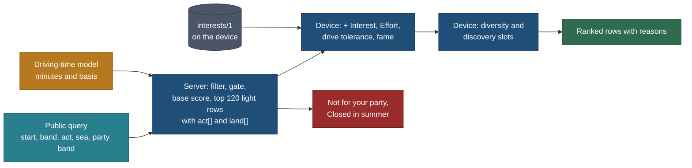

# Trip kinds, activity-first selection and the interest profile

Status: **spec, planned only** (27 Oct 2026, travel-planner, Opus). No app code, no new HTML. Owner direction of 27 Oct
2026. TODO row of 27 Oct 2026; BACKLOG 15.345; owner questions Q-TK1 to Q-TK6 (section 10).

Principles cited by number from [principles.md](../design/foundation/principles.md) (P1 to P9, T1 to T5).

## The owner's direction (27 Oct 2026, intent as given)

> The planner is not only vacations. Someone may want to go in summer, plan a weekend, a long weekend, a day trip, or a
> longer holiday. They select by activity and the app suggests nearby things and says how much driving each needs. It is a
> starting point; look at each kind one by one. Also an interest profile: someone likes mountains a lot, someone trails and
> hikes, someone beaches only and not mountains. Suggestions go up and down by profile, and the planner gives different
> suggestions per profile. This is data-based.

## Relation to other pages

| Page | Relation | Changed there? |
|---|---|---|
| [trip-builder.md](trip-builder.md) | **The engine and the flow this page parameterises.** Trip kinds are presets over its two modes (TB1); activity chips and the interest part extend its stage 1 scoring (4.3); the profile rides in its `planBuild` POST body beside the party (2.4). Its isolation section (being added by another agent) governs where the code lives; this page adds no route and no module outside `core/src/plan/` and `web/components/plan/` | Needed edits (section 11): 4.3 gains the Interest, Effort and context Draw parts; 2.5 gains `act` and `sea`; near-mode limits widen for the week kind |
| Driving-time model (`docs/v2/features/driving-time-model.md`, being written by another agent) | Supplies every drive minute and band this page shows: per suggestion, per bundle, per day, with its basis (routed or estimate ≈) | No (referenced by name) |
| [short-trips.md](short-trips.md) K1, K2 | **Amended.** Its derived `lengthClass` (day 0, overnight 1, weekend 2, long weekend 3, multi-day 4+) stays as the public card label. The planner's trip kind (section 1) groups nights as the owner did: weekend 1 to 2, long weekend 3 to 4 | Needed edit: a pointer line |
| [F02](F02-trip-creation-and-trip-types.md) | **Superseded in part.** The Day trip, Weekend and Vacation rows of "Trip types" become the length kinds of section 1; open question 1 is answered (vacation is not a type: it is the week and long-holiday kinds). Entry point 2's outing types (picnic and relax, active, sightseeing, food, kid-focused) become the activity chips of section 2. The style profiles (family, couple, adventure, road trip and the rest) stay | Needed edit: a pointer line |
| [F04](F04-explore-search-and-suggestions.md) rules 15 and 19 | **Superseded in part.** "Persona or saved-view boosts" become the Interest part (4.2); the system personas become the presets (3.4) | Needed edit: a pointer line |
| [F01](F01-household-and-profiles.md) behaviour 7 | **Superseded in part.** The household `prefs.interests[]` tag list is replaced by the person's `interests/1` weights (section 3); avoid rules, pace, budget style, transport and dietary stay household data | Needed edit: a pointer line |
| [research/method/relevance.md](../../../research/method/relevance.md) R5, 3.4, 6.1 | **Amended.** Its four contexts (vacation, weekend, day trip from a hub, passing through) become the Draw part per trip kind (4.2). R5 "no personalisation" is lifted for the planner only, by the owner's direction; public lists stay unpersonalised (Q-TK3) | Needed edit: a pointer under R5 |
| [principles.md](../design/foundation/principles.md) "Not adopted: personalisation and recommendations now" | **Amended for the planner** by the owner's direction of 27 Oct. The deterministic, explainable, device-first model here costs no server and no ML | Needed edit (design reviewer owns the file) |
| [protected-area-entry.md](protected-area-entry.md), [entity-graph.md](entity-graph.md) | Parks are hubs in candidate lists (2.5); `requirementsOf` gives day passes, campsite and lottery windows to the kind's booking check (1.6) | No |
| [destination-data-coverage.md](destination-data-coverage.md) | Owns breadth. Section 5 states what the profile needs from it (per-activity minimums) and does not repeat the waves | Needed edit: an activity-minimum line in its T0 quotas |
| [world-map-scratch.md](world-map-scratch.md), [visitor-suggestions-and-favourites.md](visitor-suggestions-and-favourites.md) | `visits/1` and `favourites/1` may feed suggestions to the profile, on the device, with consent only (3.3) | No |
| [smart-search.md](smart-search.md) | Its TRIP LENGTH words map to kinds; activity words map to the activity ids (2.1) | No |

## 0. The decision in one paragraph

A trip kind is a **preset over the one builder**, not a product: day trip, weekend, long weekend, week and longer holiday
each set the mode, the nights, the drive limit, the base count, the relevance context and the output shape, and every step
after "where from" is shared. The visitor **selects by activity** (19 public activity ids, each a set of type-tree prefixes
and tags) and the app lists what is in the drive band with a **driving figure per suggestion and per bundle**. The
**interest profile** is a separate, private, device-first model: weights from avoid to love on 19 activities and 7
landscapes, plus four habits (effort, pace, drive tolerance, famous or quiet). It **ranks and never gates**: the party
(`core/src/trips/party.ts`) gates, as relevance R8 already says. The profile **never leaves the device for list ranking**:
the server returns a cacheable shortlist of up to 120 light rows for a public query, and the device re-ranks it with the
profile, adds diversity and a discovery slot, and writes the reasons ("Because you like trails"). **The binding
constraint is again data:** 425 of 504 records map to an activity by type, but the catalogue is 118 trails and 3 beaches,
so a beach profile has nothing to rank yet, landscapes are not derived anywhere, and every day and weekend relevance fit is
empty because no hub drive time exists. P1 (46.5 h) rides with the builder's P1 in bundle D.

## Decisions

| # | Decision | Why | Trade-off |
|---|---|---|---|
| TK1 | **Five kinds as presets, derived from nights**: day 0, weekend 1 to 2, long weekend 3 to 4, week 5 to 9, longer holiday 10 to 21 | The owner's bands; one engine (trip-builder TB1); the kind is never stored, so it cannot disagree with the nights | short-trips K1 labels 3 nights "long weekend" and 4 "multi-day"; the public card label keeps K1, the planner groups 3 and 4 (Q-TK1) |
| TK2 | **Activity selection is the query; the interest profile is the person.** Activity chips (`act=`) filter this search and are public, shareable URL state. The profile re-ranks and is private | Separates "what I want today" from "what I usually like"; a shared link reproduces the list without exposing anyone's tastes | Two concepts; the UI names them differently ("Looking for" and "Your interests") |
| TK3 | **Profile ranks, party gates** | Relevance R8; a profile is a taste, an age limit is a fact. Merging them would let a taste hide a fact or a fact look like a taste | Accessibility needs belong to the party, which today has none: a party v2 `needs` field is a contract task (TK-C, optional) |
| TK4 | **Device re-rank of a public shortlist.** The server answers the public query (`GET`, cacheable) with up to 120 light rows sorted by the base score and carrying their axis ids; the device applies the profile | The profile never reaches a server for lists, so there is nothing to log, leak or subpoena; P9 caching holds | A row ranked 121st by base score cannot be lifted by a profile. Mitigation: activity chips filter on the server first; the cut is measured in TK-G (Calgary 150 km holds 82 records today) |
| TK5 | **Integer score parts, bounded so a profile moves but never erases** (4.2): Interest −24 to +20 against Draw 0 to 40 | A loved local place (10 + 20) stays under a neutral world anchor (40); an avoided world anchor (40 − 24) still shows. The owner's "up and down", not "in and out" | A strong beach lover still sees Moraine Lake in the first two pages; "Hide what I avoid" is the explicit way out |
| TK6 | **Diversity and a labelled discovery slot** on page 1 (4.3) | Profiles must not over-narrow (filter bubbles); the visitor sees why an off-profile row is there | Two of twelve rows are not the closest match |
| TK7 | **Learning is a suggestion, never a silent change**, and off until the visitor turns it on (3.3) | Explainable and reversible; no hidden model | Slower to adapt than implicit learning |
| TK8 | **Landscapes are derived, not researched**: relief from a public DEM, coast distance from Natural Earth, lake and forest from type and later OSM (5.3) | 461 records have a point; a derivation covers them in one run at no research cost | Derived tags are ≈; they never score a place without its point |
| TK9 | **Kinds pick the relevance context for Draw** (day, weekend, vacation, passing), computed at query time from the driving-time model's minutes from the visitor's start | Relevance already defines the four contexts; today they are empty (no hub minutes on any of 327 derived items) | Needs relevance's fit rules exported as a pure core function (TK-R5) |
| TK10 | **Booking windows are first-class per kind** (1.6): a summer weekend shows campsite and day-pass windows on the row, and with a date says whether they are still open | T1; a weekend fails on a sold-out campsite more often than on a route | Needs `requirementsOf` (protected-area P1, bundle C) and windows on the park's offers |

## 1. Trip kinds

### 1.1 The kinds

| Kind | Nights | Mode default (trip-builder TB1) | Drive limit, one way: default (choices) | Bases | Relevance context for Draw | Output shape |
|---|---|---|---|---|---|---|
| **Day trip** | 0 | near | 2 h (1, 1.5, 2, 3) | none | day trip from the start | one day: ordered stops, leave by, home by, total drive, time on site |
| **Weekend** | 1 to 2 | near | 3 h (1 to 4) | 1 | weekend | one base; day 1 drive out plus 1 or 2 stops, full day(s), last day stops on the way home |
| **Long weekend** | 3 to 4 | near | 4 h (2 to 6) | 1; 2 offered at 4 nights | weekend | as weekend, with a spare-day offer ("Rainy-day options near your base") |
| **A week** | 5 to 9 | asks: "Drive from home" (near) or "Fly somewhere" (trip) | near: 6 h (3 to 8); trip: n/a | 1 to 3 | near: weekend for picks within 4 h, else vacation; trip: vacation | bases with nights, days per base, move days |
| **Longer holiday** | 10 to 21 | trip | n/a (gateway, trip-origin spec) | 2 to 4 (TB Kmax) | vacation | the full trip-builder output |

- **21 nights is the cap** (the build route's 21 days, trip-builder 5). Over that, the review says "Split into two plans".
- **The kind is derived** by `tripKindOf(nights)` in `core/src/derive/length.ts` beside `lengthClass`; the visitor picks a
  tile, the tile sets the default nights, and changing the nights moves the tile.
- **Seasonal framing** is an input on every kind (1.4), never a kind of its own.

### 1.2 Inputs per kind

| Input | Day trip | Weekend | Long weekend | Week | Longer holiday |
|---|---|---|---|---|---|
| Start point (public hub, airport, or device location that never leaves the device as a point; trip-builder 7) | required | required | required | required for near | optional (Getting there, step 7) |
| Where to (country and regions) | no | no | no | trip mode only | required |
| Drive limit, one way | yes | yes | yes | near only | no |
| Nights | fixed 0 | 1 or 2 | 3 or 4 | 5 to 9 | 10 to 21 |
| When: date, month or season | optional date ("This Saturday"), else season | optional weekend, else month or season | optional, with holiday weekends (1.5) | month or season | month or season |
| Party (adults, children's ages; device) | yes | yes | yes | yes | yes |
| Pace | default relaxed for families, standard for adults | standard | standard | standard | standard |
| Moves preference (trip-builder 4.4 `M`) | n/a | n/a | fewer | balanced | balanced |
| Home-by target (short-trips K4) | default 20:00 with a child under 10, else none | last day only | last day only | n/a | n/a |
| Budget band | **not in v1** | not in v1 | not in v1 | not in v1 | not in v1 |

**Budget band: not in v1.** Price is a value on 50 of 504 records and no lodging price exists (trip-builder TB12). A band
filter would hide most of the catalogue on a gap, which breaks "a gap is never a yes". A "Free entry" chip comes when
price coverage passes 60% of offered candidates (TK-G measures it).

### 1.3 How the one flow scales across kinds

Trip-builder's eight steps, per kind. "Shown done" means the step is in the stepper with its value, not hidden (TB1).

| Step | Day trip | Weekend | Long weekend | Week (near) | Week (trip) and longer holiday |
|---|---|---|---|---|---|
| 1 Where | start, limit, kind tile | start, limit, kind tile | same | same | country, kind tile |
| 2 Regions | shown done ("Within 2 h of Toronto") | shown done | shown done | shown done | asked |
| 3 Discover and pick | activity chips, list by drive | same | same | same | same, by region |
| 4 Days and pace | shown done (0 nights) | nights 1 or 2 | 3 or 4 | 5 to 9 | as trip-builder |
| 5 Bases | skipped (no night) | one suggested base, campgrounds included when Camping is chosen | one, or two at 4 nights | 1 to 3 | 2 to 4 |
| 6 Build | one day with leave by and home by | base days | base days, spare day offered | full engine | full engine |
| 7 Getting there | the drive, inside day 1 | drive out and back on first and last day | same | same | origin ladder, flights link-out |
| 8 Review, primary action (P7) | Add to calendar | Add to calendar | Add to calendar | Save to Mine | Save to Mine |

The phone gets one screen per step and the desktop the trip-builder layout; the kind changes only which steps ask.

### 1.4 Seasonal framing

| Input | Months, northern hemisphere | Southern hemisphere | Notes |
|---|---|---|---|
| Summer | Jun, Jul, Aug | Dec, Jan, Feb | |
| Winter | Dec, Jan, Feb, Mar | Jun, Jul, Aug, Sep | March and September are included for snow activities only |
| Shoulder | Apr, May, Sep, Oct | Oct, Nov, Mar, Apr | spring and autumn together; the season strip shows which |
| A month | the month | the month | `mo` wins over `sea` |

- The hemisphere comes from the start point (near mode) or the country centroid (trip mode).
- **In season** means open in at least one month of the set. The row shows the best month ("Best in July") when the
  record has `best_window`; otherwise its months.
- **Closed in every month of the set removes the row** to "Closed in summer" (trip-builder TB_CLOSED). An unknown season
  scores as unknown (8 points), never as open.
- **Type default seasons** (TK-S) give an estimate for kinds whose season is a fact of the type (snow, outdoor swimming,
  paddling, summer lifts). The row shows "Usually Jun to Sep ≈"; it scores as unknown and never removes a row.

### 1.5 Dates for short kinds

- A short kind can be dateless (season or month) or dated: "This weekend", "Next weekend", "A weekend in July", or a
  holiday weekend ("Thanksgiving, Sat 10 to Mon 12 Oct").
- Holiday weekends come from a public-holiday reference per country and province (TK-H, P5; F03's travel year holds the
  household's own days, which stay private).
- **The date stays on the device and in the build POST.** The URL carries `mo` and `sea` only, as trip-builder 2.5 does:
  a shared plan is rebuilt with the recipient's dates ("Copy with my dates", P7).

### 1.6 Booking windows per kind (T1, P2 safety exception)

| Kind | What the row and the plan must show | Source |
|---|---|---|
| Day trip | day-use permit or timed entry: the release rule ("Opens 5 days ahead at 07:00 ET; final sale"); with a date, whether it is open now, not yet open (the release time), or past | the park's `access.pass.*` offers via `requirementsOf` (protected-area P1), `window` with `rolling`, `same_day`, `lottery` |
| Weekend, long weekend | the above plus campsites, huts and lodges inside the park: the reservation window ("Campsites: book up to 5 months ahead") and, only with a source, "Summer weekends usually sell out" | the campground's lodging offer `window` |
| Week, longer holiday | as trip-builder Book ahead and `TB_BOOKING` | `core/src/bookings` |

- A dated weekend whose campground window has not opened yet gives a **reminder offer** ("Opens Tue 07:00: add a reminder
  to your calendar"), made on the device as an ICS event. No server reminder before accounts.
- A lottery that has closed for the dates is `TB_BOOKING` with the next lottery dates; it never removes the row.
- The engine reads windows only through `core/src/bookings`; the builder never computes a book-by date itself
  (trip-builder gotcha).

### 1.7 Copy

| Where | Words |
|---|---|
| Step 1 title | "What kind of trip?" |
| Kind tiles | "Day trip" · "Weekend · 1 or 2 nights" · "Long weekend · 3 or 4 nights" · "A week" · "Longer holiday" |
| Drive limit | "How far will you drive each way?" chips "1 h", "2 h", "3 h", "4 h" (the kind's range) |
| Season | "When?" chips "This weekend", "Summer", "Winter", "Spring or autumn", "Pick a month" |
| Activity bar | "Looking for" with chips; "All" when none |
| Profile entry | "Your interests" (a chip with the count of likes, for example "Your interests · 4") |
| Reasons | "Because you like trails" · "You said no mountains" · "Something different: worth the journey" · "Quieter place, as you prefer" |
| Thin supply | "Only 2 beach places within 3 h in our catalogue. Ask us to add more" (links to the request form) |
| Driving per row | "1 h 40 each way ≈" (estimate) or "about 1 h 35 each way" (routed), per the driving-time model |
| Driving per bundle | "About 4 h 50 of driving for 5 h on site" |

### 1.8 URL and state

Added to trip-builder 2.5 (the rest unchanged). Kind is not a key: it is derived from `n`.

| Key | Meaning | Example | Personal? |
|---|---|---|---|
| `act` | activity ids, comma list (2.1) | `act=hikes,lakes-falls` | no: the search, like Places filters |
| `sea` | season: `summer`, `winter`, `shoulder` | `sea=summer` | no |
| `x` | excluded activity or landscape ids, only when the visitor turns on "Hide what I avoid" for this search | `x=land-mountains` | no once it is a visible chip; it is never filled from the profile without that tap |
| `ip` | **forbidden**: no key ever carries profile weights | | the privacy detector fails on it (TK-C) |

Draft state: `plan-draft/1` gains `act`, `sea`, `x` and `dated` (the device-only date). The profile is not in the draft:
the draft references the device profile as it does the party (trip-builder 2.4).

### 1.9 How a kind turns into catalogue queries

| Kind | Candidate query (`planCandidates`) | Grouping | Entity graph use |
|---|---|---|---|
| Day trip, weekend, long weekend, week near | centre = start (a hub id, airport code, or the nearest towns-layer id for a device location); band = drive limit by the driving-time model; `act` as type prefixes and tags; `sea` or `mo` as months; party band | by drive band; **parks as hub rows** (2.5) | `within` (EG-Q), `part_of`, `requirementsOf` |
| Week trip, longer holiday | regions (trip-builder) | by region | same |
| Spare-day suggestions (all kinds with a base) | centre = base; band = trip-builder day-trip radius | by distance | same |

## 2. Activity-first selection

### 2.1 The activity taxonomy

Nineteen ids. Each is data in a new authored vocab file `data/vocab/activities.json` (TK-C, TK-V): a label, type-tree
prefixes, tag ids, an icon and an optional type default season. A record matches when its type starts with a prefix or it
carries a tag. One record can match several (rafting is Thrills and Rivers). Counts are capture records on 27 Oct 2026
(section 5).

| Id | Label | Type prefixes (types.json) | Tags (tags.json) | Records today |
|---|---|---|---|---|
| `hikes` | Hikes and trails | `nature.trail`, `nature.trek` | hiking, trekking, family-hike | 118 |
| `views` | Viewpoints and summits | `nature.viewpoint`, `nature.summit`, `nature.landform` | views, viewpoint, scenic | 63 |
| `lakes-falls` | Lakes and waterfalls | `water.body`, `water.falls` | lake, waterfall | 66 |
| `beaches-swim` | Beaches and swimming | `water.swim` | beach, coast | 3 |
| `paddle-boat` | Paddling and boats | `water.paddle`, `water.boat`, `water.surf`, `water.motor`, `water.under`, `water.fishing` | kayaking, boat, cruise, ferries, whale-watching | 8 |
| `thrills` | Thrills: rafting, via ferrata, zip lines, bungee | `water.river.rafting`, `air.`, `mountain.ferrata`, `mountain.climb`, `mountain.canyon`, `play.adventure`, `play.amusement.alpine_coaster` | rafting, via-ferrata, paragliding, alpine-coaster, mountain-coaster | 7 (plus rafting) |
| `rivers` | Rivers and floats | `water.river` | | 7 |
| `alpine` | Huts and alpine walks | `mountain.alpine`, `stay.mountain` | rifugi | 14 |
| `drives` | Scenic drives | `wheels.drive` | scenic-drive, road-trip-stop, mountain-pass | 10 |
| `cycling` | Cycling | `wheels.bike` | | 5 |
| `lifts` | Lifts and scenic trains | `ride.` | railway | 15 |
| `wildlife` | Wildlife and parks | `nature.wildlife`, `animals.`, `nature.protected` | wildlife, gannets, national-park | 28 |
| `culture` | Culture and history | `culture.` | history, culture, art, unesco, landmark, lighthouse | 22 |
| `towns` | Towns and villages | `settlement.` | villages | 47 |
| `food` | Food and drink | `food.` | food, wine | 1 |
| `winter` | Winter sports | `snow.` | ski-resort | 1 |
| `hot-springs` | Hot springs and spas | `water.thermal` | hot-springs | 10 |
| `camping` | Camping | `stay.camp` | camping | 0 as places (campgrounds are parts of parks, protected-area 4) |
| `play` | Play and theme parks | `play.playground`, `play.amusement`, `play.farm` | | 4 |

`rivers` and `alpine` are secondary ids shown under "More", so the desktop bar's first view holds 17 and the phone shows
8 with "More" (P4: four primary pills on Places stay; the builder's Discover step has its own bar).

**Not activities: modifiers.** These narrow by fact, from the party or the record, and appear as filters beside the
activity bar, never as interests:

| Modifier | Reads | Gate or rank |
|---|---|---|
| Kid-friendly | the party (youngest age) and suitability `age_band`, `min_age` | gate (trip-builder Fit part) |
| Easy or accessible | suitability effort and stroller, wheelchair; party v2 `needs` when it exists | gate when "step-free" is a party need; rank (Effort part) otherwise |
| Rainy-day | relevance `weather` (indoor, any weather) | filter |
| Free entry | `price` | not in v1 (1.2) |

`access.*` records (parking, trailheads, transit, passes: 78 today) and `event.*` match no activity: they are parts of a
plan, not reasons to go.

### 2.2 From selection to query

1. The client sends `act` (and `x`) with the public query. The server expands each id to its prefixes and tags from the
   vocab and filters with OR across ids. No chip means all activities.
2. Places not matching the chips are **collapsed, not dropped**: "34 other places within 3 h · Show" (P2).
3. Each row carries its axis ids (`act[]` and `land[]`, short ids) as part of the light row. This is an allowlist
   addition (P8): ids are like the kind chip, not facts.
4. The server sorts by the base score (trip-builder 4.3 without the profile) and returns at most 120 rows; the device
   re-ranks (4.2) and pages them 40 at a time.
5. "See them on Places" opens the Places list with the same activities as its Kind and Tag keys, so the two surfaces agree.

### 2.3 Driving needed: per suggestion and per bundle

All minutes come from the driving-time model (`driving-time-model.md`), with its basis: routed ("about 1 h 35") or
estimate ("1 h 40 ≈"), and bands while estimates only exist (nearby Q57).

| Figure | Where | Rule |
|---|---|---|
| Per suggestion, near kinds | every row in Discover | one way from the start; the day-trip kind adds "4 h 20 return ≈" when over 1 h |
| Per suggestion, base kinds | every row after a base is set | one way from the nearest base, else from the start |
| Per bundle, before a build | the tray | a nearest-neighbour tour start → picks → start (day trip) or base → picks per day (other kinds) on the picks matrix, with the model's estimate for missing cells, labelled ≈ |
| Per bundle, after a build | the plan header and each day | the routed total per day and for the trip ("Day 1 3 h 10 · Day 2 1 h 05 · Day 3 2 h 55") |
| Drive share | the day trip's header | "About 4 h 50 of driving for 5 h on site"; a warning `TK_DRIVE_SHARE` when driving exceeds time on site on a day trip (a warning only; the visitor decides) |

### 2.4 Ranking without a profile

The trip-builder 4.3 order holds, with two changes this page makes: Draw reads the kind's relevance context (4.2), and the
activity filter replaces most of the Theme part (Theme counts matched chips only when two or more are chosen).

### 2.5 Parks as hubs in the list

When three or more candidates in the band are `within` one park (EG-Q), the list shows **one park row** with member counts
by activity and the park's requirements, and the members one tap away (P2, P3):

```
Algonquin Provincial Park        2 h 50 each way ≈      Worth a detour
  6 trails · 3 lakes · 2 campgrounds                    Day permit: opens 5 days ahead, 07:00
  Show the 11 places  ·  Pick the park
```

"Pick the park" adds the park as a pick; the engine then offers its top members for the days (by score, profile
included). This keeps a 4 h band readable at 10,000 places (P1).

## 3. The interest profile

### 3.1 The model

```ts
// core/src/schema/interests.ts (TK-C; Zod, validated on every read; a bad or newer envelope is left untouched)
type Weight = -2 | -1 | 0 | 1 | 2;          // avoid, less, neutral, like, love
interface Interests {
  schema: "interests/1";
  activities: Partial<Record<ActivityId, Weight>>;     // 19 ids (2.1)
  landscapes: Partial<Record<LandscapeId, Weight>>;    // 7 ids (5.3)
  effort: "easy" | "moderate" | "hard" | "any";        // default "any"
  pace: "relaxed" | "standard" | "full" | null;        // pre-fills drafts; the draft's pace wins
  drive: "low" | "medium" | "high";                    // drive tolerance; default "medium"
  fame: "icons" | "mix" | "quiet";                     // default "mix"
  preset: PresetId | null;                             // the preset it started from, for the words only
  learn: boolean;                                      // consent to suggestions from favourites and the map (3.3); default false
  updated: string;                                     // ISO date-time, for the account merge later
}
```

- Missing keys mean neutral. An empty profile is valid and ranks like no profile.
- Size: under 1 KB. One profile per device (and later per account), not per trip.
- **Landscapes** (7): `land-mountains`, `land-lakes-rivers`, `land-coast`, `land-forest`, `land-desert-canyon`,
  `land-city`, `land-countryside`.
- **What is not in it:** ages, names, home, accessibility needs (the party's), dates, budget. The profile says what a
  person likes, never who they are or where they live.

### 3.2 Capture

| Way | When | Cost to the visitor |
|---|---|---|
| **Quick picker** | optional card at step 3 the first time: "What do you enjoy?" with 8 tappable activities and 4 landscapes; one tap like, two taps love, long press or a menu for "Not for us" | 3 to 5 taps; "Skip" always there |
| **Presets** | the same card's first row (3.4) | 1 tap |
| **Deeper sheet** | "Your interests" chip: every activity and landscape on a five-step scale, the four habits, Reset, Export, Delete | on demand |
| **Learned suggestions** | only with `learn: true` (3.3) | accept or dismiss a card |

The profile is **always visible and editable**: the "Your interests · 4" chip sits in the Discover bar, the reasons on each
row open the sheet at that axis, and Mine › Settings holds the sheet too.

### 3.3 Learning, with consent

- **Off by default.** The sheet's switch: "Suggest changes from my saved places and my map (on this device)".
- **Signals:** `favourites/1` (places hearted: their axes), `visits/1` (places marked Been with a public ref: their
  axes; a country mark alone carries no axis), and picks in saved drafts.
- **Rule:** when one axis gathers at least 5 signals and is neutral in the profile, a card offers "You saved 6 lakes. Add
  Lakes and waterfalls to your likes?" Never more than one card per visit; a dismissed axis is not offered again for 90
  days. **Nothing changes without the tap.**
- All of it runs on the device. No signal is sent, and nothing is learned from other visitors.

### 3.4 Presets (data, owner-tunable)

`data/vocab/interest-presets.json` (TK-V). Each is a full `interests/1` body; applying one replaces the weights after a
confirm when the profile is not empty.

| Preset | Likes (+2 love, +1 like) | Avoids | Habits |
|---|---|---|---|
| Mountains and hikes | hikes +2, views +2, alpine +1, lifts +1, land-mountains +2 | | effort moderate, fame mix |
| Lakes and waterfalls | lakes-falls +2, paddle-boat +1, views +1, land-lakes-rivers +2 | | effort easy |
| Beach and relax | beaches-swim +2, paddle-boat +1, food +1, land-coast +2 | land-mountains −2, hikes −1 | effort easy, drive low |
| Family with young kids | play +2, lakes-falls +1, beaches-swim +1, wildlife +1, lifts +1 | thrills −2 | effort easy, pace relaxed, drive low; offers "Set your party" (the party stays separate) |
| Culture and food | culture +2, towns +2, food +2, land-city +1 | | effort easy |
| Adventure | thrills +2, hikes +1, paddle-boat +1, rivers +1 | | effort hard, pace full |
| Scenic drives and views | drives +2, views +2, lifts +1 | | drive high |
| Winter | winter +2, hot-springs +1, land-mountains +1 | beaches-swim −1 | |

### 3.5 Storage and privacy

| Rule | How |
|---|---|
| Device first | `localStorage` key `travel.interests`, envelope `interests/1`; storage blocked or private window: in memory, with the same notice as Mine |
| Never in a URL, a public API, a cached response, a log, analytics or a public MCP tool | no URL key (1.8 `ip` forbidden); the shortlist is a public query and the device re-ranks; the privacy detector gains the key `travel.interests` and the field names `activities`, `landscapes`, `fame` under an `interests` object as forbidden in public output (TK-C); a test plants a profile in a share URL and fails |
| Server sees it only in private POST bodies | `POST /api/v1/plan/build` body (spare-day suggestions), `Cache-Control: no-store`, not logged, exactly as the party (trip-builder 7) |
| Account sync later | `account_interests` (one row per user: `doc` jsonb `interests/1`, `updated_at`), owner-predicate RLS, merged at sign-in by the newer `updated` (NAV-D pattern), in bundle F; a new private data class "preferences" in F17 rule 12; included in export and delete |
| MCP | a user-scope tool `get_my_interests` behind an add-on, off by default, read-only, on the private remote MCP only (mcp/product.md levels); never on the public MCP |
| Repository | no profile, preset tuned on a real person, or household taste is ever committed; presets are generic |
| Separate from the household | F01's household `prefs` stay household data; a household member's interests are their own `interests/1`, not shared with the household |

### 3.6 Interplay with the party (core `party.ts`) without merging

| | Party (`travel.party`, `Profile` in `core/src/schedule/types.ts`) | Interest profile (`travel.interests`) |
|---|---|---|
| Says | who travels: adults, children's ages | what they enjoy and how they like to travel |
| Effect | **gates**: suitability Fit pass, unknown, fail (fail removes to "Not for your party"); day caps; pace caps | **ranks**: Interest, Effort, Draw adjustments; never removes |
| In the URL | two derived numbers only (`p=family-<n>`, `a=<n>`) | nothing |
| Scope | per device, per copy, per draft | per device (later per account) |
| Pace | the draft's pace is the scheduler input | `pace` only pre-fills a new draft |

The engine reads both through one input object, `{ party, interests }`, and keeps them in separate fields, so a test can
assert that no interest value changes a Fit verdict (TK-G).

## 4. How the profile changes suggestions

### 4.1 Pipeline



### 4.2 The scoring function

All parts are integers; ties end on name then ref, so the order is reproducible (trip-builder 4.11).

```
score = Draw(kind) + Fit + Season + Theme + Distance(drive) + Quality      // server, public, cacheable
      + Interest + Effort + FameAdj                                        // device, private
```

| Part | Rule | Range |
|---|---|---|
| **Draw(kind)** | vacation kinds: the badge (journey 40, detour 25, local 10, none 15: trip-builder 4.3). Day, weekend and long-weekend kinds: the relevance context fit computed with the minutes from the start (`contextFit`, TK-R5): plan_around 40, worth_it 25, if_nearby 10, skip 0, unknown 15 | 0 to 40 |
| Fit, Season, Quality | trip-builder 4.3, unchanged; Fit fail and Season closed remove the row | |
| Theme | 10 per matched activity chip when two or more chips are chosen, at most 20; else 0 | 0 to 20 |
| **Distance(drive)** | by drive tolerance. low: under 30 min 16, 30 to 60 10, 60 to 120 0, over 120 −10. medium: trip-builder's 10, 6, 3, 0. high: 6, 6, 4, 2 | −10 to 16 |
| **Interest** | over the row's axes A (activities matched, plus derived landscapes): `10 × max(w > 0 in A, else 0) + 12 × min(w < 0 in A, else 0)` | −24 to +20 |
| **Effort** | the row's effort band (suitability effort; family effort for a party with children) against the profile's `effort`: same +6, one step off 0, two steps off −10, unknown or `any` 0 | −10 to +6 |
| **FameAdj** | `icons`: 0. `mix`: 0. `quiet`: −half the Draw points (rounded down) and +10 for relevance's `hidden_gem` flag | −20 to +10 |

**Why these bounds:** a loved local place (Draw 10 + Interest 20 = 30) stays below a neutral world anchor (40); an avoided
world anchor (40 − 24 = 16) stays above a neutral `skip` row (0) and near a neutral local favourite (10). The profile
moves rows up and down within a band of about one Draw step, which is what the owner asked for, and it never erases a
fact-based judgement (TK5).

**A gap is never a yes:** a row with no derived landscape gets no landscape points, and an unknown effort gets 0, never +6.

### 4.3 Diversity and serendipity (TK6)

Applied on the device to page 1 (the first 12 rows) after scoring, deterministically:

1. **Spread:** walk the ranked list; a row whose primary activity already holds 4 of the 12 slots waits for the next free
   slot. Skipped when only one activity chip is chosen.
2. **Discovery slots:** slots 6 and 12 take the best row whose axes the profile leaves neutral and whose Draw is 25 or
   more, labelled "Something different: worth the journey". Never a row with an avoided axis. Empty when none qualifies.
3. **Anchors stay findable:** every plan_around row in the band appears within the first 24 rows unless an axis it carries
   is avoided; then it sits where its score puts it.
4. **Reset:** "Show without my interests" is one tap above the list and shows the server order.

### 4.4 Explainability

Each row carries at most two reason chips from its largest non-zero device parts, in words, never as numbers:

| Part | Chip |
|---|---|
| Interest positive | "Because you like trails" (the axis with the highest weight) |
| Interest negative | "You said no mountains" |
| Effort | "Easy, as you prefer" or "Harder than you usually choose" |
| FameAdj | "Quieter place, as you prefer" |
| Discovery slot | "Something different: worth the journey" |

"Why this order?" (trip-builder 4.3) gains one line: "Then your interests: trails and lakes up, mountains down. Change."
The chips open the sheet at the axis.

### 4.5 Cold start and defaults

- **No profile:** all weights neutral, effort any, drive medium, fame mix: the server order, unchanged.
- **First use:** the quick picker card is offered once at step 3, dismissible, never blocking.
- **Presets** are the fastest start; the sheet always shows which preset the profile began from and that it was edited.
- **Thin supply:** when the liked axes hold fewer than 3 rows in the band, the list says so with the count and an "Ask us"
  link (TB9); it never pads with unresearched places (Q60).

## 5. The data it needs, measured

Measured 27 Oct 2026 on `main` fd11643d over the 504 capture records (`data/capture/**`), their sidecars, the points files
and the locations store, with read-only scripts; `capture.ts types` reports 15 domains, 61 categories, 328 type ids (281
types, 47 subtypes).

### 5.1 Coverage of what the profile and kinds read

| Attribute | Used for | Have | Coverage | Gap |
|---|---|---|---|---|
| Type id | activity axes | 504 | 100%; 425 map to at least one activity, the other 79 are `access.*` and one event (correct) | none |
| Tags on capture records | activity axes (secondary) | 0 | 0% | tags live only in the locations store: 73 of 150 laundry-list places carry one (208 tag rows) |
| Point | drive minutes, landscapes | 461 (285 in `data/capture/points.json`, the rest in relevance inputs) | 91% | 43 records |
| Landscape | landscape axes | 0 derived; type alone implies mountain for 36, lake for 43, coast for 11, forest for 2, city for 12 | 0% as a field | derivation (5.3) |
| Elevation or relief | land-mountains | suitability `altitude_m` 25; locations `elevation_m` 53 of 150 | 5% | DEM derivation |
| Coast distance | land-coast, beaches | 0 | 0% | Natural Earth derivation |
| Effort | Effort part | `effort.source_grade` 65; distance 123 and gain 105 of 143 routes | 45% of routes graded | route effort derives from distance and gain (existing rule) |
| Kids | Fit gate | suitability rows 370; `age_band` 196; stroller 177; wheelchair 118 | 39% age band | research lanes, as planned |
| Season | Season part, kinds | record `season` 32, `window` 14; suitability `access_season` 190 | 6% on the record, 38% via access season | type default seasons (TK-S) plus research |
| Draw and fame | Draw part, FameAdj | judged `draw` 281; derived `effective_draw` 327 (world 34, national 76, regional 150, local 67); badges 191; Wikidata QID 220; sitelinks and pageviews 155 | 65% derived | fame at scale is DC-3 |
| Context fits (day, weekend) | Draw for short kinds | `from_hubs` empty on all 327 derived items: every day fit is empty and every weekend fit is "skip: no hub distance known" | **0%** | `contextFit` at query time from the driving-time model (TK-R5) |
| Weather | rainy-day modifier | 280 | 56% | research |
| Hidden gem | FameAdj quiet | the relevance flag exists on derived items | partial | DC `gem_candidate` |

### 5.2 Supply per activity, and in the fixture regions

| Activity | All | Toronto 300 km | Calgary 150 km | Bolzano 100 km | Salt Lake City 450 km | Quebec City 100 km |
|---|---|---|---|---|---|---|
| Records with a point in the radius | | 9 | 82 | 67 | 49 | 6 |
| hikes | 118 | 2 | 32 | 17 | 13 | 0 |
| lakes-falls | 66 | 1 | 11 | 11 | 2 | 1 |
| views | 63 | 2 | 6 | 9 | 11 | 2 |
| towns | 47 | 2 | 0 | 10 | 2 | 0 |
| wildlife | 28 | 1 | 5 | 1 | 7 | 0 |
| culture | 22 | 0 | 2 | 1 | 2 | 0 |
| hot-springs | 10 | 0 | 5 | 0 | 0 | 0 |
| beaches-swim | 3 | 0 | 0 | 0 | 0 | 0 |
| food | 1 | 0 | 1 | 0 | 0 | 0 |
| winter | 1 | 0 | 1 | 0 | 0 | 0 |

Straight-line radius stands in for the drive band until the driving-time model exists.

**Verdict:** the profile can change suggestions visibly today only around Calgary, Bolzano and Utah, and only between
trails, lakes, views and towns. "Beach only" has 3 places in the world and "Culture and food" 23. A profile that
re-ranks nothing is honest but useless, so the profile ships with the builder's P1 and its value grows with the coverage
plan's wave 0. The coverage plan must add **per-activity minimums** to its T0 type-family quotas (5.4).

### 5.3 Landscape derivation (TK-L)

| Landscape | Rule (any one) | Source | Licence |
|---|---|---|---|
| `land-mountains` | type in `mountain.*`, `nature.summit`, `nature.trek`, `snow.*`, `ride.lift`, `mountain.alpine`; or relief ≥ 400 m within 5 km of the point | Copernicus GLO-30 DEM, sampled only at our points (tiles fetched once, sequential) | Copernicus DEM licence, free with attribution (DC-L confirms the wording) |
| `land-lakes-rivers` | type `water.body`, `water.falls`, `water.river`, `water.paddle`; later within 300 m of an OSM water polygon over 1 km² | type; OSM later (the ODbL layer of destination-data-coverage) | ODbL for the OSM part |
| `land-coast` | coast within 3 km | Natural Earth 10m coastline (public domain); OSM coastline later for precision | public domain |
| `land-forest` | type `nature.protected.forest`; later a land-cover class | type; ESA WorldCover later | CC BY 4.0 (later) |
| `land-desert-canyon` | type `mountain.canyon`, tags canyon, slot-canyon, badlands, hoodoos, arches | type and tags | ours |
| `land-city` | type `settlement.city`, `settlement.district`; or a towns-layer town of 100,000 or more within 2 km | towns layer (GeoNames) | CC BY |
| `land-countryside` | type `settlement.village`, `settlement.town` under 20,000; tags villages | type, towns layer | CC BY |

- Written by `capture.ts derive-landscape` (new; the `derive-near` pattern: idempotent, dry run by default, never touches
  an authored value), as a property `landscape` (list of ids) with basis `our_inference` and a note naming the rule.
- Relief is stored as `relief_m` (the range within 5 km) and coast as `coast_km`, so the rule can be retuned without
  refetching.
- Records without a point get type-only landscapes; nothing is guessed.

### 5.4 Contract tasks for the one-author chain (not edited here)

| Id | Contract | Files (owned by the contract author, MASTER-ORDER 4.3) |
|---|---|---|
| TK-C1 | `data/vocab/activities.json`, `interest-presets.json`, landscape ids; their Zod schemas and the validator rule "every type id with a profile maps to an activity or is in the declared non-activity list" | `core/src/schema/vocab/*`, `data/vocab/*` |
| TK-C2 | registry properties `landscape` (list, public), `relief_m`, `coast_km` (numbers with units), with exposure rows (list row: `land[]` ids only) | `core/src/schema/capture/properties.ts`, the property display matrix |
| TK-C3 | `interests/1` envelope, storage key `travel.interests`, privacy detector keys, the forbidden `ip` URL key | `core/src/schema/interests.ts`, `core/src/privacy/detect.ts`, `web/lib/storage/keys.ts` |
| TK-C4 | plan contracts: `plan-draft/1` gains `act`, `sea`, `x`, `dated`; `planCandidates` query gains `act`, `sea`, `x` and rows gain `act[]`, `land[]`, `effortBand`, `fit` (context), `parkGroup`; `planBuild` body gains `interests`; new warning `TK_DRIVE_SHARE` | `core/src/schema/plan-draft.ts`, `core/src/schema/api/*` (with TB-C) |
| TK-C5 | `contextFit(item, context, minutes)` exported pure from relevance derive | `core/src/relevance/*` |
| TK-C6 (optional) | party v2 `needs: ("step-free" \| "stroller")[]` | `core/src/trips/party.ts`, `copies/1` reader |

### 5.5 Ask of the coverage plan

For wave 0 (the Ontario, Quebec and northern-US slice): at least 8 places per main activity (hikes, lakes-falls, views,
beaches-swim, paddle-boat, culture, towns, food, play) within 4 h of Toronto, so that six golden profiles give six
different first pages. Beaches (Sandbanks, Wasaga, the Pinery, Lake Placid's beaches), food (Prince Edward County,
Niagara wine) and culture are the shortfalls.

## 6. Evaluation (TK-G)

### 6.1 Fixtures

Golden profiles × regions, with frozen candidates and frozen drive minutes in `core/test/fixtures/plan/interests/`:

| Profiles (6) | Regions (5 real, 1 synthetic) |
|---|---|
| Neutral; Mountains and hikes; Beach and relax (avoid mountains); Family with young kids (with a party youngest 4); Culture and food; Low drive (drive low, effort easy) | Calgary 150 km (82 records), Bolzano 100 km (67), Salt Lake City 450 km (49), Quebec City 100 km (6), Toronto 300 km (9); synthetic: 10,000 places balanced across axes and draws (P1) |

### 6.2 Metrics and thresholds

| Metric | Definition | Must hold |
|---|---|---|
| Lift | share of page-1 rows carrying a liked axis, profile minus neutral | at least +30 points where the band holds 6 or more such rows |
| Aversion | page-1 rows carrying an avoided axis | at most 1 (only an anchor, never a discovery slot) |
| Distinctness | Jaccard of page 1 between Mountains and Beach | at most 0.5 where supply allows (synthetic always; Calgary not, and the test records why) |
| Diversity | distinct primary activities on page 1 | at least 4 when the band holds 4 or more; no activity over 4 of 12 (spread rule) |
| Anchor findability | plan_around rows in the first 24 | all, except those with an avoided axis |
| Stability | one weight changed by one step | at most 4 of the 12 page-1 rows change |
| Gate integrity | any profile against the neutral run | identical Fit and Season verdicts (no row removed or restored by a taste) |
| Determinism | two runs | byte-identical order and reasons |
| Explainability | rows with a non-zero device part | each has a reason chip whose axis is in its `act[]` or `land[]` |
| Honest supply | liked axes with fewer than 3 rows in the band | the thin-supply line appears with the true count |
| Privacy | a build of the plan link and every public response | no `interests` field, no `ip` key, no profile in a URL (detector) |

### 6.3 No filter bubbles

The discovery slots, the spread rule, the anchor rule, the one-tap "Show without my interests", learning only by accepted
suggestion, and the Distinctness ceiling together keep a profile from narrowing the catalogue it shows. The owner reviews
three profiles × two regions on screenshots before P1 ships (the design review round).

## 7. Tasks, hours, models and dependencies

### 7.1 Tasks

| Task | What | Model | h | Needs |
|---|---|---|---|---|
| TK-N | design note and phone and desktop mocks: kind tiles, activity bar, quick picker, interests sheet, reason chips, park row, bundle driving | Opus (design reviewer) | 4 | trip-builder TB-N mocks |
| TK-C | contracts TK-C1 to TK-C5 (TK-C6 only if the owner wants step-free as a gate) | Opus (shared contract) | 6 | TB-C in the same author seat |
| TK-V | author `activities.json` over the type tree and the presets; tests pin every mapping | Opus 3, Sonnet 1 | 4 | TK-C |
| TK-R5 | `contextFit` from relevance derive with the driving-time model's minutes; unit tests on relevance section 10 examples | Sonnet 3, Opus review 0.5 | 3.5 | TK-C, the driving-time model |
| TK-E | engine: kind presets (`tripKindOf`), Draw by context, Interest, Effort, drive tolerance, FameAdj, spread, discovery slots, reasons, `TK_DRIVE_SHARE`; device re-rank module shared by client and server | Opus (new abstraction) | 6 | TB-E1, TK-R5 |
| TK-G | golden profile × region fixtures, the metrics of 6.2 as tests, the synthetic 10,000 | Sonnet 5, Opus review 1 | 6 | TK-E |
| TK-W1 | UI: step 1 kind tiles and season, activity bar with "More", quick picker and presets, interests sheet (also in Mine), reason chips, park rows, tray and day driving; phone and desktop | Sonnet | 12 | TK-N, TB-W1 |
| TK-R1/V1 | design review, then verifier (1440 and 390, light and dark; three profiles × two regions) | Opus 3, Sonnet 2 | 5 | TK-W1 |
| TK-S | type default seasons: rules per category (Opus), `season_est` derivation and tests (Sonnet) | Opus 2, Sonnet 2 | 4 | TK-C |
| TK-L | `derive-landscape`: DEM relief at our points, Natural Earth coast, type rules; licence lines with DC-L | Sonnet 6, Opus review 1 | 7 | TK-C2, DC-L |
| TK-SY | account sync: `account_interests` migration, RLS, sign-in merge, export and delete | Sonnet 4, Opus review 1 | 5 | NAV-D (bundle F) |
| TK-W2 | learned suggestions with consent (favourites, map, drafts) | Sonnet | 4 | FAV-1 (A), WM-1 (D) |
| TK-R2/V2 | review and verify TK-W2 | Opus 1, Sonnet 1 | 2 | TK-W2 |
| TK-MCP | `get_my_interests`, user scope, add-on off by default | Sonnet | 2 | MCP H2 |
| TK-H | public-holiday reference for long-weekend chips, per country and province | Sonnet | 2 | a source and licence check (Opus, inside DC-L) |

**Total 72.5 h** (Opus 28.5, Sonnet 44).

### 7.2 What must exist first (explicit)

1. Trip-builder TB-C (`plan-draft/1`, plan API schemas) and TB-E1 (stage 1 scoring) in bundle D: TK-C and TK-E extend
   them.
2. The driving-time model (`driving-time-model.md`): minutes and basis from any start for TK-R5, Distance and every
   driving figure.
3. The leg service TB-L and the hub matrix MX (bundle C): routed minutes; estimates otherwise.
4. Near mode in the store, LST2c (bundle C).
5. Protected-area P1 and the entity graph EG-Q `within` (bundles C and E): park rows and booking windows. Before EG-Q, park
   rows are off and windows show on member rows only.
6. `core/src/bookings` (built) for window dates.
7. The coverage plan's wave 0 Toronto batch: without it, the Ontario story shows 9 records and profiles change nothing
   there.
8. FAV-1 (merged, bundle A) and WM-1 (bundle D) for learned suggestions; NAV-D (F) for sync; MCP H2 for the tool.

### 7.3 Bundle slots, consistent with trip-builder P1 to P5

| Builder phase | Bundle | This page's tasks | h | Why there |
|---|---|---|---|---|
| P1 (near mode, single base) | **D** | TK-N, TK-C, TK-V, TK-R5, TK-E, TK-G, TK-W1, TK-R1/V1: kinds day, weekend and long weekend; activity bar; device profile, presets, quick picker, reasons | 46.5 | the kinds are near-mode presets; the profile is device-only and needs no account |
| P2 (country, regions, multi-base) | **G** | the week kind (near up to 8 h needs trip-builder's near limits widened, section 11); TK-S; TK-L (may run earlier in the data seat, from bundle C, once TK-C2 lands); TK-SY (needs F) | 16 | |
| P3 (algorithmic bases) | **G2** | the longer-holiday kind is trip mode; spare-day suggestions use the profile (in TK-E, no new hours) | 0 | |
| P5 (polish and hooks) | J or later | TK-W2, TK-R2/V2, TK-H; TK-MCP in H2 | 10 | learned suggestions after the map ships |

## 8. Phone and desktop (P2 to P5, T2)

| | Phone (390) | Desktop (1440) |
|---|---|---|
| Kind tiles | five stacked tiles, one thumb; the drive chips below | a row of five tiles beside the start picker |
| Activity bar | horizontal chip scroller, 8 then "More" as a sheet | the 17 primary ids in a wrapping bar with counts, 2 under More |
| Your interests | a chip opens a full-height sheet | a side panel beside the list, live re-rank as weights change |
| Reasons | one chip per row at rest, the second on open | two chips at rest |
| Bundle driving | in the tray peek bar | in the tray column header and per day |

Every weight control is a segmented control with a menu fallback and visible labels (P4); the weight is never only a
colour.

## 9. Risks

| Risk | Effect | Mitigation |
|---|---|---|
| Thin, skewed data (118 trails, 3 beaches) | profiles look broken | thin-supply line with counts and "Ask us"; ship with wave 0; Distinctness tested on the synthetic set |
| Over-narrowing | a visitor never sees the area's best | bounded Interest, discovery slots, anchor rule, one-tap reset |
| Profile leakage | a taste reveals a person | device-only ranking; detector keys; no URL key; no-store POST |
| Two "profiles" confuse | party and interests mixed up | different names ("Who's going", "Your interests"), different places, a test that no taste changes a gate |
| 120-row cut | a liked place ranked low by base score never shows | server-side activity filter first; TK-G measures the cut on each region; raise to 200 if a fixture fails |
| Derived landscapes wrong | a lowland lake tagged mountains | relief threshold tuned on the fixtures; `relief_m` stored; derived values marked ≈ in the provenance |

## 10. Owner questions (Q-TK1 to Q-TK6)

| ID | Question | Recommended answer |
|---|---|---|
| Q-TK1 | Planner kinds use your bands (weekend 1 to 2 nights, long weekend 3 to 4), while public trip cards keep short-trips K1 labels (3 nights "long weekend", 4 "4 nights")? | **Yes.** Kinds are planning presets; labels describe a finished trip |
| Q-TK2 | The interest profile stays on the device and lists are re-ranked there; the server sees it only inside a private build request? | **Yes.** Privacy by construction and cacheable lists; the cost is a 120-row cut that the tests watch |
| Q-TK3 | Personalised order in the planner only; public Places and Trips lists stay unpersonalised (an opt-in "Use my interests" there later)? | **Yes**, planner only in v1. It keeps the 90% pages (P7) identical for everyone and keeps relevance R5 for them |
| Q-TK4 | Learning from favourites, the map and drafts only as suggestions you accept, and off until you turn it on? | **Yes** |
| Q-TK5 | Landscapes derived from a public elevation model and Natural Earth coastlines rather than researched per place? | **Yes**; research corrects outliers only |
| Q-TK6 | Ship kinds (day, weekend, long weekend), the activity bar and the device profile with the builder's P1 in bundle D (+46.5 h), the week kind with P2 and the rest later? | **Yes.** Without the profile in P1 the near-mode builder cannot answer "beaches, not mountains" |

## 11. Edits other pages need (not made here; owner or coordinator)

| Page | Edit |
|---|---|
| [trip-builder.md](trip-builder.md) 4.3, 2.5, 2.2, 9 | 4.3: Draw by kind context; add the Interest, Effort and FameAdj rows (device side) and the Distance table by drive tolerance; 2.5: keys `act`, `sea`, `x`; 2.2: near-mode limits for the week kind (`r` up to 480 min, `n` up to 9); 9: the TK tasks beside TB-E1 and TB-W1 |
| [short-trips.md](short-trips.md) K1 | pointer: "Planner kinds group 1 to 2 and 3 to 4 nights: trip-kinds-and-interest-profile.md 1" |
| [F02](F02-trip-creation-and-trip-types.md) | pointer at Trip types and entry point 2; open question 1 answered |
| [F04](F04-explore-search-and-suggestions.md) 15, 19 | pointer: boosts are the Interest part; personas are the presets |
| [F01](F01-household-and-profiles.md) 7 | pointer: `prefs.interests[]` replaced by `interests/1` |
| [F17](F17-accounts-auth-and-privacy.md) 12, 15, 16 | new private class "preferences"; export and delete include `account_interests` |
| [principles.md](../design/foundation/principles.md) "Not adopted" | "personalisation" adopted for the planner only (owner, 27 Oct 2026), device-first and explainable |
| [research/method/relevance.md](../../../research/method/relevance.md) R5 | pointer: the planner re-ranks by a visitor's own profile; contexts are read by trip kind |
| [destination-data-coverage.md](destination-data-coverage.md) T0 quotas | per-activity minimums of 5.5 |
| MASTER-ORDER, RELEASE-PLAN, PLAN | TK rows into D (46.5 h), G (16 h), J or later (10 h); contract rows TK-C1 to TK-C5 in 4.3 after TB-C; PLAN requirement rows for kinds, activity selection and the profile |

## 12. Acceptance criteria (feature level)

1. Toronto, Weekend, 2 nights, `act=hikes,lakes-falls`, summer: rows within 3 h only, each with a one-way drive and its
   basis; the tray shows the bundle's driving; Algonquin appears as one park row with its day-permit and campsite windows.
2. The same query with the Beach and relax preset and with Mountains and hikes gives different page-1 orders on the
   synthetic fixture (Jaccard at most 0.5), and on real data where supply allows.
3. No profile, or a reset, gives exactly the server order.
4. Every row moved by the profile carries a reason chip; "Why this order?" names the interests.
5. No profile value appears in a URL, a public response, a log line or a public MCP output (privacy test).
6. Changing any weight never changes a Fit or Season verdict (gate integrity test).
7. A day trip whose driving exceeds its time on site shows `TK_DRIVE_SHARE`.
8. Phone at 390 and desktop at 1440, light and dark: the kind, activity and interests flows pass the verifier, every
   control reachable by keyboard and labelled.

## 13. Gotchas

- `capture.ts types` reports 328 type ids (281 types and 47 subtypes); older pages say 324. Activities map prefixes, so the
  count does not matter, but a new category needs an activity or a place in the non-activity list (TK-C1 validator).
- Tags are not on capture records; the activity mapping must work from types alone, with tags as a bonus.
- Relevance's day and weekend fits are empty today because `from_hubs` is empty everywhere: do not read them from
  `data/relevance/derived/`; compute them with `contextFit` at query time.
- Longitudes are positive east (`core/src/sun`); the hemisphere for seasons comes from latitude only.
- A device location never leaves the device as a point; the query carries the nearest towns-layer id (trip-builder 7).
- Presets are generic. Never tune a preset on the household's real tastes and commit it.

## Change log

- 2026-10-27: created (travel-planner, Opus) from the owner's direction of the same day. Amends short-trips K1, F02 trip
  types and entry point 2, F04 rules 15 and 19, F01 behaviour 7, relevance R5 and the principles' "Not adopted:
  personalisation" for the planner. BACKLOG 15.345; TODO row of 27 Oct 2026.
