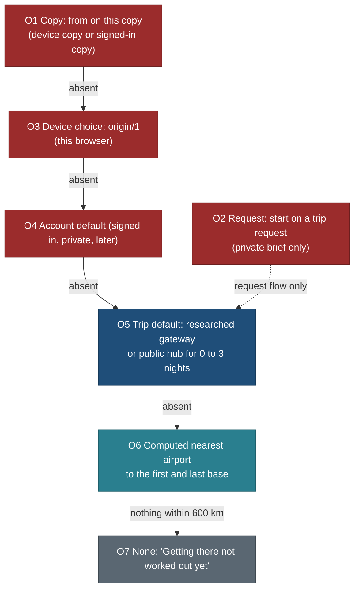

# Trip origin and the nearest airport: where getting there starts

> **Amended 27 Oct 2026 (TB-FLOW):** the trip builder asks Starting from at its stage 1 for every kind and confirms airports at stage 6 ([FLOW.md](../design/trip-builder/FLOW.md)); for builder plans a travel region's researched `gateways` play the O5 role ([trip-builder-location-metadata.md](trip-builder-location-metadata.md) M3).

Status: **spec, planned only** (25 Oct 2026, travel-planner, Opus). Requirements PLAN R-200 to R-207, BACKLOG 15.200 to
15.208, owner questions Q240 to Q249 (all answered 25 Oct 2026, yes as recommended). Nothing here is built. This page owns one rule, "where does a trip start
for this visitor", and every surface that reads it. It does not repeat what its neighbours own:

- [trip-timeline.md](trip-timeline.md) 6 (arrival day, departure day, `airport.before`, the day cap after a long flight):
  this page supplies the airport and the flight length those rules already expect;
- [stay-bases-and-optimisation.md](stay-bases-and-optimisation.md) 2 and 9.2 (gateway `in` and `out`, open jaw, M5):
  this page makes the gateway a field of every trip, not only the Rockies;
- [short-trips.md](short-trips.md) 4 (public hubs, the hub matrix, the household origin never public): unchanged for
  trips of 0 to 3 nights, see OR6;
- [nearby-and-regions.md](nearby-and-regions.md) 6 (the smart trip builder, step 2 "Base and source"): uses this rule;
- [navigation-and-mine.md](navigation-and-mine.md) 3.1 (`copies/1`) and
  [trip-overview-and-customisation.md](trip-overview-and-customisation.md) 5.6 (`trip-custom/1`): each gains one
  optional private field `from`;
- [request-intake-fields.md](request-intake-fields.md) 3 (Q239 "Starting from"): the field becomes the same picker;
- [F01-household-and-profiles.md](F01-household-and-profiles.md) 2 (home base): the planner's origin, later.

Principles cited by number from [principles.md](../design/foundation/principles.md) (P1 to P9, T1 to T5).

## The owner's request (25 Oct 2026)

> When planning a trip and only the destination is given, travel (the getting-there leg, flights, drive times, costs,
> day 1 arrival and the last day departure) starts from the nearest airport to that destination when the visitor gives
> no source city. If a source city is provided or selected, everything is calculated from there. I do not know which
> plan this belongs to: find out, put it there, and add whatever is missing.

**Where it belongs.** It belongs to no single existing plan. The pieces are spread over five specs: the timeline owns
arrival and departure days, the stays spec owns the gateway, the short-trips spec owns the public hub and the
household-origin rule, the nearby spec owns the trip builder, and the copy and request specs own the visitor's own
data. None of them defines a default for a long trip, a picker, an airport dataset or a precedence rule. This page is
the home; each of those specs carries a banner pointing here. In the plan it sits next to R-59 (directions beside every
stop, [TRIP-NAVIGATION-PLAN.md](../build/public-site/TRIP-NAVIGATION-PLAN.md)), because getting there is the trip's
first and last direction, and it ships with it in v0.9 (Q247).

## 1. Traceability: what exists, what is partial, what is missing

Checked on `main` aa01821 (private history) and on the unmerged `public/PUBLIC-SCRUB` branch, 25 Oct 2026.

| # | Piece | Verdict | Evidence |
|---|---|---|---|
| 1 | Public hubs (the neutral "from Toronto" start) | **PARTIAL** | `core/src/relevance/hubs.ts` holds Toronto City Hall only; short-trips 4.1 specifies `data/outings/hubs.json` with Toronto, Hamilton, Ottawa, Montréal (Q9 decided 19 Oct) and Q19 adds hubs outside Ontario; the file does not exist |
| 2 | Hub drive matrix `data/outings/from-hubs.json` | **MISSING** | BACKLOG 3.12 queued, 8.13 later (lane MX, E13); `web/lib/public/world.ts` `fromHubsOf` reads an absent file; `web/lib/entities/descriptors/trip.tsx` hides the drive pill while no trip has a value |
| 3 | "From Toronto" pill, card line, parser rule | **EXISTS, dormant** | `web/components/trips/tags/labels.ts` (bands, card line), `core/src/parse/parse.ts` (`from toronto`), L3b item 10 |
| 4 | Household home point kept out of public output | **EXISTS** | `core/src/privacy/home.ts` (`nearHome`, `PUBLIC_START_CITY` Toronto, `HOME_TOWN` scrub through `origin.ts`), `E_REL_HOUSEHOLD` in relevance inputs, PRIV1. On `main` the point is a constant; `public/PUBLIC-SCRUB` (not merged) reads it from `HOME_POINT_LAT` and `HOME_POINT_LON` with no default, through `core/src/config/home.ts` |
| 5 | An airport dataset (IATA code, point, scheduled service, size) | **MISSING** | no airport file in `data/`; OurAirports is listed as a public-domain reference source in [sources-and-licences.md](../../../research/method/sources-and-licences.md) and as the planner's AirportField source in [09-reservations.md](../09-reservations.md) (unbuilt) |
| 6 | Airports inside trip data | **PARTIAL** | Rockies `data/base-plans/canadian-rockies-2029.json` `gateway: {in: calgary-airport, out: calgary-airport}` with refs `place/calgary-international-airport`, `place/edmonton-international-airport` marked "proposed: no record yet"; prototype places carry `kind: airport` (`vce` in `data/seed/prototype/places.ts`); `web/lib/public/timeline.ts` hard-codes `calgary-airport` for the Rockies arrival and departure (a CONS breach) and finds the Dolomites airport by item kind |
| 7 | The gateway concept (in, out, open jaw) | **PARTIAL** | stay-bases 2 (Gateway row), M5 "Easier last day", DD-6 (a preference); authored for one trip of 14 |
| 8 | Arrival and departure day rules | **EXISTS** | trip-timeline 6: arrival `start` = `land`, `arrival.car-hire` 60 min, day cap 6 h after a flight over 5 h; departure `end` "at-airport" 3 h before an international flight with a 17:00 assumption, `airport.before` 180 international and 120 domestic; built in `web/lib/public/timeline.ts` |
| 9 | Routed legs to and from the airport | **PARTIAL** | Rockies legs from D9-R (ORS Calgary airport to every base, Edmonton airport to Jasper) in `data/schedules/legs/canadian-rockies-2029.json`; Dolomites legs from its airport item; no other trip |
| 10 | Flight leg and flight time | **MISSING** | nothing public; planner flight segments in [09-reservations.md](../09-reservations.md) (unbuilt) |
| 11 | Getting-there costs | **PARTIAL (planner only)** | F10 budget category "getting there" ([S16](../ux/screens/S16-budget-and-expenses.md)); short-trip cost lines (short-trips K3); no public flight, fuel or one-way hire line. No free fare source: Amadeus Self-Service closed to new users and shut down on 17 Jul 2026 |
| 12 | A visitor's own source city on public pages | **PARTIAL (spec only)** | short-trips K5 (switchable hubs and "use my location" kept in the browser, Q9); nearby 6.1 step 2 ("the source is a hub; signed in, it is the private origin"); none built |
| 13 | The source city in a copy | **MISSING** | `copies/1` (nav 3.1) holds start date, travellers, profile, overrides, additions; `trip-custom/1` (overview 5.6) has no origin, and its `start` (nav 4.2) is an ISO date |
| 14 | The starting city on a trip request | **PARTIAL** | Q239 decided yes: request-intake 3, "Starting from", free text 0 to 60, hint "A city or airport, never your address", detail weight 5, missing code `start`; not resolved to a town or airport |
| 15 | An account's saved home or origin | **PARTIAL (schema only)** | `household.home_point`, `home_label` (migration 0002) and `trip.origin`, `origin_label` (0004) exist under RLS with no UI or route; F01 2 "Home base ... used as the trip origin default" (planner) |
| 16 | Towns for a picker | **PARTIAL** | `data/reference/towns/**` (GeoNames `cities1000`, 130 parts, rows verbatim; only towns near catalogue anchors plus cities of 100,000 or more in those countries), `GET /api/v1/towns`; world towns of 5,000 or more planned in REQ-RF (R-195) |
| 17 | URL key for the start | **PARTIAL** | short-trips 3.4 reserves `from=ottawa`; `core/src/schedule/profileCodec.ts` `PROFILE_KEYS` has no `from` |
| 18 | API and MCP surfaces | **MISSING** | no route; MCP `search_entities` has `near` with `drive_min` and a `hub` kind ([tools-explore.md](../mcp/tools-explore.md)); the public MCP set (MCP-1) is unbuilt |
| 19 | The smart trip builder (destination only) | **PLANNED** | nearby 6 (BACKLOG 8.5, 8.6), source = hub or private origin, no airport |

**Net:** the arrival and departure mechanics exist; the data (airports, gateways for 13 trips), the rule, the picker, the
visitor's own origin and every surface that switches with it are missing.

## 2. Decisions

| ID | Decision | Why |
|---|---|---|
| OR1 | **One precedence ladder** (section 3) decides the start of every trip, for every surface: page, copy, request, builder, API, MCP | one answer everywhere; no surface invents its own default |
| OR2 | **Server output never varies by the visitor's origin.** Server HTML, OG images, the sitemap and cached `/api/v1` trip responses always carry the trip's public default; a visitor's choice is applied in the browser or in an RLS-protected private route | nothing private can leak through a cache, a crawler or a log, and the CDN keeps one copy per page (P9) |
| OR3 | **A researched gateway beats the computed nearest airport** on a public trip (Dolomites flies into Venice, not Innsbruck); the computed airport is shown as an alternate when it differs | research has judged fares and routes; distance alone has not (Q241) |
| OR4 | **Nearest airport = the best-scored airport with scheduled service and an IATA code** within 600 km: straight-line km plus a class penalty (medium +150 km, small +250 km), from OurAirports; 2 alternates; per-trip override | pure distance picks Bolzano, Whitecourt, La Fortuna Arenal and Reykjavík domestic (section 4.3) (Q242) |
| OR5 | **Arrival airport from the first night's base, departure airport from the last night's base**; different airports are an open jaw, offered with "Same airport both ways" | matches stays 2 and the Norway and Costa Rica plans |
| OR6 | **Trips of 0 to 3 nights keep the public hub default** ("from Toronto"); the nearest-airport rule applies from 4 nights | a day trip from an airport is nonsense; short-trips K5 stands (Q240) |
| OR7 | **Mode follows the road estimate from the visitor's origin**: up to 6 h drive is Drive, 6 to 10 h offers both with Fly first, over 10 h is Fly; train and ferry only when the trip's gateway says so | an honest estimate, never a computed rail or ferry time (T5) |
| OR8 | **No fares.** Flights show "Fares not shown" with a search link (a Google Flights URL, no key); fuel is an estimate from a configured band, marked ≈ and dated; open jaw adds a one-way car hire note | no free fare API exists; a price we cannot source is not shown (T3) (Q245) |
| OR9 | **The visitor's origin lives on the device or in their copy**, never in public output; share links carry an airport code or a public hub, never a town (Q243) | a home town is personal; an airport is not |
| OR10 | **Airports are reference rows (`airport:YYC`), not catalogue places** with pages | 4,008 rows of public-domain data are not our research (P8); a page per airport is noise (Q244) |
| OR11 | **One picker, three homes**: the trip page's Plan it for row, the trip request's Starting from field, and later the trip builder. It lists airports and gazetteer towns, shown exactly as the files hold them | one component; towns rule A33 |
| OR12 | **Budgets:** place HTML +0 B; trip start JS at most +200 B gzip for a closed trigger; the panel is a lazy chunk of at most 8 KB gzip; no client-side airport list | P8, P9; trip start JS is at 199.4 KB of 200 after BUDGET-FIX |

## 3. The rule: precedence



| Level | Source | Who sees it | Stored where |
|---|---|---|---|
| O1 | the copy's `from` (the visitor set it in the copy sheet line or the panel while a copy was open) | the visitor | `copies/1` item, or `trip-custom/1` in `planner_draft` (RLS) |
| O2 | a trip request's `start` | the owner, in the private brief | `intake.detail` (owner only) |
| O3 | the device choice from the picker ("Use for every trip", on by default) | the visitor, on this browser | `localStorage` key `travel.origin.local` (`origin/1`) |
| O4 | the account's saved Starting from (ORG-H, later; Q246) | the account holder | a private table under owner-predicate RLS |
| O5 | the trip's researched gateway (`trip-gateways/1`), or its public hub when the trip has 0 to 3 nights | everyone | `data/trips/gateways.json`, public |
| O6 | the computed nearest airport for the first and last night's bases (section 4) | everyone | derived at request time from the airports layer; never stored |
| O7 | nothing qualifies | everyone | none |

Rules:
1. **Explicit beats default.** O1 and O3 are a choice made by the visitor; O4 is a standing default; O5 and O6 are ours.
   A device choice (O3) is newer than an account default (O4), so it wins on that device.
2. **The household home is not special.** The owner's own start is O3 or O4 like anyone's. The household point stays
   only in the privacy guard (`core/src/privacy/home.ts`, env-based after PUBLIC-SCRUB), which keeps it out of every
   public file; this feature never reads it.
3. **Public surfaces evaluate O5 to O7 only** (OR2). O1, O3 and O4 are applied after hydration in the lazy chunk, or in
   a signed-in route for O1 and O4.
4. **A stay strategy changes the bases** (`st=`, stays 7): the ladder is re-run for that strategy's first and last
   base; a strategy's own `gateway` in `trip-base-plans/1` is its O5.
5. **The visitor can override the airports** of any level from the panel's alternates (`gw=`, section 10); that choice
   is part of their origin (O1 or O3).

## 4. The nearest airport

### 4.1 Data source and licence

**OurAirports** `airports.csv` (https://davidmegginson.github.io/ourairports-data/airports.csv), released to the public
domain, no warranty, community-maintained, updated nightly. No key, no paid API. Measured 25 Oct 2026: 86,281 rows;
9,053 with an IATA code; **4,008** with `scheduled_service = yes`, an IATA code and type `large_airport` (1,151),
`medium_airport` (2,093) or `small_airport` (764). As compact JSON the 4,008 rows are about 296 KB (111 KB gzip).

| Field kept (verbatim) | OurAirports column |
|---|---|
| `iata` | `iata_code` |
| `ident` | `ident` (ICAO or local) |
| `name` | `name` |
| `city` | `municipality` |
| `lat`, `lon` | `latitude_deg`, `longitude_deg` (not rounded) |
| `cc`, `region` | `iso_country`, `iso_region` |
| `class` | `type` as `l`, `m`, `s` |

Written by `tools/airports.py build` into `data/reference/airports/<cc>.json` (`airports-part/1`) plus a
`manifest.json` (source URL, download date, licence, SHA-256 of the download and of every part, the filter), exactly as
`tools/towns.py` does for GeoNames. `--check` re-derives from the cached download and fails on any difference; it runs
in check-all. Refresh is manual (`build --refresh`), quarterly or when a trip's gateway changes, with a diff report of
added, removed and reclassified airports used by any trip.

**Staleness is real.** OurAirports flags Whitecourt (YZU) as scheduled; the class penalty keeps it out of first place
for Jasper, the per-trip gateway overrides it, and ORG-G checks each chosen airport against the airport's own site.

### 4.2 Scoring

For a point P (a base, a town, a place):

```
candidates = airports with scheduled service and IATA within MAX_AIRPORT_KM (600) of P
score(a)   = greatCircleKm(P, a) + CLASS_PENALTY_KM[a.class]     // large 0, medium 150, small 250
primary    = min score
alternates = the next best score, plus the closest scheduled airport of any class if it is not already listed
             ("Closer, fewer flights"); at most 2
```

No border penalty: tested, it moved Chamonix from Geneva to Lyon. Constants live in `core/src/config/origin.ts`
(CONS rule). Ranking uses straight-line km; what the visitor sees is a road time (routed when the pair is in the legs
store, else the timeline 2.2 ladder over straight line × 1.42, marked ≈).

### 4.3 Golden table (measured 25 Oct 2026, straight-line km, becomes the unit test)

| Destination | Pure nearest (rejected) | Primary | Alternates |
|---|---|---|---|
| Banff | YYC 109 | **YYC** 109 | YEG 273, YLW 301 |
| Jasper | YZU 207 (stale flag) | **YEG** 304 | YLW 337, YYC 340 |
| Ortisei | BZO 29 | **INN** 80 (trip gateway VCE wins, OR3) | TSF 111, BZO 29 closer |
| Chamonix | NCY 60 | **GVA** 68 | TRN 101, NCY 60 closer |
| Reykjavík | RKV 2 (domestic) | **KEF** 37 | RKV 2 closer, AEY 248 |
| Vík | RKV 164 | **KEF** 188 | AEY 253 |
| El Chaltén | FTE 121 | **FTE** 121 | RGL 358, PNT 261 |
| Ushuaia | USH 5 | **USH** 5 | PUQ 261, RGA 119 |
| La Fortuna (CR) | FON 7 | **SJO** 71 | LIR 100, FON 7 closer |
| Monteverde | FON 33 | **SJO** 76 | LIR 85, FON 33 closer |
| Reine (Lofoten) | LKN 33 | **BOO** 91 | EVE 161, LKN 33 closer |
| Geiranger | HOV 59 | **AES** 76 | HOV 59 closer |
| Elora (ON) | YKF 25 | **YYZ** 64 | YHM 70, YKF 25 closer |
| Île d'Orléans | YQB 33 | **YQB** 33 | YUL 266 |
| Algonquin Park | YQA 85 | **YYZ** 224 | YOW 230, YQA 85 closer |
| Moab | CNY 27 | **CNY** 27 | GJT 108 |
| Zion (Springdale) | SGU 48 | **SGU** 48 | CDC 58, LAS 228 |
| Grindelwald | BRN 52 | **ZRH** 100 | BSL 115, BRN 52 closer |
| Zermatt | MXP 87 | **MXP** 87 | TRN 91, GVA 129 |
| Manali | KUU 40 | **IXC** 178 | KUU 40 closer |
| Leh | IXL 3 | **IXL** 3 | KDU 228, SXR 259 |
| Stowe (VT) | BTV 37 | **YUL** 139 | BTV 37 closer |
| Niagara Falls | IAG 11 | **BUF** 33 | YHM 69, YYZ 79 |
| Lord Howe Island | LDH 2 | **LDH** 2 | none within 600 km |
| Tórshavn | FAE 27 | **FAE** 27 | none useful |
| Svalbard (Longyearbyen) | LYR 4 | **LYR** 4 | none |
| Tristan da Cunha | HLE 2,440 | **none** (O7) | none |

Moab, Zion and Stowe show why the trip gateway matters: the computed primary is defensible, the researched gateway (Salt
Lake City or Las Vegas for Utah, Burlington for Vermont) is better, and OR3 lets research win without a special case.

## 5. Several stops, open jaw and strategies

1. **Arrival** = the ladder's airport for the base of night 1; **departure** = for the base of the last night. A trip
   with no bases uses its first and last stop with a point; with neither, O7.
2. **Open jaw** when the two differ (Norway EVE in, BGO out; Rockies Jasper-first strategy, Edmonton in, Calgary out).
   The panel shows the pair, the drive saved on Day 1 or Day N, and the stays-spec note "One-way car hire fees vary"
   (base-plans `factor: gateway` lines).
3. **Same airport both ways** is always offered: the airport that minimises (arrival drive + departure drive) among the
   union of both candidate lists, with its cost in road time ("adds 1 h 04 ≈ on Day 1").
4. **Internal flights stay in the plan.** Patagonia's Ushuaia and El Calafate flights are days of the trip, not
   getting there; the gateway is Buenos Aires (EZE) both ways.
5. **Strategies** re-run the ladder per strategy (section 3 rule 4); the Where to stay comparison (stays 6) gains one
   row, "Airport in and out".

## 6. Mode, distance and the edge cases

The road estimate R from the visitor's origin to the night-1 base (routed if in the legs store, else ≈):

| R | Default mode | Also shown |
|---|---|---|
| origin within 50 km of the night-1 base | none: "You start nearby"; Day 1 starts `leave-home` | nothing |
| up to 6 h | **Drive**: "Drive from Ottawa, about 4 h 10 ≈" | "Or fly into YYC" when an airport within 100 km of the origin has scheduled service |
| 6 to 10 h | **Fly** first, Drive second | both, with times |
| over 10 h | **Fly** | none |

Constants `NEAR_START_KM` 50, `DRIVE_DEFAULT_MAX_MIN` 360, `FLY_ONLY_MIN` 600, `ORIGIN_AIRPORT_KM` 100 in
`core/src/config/origin.ts`.

| Case | Rule |
|---|---|
| Island with an airport (Iceland, Faroes, Lofoten) | normal; Lofoten shows BOO with LKN as "Closer, fewer flights" |
| Island or valley with no airport within 600 km (Tristan da Cunha) | O7 unless the trip's gateway names a port: "No airport with scheduled flights within 600 km. This trip starts at <port>." |
| Leg from the airport crosses water | when the routed leg includes a ferry segment, the leg reads "includes a ferry"; when ORS finds no road route, "Ferry or flight needed; not routed" |
| Destination reached by train (Switzerland, car-free Zermatt) | the gateway's `onward: train` with a researched time and source ("Zürich airport to Lucerne by train, about 1 h 10, SBB"); never computed |
| Origin is the arrival airport's city (a visitor from Calgary on the Rockies trip) | Drive from the town; no flight line |
| Origin in another country but drivable (Montréal to Vermont) | Drive; a border chip if the trip already carries one |
| Short trip (0 to 3 nights) with no visitor origin | the public hub (OR6); with a visitor origin, the out and back legs are recomputed ≈ from it |
| Stale or closed airport | override in `trip-gateways/1`; the refresh diff lists every trip affected |
| Overview-only trip with no points | O5 if authored, else O7 |
| Time zones | no clock times on a public trip; the flight shows a duration only |
| The origin is near the household home | irrelevant: the choice never leaves the visitor's browser or RLS row |

## 7. What switches with the origin

| Item | Without a visitor origin (O5 or O6) | With a visitor origin (O1, O3, O4) |
|---|---|---|
| Getting there line | "Fly into Calgary (YYC), about 1 h 50 to Banff. Nearest airport, our default." | "From Mumbai: fly to Calgary (YYC), about 15 h 50 ≈ flying; then 1 h 50 to Banff." |
| Flight time | not shown (no origin) | great-circle estimate: 40 min + km ÷ 800 km/h, rounded to 10 min, labelled "flying time ≈; connections add time" |
| Drive from the airport | routed (legs store) or ≈ | same, for the chosen airport |
| Day 1 `start` | `land` at the gateway, "arrival time not set" (timeline 6) | `land` at the chosen airport; if the flight estimate exceeds 5 h, the existing 6 h day cap applies and Day 1 says "Long flight: Day 1 kept light"; Drive mode starts `leave-home` "Leave Ottawa" |
| Day N `end` | "At the airport by 3 h before your flight" (international assumption) | 2 h when the origin's country equals the airport's (`airport.before` domestic 120), 3 h otherwise; Drive mode ends `at-home` with the back leg ≈ |
| Cost lines | "Flights: fares not shown. Search flights" (link) | the same link prefilled with both codes; fuel ≈ for Drive mode (km × the country band, dated); open jaw adds "One-way car hire fee may apply" |
| Alternates | listed in the panel | re-scored for the visitor's choice of in and out |
| Copy and ICS | the copy stores no `from` | the copy stores `from` (O1); ICS Day 1 and Day N notes name the airports |

Fuel bands are researched per country in `core/src/config/origin.ts` (`FUEL_PER_100KM` with currency, source and
date), never live prices. No fare, ever, without a source (T3).

## 8. Public and private display

| Surface | Shows | Never shows |
|---|---|---|
| Public trip page (server HTML) | "Getting there" line from O5 or O6, labelled "our default" or "nearest airport"; alternates in the lazy panel | the household home, any visitor origin, the household town (scrub) |
| Public trip page after hydration, visitor chose an origin | the visitor's line, client-rendered | nothing is sent to our server except the picker's query (8.1) |
| OG image, sitemap, `/api/v1/trips/{slug}` | the default only | any origin |
| Device copy in Mine | "From Mumbai" in the copy row | nothing on any other device |
| Signed-in copy `/t/<id>/` | the copy's `from` | to anyone else (404 for others, overview 5.7) |
| Trip request brief | `start` resolved to a town or airport, or the visitor's text | to anyone but the owner |
| Share link | `from=bom` (airport) or `from=ottawa` (public hub) | a town id; the share sheet says "Shared links start from the airport, not your town" |

### 8.1 Privacy rules and tests

1. `origin/1`, the copies' `from` and `trip-custom/1` `from` are private keys in `core/src/privacy/detect.ts`; a public
   payload holding one fails the privacy test.
2. The picker sends what the visitor types to `GET /api/v1/origins?q=` (as `towns` does today). Our code never logs
   the query; responses are edge-cached by prefix. Vercel's request logs keep path and query for a short time; ORG-A
   confirms the Hobby retention and records it on `/privacy/`.
3. "Use my location" rounds to 1 decimal place (about 11 km) in the browser before `GET /api/v1/airports?near=`; the
   device stores the resolved town or airport, never the coordinates (Q249).
4. The gateways file is public data: a test asserts no gateway point lies within the household exclusion radius
   (`nearHome`) unless it is an airport or a public hub on the allowlist, accepted by identity with its reference file
   (the A33 rule, extended to airports in ORG-C).
5. Server HTML for a trip is byte-identical with and without `?from=` (OR2); an e2e case pins it.

## 9. UX: where it lives

**Trip page, under the trip's shape strip, above Day 1** (P3: a glance; P7: the primary action stays "Copy with my
dates"). Server-rendered, one line:

```
Desktop (1440)
┌ Getting there ───────────────────────────────────────────────────────────────┐
│ [plane] Fly into Calgary (YYC) · about 1 h 50 to Banff · back from YYC       │
│         Nearest airport, our default                    [Starting from ... ] │
└──────────────────────────────────────────────────────────────────────────────┘

Phone (390)
┌ Getting there ───────────────────────┐
│ [plane] Calgary (YYC) in and out     │
│ 1 h 50 to Banff · our default        │
│ [Starting from ...]                  │
└──────────────────────────────────────┘
```

**The panel** (lazy chunk, opens in place from the button, P5; bottom sheet on phones):

```
Starting from
[ City or airport                          ]   [Use my location]
  Mumbai, Maharashtra, India           town
  Mumbai (BOM), Chhatrapati Shivaji... airport
──────────────────────────────────────────────
Arrive and leave
(•) Calgary (YYC) both ways · 1 h 50 to Banff, 1 h 10 back from Kananaskis   our default
( ) In Edmonton (YEG), out Calgary (YYC) · Day 1 shorter ≈ 1 h 04 · one-way car hire fee may apply
( ) Cranbrook (YXC) · closer to Golden, fewer flights
──────────────────────────────────────────────
From Mumbai: about 15 h 50 ≈ flying (great-circle 12,180 km; connections add time)
Fares not shown. [Search flights]
[x] Use for every trip on this device
[Clear]                                                     [Done]
```

- Labels are plain (P4): "Starting from", "Arrive and leave", "our default". The current state is always visible on the
  closed line (P4).
- The trigger may instead sit as a row in **Plan it for** (`ProfileBar.tsx`, timeline 3.1), so
  the party, the pace and the start sit together; one control, two anchors (ORG-N decides whether the shape-strip line
  or the Plan it for row carries the button, not both, to hold the start-JS budget).
- Towns and airports are shown exactly as their files write them (A33): "Mumbai, Maharashtra, India", "Chhatrapati
  Shivaji Maharaj International Airport".
- The Day 1 and Day N entries name the same airport, and the map draws the airport leg dashed when ≈ (T5).
- **Copy sheet:** no new question (L5 rule: start date and travellers only). One line under them: "Starting from
  Mumbai · change" when O3 is set; the copy stores it as `from`.
- **Mine › My trips:** the copy row's mono line gains "from Mumbai".
- **Trip request (Q239):** "Starting from" uses the same picker in the request sheet; a free-text fallback stays.
- **Trip builder (nearby 6, later):** step 2's source uses the same picker and ladder.
- **Place pages:** no change now (+0 B). A "Nearest airport" row in the place's Getting there section is ORG-P, after
  the Q88 ruling and only as a lazy section (Q248).

## 10. Data shapes and the URL

**`airports-part/1`** (generated): `{ "schema": "airports-part/1", "cc": "ca", "rows": [["YYC","CYYC","Calgary
International Airport","Calgary",51.113899,-114.019997,"CA-AB","l"], ...] }`.

**`trip-gateways/1`** (authored, `data/trips/gateways.json`; moves into `trip.json` through an op after TD-1):

```jsonc
{
  "schema": "trip-gateways/1",
  "trips": {
    "canadian-rockies-2029": { "mode": "fly", "in": "YYC", "out": "YYC", "basis": "researched",
                               "src": ["base-plans gateway"], "checked": "2026-10-25" },
    "norway-summer-2028":    { "mode": "fly", "in": "EVE", "out": "BGO", "basis": "researched", "src": ["PLAN.md"] },
    "switzerland-2027":      { "mode": "fly", "in": "ZRH", "out": "ZRH", "onward": "train",
                               "onward_min": 70, "onward_src": ["SBB timetable"], "checked": "2026-10-27" },
    "algonquin-muskoka-2026": { "mode": "drive", "hub": "toronto" }
  }
}
```

`in` and `out` are IATA codes that must exist in the airports layer (`E_GATEWAY_IATA`); `hub` must be on the public-hub
allowlist; `mode` is `fly`, `drive`, `train` or `ferry`; a trip with 4 or more nights and no entry falls to O6 and is
listed by `ORG-G`'s gap report. The Rockies base-plans `gateway` ids map to `airport:YYC` and `airport:YEG` (Q244).

**Origin reference** (`core/src/origin/codec.ts`): `iata:BOM`, `hub:toronto`, `town:in-mh-mumbai` (towns layer id) or
`gn:1275339` (REQ-RF world town). A label and point come from the reference files, never from the visitor.

**`origin/1`** (device, `travel.origin.local`): `{ "schema": "origin/1", "ref": "town:...", "label": "...", "gw": null,
"forAll": true, "setAt": "..." }`, Zod-validated on read like `copies/1`.

**`copies/1` and `trip-custom/1`** gain optional `from` (an origin reference) and `gw` (`{in, out}` IATA). Not
`start`: that name is the ISO date in `trip-custom/1` and the request's missing code.

**Intake** (`intake-detail/1`, trip): `start` becomes `{ "ref"?: "<origin reference>", "text"?: "<0 to 60>" }`.

**URL** (timeline 3.8 order, after `walk`): `from` (an IATA code in lower case, or a public hub id: `from=bom`,
`from=ottawa`) and `gw` (`gw=yeg,yyc` in and out; one code for both). Defaults are omitted; an unknown value falls back
silently. A town choice is never written to the URL (OR9); the URL carries its resolved airport in Fly mode and
nothing in Drive mode.

## 11. API and MCP (read-only)

| Surface | Contract |
|---|---|
| `GET /api/v1/origins?q=&cc=` | 2 to 60 characters; up to 10 rows `{ref, kind: airport \| town \| hub, label, sub, cc, point}`; airports by IATA, name or city, towns through the `towns` store method (layer, then REQ-RF world towns); edge-cached |
| `GET /api/v1/airports?near=<lat,lon to 1 decimal>&limit=` | the section 4.2 ranking, at most 3 |
| `GET /api/v1/trips/{slug}/getting-there?from=&gw=&st=` | `gettingThere/1`: mode, in, out, alternates, legs (minutes, km, basis), flight estimate, cost lines; without `from`, the trip default |
| `CatalogueStore` | `airports(query)`, `gettingThere(slug, opts)` (one contract author, D-E2); `JsonStore` reads the reference files; `PostgresStore` later reads a `reference_airport` table loaded by SRV-0 |
| Public MCP (MCP-1) | `get_trip` gains optional `origin` (an origin reference or a lat,lon) and returns `getting_there`; new `nearest_airports {point \| ref, limit ≤ 3}`; both `readOnlyHint`; the audit log records no arguments (R-127) |
| Private MCP | a copy's `getting_there` uses its `from`; no new tool |

`/api/v1/trips/{slug}` itself never changes with an origin (OR2).

## 12. Budgets

| Budget | Effect | Check |
|---|---|---|
| Place HTML (+25% median, 19 B headroom in the sign-in-on build) | **+0 B** | `place-size.test` unchanged in both builds |
| Trip start JS (199.4 KB of 200 KB after BUDGET-FIX) | closed trigger at most **+200 B** gzip | the budget test in both builds, flag on and off |
| Trip HTML and RSC payload | the one line plus the gateway block, about 300 B per trip | measured and recorded in the ORG-1 hand-back |
| Panel chunk | at most **8 KB** gzip, loaded on first open (the AddToDay pattern of f525559) | bundle report |
| Client data | no airport list in the browser; at most 10 picker rows per query | network test: no request over 4 KB on open |

## 13. Tasks

Every task: branch from `main` in its own worktree (`/Users/nks/workspace/travel-wt/v2-<TASK>`), stage only owned
paths with `git -C <worktree> add <paths>`, never `-A`, commit with the project's Co-Authored-By trailer, no push.
Verification: `npx tsc --noEmit` in `core/` and `web/`, the unit tests named, Playwright screenshots of
`/trips/canadian-rockies-2029/` and `/trips/algonquin-muskoka-2026/` at 1440 and 390 in light and dark into
`web/test-results/shots/` (UI tasks), `bash tools/check-all.sh`.

| ID | Task | Agent, model | Effort | Owns | Must not touch | Depends on | Acceptance |
|---|---|---|---|---|---|---|---|
| ORG-N | Design note: the Getting there line, the panel, the picker combobox, where the trigger lives; foundation components and patterns 1.2 (`from`, `gw`) | travel-design-reviewer, Opus | 1.5 h | `docs/v2/design/trip-page/getting-there-note.md` (new), foundation `components.md`, `patterns.md` 1.2 | `web/**`, `core/**` | none | P1 to P7 and T5 cited; one trigger location chosen |
| ORG-C | Contracts and the pure rule: `core/src/origin/**` (precedence, scoring, open jaw, mode, flight and fuel estimates, codec), `core/src/config/origin.ts`, schemas `airports-part/1`, `trip-gateways/1`, `gettingThere/1`, store methods, OpenAPI, stub, the airport identity rule in `core/src/privacy/`, detector keys `from`, `gw`, `origin/1`, `profileCodec` `from` and `gw` | travel-builder, **Opus** (shared contract) | 4 h | the files listed, `core/test/origin/**`, `core/test/catalogue/contract/origin.cases.ts` | `web/**`, `data/**` | none | golden table 4.3 passes; precedence property tests; codec round-trips; contract kit green |
| ORG-D | `tools/airports.py build`, `--check`, `--refresh` with a diff report; `data/reference/airports/**`; one check-all line; `tools/tree_contract.json` allowlist; sources-and-licences row "used: airports layer" | travel-builder, Sonnet | 3 h | those paths | `core/**`, `web/**` | ORG-C schema | 4,008 rows (or the day's count) verbatim; manifest hashes; `--check` offline |
| ORG-G | Gateways for the 13 public trips: `data/trips/gateways.json` with sources; Rockies base-plans gateway refs to `airport:` ids; gap report where O6 differs from O5; a note per trip in `research/trips/<folder>/` | travel-researcher, Opus | 3 h | those paths | `core/**`, `web/**`, `legacy/**` | ORG-D | every trip of 4+ nights has `in` and `out`; every short trip a hub; `E_GATEWAY_IATA` 0 |
| ORG-M | Routed gateway legs: `web/scripts/gateway-legs-ors.mjs` (sequential, key in the header) for primary and alternate airports against night-1 and last-night bases (about 80 cells); written into `data/schedules/legs/<trip>.json` (new files where none exist; coordinate with STY-L) | travel-builder, Sonnet | 1.5 h | those paths | `core/**`, other `data/**` | ORG-G | `--check` fails on a missing pair; key never in output |
| ORG-A | Routes `GET /api/v1/origins`, `/airports`, `/trips/{slug}/getting-there`; `DataClient` methods; edge cache headers; Vercel log retention checked and written for `/privacy/` | travel-builder, Sonnet | 2 h | `web/app/api/v1/origins/**`, `web/app/api/v1/airports/**`, `web/app/api/v1/trips/[slug]/getting-there/**`, appended section of `web/lib/client/data.ts`, `web/tests/api/origin*.test.ts` | `core/**`, `web/components/**` | ORG-C, ORG-D | route tests; no query string in our logs; 404 and 400 shapes |
| ORG-1 | Trip page: server line from O5 and O6, Day 1 and Day N from the resolver (removes the `calgary-airport` literal in `web/lib/public/timeline.ts` and the airport branch of `legs-pairs.ts`), the trigger, the lazy panel with the picker, alternates, open jaw, "Use my location", `origin/1`, the `from` and `gw` URL keys, capability flag `gettingThere` | travel-builder, Sonnet | 7 h | `web/components/trips/getting-there/**` (new), `web/lib/public/gateways.ts` (new), arrival and departure code in `web/lib/public/timeline.ts` and `legs-pairs.ts`, one trigger in `ProfileBar.tsx` or the shape strip (per ORG-N), `web/lib/origin/**` (new), `web/lib/capabilities.ts` (append), tests `web/tests/origin/**`, `web/tests/e2e/trip-getting-there.spec.ts` | `core/**`, `web/components/actions/CopySheet.tsx`, `data/**` | ORG-N, ORG-A, R-59 merged | section 12 budgets; server HTML identical with and without `?from=`; Rockies YYC both ways; a Jasper-first strategy offers YEG in; Algonquin "from Toronto"; Mumbai origin shows a flight estimate and a 3 h airport buffer; Ottawa origin on Algonquin drives |
| ORG-2 | Copy sheet line, `from` and `gw` written into `copies/1` and mapped into `trip-custom/1` at merge; Mine row "from" | travel-builder, Sonnet | 2 h | `web/components/actions/CopySheet.tsx` (one line), `web/lib/mine/copies.ts` (`from`), the Mine row component | `core/**` | ORG-1, NAV-2 | copy, reload, open: the origin is kept; never in a public payload |
| NAV-C (+) | `copies/1` reserves optional `from` and `gw`; detector keys | travel-builder, Opus | +0.25 h | inside NAV-C | | inside NAV-C | property tests |
| CUS-C (+) | `trip-custom/1` reserves `from` and `gw` before the migration is applied | travel-builder, Opus | +0.25 h | inside CUS-C | | inside CUS-C | apply then inverse is identity |
| FBK-C (+) | `intake-detail/1` trip `start` as `{ref, text}` | travel-builder, Opus | +0.25 h | inside FBK-C | | inside FBK-C | validation cases |
| REQ-F1 (+) | Starting from uses the picker | travel-builder, Sonnet | +0.5 h | inside REQ-F1 | | ORG-1's picker module | the brief prints the resolved airport or town |
| ORG-R, ORG-V | Review (P1 to P9, T1 to T5, the scenario walk) and verify (first-use walk, sweep at 1440 and 390, light and dark, budgets in both builds) | reviewer Opus, verifier Sonnet | 2 h + 2 h | review notes | code | ORG-1, ORG-2 | approved; no must open |
| ORG-MCP | Public MCP `get_trip.origin` and `nearest_airports` | travel-builder, Sonnet | 1.5 h | inside MCP-1's files | | MCP-1, ORG-C | tool tests; annotations; no arguments in the audit log |
| ORG-H (later) | Account default Starting from: migration slug `account-start` (one row per user, an origin reference only, owner-predicate RLS), routes, Account setting, O4 in the ladder | travel-builder, Opus 1 h + Sonnet 3 h | 4 h | its migration, `web/app/api/account/start/**`, the Account section | | v0.12 account sync, Q246 | cross-user isolation; never in public output |
| ORG-P (later) | Place page "Nearest airport" row in Getting there, lazy | travel-builder, Sonnet | 3 h | the place section | | Q88 ruled, Q248 | place HTML +0 B |

**Totals.** Phase 1 (ORG-N to ORG-2, review and verify): about **28 h** (Opus 10.5: ORG-N, ORG-C, ORG-G, ORG-R; Sonnet
17.5), plus 1.25 h of widenings inside NAV-C, CUS-C, FBK-C and REQ-F1, plus ORG-MCP 1.5 h with v0.15. Later: ORG-H 4 h,
ORG-P 3 h, and the planner's household home base (F01) at the planner stage.

**Order.** ORG-C, then ORG-D, ORG-G and ORG-M in seat B any time (core and data only, no visitor change). ORG-N before
ORG-1. ORG-A after ORG-C and ORG-D. ORG-1 after R-59 merges (R-59 owns `web/components/trips/**` while it runs), then
ORG-2, then ORG-R and ORG-V. The NAV-C, CUS-C and FBK-C widenings ride inside those tasks before their contracts are
used.

## 14. Release placement

| Release | What rides | Visible? |
|---|---|---|
| v0.3 | NAV-C widening (`copies/1` reserves `from`, `gw`) | no |
| any release after it merges | ORG-C, ORG-D, ORG-G, ORG-M (internal) | no |
| v0.7 | FBK-C widening (`start` as `{ref, text}`) | no |
| **v0.9** | ORG-N, ORG-A, ORG-1, ORG-2, ORG-R, ORG-V with R-59 (directions beside every stop); flag `gettingThere` | **yes** (Q247) |
| v0.11 | CUS-C widening | no |
| v0.12 | ORG-H (if Q246 yes) | yes |
| v0.15 | ORG-MCP with the public MCP | yes |
| not on the train | ORG-P (after Q88), the planner's home base | |

## 15. Acceptance criteria (feature level)

1. With no visitor origin, every public trip of 4 or more nights shows a Getting there line naming an airport and a
   road time to the night-1 base, labelled as our default; short trips show their hub.
2. The golden table (4.3) is a passing unit test; Dolomites shows Venice (researched) with Innsbruck as an alternate.
3. Choosing Mumbai on the Rockies trip changes the line, the flight estimate, Day 1's light-day note and Day N's 3 h
   buffer, in place, without a reload (P5), and survives a reload on the same device.
4. Choosing Ottawa on Algonquin gives Drive with an ≈ time; choosing a town within 50 km of the first base gives "You
   start nearby".
5. Server HTML, OG and `/api/v1/trips/{slug}` are byte-identical with and without `?from=`; no origin value is in any
   public payload, log line or export.
6. A share link from a town choice carries the airport, never the town.
7. Budgets of section 12 hold in the public and sign-in-on builds.
8. First-use walk: a visitor finds and sets "Starting from" in under 20 seconds with no help text (P4).

## 16. Owner questions (Q240 to Q249, all answered 25 Oct 2026)

| ID | Question | Recommendation | Trade-off |
|---|---|---|---|
| Q240 | Trips of 0 to 3 nights keep the public hub default ("from Toronto"), and the nearest-airport rule starts at 4 nights? | **Yes** (ANSWERED 25 Oct 2026: yes, as recommended.) | a Calgary visitor sees "from Toronto" on a day trip until they pick a start |
| Q241 | A researched gateway beats the computed nearest airport on a public trip, with the computed one as an alternate? | **Yes** (ANSWERED 25 Oct 2026: yes, as recommended.) | needs ORG-G for 13 trips (3 h); without it the computed airport shows (Innsbruck for the Dolomites) |
| Q242 | Nearest airport: scheduled service and an IATA code, within 600 km, class penalty medium +150 km and small +250 km, two alternates, no border penalty? | **Yes** (ANSWERED 25 Oct 2026: yes, as recommended.) | a big airport 150 km further beats a small one next door; the small one is always listed as "Closer, fewer flights" |
| Q243 | Share links carry the airport code or public hub, never the visitor's town? | **Yes** (ANSWERED 25 Oct 2026: yes, as recommended.) | a shared Drive-mode link loses the start; the share sheet says so |
| Q244 | Airports are reference rows (`airport:YYC`), not catalogue places with pages; the Rockies base-plans refs change? | **Yes** (ANSWERED 25 Oct 2026: yes, as recommended.) | no airport page to link to; the stays spec's proposed `place/...` airport records are dropped |
| Q245 | No fares at all: "Fares not shown" with a Google Flights search link; fuel as a dated ≈ band per country? | **Yes** (ANSWERED 25 Oct 2026: yes, as recommended.) | no money figure for flights; no free fare API exists (Amadeus Self-Service shut down 17 Jul 2026) |
| Q246 | The account default Starting from (O4) waits for v0.12 (account sync); device and copy cover the start until then? | **Yes** (ANSWERED 25 Oct 2026: yes, as recommended.) | a signed-in visitor on a new device picks the start again until v0.12 |
| Q247 | Ship the visible part in v0.9 with R-59, or as its own release right after v0.4? | **v0.9 with R-59** (ANSWERED 25 Oct 2026: yes, as recommended.) | one review and one owner of the trip components; visible about five releases later than an early slot |
| Q248 | Place pages get a "Nearest airport" row later, lazily, after the Q88 ruling? | **Yes, later** (ANSWERED 25 Oct 2026: yes, as recommended.) | place pages say nothing about airports until then |
| Q249 | "Use my location" rounds to 1 decimal place before the airports request and stores only the resolved town or airport? | **Yes** (ANSWERED 25 Oct 2026: yes, as recommended.) | the nearest airport can be off by one for a visitor on a boundary; their coordinates never leave the browser unrounded |

## 17. Gotchas

- **`start` is taken.** It is an ISO date in `trip-custom/1` (nav 4.2) and a missing code in intake. The origin field is
  `from` everywhere.
- **OurAirports flags go stale** (Whitecourt). Never trust `scheduled_service` alone; the penalty and the gateway file
  carry the weight, and ORG-G checks each chosen airport.
- **`timeline.ts` hard-codes `calgary-airport`.** ORG-1 must replace it with the resolver, or the Rockies keeps Calgary
  whatever the visitor picks.
- **The trip start-JS budget is the binding limit.** One trigger only (ORG-N chooses where); the panel loads on open.
- **A routed leg is not a promise.** Airport legs from ORS are drive times without traffic; the ≈ marker stays where
  the leg is an estimate (T5).
- **Do not geocode with Nominatim from the picker.** Its policy forbids type-ahead (requests spec 4.3); the picker reads
  our reference files only.
- **Vercel request logs** can hold a typed query briefly; nothing in our code logs it, and `/privacy/` says so.
- **Parallel numbering.** R-197 to R-199 stay unused; this page took R-200 to R-207, Q240 to Q249 and BACKLOG 15.200 to
  15.208.

## Change log

| Date | Change |
|---|---|
| 2026-10-25 (owner answers, ANSWERS-4) | Q240 to Q249 answered 25 Oct 2026, yes as recommended (Q247 as v0.9 with R-59). Status line and section 16 table marked answered; nothing else changed |
| 2026-10-25 | First version from the owner's request of the same day: traceability (19 rows), decisions OR1 to OR12, the precedence ladder O1 to O7, OurAirports measured (4,008 scheduled airports with IATA codes) and the class-weighted rule tested on 27 destinations, open jaw, modes and edge cases, what switches with the origin, privacy, UX, data shapes and URL keys, API and MCP, budgets, tasks ORG-N to ORG-P (about 28 h for phase 1), release placement (v0.9 with R-59), Q240 to Q249. travel-planner, Opus |
