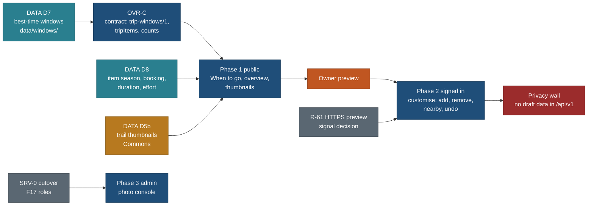

# Trip overview, best time to go, and customisation

> **Superseded in part 27 Oct 2026 by Step 2 ([design/step2/](../design/step2/README.md), R-285):** section 5 (customisation) is now [edit-mode-spec.md](../design/step2/edit-mode-spec.md): signed-out device copies are editable too (EM8), the document is `plan-draft/1` (not `trip-custom/1`), the entry is Copy to my trips (not a separate Customise this trip), and the warnings of 5.4 come in two levels. Sections 2 to 4 and 6 to 8 stand.

> **Amended 27 Oct 2026 (edit my trip, TRIP-EDIT-I):** the customised copy is the same document as a device copy and a builder plan: `plan-draft/1` with a `template` block holding this page's 5.6 delta (field names kept). `trip-custom/1` is retired before any doc is stored. The `custom-draft` migration's columns become `plan_doc` (bundle D). Customising a device copy no longer needs sign-in (Q-EM8; Q96 stands for public `rm=` links). CUS-1, CUS-2 and REQ-E fold into EM-4. See [edit-my-trip.md](edit-my-trip.md) 1 to 5 (PLAN: TODO row 27 Oct; BACKLOG 15.348 to 15.351).

> **Amended 26 Oct 2026 (UX fixes, planned, waiting for the owner's design approval):** the "[Day by day] [Trip overview]" toggle of 3.3 is replaced by page tabs (Summary · Days · Stops · Bookings · Photos); the overview renders inside the **Stops** tab and its Bookings sub-tab becomes the page's **Bookings** tab (URL `view=all`, `view=bookings`; OVR's `tab=` stays the sub-tab inside Stops). The SeasonBand redesign of 2.1 starts from the When to go design; OVR-1 fills its "Other weeks" slot and the hero's window. OVR-N must read UXB-N first. See [trip-and-places-ux-fixes.md](trip-and-places-ux-fixes.md) 3, 6 (PLAN R-260, R-263).

> **Amended 25 Oct 2026 (trip origin and nearest airport):** `trip-custom/1` gains optional private `from` and `gw`, reserved in CUS-C (+0.25 h) before its migration is applied. Not `start`, which stays the ISO date. See [trip-origin-and-nearest-airport.md](trip-origin-and-nearest-airport.md) section 10 (PLAN R-204).

> **Amended 25 Oct 2026 (requests and custom places):** `trip-custom/1` gains `title`, `moved` (reorder in a day),
> `days` (add or drop a day), `notes` and `custom` (a stop we do not have, with the visitor's point and source), widened
> in CUS-C before the migration is applied. "Only places are added" and "added items use catalogue refs, never names"
> (5.2, 5.6) stay true for `added`; stops outside the catalogue use `custom`, signed in only. See
> [requests-and-custom-places.md](requests-and-custom-places.md) sections 3 and 4 (PLAN R-173, R-174).

> **Amended 25 Oct 2026 (navigation and Mine):** private copies and own plans are listed in Mine › My trips (`/mine/`),
> where a signed-in customised copy opens at `/t/<id>/`; `trip-custom/1` gains optional `start` and `travellers` so a
> visitor's device copy can merge into `plan_draft` at sign-in ([navigation-and-mine.md](navigation-and-mine.md) 4.2).

Status: spec, 25 Oct 2026, written by travel-planner (Opus) from the owner's request of the same day. Nothing here is
built. Tracked as PLAN R-62 to R-67, BACKLOG 15.51 to 15.56, TODO row 2026-10-25. Build brief:
[build/public-site/briefs/OVR.md](../build/public-site/briefs/OVR.md). Research batches: DATA D7, D5b and D8 in
[build/public-site/briefs/DATA.md](../build/public-site/briefs/DATA.md).

**Amends:**
- [trip-timeline.md](trip-timeline.md): the "By category" view (`view=category`) becomes the trip overview (`view=all`,
  section 3 here); a new URL key `w` picks a best-time window and sets the scheduler's sun window (section 2.6). The 3.7
  "Add to this day" rule and its 30 km candidate radius are unchanged and reused.
- [F16-admin-console.md](F16-admin-console.md): adds photo update (section 6 here).
- [F06-plan-document-lists-and-days.md](F06-plan-document-lists-and-days.md) and
  [F12-templates-reuse-and-adaptation.md](F12-templates-reuse-and-adaptation.md): a customised copy is a delta on the
  public template held in `plan_draft` until the F06 plan document exists; F12's fork then converts it (section 5.6).
- Design foundation patterns 3.4 (By category) is amended by the design note OVR-N, written by `travel-design-reviewer`;
  this page does not edit the foundation.

## The owner's request (25 Oct 2026, voice, lightly cleaned)

> Take Canada Rockies as the example. In legacy we did it for September, but right now we just say 14 days. Then we can
> suggest the best time to avoid rush: June last week, or the second, third or last week, and also September first week.
> Also add plus and minus for each. For a trip we need to think about what will be there by trip, but there should be a
> view of all walking trails, all sightseeing, all activities, as a tab or group on the page, so I can read a
> consolidated list of how many trails there are for that trip. I should be able to filter for that trip: how many
> sightseeing items, how many things we have to book, which activities. Those must be very filterable for the trip
> itself, not only day by day. When anyone starts customising the trip they can add more trails or remove trails they do
> not need, so that is customisation. At least show all possible nearby things if they would like to add more. So the
> whole customisation is also coming. If we are missing data, capture as much as possible. When creating cards we need
> thumbnail images for all trails, so capture all those images too.

Answers to the clarifying questions (owner, final):
1. Read-only views and customisation are **one effort**. The public views never need a login; customisation is the
   signed-in layer on the existing Neon sign-in and private drafts. **The public views ship first and stand alone**
   (product direction: public site first, planner second).
2. Best time: 2 to 4 researched windows per trip, each with plus and minus points, sourced and dated, as data for every
   trip, the Rockies first as the pattern. Trips stay dateless templates, so windows are relative, never dates.
3. Thumbnails: Wikimedia Commons first, licence and author recorded; Flickr only if a key is free; otherwise Commons and
   an honest "No licensed photo yet". Photos must be updatable from the admin console.

## Decisions

| # | Decision | Why | Trade-off |
|---|---|---|---|
| D1 | Three deliverables in one effort, shipped in order: **(a)** best-time windows and the trip overview, public; **(b)** customisation, signed in; **(c)** the admin photo console | Product direction puts the public site first; (a) needs no account, no new backend and no data-layer cutover | Customisation waits for (a) and for the R-61 HTTPS preview, about two weeks later |
| D2 | Windows are **per-trip data** in a new file `data/windows/<trip-id>.json` (`trip-windows/1`; moved from `data/seasons/` on 25 Oct, see 2.2), not prose and not a trip table yet | The 14 trips are still legacy-backed (TD-4 is after R2); a sidecar keyed by trip id works for every trip today and folds into `trip.json` at TD-1/TD-4 | One more per-trip file until TD-4; the TD-2 allowlist must classify it then |
| D3 | A window is a **start week of a month** ("last week of June"), plus a month-day pair for the sun range, never a calendar date | Dateless rule (PLAN section 1); the schedule files already use month-day pairs for sun times only | "Week" is coarse; holidays that move (Labour Day) are written as rules, not dates |
| D4 | The overview **replaces** the By category view (`view=all`; `view=category` stays as an alias) | One inventory view, not two that drift; the six categories survive as its tabs | The view's code moves into a lazy chunk, so the first open costs one request and one chunk |
| D5 | The overview has **three scopes**: In this plan, Also researched for this trip, Nearby you could add | The owner asked "how many trails there are for that trip": the Rockies plan uses 33 trails but 62 were researched; "all possible nearby things" is the third scope | More rows than the plan; counts per scope keep it readable (P2) |
| D6 | Overview rows come from **one new store method per trip** (`tripItems`, `tripItemCounts`), light rows only, paged and capped | P8 (light rows, no bulk), P9 (one boundary); the trip page start JS is at 199.2 of 200 KB | A new contract in the API lane (one author, Opus) before any UI |
| D7 | Nearby candidates reuse the trip-timeline 3.7 rule: catalogue places with a page and an exact point **within 30 km straight line of a base the trip uses**, served by the existing `near` method | Existing decision (timeline 3.7; nearby spec 6.4 keeps 30 km for public trip pages); no second distance rule | 30 km misses some day trips; the "Day trips" link to near mode at 100 km covers them |
| D8 | Customisation is a **delta on the public template**, stored in `plan_draft` (new columns, migration `custom-draft`, number assigned at merge), not F06 `trip_item` rows | `plan_draft` already has RLS, cross-user isolation and live invalidation proven against Neon; F06 tables need membership policies (Q69, open) | A delta is a stop-gap; F12's "Use this trip" converts it into a full plan later |
| D9 | Photos: **Commons first, no Flickr now.** NPS public-domain images are allowed where a page is NPS (Utah). Everything else shows "No licensed photo yet" | A Flickr API key now appears to need a paid Pro account (section 7), which breaks the free-tier rule (R-4); the 18 Oct media report already set Flickr to "No for now" (its Q8) | Fewer candidates where Commons is thin (Kananaskis, Patagonia trails) |
| D10 | An owner photo choice is an **override that research never replaces**, kept in its own file until the catalogue cutover, then as `media` rows | A D5 rerun must not undo a person's pick; the deployed app cannot write repo files | The admin console screen waits for the PostgresStore cutover and F17 roles (section 6.3) |



## 1. User stories

| # | As | I want | So that | Principles |
|---|---|---|---|---|
| U1 | a visitor reading the Rockies trip | to see 2 to 4 good weeks to start this 15-day trip, each with its plus and minus points and sources | I pick a week that avoids the rush and know what I give up | T1, T3, P6 |
| U2 | a visitor | to pick a window and see the plan change: sun times, items that may be closed, booking notes | the plan I read is the plan for my weeks | T1, P5 |
| U3 | a visitor | one view with every trail, sight, activity and booking of the trip, with counts | I see at a glance that this trip has 33 trails in the plan and 62 researched | P2, P3 |
| U4 | a parent | to filter that view by effort, duration, "fits a 6 year old", booking needed and day | I find the easy walks or the things I must book without reading 15 days | P4, T4 |
| U5 | a visitor | to see nearby places the plan does not use | I know what else is there before I copy the plan | P2 |
| U6 | a signed-in planner | to make my own copy, add trails, remove ones I do not need, and see the day re-flow with warnings | the plan fits my party and I can undo anything | P5, T4 |
| U7 | anyone | a photo on every trail card, credited, or an honest "No licensed photo yet" | I recognise the place and trust the credit | T3, P8 |
| U8 | the owner | to replace or hide a photo for any place from the admin console, with a record of who changed what | a bad pick is fixed in minutes and research never undoes it | F16 |

## 2. Best time to go (R-62)

### 2.1 What the visitor sees

The SeasonBand ("This plan is valid for") becomes **When to go**. It keeps the twelve-month strip, the reason and the
weather tiles, and adds one card per window below them. The window the plan was written for is first and labelled
"The plan's own window".

```
When to go                                                        Rockies, 15 days
Jan Feb Mar Apr May [Jun] Jul Aug [Sep] Oct Nov Dec      (open months shaded; picked window outlined)

+-- The plan's own window ------+  +-- Last week of June -----------+  +-- First week of September ----+
| Start in the 2nd week of Sep  |  | Start in the last week of June |  | Start in the 1st week of Sep  |
| Crowds: lower   Read Oct 2026 |  | Crowds: rising  Read Oct 2026  |  | Crowds: high at the start     |
| + Larches start turning (P)   |  | + Longest days, 16 h of light  |  | + Every lift and shuttle runs |
| + After the Labour Day weekend|  | + Lake roads open, Moraine bus |  | + Warmer lakes for the canoe  |
| - Sunshine gondola may close  |  | - Snow on high passes (Sentinel)|  | - Labour Day weekend crowds  |
| - Colder mornings, snow dust  |  | - Sunshine Meadows not open yet|  | - Larches still green        |
| 2 more  Sources (4)           |  | 2 more  Sources (5)            |  | 1 more  Sources (3)          |
| [Plan for this window]        |  | [Plan for this window]         |  | [Plan for this window]       |
+-------------------------------+  +--------------------------------+  +-------------------------------+
Not checked for any window yet: larch timing in late June (not applicable), wildfire smoke odds.
```

(Illustrative wording. Every bullet in the built page comes from the D7 data with its source; nothing above is a
researched fact.)

- **Card anatomy (P3, P6).** Label, the start rule in words, a crowd chip, at most two plus and two minus points at
  rest, "N more" to expand in place (P5), "Sources (n)" one step away, and the read date (T3). Plus and minus points are
  short lines (at most 120 characters), each with a factor chip on expand: Crowds, Weather, Access, Light, Wildlife,
  Price, Events, School.
- **No colour scale.** The verdict is a word, never a red-to-green scale (no green, PLAN section 1): **Best for this
  plan**, **Good, with trade-offs**, **Workable**. Plus and minus are marked with a plus and a minus glyph and text, not
  colour alone.
- **Plan for this window** sets `w=<window id>` in the URL (2.6). The picked card is outlined; "The plan's own window"
  is the default and is omitted from the URL.
- **Phone (390).** The cards become a horizontal snap list with the picked card first; each card shows the label, the
  verdict word, one plus and one minus at rest. The months strip stays above. Nothing opens as a modal.
- **Overview trips** (no days) show the windows too; "Plan for this window" is absent because there is no plan to
  re-run.
- **Gap state.** A trip with no windows file shows today's band unchanged plus one line: "Other weeks to go have not
  been researched yet."

### 2.2 Data shape: `trip-windows/1`

**Folder changed 25 Oct 2026 (DATA-ROADMAP decision DD-1, reversible until D7-R writes a file).** DATA D6a wrote
`data/seasons/<trip>.json` for the six trips with no season under a different schema, `trip-season-basic/1`: one window
(the plan's own, `verdict: null`) plus a `season` block in the adapter's Season shape and climate-station `points`. A
`trip-windows/1` validator over that folder would reject those files (`E_WIN_COUNT`), and D7 would overwrite them. So the
windows live in their own folder; `data/seasons/` stays the trip's basic season (BACKLOG 3.9, 15.113). Where both files
exist for a trip, the windows file's default window must agree with the season file's months (`E_WIN_SUN` reads both).

File: `data/windows/<trip-id>.json`, one per trip, keyed by the trip id used in `data/capture/` (section 8.1). Written
by research (DATA D7), validated by a Zod schema in core (`core/src/schema/windows.ts`, task OVR-C) and by check-all.
Never published as a file; the trip page and the API read it through the store.

```jsonc
{
  "schema": "trip-windows/1",
  "trip": "canadian-rockies-2029",
  "researched": "2026-10-26",            // provenance date, not a travel date
  "agent": "travel-researcher", "model": "opus",
  "length_days": 15,                     // must equal the trip's day count; the validator checks it
  "default": "sep-w2",                   // the window the plan was written for; must match the schedule's season
  "sources": [
    { "id": "src-0412", "url": "https://parks.canada.ca/...", "publisher": "Parks Canada", "read": "2026-10-26" }
  ],
  "windows": [
    {
      "id": "jun-last",                  // kebab, stable once published (URL key)
      "label": "Last week of June",
      "start": { "month": 6, "week": "last" },   // week: 1 | 2 | 3 | 4 | "last"
      "sun": { "from": [6, 24], "to": [7, 8] },  // month-day pairs for sun ranges only (as data/schedules)
      "verdict": "good",                 // best | good | workable
      "best_for": "Long days and open lake roads, before the school holidays peak",
      "crowd": { "level": "rising", "basis": "official", "src": ["src-0415"], "note": "Monthly park visitation" },
      "plus": [
        { "text": "Lake roads and the Moraine Lake shuttle run", "factor": "access", "basis": "official", "src": ["src-0412"], "on": "2026-10-26" }
      ],
      "minus": [
        { "text": "Sunshine Meadows gondola does not open until early July", "factor": "access", "basis": "operator", "src": ["src-0420"], "on": "2026-10-26", "pattern_year": 2026 }
      ],
      "events": [
        { "rule": "Canada Day long weekend falls inside this window", "effect": "crowds", "src": ["src-0430"] }
      ],
      "affects": [                       // plan items whose access season does not cover this window
        { "ref": "legacy/canadian-rockies-sept-2029/trails/sunshine-meadows-citadel-pass", "state": "closed", "why": "gondola season", "src": ["src-0420"] }
      ],
      "unknown": [
        { "text": "Snow on Sentinel Pass in late June", "searched": "2026-10-26", "tried": "Parks Canada trail report; no seasonal statement" }
      ]
    }
  ]
}
```

Rules the validator enforces:

| Rule | Error |
|---|---|
| 2 to 4 windows; ids unique; `default` names one of them | `E_WIN_COUNT`, `E_WIN_DEFAULT` |
| `length_days` equals the trip's days; the default window's `sun` equals the schedule's season | `E_WIN_LENGTH`, `E_WIN_SUN` |
| Every plus, minus, crowd, event and affects entry has `src` (resolving to the source registry) or `basis: "our_inference"` with a `note` saying why | `E_WIN_SRC` |
| No calendar date in any text (`DATE_TEXT` from `web/lib/public/dateless.ts`); a bare year only as `pattern_year` | `E_WIN_DATE` |
| No household data (the privacy scan the adapter runs) | `E_PRIVACY` |
| At most 4 plus and 4 minus per window, each at most 120 characters | `E_WIN_LONG` |
| `affects[].ref` resolves to a record of the trip | `E_FK` |
| Windows at least 7 days apart by start | `W_WIN_CLOSE` |

### 2.3 How windows are chosen (the research method, DATA D7)

1. **Candidates.** The plan's own window, the weeks the owner named for the Rockies (June weeks 2, 3 and last;
   September week 1), and for every trip the shoulder weeks either side of its season months.
2. **Feasibility first.** For each candidate, check the access seasons of the plan's must-do items and each base's key
   access (roads, shuttles, lifts, huts). A candidate where a must-do is closed stays only if the minus says so plainly.
3. **Factors, each sourced:** crowds (official monthly visitation, school calendars and public holidays as rules,
   events such as the Calgary Stampede as rules), weather (climate normals by month from the national weather service),
   light (sun times from `core/src/sun`, never from memory), access (operator and park season pages), wildlife and
   closures (park pages), price (only where an operator states a season price).
4. **Keep 2 to 4** distinct windows (at least a week apart), ranked by fit for the plan as written. Drop a candidate
   that adds nothing new.
5. **Write the gaps.** Anything searched and not found goes into `unknown` with the date and what was tried.

Sources follow the standing rules: AllTrails, Google, Tripadvisor and Komoot are links only, never values; one runner
per service under its lock; every `src` resolves to the registry.

### 2.4 Honesty rules

- **A gap is never a yes.** A window with no crowd source shows "Crowds: not checked", never "quiet". An item with no
  access season is "Season not checked" in that window, never "open".
- **Sources are dated.** Each card shows "Read Oct 2026"; a value from one year's operator calendar shows "2026
  pattern" (T3).
- **Our inference is labelled.** A plus or minus with `basis: our_inference` carries the existing Estimate chip.
- **Crowd words are relative to the trip's own season**, from a small fixed scale: lower, similar, rising, high, peak.
  A level needs a source or an inference note.
- **No promise of quiet trails.** Copy never says "no crowds" or "empty"; it says what the source says.

### 2.5 Rockies: the pattern (what D7 must answer first)

The plan was written for "Early to late September" (prototype season) with a 15-day schedule; the legacy plan chose a
start in the second week of September to skip the Labour Day weekend and catch the start of larch colour
(`legacy/canadian-rockies-sept-2029/PLAN.md`, `research/trips/canadian-rockies-sept-2029/timing-hazards.md`).

| Candidate window | Questions D7 must answer with sources | Already in our research |
|---|---|---|
| Second week of September (the plan's own) | crowds after Labour Day; larch timing; Sunshine gondola last day; Moraine canoe end; first snow at altitude | larch peak about 20 Sep to 5 Oct; Sunshine closed 21 Sep 2025 and 20 Sep 2026; snow dustings from late August |
| First week of September | Labour Day long weekend effect; which lifts, shuttles and cruises still run; larches still green | Minnewanka kids' cruise ended 31 Aug 2026; the free shuttle ended on Labour Day |
| Last week of June | school year end in Alberta and Ontario (as rules); Canada Day weekend; Calgary Stampede start; snow on high passes; Sunshine gondola opening; Lake O'Hara bus start; Highwood Pass opening | Moraine Lake road and shuttle from about 1 June; Lake O'Hara shuttle from 19 June 2026; Sunshine gondola from 6 July 2026; Highwood Pass closed 1 Dec to 15 Jun (unverified) |
| Second or third week of June | lingering snow on high trails; bear closures; lake ice; cold nights; fewer crowds before school ends | Parks Canada warned of deep snow on high trails in May 2026 (snippet only) |

D7 keeps 2 to 4 of these. The owner named four, so the likely set is the plan's own window, the first week of
September, the last week of June and one mid-June window, unless the data rules one out.

### 2.6 What picking a window changes

| Element | Change | Where |
|---|---|---|
| Sun anchors and ranges | the scheduler's sun window becomes the window's `sun` pair | `scheduleInput` sun window (timeline 2.1, 2.8); no other scheduler change |
| Day entries | an entry whose record is in `affects` gets a chip: "May be closed in this window", with the reason one step away | day rows (P6) |
| Overview | the Season fit filter (3.4) uses the picked window | overview |
| Copy with my dates | the copy sheet's date picker opens on the next year's week that matches the window | copy sheet; dates attach only in the copy |
| Exports | the print view and the ICS of a dated copy name the window | export builders |

URL: `w=jun-last`. The codec is `core/src/schedule/profileCodec.ts`; an unknown `w` falls back to the default without
an error (timeline 3.8). The order of keys: after `add`, before `view`.

## 3. The trip overview: everything in one trip (R-63)

### 3.1 How it differs from the day-by-day timeline

| | Day by day (timeline, the default view) | Trip overview (`view=all`) |
|---|---|---|
| Question it answers | What do we do on Day 5, in what order, at what time? | What is in this trip, and how much of it suits us? |
| Order | chronological | grouped by tab, then by the chosen sort |
| Variants | the variant the party profile selects per day | every variant, labelled ("Day 5, adults' hike") |
| Scope | the plan | the plan, plus also researched, plus nearby |
| Filters | none (the profile reshapes the days) | kind, effort, duration, suits, booking, day, base, season fit, scope |
| Counts | per day | per tab and per scope, updated as you filter |
| Link between them | an entry links to its place page | a row's "Day 5" link opens the timeline at `#day-5` with the entry open (P5) |

### 3.2 Tabs, scopes and counts

Tabs, in this order: **Trails, Sights, Activities, Bookings, Stays, Food, Getting around**. The first four are the
owner's; the last three are the existing categories. Bookings is cross-cutting: every item from any tab with a booking
rule, plus the trip's booking rules that have no place (a park pass). OVR-N may reorder; the patterns 3.4 order stays
for print.

Scopes, as the first filter pill: **In this plan** (default), **Also researched for this trip**, **Nearby you could add**.

The summary line at rest (server-rendered, P3):

```
In this plan: 33 trails · 30 sights · 15 activities · 17 to book (6 book first)
Also researched: 29 more trails · 18 sights · 28 activities        Nearby you could add: 41 places within 30 km of a base
```

(Rockies counts measured 25 Oct from the legacy datasets: trails 33 of 62, sights 30 of 48, activities 15 of 43,
bookings 17 on days of 33 rules, 6 must-do. The nearby count does not exist yet; it needs D1 points.)

Stays shows bases and nights only. Lodging ideas never appear (privacy rule: no stay ideas on the public site). Amended 25 Oct: [stay-bases-and-optimisation.md](stay-bases-and-optimisation.md) renames this tab "Where to stay" and adds researched ways to stay; property names and booking state still never appear.

### 3.3 Layout

Desktop (1440):

```
[Day by day]  [Trip overview]                                       Export trip  Copy with my dates
Trails 33   Sights 30   Activities 15   Bookings 17   Stays 5   Food 4   Getting around 9
Scope: In this plan v   Effort v   Duration v   Booking v   More filters (Day, Base, Suits, Season fit)   Clear all
33 trails · 14 suit a 6 year old · 3 not checked · sorted by day                       Sort: Day v   Cards | List
+-------+-----------------------------------------------+-----------------+-----------------------+
| [img] | Mary Schaffer Loop          Easy · 3.2 km · 84 m | ~1 h 20 with a 6 | Day 5 · family version |
| 96x72 | Jasper · Maligne Lake                         | Fits 6 · Stroller part | No booking          |
+-------+-----------------------------------------------+-----------------+-----------------------+
| [img] | Bald Hills                  Hard · 10.4 km · 500 m | 4 h 30 adults   | Day 5 · adults' hike   |
| glyph | Jasper · Maligne Lake       No licensed photo yet | Not for under 12 | No booking           |
+-------+-----------------------------------------------+-----------------+-----------------------+
...                                                       Photo credits (31)          Page 1 of 2  Next
```

Phone (390):

```
[Day by day] [Trip overview]
< Trails 33 | Sights 30 | Activities 15 | Bookings 17 >     (scrolling chip strip, sticky)
In this plan v   Filters (2)                                (Filters opens an inline panel, not a modal)
33 trails · 14 suit a 6 year old
[img 64] Mary Schaffer Loop
         Easy · 3.2 km · ~1 h 20 · Day 5
         Fits 6 · No booking
[glyph]  Bald Hills
         Hard · 10.4 km · 4 h 30 · Day 5 adults
         Not for under 12
```

- Rows use the existing row and card components (the Places list anatomy), with a thumbnail (section 4). Cards and List
  are the two views; Table and Map stay on the Places list (one map family per page; the trip map stays the route map).
- The tab strip reuses `CategoryStrip` (counts, sticky, phone snap). An empty tab is shown at 45% and not clickable, as
  today.
- Each row opens its place page; "Day 5" opens the timeline at that entry; on a nearby row, the action is "See on the
  map" (near mode on the Places list) for visitors, and "Add to a day" once signed in (section 5).
- The Bookings tab groups rows as **Book first** (must-do, sells out), **Book ahead**, **On the day**, **Not checked**,
  each row with its dateless rule ("Opens 30 days before Day 3 at 08:00 local"), the sells-out note and the official
  link.

### 3.4 Filters

Four pills at rest, the rest under "More filters"; six at most when a kind is chosen (P4, Q27). Results and counts update
as you choose; "Clear all" is always visible when a filter is set; an empty result offers the nearest match ("No easy
trails under 1 h in this plan. 4 in Also researched. Show").

| Filter | Values | Source of the value | Gap behaviour |
|---|---|---|---|
| Scope | In this plan, Also researched, Nearby | plan items; the trip's research datasets and capture records; `near` within 30 km of a base | Nearby is absent while a base has no point, with a line saying so |
| Effort | Easy, Moderate, Hard, Not checked | the family effort scale (1-2 easy, 3 moderate, 4-5 hard) from suitability; else the source grade labelled ("Parks Canada: moderate") | Not checked is its own value and is never folded into Easy |
| Duration | Under 1 h, 1 to 3 h, 3 to 6 h, Over 6 h, Not checked | the scheduler's duration for the page's party profile and pace (one pure function, the same numbers as the timeline) | rule-based durations carry the Estimate chip |
| Booking | Book first, Book ahead, On the day, No booking, Not checked | the item's booking rule (`window`, `book_url`) or the trip's booking rules | "No booking" needs a source or an explicit `none_stated`; otherwise Not checked |
| Day | Day 1 to N, Not in the plan | plan items | none |
| Base | the trip's bases | the item's base or nearest base | items with no point: "Base not known" |
| Suits | Fits your party (from `p`), Stroller, Wheelchair, Dogs | suitability sidecars | Fits is a yes only on an answered limit; unknowns are counted as "not checked" beside the result |
| Season fit | Open in this window, May be closed, Not checked | the picked window's `affects` and the item's access season | Not checked is shown, never counted as open |
| Kind | the type tree under the tab (trail: walk, hike, nature walk; activity: boat, lift, river...) | `data/vocab/types.json` | none |

Sort: Day (default for In this plan), Distance from a base (default for Nearby), Effort, Duration, Name.

URL keys (extending timeline 3.8; parsed today by `web/components/trips/useTripUrl.ts`, which the lane keeps pure):
`view=all`, `tab=trails`, `scope=plan|more|near` (comma list), `eff`, `dur`, `book`, `day`, `base`, `suits`, `fit`, `k`,
`sort`, `pg`. Defaults are omitted. `view=category` and the existing category fragments (`#trails`, `#stays`) open the
overview on that tab, so old links keep working. The profile keys (`p`, `pace`) and `w` apply to the overview too.

### 3.5 Data boundary, size budgets and loading (P8, P9)

- **Boundary.** Components read only through `DataClient` (`web/lib/client/data.ts`): `tripItems(slug, query, page)`
  and `tripItemCounts(slug, query)`, served by `GET /api/v1/trips/{slug}/items/` and `GET /api/v1/trips/{slug}/items/counts/`,
  which call new `CatalogueStore` methods with Zod contracts in `core/src/schema/api/trip.ts`. The windows ride on the
  existing `getTrip` payload (`trip.windows`), because they are small and server-rendered. The StaticAdapter fallback gets
  a prerendered per-trip file with the same contract.
- **Light rows (P8 allowlist).** A row carries: ref, slug, name, type, tab, scope, area label, base, days with variant
  labels, effort label, duration minutes and band, km and gain (the existing waiver), booking group and rule label,
  season-fit label, suits chips, distance and bearing (Nearby only), and the thumbnail (url, width, height, credit short
  form, licence id). Never facts, links, notes, suitability values, sources or prose. A contract test pins the keys.
- **Caps.** Page size 24 (default) to 50 (max); a trip's items are bounded by the trip; Nearby is the existing `near`
  method per base with `r=30`, capped and deduplicated; no unscoped query.
- **Start JS: net zero or less.** The trip page start JS is 199.2 KB against a 200 KB budget (TRP2b2 verification). The
  overview's filter bar, rows and fetch code live in a dynamic chunk loaded on the first click on "Trip overview" or on a
  direct load with `view=all`. Step 0 of the build (OVR-0) moves today's `CategoryView` into that chunk, which should
  free headroom; the lane must measure before and after with `web/tests/budget.test.ts` and may not end above `main`.
- **HTML.** At rest the page adds only the summary line and the tab counts (target under 1.5 KB) and the window cards
  (target under 2.5 KB for four). Rows are never in the initial HTML.
- **Images.** Thumbnails load lazily (`loading="lazy"`, fixed 4:3 box, no layout shift), 160 and 320 px renditions,
  under 15 KB each; at most 24 per page.
- **Server switch.** The same methods run on the proposed `PostgresStore` (SRV-0) with the same cases; URLs and components
  do not change.

## 4. Thumbnails for every trail card (R-64)

- **Where.** Overview rows and cards (all tabs), the timeline's trail and visit entries when expanded, the Places list
  cards (already photo cards), and the Nearby rows.
- **Which photo.** One resolution function, `pickPhotos(ref)` in `core/src/media/` (new), used by `JsonStore` now and
  `PostgresStore` later, in this order: owner override (section 6) > research pick from the lane files (`PH.json`, DATA D5)
  > photos already on the record > none. A hidden photo is never shown even if research picks it again.
- **Credit.** Each thumbnail has its author and licence in its accessible name and tooltip; every list has a "Photo
  credits (n)" disclosure listing author, licence (linked) and source (linked to the Commons file page); the place page
  keeps its full credit. CC BY-SA files resized for thumbnails say "resized".
- **No photo.** The kind glyph, at the same size, with "No licensed photo yet" in the row's accessible name and on the
  place page (existing wording). Never a stock image, never a map tile as a stand-in.
- **Licences accepted:** CC BY (2.0 to 4.0), CC BY-SA (2.0 to 4.0), CC0, public domain (Public Domain Mark; US federal
  works such as NPS photos, labelled "Public domain, US government"). Rejected: any NC or ND licence, all rights
  reserved, "no known copyright restrictions" without a person's review.
- **Known gap today.** 0 of 118 trail records in `data/capture/` carry a photo (`capture.ts gaps --tier required`, 25 Oct),
  and the Vercel build has no Commons renditions because `web/.og-cache` is git-ignored (HANDOVER item 3). Thumbnails
  depend on DATA D5b and on that image-pipeline fix.

## 5. Customisation: your own copy (R-65, signed in)

### 5.1 Entry and privacy

- **Public page, signed out.** Nothing changes for the 90%: the primary action stays "Copy with my dates" (P7). The
  existing URL-only "Add to this day" (timeline 3.7, `add=`) stays as it is. A secondary action **Customise this trip**
  sits in the plan bar.
- **Customise this trip** while signed out goes to sign-in with the return URL; the current URL state (`p`, `pace`, `a`,
  `walk`, `split`, `d`, `add`, `w`) carries over. Signed in, it creates a private copy and opens it at `/t/<draft-id>/`
  (scenario rule 9: `/trips/...` is always public, the planner's URLs carry the trip).
- **The private copy** reuses the timeline and overview components with edit actions. It is `noindex`, `Cache-Control:
  private, no-store`, has no OG image, is not in the sitemap, and is never served by `/api/v1`.
- **Who can.** Signed-in users only; whether sign-up is open is owner question Q67 (default invite-only).

### 5.2 What a person can change

| Action | Where | Effect |
|---|---|---|
| Add an item to a day | overview row (Also researched, Nearby) or the timeline's "Add to Day N" | scheduler `addItem` re-flows the day; the diff shows "You added this" and what moved (timeline 3.7) |
| Add to Maybe | overview row | kept in the copy's Maybe list, not scheduled; counted in the overview as "Maybe (n)" |
| Remove an item | timeline entry or overview row ("Remove from Day 5" or "Remove from the plan") | scheduler `removeItem` (new, core) re-flows; generated meals and rests return when room frees up |
| Move to another day | timeline entry menu "Move to..." | remove plus add, one operation |
| Pick a variant, profile, window | as on the public page | stored in the copy |
| Reset | "Reset to the published plan" | clears the delta after a confirmation |

Only places are added (timeline 3.7 round 4 decision): never a meal, break or rest; the scheduler owns those.

### 5.3 "Possible nearby things"

- **Rule (D7).** Catalogue places with a page and a non-approximate point within **30 km straight line of a base the trip
  uses**, not already in the plan, from the existing `near` method (one call per base, `r=30`), deduplicated, grouped by
  base ("Near Jasper, Days 4 to 7") and then by distance band (walk, short drive, 15 to 30 km), each with "12 km NE ·
  15-30 min ≈" (nearby spec 5.1: bands, not minutes, until the ORS matrix MX exists).
- **Also researched** items (the trip's own research datasets) are offered even beyond 30 km, with their distance from
  the nearest base.
- **Beyond 30 km:** one link per base, "Day trips from Jasper (25 to 100 km): 36 more", to near mode on the Places list
  (nearby spec 5.2).
- **Ranking inside a band:** relevance badge first, then fit for the party, then season fit for the picked window, then
  distance, each shown as a chip (nearby spec 6.2: no hidden scores). A "Not checked" item never ranks above a checked
  one on a constraint it fails to answer.
- **No point, no nearby.** A base with no point shows "Nearby places need this base's location; not researched yet"
  (Rockies base points are DATA D1 and ST-1).

### 5.4 Effect on the day plan and conflicts

The checks are the existing codes (timeline 2.11), shown where the change happened, with numbers:

| Situation | Warning | Fix offered |
|---|---|---|
| The day goes over its cap | `W_PACE` / day cap: "Day 5 is now 11 h 20, 1 h 20 over a standard family day" | name the optional entries to drop |
| The added place is far from the day's base | `W_DRIVE_LIMIT`: "Moraine Lake is 58 km from Jasper, about 1-2 h ≈ each way" | suggest the day whose base is nearest |
| It does not suit the party | `W_FIT` / `W_CEILING` with the limit | the family alternative where the data has one |
| It may be closed in the window | "May be closed in the last week of June" (from `affects` or the access season) | another window, or Maybe |
| Removing an item with a booking | "This also removes its booking row: Spirit Island cruise slot" | undo |
| Removing the last item of a split lane | the lane collapses: "Day 5 is no longer a split day" | undo |
| Dinner would slip | the existing dinner-hold rule places the stop after dinner and says so | none needed |
| A change no longer applies after the template changed | "2 of your changes no longer apply: Moose Lake Loop was removed from the published plan" | listed, never silently dropped |

### 5.5 Undo and saving

- Every change is one operation with an inverse (the ops pattern used by `core/src/ops/`). Undo and Redo in the plan bar
  and with the keyboard; at least 50 steps per session.
- Saving is automatic: the client sends the new delta with the revision it started from; the server stores it under RLS
  and bumps the revision. A stale revision returns a conflict, the client re-fetches and re-applies its pending step
  (two tabs open on one copy).
- The existing content-free `plan_draft_signal` path tells other open tabs to re-fetch (no content in the signal).
  Owner security decision on that table (HANDOVER item 5) must be made before this ships to production.

### 5.6 How it maps onto `plan_draft` and the F06 plan document

Migration `custom-draft` (task CUS-C; number assigned at merge, 0011 is EML-1's `quota`) adds nullable columns to `plan_draft`, under the same owner-predicate RLS:

| Column | Type | Holds |
|---|---|---|
| `source_trip` | text | the public trip slug the copy came from |
| `source_revision` | text | the content revision of that trip when copied (timeline and template updates) |
| `doc` | jsonb | the delta, `trip-custom/1`, validated by Zod in core before every write; at most 64 KB |
| `revision` | int not null default 0 | optimistic concurrency |

```jsonc
{
  "schema": "trip-custom/1",
  "profile": { "party": "family", "youngest": 6, "pace": "standard", "adults": 2, "walk": null, "split": false },
  "window": "jun-last",
  "overrides": { "5": "C" },                                  // per-day variant (timeline 3.6)
  "added":   [ { "op": "o-7", "day": 5, "ref": "place/pyramid-lake", "after": "d5-b-3" } ],
  "removed": [ { "op": "o-8", "day": 5, "item": "d5-b-moose-lake-loop" } ],
  "maybe":   [ { "op": "o-9", "ref": "legacy/canadian-rockies-sept-2029/trails/opal-hills" } ]
}
```

This is the `CopyDraft` of timeline 3.9 plus `removed`, `maybe` and `window`. Item ids are the stable schedule ids
(timeline 1.2); added items use catalogue refs, never names.

**Later (F06, F12).** When the planner's trip tables open (after Q69), F12 "Use this trip" materialises a `trip` with
`trip_item` rows from the template plus this delta in one operation, and the draft becomes read-only with a link to the
plan. Nothing in the delta needs reshaping for that.

### 5.7 Household privacy

- The delta can hold the party profile (a youngest age), so it is private: RLS owner predicate, never logged (log
  deny-list), never in `/api/v1`, never in a public export, OG image or sitemap.
- Exports from a private copy are per trip and go through the same privacy scan as public exports, with the profile
  allowed only in the user's own download.
- Tests: the existing cross-user isolation suite extended to the new columns; a privacy scan over every public route and
  export while a signed-in user holds drafts finds no draft content; `/t/<id>/` for another user's id returns 404, not
  403 (no existence leak).

## 6. Admin photo update (R-66, extends F16)

### 6.1 Who and what

The owner (role `admin`; later a `moderator` per F16 users and roles) can, for any place, route, offer or trip stop:
replace the photo, pick the thumbnail among the record's photos, reorder the gallery, hide a photo, or mark "No suitable
photo" (which stops research from proposing more until a date the owner sets).

### 6.2 Where the override lives

| Phase | Store | Written by | Read by |
|---|---|---|---|
| Now (PHO-0) | `data/capture/photo-overrides.json`, `photo-overrides/1`, one file, keyed by ref | the owner locally: `python3 tools/gallery/gallery_pick.py --pin <ref> <commons file>` (and `--hide`, `--none`) through the `research` skill 3e; committed like any data | `pickPhotos(ref)` in core, so every page and the API respect it |
| After the cutover (PHO-1) | `media` rows (migration 0003) with new columns `pinned boolean`, `pinned_by`, `reason`, `focal_x`, `focal_y`; the loader maps the overrides file into pinned rows once | the admin console | the same `pickPhotos` logic inside `PostgresStore` |

Entry shape (the same fields in both phases):

```jsonc
{ "ref": "legacy/canadian-rockies-sept-2029/trails/mary-schaffer-loop",
  "action": "pin",                                  // pin | hide | none
  "file": "Mary Schaffer Loop, Maligne Lake.jpg",   // Commons file title
  "role": "thumb",                                  // hero | thumb | gallery
  "licence": "CC-BY-SA-4.0", "licence_url": "https://creativecommons.org/licenses/by-sa/4.0/",
  "author": "...", "source_url": "https://commons.wikimedia.org/wiki/File:...",
  "width": 4000, "height": 3000, "read_on": "2026-10-26",
  "by": "owner", "on": "2026-10-26", "reason": "the research pick showed the parking lot",
  "previous": { "file": "...", "by": "research:DATA-D5b" } }
```

Rule: a research batch never writes this file, and `pickPhotos` tests pin that a later lane pick cannot replace a pinned
or hidden entry.

### 6.3 The console flow (PHO-1)

1. `/admin/photos/?ref=` (or "Change photo" on a place page for an admin): the current picks with credits, the record's
   other candidates (from the last research contact sheet), and a field to paste a Commons file URL.
2. A pasted URL is read once on the server (Commons `extmetadata`, the shared user agent, sequential); the licence must be
   on the allowlist (section 4) or the form refuses it with the reason.
3. Preview at hero, thumbnail and phone sizes with the credit line; set the focal point for the crop.
4. Save writes a changeset (F16 review queue model) that the owner's own media change auto-accepts (F16 open question 2
   default: media with free licences only); the accept writes the `media` row, bumps the content revision and refreshes
   the affected pages.
5. Audit: the changeset and its change rows (before, after, actor, client, time, reason) and an `op_event`; one-step
   rollback per change (F16 behaviour 4).

Before the console exists, the audit trail is the git history of the overrides file plus its `previous` field.

**Dependencies.** Roles in `app_user` and an admin gate (F17: not built), the data-layer cutover (the deployed app cannot
write repo files), and a server-side Commons read that keeps the one-runner rule (owner question Q97).

## 7. Flickr: checked 25 Oct 2026, recommendation

| Question | What the terms say | Source |
|---|---|---|
| Is a key free for a non-commercial site? | The API key page asks personal, free or non-commercial projects not to request a commercial key and states no price. But Flickr's own help centre, in search results, now says API key requests are **available only to Pro subscribers** (free accounts are also limited to 1024 px downloads through the API). The help page itself returned 403 to us, so this is a search-result reading, consistent with the 18 Oct media report's finding | [API keys page](https://www.flickr.com/services/api/misc.api_keys.html); [Help centre: Flickr API](https://www.flickrhelp.com/hc/en-us/articles/4404070036884-Flickr-API) (snippet); [trails-and-media report](../../../research/reports/trails-and-media-2026-10-18.md) section 2 |
| What does Pro cost? | No official public price page found; third-party listings say about US$70 to 100 a year | [Toolradar](https://toolradar.com/tools/flickr/pricing) (third party, unverified) |
| Is our site commercial? | Commercial means the primary purpose is revenue, including a destination site using Flickr photos to drive traffic and ad revenue. A free site with no ads is non-commercial | [Flickr API Terms](https://www.flickr.com/help/terms/api) |
| Which licences can we filter? | `flickr.photos.search` takes comma-separated licence ids: 4 CC BY 2.0, 5 CC BY-SA 2.0, 9 CC0, 10 Public Domain Mark, 11 CC BY 4.0, 12 CC BY-SA 4.0 (8 is US Government Work; 7 "no known copyright restrictions" needs review) | [licenses.getInfo](https://www.flickr.com/services/api/flickr.photos.licenses.getInfo.html), [photos.search](https://www.flickr.com/services/api/flickr.photos.search.html) |
| Geo search limits | radius under 32 km; a geo query needs a limiting parameter (tag or date), else only the last 12 hours; 250 results per page for bbox; 4,000 results per query | photos.search |
| Attribution and display | show "This product uses the Flickr API but is not endorsed or certified by SmugMug, Inc."; at most 30 Flickr photos per page; link each photo back to its Flickr photo page (not a static URL); respect each photo's licence | API Terms; [Developer guide](https://www.flickr.com/services/developer/api/); Flickr help on embedding |
| Storage and caching | cache only "for reasonable periods"; remove photos that go private as soon as reasonably possible; remove on the owner's request within 24 hours. So hotlink, or re-check every stored copy | API Terms |
| Rate | about 3,600 queries an hour per key | Developer guide |
| Does our "links only" rule cover it? | No. That rule is for AllTrails, Google, Tripadvisor and Komoot as data sources. Flickr would be a **media source** like Commons, needing its own row in `research/method/sources-and-licences.md`, a credit line per photo, the disclaimer on the page, and the 24-hour removal duty. `research/README.md` 3e ("Wikimedia Commons only") would also change | PLAN section 1 "Sources"; research/README 3e |

**Recommendation: do not use Flickr now.** A key appears to need a paid Pro account, which fails the owner's condition
("if a Flickr API key is free") and the free-tier rule (R-4); the 24-hour removal duty also forces hotlinking or a
re-check job we do not have. Stay with Commons, add NPS public-domain photos for US park trails (already allowed by the
sources page as agency public domain), and show "No licensed photo yet" elsewhere. **Trade-off:** thin areas
(Kananaskis, Patagonia, Iceland trails) keep more placeholders. If the owner already holds Flickr Pro, Flickr can be a
third source after Commons for trails with no Commons photo only, licence ids 4, 5, 9, 10, 11, 12, hotlinked, with the
disclaimer in the credits, as a separate batch D5f (owner question Q93). This keeps the 18 Oct decision (media report
Q8: "No for now"); nothing is superseded.

## 8. Data-gap analysis (25 Oct 2026)

### 8.1 Trip ids

Capture ids (`data/capture/<id>/`, used with `--trip`, `data/windows/<id>.json`, `data/seasons/<id>.json` and run notes) differ from the research
folders:

| Capture and seasons id | Research folder (`research/trips/`) | Depth on the site |
|---|---|---|
| `canadian-rockies-2029` | `canadian-rockies-sept-2029` | full |
| `dolomites-2027` | `dolomites-july-2027` | full |
| `chamonix-mont-blanc-2028` | `chamonix-mont-blanc-sept-2028` | summary |
| `iceland-ring-road-2027` | `iceland-ring-road` | summary |
| `patagonia-2027` | `patagonia-feb-mar-2027` | summary |
| `algonquin-muskoka-2026` | `algonquin-muskoka-oct-2026` | summary |
| `vermont-fall-2026` | `vermont-fall-2026` | summary |
| `utah-five-parks` | `usa-southwest-rockies` | summary |
| no capture yet: `niagara-day-2026`, `new-hampshire-stopover-2026`, `quebec-2026`, `switzerland-2027`, `costa-rica-2027`, `norway-summer-2028` (public slugs) | `niagara-day-aug-2026`, none, none, `switzerland-2027`, `costa-rica-feb-2027`, `norway-summer` | overview |

### 8.2 The Rockies, measured

Two stores hold Rockies data: the legacy datasets the adapter reads today (`legacy/canadian-rockies-sept-2029/data/*.json`,
read only, frozen) and the `capture/1` records (`data/capture/canadian-rockies-2029/`, 199 records). Counts from
`capture.ts gaps --tier required --trip canadian-rockies-2029` and a count of the legacy files, 25 Oct.

| Need for these views | Legacy datasets (read by the adapter) | `capture/1` records | Gap to close | Batch |
|---|---|---|---|---|
| Best-time windows | none (one season, "Early to late September") | none | 2 to 4 windows | D7 |
| Trails researched / in the plan | 62 / 33 | 67 trail routes | none for counts | none |
| Trail distance and gain | 62 and 61 of 62 | 63 and 62 of 67 | 4 to 5 routes | D3a (planned) |
| Trail duration | `hours` 62 of 62 | `adult_time_min` 55 of 67 | 12 | D3a |
| Trail effort | `difficulty` 62 of 62 (easy 29, moderate 12, hard 21) | `effort.source_grade` 20 of 47 asked | family effort on 27 | D8 |
| Trail season per window | `sept_notes` only (September-specific) | `access_season` 33 of 67; `season` 0 of 67 | access season on 34 trails; every window's `affects` | D7, D8 |
| Sight duration | `time_needed_hours` 48 of 48 | `on_site_min` 26 of 60 asked | 34 | D8 |
| Booking needed (sights) | `booking_needed` 48 of 48, but mixed values (15 False, 16 No, 3 True, 14 free-text or GAP) | not a field | normalise to Book first / ahead / on the day / none / not checked, with sources | D8 |
| Activity booking | `booking` text 43 of 43; `book_url` 14 of 43 | offers: `window` 1 of 25, `book_url` 0 of 22 | windows and URLs on the 15 plan activities first, then the 28 others | D4a (planned), D8 |
| Activity duration | none | `duration_min` 12 of 35 | 23 | D4a, D8 |
| Booking rules | 33 rules (6 must-do), `book_url` 15 | not a lane | dateless rule per booking (MUST-6) | D8 |
| Points (for thumbnails and nearby) | text map queries | 61 of 78 places, 38 of 67 trails | D1 (53 Rockies records) | D1 (planned) |
| Photos | 2 gallery sections for the trip | `photos` on 6 records; trails 0 of 67 | a thumbnail or `searched_none` for every trail, then every plan stop | D5b |

### 8.3 All trips

| Trip | Windows now | Season now | Trail records | Trail photos | Offers with a booking window |
|---|---|---|---|---|---|
| Rockies | 0 | set | 67 | 0 | 1 of 25 asked |
| Dolomites | 0 | set | 20 | 0 | 3 of 8 |
| Chamonix | 0 | set | 3 | 0 | 0 of 2 |
| Iceland | 0 | set | 5 | 0 | 0 of 2 |
| Patagonia | 0 | set | 7 | 0 | 0 of 2 |
| Algonquin | 0 | set | 2 | 0 | none |
| Vermont | 0 | set | 1 | 0 | none |
| Utah | 0 | set | 13 | 0 | none |
| 6 overview trips | 0 | not set (D6a) | none | none | none |
| **Total** | **0 of 14** | 8 of 14 | **118** | **0 of 118** | |

(From `capture.ts gaps --tier required --trip <id>` per trip, 25 Oct. The DATA brief's "118 trails without a photo"
matches. Only about 6 trail pages show an image today, from Wikidata or legacy galleries.)

### 8.4 Research batches

Written into the DATA brief ([briefs/DATA.md](../build/public-site/briefs/DATA.md), sections D7, D5b, D8) with
copy-paste prompts in [DATA-AGENT-PROMPTS.md](../build/public-site/briefs/DATA-AGENT-PROMPTS.md). Summary:

| Batch | What | Files it owns | Model | Effort | Starts |
|---|---|---|---|---|---|
| D7-R | Rockies windows, the pattern | `data/windows/canadian-rockies-2029.json`, `research/trips/canadian-rockies-sept-2029/timing-windows.md`, `research/runs/DATA-D7-canadian-rockies-2029.md`, `data/capture/runs/DATA-D7-*.json` | Opus researcher | 4 h | on the owner's go; no code dependency (validated by hand against 2.2 until OVR-C lands) |
| D7 | windows for the other 13 trips | `data/windows/<id>.json`, `research/trips/<folder>/timing-windows.md`, run notes | Opus | about 16 h (7 day trips at 1.5 h, 6 overview trips at 1 h) | after OVR-Ca freezes the schema |
| D8-R | Rockies overview facts: access season per item for each window, booking normalised with sources, durations for sights and activities, family effort for trails | `data/capture/canadian-rockies-2029/OV.json`, `data/suitability/canadian-rockies-2029/OV.json`, run notes | Opus | 8 h | beside D3a/D4a (disjoint lane files) |
| D8 | the same for the other 7 day trips | `data/capture/<id>/OV.json`, sidecars | Opus | about 8 h | after D8-R |
| D5b | a thumbnail for all 118 trails, then every stop on a plan day, then the overview's Also researched items | `data/capture/<id>/PH.json`, run notes | Haiku for `gallery_find` runs (mechanical, one runner); Opus for picks | 2 h Haiku + 10 h Opus | after D1 merges (geosearch needs points); D5a's five R2 trails first |
| D5f | Flickr as a third source | none until Q93 is yes | Opus | 4 h | only if Q93 is yes |

Mechanical checks inside every batch (gap reports, `src` resolution, run-record overlap): Haiku `explorer`. Verifier per
batch: `travel-verifier` on Sonnet.

## 9. Acceptance criteria (feature level)

| # | Check | Principle |
|---|---|---|
| A1 | Rockies shows 2 to 4 window cards; every plus, minus and crowd chip opens to a dated source or an inference note; no calendar date in any window text (DATE_TEXT test) | T1, T3 |
| A2 | Picking "Last week of June" sets `w=jun-last`, changes the sun ranges on Day 5, marks every `affects` item on its day, and survives reload and a shared link | T1, P5 |
| A3 | The overview opens from one click, shows Trails 33 / Sights 30 / Activities 15 / Bookings 17 for the Rockies plan, and the Also researched and Nearby counts | P2, P3 |
| A4 | Filters: Effort Easy plus Duration under 3 h plus Fits a 6 year old returns only rows that answer all three; unknowns appear as a "not checked" count, never as matches | P4, T4 |
| A5 | The overview's API returns only allowlisted keys (contract test), pages at most 50, and no request returns more than one trip's rows | P8 |
| A6 | Trip page start JS is not larger than on `main` before the lane; HTML at rest grows by at most 4 KB | P1, P9 |
| A7 | Every trail row shows a credited thumbnail or the kind glyph with "No licensed photo yet"; credits list complete | T3 |
| A8 | Signed in: add Pyramid Lake to Day 5, remove Moose Lake Loop, see the diff and warnings, undo both, reload and see the saved state; another user's `/t/<id>/` returns 404 | P5, privacy |
| A9 | A privacy scan over every public page, `/api/v1` route and export while drafts exist finds no draft content | privacy |
| A10 | A pinned photo survives a D5 rerun; a hidden photo never renders | F16 |
| A11 | Screenshots at 1440 and 390 in light and dark: When to go, the overview on Trails and Bookings, a filter applied, a private copy with a warning | design review |

## 10. Owner questions (Q93 to Q100, all answered 26 Oct 2026, yes as recommended)

| ID | Question | Recommendation | Trade-off |
|---|---|---|---|
| Q93 | Flickr: confirm no Flickr now (a key appears to need Pro, about US$70-100 a year), or do you already hold Pro and want it as a third source after Commons? | No Flickr now; Commons, NPS public domain and the placeholder (ANSWERED 26 Oct 2026: yes, as recommended.) | More placeholders in thin areas |
| Q94 | Window granularity: a start week of a month ("last week of June"), as here, or half-months ("late June")? | Weeks, 2 to 4 per trip (ANSWERED 26 Oct 2026: yes, as recommended.) | Weeks are precise enough to avoid a holiday weekend; more research per trip |
| Q95 | Is "how many trails there are for that trip" the plan (33) or everything researched (62)? This spec shows both as scopes, defaulting to the plan | Default In this plan, with the other counts visible (ANSWERED 26 Oct 2026: yes, as recommended.) | A visitor may read 62 as the plan if the scope pill is missed |
| Q96 | Should signed-out visitors also remove items through the URL (`rm=`), like the existing `add=`? | No: removal is customisation, signed in (ANSWERED 26 Oct 2026: yes, as recommended.) | Visitors cannot share a trimmed public link |
| Q97 | Admin photo console before the data-layer cutover: wait for it (local pin command until then), or build a bridge that opens a GitHub pull request from the deployed admin page? | Wait; use the local pin command (PHO-0) now (ANSWERED 26 Oct 2026: yes, as recommended.) | Photo fixes need the owner's Mac until the cutover |
| Q98 | Who may customise: open sign-up or invite-only (ties to Q67)? | Invite-only until the owner's preview of phase 2 (ANSWERED 26 Oct 2026: yes, as recommended.) | Fewer people try customisation in year one |
| Q99 | Research windows for the 6 overview trips too (no days yet)? | Yes, about 6 h of Opus; windows do not need days (ANSWERED 26 Oct 2026: yes, as recommended.) | Usage allowance spent on trips that cannot be customised yet |
| Q100 | Start D7-R (Rockies windows, 4 h Opus) now in the data seat, beside the closure queue, or after it? | Now: it touches only data and becomes the pattern for the contract (ANSWERED 26 Oct 2026: yes, as recommended.) | Uses this week's Opus allowance before R-61 finishes |

Owner answers, 25 Oct (second round, in the data seat):

- **Q93:** no Flickr now (the owner also reads a key as needing a paid account). Flickr photos reach us only through Openverse (DATA-LOC section 4), never the direct API.
- **Q96:** the add-on and overview list is public; add and remove need a plan (the default stands).
- **Verdict word:** shown on each window card (`best`, `good`, `workable`, section 2.2), marked as our judgement.
- **Day count:** "fix it": the card and page show the schedule's own count (Rockies: 15 day sections, arrival and departure days named, the "14 days" wording corrected everywhere); never a typed count.
- **AllTrails:** link-only (DATA-LOC section 3); no value is typed in from it.

## 11. Gotchas

- **Trip page start JS has under 1 KB of headroom** (199.2 of 200 KB). Any overview code in the start bundle breaks the
  budget; OVR-0 must measure first and the overview must be a dynamic chunk.
- **Place HTML has 19 bytes of headroom** on the configured (sign-in on) build (HANDOVER risks). D5b adds hero images to
  place pages; over-budget records stay unmerged on the branch and go to the owner's Q88 ruling (D-E8), as the DATA brief
  says.
- **Vercel builds have no photos yet** (`web/.og-cache` is git-ignored; HANDOVER item 3). Thumbnails will look missing on
  a preview until the image pipeline is fixed, even when the data is complete.
- **Commons calls are one runner per machine.** Never run D5b beside another agent on Commons; D5b and D5a share the lock.
- **Two Rockies stores.** The adapter reads the frozen legacy datasets; research writes `capture/1`. D8 writes capture
  records only; it must not edit `legacy/**`. The overview must join by exact refs (never fuzzy names), as TRP2b2 did.
- **The default window must match the schedule's season** (`data/schedules/canadian-rockies-2029.json`), or sun times
  disagree between the band and Day 5. The validator checks it (`E_WIN_SUN`).
- **Booking values in the legacy sights file are mixed** (`False`, `No`, `True` and free text). Do not map free text to
  a yes or a no in code; D8 normalises them with sources, and until then the overview shows "Not checked".
- **`/t/<id>/` must not exist under `/trips/`.** A private copy at a public path would be cached and indexed.
- **R-59 and this lane share `web/components/trips/**`.** Run OVR after R-59 merges, or split ownership explicitly.
- **Week-of-month is not a date, but a holiday rule is not either.** "Labour Day weekend" is a rule (first Monday of
  September); never write "1-3 Sep".
- **The Flickr disclaimer is a page requirement** if Flickr is ever used: the credits block must show it on every page
  with a Flickr photo.

## Change log

| Date | Change |
|---|---|
| 2026-10-25 (data roadmap) | Best-time windows move from `data/seasons/` to `data/windows/` because D6a's `trip-season-basic/1` files use `data/seasons/` (DATA-ROADMAP DD-1); 2.2 explains the two files |
| 2026-10-25 | First version from the owner's request and answers of 25 Oct: decisions D1 to D10, windows (`trip-windows/1`), the overview with scopes and filters, thumbnails, customisation as a delta in `plan_draft`, admin photo update, the Flickr check, the data-gap analysis with batches D7, D8, D5b, D5f, questions Q93 to Q100 |
