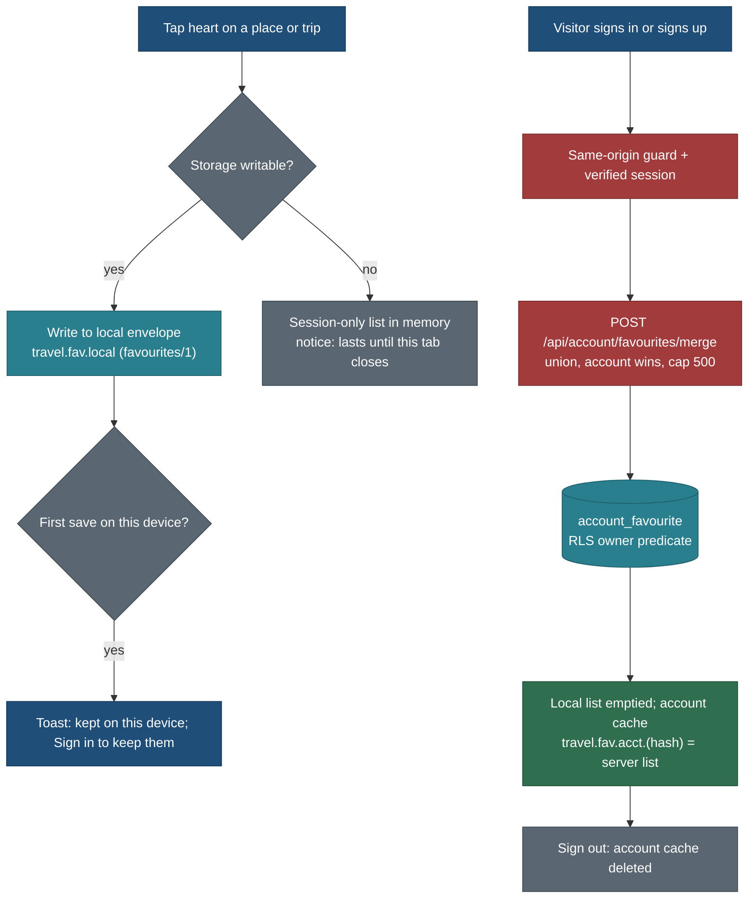
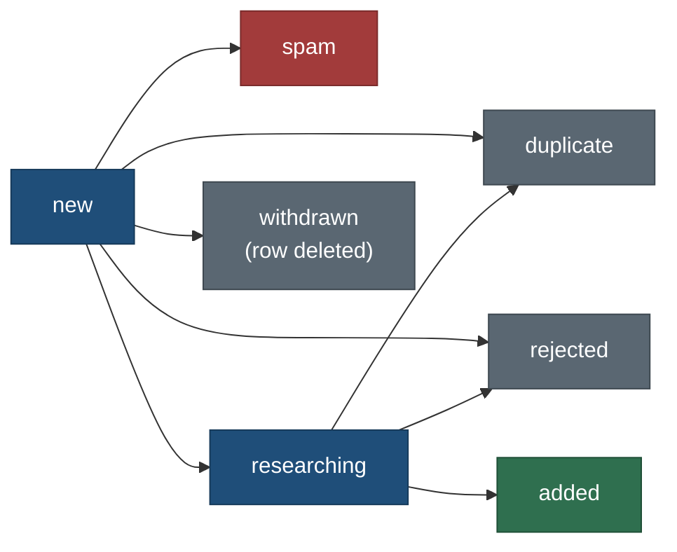

# Visitor suggestions and favourites

> **Amended 26 Oct 2026 (bundle A):** [briefs-bundle-A.md](../build/briefs-bundle-A.md) is the build authority for FAV-1. FAV-1 is split into FAV-1W (the `resolveRefs` store method, route, OpenAPI and `DataClient`; Opus, D1) and FAV-1 (the UI; 10 h); FAV-1 starts after NAV-2 rather than after NAV-R1 (D2); the trip-page heart keeps the 0.15 KB cap and must leave 256 B of trip start JS, else it becomes an Export menu row (D11, Q291).

> **Amended 25 Oct 2026 (navigation and Mine):** the favourites list is the Favourites tab of `/mine/`, not its own
> page (`/favourites/` redirects there); the header link is the visible "Mine" link, not an account-menu entry; the
> sign-in merge (4.4 step 1) runs on `/account/` and `/mine/` only, never from `AccountNav` on every page; FAV-1 builds
> a panel (12 h). See [navigation-and-mine.md](navigation-and-mine.md) (PLAN R-160 to R-164). Everything else here stands.
>
> **Amended 26 Oct 2026 (NAV-F, design):** the heart keeps one name, "Favourite <name>", with the state in
> `aria-pressed` (section 13's flipping names are dropped); cards carry a decorative badge only, never a toggle; the
> Favourites panel uses list rows with the kind glyph, not photo cards. See
> [mine-and-bar-spec.md](../design/shell/mine-and-bar-spec.md) D9, D10 and section 6, and components 2.11.
>
> **Amended 25 Oct 2026 (feedback and reports):** suggestions, trip requests and reports now share one intake model,
> one "Report or suggest" sheet and one route family (`/api/v1/submissions`), specified in
> [feedback-and-reports.md](feedback-and-reports.md) (PLAN R-90 to R-96). Every submission now needs an email
> confirmed by link (this changes V5 and 5.1), confirmed guests may ask for a trip, and senders get an outcome email
> (reverses Q104, see Q137 there). `/api/v1/suggestions`, the `/suggest/` pages and tasks INT-C, INT-1, INT-S, INT-2,
> INT-4 (UI) and REP-1 are superseded by the FBK tasks there; INT-3 is extended; INT-5 stays. Favourites are unchanged.

Status: **spec, planned only** (25 Oct 2026, travel-planner, Opus). Requirements PLAN R-70 to R-75, BACKLOG 15.70 to
15.75, owner questions Q101 to Q108. Nothing here is built. The build queues behind the closure queue, R-59 and the
R-61 HTTPS preview, as section 10 sets out; phase 1 (favourites on this device) needs no backend.

Related: [trip-overview-and-customisation.md](trip-overview-and-customisation.md) (customisation is a private copy in
`planner_draft`; favourites are bookmarks, section 4.6), [F16 admin console](F16-admin-console.md) (moderation and
the backlog), [F17 accounts, auth and privacy](F17-accounts-auth-and-privacy.md) (sign-in, export and delete),
[NEON-SETUP.md](../build/public-site/NEON-SETUP.md) and [NEON-MIGRATIONS.md](../build/public-site/NEON-MIGRATIONS.md)
(what exists), principles P1 to P9 in [principles.md](../design/foundation/principles.md).

## The owner's request (25 Oct 2026, dictated)

> "Any one on the public site can request to plan a trip for a location or add one location in the location list. I
> think that should be a good add on, then we can do more research on it and add it here. Also we can allow users to
> add favourites on the public site, with storage as an option to sign up, with a message that you can lose the saves
> on cache clear or device switch, in a graceful manner, so that we are not forcing anyone to sign up. Let the
> favourites work locally without sign-up or sign-in too. After sign-up, that should sync to the account. Think about
> these features and check how we can add them."
>
> Follow-up: "Create this plan with your recommendations. The idea is less friction, the user gets most of it, and at
> the same time we avoid spam."

## Decisions

| ID | Decision | Why | Trade-off |
|---|---|---|---|
| V1 | **Favourites work with no account.** A signed-out visitor's favourites live in `localStorage`, keyed by the public ref, with no server call to save | Least friction; the 90% never sign in (P7) | Lost on clearing browser data, a private window, a device switch, or (Safari) weeks without a visit |
| V2 | **One calm note, never a gate.** The first save shows a toast with a Sign in action; the Favourites page carries a snoozable notice. No dialog, no blocking step | The owner's "graceful manner"; P4 | Some visitors will miss the note and lose a list |
| V3 | **On sign-in, local favourites merge into the account** once per device and account (set union, account wins, idempotent). After that the account is the source of truth and the browser holds a cache | One list everywhere; no duplicate prompts | A favourite removed on another device can come back once if this device merges an old local list (section 4.4) |
| V4 | **Favourites are a separate, private table** (`account_favourite`), never `saved_place` and never `locations.json` | `saved_place` and `locations.json` are the owner's wishlist; PRIV1 says wishlist saves never reach public output. A visitor's heart must never be confusable with them | One more table and policy set |
| V5 | **Anonymous place suggestions are allowed**, rate-limited and challenged invisibly. **Trip requests need an account** | A place is one line to check; a trip is heavier and needs follow-up | Anonymous visitors cannot see the outcome |
| V6 | **Turnstile, not BotID, as the challenge** (section 6.3) | Free with unlimited challenges, invisible in managed mode, host-independent, stronger than BotID Basic (Deep Analysis is a paid Pro feature) | A third-party script on one page and one more secret |
| V7 | **Quotas live in Postgres**, not in the edge firewall | Vercel Hobby allows one rate-limit rule per project, and GB-A-9 already needs it for `/api/v1/*`. Neon is free at this size | A database round trip per submission |
| V8 | **Suggestions are private to the owner.** No public "popular requests" list. Nothing a visitor submits reaches public output until it is researched and added through the existing `location` or `trip` skill | P8 and PRIV1; no spam surface; no PII exposure | Visitors cannot see what others asked for |
| V9 | **Submitted links are never fetched by the server.** No preview, no unfurl, no DNS lookup | No SSRF surface | The owner opens each link by hand |
| V10 | **One intake pipeline for suggestions, trip requests and (later) stored reports**: one table, one guard module, one moderation queue; separate input schemas and routes | Same anti-spam and moderation for all three; the `report` input pins `page` and is a `CatalogueStore` method, which is a read-catalogue contract | Changes the recommendation of a "second report type on the report seam" (see "Changed from the brief") |
| V11 | **Moderation is a local owner CLI first**, the console screen later | F16 has no admin role or screen yet; F17 roles are not built (Q97 makes the same call for photos) | The owner moderates from the Mac, not the phone |
| V12 | **Sign-out clears the account cache from the browser** | The existing rule "full session changes unload all prior-user client state" (NEON-SETUP); a shared computer must not show the previous person's list | A signed-out visitor sees an empty list after sign-out (copy explains where it went) |

### Changed from the brief, and why

| Brief said | This spec does | Reason |
|---|---|---|
| A second report type on the existing `reportForm` / report seam | One intake pipeline and table shared with reports, but a new route `POST /api/v1/suggestions` with its own schema | `reportInput` requires a page path and is a `CatalogueStore` method (`core/src/catalogue/store.ts`), the read-catalogue interface that `PostgresStore` will replace. Writes to a private table belong in a separate intake module, as `planner_draft` writes sit outside it. The `reportForm` flag later routes stored reports into the same table (task REP-1) |
| Sign-out keeps the local list until the user chooses | Sign-out clears the account cache; the pre-sign-in list was merged into the account, so nothing is lost | NEON-SETUP's rule that a full session change unloads prior-user state, and the shared-computer case |
| Disposable-email handling for sign-in users | Applied to signed-in submissions only, from a vendored domain list; sign-up itself is unchanged | We do not own the sign-up flow (Managed Better Auth); the check sits where we act |
| A pin with the suggestion | Kept as an optional hint, never stored as the place's point | Research rule: coordinates never from Google, and every point needs a known source; a visitor's pin (often pasted from Google Maps) is a hint for the researcher only |

## 1. User stories

1. As a visitor, I tap a heart on a place or trip and find it later on a Favourites page, without an account.
2. As a visitor, I am told once, calmly, that my favourites stay on this device and how to keep them, and I am never stopped.
3. As a visitor who signs up, my favourites from this browser appear in my account, and on my phone after I sign in there.
4. As a signed-in visitor on a second device that already has its own favourites, both lists end up in my account.
5. As a visitor, I can't find a place, so I suggest it with a name, an optional link and a short note, without signing in.
6. As a signed-in visitor, I ask for a trip to a destination ("a week in the Lofoten in July, with kids") and later see whether it is being researched or was added.
7. As the owner, I review suggestions in one queue, mark them duplicate, rejected, spam or researching, hand one to the research skill, and mark it added with its public ref.
8. As the owner, I never see a flood of junk: quotas, a challenge and a daily cap keep the queue small, and spam never reaches the site.
9. As a signed-in visitor, I can export my favourites and withdraw a suggestion I made.

## 2. Flows

### 2.1 Favourites: signed out, then signed in



### 2.2 A suggestion, from form to the catalogue

```mermaid
flowchart LR
  classDef core fill:#1F4E79,stroke:#163A5A,color:#FFFFFF
  classDef data fill:#2A7F8F,stroke:#1E5F6B,color:#FFFFFF
  classDef ext fill:#B7791F,stroke:#8A5A12,color:#FFFFFF
  classDef ok fill:#2F6F4F,stroke:#1F4F37,color:#FFFFFF
  classDef sec fill:#A23B3B,stroke:#7A2B2B,color:#FFFFFF
  classDef infra fill:#5A6772,stroke:#3E4850,color:#FFFFFF

  F["/suggest/ form<br/>name, where, link, note"]:::core
  TS["Turnstile widget<br/>(loaded on this page only)"]:::ext
  R["POST /api/v1/suggestions"]:::core
  G1["Strict same-origin<br/>4 KB body cap<br/>form-age token"]:::sec
  G2["Turnstile siteverify<br/>hostname + action checked"]:::sec
  G3["Sanitise, validate,<br/>honeypot, PII redaction"]:::sec
  G4["intake_take(): IP, net,<br/>account, global quotas; blocks"]:::sec
  D1{"Matches a public place?"}:::infra
  Y["Answer: we already have it<br/>(link) or Suggest anyway"]:::ok
  W[("visitor_submission<br/>state new")]:::data
  Q["Owner: intake.ts list / decide"]:::infra
  B["intake.ts brief: research/inbox brief"]:::data
  RS["research skill, then location or trip skill"]:::core
  A["Public after research:<br/>state added, outcome_ref"]:::ok

  F --> TS --> R --> G1 --> G2 --> G3 --> G4 --> D1
  D1 -- yes --> Y
  D1 -- no --> W --> Q --> B --> RS --> A
```



### 2.3 Moderation state machine



Only the owner moves a row out of `new`; the submitter can only withdraw while it is `new` (a delete). `added` needs
a public ref. What the submitter sees for each state is in section 5.4.

## 3. Where things show (UX)

| Surface | What | Server HTML added | Principle |
|---|---|---|---|
| Place page cover | Heart toggle beside "Save to a trip" | 0 bytes: mounted after hydration from the existing `SaveToTrip` client module (section 7) | P7 (the primary action stays first), P3 |
| Trip page header | Heart toggle beside "Copy with my dates" | 0 bytes; start JS only the dynamic-import stub | P7 |
| Cards (Places, Trips, home strips) | A small filled heart badge on favourited cards | 0 bytes: added after hydration from the local set | P3, P6 |
| `/favourites/` | Tabs Places and Trips with counts; local Kind and Country filters; sort Newest or Name; pages of 48 | a static noindex shell | P1, P4 |
| `/places/` filter bar | A "Favourites (n)" pill that opens `/favourites/` with the current Kind and Country | appears after hydration only when n > 0 | P4 |
| Header account menu (signed in) | "Favourites" link | inside the lazy `AccountMenu` | P3 |
| `/account/` | Sections "Favourites" (count, Export, Remove all) and "Your suggestions" (status list) | private route | P2 |
| Places zero results, search zero results, footer, About | "Can't find it? Suggest a place" link | one short link in the footer, which every page carries; budget check in section 7 | P4 |
| Trip list zero results, About | "Ask us to plan a trip" link (signed in; otherwise "Sign in to ask") | as above | P4 |
| `/suggest/` and `/suggest/trip/` | The forms | own pages, noindex | P4 |

The word **"Saved"** is not used for favourites: the globe calls the owner's catalogue places "Saved place", and the
planner's "Save to a trip" is a different action. Favourites always use the heart and the word "Favourites".

## 4. Favourites

### 4.1 What can be a favourite

Places (every kind, trails included) and trips, identified by their public `ref` (`place/<slug>` or a capture ref for
places, `trip/<id>` for trips; API rows carry `ref` since API-1). Not offers, events, days or items inside a trip in v1
(Q108). The cap is 500 per device and 500 per account.

### 4.2 The local envelope (`favourites/1`)

Two keys in `localStorage`:

| Key | Holds | Lifetime |
|---|---|---|
| `travel.fav.local` | The signed-out list | Until the visitor clears it or it merges into an account |
| `travel.fav.acct.<h>` | The account cache for the account whose id hashes to `<h>` (SHA-256 of the user id, first 16 hex) | Deleted on sign-out and when a different account signs in |

Envelope, validated by a Zod schema in `core/src/schema/favourites.ts` on every read (a bad or newer envelope is
kept untouched and the list shows empty with an error state, never overwritten):

```json
{ "schema": "favourites/1", "items": [ { "ref": "place/moraine-lake", "space": "place", "slug": "moraine-lake",
  "name": "Moraine Lake", "kind": "lake", "cc": "CA", "favouredAt": "2026-10-25T14:02:11Z" } ],
  "noteSeen": "2026-10-25", "snoozedUntil": null, "merged": { "3f9a1c0e7b2d4a55": "2026-10-26T09:00:00Z" },
  "pending": [] }
```

- `name`, `kind` and `cc` are a snapshot so the Favourites page renders with no request; they come from the light
  row the page already shows or from the resolve call in 4.5. No facts, links, times or suitability (P8).
- `pending` holds account writes made offline (`add` or `remove` with a time), replayed in order on reconnect.
- At 500 items about 75 KB: far under every browser quota.

### 4.3 Storage unavailable, private windows, eviction

| Case | Detection | Behaviour | Copy |
|---|---|---|---|
| `localStorage` throws (disabled, blocked, quota) | write-and-remove probe on first use | list kept in memory for this tab | Notice: "This browser is not keeping data, so favourites last until you close this tab." plus "Sign in to keep them" when sign-in is on |
| Private window that allows storage | not detectable reliably | normal; the first-save toast already says device-only | as the first-save toast |
| Safari deletes script storage after about 7 days without a visit | not detectable | the list is gone on return | the Favourites page notice names it: "Some browsers clear site data after a few weeks without a visit." |
| Quota exceeded mid-write | the write throws | keep the in-memory list, show the notice once | as the first row |

`navigator.storage.persist()` is **not** called: Firefox answers it with a permission prompt, which is the kind of
dialog V2 rules out.

### 4.4 Sign-in merge and sync

1. On a confirmed session (the lazy `AccountNav` already learns it), the favourites module reads
   `travel.fav.local`. If it has items and `merged[h]` is absent, it calls `merge` with up to 500 items.
2. The server resolves each ref against the catalogue (4.5): moved refs map to the survivor, withdrawn and unknown refs
   are dropped and counted. It inserts with `on conflict do nothing` (the account's `favoured_at` wins), keeps the
   account's rows first and then the local items newest first up to 500, and answers `{ items, added, dropped,
   overCap }`.
3. The client writes `travel.fav.acct.<h>` from the answer, sets `merged[h]`, and empties `travel.fav.local`. A toast
   reports the result: "12 favourites added to your account." or, when some did not fit, "490 added. Your account
   holds up to 500."
4. After the merge every heart tap writes to the server (optimistic; undo through the toast). The cache is replaced by
   the server list on sign-in, on `visibilitychange` to visible (at most once a minute) and after each write.
5. Re-running the merge is a no-op (idempotent), so a crash between steps 2 and 3 is safe.
6. A second device with its own local list merges the same way: the account ends with the union.
7. Removal is not merged: a favourite removed on device A comes back once if device B merges an older local list that
   still holds it. This only happens on a device's first sign-in to that account and is accepted (no tombstones).
8. **No Realtime.** Favourites do not use the `planner_draft_signal` path; other devices see changes on focus. This
   keeps the single non-RLS exception exactly as approved and does not wait on the owner's ruling on it.

| Event | Local list | Account cache |
|---|---|---|
| Sign in, first time on this device | merged, then emptied | written from the server |
| Sign in again later | (empty unless the visitor saved while signed out) merged again | refreshed |
| Sign out | untouched (normally empty) | deleted (V12); toast "Signed out. Your favourites are in your account." |
| Session expires | untouched | kept but hidden; shown again only when the same account signs in; deleted if another account does |
| Another account signs in | merged into the new account | the old account's cache deleted first |
| Multi-tab | the `storage` event re-reads the envelope; hearts update in every open tab | same |

### 4.5 Renamed, merged and withdrawn items

A new read method `resolveRefs` (section 8.2) answers, for up to 48 refs, `current`, `moved` (with the new slug),
`merged` (with the survivor's ref) or `withdrawn`/`unknown`, plus the light snapshot fields. It reads the pinned slug
registry (`data/catalogue/slugs.json`: `retired`, `merged`, `withdrawn`), the same source the 308 redirects use.

- The Favourites page resolves the visible page of 48 items once per visit and updates snapshots.
- A merged item becomes its survivor (deduplicated if the survivor is already a favourite).
- A withdrawn item stays as a row reading "No longer listed" with a Remove button; it is never removed silently.
- Links always go to `/places/<slug>/` or `/trips/<slug>/`; a stale slug still works through the 308.

### 4.6 Favourites, "Save to a trip" and customisation

| Action | What it is | Where it lives | Flag |
|---|---|---|---|
| Heart (favourite) | A bookmark: "I like this" | local envelope, then `account_favourite` | `favourites`, `favouritesSync` |
| Save to a trip | Put a place into a specific trip plan (rule 4 of [trip-scope-scenarios.md](../design/trip-scope-scenarios.md): the trip is always named) | planner (`POST /api/v1/plan/trips/{id}/items`, not built) | `saveToTrip` (off) |
| Copy with my dates | A dated local copy of a public trip (`web/lib/export/draft.ts`) | browser | none |
| Customise this trip | A private copy with additions and removals | `planner_draft` delta ([trip-overview-and-customisation.md](trip-overview-and-customisation.md) section 5.6) | customisation flags there |

Rules: a heart never adds anything to a trip; "Save to a trip" never adds a favourite. When `saveToTrip` exists, each
place row on `/favourites/` gains "Add to a trip...", which opens the same trip-choosing flow. A favourited trip that
also has the visitor's private customised copy shows "Your copy" on its Favourites row (phase 2, signed in, read from
`planner_draft.source_trip`). The `guestDrafts` flag is untouched; the local envelope plus merge-on-sign-in is the
pattern to reuse if Q68 (guest planning) is answered yes, but this spec does not decide Q68.

### 4.7 Household

Favourites belong to a person, not a household, in v1. Household sharing waits for the membership policies of Q69.

## 5. Suggestions and trip requests

### 5.1 Suggest a place (anonymous or signed in)

> **Superseded in part 25 Oct 2026:** the fields of 5.1 and 5.2 are replaced by
> [request-intake-fields.md](request-intake-fields.md) section 2 (structured Where, kinds mapped to `types.json`, trip
> detail steps); de-duplication in 5.3 is keyed by name, country and region (its section 7). PLAN R-190 to R-196.

| Field | Rule | Required |
|---|---|---|
| Name | 2 to 120 characters, no URL | yes |
| Where | town, region or country, 0 to 120 characters | no (strongly prompted: "Helps us find the right one") |
| Kind | one of: trail, lake, waterfall, viewpoint, sight, activity, town, stay, other | no |
| Link | one `https` URL, at most 500 characters (section 6.4) | no |
| Note | 0 to 500 characters; at most one URL in total across Link and Note | no |
| Honeypot | a hidden `website` field | must be empty |

No email field: anonymous suggestions take no contact details. The success message says that signed-in visitors can
follow the outcome.

### 5.2 Ask us to plan a trip (signed in)

| Field | Rule | Required |
|---|---|---|
| Destination | 2 to 120 characters | yes |
| Length | day trip, weekend, 3 to 5 nights, about a week, two weeks or more | yes |
| Months | any of the 12 months (chips), no dates | no |
| Who is going | chips: adults only, with young children (under 6), with children 6 to 12, with teens; no names or ages | no |
| Note | 0 to 1,000 characters, at most one URL | no |

Expectation copy on the form: "We can't plan every request. Requests help us choose what to research next, and a
researched trip is published for everyone, without your name." A trip request is a vote for research, never a private
commission.

### 5.3 De-duplication

| Against | When | What the visitor sees |
|---|---|---|
| Public catalogue places and trips (served names, `normName` folding, plus the Where hint's country) | before storing | "We already have Moraine Lake." with Open it and "Suggest anyway" (a different place with the same name) |
| The owner's private store (`locations.json` places with no public page, collections) | after storing, in the owner's queue | nothing: the same "Thanks" as any suggestion. Revealing it would leak the private wishlist (PRIV1) |
| Earlier suggestions (same normalised name and country) | on insert | nothing; the earlier row's `seen_count` rises and the new row is linked as `duplicate` |
| The same anonymous IP hash with the same name in 24 hours | on insert | "Thanks" (silently dropped) |

### 5.4 What the submitter sees

Only signed-in submitters see outcomes, on `/account/` under "Your suggestions":

| Internal state | Shown as | Extra |
|---|---|---|
| new | Received | Withdraw button |
| researching | Being researched | none |
| added | Added | link to the public page |
| duplicate of a public item | Already on the site | link |
| duplicate of a private item or of another suggestion | Received | none (no wishlist signal) |
| rejected | Not this time | the owner's short note, if any (from a fixed list: out of scope, too far from our areas, not enough information, closed or unsafe) |
| spam | Not this time | none |

## 6. Anti-spam design

### 6.1 Layers, in order

| # | Layer | Rule | On failure |
|---|---|---|---|
| 1 | Flag | `suggestPlace` / `requestTrip` on in build and server env | `not_available` (404 page, 503 API) |
| 2 | Strict same-origin | `Origin` must be present and equal `Host` (the account guard allows a missing Origin; this one does not), `Content-Type: application/json` | 403, no detail |
| 3 | Body cap | read at most 4 KB through the existing bounded reader | 413 `invalid_input` |
| 4 | Form-age token | the page issues an HMAC token with its issue time; submit only between 3 s and 2 h after | below 3 s: shadow-accept (answer "Thanks", store nothing); above 2 h: "This form has expired; please send it again" |
| 5 | Honeypot | `website` must be empty | shadow-accept, counter `honeypot` |
| 6 | Turnstile | token verified server-side (`siteverify` with `remoteip`, `hostname` equals `SITE_ORIGIN` host, `action` equals `suggest_place` or `request_trip`), single use, 3 s timeout | fail closed: "We couldn't confirm this browser. Please try again." |
| 7 | Schema and text rules | section 6.4 | 400 with the field message |
| 8 | Blocks | `intake_block` on the user id, IP hash or network hash | shadow-accept |
| 9 | Quotas | `intake_take()` atomically checks and increments every bucket below | 429 "You've sent a lot of suggestions today. Please try again tomorrow." with `Retry-After` |
| 10 | Disposable email (signed in) | the account email's domain is on the vendored list | place: anonymous quotas apply; trip: "Please use a permanent email address to ask for a trip." |
| 11 | De-duplication | section 5.3 | as there |
| 12 | Store | `visitor_submission` state `new` | 503 "We couldn't send this right now. Your text is still here." (the form keeps its values) |

Shadow-accept is used only where a real visitor cannot land (a filled honeypot, a 0.5 s submit, a block), so a bot
learns nothing; every real error is explicit.

### 6.2 Quotas (all windows are fixed UTC windows)

| Bucket | Place suggestion | Trip request | Stored report (REP-1) |
|---|---|---|---|
| Per IP hash | 3 an hour, 10 a day | n/a | 10 a day |
| Per network hash (IPv4 /24, IPv6 /48) | 30 a day | n/a | 30 a day |
| Per account | 10 a day, 40 in 30 days | 2 open (new or researching) at once, 4 in 30 days | 20 a day |
| Global | 100 a day anonymous plus 100 a day signed in | 20 a day | 100 a day |

At under 100 users in year one these limits are never reached by people; they bound the owner's worst day to about
220 rows. When a global cap is hit the form says so ("We've had a lot of suggestions today; please try again
tomorrow") and the owner's `intake.ts stats` shows it. Numbers live in one file, `core/src/config/intake.ts` (CONS
rule: no literals elsewhere).

**IP handling.** The route takes the client address from the platform (`ipAddress()` from `@vercel/functions`, which
reads the header Vercel's edge sets), never from a header a client can add on another host. It stores only
`HMAC-SHA256(INTAKE_HASH_SECRET, date || ip)` truncated to 16 bytes, and the same for the network prefix. The date in
the key makes hashes unlinkable across days; nothing stores the raw address.

### 6.3 Turnstile or Vercel BotID: the choice

| | Cloudflare Turnstile | Vercel BotID |
|---|---|---|
| Free tier | free plan: unlimited challenges and verifications, 20 widgets, 10 hostnames per widget | Basic free on all plans; Deep Analysis is Pro only at $1 per 1,000 checks |
| Strength free | managed challenge with Cloudflare's signals | Basic checks challenge integrity only ("catches many less sophisticated bots") |
| Visible friction | invisible or a one-click box in managed mode, rarely | invisible |
| Host lock-in | none; works on Vercel today and anywhere later | Vercel only |
| Privacy | Cloudflare sees the visitor's IP on the form page; named in the privacy note | Vercel (already the host) |
| Local and preview testing | documented test keys that always pass or always fail | special local behaviour |

**Recommendation: Turnstile**, managed mode, loaded only on `/suggest/` pages after the first field gets focus, with
the documented always-pass test keys in development and e2e. Trade-off: a Cloudflare widget and secret to manage, one
third-party script on two pages, and preview hostnames (Vercel preview URLs change per deploy, and a widget holds 10
hostnames) need the stable branch alias or the test keys. BotID Basic is the fallback if the owner rejects a
third-party script (Q102). Vercel's one Hobby rate-limit rule stays reserved for the general `/api/*` limit (GB-A-9).

### 6.4 Text and URL rules (untrusted input)

- Normalise to NFC; strip C0 and C1 control characters except newline; strip zero-width and bidi override characters
  (U+200B to U+200F, U+202A to U+202E, U+2066 to U+2069); collapse runs of whitespace; at most 3 consecutive newlines.
- Store plain text only. Markup is not parsed or stripped into something else: it is stored as text and rendered as
  text (React escaping; never `dangerouslySetInnerHTML`; the CLI prints with control characters escaped).
- Redact before storing: email addresses and digit runs of 9 or more (phone numbers) become `[removed]`, and the
  success message says "We removed contact details from your note." The form warns first: "Please leave out names,
  phone numbers and addresses."
- URL: `https:` only; no user info; host must be a domain name with a public suffix, not an IP literal, not
  `localhost`, not a single label; punycode hosts are shown decoded and encoded side by side in the queue; at most 500
  characters; no fragments kept. Validation is purely syntactic: no DNS lookup, no fetch, ever (V9).
- A URL is counted wherever it appears (`http`, `https`, `www.`); more than one across Link and Note is a 400:
  "Add one link at most."
- Exports of the queue to CSV prefix cells starting with `=`, `+`, `-` or `@` with an apostrophe (formula injection);
  the research brief puts visitor text inside a fenced block marked as untrusted.

### 6.5 Pins

A pin is optional and only a hint: coordinates parsed from a pasted map link (Google, Apple, OpenStreetMap formats,
by pattern, no fetch) or typed as "lat, lon", rounded to 4 decimals. It is never stored as a place's point: research
re-derives the point from an allowed source (research README section 9: never from Google; every point has a
`point_source`). The form has no map picker in v1 (it would add a map chunk); a picker can come later from
`PlaceMapLazy`.

## 7. Performance budgets

| Budget | Today | This feature's rule | How |
|---|---|---|---|
| Place HTML, +25% median cap | 19 bytes of headroom in the sign-in-on build | **+0 bytes** | The heart renders nothing on the server: inside `SaveToTrip.tsx` (the place page's existing client module) a `useSyncExternalStore` "live" check returns false on the server, and after hydration an `import()` loads `web/lib/favourites/heart.tsx`. No new props cross the server boundary (the component already has `slug`; the snapshot comes from `resolveRefs` on the first tap), so the RSC payload is unchanged. CSS for the heart lives in the lazy chunk's stylesheet or `places.css`, never inline |
| Trip page start JS, 200 KB gzipped | 0.75 KB under | **at most 0.15 KB** (the import stub) | The heart mounts from the trip header's existing client island the same way; FAV-1 lands after OVR-0, which frees bytes (Q106) |
| Places and Trips list start JS | per `budget.test` | at most 0.2 KB | card badges come from a lazily imported module after first paint |
| Footer link to `/suggest/` | on every page | must fit inside the place budget | measured in FAV-1's sibling task INT-2; if it does not fit, the link moves into About and the zero-result states only, and the footer gains nothing |
| Heart icon | `Icon.tsx` is in every start chunk | the heart SVG lives in the lazy chunk, not `Icon.tsx` | |
| `/favourites/` chunk | new | 25 KB gzipped | static shell; list and filters client-side over at most 500 local items (this is the visitor's own data, not a catalogue bulk load, P9) |
| `/suggest/` pages | new | 20 KB gzipped plus Turnstile's script | Turnstile loads on first focus, so a visitor who only reads pays nothing |
| `resolveRefs` | new | 48 refs a call, light rows only, cached by catalogue revision | P8 light list data |

## 8. Data model and API

### 8.1 Proposed migrations (descriptions, not SQL files)

Numbering: 0011 is taken by EML-1 (`quota`); numbers are assigned at merge. These take the numbers assigned at merge (MIG-N, by slug). The runner refuses an out-of-order insert, so whichever lands second renumbers before it is
applied anywhere.

**Migration A, `account_favourite` (task FAV-D)**

| Column | Type | Rule |
|---|---|---|
| `user_id` | text not null | the Better Auth id, from the session only (no FK, as `planner_draft`) |
| `ref` | text not null | 1 to 300 characters; must resolve when written (checked in the route) |
| `space` | text not null | `place` or `trip` |
| `favoured_at` | timestamptz not null default now() | |

- Primary key `(user_id, ref)`; index `(user_id, favoured_at desc)`.
- RLS on. Policies exactly as `planner_draft`: select, insert and delete where `user_id = app_current_user_id()`
  (insert `with check`). No update (nothing to edit). Grant `select, insert, delete` to `travel_app`.
- Cap: a `before insert` trigger takes `pg_advisory_xact_lock(hashtext('fav:' || new.user_id))`, counts the user's
  rows and raises SQLSTATE `P0001` with message `favourites_cap` at 500. The route maps it to 409 `limit_reached`.
- No signal table and no Realtime (4.4 step 8).
- Retention: until the user removes them or the account is deleted (F17 delete cascades by `user_id`).

**Migration B, the intake tables (task INT-C)**

`visitor_submission`

| Column | Type | Rule |
|---|---|---|
| `id` | uuid primary key | generated by the route (no `returning` needed, so anonymous inserts need no select policy) |
| `type` | text not null | `place`, `trip`, `report` |
| `state` | text not null default `new` | `new`, `duplicate`, `rejected`, `spam`, `researching`, `added` |
| `submitter_id` | text null | the session user id; null for anonymous |
| `name` | text null | 2 to 120 (place name or destination; null for a report) |
| `area_hint`, `kind_hint` | text null | 0 to 120; kind from the fixed list |
| `link` | text null | at most 500 |
| `pin_lat`, `pin_lon` | numeric(7,4), numeric(8,4) null | hint only |
| `note` | text null | at most 500 (place, report 2,000 per `API_LIMITS.reportText`) or 1,000 (trip) |
| `trip_shape` | jsonb null | `{ length, months[], party[] }` for trips, validated by Zod |
| `page` | text null | report only: the site path |
| `norm_name`, `country` | text null | for de-duplication |
| `seen_count` | int not null default 1 | |
| `duplicate_of_ref`, `duplicate_of_submission` | text, uuid null | owner-only |
| `ip_hash`, `net_hash` | bytea null | 16 bytes each; nulled after 30 days |
| `created_at` | timestamptz not null default now() | |
| `decided_at`, `decided_by`, `outcome_note`, `outcome_ref`, `internal_note` | | owner-written; `outcome_note` at most 280 |
| `purge_after` | timestamptz null | set by the retention rules below |

- Indexes: `(state, created_at)`, `(submitter_id, created_at desc)`, `(norm_name, country)`.
- RLS on. Column-level grants to `travel_app`: **insert** only on the visitor columns (`id, type, submitter_id, name,
  area_hint, kind_hint, link, pin_lat, pin_lon, note, trip_shape, page, norm_name, country, ip_hash, net_hash`), so a
  request can never set `state`, `outcome_*` or `duplicate_of_*`. **Select** only through the view below. **Delete**
  for withdrawal.
- Policies: insert `with check ((submitter_id is null and app_current_user_id() is null) or submitter_id =
  app_current_user_id())`; select `using (submitter_id is not null and submitter_id = app_current_user_id())`; delete
  `using (submitter_id = app_current_user_id() and state = 'new')`.
- View `my_submission` (`security_invoker = true`, so RLS applies): `id, type, name, created_at`, the shown state of
  section 5.4 computed in SQL (a private duplicate reads `received`), `outcome_note`, and `outcome_ref` only for
  `added` or a public duplicate. `ip_hash`, `internal_note` and `duplicate_of_*` are never selectable by the app role.
- The owner reads and decides over the owner connection (`DATABASE_URL_UNPOOLED`, as migrations), never through the
  app role. A console later gets a moderator path through F17 roles (INT-5).

`intake_counter (bucket text, window_start timestamptz, n int, primary key (bucket, window_start))` and
`intake_block (subject text primary key, reason text, until timestamptz)`: RLS on, **no policy and no grant**. The only
access is `intake_take(buckets text[], limits int[], windows_s int[]) returns boolean`, `security definer` with a fixed
`search_path` (the same pattern as `planner_draft_bump_signal`), executable by `travel_app`. It locks the bucket rows,
returns false without incrementing if any bucket is full or a subject is blocked, otherwise increments all, and deletes
up to 50 expired counter rows of those buckets. A second definer function `intake_purge()` (callable at most once an
hour, guarded by its own bucket) applies retention to up to 100 rows. No cron is needed (Vercel Cron calls with GET,
and GET handlers here have no side effects).

Retention:

| Rows | Content kept | Then |
|---|---|---|
| `spam` | 30 days | deleted |
| `rejected`, `duplicate` | 90 days | deleted |
| `new` untouched | 180 days | deleted, counted in `stats` |
| `added` | 12 months | `submitter_id`, `note`, `link`, hashes nulled; name and outcome ref kept as research history |
| any row, `ip_hash`, `net_hash` | 30 days | nulled |
| `intake_counter` | until the window ends | deleted |

Anonymous inserts use a new helper `withAnonTransaction(fn)` in `core/src/db/tx.ts`: `set local role travel_app` with
`app.user_id` left unset, so `app_current_user_id()` is null and the policies above apply.

### 8.2 Routes

All handlers: Node runtime, `Cache-Control: private, no-store` unless stated, `safeError` logging, no GET side
effects. Writes return typed results, never throws.

| Route | Who | Guard | Input | Answer |
|---|---|---|---|---|
| `GET /api/v1/resolve?ref=...` (up to 48) | anyone | none (read); public cache by revision | refs | per ref `{ ref, state, space, slug, name, kind, cc }`; a new `CatalogueStore` method `resolveRefs` with contract cases, so `PostgresStore` must pass it too |
| `POST /api/account/favourites/read` | signed in | `sameOrigin`, `getUser(pageUserId)` as drafts | `{ userId }` | `{ items }`; 401 tells the client to unload the cache |
| `POST /api/account/favourites/add` | signed in | as above | `{ userId, ref }` | `committed` / `unchanged` / `rejected: LIMIT_REACHED, INVALID_INPUT, UNAUTHENTICATED, SERVICE_UNAVAILABLE` |
| `POST /api/account/favourites/remove` | signed in | as above | `{ userId, ref }` | as above |
| `POST /api/account/favourites/merge` | signed in | as above; body at most 64 KB | `{ userId, items[] }` (at most 500) | `{ items, added, dropped, overCap }` |
| `POST /api/v1/suggestions` | anyone (place), signed in (trip) | section 6.1 in full | `suggestInput`: a Zod union on `type` (`place`, `trip`) | `{ kind: 'submitted', id }` (same shape as `reportResult`), `{ kind: 'exists', ref, slug, name }` for a public duplicate, or an error |
| `POST /api/account/suggestions/read` | signed in | `sameOrigin`, `getUser` | `{ userId }` | rows from `my_submission` |
| `POST /api/account/suggestions/withdraw` | signed in | as above | `{ userId, id }` | `committed` / `unchanged` |
| `POST /api/v1/report` | anyone | unchanged until REP-1 | `reportInput` | `link` today; `submitted` when `reportForm` is on |

Favourites routes are route handlers, not server actions, so public pages carry no server-action ids and the lazy
heart chunk calls them with `fetch`. `/api/v1/suggestions` is added to OpenAPI; `/api/account/*` stays out of it, as
today.

### 8.3 Privacy detector

Add `favouredAt` and `favourites` to `PRIVATE_KEYS` in `core/src/privacy/detect.ts`, so any served `/api/v1` body or
exported page that ever carries a favourites payload fails closed. The submission content never passes through
`/api/v1` bodies except the submitter's own `exists` answer, which only echoes a public row.

## 9. Moderation and the research hand-off

### 9.1 Now: the owner CLI (`node core/bin/intake.ts`)

| Command | Does |
|---|---|
| `list [--state new] [--type place]` | table of id, type, age, name, where, kind, seen count, flags (link, pin, private-duplicate candidate) |
| `show <id>` | full row with text escaped; the link as text; the private de-duplication candidates from `locations.json` |
| `decide <id> --to duplicate\|rejected\|spam\|researching [--ref <public ref>] [--note <fixed note id>]` | moves state, sets `decided_*` |
| `brief <id>` | writes `research/inbox/<date>-suggestion-<short id>.md` (format in `research/formats/README.md`, added by INT-3): name, where, kind, the link marked "visitor-supplied, not checked", the pin marked "hint only", the note in an untrusted fenced block after the owner confirms it holds no personal data; no submitter id or hashes. Sets `researching` |
| `added <id> --ref <public ref>` | sets `added` and `outcome_ref`, after the ref resolves as public |
| `block --user <id> \| --ip-hash <hex> [--days 30]` | writes `intake_block` |
| `stats` | counts by state and day, quota hits, shadow-accepts, global cap days |
| `purge` | runs retention now |

It reads `.env.local` like `db-migrate.ts` and never prints hashes unless `--verbose`.

### 9.2 From researching to public

1. `brief` produces the research brief; the `research` skill runs it (research README 3a for a place, 3b for a
   trip). Rule zero applies: the visitor's claim is a hypothesis.
2. A place is added through the `location` skill only when the research reaches at least the Draft level for its
   kind ([kinds/README.md](../../../research/method/kinds/README.md)). Reason: every place in `locations.json` gets a
   public page today, and the store has no unpublished state. The source is recorded with source type `suggestion`
   (a new value in the locations tool's list, INT-3) and stays private like every source type (PRIV1).
3. A trip goes through the `trip` skill as data in `data/trips/<id>/` with `visibility` private until the owner
   publishes it.
4. `intake.ts added <id> --ref ...`. The submitter sees "Added" with the link. The public page never names the
   submitter.

### 9.3 Later: the console (INT-5, extends F16)

A "Suggestions" tab in the F16 moderation area: the same list, filters and actions; "Research this" creates a backlog
row (F16 item 10, `backlog.requested_by` is the moderator, never the visitor). It needs F17 roles and the console
itself, so it waits for SRV-0's cutover like PHO-1.

## 10. Capability flags and rollout

### 10.1 Flags (`web/lib/capabilities.ts` plus server env checks)

| Flag | Build variable | Server also needs | Off means |
|---|---|---|---|
| `favourites` (new) | `NEXT_PUBLIC_FAVOURITES=1` | nothing | no heart, no badge, `/favourites/` is a noindex notice |
| `favouritesSync` (new) | `NEXT_PUBLIC_FAVOURITES_SYNC=1`, only with `signIn` | `DATABASE_URL`, migration A applied | favourites stay local even when signed in; the copy omits the sign-in promise |
| `suggestPlace` (new) | `NEXT_PUBLIC_SUGGEST=1` and `NEXT_PUBLIC_TURNSTILE_SITE_KEY` | `TURNSTILE_SECRET_KEY`, `INTAKE_HASH_SECRET`, `INTAKE_FORM_SECRET`, `DATABASE_URL`, migration B | no links; `/suggest/` is a notice; the route answers `not_available` |
| `requestTrip` (new) | `NEXT_PUBLIC_REQUEST_TRIP=1`, only with `signIn` and `suggestPlace` | as above | "Ask us to plan a trip" hidden |
| `reportForm` (existing, planned) | as EXECUTION-PLAN 5.2 | the intake table | the issue link, as today |
| `signIn` (existing) | `NEXT_PUBLIC_SIGN_IN=1` | Neon Auth | as today |
| `saveToTrip`, `guestDrafts` (existing) | unchanged | | unchanged; see 4.6 |

The server checks its own environment and never trusts the build flag alone. Every secret is an encrypted Vercel
variable set by the owner, never in chat or source.

### 10.2 Build order

| Step | Tasks | Needs | Ships |
|---|---|---|---|
| 1. Favourites on this device | FAV-C, FAV-1, FAV-R, FAV-V | nothing on the backend; OVR-0 first for trip-page bytes (Q106) | heart, badge, `/favourites/`, the note; `resolveRefs` over `JsonStore` |
| 2. Account sync | FAV-D, FAV-2, FAV-2E, review, verify | R-61 HTTPS preview, `SITE_ORIGIN`, the preview and production domains in Neon Auth trusted origins (the list is empty today), migration A on the child branch then production with the owner's approval | merge, sync, account section, export |
| 3. Suggest a place | INT-C, INT-1, INT-S, INT-2, INT-3, review, verify | step 2's environment, a Turnstile widget with the preview alias and production hostnames, Q101 and Q102 | anonymous and signed-in suggestions, the CLI, the research brief |
| 4. Trip requests | INT-4, review, verify | Q103 (who may sign up) | signed-in trip requests and status |
| 5. Console and stored reports | INT-5, REP-1 | F17 roles, F16 console, SRV-0 cutover; Q70 for REP-1 | moderation in the browser; reports stored |

Steps 1 and 2 can ship to the public site independently; nothing in step 1 waits for Neon.

## 11. Privacy and security analysis

| Risk | Control |
|---|---|
| A visitor's favourite or suggestion appears in public output | Separate tables, never loaded by the catalogue loader; detector keys (8.3); the web privacy test over every exported page; nothing reaches `locations.json` without research and the owner's skill run |
| Confusion with the owner's wishlist (PRIV1) | Different table, different word, different icon; private duplicates are never revealed (5.3, 5.4) |
| Cross-user reads | Owner-predicate RLS on `account_favourite`; RLS plus column grants plus a security-invoker view on `visitor_submission`; tests with two users (12) |
| Forged identity | user id only from the verified session, bound per transaction (`withUserTransaction`); the request body's `userId` only detects a session switch, as drafts |
| CSRF | `sameOrigin` on account routes; strict same-origin (Origin required) on `/api/v1/suggestions` |
| XSS through stored text | Plain text stored and rendered as text everywhere, including the CLI and the research brief (6.4) |
| SSRF | No server fetch of any submitted URL, ever (V9); syntactic validation only |
| PII in notes | form warning, redaction of emails and phone-like numbers, owner check before `brief`, retention limits, no PII in logs (log ids and decision codes only) |
| Tracking visitors | no raw IPs; daily-keyed hashes nulled after 30 days; Turnstile named in the privacy note |
| Abuse and spam | section 6; `spam` state and `block`; shadow-accept for bot-only signals |
| Wishlist or home-point leak through a pin | pins are never served publicly; a submitter sees only their own; research applies the home-radius rules to any point it stores |
| Export and delete (GDPR-style) | Account page: "Download favourites" (`favourites-export/1` JSON) and "Remove all"; withdraw any `new` suggestion. When F17 export and delete exist they include `account_favourite` and the user's `my_submission` rows; delete cascades favourites and nulls `submitter_id` on submissions (content of non-added rows deleted at the same time). Anonymous suggestions hold nothing that identifies a person after 30 days |
| Open sign-up as a spam path | per-account quotas, disposable-domain check, trip requests limited to 2 open; admission itself is Q67/Q103 |

## 12. Testing

| Layer | Checks | Failure paths |
|---|---|---|
| Core unit | envelope schema and migration; merge algorithm (idempotent, union, account wins, cap, moved and withdrawn refs) as property tests; text sanitiser; URL validator; PII redaction; `normName` de-duplication; quota policy table | newer envelope left untouched; bidi and zero-width characters; IP-literal, userinfo, `http:`, single-label and over-long URLs; two URLs |
| Contract kit | `resolveRefs` cases on `JsonStore` (current, retired, merged, withdrawn, unknown, 49 refs is `too_large`) | as listed |
| DB integration (child branch, `core/test/db`) | anonymous insert succeeds and selects 0 rows; user A cannot read, withdraw or see B's rows; app role cannot read `ip_hash`, `internal_note`, `duplicate_of_*` or set `state`; `my_submission` hides private duplicates; `intake_take` under 20 parallel calls admits exactly the limit; blocks; favourites owner predicate; cap trigger under parallel inserts stops at 500 | every denial asserted, no skips |
| Route tests (`web/tests`) | strict origin (missing Origin is 403 for suggestions), body caps, form-age token, honeypot shadow-accept, Turnstile mocked (pass, fail, timeout, wrong hostname, wrong action, reused token), quotas 429 with `Retry-After`, trip request without a session 401, favourites routes 401 and user switch, flags off answer `not_available` | each branch |
| Privacy and budgets | detector keys; web privacy test over every exported page; `place-size.test` unchanged with the sign-in-on build; `budget.test` unchanged numbers; `boundary.test` (no favourites module in start chunks) | budgets are never raised |
| E2E, public build (Playwright) | heart toggles and survives reload; a second tab updates through the `storage` event; storage that throws shows the session notice; the first-save toast appears once; `/favourites/` empty, list, filters, a withdrawn row; keyboard-only and screen-reader names; screenshots at 1440 and 390, light and dark | storage blocked by an init script; resolve endpoint failing shows cached snapshots |
| Real-service E2E (`web/scripts/neon-e2e.mjs`, on the Vercel HTTPS preview; HANDOVER item 2 explains why not local) | local favourites, sign up, merge, second browser context of the same user sees them; a second context with its own local list unions; sign-out clears the cache; user B sees none of A's; anonymous and signed-in suggestions with Turnstile test keys; the signed-in submitter sees the state change made by `intake.ts decide` | over-cap merge; Turnstile always-fail key; quota reached |

## 13. Accessibility and mobile

- The heart is a toggle button with `aria-pressed` and a full name ("Add Moraine Lake to favourites", "Remove Moraine
  Lake from favourites"); the change is announced through the toast's polite live region; 44 px hit target, 32 px
  visual on cards; focus ring from tokens; it never steals the primary action's place (P7).
- Card badges are decorative for screen readers (`aria-hidden`), and the card's accessible name gains ", in your
  favourites".
- Forms: visible labels, field errors linked with `aria-describedby`, the first error focused on submit, 16 px inputs
  (no iOS zoom), `inputmode="url"` on Link, character counters announced only near the limit, the honeypot
  `aria-hidden` with `tabindex="-1"` and `autocomplete="off"`.
- Turnstile in managed mode; when it shows its checkbox it is keyboard reachable; failure copy offers "Try again".
- Phone: `/favourites/` one column with filters in a bottom sheet (components 5.5); forms one column with the submit
  button above the keyboard; the first-save toast sits above the bottom bar (components 5.3).
- Reduced motion: the heart fill does not animate.

## 14. Copy

| Where | Text |
|---|---|
| First-save toast (sign-in on) | "Added to favourites on this device. Sign in to keep them on every device." Action: **Sign in**. 8 s, once per device |
| First-save toast (sign-in off) | "Added to favourites. They are kept in this browser." |
| Favourites page notice (signed out) | "Your favourites are kept in this browser only. Clearing browser data, using a private window or switching devices loses them, and some browsers clear site data after a few weeks without a visit. Sign in to keep them in your account." Buttons: **Sign in**, **Got it** (snoozes until 10 more favourites or 30 days) |
| Session-only notice | "This browser is not keeping data, so favourites last until you close this tab." |
| Favourites empty | Title "No favourites yet". Line "Tap the heart on a place or a trip to keep it here." Button **Browse places**; secondary **Browse trips** |
| Favourites error | "We couldn't refresh your favourites. Showing the list on this device." **Try again** |
| Withdrawn row | "No longer listed" **Remove** |
| Merge done | "12 favourites added to your account." / "490 added. Your account holds up to 500." |
| Cap reached | "You have 500 favourites, the most we keep. Remove one to add another." |
| Signed out | "Signed out. Your favourites are in your account." |
| Suggest entry | "Can't find it? Suggest a place" |
| Suggest form intro | "Tell us about a place we should research. We read every suggestion; it can take a few weeks." Warning under Note: "Please leave out names, phone numbers and addresses." |
| Public duplicate | "We already have Moraine Lake." **Open it** / **Suggest anyway** |
| Suggest success (anonymous) | "Thanks. We read every suggestion. Sign in next time if you'd like to see what happens to it." |
| Suggest success (signed in) | "Thanks. You can follow it in your account." **Your suggestions** |
| Quota | "You've sent a lot of suggestions today. Please try again tomorrow." |
| Global cap | "We've had a lot of suggestions today. Please try again tomorrow." |
| Challenge failed | "We couldn't confirm this browser. Please try again." |
| Expired form | "This form has expired. Please send it again." (values kept) |
| Service down | "We couldn't send this right now. Your text is still here." |
| Trip request intro | "Ask us to research a trip. We can't plan every request; requests help us choose what to research next, and a researched trip is published for everyone, without your name." |
| Trip request, signed out | "Sign in to ask for a trip, so we can show you what happens to it." **Sign in** |

## 15. Build tasks

Every task: branch from `origin/main` in its own worktree; stage only owned paths with
`git -C <abs worktree> add <paths>` (never `-A`); message `<area>(<task>): ...` ending with the session's
Co-Authored-By trailer; do not push or merge; run `pnpm --dir web exec tsc --noEmit`, `pnpm --dir core exec tsc
--noEmit`, the affected vitest suites and `bash tools/check-all.sh`; UI tasks add Playwright screenshots at 1440x900 and
390x844 in light and dark to `web/test-results/shots/` (not committed), then `travel-design-reviewer` and
`travel-verifier`. Do not touch `legacy/**`, `data/locations/**` (except through the tool), `HANDOVER.md`,
`docs/v2/PLAN.md` or files another active lane owns (`web/components/trips/**` while OVR or R-59 run).

| Task | Model | Effort | Goal | Owns | Acceptance |
|---|---|---|---|---|---|
| FAV-C | Opus | 4 h | Contracts: `favourites/1` envelope and merge rules; `resolveRefs` store method and HTTP contract with K cases; detector keys | `core/src/schema/favourites.ts` (new), `core/src/schema/api/resolve.ts` (new), `core/src/catalogue/store.ts` (append method), `core/src/catalogue/json/**` (the method), `core/src/privacy/detect.ts` (two keys), contract-kit cases, OpenAPI regeneration | contract kit green; property tests for merge; OpenAPI lists `/api/v1/resolve`; detector test fails on a planted `favouredAt` |
| FAV-1 | Sonnet | 14 h | Local favourites: store, probe, `storage` event, lazy heart on place and trip pages, card badges, `/favourites/`, the Places pill, notes and toasts | `web/lib/favourites/**` (new), `web/app/favourites/**` (new), `web/app/api/v1/resolve/route.ts` (new), `web/components/places/SaveToTrip.tsx` (mount point only), the trip header island (mount point only, after OVR-0), card components (badge mount only), `web/lib/capabilities.ts` (append `favourites`), `web/tests/favourites/**`, `web/e2e/favourites.spec.ts` | `place-size.test` and `budget.test` pass at unchanged limits in both builds; trip start JS delta at most 0.15 KB; e2e of section 12 public rows; flag off renders nothing |
| FAV-R / FAV-V | Opus / Sonnet | 2 h / 2 h | Design review against P1 to P9 and this page; independent verification | review and verify notes | approved; verifier sweep passes |
| FAV-D | Opus | 4 h | Migration A, queries in `core/src/db`, DB tests | `core/src/db/migrations/00NN_account_favourite.sql`, `core/src/db/favourites.ts`, `core/src/db/inventory.ts`, `core/test/db/favourites.test.ts` | child branch: RLS, cap race, inventory all green; NEON-MIGRATIONS table row added |
| FAV-2 | Sonnet | 12 h | Account routes, merge and sync engine, account section with export and Remove all, sign-out and user-switch unload | `web/app/api/account/favourites/**`, `web/lib/favourites/sync.ts`, `web/app/account/Favourites*.tsx`, `web/lib/capabilities.ts` (append `favouritesSync`), tests | route tests of section 12; unit tests of the event table in 4.4 |
| FAV-2E | Sonnet | 3 h | Real-service E2E on the HTTPS preview | `web/scripts/neon-e2e.mjs` (new cases) | the real-service row of section 12 passes |
| INT-C | Opus | 6 h | Intake contract and migration B: Zod `suggestInput`, sanitiser, URL validator, PII redaction, quota table, `withAnonTransaction`, `intake_take`, `intake_purge`, `my_submission` | `core/src/intake/**` (new), `core/src/config/intake.ts` (new), `core/src/schema/api/suggest.ts` (new), `core/src/db/migrations/00NN_intake.sql`, `core/src/db/tx.ts` (append helper), `core/test/intake/**`, `core/test/db/intake.test.ts` | DB rows of section 12; unit rows; the 20-parallel quota test |
| INT-1 | Opus | 6 h | The route: layers 1 to 12 of section 6.1, Turnstile verify, IP hashing, disposable list, de-duplication against the public catalogue | `web/app/api/v1/suggestions/route.ts`, `web/lib/server/intake.ts`, `web/lib/server/turnstile.ts`, `web/lib/server/same-origin.ts` (append a strict variant), `core/src/intake/disposable-domains.ts` (vendored list with its licence line; verify the licence first) | route tests of section 12 |
| INT-S | Opus | 3 h | Independent security review of INT-C and INT-1 | review note | no open MUST |
| INT-2 | Sonnet | 10 h | `/suggest/` form, entry links, success and error states, "Your suggestions" on `/account/` with Withdraw | `web/app/suggest/**`, `web/components/intake/**`, `web/app/api/account/suggestions/**`, `web/app/account/Suggestions*.tsx`, footer and zero-result link lines only, `web/lib/capabilities.ts` (append `suggestPlace`) | e2e and screenshots; the footer link fits the place budget or moves (section 7) |
| INT-3 | Sonnet | 2 h | `core/bin/intake.ts` CLI, the research brief format, source type `suggestion` in the locations tool, one pointer line in the `research` and `location` skills | `core/bin/intake.ts`, `research/formats/README.md` (one section), `tools/locations.py` (source-type list), `.claude/skills/location/SKILL.md` and `.claude/skills/research/SKILL.md` (one line each) | CLI tests against the child branch; `locations.py build --check` up to date |
| INT-4 | Sonnet | 6 h | Trip requests: form, quotas, account list | `web/app/suggest/trip/**`, `web/components/intake/TripRequest*.tsx`, `web/lib/capabilities.ts` (append `requestTrip`) | e2e; 2-open rule enforced |
| INT-5 | Opus + Sonnet | 2 h + 8 h | Console tab (after F17 roles and SRV-0) | `web/app/admin/suggestions/**` | F16 acceptance 5 (non-admins cannot reach it) |
| REP-1 | Sonnet | 3 h | `reportForm` stores reports in `visitor_submission` | `web/lib/server/respond.ts` (report branch), `core/src/intake/report.ts` | `/api/v1/report` answers `submitted`; flag off returns the link |

Total: about 32 h for steps 1 and 2, about 27 h for steps 3 and 4 (reviews included), about 13 h for step 5.

## 16. Acceptance criteria (feature level)

1. A signed-out visitor favourites 3 places and 1 trip, reloads, and sees them on `/favourites/`; no request was made to save them.
2. Place HTML size and trip start JS budgets pass at their current limits in the public and the sign-in-on builds.
3. After sign-up the same 4 items are in the account; a second context of the same user shows them; sign-out clears them from the browser; another user sees none.
4. An anonymous suggestion passes with the Turnstile test key and fails with the always-fail key; the 4th in an hour from one IP gets 429.
5. A suggestion that matches a private `locations.json` place answers exactly as any other suggestion, and the submitter's account never shows "duplicate" for it.
6. No exported page, `/api/v1` body or catalogue file contains a favourite or any submission text (privacy test).
7. The owner moves a suggestion through `researching` to `added` with the CLI, and the signed-in submitter sees "Added" with the link.
8. Every route rejects a cross-origin request; the suggestions route also rejects a request with no Origin.

## 17. Owner questions (Q101 to Q108, all answered 26 Oct 2026, yes as recommended)

| ID | Question | Recommendation | Trade-off |
|---|---|---|---|
| Q101 | Allow anonymous place suggestions, or require sign-in for all? | Allow anonymous, with Turnstile and the quotas (ANSWERED 26 Oct 2026: yes, as recommended.) | More noise to moderate; sign-in-only cuts suggestions to almost none at our size |
| Q102 | Challenge: Cloudflare Turnstile or Vercel BotID Basic? | Turnstile (6.3) (ANSWERED 26 Oct 2026: yes, as recommended.) | A Cloudflare widget, a secret and one third-party script on the form pages |
| Q103 | Trip requests need an account, and Q67 (admission) is open. May anyone sign up for the light account features (favourites sync, suggestions, trip requests) while the planner and customisation stay invite-only (Q98)? | Yes: open sign-up for the account, with planner features gated by role or invite (ANSWERED 26 Oct 2026: yes, as recommended.) | Needs a role or allowlist check before customisation ships; more accounts to hold |
| Q104 | Tell submitters by email when a request is researched or added? | No in v1 (no email sender is chosen, F17); status on `/account/` only (ANSWERED 26 Oct 2026: no email to submitters in v1; Q137 adds the outcome email for confirmed guests.) | Submitters must come back to see it |
| Q105 | Retention: spam 30 days, rejected and duplicate 90 days, untouched 180 days, added 12 months then de-identified, IP hashes 30 days | Accept as written (ANSWERED 26 Oct 2026: yes, as recommended.) | Shorter keeps less personal data; longer helps spot repeat abuse |
| Q106 | Where in the queue: favourites step 1 right after OVR-0 (which frees trip-page bytes), step 2 after the R-61 HTTPS preview, suggestions after that? | Yes (ANSWERED 26 Oct 2026: yes, as recommended.) | Favourites before the overview's later lanes; both touch the trip header |
| Q107 | Credit approved suggestions publicly ("Suggested by a visitor")? | No (ANSWERED 26 Oct 2026: yes, as recommended.) | Less recognition for contributors; no PII and no spam incentive |
| Q108 | Favourites hold places and trips only, cap 500? | Yes; offers and events later if asked (ANSWERED 26 Oct 2026: yes, as recommended.) | A visitor cannot heart a single activity or event |

Conflicts with open decisions, flagged, not changed: Q67 (who may sign in) blocks step 4 and is asked again as Q103;
Q68 (guest planning) is not decided here, though the local envelope pattern would serve it; Q69 (household RLS)
keeps favourites per person (4.7); Q66 (sign-in methods) does not block anything here; the `planner_draft_signal`
ruling does not block favourites because they use no Realtime.

## 18. Gotchas

- **The 19-byte place budget.** Any server-rendered heart, `aria` text, wrapper or new prop on the place page breaks
  `place-size.test` in the sign-in-on build. Mount after hydration; pass no new props; keep the SVG out of `Icon.tsx`.
- **The trip page has 0.75 KB of start JS.** One static import of the favourites module from a trip component spends
  it. Use `import()` inside an effect and check `boundary.test`.
- **`saved_place` is the owner's wishlist table.** Do not reuse it, and do not call favourites "saved".
- **Every place in `locations.json` gets a public page.** Adding a visitor suggestion to the store publishes it; research
  first, then the `location` skill.
- **Private duplicates must look like any other answer.** Telling a visitor "already on our list" for a private place
  leaks the wishlist.
- **Visitor pins are hints.** A pin pasted from Google Maps is Google-derived and can never become a stored point.
- **The account same-origin guard allows a missing Origin** (for direct API clients). The suggestions route must not.
- **`next start` is production**, so local HTTP fails the origin guard (HANDOVER item 2). Real-service E2E runs on the
  Vercel HTTPS preview, and Neon Auth's trusted origins must list that domain first.
- **Vercel preview URLs change per deploy**; a Turnstile widget holds 10 hostnames. Use the stable branch alias or the
  test keys on previews.
- **Vercel Cron calls with GET.** Do not add a purge cron; retention runs inside the definer functions and the CLI.
- **Migration numbers.** 0011 is taken by EML-1 (`quota`); numbers are assigned at merge and the runner refuses out-of-order files. Renumber before applying,
  never after.
- **`reportInput` says no personal data is kept.** When REP-1 stores reports, the stored free text is personal data
  under the same retention and redaction rules; update that comment.
- **Safari's 7-day storage rule** clears favourites for visitors who do not come back; the copy says so, and sign-in is
  the fix.
- **Firefox prompts on `navigator.storage.persist()`.** Do not call it.

## Supersedes and amends

- EXECUTION-PLAN 14.2 row 4 ("report: `reportForm` on, reports table"): refined. Stored reports go into
  `visitor_submission` (type `report`) with the same quotas, not a separate reports table. EXECUTION-PLAN is not edited
  here; the coordinator updates it when REP-1 is scheduled.
- F16 (moderation, backlog "user requests") and F17 (export, delete, data touched): amended by banners pointing here.
- The "Saving to a trip comes with the planner" note on place pages is unchanged; favourites do not replace it.

## Change log

| Date | Change |
|---|---|
| 2026-10-25 | First version from the owner's request and follow-up of 25 Oct: decisions V1 to V12, favourites local then account, suggestions and trip requests, anti-spam layers and quotas, Turnstile chosen over BotID, data model, routes, moderation CLI, budgets, tests, tasks FAV and INT, questions Q101 to Q108 |

Sources checked 25 Oct 2026 for section 6.3: [Vercel BotID](https://vercel.com/docs/botid) (Basic free on all plans;
Deep Analysis Pro, $1 per 1,000 calls), [Vercel WAF rate limiting](https://vercel.com/docs/vercel-firewall/vercel-waf/rate-limiting)
(one rule per project on Hobby), [Cloudflare Turnstile plans](https://developers.cloudflare.com/turnstile/plans/)
(free: unlimited challenges, 20 widgets, 10 hostnames per widget).
