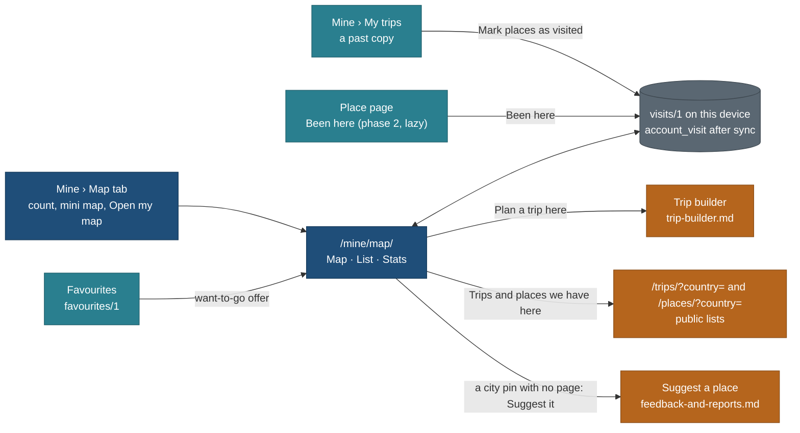

# My travel map: a flat world map you scratch as you travel

Status: **spec, planned only** (SCRATCHMAP-SPEC, travel-planner Opus, 27 Oct 2026). Nothing here is built. BACKLOG row
**WM**; TODO row of 27 Oct 2026. Owner questions Q-WM1 to Q-WM8 (section 9). Wireframes:
[design/world-map/phone.md](../design/world-map/phone.md), [design/world-map/desktop.md](../design/world-map/desktop.md);
proposed palette: [design/world-map/palette.md](../design/world-map/palette.md).

Related, referenced and not repeated here: [navigation-and-mine.md](navigation-and-mine.md) (Mine, `copies/1`, the merge
pattern), [visitor-suggestions-and-favourites.md](visitor-suggestions-and-favourites.md) (`favourites/1`, storage
failure rules, `account_favourite`), [F14-after-the-trip.md](F14-after-the-trip.md), [F17-accounts-auth-and-privacy.md](F17-accounts-auth-and-privacy.md),
[public-ref-aliases.md](public-ref-aliases.md) (refs stored here are public aliases),
[feedback-and-reports.md](feedback-and-reports.md) ("Suggest a place"), the MCP role tables in
[mcp/product-roles-and-tools.md](../mcp/product-roles-and-tools.md), and two specs written in parallel on 27 Oct:
`trip-builder.md` (the build-your-own-trip flow) and `destination-data-coverage.md` (data at scale). This page only says
where the map hands over to them.

## The owner's request (27 Oct 2026)

> "We have to think about how we can gamify. Everyone can save their own maps: it is not the globe, it is a FLAT, full
> world map. They can scratch it: based on their visits the colour of the countries changes, where they have visited a few
> places. They can change the colour at the city level, or choose to change the colour of the country. And show how many
> countries you have seen and that kind of thing. We have to think how we can gamify these things so that people get more
> excited to use all of this."

For every visitor, not only the owner. Mobile-native on phones, desktop-native on the full screen.

## Recommendation in one paragraph

Build **"My map"**: a flat **Equal Earth** world map in Mine, drawn as SVG from Natural Earth shapes we already ship
(plus a map-units build so France's overseas regions and Svalbard are their own shapes), with no basemap tiles and no
new map vendor. Tap a country to mark it **Been, Lived, Want to go or Transit**; add cities from a public gazetteer; the
country deepens one colour step as the visitor adds places in it, unless they pick a colour by hand. It shows countries
of 195, the share of the world's land, continents and regions, and earns a short list of honest milestone badges.
**Version 1 is local-only, needs no account and no server** (the `copies/1` and `favourites/1` pattern), ships behind a
flag in bundle D, and costs about 36 hours, then 14.5 hours for cities and the share image. Account sync rides bundle F
with `account_favourite`; MCP tools ride bundle H. Trade-off: no street basemap and no Pacific-centred view in v1, and
until sync exists a cleared browser loses the map (we say so and offer an export).

## Gotchas first

| # | Finding | Consequence |
|---|---|---|
| G1 | Natural Earth **admin-0 countries** puts French Guiana, Réunion, Guadeloupe, Martinique and Mayotte inside France, and Svalbard inside Norway (checked: these 14 units have no shape of their own in our `countries-50m.json`) | Marking France would paint South America. The scratch map needs **admin-0 map units** keyed to ISO alpha-2 (WM-G), not the globe's file |
| G2 | 75 of the 249 ISO units have **no shape at 110m** (Andorra, Bahrain, Barbados, Comoros, Cape Verde, Dominica, Liechtenstein, Malta and most island states) | Tiny units are dots with real hit targets and a "Which one?" chooser where they crowd (section 1.4) |
| G3 | `countries.json` has region and subregion but **no UN membership flag** and no seven-continent split ("Americas" is one region) | WM-C adds `un`, `sov` and `continent` from the same source; "of 195" is impossible without it |
| G4 | MapLibre 6 draws Mercator or the globe only | The flat map does not use MapLibre. A 30-line Equal Earth function in `core/` plus SVG is smaller than any map library |
| G5 | **The repository is public** ([public-ref-aliases](public-ref-aliases.md) G1) | The owner's own visited countries, cities, years and home are household data. They never go into the repo, a fixture, a screenshot that is committed, or the locations store. The owner seeds his own map the way any visitor does (Q-WM8) |
| G6 | "Lived" is a home signal; a dated visit is an "away" signal | Visit dates are year or year-month only, never a day; "Lived" is never shown on a share image or to MCP without its own consent (section 3.6) |
| G7 | Safari deletes script storage after about 7 days without a visit | A visitor who scratched 40 countries can lose them. v1 offers Export after the 10th country and names the risk once; sync (phase 3) is the real fix |
| G8 | The gazetteer we ship is 344 KB gzipped for the whole world | City search loads one country's slice at a time (WM-4), never the whole file on the map route (P9) |

## 1. The experience

### 1.1 Who it is for and the primary goal (P7)

| Visitor | Comes to | Primary action |
|---|---|---|
| A first-time visitor (90%) | see their travels at a glance and feel progress | **Tap the countries you have been to** |
| A returning visitor | add the last trip, check the count, share | **Mark a trip's places** (from Mine) or tap a country |
| A planner (10%) | choose where to go next | **Plan a trip here** on an unvisited country (hands to the trip builder) |

### 1.2 Projection

| Option | Area honest | Look | Antimeridian | Cost to us | Verdict |
|---|---|---|---|---|---|
| **Equal Earth** (Šavrič, Patterson, Jenny 2018) | yes, equal-area | rounded, pleasant, made for world thematic maps | edges at ±180; Natural Earth shapes are already cut there | one pure function, about 0.5 KB | **chosen** |
| Robinson | no (Greenland and Russia about 1.5 to 2 times too large relative to Africa) | familiar from atlases | as Equal Earth | needs d3-geo-projection (about 25 KB gz) or a lookup table | rejected: unfair to the tropics, extra code |
| Mercator | no (Greenland looks as big as Africa, which is 14 times larger) | familiar from web maps | wraps, poles cut at 85° | reuses MapLibre and tiles (600 KB chunk, tile terms) | rejected: a scratch map of Mercator rewards visiting Svalbard over Brazil, and the "% of the world" counter would disagree with what you see |
| Winkel tripel, Natural Earth projection | no | good | as Equal Earth | d3-geo-projection | rejected: no gain over Equal Earth |

Why it matters here: a scratch map is a picture of how much of the world you have seen. With an equal-area projection the
painted area and the "% of the world's land" counter agree. Trade-off: Equal Earth is less familiar than Mercator, and a
Pacific-centred view (for visitors in Australia, New Zealand and East Asia) needs antimeridian clipping, deferred to
"Later" (section 5).

### 1.3 Pan, zoom and levels of detail

| Behaviour | Phone | Desktop |
|---|---|---|
| Zoom | pinch; double-tap zooms in 2x at the point; `+` and `−` buttons in thumb reach | wheel at the cursor; `+` `−` buttons; keys `+` `−` |
| Pan | one-finger drag (the page does not scroll under the map) | drag; arrow keys with Shift |
| Range | 1x (whole world fits the width) to 32x | 1x to 32x |
| Reset | "World" button | button and key `0` |
| Bounds | the map cannot be panned off screen | same |
| Shapes | 110m map units first (about 45 KB gz), 50m map units fetched at 3x zoom | 50m map units from the start (about 120 KB gz) |
| Strokes | non-scaling, 0.5 px country borders | same |
| Wrap | none: Russia's Chukotka and Fiji show at both edges; selecting either part highlights both | same |

**Subdivisions (phase 2):** for countries with a meaningful first-level split (US states, Canadian provinces and
territories, Australian states, Indian states, Mexican and Brazilian states, Chinese provinces) the country sheet offers
"Show states" and fills the ADM1 shapes we already ship (`web/public/globe/admin/<A3>-ADM1.json`, Natural Earth 10m,
public domain). The country then reads "14 of 50 states". Off by default.

### 1.4 Tiny countries and islands

| Rule | Value |
|---|---|
| A unit is drawn as a **dot** when | it has no shape at the loaded resolution, or its shape is under 6 px across at the current zoom |
| Dot | 6 px circle at the unit's centre (from `countries.json` `latlng`), filled with the unit's level colour, 1 px `--line-2` keyline |
| Hit target | 44 px on phones, 24 px on desktop, centred on the dot |
| Crowding | a tap whose 44 px circle covers two or more units opens **"Which one?"**, a small sheet listing them with flags and their state (e.g. Saint Lucia, Saint Vincent, Barbados). No magnifier lens: a list is faster, needs no fine motor control and works with a screen reader |
| Desktop hover | the name card follows the cursor; crowded dots fan out 8 px on hover at zoom 1x to 2x |
| At 6x and more | most dots have become shapes; dots that remain keep their 24 px target |

### 1.5 Scratching: marking a country

| Step | Phone | Desktop |
|---|---|---|
| Select | tap a country or dot | click; or type in "Find a country" |
| What opens | bottom sheet at half height: flag, name, region, current state, the four level chips, then places | side panel: same content |
| Mark | tap **Been** (or Lived, Want to go, Transit); tap the selected chip again to clear | same, or keys `1` to `4`, `Backspace` to clear |
| Feedback | the country fills with a radial "scratch" wipe from the tap point (320 ms), the counter ticks up (240 ms), the chip pulses once (120 ms). No vibration API: feedback by animation only | same wipe from the cursor |
| Undo | toast "Italy marked as been · Undo" (5 s) | same |
| Reduced motion | fill and count change at once; the toast stays | same |

**Quick mark** (first use): while the map holds no countries, a visible switch "Quick mark: tap to mark been" is on. Each
tap toggles Been without opening the sheet, so a visitor marks 30 countries in 30 taps. It turns off by itself after the
first sheet is opened or when the visitor turns it off; it can be turned on again from the toolbar. The switch shows its
state in words, so it passes P4.

### 1.6 Levels of visit

| Level | Meaning | Counts toward "countries" | Drawn as | Text in lists |
|---|---|---|---|---|
| **Been** | visited, any length | yes | the visited ramp (1.7) | "Been" |
| **Lived** | lived there (any length the visitor chooses) | yes | the darkest step plus fine diagonal stripes | "Lived" |
| **Transit** | airport or border only | **no** (Q-WM3) | unvisited fill with a fine hatch | "Transit" |
| **Want to go** | wishlist | no | unvisited fill with a dot pattern and a dashed edge | "Want to go" |
| none | | no | the paper fill | "Not yet" |

A country's level is the highest of its own mark and its places' levels (Lived > Been > Transit > Want to go). Adding a
city as Been marks its country Been. Clearing the country asks "Also remove 3 places in Italy?" (Remove all, Keep places,
Cancel).

### 1.7 How "a few places in a country" changes its colour

Two modes, chosen in the toolbar ("Colour by"), plus a manual override per country:

| Mode | What fills | Default |
|---|---|---|
| **Country depth** | the whole country, one step deeper per band of places marked Been in it | **yes** |
| **Cities** | countries take only the first step; each city or place is a coloured pin by its level | no |
| Manual (per country) | the visitor picks a step or one of six swatches for that country; it beats the automatic step and shows a small "set by you" note in the sheet | off |

Bands for Country depth (counted from distinct places and cities marked Been or Lived in the country):

| Step | Places in the country | Example |
|---|---|---|
| 1 | 0 or 1 (the country alone is enough) | "Been to Iceland" |
| 2 | 2 to 4 | Reykjavik, Vík, Húsafell |
| 3 | 5 to 9 | |
| 4 | 10 or more | |
| Lived | any | darkest step and stripes |

Why bands and not share of regions: a count of places needs no subdivision data, works for every country on day one and
moves with every trip. Share of regions comes with subdivisions in phase 2 as an option of Country depth ("by states").

### 1.8 Counters and stats

| Counter | Definition | Shown |
|---|---|---|
| **Countries** | units marked Been or Lived whose `un` flag is set (193 UN members plus the two observers, Holy See and Palestine): "**23 of 195**" | always, top of the map and the Mine tab |
| Territories and other places | the other 54 ISO units (Greenland, Puerto Rico, Hong Kong, Taiwan, Kosovo where present ...): "**+4 territories**" | beside the count when non-zero |
| Share of the world | sum of `area` of visited units over the sum for all 249 units, one decimal: "**6.8% of the world's land**" | stats panel; Equal Earth makes it match the picture |
| Continents | seven: Africa, Antarctica, Asia, Europe, North America (Northern America, Central America, Caribbean), South America, Oceania: "**5 of 7**" | stats panel with a bar each |
| UN regions | the 22 subregions in `countries.json`: "**9 of 22**" | stats panel |
| Cities and places | distinct cities from the gazetteer and places from our catalogue marked Been | stats panel |
| From our catalogue | places marked Been that have a page here, with a link to each | stats panel (phase 2) |
| By year | countries first visited per year, when the visitor gave a year | stats panel; hidden when no years are set |
| Parks, UNESCO sites | **not in v1.** Parks need the protected-area records (parks P1 to P3); UNESCO needs a heritage list we do not hold | later |
| Kilometres travelled | **never.** We do not hold the visitor's routes, and a guessed number breaks T5 | no |

### 1.9 Achievements: milestones, not streaks

Badges mark facts the visitor can see on the map. Each is a quiet chip in the stats panel with a one-line reason. A new
badge shows once as a toast with a 600 ms fade and scale (nothing under reduced motion). No sound, no confetti over the
map, no points, no levels, no locked teasers.

| Badge | Earned when |
|---|---|
| First stamp | the first country |
| 5, 10, 25, 50, 100 countries | the count reaches it (of 195) |
| Every continent but one / All seven | 6 or 7 continents |
| Both hemispheres | Been north and south of the equator (from unit centres) |
| East meets west | Been on both sides of the prime meridian and of 90°E |
| Region complete | every country of a UN subregion (e.g. "All of Northern Europe") |
| A country in depth | 10 or more places in one country |
| Every state (phase 2) | all ADM1 regions of a country with subdivisions on |

### 1.10 Goals and the want-to-go layer

| Source of a "Want to go" | How | Privacy |
|---|---|---|
| The visitor taps Want to go | direct | their data |
| Their **favourites** | the sheet of a country with favourited places offers "You have 4 favourites in Norway. Mark Norway as want to go?" (phase 2). Read from `favourites/1` on the device; nothing leaves the browser | their data |
| Our catalogue | the country sheet lists "Trips we have here" and "Places we have here" with counts, linked to `/trips/?country=NO` and `/places/?country=NO` | public data |
| A goal | "Goal: 30 countries by 2030" set in the stats panel; progress as a bar, no reminders | their data |

**The owner's laundry list is not a seed for other people.** `data/locations/locations.json` is the owner's household
wishlist. Other visitors see only what the public catalogue already shows (published trips and places, counted per
country). Nothing on the map says "the owner wants to go here", and no household count or date is read (Q-WM8).

### 1.11 Sharing

| Share | v1 | Later |
|---|---|---|
| **Image card** | made in the browser from the SVG, no upload, no server: 1200 x 630 (link preview) and 1080 x 1350 (phone story). Phone: the system share sheet (Web Share with files); desktop: Download PNG | |
| What the card shows by default | the map in the visitor's colours, "23 countries · 5 continents · 6.8% of the world" | |
| Off by default, each a switch | a display name the visitor types (never the account email), cities and places as pins, Want to go | |
| Never on the card | Lived (drawn as Been), years and months, notes, the home country flagged as home | |
| Print poster (desktop) | A3 and A2 landscape, vector through print CSS, legend and counts, the same defaults | |
| Public link | **no** | phase 4, signed in: an opt-in snapshot of countries and levels only at `/m/<random id>/`, noindex, revocable (Q-WM7) |
| Compare with friends | **no** | only by exchanging links, never a leaderboard |

### 1.12 How it ties to Mine, favourites, trips and the trip builder



| Tie | Behaviour | Phase |
|---|---|---|
| Mine tab | Mine's tabs become **My trips · Favourites · Map**. The Map panel shows the count, a non-interactive mini map and **Open my map** (`/mine/map/`). The full map is its own full-bleed route so it can use the whole phone and desktop screen | 1 |
| A past copy in Mine | when a copy's last day has passed, its row gains **Mark places as visited**: a sheet lists the trip's countries and stops (from the public trip's light rows, by public alias), all ticked; one tap marks them Been with the copy's year and month | 2 |
| Place page | **Been here** in the place's action menu, a lazy chunk with 0 server bytes (place HTML budget) | 2 |
| Trip page | none in v1; the copy path above is the way in | |
| Trip builder | the country sheet's **Plan a trip here** opens the builder with the country preselected; the builder may show a "Not been yet" chip on countries from `visits/1` read on the device. The builder's spec owns its side | 2, with the builder |
| "Places left in Italy" | the country sheet shows "Places we have in Italy: 42 · You have been to 3" from the public per-country count (destination-data-coverage.md owns the counts) and the visitor's own marks | 2 |
| Suggest a place | a city or place the visitor marked that has no page here offers **Suggest it** (prefilled name and country; the visitor confirms; never automatic) | 2 |
| Copies and favourites | unchanged; a heart never marks a visit, a visit never adds a favourite | |

## 2. Mobile-native and desktop-native

The wireframes are separate pages: [phone](../design/world-map/phone.md) (390 and 320 px) and
[desktop](../design/world-map/desktop.md) (1440 and 1024 px). The summary:

| Concern | Phone (below 640 px) | Desktop (1024 px and wider) |
|---|---|---|
| Layout | full-bleed map under the 56 px header; the bottom bar stays (Mine current) | map fills the width left of a 400 px side panel; header unchanged |
| Top of map | a count pill "23 of 195" (opens Stats) and a "Find a country" button | toolbar: Find a country, Colour by, Quick mark, Share, Print, More (Export, Import, Map settings) |
| Detail | bottom sheet: peek 96 px (counts and the view switch), half (country), full (places, stats, list). The bar hides above half (components 1.4) | side panel with tabs Country · Stats · List; a hover card follows the cursor |
| Controls | `+`, `−`, World, List at the bottom right, 44 px each, above the sheet peek | `+`, `−`, World at the bottom right of the map; keyboard |
| Views | Map · List · Stats as a segmented control in the sheet peek | the panel's tabs; List can also take the full width |
| Gestures | pinch, double-tap, drag; a tap selects; no long-press actions | wheel, drag, hover, click, keys |
| Keyboard | not primary | section 2.2 |

### 2.1 Accessibility

| Need | How |
|---|---|
| A non-visual way to do everything | **List view**: every unit grouped by continent, with the same level control per row (a radio group), the places count and a link to the country sheet. Sorting: name, level, continent. It is the same state, not a copy |
| The map itself | `role="application"` is not used. The SVG is `role="img"` with a live summary ("Map of 249 countries; 23 been, 1 lived, 6 want to go"). Each shape is `aria-hidden`; the operable paths are Find a country, the list and the keyboard focus model below |
| Colour is never the only signal | each level has a pattern (stripes, hatch, dots, dashed edge), the sheet and list name it in words, and the legend is always one tap away |
| Contrast | every selected or focused shape has one edge layer at 3:1 or more on its fill and on the sea (palette.md, the 5.1 rule of the tokens) |
| Targets | 44 px on phones, 24 px on desktop for dots; 44 px chips |
| Text size | at 200% the sheet and panel reflow; the map does not scale its labels (it has none at rest) |
| Reduced motion | no wipe, no count roll, no badge scale; zoom jumps |
| Screen-reader announcements | "Italy, been. 23 countries." through one polite live region after each mark |

### 2.2 Keyboard (desktop)

| Key | Does |
|---|---|
| `/` | Find a country (combobox; Enter selects, focuses the shape and opens the panel) |
| Tab into the map | focuses the selected country, else the country nearest the centre |
| Arrow keys | move focus to the nearest country centre in that direction (a focus ring in `--focus`, the name card shows) |
| Shift + arrows | pan |
| `+` `−` `0` | zoom in, out, reset |
| Enter | open the focused country in the panel |
| `1` `2` `3` `4`, Backspace | Been, Lived, Transit, Want to go, clear (when the panel's country is focused) |
| Escape | close the hover card, then the selection |

### 2.3 Light and dark

Both themes follow the page theme. The scratch palette is a proposed token family, generated into `web/app/themes.css`
by `tools/theme_tokens.py` like every colour (CLAUDE.md "Design system"); no component holds a hex. Proposed values, with
measured contrast, are in [palette.md](../design/world-map/palette.md). Summary: the visited ramp is one blue hue, the
hue of `--ok` ("done"); no green, no purple; the selection keeps the existing amber edge over the ink casing.

### 2.4 Performance budgets (P8, P9)

| Budget | Value | How |
|---|---|---|
| Start JS of every public page | **+0 B** | nothing on a public page imports the map; Mine's bar and dot are unchanged |
| Place HTML (S13) | **+0 B** | no Been here button in v1; in phase 2 it renders after hydration inside a lazy chunk |
| Mine route chunk | inside its 30 KB | the Map tab panel is a lazy chunk of at most 6 KB gz (count, mini map from the 110m shapes already cached, link) |
| `/mine/map/` route JS | **at most 35 KB gz** | SVG renderer, Equal Earth, pan and zoom, sheet, stats; badges and share are lazy chunks (at most 8 KB and 10 KB) |
| Geometry | 110m map units at most 45 KB gz; 50m map units at most 120 KB gz | static files, long cache, shared by phone and desktop |
| First paint | an inline SVG silhouette of the world (at most 6 KB, server-rendered, no data) | the route is static; the visitor's state paints after the envelope is read |
| Interaction | a mark paints within 100 ms (INP) on a mid phone at 4x CPU throttle; pan and zoom at 50 fps or more with 249 shapes | one SVG `<g>` transform; fills by CSS class per level, not per-path style recalculation |
| City search | one country's gazetteer slice, at most 25 KB gz, fetched when the visitor opens "Add a city" for that country | WM-4 splits the gazetteer by country at build |
| No new client-side bulk load | none | geometry and gazetteer are public geodata, not our catalogue; the catalogue is read only as per-country counts through the existing adapters (P8, P9) |

### 2.5 Offline

| Case | Behaviour |
|---|---|
| Signal drops while the map is open | everything keeps working; state is local |
| Opened offline after an earlier visit | works when the browser kept the route and the geometry in its HTTP cache; there is no service worker in v1 |
| Opened offline for the first time | the shell and silhouette show; "Your map needs a connection the first time." |
| Signed in, offline (phase 3) | marks queue in `pending` and replay on reconnect (the favourites rule) |

## 3. Data model and storage

### 3.1 The envelope `visits/1` (device)

Key `travel.visits.local` in `localStorage`, read and written only through `web/lib/storage/safe.ts` and a new
`web/lib/mine/visits.ts`; validated by a Zod schema `core/src/schema/visits.ts` on every read. A bad or newer envelope is
left untouched and the map shows the error state (the favourites rule, visitor spec 4.2).

```json
{ "schema": "visits/1",
  "countries": {
    "IT": { "level": "been", "colour": null, "year": 2019, "month": null, "note": null, "updatedAt": "2026-10-27T10:02:11Z" },
    "CA": { "level": "lived", "colour": null, "year": null, "month": null, "note": null, "updatedAt": "2026-10-27T10:03:40Z" }
  },
  "regions": {},
  "places": [
    { "id": "0d3c2b1a-5e6f-4a7b-8c9d-0e1f2a3b4c5d", "kind": "city", "ref": null, "gaz": "ne:1159151471",
      "name": "Florence", "cc": "IT", "admin1": "52", "pt": [11.25, 43.78], "level": "been",
      "year": 2019, "month": 7, "note": null, "updatedAt": "2026-10-27T10:05:00Z" },
    { "id": "6f1c0a52-8d0e-4b7e-9a51-2c3d4e5f6a7b", "kind": "place", "ref": "place/moraine-lake", "gaz": null,
      "name": "Moraine Lake", "cc": "CA", "admin1": "ab", "pt": [-116.19, 51.32], "level": "been",
      "year": null, "month": null, "note": null, "updatedAt": "2026-10-27T10:06:00Z" } ],
  "prefs": { "colourBy": "country", "theme": "blue", "quickMark": true, "denominator": "un195" },
  "goal": null, "badgesSeen": ["first-stamp"], "tombstones": {}, "exportNudge": null, "merged": {}, "pending": [] }
```

| Field | Rule | Why |
|---|---|---|
| Country key | ISO 3166-1 alpha-2, from `countries.json` (249 units) | one key the map, list, stats and API share |
| `level` | `been`, `lived`, `transit`, `want` | section 1.6 |
| `colour` | null or one of six swatch keys (palette.md) | manual override (1.7) |
| `year`, `month` | optional; year 1900 to this year, month 1 to 12; **no day field exists** | G6: a day plus a home is a burglary calendar |
| `note` | optional, 280 characters, plain text | the visitor's own words |
| Place `ref` | a **public alias** from `publicRef()` ([public-ref-aliases](public-ref-aliases.md)), validated as such by the schema; never a dated internal ref | P8 and REF |
| Place `gaz` | a gazetteer id (`ne:<id>` for Natural Earth, `gn:<id>` for GeoNames towns) | cities that have no page |
| `pt` | longitude and latitude rounded to 2 decimals (about 1 km) | enough for a pin on a world map; no precise points of anyone's home |
| `name`, `cc`, `admin1` | snapshot so the map draws with no request | P8: no facts, links, times or suitability |
| Caps | 249 countries, 2,000 places, 2,000 regions | about 300 KB at the worst case, typically under 10 KB |
| `tombstones` | `{key: deletedAt}`, kept 90 days | removals must survive the sign-in merge (unlike favourites, 3.4) |

Storage failure, private windows and other tabs follow visitor spec 4.3 and navigation 3.3 exactly (in-memory for the
tab, one notice, the `storage` event re-reads). `navigator.storage.persist()` is not called.

### 3.2 Export and import (v1.1)

| Format | Export | Import |
|---|---|---|
| JSON | the whole envelope minus `merged`, `pending` and `tombstones`, named `my-travel-map-<yyyy-mm-dd>.json` | validated by the same Zod schema; merge or replace, chosen by the visitor |
| CSV | `iso2,level,year,month` per country; places as `name,iso2,level,year,month,lon,lat` | ISO alpha-2 or alpha-3 codes, or English country names matched against `countries.json`; unknown rows listed, never guessed |

The export nudge appears once, after the 10th country, while the map lives only on this device.

### 3.3 Account sync (phase 3, bundle F)

Three tables, RLS owner predicate on each, written only through account routes, never through the public API or the
public MCP:

| Table | Columns (description, not SQL) |
|---|---|
| `account_visit_country` | `user_id`, `cc` (char 2), `level`, `colour` (nullable), `year` and `month` (nullable smallints), `note` (nullable, 280), `updated_at`, `deleted_at`; primary key (`user_id`, `cc`) |
| `account_visit_place` | `id` (uuid from the device), `user_id`, `kind`, `ref` (nullable, public alias), `gaz` (nullable), `name`, `cc`, `admin1`, `lon` and `lat` (numeric, 2 decimals), `level`, `year`, `month`, `note`, `updated_at`, `deleted_at`; cap 2,000 per user |
| `account_map_pref` | `user_id` primary key, `doc` (`prefs`, `goal`, `badgesSeen`) |

Routes: `GET /api/account/visits`, `POST /api/account/visits/merge`, `PATCH /api/account/visits` (a batch of upserts
and deletes). Same-origin guard and verified session, as `copies` and `favourites` (navigation 4.2).

**Merge and conflict rules:**

1. The merge runs on `/account/` and `/mine/` only, beside the copies and favourites merges, in the same toast
   ("23 countries and 41 places added to your account").
2. Per country (key `cc`) and per place (key `id`, or `ref` / `gaz` when ids differ): **last writer wins by
   `updated_at`**, tombstones included. A device tombstone newer than the account row deletes it.
3. Two devices that both marked Italy at different levels: the newer mark wins; the other is not kept.
4. Over the cap, the newest places go first; the toast names the overflow.
5. Re-running is a no-op; a crash between the write and emptying the envelope is safe (ids and timestamps).
6. After the merge every mark writes to the server (optimistic, Undo in the toast); the device cache is
   `travel.visits.acct.<h>` and is deleted at sign-out (V12).
7. No Realtime; other devices refresh on focus, at most once a minute.

### 3.4 Privacy rules

| Rule | Detail |
|---|---|
| Private class | visits are a new personal data class **"travel history"** in F17 rule 12: readable only by the user |
| Never public | no public page, public API route, sitemap, OG image, public MCP tool or build artifact reads `visits/1` or the tables; the privacy detector (`core/src/privacy/detect.ts`) gains the keys `travel.visits.*` and the table names as forbidden in public output |
| Never in the repo | no fixture uses the owner's real visits; test fixtures use the synthetic household of the scenario page with invented countries |
| Export and delete | F17 export includes the three tables; delete removes them |
| Household | visits belong to a person, not a household, in v1 (the favourites rule, visitor spec 4.7) |
| Analytics | the Cloudflare beacon counts page views of `/mine/map/` only. No event carries a country, a count or a badge. No aggregate of users' maps is computed, now or later, and F14's `visit_stat` is never fed from personal maps |
| Share image | made on the device; the defaults in 1.11 drop Lived, dates and notes |

### 3.5 Geometry and reference data

| Need | Source | Licence | Size | Build |
|---|---|---|---|---|
| Map units, first paint | Natural Earth 1:110m `admin_0_map_units`, keyed to ISO alpha-2 (`ISO_A2_EH`), simplified, quantised | public domain | at most 45 KB gz | `tools/globe_data.py` gains a `scratch` output: `web/public/globe/data/scratch-110.json` |
| Map units, detail | Natural Earth 1:50m `admin_0_map_units` | public domain | at most 120 KB gz | `scratch-50.json` |
| Units with no shape | `countries.json` `latlng` | world-countries (ODbL, already credited), Wikidata CC0 | 0 (exists) | dots (1.4) |
| UN membership, sovereign, continent | world-countries `unMember`, `independent`; continent derived from `region` and `subregion` | ODbL, as above | +5 KB raw to `countries.json` | `globe_data.py`, additive fields `un`, `sov`, `continent` |
| Subdivisions (phase 2) | `web/public/globe/admin/<A3>-ADM1.json` | Natural Earth, public domain | per country, exists | none |
| Cities | `gazetteer.json` cities (Natural Earth populated places, 7,342) and, where we hold it, the GeoNames towns layer (`data/reference/towns/`) | public domain; GeoNames CC BY 4.0 (credit "Contains data from GeoNames") | per-country slices at most 25 KB gz | WM-4 splits by ISO code |
| Boundaries note | Natural Earth draws de facto boundaries | | | the map's footer: "Borders are approximate and do not express a position on any dispute." |

The map page credits Natural Earth, world-countries (ODbL) and, when a GeoNames town is shown, GeoNames, in one
attribution line (as the globe does).

### 3.6 MCP exposure

| Tool | Role and level | Endpoint | Phase |
|---|---|---|---|
| `get_my_map` | signed in, **a new add-on "My travel map", off by default**, on top of "My plans, read" | `GET /api/account/visits` (counts, countries and levels; places only when asked; Lived returned as Lived only with the add-on) | bundle H, MP2 |
| `mark_visited` | signed in, "propose changes" plus the add-on; preview, then apply | `PATCH /api/account/visits` | bundle H2, MP3 |
| Anything public | none. The public MCP never sees a visit | | |

Why an add-on, not part of "My plans, read": a map of where someone lived and travelled is more personal than their trip
drafts, and the consent screen should say so in its own line ([mcp/auth-and-sign-in.md](../mcp/auth-and-sign-in.md) 14).

### 3.7 Clicking a country: where it links

| From the country sheet | Goes to | Notes |
|---|---|---|
| Trips we have here (n) | `/trips/?country=<a2>` | count from the public trip list adapter |
| Places we have here (n) | `/places/?country=<a2>` | count from the public place list adapter; per-country counts are light data (P8) |
| Plan a trip here | the trip builder with the country preselected | trip-builder.md owns the URL |
| A place row with a page | `/places/<slug>/` | |
| A city with no page | Suggest it (phase 2) | feedback-and-reports.md |

There is no public country page today; when one exists, the sheet's header links to it.

## 4. Gamification design

### 4.1 Motivations and the mechanic that serves each

| Motivation | Mechanic | In v1 |
|---|---|---|
| Collection | countries, continents, regions, places; the map filling in | yes |
| Progress | "23 of 195", "% of the world", continent bars, country depth | yes |
| Mastery | region complete, a country in depth, every state | region and depth yes; states phase 2 |
| Exploration | want-to-go layer, "Places we have here", Plan a trip here | want-to-go yes; the rest phase 2 |
| Memory | years, notes, places from a past trip copy | years and notes yes; copy tie phase 2 |
| Expression | colour themes, manual colours, the share image, a poster | themes and manual yes; share and poster v1.1 |
| Social comparison | **optional and private**: only by sending your image or (later) a link | image v1.1 |

### 4.2 Version 1: small and delightful

- Quick mark on an empty map, the scratch wipe and the ticking counter.
- Four levels with patterns; Country depth from places.
- Counts: countries of 195, territories, % of the world, continents.
- Eight badges from the list in 1.9 (first stamp, 5, 10, 25, 50, 100, all seven continents, region complete).
- The Mine tab with the count and mini map.
- List view and Find a country.

Version 1.1 adds cities, the share image, the print poster and export and import. Everything else waits for evidence
(section 5).

### 4.3 Anti-patterns we do not build

| Anti-pattern | Why not |
|---|---|
| Streaks ("visit 7 days in a row") | travel is not daily; a streak would punish people for staying home |
| Leaderboards, public ranks | social pressure and a privacy risk; most visitors never sign in |
| Points, coins, levels | an invented currency with nothing to spend it on |
| Locked badges shown as greyed teasers, mystery boxes | manufactured curiosity |
| Notifications or e-mails nudging people to "keep going" | we send none for this feature |
| Fake urgency ("only 3 days to reach 30 countries this year") | breaks trust; goals have no deadlines we enforce |
| Inflated counts (transit counted, territories in the 195) | the number must survive a sceptical friend |
| Dark patterns around sign-in ("sign in or lose your map") | the device notice states the fact once, with Export beside it |

### 4.4 Copy tone

Plain, warm and exact. Numbers first, no exclamation marks, no "Amazing!".

| Moment | Copy |
|---|---|
| Empty map | **Tap the countries you have been to.** Quick mark is on: one tap marks a country as been. Everything stays in this browser. |
| After a mark | Italy marked as been · Undo |
| Counter | 23 of 195 countries · +2 territories |
| Badge toast | **10 countries.** Ten flags on your map. |
| Device notice | Your map is kept in this browser only. Clearing site data or switching devices loses it. **Export** · Got it |
| Export nudge (10th country) | Ten countries in. Keep a copy: **Export your map** |
| Sign-in line (when sync exists) | Sign in to keep your map on every device. |
| Clear with places | Also remove 3 places in Italy? **Remove all** · Keep places · Cancel |
| Want-to-go offer | You have 4 favourites in Norway. Mark Norway as want to go? |
| Plan | **Plan a trip here** · 3 trips and 42 places we have in Norway |

### 4.5 How it drives planning and contributions

| Path | Effect we expect | Honest limit |
|---|---|---|
| An unvisited country with our trips or places | a click into `/trips/?country=` or the trip builder | only for the 10 countries we cover today; the sheet says "We have nothing here yet" elsewhere, with **Ask us to plan it** (the request form) |
| A marked city that has no page | Suggest it, prefilled | the visitor still writes the suggestion |
| A past trip copy | marks places, which keeps people returning to Mine after a trip | phase 2 |

### 4.6 Measuring it, privately

Page views per path from the existing Cloudflare beacon: `/mine/map/` against `/mine/`. Decision rule: if after eight
weeks fewer than 10% of Mine's visitors open the map, stop at v1.1 and do not build phases 2 to 4. No event tracking,
no per-user numbers.

## 5. Where it fits and when

### 5.1 Phases

| Phase | Tasks | Hours | Model | Depends on | Proposed bundle |
|---|---|---|---|---|---|
| **1. My map on this device (v1)** | WM-DR 2, WM-C 5, WM-G 4, WM-1 14, WM-2 8, WM-R 2, WM-V 1 | **36** | Opus (DR, C, R), Sonnet (G, 1, 2, V) | bundle A merged (Mine, `safe.ts`); design review of this page and palette.md | **D**, feature label v0.11a, flag `worldMap`, ships dark if late |
| **1b. Cities, share, export (v1.1)** | WM-4 6, WM-5 6, WM-R2 1.5, WM-V2 1 | **14.5** | Sonnet, Opus review | phase 1 | **D** (or E if D is full) |
| **2. Ties** | WM-T 4 (past copy), WM-P 3 (Been here, lazy), WM-F 3 (favourites offer, per-country counts), WM-B 2 (builder hand-off), WM-A 9 (subdivisions and state badges), WM-Q 2 (goal), WM-R3 3, WM-V3 1 | **27** | Sonnet; Opus 1 h of WM-A rules and the review | phase 1; trip-builder.md; destination-data-coverage.md counts; place HTML headroom | **E** (WM-T, WM-F, WM-A, WM-Q), **F** (WM-P after field slimming), WM-B with the builder's bundle |
| **3. Account and MCP** | WM-D 4 (migrations), WM-S 8 (routes, merge, sync), WM-X 1 (F17 export and delete), WM-M 5 (MCP tools and the add-on), WM-SR 2 (security review), WM-V4 1 | **21** | Opus (D, M design, SR), Sonnet | CUS-C, NAV-D, FAV-D (bundle F); MP2 for `get_my_map`; MP3 for `mark_visited` | **F** (D, S, X), **H** (`get_my_map`), **H2** (`mark_visited`) |
| 4. Later, not counted | public share link `map_share` (about 9 h), Pacific-centred view (about 4 h), parks and UNESCO counts (data first), a yearly recap | about 20 | | evidence from 4.6 | none until asked |

**Total planned: 98.5 hours, about 7.3% of the 1,350.5-hour program.** Phases 1 and 1b (50.5 h) deliver what the owner
described. Phases 2 and 3 are worth it only if the map is used (4.6).

### 5.2 Why bundle D and not earlier

| Option | For | Against | Verdict |
|---|---|---|---|
| Bundle C | sooner | C is 301.5 h with a cut rule (Q309); Mine's tab file and the trip page are already hot there | no |
| **Bundle D** | after Mine has been live a bundle; D's UI work (report and suggest, request forms) touches different files; the map needs no migration | waits two bundles | **yes** |
| A parallel seat during C, dark | earliest | adds a stack to C's T3 and a reviewer pass during the busiest bundle | only if the owner asks (Q-WM4) |

### 5.3 Readiness audit (checked on `main` 6c422664)

| Thing | State | Where |
|---|---|---|
| Mine page with tabs, envelopes, the storage door, the change event | **built** (bundle A) | `web/app/mine/**`, `web/lib/mine/**`, `web/lib/storage/safe.ts`, `web/lib/mine/keys.ts` |
| Envelope pattern with Zod in core, merge pattern | built for copies and favourites | `core/src/schema/copies.ts`, `favourites.ts`; navigation 4.2 |
| Country facts for 249 ISO units (a2, a3, numeric, name, region, subregion, area, centre, flag) | **built** | `web/public/globe/data/countries.json` (18 KB gz) |
| Country shapes at 110m and 50m | built for the globe, **admin-0 countries, not map units** (G1) | `countries-110m.json` (177 shapes, 39 KB gz), `countries-50m.json` (241 shapes, 236 KB gz) |
| TopoJSON decoder, bounding boxes, centroids | built | `web/lib/globe/geometry.ts` |
| ADM1 shapes for 251 units, ADM2 for 277 | built | `web/public/globe/admin/` (21 MB in all, per-country files) |
| City gazetteer | built, whole-world file only | `gazetteer.json` (7,342 cities, 344 KB gz); towns for 15 countries in `data/reference/towns/` |
| Flat projection, SVG map renderer | **missing** | WM-C, WM-1 |
| UN membership, sovereign, seven continents | **missing** | WM-C |
| Map-units geometry keyed to ISO | **missing** | WM-G |
| Scratch palette tokens | **missing** (proposed) | palette.md, then `tools/theme_tokens.py` |
| Account tables, routes, MCP tools | **missing** | phase 3 |
| UNESCO list, park records | missing; parks come with P1 to P3 | later |
| MapLibre globe | built; **not reused** for the flat map (G4) | |

## 6. Build briefs for phase 1

Each brief is complete for a coding agent. Branch from `main` in a worktree `/Users/nks/workspace/travel-wt/<TASK>` on
`public/<TASK>`. Read `docs/v2/design/foundation/principles.md` (P1 to P9) first and cite the principle numbers in the
hand-back.

**Commit rules for every brief:** commit only the paths you own with `git -C <worktree> add <paths>` (never `-A`); one
commit per task; message `feat(world-map): <task> <summary>`; end with the trailers `Co-Authored-By: Claude <model> <noreply@anthropic.com>`,
`Task: <ID>`, `Model: <model>`. Do not push or merge. Delete `node_modules` and `.next` in the worktree before handing
back. Never put real household data in a fixture, a test or a committed screenshot (G5).

**Verification for every UI brief:** `npx tsc --noEmit` in `web/` and `core/`; the unit tests named in the brief;
`bash tools/check-all.sh` stage subset per TEST-STRATEGY (T1 for the touched paths); Playwright screenshots at **1440 and
390, light and dark**, written to `web/test-results/shots/world-map/` (gitignored), plus 320 px for the phone layout;
`budget:report` before and after in both builds. Then the design review (`travel-design-reviewer`), then
`travel-verifier`.

### WM-C: the contract (Opus, 5 h)

- **Goal:** the shared data contract for the map: the `visits/1` schema, the unit reference fields, the derivation and
  stats functions, the Equal Earth projection.
- **Owns:** `core/src/schema/visits.ts` (new), `core/src/visits/**` (new: `derive.ts` levels and steps, `stats.ts`
  counters and badges, `project.ts` Equal Earth forward and inverse), `core/tests/visits/**` (new),
  `web/lib/mine/keys.ts` (append `VISITS_KEY = 'travel.visits.local'` and its pin test),
  `tools/globe_data.py` (additive `un`, `sov`, `continent` in `countries.json`), `web/public/globe/data/countries.json`
  (regenerated), `core/src/privacy/detect.ts` (forbid `travel.visits.` and the planned table names in public output).
- **Must not touch:** `web/app/**`, `web/components/**`, `core/src/schema/copies.ts`, `favourites.ts`, any migration.
- **Steps:** (1) Zod schema exactly as section 3.1, with caps, no day field, `ref` validated by `publicRef` rules;
  (2) `derive.ts`: effective country level (1.6), Country depth step (1.7), manual override; (3) `stats.ts`: counters of
  1.8 and badges of 1.9, pure functions over the envelope and `countries.json`; (4) `project.ts`: Equal Earth with the
  published coefficients, forward and inverse; (5) the additive country fields; (6) detector rule.
- **Acceptance:** a test pins 195 units with `un: true` (193 members plus VA and PS); France, French Guiana and Réunion are
  separate units with their own continent; transit never counts; Lived beats Been; a newer envelope schema is refused
  without being overwritten; Equal Earth round-trips 1,000 random points within 1e-9; the detector fails a fixture
  public page that contains `travel.visits.local`.
- **Verification:** `tsc`, `vitest run core/tests/visits`, the privacy contract kit, `python3 tools/globe_data.py --check`.

### WM-G: map-units geometry (Sonnet, 4 h)

- **Goal:** `scratch-110.json` and `scratch-50.json` from Natural Earth admin-0 map units, keyed to ISO alpha-2.
- **Owns:** `tools/globe_data.py` (the `scratch` output only, after WM-C merged), `web/public/globe/data/scratch-*.json`
  (new, generated with a "Generated ... Do not edit" property), `web/tests/world-map/geometry.test.ts` (new).
- **Must not touch:** `countries-110m.json`, `countries-50m.json`, the globe code.
- **Steps:** download the two map-unit shapefiles (public domain), map `ISO_A2_EH` to `countries.json` keys, drop units with
  no ISO key into a logged list, simplify and quantise to the size budget, write TopoJSON with object `units`.
- **Acceptance:** every shape id is a `countries.json` key; France does not contain a point in French Guiana; sizes at
  most 45 KB and 120 KB gzipped; the list of ISO units with no shape at each resolution is written to the test snapshot.
- **Verification:** the geometry test, `tsc`, size check in `budget:report`.

### WM-1: the map route (Sonnet, 14 h)

- **Goal:** `/mine/map/` with the full phone and desktop experience of sections 1.3 to 1.7 and 2, local-only.
- **Owns:** `web/app/mine/map/**` (new), `web/components/world-map/**` (new), `web/lib/mine/visits.ts` (new),
  `web/lib/capabilities.ts` (append the `worldMap` flag only), `web/tests/world-map/**`, `web/e2e/world-map.spec.ts` (new).
- **Must not touch:** `web/app/mine/MineShell.tsx` and `MineTabs.tsx` (WM-2), the globe, `web/app/themes.css` by hand,
  any public page.
- **Steps:** silhouette SSR shell; load envelope through `visits.ts` (safe storage, Zod, `storage` event); SVG renderer
  with one `<g>` transform, fills by level class; pan, pinch, wheel, double-tap, bounds; dots and "Which one?"; bottom
  sheet (phone) and side panel (desktop) using the existing `BottomSheet` and side-sheet components; level chips, Undo
  toast, Quick mark; Colour by; Find a country; keyboard model of 2.2; reduced motion.
- **Acceptance:** with an empty envelope, 30 taps mark 30 countries without opening a sheet; marking Italy at 390 px paints
  within 100 ms at 4x throttle; Saint Lucia is selectable at 1x on a phone through "Which one?"; Tab, arrows and Enter
  mark a country with no mouse; the route chunk is at most 35 KB gz; no public page's start JS changes; the screen reader
  summary updates after a mark.
- **Verification:** `tsc`, unit tests, the e2e spec, screenshots at 1440 and 390 (and 320) in light and dark: empty map,
  12 countries in Country depth, Cities mode, the country sheet, "Which one?" over the Caribbean, the list view.

### WM-2: Mine tab, list view and stats (Sonnet, 8 h)

- **Goal:** the third Mine tab, the list view, the stats panel with badges.
- **Owns:** `web/app/mine/MineShell.tsx`, `web/app/mine/MineTabs.tsx` (add the tab), `web/components/world-map/list/**`,
  `web/components/world-map/stats/**`, tests beside them.
- **Must not touch:** the renderer files of WM-1 except through their exported props; the phone bar; `keys.ts` beyond
  WM-C's line.
- **Steps:** Mine tabs My trips · Favourites · Map with `?show=map`; the lazy Map panel (count, mini map, Open my map);
  the list grouped by continent with a radio group per row; stats with counters, continent bars, badges and the badge toast.
- **Acceptance:** the three segments fit at 320 px with 44 px targets; the Map panel chunk is at most 6 KB gz and Mine
  stays inside 30 KB; every mark made in the list shows on the map and the reverse, in two tabs; badges match `stats.ts`.
- **Verification:** as WM-1; screenshots of Mine with each tab, the list, stats with 0 and 23 countries.

## 7. Risks

| Risk | Likelihood | Impact | Mitigation |
|---|---|---|---|
| Scope creep: gamification keeps growing | high | weeks of the program | phases gated by 4.6; phase 4 only on request |
| The owner's real map leaks into the public repo through fixtures or screenshots | medium | household privacy | G5; detector rule; synthetic fixtures; committed screenshots only when a review names them and they hold synthetic data |
| Visitors lose a map to browser eviction | medium | trust | the device notice, the export nudge, then sync |
| Disputed borders and names offend someone | medium | reputation | Natural Earth defaults, the boundaries note, territories outside the 195, no flags of disputed units added by us |
| Low-end phones stutter at 50m | low | P5 | 110m first, 50m at 3x zoom, one transform, measured in WM-1 acceptance |
| The scratch palette fails contrast or clashes with amber selection | low | accessibility | palette.md measurements; the design reviewer owns the final values |
| Little use at under 100 users | medium | wasted hours | v1 is 36 h; the 10% rule in 4.6 stops further work |
| "Lived" plus a year reveals a home | low | privacy | country-level by default, never on shares, MCP add-on off by default |

## 8. Supersedes and amends

Nothing is superseded. This page **amends** (each page needs a one-line note; listed for the coordinator because this
task does not own them):

| Page | Amendment |
|---|---|
| [navigation-and-mine.md](navigation-and-mine.md) N1, 2.1, 2.2 | Mine has three tabs: My trips · Favourites · Map (`?show=map`) |
| [F17-accounts-auth-and-privacy.md](F17-accounts-auth-and-privacy.md) rule 12, 15, 16 | new private class "travel history"; export and delete include the three visit tables |
| [F14-after-the-trip.md](F14-after-the-trip.md) behaviour 5 | `visit_stat` is never fed from personal maps; "Mark places as visited" from a past copy is the first slice of the after-trip loop |
| [visitor-suggestions-and-favourites.md](visitor-suggestions-and-favourites.md) 4.6 | a heart never marks a visit; favourites feed the want-to-go offer on the device only |
| [mcp/product-roles-and-tools.md](../mcp/product-roles-and-tools.md), [mcp/auth-and-sign-in.md](../mcp/auth-and-sign-in.md) 14 | `get_my_map` (M2), `mark_visited` (M3), add-on "My travel map", off by default |
| [design/foundation/tokens.md](../design/foundation/tokens.md) 5 | a proposed 5.4 "Scratch map" token family (palette.md), pending the design review |

## 9. Owner questions (Q-WM1 to Q-WM8)

| ID | Question | Recommended answer | Blocks |
|---|---|---|---|
| Q-WM1 | Name: "My map" (page title "My travel map", Mine tab "Map")? Alternatives: "Scratch map", "Been" | **My map** | WM-2 copy |
| Q-WM2 | Headline count "of 195" (UN members and observers) with territories counted separately? | **Yes** | WM-C |
| Q-WM3 | Transit shown but not counted? | **Yes** | WM-C |
| Q-WM4 | Phase 1 and 1b in bundle D behind the `worldMap` flag (not in C)? | **Yes, D** | MASTER-ORDER slot |
| Q-WM5 | Palette: a blue visited ramp (the "done" hue) as default, plus Rose, Ochre and Slate themes and six per-country swatches, through a foundation change reviewed by the design reviewer? | **Yes** | WM-DR, WM-1 |
| Q-WM6 | Quick mark on by default on an empty map? | **Yes** | WM-1 |
| Q-WM7 | No public share link until accounts sync; v1 shares an image made on the device? | **Yes** | phase 4 |
| Q-WM8 | The owner seeds his own map like any visitor (by hand or by importing a private file kept outside the repo); other visitors' want-to-go never reads the locations store? | **Yes** | WM-5, G5 |

## Change log

| Date | Change |
|---|---|
| 2026-10-27 | Written (SCRATCHMAP-SPEC, travel-planner Opus). Planned only |
