# MCP build readiness: M1 to M5, task by task

Status: **plan, ready to cut briefs** (28 Oct 2026, travel-planner, Opus 5.5). Docs only. Owner direction of 27 Oct 2026,
item 4: "Enhance the existing plan and specs so everything is ready when building starts." PLAN R-290; BACKLOG 15.391 to
15.399. A builder brief is cut from one row of section 2 plus its phase block in section 3; nothing else should be needed.

Specs this page schedules: [identity-and-roles.md](identity-and-roles.md), [tool-registry-and-admin-controls.md](tool-registry-and-admin-controls.md),
[tool-catalogue.md](tool-catalogue.md), [auth-and-sign-in.md](auth-and-sign-in.md), [tools-v1-from-api.md](tools-v1-from-api.md),
[product-roles-and-tools.md](product-roles-and-tools.md), [product-staging-and-admin-writes.md](product-staging-and-admin-writes.md),
[product-response-format.md](product-response-format.md), [product-method-and-discovery.md](product-method-and-discovery.md),
[product-security.md](product-security.md), [product-testing-and-evals.md](product-testing-and-evals.md). Tiers T0 to T3 are
[TEST-STRATEGY](../build/TEST-STRATEGY.md) 4. Bundles and the one ordering: [MASTER-ORDER](../build/MASTER-ORDER.md).

> **Owner decision, 27 Oct 2026: no public or anonymous MCP endpoint.** Every MCP call needs a signed-in account; there is
> one endpoint, `/mcp/` ([identity-and-roles.md](identity-and-roles.md) 1.1). So M1 (v0.19) is **authenticated catalogue
> read**: the OAuth server switch-on, the verifier, grants (MCP-G), tokens (MCP-T), consent (MCP-O), Connected apps (MCP-U)
> and the whole admin panel move into M1; M2 (v0.20) shrinks to reading the user's own plans. This page is written to that
> decision.

## 0. Totals (the numbers every other page must match)

| Part | Bundle, label | Opus h | Sonnet h | Total h | Was (27 Oct) | Change |
|---|---|---|---|---|---|---|
| API prerequisites (PM-C, PM-G, PM-F, API-P, API-G, API-T, API-S, API-V, MTH-G, MTH-1) | D, E, G | 15 | 26.5 | **41.5** | 41.5 | 0 |
| M1 authenticated catalogue read: identity, OAuth, grants, tokens, consent, Connected apps, governance, the whole panel, 22 tools | H, v0.19 | 57 | 66.5 | **123.5** | 40 | +83.5 |
| M2 my plans, read (5 tools) | H, v0.20 | 1.5 | 6.5 | **8** | 43.5 (41 + WM-M 2.5) | −35.5 |
| M3 user writes, previews and approvals, MCP Apps views, profile tools | H2, v0.20a | 17.5 | 45.5 | **63** | 59.5 | +3.5 |
| M4 research, staging, review, intake | H2, v0.20b | 21 | 35 | **56** | 55 | +1 |
| M5 tasks, export, Agent Skills bundle, listings, researchers | L, v1.3 (QX13) | 8.5 | 21.5 | **30** | not sized | +30 |
| **MCP program** | | **120.5** | **201.5** | **322** | 239.5 | **+82.5** |

Bundle effects: **H 83.5 → 131.5 h** (+48), **H2 114.5 → 119 h** (+4.5), **new bundle L 30 h** after K. Program total in
MASTER-ORDER: **2,323.5 → 2,406 h**; without H2 (QX2 no, and so no L): 2,257 h. Reviewers and verifiers are counted inside
the tasks that name them. Owner time is outside these hours (section 4).

Where M1's growth comes from: 34 h of governance and identity this plan adds (IDN-C, GOV-C, SCH-G, GOV-1, ADM-0, GOV-API1,
GOV-UI1, reviews), 13 h that were planned in M2 for the panel and identity (IDN-1, GOV-API2, GOV-UI2, GOV-RV2, GOV-S2), and
33 h of the old M2 that sign-in for every call pulls forward (MCP-G 6, MCP-T 5, MCP-2's endpoint half 6.5, MCP-O 4, MCP-U
10, MCP-S and MCP-E as one review and one real-client pass), plus 2 h for the per-user access switch, the new-account wait
and signed-in evals, less 3.5 h saved by having one endpoint (MCP-1 8 to 6.5, the reviews merged).

## 1. Order across phases

```mermaid
flowchart LR
  classDef core fill:#1F4E79,stroke:#163A5A,color:#FFFFFF
  classDef data fill:#2A7F8F,stroke:#1E5F6B,color:#FFFFFF
  classDef ext fill:#B7791F,stroke:#8A5A12,color:#FFFFFF
  classDef guard fill:#9B2C2C,stroke:#6B1E1E,color:#FFFFFF
  classDef infra fill:#5A6772,stroke:#3E4850,color:#FFFFFF

  PRE["API prerequisites<br/>D, E, G: 41.5 h"]:::infra
  IDN["IDN-C<br/>identity core"]:::core
  C["MCP-C contract<br/>+ AU-D"]:::core
  GOV["GOV-C governance<br/>SCH-G registry"]:::guard
  AC["MCP-G grants, MCP-T tokens"]:::guard
  EP["MCP-2 endpoint /mcp/,<br/>GOV-1, MCP-1 catalogue tools"]:::core
  UI["MCP-O consent, MCP-U,<br/>ADM-0, GOV-API, GOV-UI"]:::core
  S1["MCP-S + GOV-S"]:::guard
  D1["O-M2, deploy v0.19<br/>owner first, then accounts"]:::ext
  M2["MCP-2R plans reads,<br/>get_my_map"]:::core
  M3["UPL, MCP-W, MCP-P,<br/>MCP-UI"]:::core
  S3["MCP-S3"]:::guard
  M4["STG, MCP-3, REQ-M,<br/>MCP-A, MCP-P2"]:::core
  S4["MCP-S4"]:::guard
  M5["M5-T, X, K, D, R"]:::core
  S5["M5-S"]:::guard

  PRE --> C
  IDN --> GOV
  C --> GOV --> AC --> EP --> UI --> S1 --> D1 --> M2 --> M3 --> S3 --> M4 --> S4 --> M5 --> S5
```

One-author contract order added to MASTER-ORDER 4.3 row 8: **IDN-C** → **MCP-C** → **GOV-C**, **SCH-G** → **MCP-G** →
**MCP-T** (all M1) → **UPL-C**, the MCP-W contract part (M3) → **STG-C** (M4) → **M5-T** (M5). IDN-C has no MCP
dependency and may run as soon as a B2 seat is free in bundle H (it needs only the migration order).

## 2. Every task

Columns: **Seat** per MASTER-ORDER 5.1 (B1 web UI, B2 contracts and MCP, R reviewer, V verifier). **Files** are the main
owned paths; `<n>` is the migration number given at merge (MIG-N). Every task also owns its tests under the folders named.

### 2.1 M1 (bundle H, v0.19, authenticated catalogue read): 123.5 h

| # | Id | Task | Model | h | Seat | Owns | Depends on | Acceptance (short) |
|---|---|---|---|---|---|---|---|---|
| 1 | IDN-C | Identity contract: principal, role ceilings, capability lattice and intersection; migration `account_status`; `app_user_ensure`, `identity_resolve`, `admin_set_role`, `admin_set_status`; `core/bin/access.ts bootstrap-owner` | Opus | 4 | B2 | `core/src/access/{identity,caps}.ts`, `core/src/db/migrations/<n>_account_status.sql`, `core/bin/access.ts`, `core/test/access/**`, `core/test/db/account-status.test.ts`; one line in `core/src/db/inventory.ts` | none (migration order) | identity IT1 to IT8, IT11; lattice property test; last admin protected |
| 2 | AU-D | Delta audit narrowed to the MCP field list (`expose.mcp` overrides) | Opus | 3 | R | audit note, matrix overrides | v0.18 commit, PM-G | as packaging 4 |
| 3 | MCP-C | Remote contract: `ToolDef` type and the 22 M1 rows (21 catalogue tools, `whoami`), tool-to-route table, schemas from the API, projections from the matrix, `travel-view/1`, error map, annotations, levels and add-ons vocabulary (incl. `map`, `interests`), the R-252 grep test, the governance-group exclusion test (GT12), the unauthenticated answers of identity 1.1, protocol pins (`@modelcontextprotocol/server` ^2.4, `mcp-handler` 2.3) | Opus | 10 | B2 | `core/src/mcp/registry/**` (types and M1 rows), `core/src/mcp/remote/{contract,projections,fields.generated}.ts`, `core/src/config/mcp-limits.ts`, `core/test/mcp/**` | API-G, API-P, API-T, API-S, API-V, PM-G, AU-D | L1 to L3; snapshot of `tools/list` per level; catalogue rows 1 to 22 exactly |
| 4 | GOV-C | Governance contract: `mcp_governance` migration (registry 3.2 with the access settings of identity 2.3), the policy half of `mcp_gate()`, the `mcp:unauth:ip` bucket, admin readers and writers with `admin_audit`, Zod `core/src/schema/api/admin-mcp.ts`, `core/src/access/policy.ts` | Opus | 6.5 | B2 | `core/src/access/policy.ts`, `core/src/db/migrations/<n>_mcp_governance.sql`, `core/src/schema/api/admin-mcp.ts`, `core/test/access/policy.test.ts`, `core/test/db/mcp-governance.test.ts`; one export line in `core/src/schema/api/index.ts` | MCP-C, IDN-C | GT2, GT3, GT6, GT14 |
| 5 | SCH-G | Registry generator and check: `mcp-registry build` and `--check`, hashes, description lint, generated JSON and Markdown, check-all stage, gate-map row | Sonnet | 3 | B2 | `core/bin/mcp-registry.ts`, `core/src/mcp/registry/generate.ts`, `data/schema/generated/mcp-tools.json`, `docs/v2/mcp/generated/tool-catalogue.generated.md`, one line in `tools/check-all.sh`, one row in `tools/gate/map.json` | MCP-C | CT1, CT2, CT5, CT6; check-all green |
| 6 | MCP-G | `mcp_access` migration (grants, token columns, `mcp_user_settings` with `mcp_allowed` and `paused`, `mcp_audit`, `mcp_grant_event`), the identity and grant half of `mcp_gate()`, effective capabilities over IDN-C's lattice | Opus | 6 | B2 | `core/src/db/migrations/<n>_mcp_access.sql`, `core/src/access/grants.ts`, tests | GOV-C | auth 14.10 unit and DB rows; identity IT5, IT14 |
| 7 | MCP-T | Personal access tokens: create, list, revoke, resolve, levels | Opus | 5 | B2 | `core/src/access/tokens.ts`, `web/app/api/account/mcp/tokens/**`, tests | EML-1, MCP-G | identity 8; hash only |
| 8 | GOV-1 | Enforcement in the transport: env parser (`MCP_ENABLED`, `MCP_PANIC`, `MCP_WRITES_ENABLED`, `MCP_STAGE_ENABLED`, `MCP_MAX_LEVEL`, `MCP_TOOL_DENY`), one gate call per request, list filtering, `not_available` reasons, drift check | Sonnet | 4 | B2 | `core/src/access/env.ts`, `core/src/access/gate.ts`, `web/lib/mcp/gate.ts`, `web/tests/mcp/gate.test.ts` | GOV-C, MCP-G, SCH-G | GT1, GT4, GT5, GT9, GT11 |
| 9 | MCP-2 | The endpoint `/mcp/`: JWT verifier, PAT path, guard (identity 3), PRM at `/.well-known/oauth-protected-resource/mcp/`, the unauthenticated handshake (identity 1.1), `server/discover` (`listChanged: false`), `whoami`, audit | Opus | 6.5 | B2 | `web/app/mcp/route.ts`, `web/app/.well-known/oauth-protected-resource/[[...path]]/route.ts`, `web/lib/mcp/{guard,verify-jwt,unauth}.ts`, `core/src/mcp/remote/me/whoami.ts`, `web/tests/mcp/endpoint*.test.ts`, `web/package.json` (`jose`, MCP packages) | MCP-G, MCP-T, GOV-1, O-M1b | auth 10 negatives on the new path; identity IT1 to IT3, IT13 |
| 10 | MCP-1 | The 21 catalogue tools on `/mcp/`, per-user quotas, privacy detector on every result | Sonnet | 6.5 | B1 (lane X) | `core/src/mcp/remote/catalogue/**`, `web/tests/mcp/catalogue*.test.ts` | MCP-2, EML-Q | tools-v1 13 cases (quota rows per user); 301st catalogue call in an hour refused |
| 11 | MCP-M | Resources and prompts over MTH-1 and API-T (served only to signed-in callers) | Sonnet | 3 | B1 | `core/src/mcp/remote/resources/**` | MCP-1, MTH-1 | method 2, 3 |
| 12 | MCP-GR | Graph tools (dark until the routes exist) | Sonnet | 2 | B1 | `core/src/mcp/remote/catalogue/graph.ts` | MCP-1; ENTITY, PA-Q routes | parity on PA-FX F1 to F4, or `not_available` |
| 13 | ORG-MCP | `nearest_airports`, `get_public_trip.origin` | Sonnet | 1.5 | B1 | `core/src/mcp/remote/catalogue/origin.ts` | ORG-A | origin never logged |
| 14 | MCP-O | Login continuation, consent flow (MCP access settings, new-account wait, verified email, allow list), `app_user_ensure`, `delete-consent` | Opus | 4 | B2 | `web/lib/auth/oauth-query.ts`, the one sign-in card hook, `web/app/oauth/consent/page.tsx`, consent API | EML-1, MCP-2 | identity 7 and 12 states |
| 15 | MCP-U | Connected apps and access, consent look, dialogs, tokens, activity, `/mcp-help/` (every client path starts with sign-in); shots; review then verifier | Sonnet | 10 | B1 | `web/app/account/connected-apps/**`, `web/components/oauth/**`, `web/components/account/mcp/**`, `web/app/mcp-help/**` | MCP-O | auth 14.10 acceptance 1 to 10 |
| 16 | IDN-1 | Suspension and role on the web: `identity_assert_active()` at the start of every user transaction, a suspended notice, `principal.ts` | Sonnet | 2 | B2 | one call in `core/src/db/tx.ts` (hot file: after MCP-G), `web/lib/auth/principal.ts`, `web/components/account/SuspendedNotice.tsx`, tests | IDN-C, MCP-G | identity IT3 web half |
| 17 | ADM-0 | Admin shell `/admin/`: owner guard ("Not here" for others), section list, phone section screens | Sonnet | 3 | B1 | `web/app/admin/{layout,page}.tsx`, `web/components/admin/shell/**`, `web/lib/server/admin-guard.ts`, `web/tests/e2e/admin-shell.spec.ts` | IDN-C | non-admin and signed-out get "Not here"; shots |
| 18 | GOV-API1 | Admin routes for overview, tools, locks, panic, settings, audit; `web/lib/server/admin-mcp.ts`; fresh-session rule | Sonnet | 4 | B2 | `web/app/api/admin/mcp/{overview,tools,locks,panic,settings}/**`, `web/app/api/admin/audit/**`, `web/lib/server/admin-mcp.ts`, `web/tests/api/admin-mcp*.test.ts` | GOV-C, ADM-0 | GT6, GT7, GT10 |
| 19 | GOV-API2 | Admin routes for clients, users (`mcp_allowed`), activity, quotas | Sonnet | 3 | B2 | `web/app/api/admin/mcp/{clients,activity,quotas}/**`, `web/app/api/admin/users/**` | GOV-API1, MCP-G | GT3, GT6 |
| 20 | GOV-UI1 | Overview and kill switches (with the access settings), Tools with the sheet and the drift view, Locks, Admin changes | Sonnet | 6 | B1 | `web/app/admin/mcp/{page.tsx,tools,locks}/**`, `web/app/admin/audit/**`, `web/components/admin/mcp/**`, `web/tests/e2e/admin-mcp.spec.ts` | GOV-API1 | GT13; registry 10.1 to 10.3, 10.6 |
| 21 | GOV-UI2 | Clients, Users and apps (MCP access switch), Calls, Quotas | Sonnet | 5.5 | B1 | `web/app/admin/mcp/{clients,users,activity,quotas}/**`, components | GOV-API2 | GT13; registry 10.4, 10.5, 10.7 |
| 22 | GOV-RV1 | Design review of the first screens (P1 to P9), then the verifier | Opus 1.5, Sonnet 1 | 2.5 | R, V | review note under `docs/v2/design/admin/` | GOV-UI1 | no open must-fix |
| 23 | GOV-RV2 | Design review and verifier of the second screens | Opus 1, Sonnet 1 | 2 | R, V | review note | GOV-UI2 | no open must-fix |
| 24 | MCP-PK | Packaging spike: claude.ai, ChatGPT (CIMD against Neon on the child), Claude Code, VS Code, Cursor, each with the sign-in step; plugin manifest | Sonnet | 3 | B1 | results in packaging 2 | MCP-1 on the child | each client row filled with evidence; ChatGPT result feeds QX16 |
| 25 | MCP-EV | Eval harness with a signed-in synthetic account (PAT) on the child; E1, E2, E11 (lock honesty) | Opus 2, Sonnet 4.5 | 6.5 | B2 | `tools/evals/mcp/**` | MCP-1 | product-testing 2 |
| 26 | MCP-S | Security review of M1: auth (B1 to B15), the unauthenticated handshake, catalogue tools, T1 to T31, OWASP MCP01 to MCP10, the OWASP practical guide read in full | Opus | 5 | R | notes in auth 13 | 1 to 25 | no open high finding |
| 27 | GOV-S | Security review of governance: lock bypass, role-claim confusion, audit integrity, sign-up abuse (identity 2.4), panel CSRF and framing | Opus | 2.5 | R | notes in auth 13 | 1 to 25 | T28 to T32 traced to tests |
| 28 | MCP-E | Real clients on production at `catalogue`: Inspector, Claude Code (OAuth and PAT), claude.ai, ChatGPT if QX16 yes | Sonnet | 3.5 | V | auth 13, client-recipes 0 | MCP-S, GOV-S, O-M2, O-M3, O-M6 | recipes work as written, each with sign-in |

Check: 4 + 3 + 10 + 6.5 + 3 + 6 + 5 + 4 + 6.5 + 6.5 + 3 + 2 + 1.5 + 4 + 10 + 2 + 3 + 4 + 3 + 6 + 5.5 + 2.5 + 2 + 3 + 6.5 +
5 + 2.5 + 3.5 = **123.5**. Opus: IDN-C 4, AU-D 3, MCP-C 10, GOV-C 6.5, MCP-G 6, MCP-T 5, MCP-2 6.5, MCP-O 4, GOV-RV1 1.5,
GOV-RV2 1, MCP-EV 2, MCP-S 5, GOV-S 2.5 = **57**; Sonnet **66.5**.

### 2.2 M2 (bundle H, v0.20, my plans read): 8 h

| # | Id | Task | Model | h | Seat | Owns | Depends on | Acceptance (short) |
|---|---|---|---|---|---|---|---|---|
| 1 | MCP-2R | `list_my_trips`, `get_my_trip`, `list_my_favourites`, `list_my_requests` over the account routes | Sonnet | 3 | B1 | `core/src/mcp/remote/me/{plans,favourites,requests}.ts`, tests | M1 shipped; EM-1 (built), FAV-D, FBK-2 | cross-user `not_found`; QM8 add-on matrix; `untrusted_text` |
| 2 | WM-M (part) | `get_my_map` | Sonnet | 2.5 | B1 | `core/src/mcp/remote/me/map.ts` | WM-S | world-map 9 |
| 3 | MCP-S2 | Security review of the plans reads | Opus | 1.5 | R | auth 13 | 1, 2 | no open high finding |
| 4 | MCP-E2 | Real clients at `plans_read` | Sonnet | 1 | V | auth 13 | deploy | |

Check: 3 + 2.5 + 1.5 + 1 = **8**. Opus **1.5**; Sonnet **6.5**.

### 2.3 M3 (bundle H2, v0.20a): 63 h

| # | Id | Task | Model | h | Seat | Owns | Depends on | Acceptance (short) |
|---|---|---|---|---|---|---|---|---|
| 1 | UPL-C | `user-place/1`, migration `user_place` (RLS), caps, ops with inverses (O7: no `user-plan/1`) | Opus | 4 | B2 | `core/src/schema/user-place.ts`, `core/src/db/migrations/<n>_user_place.sql`, tests | M2 shipped, TD-1 | staging U1 to U10 |
| 2 | UPL-1 | `/api/account/places/**` routes and previews | Sonnet | 5 | B1 | `web/app/api/account/places/**` | UPL-C | cross-user, caps, inverse |
| 3 | MCP-W | User-scope tools 28 to 42 (incl. `get_my_profile`, `update_my_travellers`), `preview_trip_change` over the Step 2 ops, `apply_change`, idempotency store | Opus 3.5, Sonnet 9 | 12.5 | B2 | `core/src/mcp/remote/me/{plan,profile,ask}.ts`, `core/src/mcp/registry/m3.ts`, tests | UPL-1, STEP2-C1, STEP2-C2, TB-SY, FAV-D, FBK-1, ACCT-P | CT4 for every write; handle tests |
| 4 | MCP-P | Pending changes and `/account/approve/<id>/`, including the "On hold" state | Opus 3, Sonnet 6 | 9 | B1, B2 | `web/app/account/approve/**`, `core/src/access/pending.ts`, tests | MCP-W | GT8; 24-hour expiry |
| 5 | MCP-UI | Five MCP Apps views; design review; verifier | Sonnet 16, Opus 3 | 19 | B1, R, V | `web/mcp-views/**` | MCP-W, IMG-1 | response format 5; CSP snapshot |
| 6 | TK-MCP | `get_my_interests` | Sonnet | 2 | B1 | `core/src/mcp/remote/me/interests.ts` | TK-SY | add-on off by default |
| 7 | WM-M (part) | `mark_visited` | Sonnet | 2.5 | B1 | `core/src/mcp/remote/me/map.ts` | WM-S | world-map 9 |
| 8 | MCP-S3 | Security review, writes and views | Opus | 4 | R | auth 13 | 1 to 7 | no open high finding |
| 9 | MCP-EV2 | Evals E3, E4, E7, E8 | Sonnet | 3 | B2 | `tools/evals/mcp/**` | MCP-W | pass bars of product-testing 2 |
| 10 | MCP-E3 | Real clients, writes and views | Sonnet | 2 | V | auth 13 | deploy | |

Check: 4 + 5 + 12.5 + 9 + 19 + 2 + 2.5 + 4 + 3 + 2 = **63**. Opus: 4 + 3.5 + 3 + 3 + 4 = **17.5**; Sonnet **45.5**.

### 2.4 M4 (bundle H2, v0.20b): 56 h

| # | Id | Task | Model | h | Seat | Owns | Depends on | Acceptance (short) |
|---|---|---|---|---|---|---|---|---|
| 1 | STG-C | `research-batch/1`, `E_STAGE_*`, migration `research_stage` (+ decisions), states | Opus | 6 | B2 | `core/src/schema/capture/research-batch.ts`, `<n>_research_stage.sql`, tests | M3 shipped | staging 2.1, 2.2 |
| 2 | STG-1 | Staging and work-list routes, `stage_from_submission`, the held flag | Sonnet | 8.5 | B1 | `web/app/api/admin/{stage,worklist,coverage}/**` | STG-C | states move only as 2.2 allows |
| 3 | STG-P | `core/bin/stage.ts export` with the validator chain; refuses held batches without `--release` | Sonnet 6, Opus 1 | 7 | B1 | `core/bin/stage.ts`, tests | STG-1 | staging 2.5 |
| 4 | MCP-3 | Research tools 43 to 47 | Opus 4, Sonnet 6 | 10 | B2 | `core/src/mcp/remote/me/research.ts`, `core/src/mcp/registry/m4.ts` | STG-1, MTH-1 | E5, E6 |
| 5 | REQ-M | Intake tools 51 to 53 | Opus 2, Sonnet 4 | 6 | B2 | `core/src/mcp/remote/me/intake.ts` | MCP-3 | never `intake_contact` |
| 6 | MCP-A | Review tools 48 to 50, 54, 55 | Opus 2, Sonnet 4 | 6 | B2 | `core/src/mcp/remote/me/review.ts` | STG-1 | C4: binding only on the site |
| 7 | MCP-P2 | Approval page for batches; the panel's staging entry | Sonnet | 3.5 | B1 | `web/app/account/approve/batch/**`, one Overview row | MCP-P, STG-1 | staging 2.4 |
| 8 | MCP-S4 | Security review, staging and admin, external style with a planted-injection exercise | Opus | 6 | R | auth 13 | 1 to 7 | no open high finding |
| 9 | MCP-EV3 | Evals E5, E6, E7 | Sonnet | 2 | B2 | `tools/evals/mcp/**` | MCP-3 | |
| 10 | MCP-E4 | Real clients, owner | Sonnet | 1 | V | auth 13 | deploy | |

Check: 6 + 8.5 + 7 + 10 + 6 + 6 + 3.5 + 6 + 2 + 1 = **56**. Opus: 6 + 1 + 4 + 2 + 2 + 6 = **21**; Sonnet **35**.

### 2.5 M5 (bundle L, v1.3; QX13): 30 h

| # | Id | Task | Model | h | Seat | Owns | Depends on | Acceptance (short) |
|---|---|---|---|---|---|---|---|---|
| 1 | M5-T | Tasks extension: migration `mcp_task`, `CreateTaskResult` for `validate` (> 50 records) and `stage_batch`, `tasks/get`, `tasks/cancel`, bounded steps per poll, lock checks between steps | Opus 2, Sonnet 5 | 7 | B2 | `core/src/mcp/remote/tasks/**`, `<n>_mcp_task.sql`, tests | M4 shipped | never a task to a client without the extension; `<user_id>:<task_id>` binding; lock mid-task fails it |
| 2 | M5-X | `export_trip` over the export routes, per item, quota | Opus 0.5, Sonnet 3 | 3.5 | B1 | `core/src/mcp/remote/me/export.ts` | STEP2-E6 | P8; household fields only with `people` |
| 3 | M5-K | Agent Skills bundle (three skills), Skills over MCP resources, `/mcp-help/research/` | Opus 1, Sonnet 4 | 5 | B1 | `tools/mcp-skills/**` (generator), `web/app/mcp-help/research/**` | MTH-G | skills call tools, never copy the method |
| 4 | M5-D | Directory listings: Claude and ChatGPT submissions, privacy and terms lines, screenshots, test account | Opus 1, Sonnet 3 | 4 | B1 | packaging 2, `/privacy/` lines (owner approves words) | custom domain (Q148), O-M9 | both submissions accepted or the reasons recorded |
| 5 | M5-R | Researcher role for invited people: panel invite flow, the `research` level for non-owners, guidance page | Opus 1, Sonnet 3 | 4 | B1 | admin Users sheet additions, `/mcp-help/research/` | M4 a month in use (QX11) | role ceiling tests for `researcher` |
| 6 | M5-S | Security review of M5 | Opus | 3 | R | auth 13 | 1 to 5 | no open high finding |
| 7 | M5-EV | Evals E9 (a long batch through a task, a lock mid-task), E10 (export privacy) | Sonnet | 2 | B2 | `tools/evals/mcp/**` | 1, 2 | |
| 8 | M5-E | Real clients, including a directory install | Sonnet | 1.5 | V | auth 13 | deploy | |

Check: 7 + 3.5 + 5 + 4 + 4 + 3 + 2 + 1.5 = **30**. Opus: 2 + 0.5 + 1 + 1 + 1 + 3 = **8.5**; Sonnet **21.5**.

## 3. Per phase: contracts, migrations, tests, gates, owner steps, switches, rollback

### 3.1 M1

| Item | Content |
|---|---|
| Contracts | IDN-C (`core/src/access/{identity,caps}.ts`), MCP-C (`ToolDef`, tool-to-route table, `travel-view/1`, unauthenticated answers), GOV-C (`admin-mcp.ts`, `policy.ts`), SCH-G (generated registry), MCP-G (`grants.ts`), MCP-T (`tokens.ts`) |
| Migrations | `account_status` (IDN-C), `mcp_governance` (GOV-C), `mcp_access` (MCP-G), token columns on `mcp_token` (MCP-T, same merge or the next number) |
| Tiers | T0 per edit; T1 per task (gate map selects `core` access, mcp and db suites, `web` mcp, account and admin suites, e2e admin and Connected apps specs on Chromium); T2 per stack with the child database suites and the auth 10 negative suite; T3 at the v0.19 release (full check-all, full e2e, the visual sweep of the panel, Connected apps and consent at 1440 and 390 light and dark, evals E1 and E2 signed in) |
| Security gate | MCP-S and GOV-S: no open high finding before O-M2 and before `MCP_ENABLED=1` |
| Owner steps | O-M1b (child plugin resource to `http://localhost:3000/mcp/`, before MCP-2), O-M7 (the inactive "MCP block" firewall rule), O-M8 (production Require Verification on, then `access.ts bootstrap-owner`), O-M11 (eval API keys in the keychain, QX10), O-M3 (env and the WAF rate-limit rule), O-M2 (production OAuth plugin with the `/mcp/` resource), O-M6 (known clients), O-M10 (ChatGPT if QX16 yes), O-M4 (real clients), the named commit (Q43) |
| Switches (default) | `MCP_ENABLED=0`, `MCP_PANIC=0`, `MCP_MAX_LEVEL=catalogue`, `MCP_TOOL_DENY` empty; `mcp_access = owner_only`; every tool `dark` until the owner turns it On |
| Switch-on | auth 14.8.4 on the `/mcp/` path: deploy with `MCP_ENABLED=0`, O-M2, O-M6, `MCP_ENABLED=1` for the owner only (`owner_only`), MCP-E; the owner turns the 20 non-graph tools On (graph tools stay dark until their routes exist); then `mcp_access = per_user` with the new-account default of QX20 |
| Rollback | panel Stop all or Pause writes (instant); a user's MCP access off (instant); `MCP_ENABLED=0` (redeploy); the firewall rule (seconds); Neon OAuth provider Disable (auth 14.8.4); revert the release |

### 3.2 M2

| Item | Content |
|---|---|
| Contracts | none new (projections over existing account routes) |
| Migrations | none |
| Tiers | T1 per task; T2 with cross-user suites; T3 at v0.20 |
| Security gate | MCP-S2 before `MCP_MAX_LEVEL=plans_read` |
| Owner steps | `MCP_MAX_LEVEL=plans_read`, the named commit |
| Switches | `MCP_MAX_LEVEL`; the five tools `dark` until On; `get_my_map` also needs the user's `map` add-on |
| Rollback | `MCP_MAX_LEVEL=catalogue` (redeploy) or lock the group `mine` (instant) |

### 3.3 M3

| Item | Content |
|---|---|
| Contracts | UPL-C (`user-place/1`), the MCP-W contract part (write tool inputs over the Step 2 ops), the pending-change model (MCP-P) |
| Migrations | `user_place` |
| Tiers | T1 per task; T2 with cross-user suites; T3 with evals E1 to E4, E7, E8 and the views' sweep in the reference host |
| Security gate | MCP-S3 before `MCP_WRITES_ENABLED=1` and before any M3 destructive tool may be On (G7) |
| Owner steps | `MCP_WRITES_ENABLED=1` and `MCP_MAX_LEVEL=plans_write` after MCP-S3, named commit |
| Switches | `MCP_WRITES_ENABLED`; M3 tools `dark` until On; views ride their tools (the hash includes `_meta.ui`, so a view change shows as Changed in the panel) |
| Rollback | lock the class `write_user` (one rule, instant); `MCP_WRITES_ENABLED=0`; pending changes are held, not lost |

### 3.4 M4

| Item | Content |
|---|---|
| Contracts | STG-C (`research-batch/1`) |
| Migrations | `research_stage` |
| Tiers | as M3, plus the staging export chain at T2 on a data stack; evals E5 to E7 |
| Security gate | MCP-S4 (external style, planted injection) before `MCP_STAGE_ENABLED=1` |
| Owner steps | `MCP_STAGE_ENABLED=1`, `MCP_MAX_LEVEL=owner_admin` (the owner's own role still gates it), named commit |
| Rollback | lock the groups `research` and `review`; `MCP_STAGE_ENABLED=0`; staged batches held; nothing published without a release |

### 3.5 M5

| Item | Content |
|---|---|
| Contracts | M5-T (task model) |
| Migrations | `mcp_task` |
| Tiers | as M4, plus E9 and E10 |
| Security gate | M5-S before tasks, export and researcher access are On |
| Owner steps | O-M9 (directory submissions; approve the privacy and terms lines), the custom domain (Q148) before listings, the researcher invitations, named commit |
| Switches | env `MCP_TASKS_ENABLED` (new; off: long runs answer synchronously with a size cap); `export_trip` dark until On; researchers get the `researcher` role on the panel |
| Rollback | `MCP_TASKS_ENABLED=0` (open tasks fail with `not_available`); lock `export_trip`; demote researchers (next call) |

## 4. Owner steps, all phases

| Step | Phase | What | Minutes |
|---|---|---|---|
| O-M1 | done | child OAuth plugin on (MCP-0) | |
| O-M1b (new) | M1, before MCP-2 | Neon console, child branch, OAuth provider: MCP Server URL `http://localhost:3000/mcp/` (was `/mcp/private/`); read it back | 2 |
| O-M7 (new) | M1 | Vercel, project `travel`, Firewall: create a custom rule "MCP block", action Deny, path starts with `/mcp/` or `/.well-known/oauth-protected-resource/mcp`; keep it off; confirm Hobby keeps an inactive rule (if not, write its settings here and create it only in an incident) | 10 |
| O-M8 (new) | M1 | production Require Verification on (with EML-1), then `node core/bin/access.ts bootstrap-owner` from the main checkout with the root `.env.local` | 5 |
| O-M11 (new) | M1 | `ANTHROPIC_API_KEY`, `OPENAI_API_KEY` into the macOS keychain for the eval harness (QX10); never in a file in the repo | 5 |
| O-M3 | M1 | Vercel env (names only here): `MCP_ENABLED=0`, `MCP_RESOURCE_URL=https://travel-beta-tan.vercel.app/mcp/`, `MCP_AUDIT_SALT` (sensitive), `MCP_MAX_LEVEL=catalogue`; the WAF rate-limit rule on `/mcp/` and the PRM path | 15 |
| O-M2 | M1 | production OAuth plugin on, resource `https://travel-beta-tan.vercel.app/mcp/` (auth 14.8.4) | 10 |
| O-M6 | M1 | confirm Claude and Claude Code in Clients | 5 |
| O-M10 (new) | M1 | add ChatGPT in Clients after MCP-PK (QX16) | 5 |
| O-M4 | M1 | claude.ai custom connector and Claude Code sign-in | 20 |
| O-M5 | before go-live | Allow Localhost off on production | 2 |
| O-M9 (new) | M5 | submit to the Claude directory and the ChatGPT apps directory; approve listing words | 60 |
| Named commits | every phase | approve each deploy (Q43) | |

## 5. Definition of ready (a brief may be cut only when every line is true)

- [ ] The task's row exists in section 2 and in MASTER-ORDER 3.9, with model, hours, seat and bundle.
- [ ] The spec sections it builds are named, and no open owner question blocks it (section 6 lists which do).
- [ ] Every contract it depends on is merged on `main` (check `git log`), in the one-author order of MASTER-ORDER 4.3.
- [ ] Owned files are listed and disjoint from every task running at the same time; hot files (MASTER-ORDER 4.1) are named
      with their order.
- [ ] The migration slug is reserved in MASTER-ORDER 4.4; the number is given at merge.
- [ ] Env switches it reads are named, default off, and listed in section 3.
- [ ] Acceptance checks are testable and mapped to suites in `tools/gate/map.json` (or the brief adds the row).
- [ ] UI tasks list their screens and states for shots at 1440 and 390, light and dark, and name the design review and the
      verifier that follow.
- [ ] The security review that gates its door is named.
- [ ] Owner steps it needs are listed with when and who.
- [ ] The rollback for its feature is written.
- [ ] The brief carries: goal; files it owns; files it must not touch (`legacy/**`, `HANDOVER.md`, `docs/v2/PLAN.md`,
      `EXECUTION-PLAN.md`, `web/lib/server/same-origin.ts`, `web/proxy.ts`, other tasks' files); ordered steps; acceptance
      checks; verification (`pnpm --dir core exec tsc --noEmit`, `pnpm --dir web exec tsc --noEmit`, the mapped vitest
      suites, `tools/gate.sh --tier 1`, Playwright screenshots at 1440 and 390 in light and dark to
      `web/test-results/shots/` for UI); commit rules (worktree from `main`, `git -C <abs worktree> add <paths>`, never
      `-A`, message `<area>(<task>): ...` ending with the Co-Authored-By trailer of the model that did the work, no push,
      no merge); the hand-back block (TEST-STRATEGY 8.2) with the model used per part.

## 6. What still blocks building (owner answers)

| Blocks | Question | Recommendation |
|---|---|---|
| all of H2 (M3, M4) and L (M5) | **QX2** recorded answer | yes (the owner's "build all M1 to M5" reads as yes; record it) |
| M5 timing | QX13 | after K, as bundle L (v1.3) |
| M1 release shape | QX14 | one v0.19 release, opened in two switch-ons (owner only, then accounts) |
| MCP-2, O-M1b, O-M2 | QX15 | the single path `/mcp/` |
| O-M10, MCP-E scope | QX16 | yes, after MCP-PK; no ChatGPT access if its OAuth fails |
| MCP-W tools 28 and 39 | QX17 | yes |
| GOV-1 drift rule | QX18 | yes, hide until accepted |
| GOV-C retention constant | QX19 | one year |
| GOV-C defaults, the `per_user` switch-on | QX20 | new verified accounts allowed after 24 hours |
| MCP-C (unchanged from 26 Oct) | QX1, QX7, QM4, QM6, QM8, QM10, QX10 | as recommended there |

Nothing else in M1 to M5 waits on a design decision; each remaining unknown is a spike row with a named task (MCP-PK for
clients, O-M7 for the inactive firewall rule, MCP-S for the OWASP guide).

## Gotchas

- **The migration order is a chain** (`account_status`, `mcp_governance`, `mcp_access` and the token columns, all in M1, then H2's): each takes the next
  number at its own merge; never pre-number in a branch.
- **`core/src/db/tx.ts` is hot.** IDN-1 adds one call there after MCP-G; no other task in H edits it.
- **B1 carries the lane X Sonnet builds** from bundle G onward (MASTER-ORDER 5.1); in H that is about 46 h (40.5 h in v0.19: MCP-1,
  MCP-M, MCP-GR, ORG-MCP, MCP-U, ADM-0, GOV-UI1, GOV-UI2, MCP-PK; 5.5 h in v0.20: MCP-2R, WM-M), so M1 is on B1's critical path
  (MASTER-ORDER 5.4 row 22).
- **M1 cannot open before EML-1 and GSI-SEC**: it needs the sign-in card hook, verified email in production (O-M8) and
  the Google gate, because every MCP call now starts with a sign-in.
- **Hours here include reviews and verifiers inside the tasks that name them**; do not add them again in a bundle total.

## Change log

- 28 Oct 2026: written (travel-planner, Opus 5.5) on `public/MCP-PLAN` for the owner's direction of 27 Oct 2026.
- 28 Oct 2026: re-cut for the owner's decision of 27 Oct 2026 (no anonymous endpoint): M1 123.5 h, M2 8 h, program 322 h.
