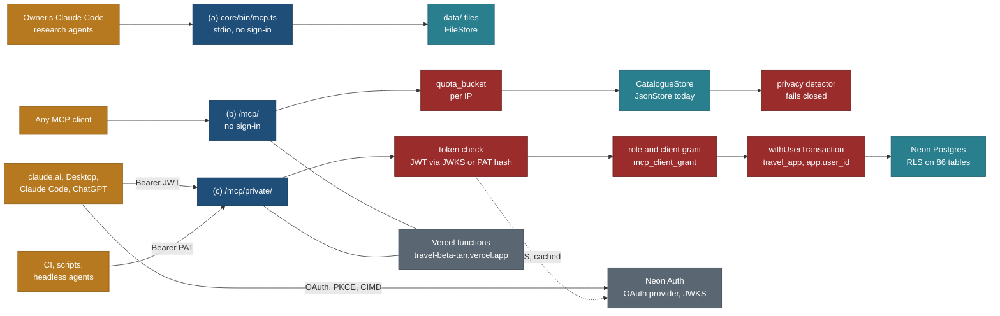
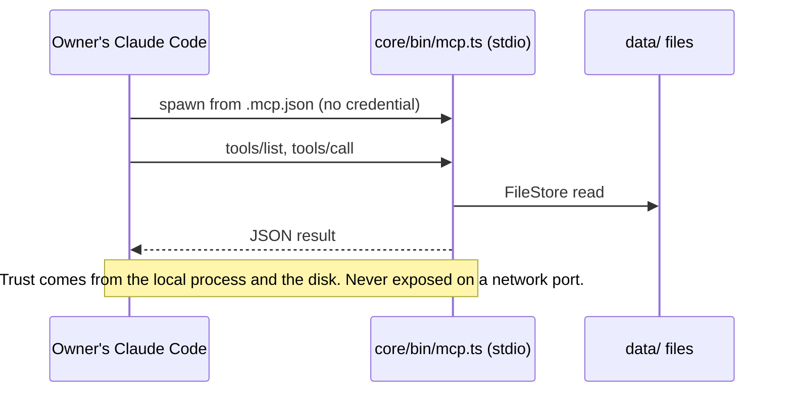
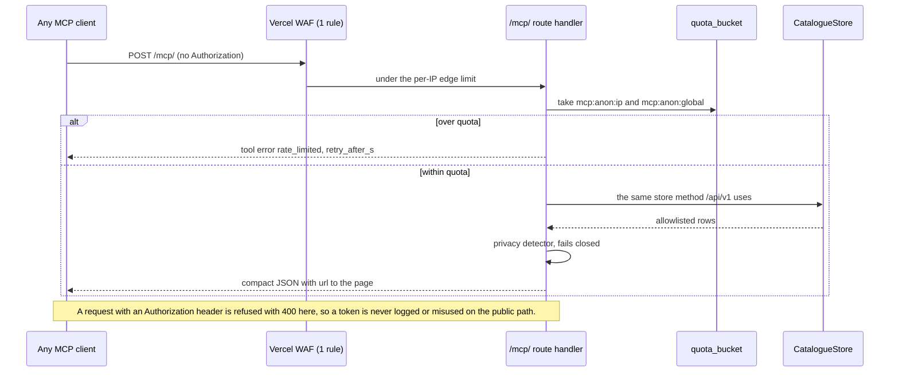
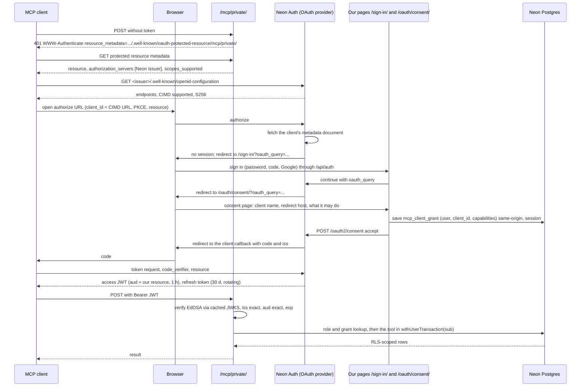
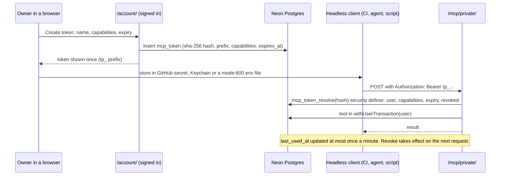

# MCP sign-in: how each of our MCP servers authenticates, with the current Neon and Vercel setup

Status: **design, 25 Oct 2026 (travel-planner, Opus). Nothing here is built. Spike MCP-0 passed on the child branch
on 25 Oct with conditions (section 13).** Last verified 25 Oct 2026 against main 196207e. PLAN R-123 to R-129, BACKLOG 15.123 to 15.129, owner questions Q160 to Q167 (section 12). Supersedes the
"provider not selected" lines in [README.md](README.md) section 3, [security.md](security.md), [03-mcp-and-research.md](../03-mcp-and-research.md)
section 3 and F17 items 7 and 8 (each carries a pointer here).

Read with: [README.md](README.md) (tools, scopes, limits), [security.md](security.md) (threat model T1 to T13),
[F16](../features/F16-admin-console.md), [F17](../features/F17-accounts-auth-and-privacy.md),
[email-sign-in-and-account-emails.md](../features/email-sign-in-and-account-emails.md) (the sign-in card, `quota_bucket`,
the EML-0 findings), [NEON-SETUP.md](../build/public-site/NEON-SETUP.md), [principles.md](../design/foundation/principles.md)
(P8, P9 apply to every tool here).

## 0. Verdict in five lines

1. **Works today, unchanged:** the owner's local stdio server (`core/bin/mcp.ts`, `.mcp.json`) with no sign-in. Keep it local; never deploy it.
2. **Neon can be our OAuth server for MCP, proven on the child branch (MCP-0, section 13).** Neon Managed Better Auth has an `oauth_provider` plugin with MCP support (client ID metadata documents on, dynamic registration off). The owner enabled it on the child branch on 25 Oct; it is still **off on production**, and the CLI cannot switch it (console or API only). A real MCP client completed sign-in on our own pages through our proxy and called a tool with a verified JWT, and Neon accepts Claude's and Claude Code's own client documents. Conditions: the slash URL only, our own grant check as the revocation switch (Neon has no server-side token revoke), and the v2 MCP SDK for protocol 2026-07-28. It issues EdDSA JWT access tokens with `aud` set to our MCP URL, verifiable with the branch JWKS. It is a preview feature (conflicting wording, section 2.3), it has **fixed scopes only** (`openid profile email offline_access`) and **we must host the login and consent pages**.
3. **So our own permissions cannot ride in OAuth scopes.** The resource server maps the verified user to `app_user.role` plus a per-client grant stored in our database, and every tool runs inside `withUserTransaction` (role `travel_app`, transaction-local `app.user_id`) so RLS is the second wall.
4. **The browser session's JWT (`/api/auth/token`) must not be accepted by the MCP server:** its audience is not our MCP resource, and the MCP spec forbids accepting tokens issued for anything else.
5. **Recommended path (unchanged after MCP-0):** public read-only remote MCP with no sign-in first; then Neon OAuth for claude.ai, Desktop and Claude Code (MCP-0 passed); personal access tokens for headless clients. Self-managed Better Auth (option B) is not needed.

## 1. The three ways our MCP is used

| | (a) Local stdio | (b) Remote public | (c) Remote private |
|---|---|---|---|
| Who | the owner's Claude Code and research agents on this Mac | anyone, any MCP client | the owner, then invited users (Q162) |
| Where | `node core/bin/mcp.ts` via `.mcp.json` (exists) | `https://travel-beta-tan.vercel.app/mcp/` (new) | `https://travel-beta-tan.vercel.app/mcp/private/` (new) |
| Data | files under `data/` through `FileStore`, including private trip fields and booking state | the public catalogue through `CatalogueStore` (today `JsonStore`), the same allowlists and privacy detector as `/api/v1` | the caller's own rows in Neon under RLS, plus the public tools |
| Sign-in | none: the process runs as the owner on the owner's disk; the spec says stdio servers take credentials from the environment, not OAuth | none (Q165); quotas per IP | Neon OAuth (interactive clients) or a personal access token (headless) |
| Tools today | 15 read tools, catalogue phase 1 (`search`, `get_place`, `get_trail`, `get_trip`, `query_rows`, `list_due_bookings`, ...) | none | none |
| Tools v1 | unchanged | `search`, `list_places`, `get_place`, `near`, `list_trips`, `get_trip`, `trip_legs`, `sun`, `list_entity_types`, `get_entity_schema` | the public set plus `whoami`, `list_my_drafts`, `get_my_draft`, later `list_my_favourites` (R-71), then `propose_research_changes` and review tools (R-128) |

Rules that follow:

- **The stdio tool handlers are never mounted remotely.** `query_rows`, `list_due_bookings`, `list_backlog` and `get_trip` on `FileStore` return household fields and booking state. The public remote tools are a new set over `CatalogueStore` (P9: one data boundary, the same server store helper `/api/v1` uses), never the stdio handlers.
- **If the stdio server ever needs private Postgres data**, it calls the remote private endpoint with a personal access token from the environment (`TRAVEL_PAT`). It never receives `DATABASE_URL` or any owner database credential.
- **Two URLs, not one with lazy sign-in (Q161).** Neon allows one MCP resource per branch for self-onboarding clients, the public code path must not be able to import the private store, and a separate URL keeps the public endpoint's blast radius at zero. A signed-in user adds only the private connector, because it includes the public tools.

## 2. Research findings (checked 25 Oct 2026)

### 2.1 The MCP authorization specification (current version 2026-07-28)

| # | Fact | Source |
|---|---|---|
| M1 | Authorization is optional. HTTP transports **SHOULD** follow the spec; **stdio SHOULD NOT and instead retrieves credentials from the environment** | MCP spec 2026-07-28, Authorization |
| M2 | The MCP server is an OAuth 2.1 resource server. It **MUST** serve Protected Resource Metadata (RFC 9728), either through `resource_metadata` in a `401` `WWW-Authenticate` header or at `/.well-known/oauth-protected-resource[/<path>]` | same, and Authorization Server Discovery |
| M3 | Clients obtain a client id by Client ID Metadata Documents (SHOULD support), pre-registration, or Dynamic Client Registration, which is **deprecated** in 2026-07-28 and kept for compatibility | same; release post of 28 Jul 2026 |
| M4 | PKCE (S256) and the `resource` parameter (RFC 8707) on both the authorization and token requests are required of clients; the resource is the MCP server's canonical URI | same |
| M5 | The server **MUST** validate that the token was issued for it (audience), **MUST NOT accept or pass through any other token**, and answers `401` for invalid or expired tokens and `403` with `error="insufficient_scope"` for missing scope | same, Token Handling and Error Handling |
| M6 | For an issuer with a path (ours is `.../neondb/auth`), clients try OAuth metadata with path insertion, then OIDC discovery with path insertion, then **OIDC discovery path appending** (`<issuer>/.well-known/openid-configuration`) | Authorization Server Discovery |
| M7 | Issuer validation (RFC 9207 `iss` in the authorization response) is new in 2026-07-28; client credentials are bound to the issuer that minted them | release post 2026-07-28 |
| M8 | 2026-07-28 retires the `initialize` exchange and the `Mcp-Session-Id` header (stateless requests), requires `Mcp-Method` and `Mcp-Name` headers on Streamable HTTP, and deprecates the old HTTP+SSE transport | release post 2026-07-28 |

### 2.2 How clients authenticate to remote MCP servers

| # | Fact | Source |
|---|---|---|
| C1 | claude.ai, Desktop, mobile, Cowork and Claude Code share one connector auth system. Types: `oauth_dcr`, `oauth_cimd`, `oauth_anthropic_creds`, `custom_connection`, `static_headers` (**beta, a limited set of organizations**), `none` | Claude docs, "Authentication for connectors" |
| C2 | Claude uses CIMD only when the authorization server metadata advertises `client_id_metadata_document_supported: true` **and** `none` in `token_endpoint_auth_methods_supported`; otherwise it falls back to DCR | same |
| C3 | A `401` is required to start sign-in; Claude ignores `WWW-Authenticate` on a `200`; it uses only the **first** entry of `authorization_servers`; `resource` must equal the URL the user enters, path included | same |
| C4 | Redirect URIs: hosted apps use `https://claude.ai/api/mcp/auth_callback`; Claude Code uses a loopback redirect on any port, `http://localhost/callback` and `http://127.0.0.1/callback` in its own CIMD | same |
| C5 | Claude always sends S256 PKCE; it appends `offline_access` when the AS lists it; it refreshes on `401` and up to 5 minutes before expiry; it waits 10 s for discovery and token endpoints and 30 s for refresh; `client_credentials` is not supported | same |
| C6 | Anthropic's outbound traffic comes from `160.79.104.0/21` | same |
| C7 | Claude's hosted CIMD client id is reported as `https://claude.ai/oauth/mcp-oauth-client-metadata` (community source, **not confirmed** on an Anthropic page) | ericerkz/kept PR 85 |
| C8 | Claude Code accepts static headers for a remote server (`claude mcp add --transport http <name> <url> --header "Authorization: Bearer ..."`) | Claude Code CLI help (known; re-check on the installed version) |

### 2.3 Neon Managed Better Auth: what our branches expose

Read-only, 25 Oct 2026, CLI 8.11.1 and plain `GET`s on the child branch's public endpoints. No configuration was changed.

| # | Finding | Evidence |
|---|---|---|
| N1 | Both branches list an `oauth_provider` plugin (**enabled on the child since 25 Oct**, MCP-0): `enabled: false`, `mcp: {dynamic_registration: false, client_id_metadata_documents: true}`, `resources: []` | `neon neon-auth plugins list` and `plugins get oauth_provider` on `br-damp-breeze-b41mtvn5` and `br-soft-glade-b4mkqyvd` |
| N2 | The CLI can only view plugins; enabling is in the console (Settings, Better Auth, OAuth provider) or `PATCH /api/v2/projects/{project}/branches/{branch}/auth/plugins/oauth-provider` | CLI `plugins --help`; Neon "OAuth Provider" guide |
| N3 | When enabled: token at `/oauth2/token`, DCR at `/oauth2/register` (403 while off), metadata at `<issuer>/.well-known/oauth-authorization-server` and `<issuer>/.well-known/openid-configuration`, userinfo, `POST /oauth2/consent`, `POST /oauth2/continue`, `GET /oauth2/public-client` | Neon guide |
| N4 | **We host both pages**: "Managed Better Auth doesn't provide default pages." The login page receives an `oauth_query` and continues the flow after sign-in; the consent page shows client name, redirect hosts, scopes and resource, then posts accept or deny | Neon guide |
| N5 | Access tokens are **EdDSA JWTs** when the request carries `resource` (opaque otherwise), last **1 hour**, carry `aud`, `client_id` and `scope`; refresh tokens last 30 days and rotate; grants `authorization_code` and `refresh_token` only | Neon guide |
| N6 | **Scopes are fixed**: `openid`, `profile`, `email`, `offline_access`. Custom scopes, token lifetimes and provider options cannot be configured | Neon guide |
| N7 | Verify signature with the JWKS, `iss` exactly equal to the branch issuer, `aud` containing our resource. **All branches share signing keys**, so the issuer must be pinned (MCP-0: production's `kid` differs from the child's today; pin `iss` anyway) | Neon guide; `@neon/oauth` 0.3.0 README |
| N8 | Self-onboarding (CIMD or DCR) works only for the configured MCP server resource; up to 10 resources and 100 managed clients per branch; CIMD loopback redirects match on any port | Neon guide |
| N9 | Status wording conflicts: the guide says the plugin "is available to all Managed Better Auth projects"; the `@neon/oauth` README says it "is currently in private preview" | both, read 25 Oct |
| N10 | Child-branch auth server today: `/.well-known/jwks.json` 200 (one Ed25519 key), `/token` 401 without a session (Better Auth JWT plugin present), both `/.well-known/oauth-authorization-server` and `/.well-known/openid-configuration` 404 (plugin off) | `curl` 25 Oct |
| N11 | The child-branch OpenAPI lists JWT, admin, organization, email OTP and anonymous-token endpoints. **No API key plugin and no MCP plugin endpoints** are exposed | `GET <base>/open-api/generate-schema` |
| N12 | `@neon/oauth` 0.3.0 (Apache-2.0, beta, 22 Oct 2026) offers `createMcpAuth()` with Next.js handlers for the metadata and a guarded `POST`; verify-only entry points depend on `jose` alone | npm registry, README |

### 2.4 Better Auth upstream (fallback only)

`@better-auth/mcp`, `@better-auth/oauth-provider`, `@better-auth/cimd` and `@better-auth/api-key` are all at 1.7.13
(npm, 25 Oct 2026). The MCP plugin sits on the OAuth provider, serves RFC 9728 metadata, never enables DCR implicitly,
and pairs with CIMD for the 2026-07-28 profile (Better Auth docs). Using them means running our own Better Auth instance,
which Neon's managed service does not let us extend; see option B in section 3.

### 2.5 Vercel

| # | Fact | Source |
|---|---|---|
| V1 | Hobby with Fluid compute: function duration default and maximum 300 s; 2 GB memory; a timeout returns 504 | Vercel "Functions limitations"; changelog on higher defaults |
| V2 | Hobby WAF: 1 rate-limit rule per project, 3 custom rules, fixed window only; counters are per region; `@vercel/firewall` `checkRateLimit(id, { request, rateLimitKey })` | Vercel "Rate limiting" and SDK pages |
| V3 | MCP route handlers run as ordinary Next.js route handlers; the SDK's web-standard Streamable HTTP transport works stateless (one server per request). `mcp-handler` 2.3.0 is Vercel's adapter. **MCP-0: it needs `@modelcontextprotocol/server` ^2 (2.4.0, protocol 2026-07-28 plus the 2025 fallback), not the 1.x SDK, which stops at 2025-11-25** | `@neon/oauth` README example; npm; MCP-0 |
| V4 | Preview deployments sit behind Vercel Authentication; an MCP client cannot pass it. The production alias has no deployment yet (U13 in the email spec) | HANDOVER item 3; EML-0 U13 |

### 2.6 What could not be verified (each is an MCP-0 check)

Answered by MCP-0 on 25 Oct: see section 13, which numbers the checks as the MCP-0 brief did (the mapping is given there).

| # | Unknown | Why it matters |
|---|---|---|
| X1 | Whether the plugin can be enabled on our project at all (N9) | Option A depends on it |
| X2 | Whether Neon's metadata advertises `client_id_metadata_document_supported: true`, `none` in `token_endpoint_auth_methods_supported`, `code_challenge_methods_supported: ["S256"]` and `authorization_response_iss_parameter_supported` | Claude picks CIMD only with the first two (C2); with DCR off, Claude cannot connect otherwise |
| X3 | Which discovery URL Neon actually serves for our path issuer, and whether Claude finds it (M6) | Discovery failure looks like "Couldn't reach the MCP server" |
| X4 | Whether the access token's `sub` equals the Managed Better Auth user id that `planner_draft` and `app.user_id` use | RLS mapping |
| X5 | Whether `@neondatabase/auth` 0.7.0-beta in our proxy forwards `/oauth2/*` and handles `oauth_query` as the guide says | Login and consent pages |
| X6 | Whether Neon has a token revocation endpoint, and whether revoking a user's sessions revokes OAuth refresh tokens | Revocation design (section 6.3) |
| X7 | Whether `@modelcontextprotocol/sdk` 1.32.1 (in `core/`) speaks protocol 2026-07-28 or only 2025-11-25 | Header and session rules (M8) |
| X8 | Whether the trailing-slash URL (`trailingSlash: true` in `web/next.config.ts`) survives every client: a `POST` to `/mcp` gets a 308 to `/mcp/` | Resource must match exactly (C3) |
| X9 | Neon's own limits on the OAuth endpoints | Quota sizing |

## 3. Options for the private endpoint

| Option | What it is | Works with the current setup | Gives up | Verdict |
|---|---|---|---|---|
| **A. Neon OAuth provider** | Enable the plugin on the production branch; resource `https://travel-beta-tan.vercel.app/mcp/private/`; CIMD on, DCR off; we host login and consent pages and verify JWTs | yes: same users, same sessions, same Google and email-code sign-in, same trusted domain | custom scopes (N6), so permissions live in our database; a preview feature (N9) | **Recommended** after MCP-0 passes |
| B. Self-managed Better Auth with `@better-auth/mcp` | A second Better Auth instance in our Vercel functions, as the OAuth server only | partly: it needs its own user and session tables and a bridge to Neon's users | reverses R-58 for one function; two user stores; we patch auth CVEs ourselves | Fallback only if A fails, and only as an owner decision |
| **C. Personal access tokens** | Tokens created on `/account/`, hashed at rest, sent as `Authorization: Bearer` | yes | not usable from claude.ai for a personal account (static headers are a limited beta, C1) | **Build in any case**: headless clients need it, and it is the v1 fallback for Claude Code |
| D. Owner's static token for stdio only | No remote private access at all | yes | claude.ai and invited users cannot read their plans | The state today; acceptable until R-125 ships |

Not an option: presenting the Neon browser session JWT (`GET /api/auth/token`) to the MCP server. Its audience is the
auth service, not our MCP resource (M5, N5). Accepting it would let any token minted for the site's own use open the
MCP, and it bypasses client consent.

## 4. Sign-in flows

### 4.1 (a) Local stdio

### 4.2 (b) Remote public, no sign-in

### 4.3 (c) Remote private, interactive OAuth through Neon (claude.ai, Desktop, Claude Code)

### 4.4 (c) Remote private, headless with a personal access token

## 5. What the resource server verifies

Every request to `/mcp/private/` goes through one guard, `web/lib/mcp/guard.ts`, before the MCP SDK runs.

| Step | Check | On failure |
|---|---|---|
| 1 | `Authorization: Bearer <token>` present; never a query string or cookie. Session cookies are ignored on `/mcp/*` | `401` with `WWW-Authenticate: Bearer resource_metadata="..."` |
| 2a | Token starts with `tp_`: hash it (SHA-256), call `mcp_token_resolve(hash)`; not found, revoked or expired | `401 invalid_token` |
| 2b | Otherwise a JWT: `alg` EdDSA only; signature against the branch JWKS (cached, refetched on an unknown `kid`, at most once a minute); `iss` equals `NEON_AUTH_BASE_URL` exactly; `aud` contains `MCP_RESOURCE_URL` exactly; `exp` and `nbf` with 60 s skew; `client_id` present | `401 invalid_token` |
| 3 | `sub` (or the PAT's `user_id`) has an `app_user` row and the role allows MCP (Q162: owner only at first) | `403`, tool error `forbidden` |
| 4 | Effective capabilities = role capabilities AND the client grant (OAuth) or the token's capabilities (PAT) | per tool: tool error `forbidden` naming the capability and where to grant it |
| 5 | Quota buckets (section 6.4) | tool error `rate_limited` with `retry_after_s` |
| 6 | The tool runs inside `withUserTransaction(userId, ...)`: role `travel_app` (NOBYPASSRLS) and `app.user_id` set transaction-local; reads and writes only through operations | RLS denies; `not_found` (no existence leak) |
| 7 | Audit row: user, client (`mcp:<client_id host>` or `pat:<name>`), tool, result code, duration; never arguments or results | none (fire and forget, bounded) |

### 5.1 Capabilities, not OAuth scopes

Neon issues only `openid profile email offline_access` (N6). Our permission names from [README.md](README.md) section 3
stay, renamed **capabilities**, and live in our database:

| Capability | Allows | Role ceiling | Default on the consent page |
|---|---|---|---|
| `catalog:read` | the public tools | every role | on, fixed |
| `trips:read` | the caller's drafts, favourites and (later) trips | user and up | on |
| `trips:write` | change the caller's drafts and trips (after the planner exists) | user and up | off |
| `reservations:read`, `people:read` | codes; ages and documents (planner era) | user and up | off, ticked per client |
| `research:propose` | create proposals, never decide | researcher and up | off |
| `review` | decide proposals and visitor submissions | moderator and up (owner) | off |
| `admin` | publish, bulk import | admin (owner) | off |

- The PRM `scopes_supported` lists only `openid profile email`, and the server never challenges with
  `insufficient_scope` for a capability: a re-authorization cannot grant it (Neon has no such scope), so the client would
  loop. Missing capabilities come back as a tool error `forbidden` with "Allow this in Account, Connected apps".
- A capability change on `/account/` takes effect on the next call, without new tokens.

### 5.2 Mapping to RLS

The resource server never queries with the owner role. `withUserTransaction` from `core/src/db/tx.ts` is the only door,
so a tool that forgets a check still meets the policies (two walls, F17 item 6). Grants and tokens are read through two
`security definer` functions owned by the migration role with `search_path` pinned, returning only what the guard needs;
`travel_app` has no direct `select` on `mcp_token` or `mcp_client_grant`. Today only `planner_draft` has owner policies;
every private tool added later needs its table's policies and a cross-user test first (F17 acceptance 1).

## 6. Security design

### 6.1 Audience and issuer binding

- One resource identifier per environment, `MCP_RESOURCE_URL` = `https://travel-beta-tan.vercel.app/mcp/private/`
  (production, one environment per the owner's decision); `http://localhost:3000/mcp/private/` only on the child branch for
  MCP-0 and local tests.
- The issuer is pinned per branch (N7: keys are shared across branches, so a child-branch token would pass a signature-only
  check on production).
- PATs are bound to this server by construction: only `/mcp/private/` resolves them.

### 6.2 Token storage

| Token | Where it lives | Rule |
|---|---|---|
| Neon access JWT and refresh token | inside the MCP client (Claude stores them) | never in our database or logs |
| PAT plain value | shown once on `/account/`; then the user's secret store (GitHub Actions secret, macOS Keychain, an ignored mode-600 env file) | never in chat, the repo, a command line or a URL |
| PAT at rest | `mcp_token.token_hash` = SHA-256 of a 256-bit random value; `token_prefix` (first 8 characters after `tp_`) for display | a high-entropy token needs no slow hash; a database leak reveals no usable token |
| JWKS | in-memory cache per function instance | refetch on unknown `kid`, at most once a minute |

### 6.3 Revocation and expiry

- PAT: default 30 days, maximum 90, no token without expiry (Q163); Revoke and Revoke all on `/account/`; revoked on the next
  request; email to the owner when a PAT is used from a new client name (security.md T9, later, needs the mail module).
- OAuth: our kill switch is `mcp_client_grant.revoked_at`, checked on every request, so revoking a client cuts it off even
  though its JWT lives up to an hour. **MCP-0 (X7): Neon cannot revoke from the server side.** Only the token holder can
  revoke its own refresh token (`/oauth2/revoke` with `client_id`); signing out, revoking all sessions and deleting the
  consent leave refresh tokens working for 30 days, and access JWTs cannot be revoked. So the grant check is the only
  switch: "Revoke" on Connected apps sets `revoked_at` **and** calls `/oauth2/delete-consent` (our consent page then shows
  again on re-authorization), and signing out of all sessions on `/account/` also revokes every grant.
- Account deletion deletes tokens and grants (F17 item 16).

### 6.4 Rate limits and quotas

Shared with the email plan's `quota_bucket` and `quota_take()` (EML-Q builds them; R-106). Numbers live only in
`core/src/config/mcp-limits.ts` (CONS rule). Fixed windows, UTC.

| Bucket | Key | Limit | On hit |
|---|---|---|---|
| `mcp:anon:ip` | HMAC of the client IP (daily key) | 60 per hour, 300 per day | `rate_limited` |
| `mcp:anon:global` | none | 3,000 per day | `rate_limited`, one owner alert a day |
| `mcp:user` | user id | 600 per hour | `rate_limited` |
| `mcp:write:user` | user id | 60 per hour | `rate_limited` |
| `mcp:propose:user` | user id | 500 changes per changeset, 5 changesets a day | `rate_limited` |
| `mcp:pat` | token id | 2,000 per hour | `rate_limited` |
| `mcp:auth:fail:ip` | IP | 30 failed tokens per hour | `401` without lookup, alert |

Plus one Vercel WAF rule (the Hobby allowance, V2) on `/mcp/*`: 120 requests per minute per IP, default 429, so a flood is
cut at the edge before a function runs. That uses Hobby's only rate-limit rule; the go-live rule for `/api/v1/*`
(BACKLOG 15.22) must share it (one rule matching both paths) or move to the Postgres buckets (decided in MCP-C).

### 6.5 Prompt injection and untrusted text

- Every tool input is untrusted data, validated by its Zod schema; unknown keys are refused.
- Every stored user text returned by a tool (draft names, notes, visitor submissions, research proposals) comes back in a
  field named `untrusted_text`, never inside a tool description or an instruction-like position, and is length-capped.
- No v1 tool sends mail, creates share links, fetches a URL or changes another user's data. Write tools arrive with the
  preview-then-apply rule (README principle 6) and `client_op_id` idempotency.
- `research:propose` creates proposals only; a person decides (security.md T1, T5). The same fencing rule as the feedback
  spec's research hand-off (R-96) applies to proposals read back by `review` tools.

### 6.6 Privacy on outputs

- Public endpoint: the same allowlists and the `respond()` privacy detector as `/api/v1`, failing closed; no household data,
  no booking state, no wishlist saves (PRIV1), towns per the Q50 ruling. P8 holds: page caps, no unscoped near query, no
  bulk tool, exports stay per item.
- Private endpoint: only the caller's rows; people and reservation classes stay off unless granted; the log deny-list from
  F17 item 14 covers MCP logs.

### 6.7 CSRF, origins and CORS

- `/mcp/*` authenticates by bearer header only and ignores cookies, so a cross-site request carries no ambient authority.
- `Origin`: requests with no `Origin` (server-side clients such as Claude's) are accepted; requests with an `Origin` are
  accepted only from an allowlist (the site, `http://localhost:6274` for the MCP Inspector in development), as the
  Streamable HTTP transport rules require against DNS rebinding (wording re-checked in MCP-C).
- CORS: `Access-Control-Allow-Origin` for the allowlist only, no credentials, `WWW-Authenticate` exposed; `OPTIONS` answered
  without auth. The PRM document is public with `*`.
- The account and consent routes that create tokens and grants use the existing `sameOrigin()` guard and the session
  (unchanged `web/lib/server/same-origin.ts`).

### 6.8 Localhost and tunnel testing

- MCP-0 and local tests run on the child branch from `http://localhost:3000` (`allow_localhost` is true there; production
  should turn it off before go-live, Neon checklist).
- Claude Code's CIMD loopback redirect works locally. claude.ai cannot reach localhost; a free tunnel works only for the
  public endpoint and for spikes, and the tunnel host must never be added to the production branch's trusted domains.
- A Vercel preview is behind Vercel Authentication (V4), so remote MCP tests run on production after the owner approves a
  named commit, or locally.

## 7. What must exist on our side

| Piece | Path (proposed) | Task |
|---|---|---|
| Public MCP route, stateless, JSON responses | `web/app/mcp/route.ts` | MCP-1 |
| Remote tool registry over `CatalogueStore` (public set) and the private set | `core/src/mcp/remote/**` | MCP-C, MCP-1, MCP-2 |
| Private MCP route with the guard | `web/app/mcp/private/route.ts`, `web/lib/mcp/guard.ts`, `web/lib/mcp/verify-jwt.ts` | MCP-2 |
| Protected resource metadata | `web/app/.well-known/oauth-protected-resource/[[...path]]/route.ts` | MCP-2 |
| Login continuation with `oauth_query` | `web/lib/auth/oauth-query.ts` plus one hook in the EML-1 sign-in card | MCP-O |
| Consent page | `web/app/oauth/consent/page.tsx`, `web/components/oauth/**` | MCP-O |
| Grants and tokens | migration (next free number): `mcp_client_grant`, `mcp_token` gains `token_prefix`, `capabilities`, `expires_at`, `client_label`; `mcp_token_resolve()`, `mcp_grant_resolve()`; `mcp_audit` (30-day retention, Q167) | MCP-T, MCP-O |
| Account page sections "Connected apps" and "Access tokens" | `web/app/account/**` section components | MCP-T, MCP-O |
| Quotas | `core/src/config/mcp-limits.ts` on `quota_bucket` | MCP-1 |
| Our own authorization server metadata, token endpoint or proxy in front of Neon | **not needed with option A**: clients talk to Neon's endpoints directly; we serve only the PRM | none |
| Redirect URIs per client | not registered by us: CIMD carries them (claude.ai callback, Claude Code loopback) | none |

Protocol packages (MCP-0): `@modelcontextprotocol/sdk` 1.x (1.32.1 in `core/`) speaks up to 2025-11-25 only. For
2026-07-28 (M8) the remote routes use the v2 packages, `@modelcontextprotocol/server` 2.4.0 with `mcp-handler` 2.3.0,
which also answers 2025-era clients. The stdio server can stay on 1.x. MCP-C decides and pins the versions.

Library choice: `jose` directly in `web/lib/mcp/verify-jwt.ts` (about 40 lines we own, the checks of section 5), with
`@neon/oauth` 0.3.0 read as the reference. Trade-off: `@neon/oauth/mcp/next` would save a few hours, but it is beta and
its API may change in minor versions; the verifier is security code we want pinned and tested ourselves.

## 8. Build order

Every task: worktree from `origin/main` under `<repo parent>/travel-wt/`; stage only owned paths with
`git -C <abs worktree> add <paths>` (never `-A`); message `<area>(<task>): ...` ending with the Co-Authored-By trailer
of the model that did the work; do not push. Verify with `pnpm --dir web exec tsc --noEmit`,
`pnpm --dir core exec tsc --noEmit`, the affected vitest suites, `bash tools/check-all.sh`; UI tasks add Playwright
screenshots at 1440x900 and 390x844 in light and dark to `web/test-results/shots/` (not committed), then
`travel-design-reviewer`, then `travel-verifier`. Never touch `legacy/**`, `HANDOVER.md`, `docs/v2/PLAN.md`,
`EXECUTION-PLAN.md`, `web/lib/server/same-origin.ts` or `web/proxy.ts`. Secrets are set by the owner; never print them.
Never put travel material in the Obsidian vault.

| Task | Model | Effort | Goal | Owns | Must not touch | Depends on | Acceptance |
|---|---|---|---|---|---|---|---|
| MCP-0 | Opus | 3 h + 15 min owner | Spike option A on the child branch from localhost: X1 to X9 | the "MCP-0 results" section of this page; throwaway code in the scratchpad | `web/**`, `core/**`, production config | owner enables the plugin on the child branch (O-M1) | each unknown answered with evidence; MCP Inspector and Claude Code complete a sign-in against a throwaway local route and call one tool with a verified JWT; a token with another `aud` and a production-issuer token are refused |
| MCP-C | Opus | 4 h | Contracts: remote tool list and schemas, capability model, error codes, quota keys, the WAF rule shared with 15.22, origin allowlist | `core/src/mcp/remote/contract.ts`, `core/src/config/mcp-limits.ts`, `core/test/mcp/remote-contract.test.ts`, a decision note in section 13 here | web routes | MCP-0 for the private half; the public half can start without it | tool list snapshot; every public tool maps to one `CatalogueStore` method; no stdio handler imported (test) |
| MCP-1 | Sonnet | 6 h | Public endpoint `/mcp/` with the public set, quotas, privacy detector | `web/app/mcp/route.ts`, `web/lib/mcp/public.ts`, `core/src/mcp/remote/public/**`, `web/tests/mcp/public.test.ts` | auth, account | MCP-C, EML-Q (`quota_bucket`), R-61 production for the remote check | Inspector lists the tools; a `get_trip` result passes the detector and holds no household string (planted-string test); 61st call in an hour is refused; a request with an `Authorization` header gets 400; P8 caps enforced |
| MCP-T | Opus | 6 h | Personal access tokens: migration, resolve function, create, list, revoke, account section | migration (next free number), `core/src/mcp/tokens/**`, `web/app/api/account/mcp-tokens/**`, `web/components/account/AccessTokens.tsx`, tests | sign-in card | EML-1 (account page conventions), MCP-C | plain value shown once; only the hash stored; expiry enforced; revoke effective on the next call; app role cannot select the table; cross-user test |
| MCP-2 | Opus | 8 h | Private endpoint: guard, JWT verifier, PRM, PAT path, `withUserTransaction`, v1 private tools, audit | `web/app/mcp/private/route.ts`, `web/app/.well-known/oauth-protected-resource/[[...path]]/route.ts`, `web/lib/mcp/{guard,verify-jwt}.ts`, `core/src/mcp/remote/private/**`, `web/tests/mcp/private*.test.ts`, `web/package.json` (`jose`) | `same-origin.ts`, `proxy.ts` | MCP-0, MCP-T | negative tests of section 10 all pass; `whoami` and `list_my_drafts` return only the caller's rows; `sub` mapping proven (X4) |
| MCP-O | Opus (flow) + Sonnet (UI) | 6 h | Login continuation and consent page, grants, Connected apps section | `web/lib/auth/oauth-query.ts`, the one hook in the sign-in card, `web/app/oauth/consent/page.tsx`, `web/components/oauth/**`, `web/components/account/ConnectedApps.tsx`, grant migration and API | Neon config | EML-1 merged, MCP-2, O-M2 | consent shows client name, redirect host and plain-word capabilities; deny returns to the client with an error; grant revoke cuts access on the next call; design review approved |
| MCP-S | Opus | 3 h | Independent security review of MCP-1, T, 2, O against section 6 and security.md | notes in section 13 | code | MCP-O | no open high finding; every threat traced to a test |
| MCP-E | Sonnet | 3 h + 20 min owner | Real-client checks on production after the owner approves a named commit: Inspector, Claude Code (OAuth and PAT), claude.ai custom connector | results in section 13; `docs/v2/mcp/client-recipes.md` section 0 corrections | production config | MCP-S, R-61 production, O-M3 | every recipe in client-recipes section 0 works as written; test users and tokens deleted |
| MCP-3 | Opus | 8 h | `propose_research_changes` and the owner's `review_queue` and `decide` over `changeset` with RLS policies; owner CLI applies accepted changes through the ops CLI | later brief | | MCP-E, F17 roles, the INT-3 or FBK-3 CLI pattern | proposals never change public data until the owner decides; injection fixtures (planted instructions) stay inert |

Total: about 47 agent hours (Opus 38, Sonnet 9), owner about 45 minutes. Order: MCP-0 and MCP-C can start when a seat is
free; MCP-1 after EML-Q; MCP-T and MCP-2 after EML-1; MCP-O after both; MCP-S and MCP-E last. The owner's one-item-at-a-time
rule puts the build after the closure queue, R-59 and email Phase 1 (Q166). The PostgresStore cutover (SRV-0) is **not** a
dependency: public tools read `CatalogueStore` whichever store backs it, and private v1 tools read only tables that already
live in Neon.

## 9. Owner steps (placeholders only; never paste a secret into chat, the repo or a command line)

| Step | When | What |
|---|---|---|
| O-M1 | before MCP-0 | Neon console, project `damp-queen-64719841`, **child** branch `br-damp-breeze-b41mtvn5`: Settings, Better Auth, OAuth provider: Enable; Login page URL `http://localhost:3000/sign-in/`; Consent page URL `http://localhost:3000/oauth/consent/`; MCP Server URL `http://localhost:3000/mcp/private/`; Client ID Metadata Documents on; Dynamic Client Registration off. Report whether the switch exists (X1) |
| O-M2 | after MCP-S | The same on the **production** branch `br-soft-glade-b4mkqyvd` with `https://travel-beta-tan.vercel.app/...` URLs. Equivalent API call, for the record: `PATCH https://console.neon.tech/api/v2/projects/<project_id>/branches/<branch_id>/auth/plugins/oauth-provider` with a Neon API key from your own shell |
| O-M3 | after O-M2 | Vercel project `travel`, Production: add `MCP_RESOURCE_URL` (plain) and `MCP_AUDIT_SALT` (sensitive, 32 random bytes you generate locally); `NEON_AUTH_BASE_URL` already exists. Vercel Firewall: one rate-limit rule on `/mcp` (section 6.4) |
| O-M4 | at MCP-E | In claude.ai: Settings, Connectors, Add custom connector, URL `https://travel-beta-tan.vercel.app/mcp/private/`, no client id (CIMD); sign in and allow. In Claude Code: the commands in client-recipes section 0 |
| O-M5 | before go-live | Turn off Allow Localhost on the production branch (Neon checklist), after the last local check against production |

## 10. Testing strategy

| Layer | Checks |
|---|---|
| Unit (vitest) | JWT verifier: good token; wrong `alg` (HS256, none); wrong `iss` (child branch); `aud` missing, other, array without ours; expired; `nbf` in future; unknown `kid` then refetch; malformed. PAT: wrong prefix, unknown hash, revoked, expired. Capability intersection table |
| DB (vitest on the child branch) | `mcp_token_resolve` and `mcp_grant_resolve` return nothing for another user; `travel_app` cannot `select` the tables; RLS cross-user on every private tool table |
| Route | `401` shape with `resource_metadata` before the SDK runs; PRM document fields; `OPTIONS` without auth; a cookie-only request to `/mcp/private/` is `401`; an `Origin` outside the allowlist is `403`; `Authorization` on `/mcp/` is `400`; quotas admit exactly the limit under 20 parallel calls |
| MCP clients | MCP Inspector (HTTP, both endpoints, OAuth flow); the stdio server through the Inspector's stdio mode; the SDK's own client in a test script; Claude Code with OAuth and with a PAT; claude.ai custom connector (MCP-E) |
| Negative and abuse | planted instructions in a draft name come back inside `untrusted_text`; a PAT in a query string is ignored; a refresh by a revoked grant returns tools as `forbidden`; 1,000 calls with a bad token hit `mcp:auth:fail:ip` |
| Privacy | the public endpoint runs the privacy detector's planted-string suite; logs from a full test run contain no token, address or argument (log scan, F17 acceptance 5) |

## 11. Gotchas

- **The trailing slash.** `trailingSlash: true` makes `/mcp/private` a 308 to `/mcp/private/`. Use the slash form
  everywhere (Neon resource, PRM `resource`, connector URL), because Claude compares `resource` with the entered URL exactly.
  MCP-0: a client given `/mcp/private` follows the 308 on its POST, then the SDK refuses (`Protected resource .../mcp/private/
  does not match expected .../mcp/private`). Recipes and the account page must show the slash form only.
- **Shared signing keys across branches.** Per Neon, a child-branch token verifies against the production JWKS. MCP-0 saw
  different `kid`s today, and the browser session JWT is signed with the same key as the OAuth tokens. Pin `iss`, and check
  `aud` and `client_id` too.
- **Discovery only by appending.** Neon serves `<issuer>/.well-known/openid-configuration` and
  `<issuer>/.well-known/oauth-authorization-server`; both RFC 8414 path-insertion URLs are 404. Clients reach the third URL
  (M6); SDK 1.32.1 does.
- **The consent page takes the redirect host from the request.** `GET /oauth2/public-client` returns `redirect_uris: []` for
  CIMD clients, so show the host of the `redirect_uri` in the received query (the guide's rule), and warn on loopback.
- **Neon refetches the client document** on most steps (51 fetches for about 20 flows), and a client id must be `https` on
  port 443. A client whose document host is down cannot sign in.
- **A code replay revokes the refresh token from that code,** and a refresh token reused more than 30 s after rotation
  revokes the whole family. A buggy client gets logged out; that is correct.
- **Quick tunnels on the owner's Mac** read `~/.cloudflared/config.yml` and the owner's credentials unless given an empty
  `--config` file (MCP-0 incident, fixed in 2 minutes). Use `cloudflared --config <empty file> tunnel --url ...`.
- **Opaque tokens without `resource`.** A client that omits `resource` gets an opaque token we cannot verify. Return `401`
  with the PRM pointer; do not try to introspect.
- **No custom scopes.** Do not put `trips:write` in `WWW-Authenticate`; clients will loop on re-authorization.
- **DCR is off.** A client without CIMD support cannot self-register. Turning DCR on later lets anyone register clients on
  the production branch (up to Neon's limits); keep it off unless a named client needs it (Q164).
- **Disable Sign Up does not stop code sign-in creating accounts** (EML-0 U2). An OAuth sign-in through the email code
  therefore can create a new account. The MCP gate is our own check (step 3 of section 5), never a Neon flag.
- **Codes expire in 5 minutes** (EML-0 U9), so an OAuth sign-in by code is a short window; the consent page must not
  add a second code step.
- **A password reset does not revoke old sessions** (EML-0 U5). It does not revoke MCP grants or PATs either; the reset
  flow in EML-1 should also revoke grants and tokens, or the owner accepts the risk (Q168).
- **Vercel Authentication on previews** blocks every MCP client. Do not disable protection to test; test locally or on
  production after approval.
- **`app_user` rows.** `mcp_token` and grants reference `app_user(id)`. Today a signed-in user may have no `app_user` row;
  MCP-T must upsert it on first token creation.
- **Hobby's single WAF rate-limit rule** is shared with the `/api/v1/*` go-live rule (15.22). Decide once in MCP-C.
- **Stateless only.** No `Mcp-Session-Id`, no long SSE streams: a Hobby function stops at 300 s, and 2026-07-28 removed
  sessions. Set `maxDuration` to 30 s on the MCP routes.
- **The stdio server reads private files.** It must never be wrapped in an HTTP bridge or a tunnel.

## 12. Open questions for the owner (Q160 to Q167)

| # | Question | Recommendation | Trade-off |
|---|---|---|---|
| Q160 | Use Neon's OAuth provider plugin (preview) as the MCP authorization server, after the MCP-0 spike on the child branch? | **Yes** | A preview feature with fixed scopes; the alternative is a second auth service (reverses R-58 for one function) |
| Q161 | Two URLs (public `/mcp/`, private `/mcp/private/`) rather than one URL with lazy sign-in? | **Two URLs** | The owner adds one connector (private) and the public one serves everyone else; lazy sign-in would be one connector for all, at the cost of mixing public and private code paths |
| Q162 | Who may use the private endpoint at first? | **The owner only** until MCP-S passes; then invited users by role, regardless of open sign-up | Invited family members wait a few days longer |
| Q163 | Personal access tokens: 30 days by default, 90 at most, never without expiry? | **Yes** | Headless jobs must rotate a secret every 1 to 3 months |
| Q164 | Keep Dynamic Client Registration off (CIMD only)? | **Yes**; switch on only for a named client that needs it | A client without CIMD cannot connect; Claude, Claude Code and current ChatGPT builds use CIMD or fall back to DCR, so check each new client |
| Q165 | Public MCP open to anyone with no sign-in, at 60 calls an hour per IP? | **Yes** (R-1: the public product needs no login) | A scraper can read the catalogue at that pace; P8 caps and per-item exports still apply |
| Q166 | When: MCP-0 and MCP-C when a seat frees, the build after the closure queue, R-59 and email Phase 1? | **Yes** | Remote MCP waits about two weeks; the stdio server covers the owner meanwhile |
| Q167 | Keep an MCP audit log (who, which client, which tool, result, duration; no arguments) for 30 days? | **Yes, 30 days**, then daily counts only | Less history for an incident older than a month |

## 13. MCP-0 results and later review notes

MCP-0 writes its results here, one row per unknown X1 to X9, with pass or fail and evidence. MCP-S and MCP-E append dated
entries.

### MCP-0 results (25 Oct 2026, child branch, from localhost, Opus 5.5)

Evidence: [MCP-0-spike.md](../../../research/runs/MCP-0-spike.md). Throwaway code ran from the session scratchpad: a
spike app on `localhost:3000` (login and consent pages, PRM, a minimal `/mcp/private/`, a proxy to `next dev` running the
repo's `/api/auth` route with child-only values), a CIMD document behind a cloudflared quick tunnel, and SDK 1.32.1 with
Playwright Chromium as the client. One password test user on `example.com`, deleted at the end; zero emails. The child's
plugin settings were not changed; production was read only and is unchanged.

**Verdict: yes, with conditions.** Neon's OAuth provider can be the authorization server for `/mcp/private/`. Conditions:
(1) one URL form, the slash form; (2) our grant check is the only revocation switch; (3) the remote routes use the v2 MCP
packages for 2026-07-28; (4) the verifier checks `iss`, `aud` and `client_id`, not only the signature; (5) O-M2 on
production after MCP-S, as planned.

Numbering follows the MCP-0 brief. Spec 2.6 equivalents: X1 = 2.6 X1; X2 = 2.6 X2 and X3; X4 = 2.6 X4; X6 = 2.6 X5;
X7 = 2.6 X6; X8 and X9 as in 2.6; the package check = 2.6 X7.

**X1. Plugin switch: PASS**

| Check | Evidence |
|---|---|
| Exists and reads back enabled | `GET .../branches/br-damp-breeze-b41mtvn5/auth/plugins/oauth-provider` 200: `enabled` true, login `http://localhost:3000/sign-in/`, consent `http://localhost:3000/oauth/consent/`, `mcp.resource` `http://localhost:3000/mcp/private/`, CIMD true, DCR false; production `enabled` false |

**X2. Discovery: PASS**

| Check | Evidence |
|---|---|
| Documents served | `<issuer>/.well-known/oauth-authorization-server` and `<issuer>/.well-known/openid-configuration` 200 (same body, `max-age=15`); `<issuer>/.well-known/jwks.json` 200 (one Ed25519 key); path-insertion forms 404 |
| CIMD and `none` | `client_id_metadata_document_supported: true`; `token_endpoint_auth_methods_supported` includes `none`; S256 only; `authorization_response_iss_parameter_supported: true`; no `registration_endpoint` (DCR off, `/oauth2/register` 403) |
| A client finds it | SDK 1.32.1: 404, 404, then 200 on the OIDC appended URL |

**X3. Code flow with PKCE and a CIMD client: PASS**

| Check | Evidence |
|---|---|
| CIMD needs https | yes: `http://localhost` client id refused (`invalid_client`); a quick tunnel served the document; Neon fetched it (`Neon-Auth-CIMD/1.0`) |
| Login and consent | authorize, then 302 to our `/sign-in/` with a signed query; sign-in with `oauth_query` returns `{redirect, url}` to `/oauth/consent/`; consent accept returns the callback with `code`, `state`, `iss`; deny returns `access_denied`; a second authorization for the same client skips consent |
| Token exchange | 200: JWT access token, 3600 s, opaque refresh token, ID token; loopback redirect matched on any port; a replayed code gets `invalid_grant` |
| A real MCP client | SDK 1.32.1 in Chromium: 401, PRM, discovery, CIMD, our pages through `/api/auth`, token, `tools/list`, `tools/call whoami` with a verified JWT |
| Claude's documents | `https://claude.ai/oauth/mcp-oauth-client-metadata` and `.../claude-code-client-metadata` exist; Neon accepts both (a full flow under Claude Code's id issued a JWT) |

**X4. Token contents and refresh: PASS**

| Check | Evidence |
|---|---|
| Header and claims | `typ at+jwt`, `alg EdDSA`; `iss` = issuer; `aud` = `["http://localhost:3000/mcp/private/", "<issuer>/oauth2/userinfo"]` (contains, not equals, the MCP URL); `client_id` = `azp` = the CIMD URL; `scope` `openid profile email offline_access`; `sid`; `jti`; no `nbf` |
| `sub` | equals `neon_auth.user.id` (uuid; our `app_user.id` is its text form) |
| Lifetime | 3600 s; refresh token 30 days (DB) |
| Refresh and rotation | a refresh returns a new refresh token; a repeat within 30 s returns the identical response; a reuse after 35 s is refused **and revokes the newest token too** |

**X5. Offline verification and refusals: PASS**

| Check | Evidence |
|---|---|
| Good token | verified against the JWKS with `node:crypto` (EdDSA), `iss` exact, `aud` contains; the HTTP route returns 200 |
| Refused | wrong `aud` (`/mcp/` and the slashless form), expired (clock at exp + 61 s), production `iss`, tampered payload, `alg none` and `HS256`, opaque token (no `resource`), garbage: 401 with `WWW-Authenticate: Bearer error="invalid_token", resource_metadata=...` |
| Session JWT `/api/auth/token` | refused: `iss` and `aud` are the bare auth origin, 900 s, signed **with the same key**, so only `iss`, `aud` and `client_id` checks stop it |

**X6. Our `/api/auth` proxy: PASS (main); EML-1 guard compatible by reading**

| Check | Evidence |
|---|---|
| `/oauth2/*` forwarded | `consent`, `continue`, `public-client`, `get-consents` through `next dev` with child values; no tracked file edited |
| `oauth_query` | `POST /api/auth/sign-in/email/` with `oauth_query` returns `{redirect, url}` and sets our cookies; `/oauth2/continue` works for an existing session |
| EML-1 guard (`public/EML-1` 1928aa6, read only) | `oauth2/*` passes untouched; `sign-in/email` keeps `oauth_query` (whole body re-serialised) and returns Neon's success body unchanged |

**X7. Revocation: PASS for the token holder; no server-side revoke**

| Check | Evidence |
|---|---|
| `/oauth2/revoke` | 200 for a public client sending `client_id` (401 without); the refresh token then fails. Access JWTs: 400 `unsupported_token_type` |
| What does **not** revoke refresh tokens | sign-out, `revoke-sessions` (all sessions), `delete-consent`: refresh still 200 |
| What does | the holder's revoke, a code replay, a late refresh reuse, deleting the user (cascade). No Neon API for it; CIMD clients are not in the API's client list |

**X8. Trailing slash: PASS with a rule**

| Check | Evidence |
|---|---|
| Next | `POST /mcp/private` gets 308, `location: /mcp/private/` (relative), `Refresh` header, query kept |
| SDK 1.32.1 | given `/mcp/private/`: works. Given `/mcp/private`: follows the 308 on its POST, then throws "Protected resource .../mcp/private/ does not match expected .../mcp/private" |
| Claude Code, claude.ai | OWNER NEEDED (MCP-E); Claude's exact-match rule (C3) implies the same failure. Publish only the slash form |

**X9. Neon's limits and errors: PASS (no limit met; real limits unknown)**

| Check | Evidence |
|---|---|
| Limiter | 8 parallel bad code exchanges and 8 bad revokes: all 400, no rate-limit or retry headers. `/sign-in/email` limits at 5 wrong passwords (EML-0) |
| Errors | `invalid_target` for another resource; `invalid_redirect` for a redirect outside the document; "pkce is required for public clients"; S256 only; "Metadata document fetch returned HTTP 404"; tampered `oauth_query` 400 `invalid_signature`; consent with a foreign or missing `Origin` 403 |

**Packages (spec 2.6 X7): the 1.x SDK does not speak 2026-07-28**

| Package | Finding |
|---|---|
| `@modelcontextprotocol/sdk` 1.32.1 (core), 1.32.2 latest | latest protocol 2025-11-25 |
| `@modelcontextprotocol/server` 2.4.0 | 2026-07-28 plus the 2025 versions |
| `mcp-handler` 2.3.0 | serves 2026-07-28 natively with a 2025-era fallback; peer `@modelcontextprotocol/server` ^2 |
| `@neon/oauth` 0.3.0 | peers the 1.x SDK (>=1.20) |

**Owner steps after MCP-0**

1. Decide whether the child's plugin stays on for MCP-2 development (recommended: yes; it allows only `localhost`
   URLs). To switch it off: Neon console, child branch, Settings, Better Auth, OAuth provider, Disable.
2. Optional, 10 minutes, any time before MCP-E: sign in Claude Code against a local route. The MCP-2 builder starts the
   local server (the spike's scratchpad code is gone after this session). Then run
   `claude mcp add --transport http travel-local http://localhost:3000/mcp/private/`, then `/mcp` in Claude Code,
   choose the server, Authenticate, sign in on the local page and Allow. Expected: Connected, and one tool call works.
3. Nothing on production until MCP-S (O-M2 unchanged).

**Not verified:** Claude Code's own CLI sign-in, the MCP Inspector and the claude.ai connector (interactive; MCP-E); Claude's
discovery order against a path issuer; Neon's real OAuth rate limits; why production's `kid` differs from the child's; the
EML-1 guard in a running server. Left on the child: 12 cached CIMD client rows in `neon_auth."oauthClient"` (no user data;
the API does not list them).

## Sources (read 25 Oct 2026)

- MCP specification 2026-07-28, Authorization: https://modelcontextprotocol.io/specification/2026-07-28/basic/authorization
- MCP specification 2026-07-28, Authorization Server Discovery: https://modelcontextprotocol.io/specification/2026-07-28/basic/authorization/authorization-server-discovery
- MCP blog, "The 2026-07-28 Specification": https://blog.modelcontextprotocol.io/posts/2026-07-28/
- Claude docs, Authentication for connectors: https://claude.com/docs/connectors/building/authentication
- Claude docs, Add a connector that isn't in the directory: https://claude.com/docs/connectors/custom/remote-mcp
- Community source for Claude's CIMD client id: https://github.com/ericerkz/kept/pull/85
- Neon docs, OAuth Provider plugin: https://neon.com/docs/auth/guides/plugins/oauth-provider
- `@neon/oauth` 0.3.0 README (npm registry, `npm view @neon/oauth readme`)
- Better Auth, MCP plugin: https://better-auth.com/docs/plugins/mcp ; OAuth 2.1 Provider: https://better-auth.com/docs/plugins/oauth-provider ; CIMD: https://better-auth.com/docs/plugins/cimd
- Vercel, Functions limitations: https://vercel.com/docs/functions/limitations ; Fluid compute defaults: https://vercel.com/changelog/higher-defaults-and-limits-for-vercel-functions-running-fluid-compute
- Vercel WAF rate limiting: https://vercel.com/docs/vercel-firewall/vercel-waf/rate-limiting ; SDK: https://vercel.com/docs/vercel-firewall/vercel-waf/rate-limiting-sdk
- Neon CLI 8.11.1 (`neon neon-auth plugins list`, `plugins get oauth_provider`, `status`) on both branches; child-branch `GET`s of `/.well-known/jwks.json`, `/token`, the two discovery paths and `/open-api/generate-schema`

## Change log

| Date | Change |
|---|---|
| 2026-10-25 | First version (travel-planner, Opus): three uses, Neon OAuth provider finding, options A to D, flows, verification, capabilities over RLS, security, build order MCP-0 to MCP-3, owner steps O-M1 to O-M5, Q160 to Q167 |
| 2026-10-25 | MCP-0 results (Opus 5.5, child branch): verdict yes with conditions; section 0 items 2 and 5, N1, N7, V3, 6.3 revocation, protocol packages and six gotchas updated; evidence in `research/runs/MCP-0-spike.md` |
