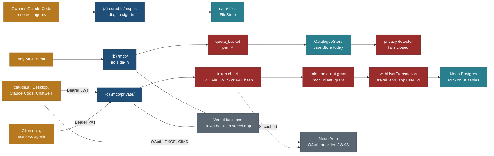
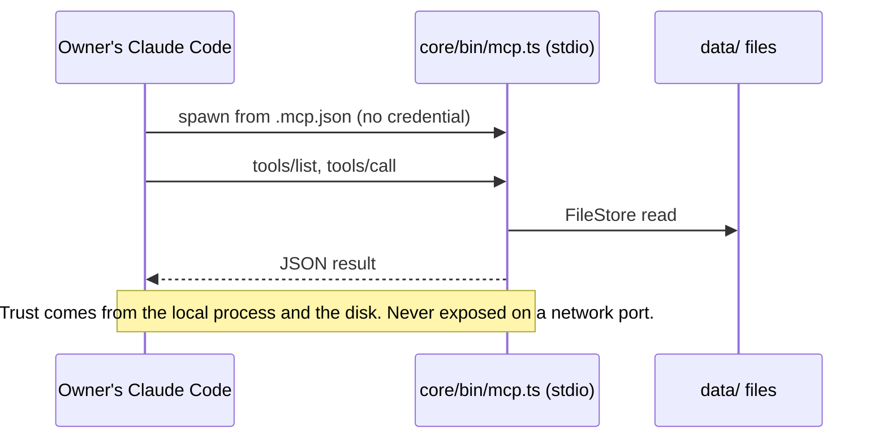
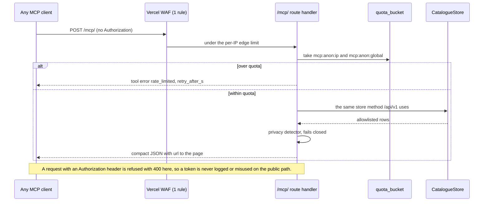
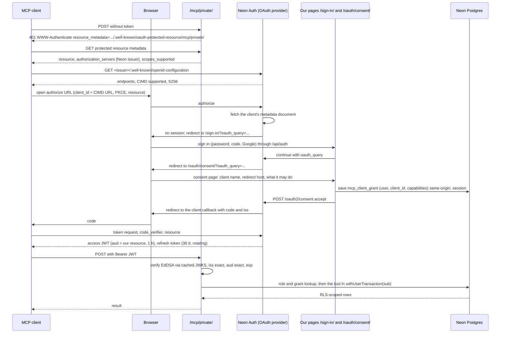
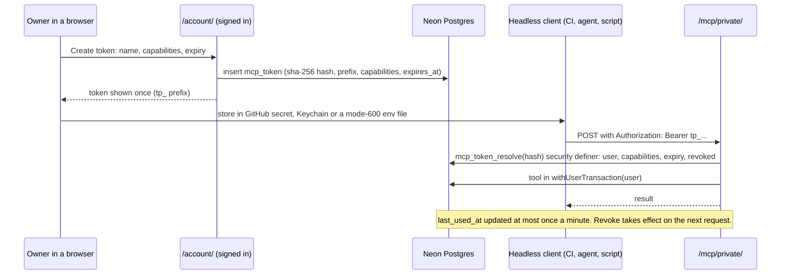
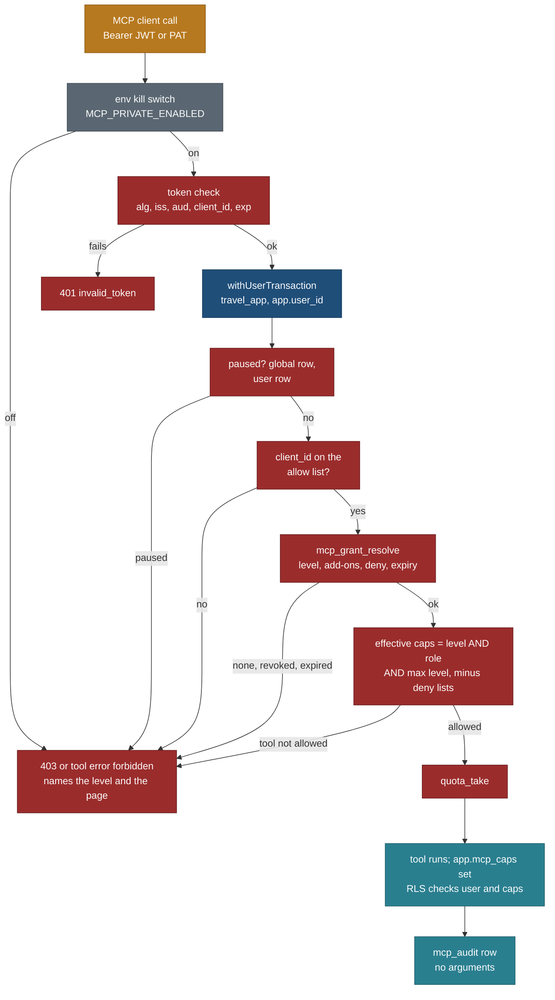
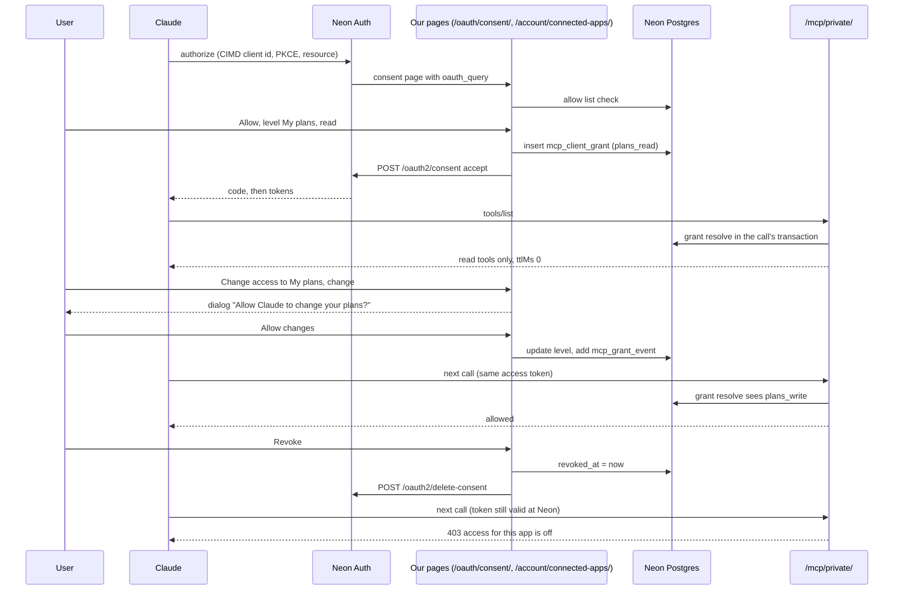

# MCP sign-in: how each of our MCP servers authenticates, with the current Neon and Vercel setup

Status: **design, 25 Oct 2026 (travel-planner, Opus). Nothing here is built. Spike MCP-0 passed on the child branch
on 25 Oct with conditions (section 13). Access levels and the Connected apps settings added 25 Oct (section 14; PLAN
R-150 to R-156, BACKLOG 15.150 to 15.157, Q190 to Q198).** Last verified 25 Oct 2026 against main 196207e (section 14
against 1d107d6). PLAN R-123 to R-129, BACKLOG 15.123 to 15.129, owner questions Q160 to Q167 (section 12). Supersedes the
"provider not selected" lines in [README.md](README.md) section 3, [security.md](security.md), [03-mcp-and-research.md](../03-mcp-and-research.md)
section 3 and F17 items 7 and 8 (each carries a pointer here).

Read with: [README.md](README.md) (tools, scopes, limits), [security.md](security.md) (threat model T1 to T13),
[F16](../features/F16-admin-console.md), [F17](../features/F17-accounts-auth-and-privacy.md),
[email-sign-in-and-account-emails.md](../features/email-sign-in-and-account-emails.md) (the sign-in card, `quota_bucket`,
the EML-0 findings), [NEON-SETUP.md](../build/public-site/NEON-SETUP.md), [principles.md](../design/foundation/principles.md)
(P8, P9 apply to every tool here).

## 0. Verdict in five lines

1. **Works today, unchanged:** the owner's local stdio server (`core/bin/mcp.ts`, `.mcp.json`) with no sign-in. Keep it local; never deploy it.
2. **Neon can be our OAuth server for MCP, proven on the child branch (MCP-0, section 13).** Neon Managed Better Auth has an `oauth_provider` plugin with MCP support (client ID metadata documents on, dynamic registration off). The owner enabled it on the child branch on 25 Oct; it is still **off on production**, and the CLI cannot switch it (console or API only). A real MCP client completed sign-in on our own pages through our proxy and called a tool with a verified JWT, and Neon accepts Claude's and Claude Code's own client documents. Conditions: the slash URL only, our own grant check as the revocation switch (Neon has no server-side token revoke), and the v2 MCP SDK for protocol 2026-07-28. It issues EdDSA JWT access tokens with `aud` set to our MCP URL, verifiable with the branch JWKS. It is a preview feature (conflicting wording, section 2.3), it has **fixed scopes only** (`openid profile email offline_access`) and **we must host the login and consent pages**.
3. **So our own permissions cannot ride in OAuth scopes.** The resource server maps the verified user to `app_user.role` plus a per-client grant stored in our database, and every tool runs inside `withUserTransaction` (role `travel_app`, transaction-local `app.user_id`) so RLS is the second wall.
4. **The browser session's JWT (`/api/auth/token`) must not be accepted by the MCP server:** its audience is not our MCP resource, and the MCP spec forbids accepting tokens issued for anything else.
5. **Recommended path (unchanged after MCP-0):** public read-only remote MCP with no sign-in first; then Neon OAuth for claude.ai, Desktop and Claude Code (MCP-0 passed); personal access tokens for headless clients. Self-managed Better Auth (option B) is not needed.
6. **Access is set per app on our site (section 14):** one named access level per connected app, read only by default, write levels behind a separate confirmation, checked on every call, changeable or revocable at any time on Account, Connected apps and access.

## 1. The three ways our MCP is used

| | (a) Local stdio | (b) Remote public | (c) Remote private |
|---|---|---|---|
| Who | the owner's Claude Code and research agents on this Mac | anyone, any MCP client | the owner, then invited users (Q162) |
| Where | `node core/bin/mcp.ts` via `.mcp.json` (exists) | `https://travel-beta-tan.vercel.app/mcp/` (new) | `https://travel-beta-tan.vercel.app/mcp/private/` (new) |
| Data | files under `data/` through `FileStore`, including private trip fields and booking state | the public catalogue through `CatalogueStore` (today `JsonStore`), the same allowlists and privacy detector as `/api/v1` | the caller's own rows in Neon under RLS, plus the public tools |
| Sign-in | none: the process runs as the owner on the owner's disk; the spec says stdio servers take credentials from the environment, not OAuth | none (Q165); quotas per IP | Neon OAuth (interactive clients) or a personal access token (headless) |
| Tools today | 15 read tools, catalogue phase 1 (`search`, `get_place`, `get_trail`, `get_trip`, `query_rows`, `list_due_bookings`, ...) | none | none |
| Tools v1 | unchanged | `search`, `list_places`, `get_place`, `near`, `list_trips`, `get_trip`, `trip_legs`, `sun`, `list_entity_types`, `get_entity_schema` | the public set plus `whoami`, `list_my_drafts`, `get_my_draft`, later `list_my_favourites` (R-71), then `propose_research_changes` and review tools (R-128) |

Rules that follow:

- **The stdio tool handlers are never mounted remotely.** `query_rows`, `list_due_bookings`, `list_backlog` and `get_trip` on `FileStore` return household fields and booking state. The public remote tools are a new set over `CatalogueStore` (P9: one data boundary, the same server store helper `/api/v1` uses), never the stdio handlers.
- **If the stdio server ever needs private Postgres data**, it calls the remote private endpoint with a personal access token from the environment (`TRAVEL_PAT`). It never receives `DATABASE_URL` or any owner database credential.
- **Two URLs, not one with lazy sign-in (Q161).** Neon allows one MCP resource per branch for self-onboarding clients, the public code path must not be able to import the private store, and a separate URL keeps the public endpoint's blast radius at zero. A signed-in user adds only the private connector, because it includes the public tools.



## 2. Research findings (checked 25 Oct 2026)

### 2.1 The MCP authorization specification (current version 2026-07-28)

| # | Fact | Source |
|---|---|---|
| M1 | Authorization is optional. HTTP transports **SHOULD** follow the spec; **stdio SHOULD NOT and instead retrieves credentials from the environment** | MCP spec 2026-07-28, Authorization |
| M2 | The MCP server is an OAuth 2.1 resource server. It **MUST** serve Protected Resource Metadata (RFC 9728), either through `resource_metadata` in a `401` `WWW-Authenticate` header or at `/.well-known/oauth-protected-resource[/<path>]` | same, and Authorization Server Discovery |
| M3 | Clients obtain a client id by Client ID Metadata Documents (SHOULD support), pre-registration, or Dynamic Client Registration, which is **deprecated** in 2026-07-28 and kept for compatibility | same; release post of 28 Jul 2026 |
| M4 | PKCE (S256) and the `resource` parameter (RFC 8707) on both the authorization and token requests are required of clients; the resource is the MCP server's canonical URI | same |
| M5 | The server **MUST** validate that the token was issued for it (audience), **MUST NOT accept or pass through any other token**, and answers `401` for invalid or expired tokens and `403` with `error="insufficient_scope"` for missing scope | same, Token Handling and Error Handling |
| M6 | For an issuer with a path (ours is `.../neondb/auth`), clients try OAuth metadata with path insertion, then OIDC discovery with path insertion, then **OIDC discovery path appending** (`<issuer>/.well-known/openid-configuration`) | Authorization Server Discovery |
| M7 | Issuer validation (RFC 9207 `iss` in the authorization response) is new in 2026-07-28; client credentials are bound to the issuer that minted them | release post 2026-07-28 |
| M8 | 2026-07-28 retires the `initialize` exchange and the `Mcp-Session-Id` header (stateless requests), requires `Mcp-Method` and `Mcp-Name` headers on Streamable HTTP, and deprecates the old HTTP+SSE transport | release post 2026-07-28 |

### 2.2 How clients authenticate to remote MCP servers

| # | Fact | Source |
|---|---|---|
| C1 | claude.ai, Desktop, mobile, Cowork and Claude Code share one connector auth system. Types: `oauth_dcr`, `oauth_cimd`, `oauth_anthropic_creds`, `custom_connection`, `static_headers` (**beta, a limited set of organizations**), `none` | Claude docs, "Authentication for connectors" |
| C2 | Claude uses CIMD only when the authorization server metadata advertises `client_id_metadata_document_supported: true` **and** `none` in `token_endpoint_auth_methods_supported`; otherwise it falls back to DCR | same |
| C3 | A `401` is required to start sign-in; Claude ignores `WWW-Authenticate` on a `200`; it uses only the **first** entry of `authorization_servers`; `resource` must equal the URL the user enters, path included | same |
| C4 | Redirect URIs: hosted apps use `https://claude.ai/api/mcp/auth_callback`; Claude Code uses a loopback redirect on any port, `http://localhost/callback` and `http://127.0.0.1/callback` in its own CIMD | same |
| C5 | Claude always sends S256 PKCE; it appends `offline_access` when the AS lists it; it refreshes on `401` and up to 5 minutes before expiry; it waits 10 s for discovery and token endpoints and 30 s for refresh; `client_credentials` is not supported | same |
| C6 | Anthropic's outbound traffic comes from `160.79.104.0/21` | same |
| C7 | Claude's hosted CIMD client id is reported as `https://claude.ai/oauth/mcp-oauth-client-metadata` (community source, **not confirmed** on an Anthropic page) | ericerkz/kept PR 85 |
| C8 | Claude Code accepts static headers for a remote server (`claude mcp add --transport http <name> <url> --header "Authorization: Bearer ..."`) | Claude Code CLI help (known; re-check on the installed version) |

### 2.3 Neon Managed Better Auth: what our branches expose

Read-only, 25 Oct 2026, CLI 8.11.1 and plain `GET`s on the child branch's public endpoints. No configuration was changed.

| # | Finding | Evidence |
|---|---|---|
| N1 | Both branches list an `oauth_provider` plugin (**enabled on the child since 25 Oct**, MCP-0): `enabled: false`, `mcp: {dynamic_registration: false, client_id_metadata_documents: true}`, `resources: []` | `neon neon-auth plugins list` and `plugins get oauth_provider` on `br-damp-breeze-b41mtvn5` and `br-soft-glade-b4mkqyvd` |
| N2 | The CLI can only view plugins; enabling is in the console (Settings, Better Auth, OAuth provider) or `PATCH /api/v2/projects/{project}/branches/{branch}/auth/plugins/oauth-provider` | CLI `plugins --help`; Neon "OAuth Provider" guide |
| N3 | When enabled: token at `/oauth2/token`, DCR at `/oauth2/register` (403 while off), metadata at `<issuer>/.well-known/oauth-authorization-server` and `<issuer>/.well-known/openid-configuration`, userinfo, `POST /oauth2/consent`, `POST /oauth2/continue`, `GET /oauth2/public-client` | Neon guide |
| N4 | **We host both pages**: "Managed Better Auth doesn't provide default pages." The login page receives an `oauth_query` and continues the flow after sign-in; the consent page shows client name, redirect hosts, scopes and resource, then posts accept or deny | Neon guide |
| N5 | Access tokens are **EdDSA JWTs** when the request carries `resource` (opaque otherwise), last **1 hour**, carry `aud`, `client_id` and `scope`; refresh tokens last 30 days and rotate; grants `authorization_code` and `refresh_token` only | Neon guide |
| N6 | **Scopes are fixed**: `openid`, `profile`, `email`, `offline_access`. Custom scopes, token lifetimes and provider options cannot be configured | Neon guide |
| N7 | Verify signature with the JWKS, `iss` exactly equal to the branch issuer, `aud` containing our resource. **All branches share signing keys**, so the issuer must be pinned (MCP-0: production's `kid` differs from the child's today; pin `iss` anyway) | Neon guide; `@neon/oauth` 0.3.0 README |
| N8 | Self-onboarding (CIMD or DCR) works only for the configured MCP server resource; up to 10 resources and 100 managed clients per branch; CIMD loopback redirects match on any port | Neon guide |
| N9 | Status wording conflicts: the guide says the plugin "is available to all Managed Better Auth projects"; the `@neon/oauth` README says it "is currently in private preview" | both, read 25 Oct |
| N10 | Child-branch auth server today: `/.well-known/jwks.json` 200 (one Ed25519 key), `/token` 401 without a session (Better Auth JWT plugin present), both `/.well-known/oauth-authorization-server` and `/.well-known/openid-configuration` 404 (plugin off) | `curl` 25 Oct |
| N11 | The child-branch OpenAPI lists JWT, admin, organization, email OTP and anonymous-token endpoints. **No API key plugin and no MCP plugin endpoints** are exposed | `GET <base>/open-api/generate-schema` |
| N12 | `@neon/oauth` 0.3.0 (Apache-2.0, beta, 22 Oct 2026) offers `createMcpAuth()` with Next.js handlers for the metadata and a guarded `POST`; verify-only entry points depend on `jose` alone | npm registry, README |

### 2.4 Better Auth upstream (fallback only)

`@better-auth/mcp`, `@better-auth/oauth-provider`, `@better-auth/cimd` and `@better-auth/api-key` are all at 1.7.13
(npm, 25 Oct 2026). The MCP plugin sits on the OAuth provider, serves RFC 9728 metadata, never enables DCR implicitly,
and pairs with CIMD for the 2026-07-28 profile (Better Auth docs). Using them means running our own Better Auth instance,
which Neon's managed service does not let us extend; see option B in section 3.

### 2.5 Vercel

| # | Fact | Source |
|---|---|---|
| V1 | Hobby with Fluid compute: function duration default and maximum 300 s; 2 GB memory; a timeout returns 504 | Vercel "Functions limitations"; changelog on higher defaults |
| V2 | Hobby WAF: 1 rate-limit rule per project, 3 custom rules, fixed window only; counters are per region; `@vercel/firewall` `checkRateLimit(id, { request, rateLimitKey })` | Vercel "Rate limiting" and SDK pages |
| V3 | MCP route handlers run as ordinary Next.js route handlers; the SDK's web-standard Streamable HTTP transport works stateless (one server per request). `mcp-handler` 2.3.0 is Vercel's adapter. **MCP-0: it needs `@modelcontextprotocol/server` ^2 (2.4.0, protocol 2026-07-28 plus the 2025 fallback), not the 1.x SDK, which stops at 2025-11-25** | `@neon/oauth` README example; npm; MCP-0 |
| V4 | Preview deployments sit behind Vercel Authentication; an MCP client cannot pass it. The production alias has no deployment yet (U13 in the email spec) | HANDOVER item 3; EML-0 U13 |

### 2.6 What could not be verified (each is an MCP-0 check)

Answered by MCP-0 on 25 Oct: see section 13, which numbers the checks as the MCP-0 brief did (the mapping is given there).

| # | Unknown | Why it matters |
|---|---|---|
| X1 | Whether the plugin can be enabled on our project at all (N9) | Option A depends on it |
| X2 | Whether Neon's metadata advertises `client_id_metadata_document_supported: true`, `none` in `token_endpoint_auth_methods_supported`, `code_challenge_methods_supported: ["S256"]` and `authorization_response_iss_parameter_supported` | Claude picks CIMD only with the first two (C2); with DCR off, Claude cannot connect otherwise |
| X3 | Which discovery URL Neon actually serves for our path issuer, and whether Claude finds it (M6) | Discovery failure looks like "Couldn't reach the MCP server" |
| X4 | Whether the access token's `sub` equals the Managed Better Auth user id that `planner_draft` and `app.user_id` use | RLS mapping |
| X5 | Whether `@neondatabase/auth` 0.7.0-beta in our proxy forwards `/oauth2/*` and handles `oauth_query` as the guide says | Login and consent pages |
| X6 | Whether Neon has a token revocation endpoint, and whether revoking a user's sessions revokes OAuth refresh tokens | Revocation design (section 6.3) |
| X7 | Whether `@modelcontextprotocol/sdk` 1.32.1 (in `core/`) speaks protocol 2026-07-28 or only 2025-11-25 | Header and session rules (M8) |
| X8 | Whether the trailing-slash URL (`trailingSlash: true` in `web/next.config.ts`) survives every client: a `POST` to `/mcp` gets a 308 to `/mcp/` | Resource must match exactly (C3) |
| X9 | Neon's own limits on the OAuth endpoints | Quota sizing |

## 3. Options for the private endpoint

| Option | What it is | Works with the current setup | Gives up | Verdict |
|---|---|---|---|---|
| **A. Neon OAuth provider** | Enable the plugin on the production branch; resource `https://travel-beta-tan.vercel.app/mcp/private/`; CIMD on, DCR off; we host login and consent pages and verify JWTs | yes: same users, same sessions, same Google and email-code sign-in, same trusted domain | custom scopes (N6), so permissions live in our database; a preview feature (N9) | **Recommended** after MCP-0 passes |
| B. Self-managed Better Auth with `@better-auth/mcp` | A second Better Auth instance in our Vercel functions, as the OAuth server only | partly: it needs its own user and session tables and a bridge to Neon's users | reverses R-58 for one function; two user stores; we patch auth CVEs ourselves | Fallback only if A fails, and only as an owner decision |
| **C. Personal access tokens** | Tokens created on `/account/`, hashed at rest, sent as `Authorization: Bearer` | yes | not usable from claude.ai for a personal account (static headers are a limited beta, C1) | **Build in any case**: headless clients need it, and it is the v1 fallback for Claude Code |
| D. Owner's static token for stdio only | No remote private access at all | yes | claude.ai and invited users cannot read their plans | The state today; acceptable until R-125 ships |

Not an option: presenting the Neon browser session JWT (`GET /api/auth/token`) to the MCP server. Its audience is the
auth service, not our MCP resource (M5, N5). Accepting it would let any token minted for the site's own use open the
MCP, and it bypasses client consent.

## 4. Sign-in flows

### 4.1 (a) Local stdio



### 4.2 (b) Remote public, no sign-in



### 4.3 (c) Remote private, interactive OAuth through Neon (claude.ai, Desktop, Claude Code)



### 4.4 (c) Remote private, headless with a personal access token



## 5. What the resource server verifies

Every request to `/mcp/private/` goes through one guard, `web/lib/mcp/guard.ts`, before the MCP SDK runs.

| Step | Check | On failure |
|---|---|---|
| 1 | `Authorization: Bearer <token>` present; never a query string or cookie. Session cookies are ignored on `/mcp/*` | `401` with `WWW-Authenticate: Bearer resource_metadata="..."` |
| 2a | Token starts with `tp_`: hash it (SHA-256), call `mcp_token_resolve(hash)`; not found, revoked or expired | `401 invalid_token` |
| 2b | Otherwise a JWT: `alg` EdDSA only; signature against the branch JWKS (cached, refetched on an unknown `kid`, at most once a minute); `iss` equals `NEON_AUTH_BASE_URL` exactly; `aud` contains `MCP_RESOURCE_URL` exactly; `exp` and `nbf` with 60 s skew; `client_id` present | `401 invalid_token` |
| 3 | `sub` (or the PAT's `user_id`) has an `app_user` row and the role allows MCP (Q162: owner only at first) | `403`, tool error `forbidden` |
| 4 | Effective capabilities = role capabilities AND the client grant (OAuth) or the token's capabilities (PAT). **Detailed in 14.5:** kill switch, pause, allow list, grant resolve and the level, inside the tool's transaction; `403` (not `401`) when the token is good but the grant is not | per tool: tool error `forbidden` naming the capability and where to grant it |
| 5 | Quota buckets (section 6.4) | tool error `rate_limited` with `retry_after_s` |
| 6 | The tool runs inside `withUserTransaction(userId, ...)`: role `travel_app` (NOBYPASSRLS) and `app.user_id` set transaction-local; reads and writes only through operations | RLS denies; `not_found` (no existence leak) |
| 7 | Audit row: user, client (`mcp:<client_id host>` or `pat:<name>`), tool, result code, duration; never arguments or results | none (fire and forget, bounded) |

### 5.1 Capabilities, not OAuth scopes

Neon issues only `openid profile email offline_access` (N6). Our permission names from [README.md](README.md) section 3
stay, renamed **capabilities**, and live in our database:

| Capability | Allows | Role ceiling | Default on the consent page |
|---|---|---|---|
| `catalog:read` | the public tools | every role | on, fixed |
| `trips:read` | the caller's drafts, favourites and (later) trips | user and up | on |
| `trips:write` | change the caller's drafts and trips (after the planner exists) | user and up | off |
| `reservations:read`, `people:read` | codes; ages and documents (planner era) | user and up | off, ticked per client |
| `research:propose` | create proposals, never decide | researcher and up | off |
| `review` | decide proposals and visitor submissions | moderator and up (owner) | off |
| `admin` | publish, bulk import | admin (owner) | off |

- The PRM `scopes_supported` lists only `openid profile email`, and the server never challenges with
  `insufficient_scope` for a capability: a re-authorization cannot grant it (Neon has no such scope), so the client would
  loop. Missing capabilities come back as a tool error `forbidden` with "Allow this in Account, Connected apps".
- A capability change on `/account/` takes effect on the next call, without new tokens.
- **Section 14 bundles these capabilities into named access levels** (one per app, plus three add-ons) and replaces the
  per-capability "Default on the consent page" column: the consent page offers only the two read levels.

### 5.2 Mapping to RLS

The resource server never queries with the owner role. `withUserTransaction` from `core/src/db/tx.ts` is the only door,
so a tool that forgets a check still meets the policies (two walls, F17 item 6). Grants and tokens are read through two
`security definer` functions owned by the migration role with `search_path` pinned, returning only what the guard needs;
`travel_app` has no direct `select` on `mcp_token` or `mcp_client_grant`. Today only `planner_draft` has owner policies;
every private tool added later needs its table's policies and a cross-user test first (F17 acceptance 1).

## 6. Security design

### 6.1 Audience and issuer binding

- One resource identifier per environment, `MCP_RESOURCE_URL` = `https://travel-beta-tan.vercel.app/mcp/private/`
  (production, one environment per the owner's decision); `http://localhost:3000/mcp/private/` only on the child branch for
  MCP-0 and local tests.
- The issuer is pinned per branch (N7: keys are shared across branches, so a child-branch token would pass a signature-only
  check on production).
- PATs are bound to this server by construction: only `/mcp/private/` resolves them.

### 6.2 Token storage

| Token | Where it lives | Rule |
|---|---|---|
| Neon access JWT and refresh token | inside the MCP client (Claude stores them) | never in our database or logs |
| PAT plain value | shown once on `/account/`; then the user's secret store (GitHub Actions secret, macOS Keychain, an ignored mode-600 env file) | never in chat, the repo, a command line or a URL |
| PAT at rest | `mcp_token.token_hash` = SHA-256 of a 256-bit random value; `token_prefix` (first 8 characters after `tp_`) for display | a high-entropy token needs no slow hash; a database leak reveals no usable token |
| JWKS | in-memory cache per function instance | refetch on unknown `kid`, at most once a minute |

### 6.3 Revocation and expiry

- PAT: default 30 days, maximum 90, no token without expiry (Q163); Revoke and Revoke all on `/account/`; revoked on the next
  request; email to the owner when a PAT is used from a new client name (security.md T9, later, needs the mail module).
- OAuth: our kill switch is `mcp_client_grant.revoked_at`, checked on every request, so revoking a client cuts it off even
  though its JWT lives up to an hour. **MCP-0 (X7): Neon cannot revoke from the server side.** Only the token holder can
  revoke its own refresh token (`/oauth2/revoke` with `client_id`); signing out, revoking all sessions and deleting the
  consent leave refresh tokens working for 30 days, and access JWTs cannot be revoked. So the grant check is the only
  switch: "Revoke" on Connected apps sets `revoked_at` **and** calls `/oauth2/delete-consent` (our consent page then shows
  again on re-authorization), and signing out of all sessions on `/account/` also revokes every grant.
- Account deletion deletes tokens and grants (F17 item 16).

### 6.4 Rate limits and quotas

Shared with the email plan's `quota_bucket` and `quota_take()` (EML-Q builds them; R-106). Numbers live only in
`core/src/config/mcp-limits.ts` (CONS rule). Fixed windows, UTC.

| Bucket | Key | Limit | On hit |
|---|---|---|---|
| `mcp:anon:ip` | HMAC of the client IP (daily key) | 60 per hour, 300 per day | `rate_limited` |
| `mcp:anon:global` | none | 3,000 per day | `rate_limited`, one owner alert a day |
| `mcp:user` | user id | 600 per hour | `rate_limited` |
| `mcp:write:user` | user id | 60 per hour | `rate_limited` |
| `mcp:propose:user` | user id | 500 changes per changeset, 5 changesets a day | `rate_limited` |
| `mcp:pat` | token id | 2,000 per hour | `rate_limited` |
| `mcp:auth:fail:ip` | IP | 30 failed tokens per hour | `401` without lookup, alert |

Plus one Vercel WAF rule (the Hobby allowance, V2) on `/mcp/*`: 120 requests per minute per IP, default 429, so a flood is
cut at the edge before a function runs. That uses Hobby's only rate-limit rule; the go-live rule for `/api/v1/*`
(BACKLOG 15.22) must share it (one rule matching both paths) or move to the Postgres buckets (decided in MCP-C).

### 6.5 Prompt injection and untrusted text

- Every tool input is untrusted data, validated by its Zod schema; unknown keys are refused.
- Every stored user text returned by a tool (draft names, notes, visitor submissions, research proposals) comes back in a
  field named `untrusted_text`, never inside a tool description or an instruction-like position, and is length-capped.
- No v1 tool sends mail, creates share links, fetches a URL or changes another user's data. Write tools arrive with the
  preview-then-apply rule (README principle 6) and `client_op_id` idempotency.
- `research:propose` creates proposals only; a person decides (security.md T1, T5). The same fencing rule as the feedback
  spec's research hand-off (R-96) applies to proposals read back by `review` tools.

### 6.6 Privacy on outputs

- Public endpoint: the same allowlists and the `respond()` privacy detector as `/api/v1`, failing closed; no household data,
  no booking state, no wishlist saves (PRIV1), towns per the Q50 ruling. P8 holds: page caps, no unscoped near query, no
  bulk tool, exports stay per item.
- Private endpoint: only the caller's rows; people and reservation classes stay off unless granted; the log deny-list from
  F17 item 14 covers MCP logs.

### 6.7 CSRF, origins and CORS

- `/mcp/*` authenticates by bearer header only and ignores cookies, so a cross-site request carries no ambient authority.
- `Origin`: requests with no `Origin` (server-side clients such as Claude's) are accepted; requests with an `Origin` are
  accepted only from an allowlist (the site, `http://localhost:6274` for the MCP Inspector in development), as the
  Streamable HTTP transport rules require against DNS rebinding (wording re-checked in MCP-C).
- CORS: `Access-Control-Allow-Origin` for the allowlist only, no credentials, `WWW-Authenticate` exposed; `OPTIONS` answered
  without auth. The PRM document is public with `*`.
- The account and consent routes that create tokens and grants use the existing `sameOrigin()` guard and the session
  (unchanged `web/lib/server/same-origin.ts`).

### 6.8 Localhost and tunnel testing

- MCP-0 and local tests run on the child branch from `http://localhost:3000` (`allow_localhost` is true there; production
  should turn it off before go-live, Neon checklist).
- Claude Code's CIMD loopback redirect works locally. claude.ai cannot reach localhost; a free tunnel works only for the
  public endpoint and for spikes, and the tunnel host must never be added to the production branch's trusted domains.
- A Vercel preview is behind Vercel Authentication (V4), so remote MCP tests run on production after the owner approves a
  named commit, or locally.

## 7. What must exist on our side

| Piece | Path (proposed) | Task |
|---|---|---|
| Public MCP route, stateless, JSON responses | `web/app/mcp/route.ts` | MCP-1 |
| Remote tool registry over `CatalogueStore` (public set) and the private set | `core/src/mcp/remote/**` | MCP-C, MCP-1, MCP-2 |
| Private MCP route with the guard | `web/app/mcp/private/route.ts`, `web/lib/mcp/guard.ts`, `web/lib/mcp/verify-jwt.ts` | MCP-2 |
| Protected resource metadata | `web/app/.well-known/oauth-protected-resource/[[...path]]/route.ts` | MCP-2 |
| Login continuation with `oauth_query` | `web/lib/auth/oauth-query.ts` plus one hook in the EML-1 sign-in card | MCP-O |
| Consent page | `web/app/oauth/consent/page.tsx`, `web/components/oauth/**` | MCP-O |
| Grants and tokens | migration (next free number): `mcp_client_grant`, `mcp_token` gains `token_prefix`, `capabilities`, `expires_at`, `client_label`; `mcp_token_resolve()`, `mcp_grant_resolve()`; `mcp_audit` (30-day retention, Q167) | MCP-T, MCP-O |
| Account page sections "Connected apps" and "Access tokens" | `web/app/account/**` section components; **now one page, `/account/connected-apps/` (14.6)** | MCP-T, MCP-O; **MCP-U builds the UI, MCP-G the tables (14.9)** |
| Quotas | `core/src/config/mcp-limits.ts` on `quota_bucket` | MCP-1 |
| Our own authorization server metadata, token endpoint or proxy in front of Neon | **not needed with option A**: clients talk to Neon's endpoints directly; we serve only the PRM | none |
| Redirect URIs per client | not registered by us: CIMD carries them (claude.ai callback, Claude Code loopback) | none |

Protocol packages (MCP-0): `@modelcontextprotocol/sdk` 1.x (1.32.1 in `core/`) speaks up to 2025-11-25 only. For
2026-07-28 (M8) the remote routes use the v2 packages, `@modelcontextprotocol/server` 2.4.0 with `mcp-handler` 2.3.0,
which also answers 2025-era clients. The stdio server can stay on 1.x. MCP-C decides and pins the versions.

Library choice: `jose` directly in `web/lib/mcp/verify-jwt.ts` (about 40 lines we own, the checks of section 5), with
`@neon/oauth` 0.3.0 read as the reference. Trade-off: `@neon/oauth/mcp/next` would save a few hours, but it is beta and
its API may change in minor versions; the verifier is security code we want pinned and tested ourselves.

## 8. Build order

> **Updated by section 14.9 (25 Oct 2026):** new tasks MCP-G (grant tables and the level check) and MCP-U (the Connected
> apps and access page and the consent screen's look), and MCP-P later; MCP-O and MCP-T hand their UI to MCP-U; MCP-C and
> MCP-S grow by an hour each. Remaining before production use: about 51 h; the totals below are the first estimate.

Every task: worktree from `origin/main` under `<repo parent>/travel-wt/`; stage only owned paths with
`git -C <abs worktree> add <paths>` (never `-A`); message `<area>(<task>): ...` ending with the Co-Authored-By trailer
of the model that did the work; do not push. Verify with `pnpm --dir web exec tsc --noEmit`,
`pnpm --dir core exec tsc --noEmit`, the affected vitest suites, `bash tools/check-all.sh`; UI tasks add Playwright
screenshots at 1440x900 and 390x844 in light and dark to `web/test-results/shots/` (not committed), then
`travel-design-reviewer`, then `travel-verifier`. Never touch `legacy/**`, `HANDOVER.md`, `docs/v2/PLAN.md`,
`EXECUTION-PLAN.md`, `web/lib/server/same-origin.ts` or `web/proxy.ts`. Secrets are set by the owner; never print them.
Never put travel material in the Obsidian vault.

| Task | Model | Effort | Goal | Owns | Must not touch | Depends on | Acceptance |
|---|---|---|---|---|---|---|---|
| MCP-0 | Opus | 3 h + 15 min owner | Spike option A on the child branch from localhost: X1 to X9 | the "MCP-0 results" section of this page; throwaway code in the scratchpad | `web/**`, `core/**`, production config | owner enables the plugin on the child branch (O-M1) | each unknown answered with evidence; MCP Inspector and Claude Code complete a sign-in against a throwaway local route and call one tool with a verified JWT; a token with another `aud` and a production-issuer token are refused |
| MCP-C | Opus | 4 h | Contracts: remote tool list and schemas, capability model, error codes, quota keys, the WAF rule shared with 15.22, origin allowlist | `core/src/mcp/remote/contract.ts`, `core/src/config/mcp-limits.ts`, `core/test/mcp/remote-contract.test.ts`, a decision note in section 13 here | web routes | MCP-0 for the private half; the public half can start without it | tool list snapshot; every public tool maps to one `CatalogueStore` method; no stdio handler imported (test) |
| MCP-1 | Sonnet | 6 h | Public endpoint `/mcp/` with the public set, quotas, privacy detector | `web/app/mcp/route.ts`, `web/lib/mcp/public.ts`, `core/src/mcp/remote/public/**`, `web/tests/mcp/public.test.ts` | auth, account | MCP-C, EML-Q (`quota_bucket`), R-61 production for the remote check | Inspector lists the tools; a `get_trip` result passes the detector and holds no household string (planted-string test); 61st call in an hour is refused; a request with an `Authorization` header gets 400; P8 caps enforced |
| MCP-T | Opus | 6 h | Personal access tokens: migration, resolve function, create, list, revoke, account section | migration (next free number), `core/src/mcp/tokens/**`, `web/app/api/account/mcp-tokens/**`, `web/components/account/AccessTokens.tsx`, tests | sign-in card | EML-1 (account page conventions), MCP-C | plain value shown once; only the hash stored; expiry enforced; revoke effective on the next call; app role cannot select the table; cross-user test |
| MCP-2 | Opus | 8 h | Private endpoint: guard, JWT verifier, PRM, PAT path, `withUserTransaction`, v1 private tools, audit | `web/app/mcp/private/route.ts`, `web/app/.well-known/oauth-protected-resource/[[...path]]/route.ts`, `web/lib/mcp/{guard,verify-jwt}.ts`, `core/src/mcp/remote/private/**`, `web/tests/mcp/private*.test.ts`, `web/package.json` (`jose`) | `same-origin.ts`, `proxy.ts` | MCP-0, MCP-T | negative tests of section 10 all pass; `whoami` and `list_my_drafts` return only the caller's rows; `sub` mapping proven (X4) |
| MCP-O | Opus (flow) + Sonnet (UI) | 6 h | Login continuation and consent page, grants, Connected apps section | `web/lib/auth/oauth-query.ts`, the one hook in the sign-in card, `web/app/oauth/consent/page.tsx`, `web/components/oauth/**`, `web/components/account/ConnectedApps.tsx`, grant migration and API | Neon config | EML-1 merged, MCP-2, O-M2 | consent shows client name, redirect host and plain-word capabilities; deny returns to the client with an error; grant revoke cuts access on the next call; design review approved |
| MCP-S | Opus | 3 h | Independent security review of MCP-1, T, 2, O against section 6 and security.md | notes in section 13 | code | MCP-O | no open high finding; every threat traced to a test |
| MCP-E | Sonnet | 3 h + 20 min owner | Real-client checks on production after the owner approves a named commit: Inspector, Claude Code (OAuth and PAT), claude.ai custom connector | results in section 13; `docs/v2/mcp/client-recipes.md` section 0 corrections | production config | MCP-S, R-61 production, O-M3 | every recipe in client-recipes section 0 works as written; test users and tokens deleted |
| MCP-3 | Opus | 8 h | `propose_research_changes` and the owner's `review_queue` and `decide` over `changeset` with RLS policies; owner CLI applies accepted changes through the ops CLI | later brief | | MCP-E, F17 roles, the INT-3 or FBK-3 CLI pattern | proposals never change public data until the owner decides; injection fixtures (planted instructions) stay inert |

Total: about 47 agent hours (Opus 38, Sonnet 9), owner about 45 minutes. Order: MCP-0 and MCP-C can start when a seat is
free; MCP-1 after EML-Q; MCP-T and MCP-2 after EML-1; MCP-O after both; MCP-S and MCP-E last. The owner's one-item-at-a-time
rule puts the build after the closure queue, R-59 and email Phase 1 (Q166). The PostgresStore cutover (SRV-0) is **not** a
dependency: public tools read `CatalogueStore` whichever store backs it, and private v1 tools read only tables that already
live in Neon.

## 9. Owner steps (placeholders only; never paste a secret into chat, the repo or a command line)

| Step | When | What |
|---|---|---|
| O-M1 | before MCP-0 | Neon console, project `damp-queen-64719841`, **child** branch `br-damp-breeze-b41mtvn5`: Settings, Better Auth, OAuth provider: Enable; Login page URL `http://localhost:3000/sign-in/`; Consent page URL `http://localhost:3000/oauth/consent/`; MCP Server URL `http://localhost:3000/mcp/private/`; Client ID Metadata Documents on; Dynamic Client Registration off. Report whether the switch exists (X1) |
| O-M2 | after MCP-S | The same on the **production** branch `br-soft-glade-b4mkqyvd` with `https://travel-beta-tan.vercel.app/...` URLs. Equivalent API call, for the record: `PATCH https://console.neon.tech/api/v2/projects/<project_id>/branches/<branch_id>/auth/plugins/oauth-provider` with a Neon API key from your own shell |
| O-M3 | after O-M2 | Vercel project `travel`, Production: add `MCP_RESOURCE_URL` (plain) and `MCP_AUDIT_SALT` (sensitive, 32 random bytes you generate locally); `NEON_AUTH_BASE_URL` already exists. Vercel Firewall: one rate-limit rule on `/mcp` (section 6.4) |
| O-M4 | at MCP-E | In claude.ai: Settings, Connectors, Add custom connector, URL `https://travel-beta-tan.vercel.app/mcp/private/`, no client id (CIMD); sign in and allow. In Claude Code: the commands in client-recipes section 0 |
| O-M5 | before go-live | Turn off Allow Localhost on the production branch (Neon checklist), after the last local check against production |

## 10. Testing strategy

| Layer | Checks |
|---|---|
| Unit (vitest) | JWT verifier: good token; wrong `alg` (HS256, none); wrong `iss` (child branch); `aud` missing, other, array without ours; expired; `nbf` in future; unknown `kid` then refetch; malformed. PAT: wrong prefix, unknown hash, revoked, expired. Capability intersection table |
| DB (vitest on the child branch) | `mcp_token_resolve` and `mcp_grant_resolve` return nothing for another user; `travel_app` cannot `select` the tables; RLS cross-user on every private tool table |
| Route | `401` shape with `resource_metadata` before the SDK runs; PRM document fields; `OPTIONS` without auth; a cookie-only request to `/mcp/private/` is `401`; an `Origin` outside the allowlist is `403`; `Authorization` on `/mcp/` is `400`; quotas admit exactly the limit under 20 parallel calls |
| MCP clients | MCP Inspector (HTTP, both endpoints, OAuth flow); the stdio server through the Inspector's stdio mode; the SDK's own client in a test script; Claude Code with OAuth and with a PAT; claude.ai custom connector (MCP-E) |
| Negative and abuse | planted instructions in a draft name come back inside `untrusted_text`; a PAT in a query string is ignored; a refresh by a revoked grant returns tools as `forbidden`; 1,000 calls with a bad token hit `mcp:auth:fail:ip` |
| Privacy | the public endpoint runs the privacy detector's planted-string suite; logs from a full test run contain no token, address or argument (log scan, F17 acceptance 5) |

## 11. Gotchas

- **The trailing slash.** `trailingSlash: true` makes `/mcp/private` a 308 to `/mcp/private/`. Use the slash form
  everywhere (Neon resource, PRM `resource`, connector URL), because Claude compares `resource` with the entered URL exactly.
  MCP-0: a client given `/mcp/private` follows the 308 on its POST, then the SDK refuses (`Protected resource .../mcp/private/
  does not match expected .../mcp/private`). Recipes and the account page must show the slash form only.
- **Shared signing keys across branches.** Per Neon, a child-branch token verifies against the production JWKS. MCP-0 saw
  different `kid`s today, and the browser session JWT is signed with the same key as the OAuth tokens. Pin `iss`, and check
  `aud` and `client_id` too.
- **Discovery only by appending.** Neon serves `<issuer>/.well-known/openid-configuration` and
  `<issuer>/.well-known/oauth-authorization-server`; both RFC 8414 path-insertion URLs are 404. Clients reach the third URL
  (M6); SDK 1.32.1 does.
- **The consent page takes the redirect host from the request.** `GET /oauth2/public-client` returns `redirect_uris: []` for
  CIMD clients, so show the host of the `redirect_uri` in the received query (the guide's rule), and warn on loopback.
- **Neon refetches the client document** on most steps (51 fetches for about 20 flows), and a client id must be `https` on
  port 443. A client whose document host is down cannot sign in.
- **A code replay revokes the refresh token from that code,** and a refresh token reused more than 30 s after rotation
  revokes the whole family. A buggy client gets logged out; that is correct.
- **Quick tunnels on the owner's Mac** read `~/.cloudflared/config.yml` and the owner's credentials unless given an empty
  `--config` file (MCP-0 incident, fixed in 2 minutes). Use `cloudflared --config <empty file> tunnel --url ...`.
- **Opaque tokens without `resource`.** A client that omits `resource` gets an opaque token we cannot verify. Return `401`
  with the PRM pointer; do not try to introspect.
- **No custom scopes.** Do not put `trips:write` in `WWW-Authenticate`; clients will loop on re-authorization.
- **DCR is off.** A client without CIMD support cannot self-register. Turning DCR on later lets anyone register clients on
  the production branch (up to Neon's limits); keep it off unless a named client needs it (Q164).
- **Disable Sign Up does not stop code sign-in creating accounts** (EML-0 U2). An OAuth sign-in through the email code
  therefore can create a new account. The MCP gate is our own check (step 3 of section 5), never a Neon flag.
- **Codes expire in 5 minutes** (EML-0 U9), so an OAuth sign-in by code is a short window; the consent page must not
  add a second code step.
- **A password reset does not revoke old sessions** (EML-0 U5). It does not revoke MCP grants or PATs either; the reset
  flow in EML-1 should also revoke grants and tokens, or the owner accepts the risk (Q168).
- **Vercel Authentication on previews** blocks every MCP client. Do not disable protection to test; test locally or on
  production after approval.
- **`app_user` rows.** `mcp_token` and grants reference `app_user(id)`. Today a signed-in user may have no `app_user` row;
  MCP-T must upsert it on first token creation.
- **Hobby's single WAF rate-limit rule** is shared with the `/api/v1/*` go-live rule (15.22). Decide once in MCP-C.
- **Stateless only.** No `Mcp-Session-Id`, no long SSE streams: a Hobby function stops at 300 s, and 2026-07-28 removed
  sessions. Set `maxDuration` to 30 s on the MCP routes.
- **The stdio server reads private files.** It must never be wrapped in an HTTP bridge or a tunnel.

## 12. Open questions for the owner (Q160 to Q167)

Q190 to Q198 (access levels, allowed clients, lifetimes, production timing) are in section 14.13.

| # | Question | Recommendation | Trade-off |
|---|---|---|---|
| Q160 | Use Neon's OAuth provider plugin (preview) as the MCP authorization server, after the MCP-0 spike on the child branch? | **Yes** | A preview feature with fixed scopes; the alternative is a second auth service (reverses R-58 for one function) |
| Q161 | Two URLs (public `/mcp/`, private `/mcp/private/`) rather than one URL with lazy sign-in? | **Two URLs** | The owner adds one connector (private) and the public one serves everyone else; lazy sign-in would be one connector for all, at the cost of mixing public and private code paths |
| Q162 | Who may use the private endpoint at first? | **The owner only** until MCP-S passes; then invited users by role, regardless of open sign-up | Invited family members wait a few days longer |
| Q163 | Personal access tokens: 30 days by default, 90 at most, never without expiry? | **Yes** | Headless jobs must rotate a secret every 1 to 3 months |
| Q164 | Keep Dynamic Client Registration off (CIMD only)? | **Yes**; switch on only for a named client that needs it | A client without CIMD cannot connect; Claude, Claude Code and current ChatGPT builds use CIMD or fall back to DCR, so check each new client |
| Q165 | Public MCP open to anyone with no sign-in, at 60 calls an hour per IP? | **Yes** (R-1: the public product needs no login) | A scraper can read the catalogue at that pace; P8 caps and per-item exports still apply |
| Q166 | When: MCP-0 and MCP-C when a seat frees, the build after the closure queue, R-59 and email Phase 1? | **Yes** | Remote MCP waits about two weeks; the stdio server covers the owner meanwhile |
| Q167 | Keep an MCP audit log (who, which client, which tool, result, duration; no arguments) for 30 days? | **Yes, 30 days**, then daily counts only | Less history for an incident older than a month |

## 13. MCP-0 results and later review notes

MCP-0 writes its results here, one row per unknown X1 to X9, with pass or fail and evidence. MCP-S and MCP-E append dated
entries.

### MCP-0 results (25 Oct 2026, child branch, from localhost, Opus 5.5)

Evidence: [MCP-0-spike.md](../../../research/runs/MCP-0-spike.md). Throwaway code ran from the session scratchpad: a
spike app on `localhost:3000` (login and consent pages, PRM, a minimal `/mcp/private/`, a proxy to `next dev` running the
repo's `/api/auth` route with child-only values), a CIMD document behind a cloudflared quick tunnel, and SDK 1.32.1 with
Playwright Chromium as the client. One password test user on `example.com`, deleted at the end; zero emails. The child's
plugin settings were not changed; production was read only and is unchanged.

**Verdict: yes, with conditions.** Neon's OAuth provider can be the authorization server for `/mcp/private/`. Conditions:
(1) one URL form, the slash form; (2) our grant check is the only revocation switch; (3) the remote routes use the v2 MCP
packages for 2026-07-28; (4) the verifier checks `iss`, `aud` and `client_id`, not only the signature; (5) O-M2 on
production after MCP-S, as planned.

Numbering follows the MCP-0 brief. Spec 2.6 equivalents: X1 = 2.6 X1; X2 = 2.6 X2 and X3; X4 = 2.6 X4; X6 = 2.6 X5;
X7 = 2.6 X6; X8 and X9 as in 2.6; the package check = 2.6 X7.

**X1. Plugin switch: PASS**

| Check | Evidence |
|---|---|
| Exists and reads back enabled | `GET .../branches/br-damp-breeze-b41mtvn5/auth/plugins/oauth-provider` 200: `enabled` true, login `http://localhost:3000/sign-in/`, consent `http://localhost:3000/oauth/consent/`, `mcp.resource` `http://localhost:3000/mcp/private/`, CIMD true, DCR false; production `enabled` false |

**X2. Discovery: PASS**

| Check | Evidence |
|---|---|
| Documents served | `<issuer>/.well-known/oauth-authorization-server` and `<issuer>/.well-known/openid-configuration` 200 (same body, `max-age=15`); `<issuer>/.well-known/jwks.json` 200 (one Ed25519 key); path-insertion forms 404 |
| CIMD and `none` | `client_id_metadata_document_supported: true`; `token_endpoint_auth_methods_supported` includes `none`; S256 only; `authorization_response_iss_parameter_supported: true`; no `registration_endpoint` (DCR off, `/oauth2/register` 403) |
| A client finds it | SDK 1.32.1: 404, 404, then 200 on the OIDC appended URL |

**X3. Code flow with PKCE and a CIMD client: PASS**

| Check | Evidence |
|---|---|
| CIMD needs https | yes: `http://localhost` client id refused (`invalid_client`); a quick tunnel served the document; Neon fetched it (`Neon-Auth-CIMD/1.0`) |
| Login and consent | authorize, then 302 to our `/sign-in/` with a signed query; sign-in with `oauth_query` returns `{redirect, url}` to `/oauth/consent/`; consent accept returns the callback with `code`, `state`, `iss`; deny returns `access_denied`; a second authorization for the same client skips consent |
| Token exchange | 200: JWT access token, 3600 s, opaque refresh token, ID token; loopback redirect matched on any port; a replayed code gets `invalid_grant` |
| A real MCP client | SDK 1.32.1 in Chromium: 401, PRM, discovery, CIMD, our pages through `/api/auth`, token, `tools/list`, `tools/call whoami` with a verified JWT |
| Claude's documents | `https://claude.ai/oauth/mcp-oauth-client-metadata` and `.../claude-code-client-metadata` exist; Neon accepts both (a full flow under Claude Code's id issued a JWT) |

**X4. Token contents and refresh: PASS**

| Check | Evidence |
|---|---|
| Header and claims | `typ at+jwt`, `alg EdDSA`; `iss` = issuer; `aud` = `["http://localhost:3000/mcp/private/", "<issuer>/oauth2/userinfo"]` (contains, not equals, the MCP URL); `client_id` = `azp` = the CIMD URL; `scope` `openid profile email offline_access`; `sid`; `jti`; no `nbf` |
| `sub` | equals `neon_auth.user.id` (uuid; our `app_user.id` is its text form) |
| Lifetime | 3600 s; refresh token 30 days (DB) |
| Refresh and rotation | a refresh returns a new refresh token; a repeat within 30 s returns the identical response; a reuse after 35 s is refused **and revokes the newest token too** |

**X5. Offline verification and refusals: PASS**

| Check | Evidence |
|---|---|
| Good token | verified against the JWKS with `node:crypto` (EdDSA), `iss` exact, `aud` contains; the HTTP route returns 200 |
| Refused | wrong `aud` (`/mcp/` and the slashless form), expired (clock at exp + 61 s), production `iss`, tampered payload, `alg none` and `HS256`, opaque token (no `resource`), garbage: 401 with `WWW-Authenticate: Bearer error="invalid_token", resource_metadata=...` |
| Session JWT `/api/auth/token` | refused: `iss` and `aud` are the bare auth origin, 900 s, signed **with the same key**, so only `iss`, `aud` and `client_id` checks stop it |

**X6. Our `/api/auth` proxy: PASS (main); EML-1 guard compatible by reading**

| Check | Evidence |
|---|---|
| `/oauth2/*` forwarded | `consent`, `continue`, `public-client`, `get-consents` through `next dev` with child values; no tracked file edited |
| `oauth_query` | `POST /api/auth/sign-in/email/` with `oauth_query` returns `{redirect, url}` and sets our cookies; `/oauth2/continue` works for an existing session |
| EML-1 guard (`public/EML-1` 1928aa6, read only) | `oauth2/*` passes untouched; `sign-in/email` keeps `oauth_query` (whole body re-serialised) and returns Neon's success body unchanged |

**X7. Revocation: PASS for the token holder; no server-side revoke**

| Check | Evidence |
|---|---|
| `/oauth2/revoke` | 200 for a public client sending `client_id` (401 without); the refresh token then fails. Access JWTs: 400 `unsupported_token_type` |
| What does **not** revoke refresh tokens | sign-out, `revoke-sessions` (all sessions), `delete-consent`: refresh still 200 |
| What does | the holder's revoke, a code replay, a late refresh reuse, deleting the user (cascade). No Neon API for it; CIMD clients are not in the API's client list |

**X8. Trailing slash: PASS with a rule**

| Check | Evidence |
|---|---|
| Next | `POST /mcp/private` gets 308, `location: /mcp/private/` (relative), `Refresh` header, query kept |
| SDK 1.32.1 | given `/mcp/private/`: works. Given `/mcp/private`: follows the 308 on its POST, then throws "Protected resource .../mcp/private/ does not match expected .../mcp/private" |
| Claude Code, claude.ai | OWNER NEEDED (MCP-E); Claude's exact-match rule (C3) implies the same failure. Publish only the slash form |

**X9. Neon's limits and errors: PASS (no limit met; real limits unknown)**

| Check | Evidence |
|---|---|
| Limiter | 8 parallel bad code exchanges and 8 bad revokes: all 400, no rate-limit or retry headers. `/sign-in/email` limits at 5 wrong passwords (EML-0) |
| Errors | `invalid_target` for another resource; `invalid_redirect` for a redirect outside the document; "pkce is required for public clients"; S256 only; "Metadata document fetch returned HTTP 404"; tampered `oauth_query` 400 `invalid_signature`; consent with a foreign or missing `Origin` 403 |

**Packages (spec 2.6 X7): the 1.x SDK does not speak 2026-07-28**

| Package | Finding |
|---|---|
| `@modelcontextprotocol/sdk` 1.32.1 (core), 1.32.2 latest | latest protocol 2025-11-25 |
| `@modelcontextprotocol/server` 2.4.0 | 2026-07-28 plus the 2025 versions |
| `mcp-handler` 2.3.0 | serves 2026-07-28 natively with a 2025-era fallback; peer `@modelcontextprotocol/server` ^2 |
| `@neon/oauth` 0.3.0 | peers the 1.x SDK (>=1.20) |

**Owner steps after MCP-0**

1. Decide whether the child's plugin stays on for MCP-2 development (recommended: yes; it allows only `localhost`
   URLs). To switch it off: Neon console, child branch, Settings, Better Auth, OAuth provider, Disable.
2. Optional, 10 minutes, any time before MCP-E: sign in Claude Code against a local route. The MCP-2 builder starts the
   local server (the spike's scratchpad code is gone after this session). Then run
   `claude mcp add --transport http travel-local http://localhost:3000/mcp/private/`, then `/mcp` in Claude Code,
   choose the server, Authenticate, sign in on the local page and Allow. Expected: Connected, and one tool call works.
3. Nothing on production until MCP-S (O-M2 unchanged).

**Not verified:** Claude Code's own CLI sign-in, the MCP Inspector and the claude.ai connector (interactive; MCP-E); Claude's
discovery order against a path issuer; Neon's real OAuth rate limits; why production's `kid` differs from the child's; the
EML-1 guard in a running server. Left on the child: 12 cached CIMD client rows in `neon_auth."oauthClient"` (no user data;
the API does not list them).

## 14. Access levels and the Connected apps settings

Added 25 Oct 2026 (travel-planner, Opus). PLAN R-150 to R-156, BACKLOG 15.150 to 15.157, owner questions Q190 to Q198
(14.13). Docs only; nothing here is built.

The owner's request (25 Oct 2026, dictated, lightly cleaned): "Keep the child's OAuth plugin on; what are the best
practices there? Enable it. Also, I'm not sure if we can make it configurable in the account settings: configure how much
access we want to give the MCP, how much read and write access, so that it knows what will be there. What do you think? Is
anything remaining?"

### 14.0 The answer in short

| Question | Answer |
|---|---|
| Keep the child's plugin on? | **Yes, and it already is** (enabled 25 Oct for MCP-0, section 13, X1). Keep it on for MCP-2 to MCP-U development. Its URLs are `localhost` only, so it cannot reach a real client outside this Mac. The child practices are in 14.8.1 |
| Enable it on production now? | **Not yet (Q197).** Nothing on our side can use it until the consent page, the grant table, the verifier and the kill switch exist, and switching it on only opens a sign-in surface on real accounts. Production follows MCP-S (O-M2 unchanged); the checklist and the rollback are in 14.8 |
| Can the access be set in account settings? | **Yes.** Neon issues fixed scopes only (N6), so access lives in our database: each connected app gets one **access level** (a named bundle of capabilities), read only by default, chosen on our consent page and changeable at any time on **Account, Connected apps and access**. A write level needs a second, separate click on our site. The server checks the level on every tool call, so a change takes effect on the next call even though Neon's access tokens cannot be revoked |
| How does the app "know what will be there"? | The private endpoint lists only the tools the app's level allows (the MCP spec lets `tools/list` vary by authorization), each tool carries `readOnlyHint`, `destructiveHint`, `idempotentHint` and `openWorldHint`, and Claude groups its own per-tool permission switches by those hints. A refused call names the level that would allow it |
| Anything remaining? | Nine tasks before production use (MCP-C, MCP-1, MCP-G, MCP-T, MCP-2, MCP-O, MCP-U, MCP-S, MCP-E), about **51 agent hours** (Opus 32, Sonnet 19) and about 50 minutes of owner steps; two later tasks (MCP-3, MCP-P), 16 h. Table and order in 14.9 |

### 14.1 Best practices checked (25 Oct 2026)

| # | Practice | Source | How we apply it |
|---|---|---|---|
| B1 | Least privilege: a minimal first set with low-risk read tools, then step-up when a privileged tool is first needed; no omnibus scopes; do not treat claimed scopes as enough without server-side checks | MCP 2026-07-28 Security Best Practices, "Scope Minimization" | Read only by default; write levels are a separate step on our site. Step-up cannot use a `WWW-Authenticate` scope challenge here (Neon has no custom scopes, so a client would loop; section 5.1), so the refusal is a tool error that points to the settings page |
| B2 | `tools/list` **MAY** vary by the authorization presented on the request, and **MUST NOT** vary by connection | MCP 2026-07-28, Server, Tools, Capabilities | The private endpoint lists only the tools the grant allows. List results carry `ttlMs: 0` and `cacheScope: "private"` (schema `CacheableResult`), so a client re-reads them after a level change |
| B3 | "There SHOULD always be a human in the loop with the ability to deny tool invocations"; clients should prompt for sensitive operations | MCP 2026-07-28, Tools, User Interaction Model and Security Considerations | Honest annotations so Claude asks before writes; for the irreversible few (sharing outside the household, publishing, merging), our own approval page on our site, because a client-side prompt can be answered by a prompt-injected model or skipped by a buggy client |
| B4 | Tool annotations are **hints**, untrusted unless the server is trusted. Defaults: `readOnlyHint` false, `destructiveHint` true, `idempotentHint` false, `openWorldHint` true | MCP 2026-07-28 schema, `ToolAnnotations` | Every tool sets all four explicitly (14.3); the server never relies on the client honouring them |
| B5 | Directory connectors need a `title` and a `readOnlyHint` or `destructiveHint` on every tool; the portal groups tools by read-only and write | Claude docs, "Submit a connector to the directory" | We do not plan to list in the directory, but we meet the rule so a later listing costs nothing |
| B6 | Claude shows each connector's tools grouped as read-only and write/delete, each set to Always allow, Needs approval or Blocked; restricting in Claude never grants more than the server allows | Claude Help Center, "Use connectors" (search summary; the article page was not read in full) | Our level is the ceiling; Claude's switches only narrow it. **Not confirmed:** that new custom-connector tools default to Needs approval (an Adobe testing guide says so) |
| B7 | Split reads and writes into separate tools; a generic tool with a method parameter was rejected in review | sunpeak.ai directory guide (May 2026, third party, **not confirmed** by Anthropic) | Mixed tools in our catalogue (`reservations`, `tasks`, `budget`, `household`, `share`, `publish_template`, `coverage`, `backlog`) split into a read tool and a write tool (14.3, Q196), so Claude's "Always allow" on a read tool can never cover a write |
| B8 | Per-client consent stored server-side; the consent page names the client, the scopes and the redirect URI, has CSRF protection, and forbids framing (`frame-ancestors`) | MCP Security Best Practices, "Confused Deputy" (written for proxy servers; applies to our consent page by analogy) | Consent page rules in 14.6.4 |
| B9 | Show the redirect URI host during authorization and warn on `localhost`-only redirects; CIMD alone cannot stop `localhost` impersonation | MCP 2026-07-28, Authorization, Security Considerations | Consent page shows the host, and a warning for Claude Code's loopback redirect |
| B10 | CIMD trust policies: allow lists of trusted client ids for protected servers; display the client hostname prominently | same, "Trust Policies"; Security Best Practices, "CIMD Trust Policies" | An allow list of client ids in production (14.7, Q192). Neon accepts any `https` client document, so the list is enforced by our consent page and by the guard on every call |
| B11 | Short-lived access tokens; public clients **MUST** rotate refresh tokens; exact redirect URI matching; audience-restricted tokens | MCP Authorization Security Considerations; RFC 9700 (Jan 2025) 2.1, 2.2.2, 2.3 | Neon: 1 h JWTs, 30-day rotating refresh, exact redirects from the client document (N5, X3). Ours: `iss`, `aud` and `client_id` checks (section 5), grant expiry (14.5) |
| B12 | Never accept a token not issued for this server; never pass it through | MCP Security Best Practices, "Token Passthrough" | Unchanged (section 3, M5); the private tools call no upstream with the caller's token |
| B13 | Servers **MUST** validate inputs, apply access controls, rate limit and sanitise outputs | MCP 2026-07-28, Tools, Security Considerations | Sections 6.4 to 6.6, unchanged; the level check is the access control |
| B14 | A state handle is a name, not a credential: bind it to the verified user, make it random and short-lived | MCP Security Best Practices, "State Handle Hijacking"; Tools, "Stateful Tools" | `preview_id` and pending-change ids are keyed `<user_id>:<id>`, random, expire in 24 h |
| B15 | OWASP GenAI Security Project, "A Practical Guide for Secure MCP Server Development" (16 Feb 2026) | genai.owasp.org | Exists; the PDF was **not read**. MCP-S reads it and records any gap |

### 14.2 The access levels

One level per connected app (an OAuth client or a personal access token). Rules:

1. **Read only by default.** A new app starts at **My plans, read** (Q190). The consent page and the "default level for new
   apps" setting offer only the read levels; a write level is chosen afterwards, with a separate confirmation (14.4).
2. **The level is a ceiling, never a grant on its own.** Effective access = the level AND the user's role ceiling AND the
   owner's maximum level, minus both tool kill lists (14.5).
3. **Research is not a plans level.** A research app cannot read your plans (security.md T1: a research token is not a
   trip token).
4. **Sensitive data needs its own switch** at any level: booking codes, travellers' ages and documents, and direct removals.
   All three are off by default.
5. **Some actions always ask on the site,** whatever the level: sharing a trip outside the household, publishing a
   template, merging catalogue entries (Q198).

| Level (stored id) | Shown as | What the app can do, in the words the page shows | Capabilities | Who can choose it | Grant expiry |
|---|---|---|---|---|---|
| `catalogue` | Public catalogue, read only | "Search and read published places, trails, trips and guides. Nothing about you." | `catalog:read` | anyone; the public endpoint needs no sign-in | 90 days |
| `plans_read` **(default)** | My plans, read | "Also read your drafts and saved places, and later your trips, tasks and budget. Booking codes and travellers' ages stay hidden." | `catalog:read`, `trips:read` | every user allowed MCP (Q162) | 90 days |
| `plans_propose` | My plans, propose changes | "Also suggest changes to your plans. Nothing is saved until you apply it on this site." | + `trips:propose` (new) | users; planner era (MCP-P) | 30 days |
| `plans_write` | My plans, change | "Also add, move and edit items in your plans. Each change can be undone from the trip's activity. Removals and sharing still ask you here first." | + `trips:write` | users (Q191); planner era | 30 days |
| `research` | Research, propose | "Search the catalogue and propose new or corrected facts for review. It cannot see your plans." | `catalog:read`, `research:propose` | researcher role and up (owner only now) | 30 days |
| `owner_admin` | Review and admin (owner only) | "Everything above, plus review and decide proposals and run coverage and backlog. Publishing, merging and bulk changes to public pages still ask you here first." | all of the above, `review`, `admin` | admin role (the owner) | 30 days |

The read ladder is `catalogue` < `plans_read` < `plans_propose` < `plans_write`; `research` stands apart; `owner_admin`
covers everything. Trade-off: one level per app is one selector a person understands at a glance (P3, P4), at the cost that
an app cannot hold "research plus change my plans" without the owner level. A free per-capability matrix was rejected:
eight switches with interactions nobody reads (P4, B1's "consent abandonment").

**Add-ons** (each a switch under the level; off by default; ignored where the level does not reach them):

| Add-on (stored id) | Shown as | Capability | Available from |
|---|---|---|---|
| `codes` | See booking codes | `reservations:read` | `plans_read` |
| `people` | See travellers' ages, heights and document dates | `people:read` | `plans_read` |
| `removals` | Remove items, days and lists without asking | `trips:remove` (new) | `plans_write` |

Without `removals`, a removal at `plans_write` is not refused: it becomes a proposal with an approval link (14.4), the same
path `plans_propose` uses.

**Kill lists.** Each app has "Turned off tools" (a per-app deny list, set on its detail view), and the owner has a global
deny list (14.7). A tool on either list is absent from `tools/list` and refused if called. Deny always wins over a level.
Destructive tools (`destructiveHint: true`) start on the global deny list in production and are removed one by one as each
ships and passes MCP-S (Q198).

### 14.3 The levels mapped to the tool catalogue

Columns R, D, I, O are the annotations `readOnlyHint`, `destructiveHint`, `idempotentHint`, `openWorldHint` (B4); "-" means
the hint has no meaning for a read tool and is sent as `false`. "Lowest level" is the first level that lists the tool.
Write tools use `client_op_id`, so they are idempotent for the same arguments (README principle 4).

**v1 remote tools (sections 1 and 7; built in MCP-1 and MCP-2)**

| Tool | Endpoint | R | D | I | O | Lowest level | Notes |
|---|---|---|---|---|---|---|---|
| `search`, `list_places`, `get_place`, `near`, `trip_legs`, `sun`, `list_entity_types`, `get_entity_schema` | public and private | yes | - | - | no | `catalogue` | P8 caps; privacy detector |
| `list_trips`, `get_trip` (public trips) | public and private | yes | - | - | no | `catalogue` | **Name clash** with the planner's private `list_trips` and `get_trip` (tools-plan.md). MCP-C should name the public pair `list_public_trips` and `get_public_trip` before MCP-1 freezes the names |
| `whoami` | private | yes | - | - | no | `plans_read` | returns the user's name, role, the app's level and add-ons, and the settings URL, so the app can tell the user what it may do |
| `list_my_drafts`, `get_my_draft`, `list_my_favourites` | private | yes | - | - | no | `plans_read` | draft names come back in `untrusted_text` (6.5) |
| `propose_research_changes` (R-128) | private | no | no | yes | no | `research` | proposals only; a person decides (MCP-3) |

**Target catalogue (README section 8; planner era), with the read and write split of B7 (Q196)**

| Group | Tool | R | D | I | O | Lowest level | Gate |
|---|---|---|---|---|---|---|---|
| Explore | `search`, `get`, `area_guide`, `sun` | yes | - | - | no | `catalogue` | |
| Explore | `plan_drive`, `weather` | yes | - | - | **yes** | `catalogue` | calls routing and weather upstream (cached first) |
| Plan | `list_trips`, `get_trip`, `check_trip` | yes | - | - | no | `plans_read` | no codes, no ages without the add-ons |
| Plan | `create_trip` | no | no | yes | no | `plans_propose` | propose: a draft trip waits for Apply; write: created |
| Plan | `edit_trip` | no | **yes** | yes | no | `plans_propose` | at `plans_write`, `remove_item`, `remove_day`, `remove_list`, `remove_traveller` and `swap_days` need `removals`, else they become a proposal |
| Plan | `draft_days` | no | **yes** | yes | no | `plans_propose` | `mode: "preview"` stays the default; `apply` at `plans_write` only |
| Plan | `list_shares` (from `share`) | yes | - | - | no | `plans_read` | |
| Plan | `share_trip` (from `share`) | no | **yes** | yes | **yes** | `plans_write` | **always** an approval on our site; `confirmed_by_user` from the client is not enough (Q198) |
| Reservations | `list_reservations` (from `reservations`) | yes | - | - | no | `plans_read` | never codes |
| Reservations | `change_reservations` | no | **yes** | yes | no | `plans_propose` | `remove` needs `removals`; `secret` fields need `codes` |
| Reservations | `reveal_booking_code` | yes | - | - | no | `plans_read` + `codes` | logged and shown in the trip's activity (T3) |
| Tasks, budget | `list_tasks`, `get_budget` | yes | - | - | no | `plans_read` | |
| Tasks, budget | `change_tasks`, `change_budget` | no | **yes** | yes | no | `plans_propose` | removals as for `edit_trip` |
| Household | `get_household` | yes | - | - | no | `plans_read` | ages as labels ("Child 1 (9)") without `people` |
| Household | `change_household` | no | **yes** | yes | no | `plans_write` + `people` | never at `plans_propose` or `research` (T1) |
| Templates | `list_templates` | yes | - | - | no | `catalogue` | |
| Templates | `fork_template` | no | no | yes | no | `plans_propose` | preview by default |
| Templates | `adapt_trip` | no | **yes** | yes | no | `plans_propose` | preview by default |
| Research | `research_brief` | yes | - | - | no | `research` | |
| Research | `start_job`, `propose`, `submit_job` | no | no | yes | no | `research` | proposals never change public data (T5) |
| Research | `bulk_import` | no | no | yes | **yes** (resolves with Wikidata and Nominatim) | `owner_admin` | one changeset, still reviewed |
| Research | `author_trip` | no | **yes** | yes | no | `owner_admin` | owner drafts only; publishing is `publish_template` |
| Review | `review_queue`, `get_coverage`, `list_backlog` | yes | - | - | no | `owner_admin` (`list_backlog` from `research`) | |
| Review | `decide` | no | **yes** | yes | no | `owner_admin` | changes the public catalogue; every accepted changeset has an inverse |
| Review | `merge_entities` | no | **yes** | yes | no | `owner_admin` | **always** an approval on our site |
| Admin | `publish_template` | no | **yes** | yes | **yes** | `owner_admin` | publish and unpublish **always** ask on our site; `preview` is a read |
| Admin | `recompute_coverage`, `change_backlog` | no | no | yes | no | `owner_admin` | |

A family member at `plans_read` sees about 20 tools, at `plans_write` about 28; the owner at `owner_admin` sees about 38
(29 before the split). That is above README principle 1's "about 25 in total" (conflict noted in 14.11, Q196); the
split is worth it because Claude's per-tool switches follow the tool, not the action argument.

### 14.4 Write consent: the separate click, and approval on the site

Choosing `plans_propose`, `plans_write`, `research` or `owner_admin`, or switching on any add-on, opens a confirmation
dialog on our site (modal, focus trapped, Esc and Cancel keep the old level). It is never shown inside the chat client
and never pre-ticked.

Exact copy for `plans_write` (the other levels replace the middle paragraph with their sentence from 14.2):

> **Allow Claude to change your plans?**
>
> Claude will be able to add, move and edit items in your trips without asking you here first. You can undo each change
> from the trip's activity.
>
> It still cannot remove days or items, share your trips or see booking codes unless you turn those on.
>
> [ Allow changes ]   [ Keep read only ]

The add-on dialogs:

| Add-on | Title | Body | Buttons |
|---|---|---|---|
| `codes` | Show booking codes to Claude? | "Claude will be able to read confirmation codes, PNRs and ticket numbers when you ask for them. Each time it does, the trip's activity says so." | Show codes · Keep hidden |
| `people` | Show travellers' details to Claude? | "Claude will be able to read ages, heights and passport expiry dates of the people in your household." | Show details · Keep hidden |
| `removals` | Let Claude remove things without asking? | "Claude will be able to remove items, days and lists from your trips. Each removal can be undone from the trip's activity." | Allow removals · Keep asking |

**Approval on the site** (the `plans_propose` path, removals without the add-on, and the always-ask actions). The tool
saves a pending change keyed to the user (B14), does not apply it, and returns `needs_confirmation` (README section 5)
with a one-line summary and `approve_url` = `https://travel-beta-tan.vercel.app/account/approve/<id>/`. The page, signed in
and same-origin, shows the change as a diff with Apply and Discard; nothing in the chat can press Apply. Pending changes
expire after 24 hours. Where the client supports URL-mode elicitation, the server may also send the URL that way; **not
confirmed** that Claude renders URL elicitation under 2026-07-28 (MCP-E checks). Built in MCP-P with the planner's write
tools; in v1 no private tool writes, so no approval page is needed before then.

### 14.5 How the levels are stored and enforced

**Tables** (one migration, slug `mcp_access`; the number is the next free one at merge, R-146). Proposed columns, not SQL:

| Table | Columns | Notes |
|---|---|---|
| `mcp_client_grant` | `id`, `user_id` (fk `app_user`), `client_id` (the CIMD URL, exactly as in the token), `client_name` and `redirect_host` (as shown at consent), `level`, `addons text[]`, `tool_deny text[]`, `created_at`, `consented_at`, `level_changed_at`, `last_used_at`, `expires_at`, `revoked_at`, `neon_consent_id`, `neon_consent_deleted_at` | unique (`user_id`, `client_id`) while not revoked; `travel_app` has no `select`; read only through `mcp_grant_resolve()` |
| `mcp_token` (exists; MCP-T extends) | adds `level`, `addons`, `tool_deny` beside `token_hash`, `token_prefix`, `client_label`, `expires_at` | the same level vocabulary as grants; `scopes text[]` (F17 data model) becomes `level` plus `addons` |
| `mcp_user_settings` | `user_id`, `paused` (bool), `default_level` (`catalogue` or `plans_read`), `updated_at` | "Pause all MCP access" and the default for new apps |
| `mcp_settings` | one row: `paused`, `max_level`, `max_level_non_owner`, `allowed_client_ids text[]`, `tool_deny text[]`, `updated_at`, `updated_by` | the owner's global switches (14.7); written only through a `security definer` function that checks `app_user.role = 'admin'` |
| `mcp_audit` | `at`, `user_id`, `grant_id` or `token_id`, `tool`, `level`, `result_code`, `duration_ms`, `request_id` | **no arguments, no results**; 30 days, then daily counts (Q167) |
| `mcp_grant_event` | `at`, `user_id`, `grant_id` or `token_id`, `event` (`created`, `level_changed`, `addon_on`, `addon_off`, `tool_off`, `tool_on`, `revoked`, `expired`, `paused`, `resumed`), `from`, `to` | shown in the audit view; kept as long as the grant plus 30 days |

**The check on every tool call.** Section 5's steps 3 and 4 become the sequence below. Everything after the token check runs
in **one transaction**: `withUserTransaction` opens it as `travel_app`, sets `app.user_id` transaction-local, calls
`mcp_grant_resolve(user_id, client_id)` (or `mcp_token_resolve(hash)`), sets `app.mcp_caps` transaction-local to the
effective capability list, and runs the tool. So a revoke or a level change that committed before the call is seen by it,
and RLS policies on the sensitive tables (reservation secrets, people) can require the capability in `app.mcp_caps` as well
as the owner key: the second wall covers the add-ons too, not only the user.



**Which answer for which failure.** `401` only for a bad, expired or foreign token (the client may refresh). A token that is
good but has no usable grant (revoked, expired, paused, unlisted client) gets `403` and a body that says "Access for this
app is off. Open Account, Connected apps and access to turn it back on, or remove and re-add the connector." A `401` there
would make the client refresh, receive a new valid token from Neon, and loop. A tool outside the level is a tool error
`forbidden` with `needed_level` and `settings_url`, never `insufficient_scope` (5.1).

**Reducing a grant while a token is live.** Neon's access JWT lives up to an hour and cannot be revoked (X7). It does not
matter: the token proves who and which app; the grant decides what. The next call after the change commits is refused or
narrowed. A call already running finishes inside its own transaction. `tools/list` is answered with `ttlMs: 0`, so the
client sees the new list on its next listing; the server keeps no stream to push `list_changed` (stateless, 2026-07-28).

**Personal access tokens** take the same levels and add-ons, created on the same page (14.6). Differences: a token is
created already at its level (the write confirmation runs at creation), it cannot be raised later (create a new one; a
token can be lowered), and its expiry is 30 days by default, 90 at most (Q163). `owner_admin` tokens: 30 days at most.

**Grant expiry.** Read levels 90 days from consent, write levels 30 days from the last level change (Q194). An expired grant
behaves as revoked, and the page offers "Renew for 30 days" (or 90) with the same confirmation for write levels.

### 14.6 The page: Account, Connected apps and access

Route `/account/connected-apps/`, a section page reached from `/account/` (S23's "Connected apps" and "Tokens" tabs become
this one page; S23 is amended). Signed in only; `noindex`; request time only, like `/account/`. Data through one server
module (`web/lib/server/mcp-access.ts`) and same-origin route handlers under `web/app/api/account/mcp/**`; no client bulk
load, the audit view is paginated on the server (P9). Principles: P2 (list first, detail on demand), P3 (a glance answers
"which apps, how much access, when last used"), P4 (levels as sentences, no scope names), P6 (the level and last use on the
row, the audit one step away), P7 (primary action of the page: change an app's level).

**Who can use it.** Today the owner only (Q162): other signed-in users see "Connecting chat apps is not open yet." Later,
invited users by role; non-owner users see only the levels their role allows (Q191). The owner sees one more section,
"Rules for every app" (14.7).

#### 14.6.1 Desktop (1440)

```
+ Account / Connected apps and access ----------------------------------------------+
| Connected apps and access                                [ Pause all MCP access  o]|
| Chat apps you allowed to use your Travel account. Changes apply on their next call.|
|                                                                                    |
| CONNECTED APPS (2)                                                                 |
| [C] Claude                    My plans, read              Last used 2 h ago        |
|     claude.ai  Verified       Booking codes off            [Change access] [Revoke]|
| [C] Claude Code               Review and admin            Last used today 09:14    |
|     claude.ai  Verified       Expires 24 Nov               [Change access] [Revoke]|
|                                                                                    |
| ACCESS TOKENS (1)                                         [ New token ]            |
| "Research laptop"  tp_3f9a...  Research, propose  Expires 14 Dec  Last used 1 d    |
|                                                            [Revoke]                |
|                                                                                    |
| DEFAULT FOR NEW APPS   (o) My plans, read   ( ) Public catalogue only              |
|                                                                                    |
| ACTIVITY (last 30 days)                                         [ Show activity ]  |
+------------------------------------------------------------------------------------+
```

"Change access" opens a side sheet (components 5.1, modal form, 460 px):

```
+ CLAUDE . claude.ai . Verified -------------------------+
| What Claude can do                                     |
| (o) My plans, read                                     |
|     Read your drafts and saved places. Booking codes   |
|     and travellers' ages stay hidden.                  |
| ( ) Public catalogue, read only                        |
| ( ) My plans, propose changes      (with the planner)  |
| ( ) My plans, change               (with the planner)  |
| ( ) Research, propose               owner only         |
| ( ) Review and admin                owner only         |
|                                                        |
| Also allow                                             |
| [ ] See booking codes                                  |
| [ ] See travellers' ages, heights and document dates   |
| [ ] Remove items, days and lists without asking        |
|     (needs "My plans, change")                         |
|                                                        |
| Turned off tools (0)                      [ Choose ]   |
| Connected 12 Oct . level changed 20 Oct . expires 18 Jan|
| Client id https://claude.ai/oauth/mcp-oauth-client-... |
|                                                        |
| [ Save ]  [ Cancel ]                                   |
+--------------------------------------------------------+
```

Levels the user cannot choose stay visible but disabled, with the reason ("owner only", "with the planner"), so nothing
is hidden for good (P2). Saving a write level or an add-on opens the 14.4 dialog first. "Choose" lists the tools of the
current level with their read or write label and a switch each.

#### 14.6.2 Phone (390)

A list of rows, each 64 px or more with 44 px targets: name and the "Verified" chip on the first line, the level and "Last
used" on the second. A row opens the app's own screen (the side sheet's content at full height, components 5.5), with
**Revoke** last, after a divider. "Pause all MCP access" is the first row; "Access tokens", "Default for new apps" and
"Activity" are rows that open their own screens. No tables on the phone.

#### 14.6.3 Revoke, pause and activity

- **Revoke** (danger button, components 2.1, always behind a confirm): "Revoke Claude? It loses access on its next call.
  To use it again, remove the connector in Claude and add it again." [Revoke] [Cancel]. It sets `revoked_at`, then calls
  `POST /api/auth/oauth2/delete-consent/ {id}` with the user's session (MCP-0, D), so the next authorization shows our
  consent page again; a failure is retried and shown ("Claude is cut off. We couldn't clear its sign-in at Neon yet; it
  will see this page again when it reconnects."). No undo (S23). Neon cannot revoke the app's refresh token (X7), which is
  why the grant check, not the token, is the switch.
- **Pause all MCP access** (switch): every grant and token of this user is refused while on; nothing is deleted. Copy under
  it when on: "Paused. No chat app can use your account until you turn this off."
- **Sign out everywhere** on `/account/` also revokes every grant (6.3).
- **Activity** (read only): a table on desktop, rows on the phone, 50 per page, newest first, filter by app: time, app,
  tool, result (`ok`, `forbidden`, `rate_limited`, `not_found`, `error`), and the grant events (level changed, revoked,
  paused). **Never arguments or results**, so the view cannot leak what was asked (Q193). No export (P8).

#### 14.6.4 The consent screen at first connect

Shown once per app (Neon remembers consent for the same client, scopes and resource, X3), at `/oauth/consent/`
(MCP-O builds the flow, MCP-U the look). S01's consent wireframe is superseded by this one.

```
+--------------------------------------------------+
|  Claude wants to use your Travel account          |
|  claude.ai . Verified        Sends you back to    |
|                              claude.ai            |
|                                                  |
|  What it can do                                  |
|  (o) My plans, read                              |
|      Search the catalogue, and read your drafts  |
|      and saved places.                           |
|  ( ) Public catalogue, read only                 |
|                                                  |
|  It cannot                                       |
|  - change or remove anything                     |
|  - see booking codes or travellers' details      |
|  - share your trips                              |
|  You can give it more on Account, Connected apps |
|  and access, after it connects.                  |
|                                                  |
|  [ Allow ]                  [ Cancel ]           |
+--------------------------------------------------+
```

- Only the two read levels are offered, `plans_read` pre-selected (or the user's default for new apps). Write levels and
  add-ons are never on this screen (B1; the write step happens later, on our page, with its own dialog).
- The client name comes from Neon's `GET /oauth2/public-client`; the redirect host from the query's `redirect_uri` (13,
  gotcha). For Claude Code's loopback redirect, a caution banner: "Claude Code signs in through this computer
  (localhost). Only allow it if you started this sign-in yourself, just now." (B9)
- An app whose client id is not on the allow list (14.7) gets no Allow button: "We don't recognise this app
  (`<client id host>`). It can't be connected." The owner sees one more line: "Add it under Rules for every app if you trust
  it." (Q192)
- Allow writes the grant (same-origin, session), then `POST /oauth2/consent {accept: true}`; Cancel posts
  `{accept: false}` and creates nothing (S01 acceptance 4). The page sends `frame-ancestors 'none'` and checks
  `sameOrigin()` (B8).
- Buttons equal in weight (S01 accessibility). Never "Authorize"; the verb is "Allow".

#### 14.6.5 The flow



#### 14.6.6 Per environment

| Setting | Production | Child branch and localhost |
|---|---|---|
| `MCP_PRIVATE_ENABLED` (env, kill switch) | `1` only after MCP-E passes; `0` turns every private call into `403` within one deploy (no database needed) | `1` |
| `MCP_PUBLIC_ENABLED` (env) | `1` after MCP-1 and a production deploy | `1` |
| `MCP_MAX_LEVEL` (env ceiling over the database setting) | `plans_read` until the planner's write tools pass MCP-S; then `owner_admin` | `owner_admin` |
| Allow list | Claude and Claude Code ids only (14.7) | any `https` client id, plus the MCP Inspector, when `NEON_AUTH_BASE_URL` is the child's issuer |
| Allow Localhost (Neon) | off before go-live (O-M5) | on |

### 14.7 The owner's global rules

Three places, each for what it does best:

| Setting | Where | Default | Changed by | Why there |
|---|---|---|---|---|
| Private MCP on or off | env `MCP_PRIVATE_ENABLED` | `0` until MCP-E | owner in Vercel, then redeploy | works when the database is down or suspect |
| Pause every app now | `mcp_settings.paused` | off | owner, "Rules for every app" | instant, no deploy |
| Highest level any app may get | env `MCP_MAX_LEVEL` and `mcp_settings.max_level` (the lower wins) | `plans_read` | owner | a compromised session cannot raise the env ceiling |
| Highest level for non-owner users | `mcp_settings.max_level_non_owner` | `plans_read` | owner | Q191 |
| Allowed client ids | `mcp_settings.allowed_client_ids` | `https://claude.ai/oauth/mcp-oauth-client-metadata` (claude.ai, Desktop, mobile; **one id for all three, expected, MCP-E confirms**), `https://claude.ai/oauth/claude-code-client-metadata` (Claude Code) | owner, after reading the client's document | B10, Q192 |
| Tools off for everyone | env `MCP_TOOL_DENY` plus `mcp_settings.tool_deny` (union) | every `destructiveHint: true` tool until it passes MCP-S | owner | per-tool kill list |
| Token and grant lifetimes | `core/src/config/mcp-limits.ts` | PAT 30 days default, 90 at most; grants 90 read, 30 write; `owner_admin` 30 at most | code review | numbers in one file (CONS rule); 90 days is a hard cap |
| Rate limits | `core/src/config/mcp-limits.ts` | section 6.4, plus `mcp:client` 300 per hour per grant | code review | same |
| Unknown clients | fixed rule | refused for everyone, owner included, until listed | not configurable | no "allow anyway" button to phish |

### 14.8 Switching the OAuth provider on for production

#### 14.8.1 The child branch now

| Practice | State |
|---|---|
| Plugin on, URLs `http://localhost:3000/...` only, CIMD on, DCR off | done (X1) |
| Allow Localhost on the child only | on; never on production after O-M5 |
| Test users on `example.com`, deleted after each run; no real mail | rule (MCP-0 did this) |
| No tunnel host in any branch's trusted domains | rule (6.8) |
| Pin the child issuer in local `.env` files; production must refuse child tokens | verifier test (section 10) |
| The 12 cached CIMD client rows from MCP-0 | harmless; left |
| A child reset from production (LOCAL-5) | **not confirmed** whether the plugin settings survive a reset; LOCAL-5 reads `GET .../auth/plugins/oauth-provider` after each reset and reports |

#### 14.8.2 Why production waits

Switching the plugin on publishes discovery documents for real accounts and lets any `https` client document start a
sign-in. Until our consent page, grant table, verifier and kill switch exist, that is a surface with nothing behind it,
and with no allow list a phishing app could ask a family member to "allow" it. Neon's switch is all or nothing per branch
and cannot be scoped to the owner. The benefit before MCP-2 is zero. So the order stays: **MCP-S, then O-M2, then MCP-E**
(section 8, Q197).

#### 14.8.3 What must exist before O-M2

| # | Item | Task | Check |
|---|---|---|---|
| 1 | `/sign-in/` continues an `oauth_query`; `/oauth/consent/` live on production with the allow list, read-only levels, `frame-ancestors 'none'` | MCP-O, MCP-U | real-page Playwright on a production build against the child |
| 2 | `mcp_access` migration applied on production; `travel_app` cannot select it | MCP-G | `core/test/db` on the child; migration on a named commit |
| 3 | Verifier with `iss`, `aud` and `client_id` checks; child tokens refused | MCP-2 | unit table of section 10 |
| 4 | Guard with the grant check in the call's transaction; `403` paths | MCP-2, MCP-G | route tests 14.10 |
| 5 | `MCP_PRIVATE_ENABLED=0` deployed first, so the plugin goes on with the door shut | O-M3 | `curl` returns `403` |
| 6 | Quotas on `quota_bucket` and the one WAF rule shared with `/api/v1/*` | MCP-1, EML-Q, O-M3 | 20-parallel test; WAF rule visible |
| 7 | Connected apps page with Revoke (and `delete-consent`) and Pause | MCP-U | e2e |
| 8 | MCP-S report with no open high finding | MCP-S | section 13 entry |

#### 14.8.4 The switch-on order

1. O-M3: env values on Vercel Production, with `MCP_PRIVATE_ENABLED=0` and `MCP_MAX_LEVEL=plans_read`; the WAF rule.
2. Deploy the approved commit; confirm `/mcp/private/` answers `403`.
3. O-M2: Neon console, production branch, OAuth provider: Login page, Consent page, MCP Server URL (slash forms), CIMD on,
   DCR off, Enable. Read it back with `GET .../auth/plugins/oauth-provider`.
4. O-M6 (new): on "Rules for every app", confirm the allow list holds the two Claude ids only.
5. Set `MCP_PRIVATE_ENABLED=1`, redeploy; MCP-E runs the real-client checks at `plans_read`.
6. Raise `MCP_MAX_LEVEL` only when a write tool ships and passes its own review.

**Rollback**, fastest first: `MCP_PRIVATE_ENABLED=0` and redeploy (about a minute; every call refused); "Pause every app"
on Rules for every app (instant); Neon console, production branch, Settings, Better Auth, OAuth provider, Disable; or
`PATCH https://console.neon.tech/api/v2/projects/<project_id>/branches/<branch_id>/auth/plugins/oauth-provider` with
`{"enabled": false}` from the owner's own shell (the `enabled` field is documented; a disable example is **not**, so read
it back with `GET`). Disabling the plugin does not revoke issued refresh tokens (X7), so the env switch stays at `0` until
the plugin is back on and checked. The last resort for one person is deleting the user, which cascades to their refresh
tokens (X7).

### 14.9 What is remaining for MCP

| Task | Model | Hours | Goal (changes from section 8 in bold) | Depends on | State |
|---|---|---|---|---|---|
| MCP-0 | Opus | 3 (spent) | spike | owner O-M1 | **done** 25 Oct |
| MCP-C | Opus | 5 (was 4) | contracts, **plus the levels and add-ons vocabulary, the tool-to-level table of 14.3 as data, annotations on every tool, the read and write split, the public tool rename** | none for the public half | can start now |
| MCP-1 | Sonnet | 6 | public endpoint | MCP-C, EML-Q, production deploy for the remote check | after EML-Q |
| **MCP-G** (new) | Opus | 6 | **`mcp_access` migration (grant, user settings, global settings, audit, grant events; `mcp_token` columns), `mcp_grant_resolve()`, `mcp_settings` writer with the role check, `core/src/mcp/access/**` (effective capabilities, deny lists, expiry), `app.mcp_caps`, tests including cross-user and the level matrix** | MCP-C; a local or child database (LOCAL-1 helps, not required) | after MCP-C |
| MCP-T | Opus | 5 (was 6) | tokens: create, list, revoke, resolve **with levels; UI moves to MCP-U** | EML-1, MCP-G | after EML-1 |
| MCP-2 | Opus | 8 | private endpoint, verifier, guard **with the 14.5 sequence and the `403` rules**, PRM, v1 private tools, audit | MCP-G, MCP-T | after MCP-T |
| MCP-O | Opus | 4 (was 6) | login continuation, consent flow wiring (grant write, accept and deny, allow-list refusal), `delete-consent` call; **UI moves to MCP-U** | EML-1, MCP-2 | after MCP-2 |
| **MCP-U** (new) | Sonnet | 10 | **Connected apps and access page (14.6), consent screen look, write and add-on dialogs, tokens section, activity view, owner Rules for every app; shots at 1440 and 390 in light and dark; design review then verifier** | MCP-G, MCP-T API, MCP-O routes | after MCP-O |
| MCP-S | Opus | 4 (was 3) | security review, **now including levels, kill switches, the consent page, B1 to B15** | MCP-U | last before production |
| MCP-E | Sonnet | 3 | real clients on production at `plans_read`; client-recipes section 0 corrected | MCP-S, O-M2, O-M3, O-M6 | last |
| MCP-3 | Opus | 8 | research proposals and review (later) | MCP-E, F17 roles | later |
| **MCP-P** (new, later) | Opus 3 + Sonnet 5 | 8 | **pending changes and the approval page `/account/approve/<id>/` for `plans_propose`, removals without the add-on and the always-ask actions** | the planner's write tools | later |

Totals: before production use **51 h** (Opus 32: C 5, G 6, T 5, 2 8, O 4, S 4; Sonnet 19: 1 6, U 10, E 3); later 16 h
(MCP-3, MCP-P); 67 h in all, against 44 h left in section 8 (+23: MCP-G 6, MCP-U 10, MCP-P 8, MCP-C 1, MCP-S 1, less
MCP-O 2 and MCP-T 1). Owner: O-M2 10 min, O-M3 15 min, O-M4 20 min, O-M5 2 min, O-M6 5 min.

**Dependencies outside MCP:** EML-1 merged (account page conventions and the sign-in card hook for `oauth_query`); EML-Q
(`quota_bucket`, `quota_take()`); the v2 MCP packages `@modelcontextprotocol/server` ^2 and `mcp-handler` 2.3.0, pinned in
MCP-C; the one Vercel Hobby rate-limit rule shared with `/api/v1/*` (15.22), decided in MCP-C; the migration number at
merge (R-146, Q186); a production deployment (R-61) for MCP-1's remote check and MCP-E.

**Build order** (two seats at most, disjoint files):

1. **Now:** MCP-C (Opus). Nothing else here can start before it.
2. MCP-G right after MCP-C (core and migration only; no web files), beside MCP-1 once EML-Q merges.
3. After EML-1 merges: MCP-T, then MCP-2.
4. MCP-O, then MCP-U (design review, verifier).
5. MCP-S; then owner steps O-M3, O-M2, O-M6; then MCP-E.
6. Later: MCP-3 after F17 roles; MCP-P with the planner's write tools.

The owner's one-item-at-a-time rule (Q166) still places steps 2 to 5 after the closure queue, R-59 and email Phase 1.

### 14.10 Acceptance checks and testing

**Acceptance (feature level)**

1. A new app connects at `plans_read` (or the user's default); the consent screen offers no write level and no add-on.
2. Raising to any write level or switching on an add-on needs the 14.4 dialog; a direct `POST` that sets a write level
   without the dialog's one-time confirmation token is refused (`400`).
3. After a level is lowered, the next call with the same access token is refused or narrowed; after Revoke, the next call
   gets `403` and the consent page shows again on reconnect.
4. "Pause all" refuses every call of that user; `MCP_PRIVATE_ENABLED=0` refuses every call of everyone; neither deletes
   anything.
5. `tools/list` returns exactly the tools of the level minus both deny lists, with `ttlMs: 0` and `cacheScope: "private"`;
   a snapshot test pins the list per level.
6. Every tool declares `title` and all four annotations; a test fails a tool that does not.
7. An unlisted client id gets no Allow button, and the guard refuses its calls even with a valid token.
8. The activity view shows tool, time and result only; a log scan of a full test run finds no argument, token or result
   text in `mcp_audit` or the logs.
9. PATs honour the same levels; a PAT cannot be raised after creation.
10. Screens at 1440 and 390, light and dark, pass the design review (P2, P3, P4, P6, P7) and the verifier.

**Testing plan**

| Layer | What |
|---|---|
| Unit (vitest, core) | effective capability table: every level x every add-on x every role x both deny lists, including `research` never reaching `trips:read`; expiry; the max-level ceiling taking the lower of env and database |
| DB (child or local Docker) | `mcp_grant_resolve` returns nothing for another user, a revoked or expired grant; `travel_app` cannot select the tables; `mcp_settings` writer refuses a non-admin; RLS on a secret table refuses a read without `reservations:read` in `app.mcp_caps` |
| Route (web) | the 14.5 sequence: env off `403`; paused `403`; unlisted client `403`; no grant `403`, never `401`; tool outside level `forbidden` with `needed_level`; level lowered between two calls with one token; 20 parallel calls across a revoke (none after the commit succeeds) |
| MCP Inspector | HTTP, both endpoints, the OAuth flow on the child from `localhost:6274`; stdio mode against `core/bin/mcp.ts` to prove the local server is unchanged |
| SDK clients | a v2 SDK HTTP client script and the stdio client in `core/test/mcp/`; protocol 2026-07-28 and the 2025-11-25 fallback |
| Negative | wrong `aud`, child `iss`, session JWT, `alg none`; a PAT in a query string; a write-level `POST` without the confirmation token; planted instructions in a draft name come back in `untrusted_text`; the consent page framed by another origin is blocked |
| Real clients (MCP-E) | Claude Code by OAuth and by PAT; claude.ai custom connector; check: one client id for claude.ai, Desktop and mobile; how each client reacts to `403` and to a shrinking `tools/list`; whether Claude shows URL elicitation; the slash form only |

The Claude Code recipe is in [client-recipes.md](client-recipes.md) section 0 ("Choosing what an app can do").

### 14.11 Conflicts with existing decisions (flagged, not changed)

| Existing | Where | This section | Resolution proposed |
|---|---|---|---|
| Q162: the owner only at first | 12 | unchanged; the page shows "not open yet" to others | none needed |
| Q163: PATs 30 days, 90 at most | 12 | unchanged; adds a 30-day cap for `owner_admin` tokens and grant expiry (Q194) | Q194 |
| Q167: audit log 30 days | 12 | unchanged; adds `mcp_grant_event` and a user-facing view (Q193) | Q193 |
| Q164: DCR off | 12 | unchanged; adds an allow list on top of CIMD (Q192) | Q192 |
| Per-capability ticks on the consent page; "Trips it can use: all / only these" | [S01](../ux/screens/S01-sign-in-and-consent.md); 5.1 "Default on the consent page" | one read level chosen at consent; no per-trip scoping; write and sensitive switches only on the settings page | S01 amended; per-trip scoping waits for the planner (not proposed now) |
| `share` with `confirmed_by_user` creates guest links | [tools-plan.md](tools-plan.md) `share`; client-recipes 9 | sharing always asks on our site | Q198 |
| "About 25 tools in total" | README principle 1 | about 38 for the owner after the read and write split | Q196 |
| PAT "expiry 90 days by default" | README section 3 | 30 days default (already Q163) | README already points here |
| Security rule 5: per-tool consent for writes from new clients | [security.md](security.md) | met by the write dialog and approval on the site | security.md points here |

### 14.12 Gotchas

- **A `401` for a revoked grant loops.** The client refreshes, Neon issues a valid token, and the call fails again. Use `403`
  for "good token, no access".
- **Neon skips our consent page on the second authorization** for the same client, scopes and resource (X3). The level is
  therefore set at first connect and changed on our settings page, never by re-consent. Revoke must call `delete-consent`,
  or a reconnect gets tokens with no consent page and no grant.
- **`tools/list` caching.** The 2026-07-28 `cacheScope: "private"` is keyed by the access token, and a level change does
  not change the token. Send `ttlMs: 0`, or a client may show tools the level no longer allows (calls are still refused).
- **Claude's own switches are keyed by tool name.** If one tool changed from read to write with a level, an earlier "Always
  allow" would carry over. That is why mixed tools are split (B7), and why a tool's annotations never change by level.
- **The client document is the client's claim.** Name and logo come from a document anyone can host; CIMD cannot prove which
  local process holds a loopback redirect (B9). Show a logo only for allow-listed ids, from our own files, never the
  document's `logo_uri`; show the client id host beside the name.
- **`app.mcp_caps` is set by the server, like `app.user_id`.** It is only as trustworthy as the guard; it must be set with
  `set_config(..., true)` (transaction-local), never from a request field.
- **A pending change is not a credential** (B14). `approve_url` works only for the signed-in user who owns it.
- **The production switch cannot be scoped.** Neon enables OAuth for every account on the branch; the owner-only rule is
  ours (role check, Q162), not Neon's.
- **Disable does not revoke.** Turning the plugin off leaves refresh tokens alive at Neon for up to 30 days; keep our env
  switch at `0` until the plugin is back and checked.
- **Two Claude surfaces, two ids.** Claude Code has its own client id; a user connecting both sees two rows and sets two
  levels. Expected, and clearer than one shared level.

### 14.13 Owner questions (Q190 to Q198)

| # | Question | Recommendation | Trade-off |
|---|---|---|---|
| Q190 | Default level for a newly connected app? | **My plans, read** | One more read surface than "Public only", but the app is useless for your plans without it, and nothing can change |
| Q191 | Once invited users exist (Q162), may they choose write levels for their own plans? | **Yes, up to My plans, change**; research and admin stay role-gated; the owner's `max_level_non_owner` can hold everyone at read | A family member's injected chat could edit their trip, undoable from the activity; removals and sharing still ask on the site |
| Q192 | Allowed clients in production? | **Claude (claude.ai, Desktop, mobile) and Claude Code only**; others added by you after reading their client document; unknown clients refused for everyone, you included | ChatGPT or another client waits for a listing step by you |
| Q193 | Show users an activity view (tool, time, result; no arguments)? | **Yes**, 30 days, no export | A little more page to build (in MCP-U's 10 h) |
| Q194 | Grant lifetimes: read levels 90 days, write levels 30 days after the last change, then renew; PATs unchanged (30 and 90) | **Yes** | You renew a write grant monthly |
| Q195 | One named level per app, plus three add-ons, rather than free per-capability switches? | **Yes** | An app cannot hold research plus change-my-plans without the owner level |
| Q196 | Split mixed tools into read and write tools (about 38 tools for you, 20 for a reader)? Conflicts with "about 25" (README principle 1) | **Yes, split** | A longer tool list for the owner's client; the reader's list barely grows |
| Q197 | You said "Enable it": the child's plugin is already on. Keep production off until MCP-S, then O-M2? | **Yes: child on now, production after MCP-S** | Remote private MCP on production waits for the build (about 51 h) |
| Q198 | Sharing outside the household, publishing and merging always ask on the site, even at write or admin level (replaces `confirmed_by_user` for those) | **Yes** | One extra tap on the site for each share link |

## Sources (read 25 Oct 2026)

- MCP specification 2026-07-28, Security Best Practices: https://modelcontextprotocol.io/specification/2026-07-28/basic/security_best_practices
- MCP specification 2026-07-28, Authorization Security Considerations: https://modelcontextprotocol.io/specification/2026-07-28/basic/authorization/security-considerations
- MCP specification 2026-07-28, Server, Tools: https://modelcontextprotocol.io/specification/2026-07-28/server/tools ; schema (`ToolAnnotations`, `CacheableResult`): https://modelcontextprotocol.io/specification/2026-07-28/schema
- RFC 9700, Best Current Practice for OAuth 2.0 Security (Jan 2025), sections 2.1, 2.2.2, 2.3: https://datatracker.ietf.org/doc/html/rfc9700
- Claude docs, Submit a connector to the directory: https://claude.com/docs/connectors/building/submission
- Claude Help Center, Use connectors (tool permissions; search summary only): https://support.claude.com/en/articles/11176164
- Adobe, Test your LLM app as a Claude connector (third party): https://experienceleague.adobe.com/en/docs/llm-apps/using/deploy-and-test/test-in-claude
- sunpeak.ai, Claude connector directory submission (May 2026, third party): https://sunpeak.ai/blogs/claude-connector-directory-submission
- OWASP GenAI Security Project, A Practical Guide for Secure MCP Server Development (16 Feb 2026; PDF not read): https://genai.owasp.org/resource/a-practical-guide-for-secure-mcp-server-development/
- MCP specification 2026-07-28, Authorization: https://modelcontextprotocol.io/specification/2026-07-28/basic/authorization
- MCP specification 2026-07-28, Authorization Server Discovery: https://modelcontextprotocol.io/specification/2026-07-28/basic/authorization/authorization-server-discovery
- MCP blog, "The 2026-07-28 Specification": https://blog.modelcontextprotocol.io/posts/2026-07-28/
- Claude docs, Authentication for connectors: https://claude.com/docs/connectors/building/authentication
- Claude docs, Add a connector that isn't in the directory: https://claude.com/docs/connectors/custom/remote-mcp
- Community source for Claude's CIMD client id: https://github.com/ericerkz/kept/pull/85
- Neon docs, OAuth Provider plugin: https://neon.com/docs/auth/guides/plugins/oauth-provider
- `@neon/oauth` 0.3.0 README (npm registry, `npm view @neon/oauth readme`)
- Better Auth, MCP plugin: https://better-auth.com/docs/plugins/mcp ; OAuth 2.1 Provider: https://better-auth.com/docs/plugins/oauth-provider ; CIMD: https://better-auth.com/docs/plugins/cimd
- Vercel, Functions limitations: https://vercel.com/docs/functions/limitations ; Fluid compute defaults: https://vercel.com/changelog/higher-defaults-and-limits-for-vercel-functions-running-fluid-compute
- Vercel WAF rate limiting: https://vercel.com/docs/vercel-firewall/vercel-waf/rate-limiting ; SDK: https://vercel.com/docs/vercel-firewall/vercel-waf/rate-limiting-sdk
- Neon CLI 8.11.1 (`neon neon-auth plugins list`, `plugins get oauth_provider`, `status`) on both branches; child-branch `GET`s of `/.well-known/jwks.json`, `/token`, the two discovery paths and `/open-api/generate-schema`

## Change log

| Date | Change |
|---|---|
| 2026-10-25 | First version (travel-planner, Opus): three uses, Neon OAuth provider finding, options A to D, flows, verification, capabilities over RLS, security, build order MCP-0 to MCP-3, owner steps O-M1 to O-M5, Q160 to Q167 |
| 2026-10-25 | MCP-0 results (Opus 5.5, child branch): verdict yes with conditions; section 0 items 2 and 5, N1, N7, V3, 6.3 revocation, protocol packages and six gotchas updated; evidence in `research/runs/MCP-0-spike.md` |
| 2026-10-25 | Section 14 (travel-planner, Opus), owner request on configurable access: six access levels and three add-ons over the capabilities of 5.1, the tool-to-level map with annotations and the read and write split, the grant tables and the per-call check in one transaction, the Connected apps and access page and the consent screen (S01 and S23 amended), the owner's global rules, the production switch-on checklist and rollback, MCP-G and MCP-U (MCP-P later), remaining work 51 h plus 16 h later; PLAN R-150 to R-156, BACKLOG 15.150 to 15.157, Q190 to Q198 |
