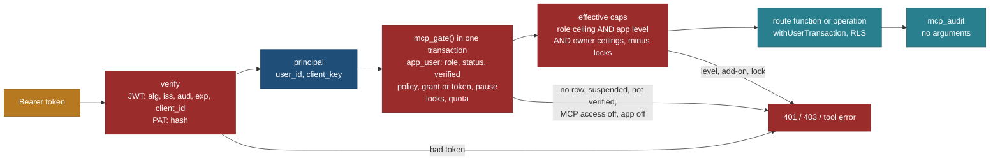
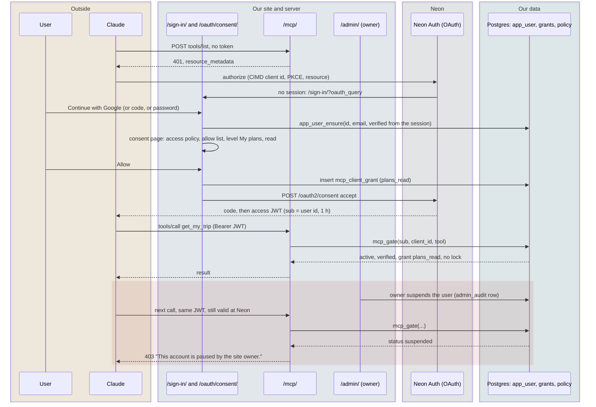

# MCP identity and roles: one account for the site and every connected AI app

Status: **spec, planned** (28 Oct 2026, travel-planner, Opus 5.5). Docs only; nothing here is built. Owner direction of
27 Oct 2026, item 1: "The MCP uses the same login credentials, accounts and roles the user has for the web UI. A user can
operate their account through their own AI agents." PLAN R-286; BACKLOG 15.392; tasks IDN-C and IDN-1
([BUILD-READINESS.md](BUILD-READINESS.md)); owner questions QX16, QX17, QX19 and QX20 ([product-packaging-and-phases.md](product-packaging-and-phases.md) 8).

Builds on and does not repeat: [auth-and-sign-in.md](auth-and-sign-in.md) (sign-in flows, the verifier, levels, add-ons,
grants, Connected apps, consent), [tool-registry-and-admin-controls.md](tool-registry-and-admin-controls.md) (locks and the
admin panel), [tool-catalogue.md](tool-catalogue.md) (which tool needs which level), research
[mcp-best-practice-2026-10-27.md](../../../research/reports/mcp-best-practice-2026-10-27.md) (N1 to N9, section 6).
Principles: P4 (no manual needed: levels in plain words), P6 (the level and last use on the row), P9 (one data boundary).

> **Owner decision, 27 Oct 2026: no public or anonymous MCP endpoint.** Every MCP call, catalogue reads included, needs a
> signed-in account with the same Neon identity as the web site. There is one remote endpoint,
> `https://travel-beta-tan.vercel.app/mcp/` (section 1.1). The `catalogue` level stays as the lowest signed-in level.
> This page is written to that decision; R-124 (public endpoint, no sign-in) is superseded by PLAN R-291.

**Supersedes:** auth-and-sign-in.md 14.2a's role value `owner` (the stored role is `admin`, shown as "Owner"; the schema has
`role in ('user','researcher','moderator','admin')` since migration 0002); auth 5 step 3's "role allows MCP" (now the access
policy of section 7 plus the verified-email rule of section 3); the bootstrap CLI's place in MCP-G (it moves to IDN-C).

## 0. The decision in one paragraph

There is **one identity**: the Neon Managed Better Auth user, and **no anonymous MCP access** (owner, 27 Oct 2026). The
site's session cookie, an OAuth access token issued to Claude or ChatGPT, and a personal access token all resolve to the
same `user_id` (the token's `sub` equals
`neon_auth.user.id`, MCP-0 X4), and our `app_user` row keyed by that id holds the **only** role and account status the
product honours. Tokens carry no role (Neon has fixed scopes and no custom claims), so on every MCP call the server resolves
the token to the user, then reads the role, the account status, the app's grant and the owner's policy from Postgres in the
call's own transaction. Effective access is the **intersection** of the role's ceiling, the app's level, the owner's
ceilings and add-ons, minus every lock that matches. A role change, a suspension, a revoke or a lock therefore applies on
the next call, though Neon's access token lives for an hour. **Trade-off:** one indexed database read per call and no way
to answer from a token alone, against permissions that are always current and one place to change them.

## 1. One identity, four doors

| Door | Credential | Resolves to | Role and status from | Phase |
|---|---|---|---|---|
| The web site (`/account/`, `/mine/`, `/t/<id>/`, `/admin/`) | Neon session cookie (`getUser()` in `web/lib/auth/server.ts`) | `user.id` | `app_user` through `identity_resolve()` (IDN-1) | exists; role and status checks M1 (admin pages) and M2 (everywhere) |
| Remote MCP `/mcp/`, interactive (claude.ai, Desktop, mobile, Claude Code, ChatGPT, VS Code) | Neon OAuth access JWT, `aud` = our resource | `sub` | `app_user`, inside `mcp_gate()` | M1 |
| Remote MCP `/mcp/`, headless (scripts, the owner's research agents, evals) | personal access token `tp_...` | `mcp_token.user_id` | the same | M1 |
| Unauthenticated requests to `/mcp/` | none | nobody | only the sign-in handshake of section 1.1; no tool, no list | M1 |
| Local stdio (`core/bin/mcp.ts`) | none (the owner's machine) | the owner, by possession of the disk | not applicable; owner-only by construction (R-123) | exists |

The browser session JWT (`/api/auth/token`) is never accepted by `/mcp/` (wrong `iss` and `aud`, auth 3). The stdio
server never gets a database credential; if it ever needs private data it calls `/mcp/` with the owner's PAT.

### 1.1 One endpoint, and what an unauthenticated caller gets

**Decision: the single remote endpoint is `/mcp/`** (slash form), and `/mcp/private/` is not used. Why: with no public
endpoint, "private" in the URL means nothing to a user, the shorter URL is the one people type into Claude, and Neon allows
one MCP resource per branch for self-onboarding clients anyway (auth 1). Cost: the child branch's plugin resource changes
from `http://localhost:3000/mcp/private/` to `http://localhost:3000/mcp/` (owner step O-M1b, two minutes), and the MCP-0
proof is repeated on the new path inside MCP-2 (same mechanism, new string). The resource is
`MCP_RESOURCE_URL = https://travel-beta-tan.vercel.app/mcp/` (the slash form only: Next answers `/mcp` with a 308 and the
SDK then refuses the resource, MCP-0 X8; the spec's SHOULD for the slashless form is a known, accepted deviation). PRM lives
at `/.well-known/oauth-protected-resource/mcp/` with `resource` equal to that URL.

| Unauthenticated request | Answer | Rate limit |
|---|---|---|
| `GET /.well-known/oauth-protected-resource/mcp/` (and the root form) | the PRM document: `resource`, `authorization_servers` (Neon's issuer), `scopes_supported: ["openid","profile","email"]`, `bearer_methods_supported: ["header"]` | `mcp:unauth:ip` |
| `POST /mcp/` with `server/discover` and no token | `200` with `supportedVersions`, `serverInfo` (name `travel`, version) and `capabilities: {tools: {listChanged: false}}` only: no tool names, counts, resources, prompts or extension settings | `mcp:unauth:ip` |
| `POST /mcp/` with any other method (`tools/list`, `tools/call`, `resources/*`, `prompts/*`) and no token | `401` with `WWW-Authenticate: Bearer resource_metadata="https://travel-beta-tan.vercel.app/.well-known/oauth-protected-resource/mcp/"` and a fixed body; nothing else | `mcp:unauth:ip` |
| A bad or expired token | `401 invalid_token`, the same header | `mcp:auth:fail:ip` (auth 6.4) |
| Neon's discovery and OAuth endpoints | served by Neon (`<issuer>/.well-known/...`), not by us | Neon's |

`mcp:unauth:ip` is 30 requests a minute per HMAC'd IP in `quota_bucket`, plus the one Vercel WAF rate-limit rule on
`/mcp/` and the PRM path (auth 6.4), so a flood is cut at the edge before a function runs. The answers above never vary by
caller and never touch the catalogue, the store or a user table.

## 2. Roles, status and access policy (the stored facts)

### 2.1 Roles

| Stored `app_user.role` | Shown as | Who | Highest MCP level (role ceiling) | Add-ons the role may grant | Admin panel |
|---|---|---|---|---|---|
| `user` (default) | Member | anyone with an account | `plans_write` | `codes` (planner era), `people`, `removals` | no |
| `researcher` | Researcher | invited by the owner (QX11; opened in M5) | `plans_write` and `research` | as `user` | no |
| `moderator` | Moderator | later, if ever (F16 open question 1: default no) | as `researcher`, plus the review tools for visitor submissions only (`list_submissions`, `show_submission`, `decide_submission`) | as `user` | no (a later "queue only" view) |
| `admin` | Owner | the owner, bootstrapped by command (section 6) | `owner_admin` (every tool) | all | yes |

One role per account; a role is a ceiling, never a grant by itself (auth 14.2 rule 2). Roles are set only on the admin panel
by an `admin` (section 5; `PATCH /api/admin/users/{id}`), audited in `admin_audit`, never by an MCP tool, a request
parameter or a token claim. The last `admin` cannot be demoted or suspended (the function refuses; a second owner needs
`access.ts bootstrap-owner --add-owner`).

Neon's own Admin plugin keeps a separate `role` and `banned` flag on `neon_auth.user` (research N9). **We never read them
for authorization.** The owner may use Neon's "Make admin" for Neon's console features; it grants nothing in our product.

### 2.2 Account status

| Stored `app_user.status` (new, migration `account_status`) | Meaning | Web site | MCP |
|---|---|---|---|
| `active` (default) | normal | normal | as the grant allows |
| `suspended` | the owner stopped the account; nothing is deleted | signed-in pages show "This account is paused by the site owner." with Sign out; account APIs answer `403 account_suspended` | every private call `403` with the same sentence; grants and tokens are kept, unusable |
| (row deleted) | the account was deleted (section 11) | signed out | the next call `403`, then Neon refuses the refresh (the user is gone, MCP-0 X7) |

Columns: `status`, `status_changed_at`, `status_changed_by`, `status_reason` (owner's words, shown to the owner only). The
panel's Suspend also asks Neon to ban the user through the owner's own session (Better Auth Admin `banUser`, which ends web
sessions and blocks sign-in, N9); if that call fails, our status still blocks every door, and the panel says so.

### 2.3 Who may use MCP at all (access policy)

Three settings decide it, all in Neon, all owner-only writes ([tool-registry-and-admin-controls.md](tool-registry-and-admin-controls.md) 3.2):

| Setting | Values | Default |
|---|---|---|
| `mcp_settings.mcp_access` (global) | `owner_only`: the `admin` role only; `per_user`: the owner and every account whose own switch is on | `owner_only` until MCP-S passes (Q162), then `per_user` |
| `mcp_user_settings.mcp_allowed` (per user, the panel's **MCP access** switch) | on, off; `null` means "follow the default for new accounts" | `null` |
| `mcp_settings.new_user_default` | `allowed` or `off`: what `null` means | **`allowed`** recommended (QX20) |
| `mcp_settings.new_account_wait_hours` | 0 to 168: a new account may connect AI apps only after this many hours | **24** recommended (QX20) |

Every value also requires a **verified email** (`app_user.email_verified = true`, section 3 step 6), because production does
not yet require verification at sign-up (EML-0) and a code sign-in can create an account even with sign-up off.

**Recommended default (QX20): new verified accounts are allowed after a 24-hour wait,** at the levels they choose (default
`plans_read`, auth Q190), with per-user quotas. Why: the catalogue is the same public data the site shows without sign-in,
and an owner switch per new account would make every family member wait for the owner. The alternative (`off`: the owner
turns each account on) is one click per person and closes the sign-up abuse path completely; the panel offers both, and the
owner can flip the default at any time (next call).

### 2.4 Sign-up abuse: the risk that remains, and its controls

Removing anonymous access removes anonymous scraping and the per-IP quota problem. The remaining path is "make accounts to
get more quota or to hide". Controls, in the order they bite:

| Control | Where | Effect |
|---|---|---|
| Turnstile and `quota_bucket` limits on sign-up and code requests | EML-Q (auth guard and quotas) | slows mass account creation |
| Verified email required | section 3 step 6 | one inbox per account |
| New-account wait (24 h) | step 7 | throwaway accounts cannot be used at once |
| Per-user quotas (`mcp:user` 600 an hour; `mcp:catalogue:user` 300 an hour for catalogue tools; `mcp:validate:user` 120 an hour) and a global daily cap `mcp:global` 20,000 calls | `quota_bucket`, `core/src/config/mcp-limits.ts` | one account cannot drain the service; the global cap bounds the sum |
| Per-user MCP access switch and "Stop AI access for this user" | panel, Users | the owner cuts one account in one click |
| Default for new accounts `off` | panel, Settings | closes the path entirely when abuse appears |
| Allow list of client ids | `mcp_known_client` | only listed apps can sign in |
| P8 caps inside the store methods | API | no tool returns the catalogue in bulk, whoever calls |

## 3. The lookup chain on every call

The guard runs before the MCP SDK (auth 5). Steps 1 to 4 need no database; steps 5 to 9 are **one call** to the security
definer function `mcp_gate(...)` inside `withUserTransaction(user_id)` (owned by GOV-C and MCP-G; the same round trip takes
the quota). Nothing on this path is cached across calls.

| Step | Check | Source of truth | On fail |
|---|---|---|---|
| 0 | the edge and env layers: WAF rule, `MCP_ENABLED`, panic | Vercel ([tool-registry](tool-registry-and-admin-controls.md) 4) | `403` (env) or the edge's block |
| 1 | `Authorization: Bearer` present, header only (never query, never cookie); without it only section 1.1's answers exist | request | `401` + `WWW-Authenticate: Bearer resource_metadata=...` |
| 2a | `tp_` token: SHA-256, then (in step 5's call) `mcp_token` row: not revoked, not expired | Postgres | `401 invalid_token` |
| 2b | JWT: `alg` EdDSA, `typ` `at+jwt`, signature by the branch JWKS (cached per instance, refetch on unknown `kid` at most once a minute), `iss` exactly `NEON_AUTH_BASE_URL`, `aud` **contains** `MCP_RESOURCE_URL`, `exp` with 60 s skew, `client_id` present and equal to `azp` | token + JWKS | `401 invalid_token` |
| 3 | principal = `{user_id: sub or token.user_id, client_key: client_id URL or "pat:<token_id>", request_id}` | step 2 | none |
| 4 | the tool name is known to the deployed registry | registry (code) | JSON-RPC `-32602` unknown tool |
| 5 | `app_user` row exists for `user_id` | Postgres | `403`: "This app isn't connected to an account here. Remove the connector and add it again." |
| 6 | `status = 'active'` and `email_verified = true` | `app_user` | `403 account_suspended` or `403 email_not_verified` (text in section 12) |
| 7 | access policy admits the user (section 2.3: the global policy, the user's own **MCP access** switch, the new-account wait); client key on the allow list (OAuth only; auth 14.7) | `mcp_settings`, `mcp_user_settings`, `app_user.created_at` | `403` "not open for your account yet", "available from <time>" or "this app isn't allowed" |
| 8 | grant (OAuth) or token (PAT): present, not revoked, not expired, user not paused | `mcp_client_grant` or `mcp_token`, `mcp_user_settings.paused` | `403` "Access for this app is off" (never `401`, auth 14.5) |
| 9 | effective capability for this tool (section 4), including every lock | `mcp_tool_policy`, `mcp_policy_rule`, env | tool error `forbidden` (level or add-on) or `not_available` (locked, disabled, paused) |
| 10 | quota buckets | `quota_bucket` | tool error `rate_limited` |
| 11 | `app.user_id` and `app.mcp_caps` set transaction-local; the tool runs through the app's route function or operation under RLS | `withUserTransaction` | its own errors; `not_found` for anything not the caller's |
| 12 | guard on the result (privacy detector, allowlists), projection, detector again; `mcp_audit` row (no arguments, no results) | core guard | `internal` |



### 3.1 Sequence: connecting Claude, then a role change and a suspension on the next call



## 4. Effective capability

Levels are bundles of capabilities (auth 14.2). Because `research` is not on the plans ladder, "minimum" is computed as a
**set intersection**, never as a comparison of level names:

```
caps(call) = caps(grant.level or token.level)         -- what the user chose for this app
           ∩ ceiling(app_user.role)                   -- what the role may ever have (2.1)
           ∩ caps(env MCP_MAX_LEVEL)                  -- the deploy's ceiling (cannot be raised by the database)
           ∩ caps(mcp_settings.max_level)             -- the owner's live ceiling
           ∩ caps(mcp_settings.max_level_non_owner)   -- only when role != admin
           ∩ phase_caps(env MCP_WRITES_ENABLED, MCP_STAGE_ENABLED)
addons(call) = grant.addons ∩ role_addons(role) ∩ addons_reachable(caps(call))

allowed(tool, call) =
     tool.min_caps ⊆ caps(call)
  ∧  tool.addons_for(arguments) ⊆ addons(call)
  ∧  tool.status = enabled  (or: status = dark ∧ role = admin)
  ∧  tool.deployed_hash = tool.pinned_hash (QX18)
  ∧  no deny rule matches (tool, group, class, level, client_key, user_id, endpoint)   -- deny wins, always
```

`whoami` is in every level (capability `self:read`), so a research-only app can still say who it is and what it may
do. A deny can only remove; nothing in the policy can add a capability a level lacks (no "allow" rules exist).

| Example | Grant level | Role | Owner ceilings | Locks | Result for `apply_change` |
|---|---|---|---|---|---|
| A family member's Claude | `plans_write` | `user` | `max_level_non_owner = plans_read` | none | refused, `forbidden`, `needed_level: plans_write`, "limited by the site's settings" |
| The owner's Claude Code | `owner_admin` | `admin` | `MCP_MAX_LEVEL = plans_write` (v0.20a deploy) | none | allowed (`plans_write` reaches it) |
| The owner's research PAT | `research` | `admin` | none | none | refused: `research` has no plans caps |
| A user whose role the owner just lowered from `researcher` to `user` | `research` | `user` | none | none | the next call: only `catalogue` and `self:read` remain; the Connected apps row says "Limited by your account's role" |
| Anyone | any | any | any | `apply_change` locked | `not_available`, reason `locked` |

## 5. Changes that apply on the next call

| Change | Who | Where | Effect on the next call | Undo |
|---|---|---|---|---|
| Role raised or lowered | owner | panel, Users | the new ceiling intersects every grant and token; grants are **not** rewritten, so raising the role back restores them | set the role back (audited) |
| Suspend | owner | panel, Users | every MCP call `403`; web pages paused; Neon ban attempted | Resume (audited); Neon unban |
| Revoke one app | user or owner | Connected apps, panel | `403` for that app; Neon consent deleted (auth 14.6.3) | none (reconnect) |
| Revoke every app and token of a user | user (Sign out everywhere) or owner | Account, panel | `403` for all | none |
| Pause all MCP for me | user | Connected apps | `403` for all apps of that user | switch off |
| Access narrowed (`per_user` to `owner_only`, a user's MCP access off, new-account default off) | owner | panel, Settings, Users | the affected accounts `403` "not open" | widen again |
| Lock a tool, group, level, client or user | owner | panel ([tool-registry](tool-registry-and-admin-controls.md) 3) | `not_available` for matching calls; dropped from `tools/list` | unlock (audited) |
| Account deleted | user or owner | Account, panel | `403`, then the refresh fails at Neon | none |

"Next call" means: any call whose `mcp_gate()` read starts after the change commits. A call already past step 9 finishes in
its own transaction (at most `maxDuration` 30 s). The 1-hour access token is irrelevant to every row of this table.

## 6. The owner: verified-email bootstrap

Keeps auth 14.2a's five safety rules and fixes the stored value:

1. `node core/bin/access.ts bootstrap-owner` (IDN-C), run by the owner on the Mac with the database owner's URL from the
   ignored root `.env.local`. It finds exactly one Neon user whose email equals `OWNER_EMAIL` **and** whose
   `emailVerified` is true (a read of `neon_auth.user` by the database owner; the one place our code reads Neon's schema,
   never from the app role, never from a request), ensures the `app_user` row, sets `role = 'admin'`, writes an
   `admin_audit` row (`actor: cli`, before and after), and prints the user id (not the email).
2. It refuses when no verified user matches, when two do, or when another `admin` exists without `--add-owner`.
3. The role sits on the user id. Changing the email at Neon does not move it; a new account with the same email string gets
   nothing.
4. **Precondition O-M8:** production "Require Verification" on (EML-1 flips it) and Google linking only to verified accounts
   (GSI-SEC). Until then `MCP_MAX_LEVEL` stays at `plans_read` and the panel's write actions stay off.
5. The `admin` role makes `research` and `owner_admin` available to the owner's apps; each app still needs a grant and the
   write-level confirmation on our site (auth 14.4).

## 7. No account, a new account

| Situation | What happens |
|---|---|
| Someone with no account adds `https://travel-beta-tan.vercel.app/mcp/` | the client gets `401` (section 1.1) and opens our sign-in card; they can create an account there (a code or Google sign-in creates one, EML-0). Nothing is served before sign-in |
| The account is new (inside the wait) | the consent page shows "You can connect AI apps from <time>. Your account was made today." with Cancel only; Cancel posts `accept: false` and creates no grant |
| The account's MCP access is off (owner-only phase, or `off` by default or by the owner) | the consent page shows "Connecting AI apps isn't open for your account yet." with Cancel only |
| An account without a verified email | the consent page says "Confirm your email first" with a link to `/account/`; no Allow |
| A signed-in user whose row has no `app_user` yet | `app_user_ensure()` creates it on the consent page, on a token creation and on the first web visit after IDN-1 (role `user`, status `active`) |

Catalogue answers do not vary by caller: two accounts asking the same catalogue question get the same body (tools-v1 PR3
now reads "for catalogue tools"). Only quotas and the audit know who asked.

## 8. Personal access tokens under the same identity

| Rule | Detail |
|---|---|
| Same user | a token belongs to one `user_id`; it can never act for another user |
| Created on the site only | `/account/connected-apps/`, signed in, verified email, same-origin; never by an MCP tool |
| Level fixed at creation | at most the role ceiling at that moment; never raised later (create a new one); can be lowered (auth 14.5) |
| Re-checked every call | role, status, access policy, pause and locks apply exactly as for an OAuth app; a role drop narrows the token at once |
| Lifetime | 30 days by default, 90 at most, `owner_admin` 30 at most (Q163) |
| Client key | `pat:<token_id>`; the panel shows the label ("research-laptop") and the prefix |
| One per agent | the owner's research agents, the eval harness and CI each get their own token, so one can be revoked without the others |

## 9. Many clients and devices per user

| Fact | Consequence |
|---|---|
| claude.ai web, Desktop and mobile share one client id (`https://claude.ai/oauth/mcp-oauth-client-metadata`) | one grant, one row on Connected apps, one level for all three (MCP-E confirms) |
| Claude Code has its own client id | a second grant and level (auth 14.12) |
| ChatGPT's CIMD id is `https://chatgpt.com/oauth/client.json` when the authorization server returns `iss` (Neon does) | a third grant once the owner adds it to the allow list after MCP-PK (QX16). **If ChatGPT cannot complete OAuth against Neon, ChatGPT has no MCP access until it can**: there is no public fallback any more, and ChatGPT offers no personal-token or static-header path for a user's own connector (research 3) |
| The same client on two laptops | one grant (same client id); Neon holds a refresh token per device; we cannot tell devices apart. Revoke cuts both. For separate control, use one PAT per device |
| VS Code, Cursor | allowed only if MCP-PK proves CIMD against Neon and the owner lists the id; otherwise a PAT |
| Display names and logos | from our own allow-list table (`mcp_known_client`: id, name, logo file), never from the client document (auth 14.12) |

## 10. Service and agent accounts: none in v1

**Decision:** no separate service principals. The owner's agents (research runs, evals, CI smoke) use the owner's PATs, one
per agent, at the narrowest level that works (`research` for research runs, `catalogue` for smoke checks). The eval
harness uses a synthetic `user` account on the child branch, reset before each run (product-testing 2). **Why:** under 100
users and one owner; a service principal is a second kind of identity that RLS, the panel and the audit must model, and
Claude does not support `client_credentials` anyway (research section 3). **Revisit** if a server-side agent ever runs
without the owner (F16 "server agent later").

## 11. Account deletion and data export

| Item | On deletion | In "Download my data" (`/api/account/profile/export`, Q320) |
|---|---|---|
| `mcp_client_grant`, `mcp_token`, `mcp_user_settings`, `mcp_grant_event` | deleted (cascade) | grants (client name and id, level, add-ons, created, last used, expires), tokens (label, prefix, level, dates; never the hash), grant events |
| `mcp_audit` rows of the user | deleted; the daily totals keep counts with no user id | the last 30 days: time, app, tool, result |
| Pending changes, preview handles, tasks | deleted | not exported (transient) |
| Staged research batches (researcher or owner) | withdrawn; `by_user` set to null; kept for the catalogue's provenance with "a deleted account" | the user's own batches as JSON |
| `admin_audit` rows that name the user as the target | target id replaced by a one-way hash; kept for the owner's record | rows that name the user as target: date and action ("Account paused by the site owner") |
| Neon user | deleted by the existing account-deletion path; this also revokes Neon refresh tokens (MCP-0 X7) | not ours |
| The last `admin` | refused: "Add another owner first" | |

## 12. Connecting an agent: the screens and words

Reuses, never duplicates: the sign-in card (GSI-UX: Continue with Google first, then email code and password), the consent
screen (auth 14.6.4), Account, Connected apps and access (auth 14.6), and the help page `/mcp-help/` (packaging 2, inside
MCP-U). Added here:

| Where | State | Exact words |
|---|---|---|
| Sign-in card, when `oauth_query` is present | the banner above the card (`--info-soft` notice, components 5.4) | "Claude is asking to connect to your Trip Plans account. Sign in to continue." (the client name from our allow-list table; unknown clients never reach this page with an Allow) |
| Consent | not open for the account | "Connecting AI apps isn't open for your account yet. The site owner can turn it on." Button: Cancel |
| Consent | new account inside the wait | "You can connect AI apps from <weekday time>. Your account was made today." Button: Cancel |
| Consent | email not verified | "Confirm your email first. We sent a code when you signed up; you can ask for a new one on your Account page." Buttons: Open Account, Cancel |
| MCP `403` body (the client shows it) | suspended | "This account is paused by the site owner." |
| MCP `403` body | not verified | "Confirm your email on the site, then try again: https://travel-beta-tan.vercel.app/account/" |
| MCP `403` body | not open | "Connecting AI apps isn't open for this account yet." |
| MCP `403` body | app off (revoked, expired, paused) | as auth 14.5 |
| Tool error `forbidden` | level too low | "This needs 'My plans, change'. You can allow it for this app on the site: <settings_url>" (the level's words from auth 14.2, never the stored id) |
| Tool error `not_available` | tool locked | "This tool is turned off on this site for now. Nothing was changed." |
| Connected apps row | role narrows a grant | chip "Limited by your account's role" (`--info`, components 2.8) |
| `whoami` text | always | "You are connected as <first name> (<role in words>). This app can: <level sentence>. Add-ons: <list or none>. Change it here: <url>" |

Accessibility for these: banners are polite live regions; the consent buttons are equal in weight (S01); every `403` text
is plain language with one action, no codes in the visible sentence (the code is in the JSON body for the client).

## 13. Decision table

| # | Decision | Chosen | Rejected | Trade-off |
|---|---|---|---|---|
| I1 | Where the role lives | `app_user.role` (ours) | a Neon role claim (impossible, N2); Neon Admin plugin role (a second store with no RLS link) | one more read per call |
| I2 | How fresh access is | read per call, no cache | cache per instance; token claims | always current; no offline answer |
| I3 | How "minimum" is computed | capability-set intersection | ordering level names | handles `research` beside the plans ladder |
| I4 | Owner identity | stored `admin` on the user id, bootstrapped by command from a verified email | email-string match at runtime; a request that grants admin | a command step (O-M8) |
| I5 | Suspension | our status column, checked per call; Neon ban as an extra wall | Neon ban alone (does not cut OAuth refresh tokens, X7) | two places to resume |
| I6 | Verified email | required for any MCP access | rely on Neon's sign-up setting (off in production) | a user must confirm email before connecting |
| I7 | New accounts from an MCP sign-in | allowed (Neon cannot stop it), but no grant unless the policy admits them | try to block sign-up | stray empty accounts are possible |
| I8 | Service accounts | none; per-agent PATs of the owner | a service principal type | the owner's identity is on agent actions (clearer audit) |
| I9 | Governance over MCP | never: no tool reads or writes roles, grants, locks or the registry | an "admin" MCP tool | the panel is the only lever, so an injected agent cannot unlock |
| I10 | Endpoints | one authenticated endpoint `/mcp/` (owner, 27 Oct 2026; supersedes Q161's two URLs and R-124) | a public `/mcp/` plus `/mcp/private/`; Claude's lazy authentication (S6b) | every user signs in, even to read the catalogue; no anonymous scraping path |
| I11 | Default for new accounts | allowed after a verified email and a 24-hour wait (QX20) | owner turns each account on | a stranger with a verified inbox can read the catalogue through an AI app a day after signing up |

## 14. Data model (proposed columns; SQL is the builder's)

| Object | Change | Owner task |
|---|---|---|
| `mcp_settings`, `mcp_user_settings` | `mcp_access`, `new_user_default`, `new_account_wait_hours` (GOV-C); `mcp_allowed` (MCP-G) | GOV-C, MCP-G |
| `app_user` | add `status` (`active` or `suspended`, default `active`), `status_changed_at`, `status_changed_by`, `status_reason`, `email_verified` (bool, default false), `email_verified_at`; `role` unchanged | IDN-C, migration slug `account_status` |
| `app_user_ensure(user_id, email, email_verified)` | security definer; upserts the row from a server-side session or consent; never lowers `email_verified` from true to false without an email change | IDN-C |
| `identity_resolve(user_id)` | security definer; returns `role`, `status`, `email_verified` for the web guard (IDN-1) | IDN-C |
| `admin_set_role(target, role, reason)`, `admin_set_status(target, status, reason)` | security definer; caller must be `admin` (`app.user_id`); refuses the last admin; writes `admin_audit` | IDN-C (functions), GOV-API1 (routes) |
| `mcp_gate(...)` | reads the identity facts above as its first step | GOV-C, MCP-G |
| `mcp_known_client` | id, display name, logo file name, added_by, added_at (the allow list's display table) | GOV-C |

`travel_app` gets `execute` on these functions only; no direct `select` on `app_user` columns beyond what RLS already allows.

## 15. Tests (T1 unless marked)

| # | Case |
|---|---|
| IT1 | a JWT whose `sub` has no `app_user` row: `403` with the reconnect words, never `401` |
| IT2 | role lowered between two calls with one JWT: the second call is narrowed (unit for the intersection table plus a route test) |
| IT3 | suspended user: every MCP tool `403`; web account API `403 account_suspended`; resume restores the old grants |
| IT4 | `email_verified = false`: consent offers no Allow; the gate refuses; a verified sign-in flips it |
| IT5 | `mcp_access = owner_only`: a `user` with a valid grant row (planted) is refused; `per_user` admits accounts whose switch is on or whose `null` follows an `allowed` default |
| IT6 | capability intersection: every level x every role x both env ceilings x add-ons, including `research` never reaching plans caps and `whoami` at every private level (property test over the lattice) |
| IT7 | the last admin cannot be demoted, suspended or deleted |
| IT8 | `bootstrap-owner`: no verified match, two matches, existing admin without `--add-owner`: all refuse; success writes `admin_audit` |
| IT9 | a PAT keeps working after the role is raised but never gains the new caps; it narrows when the role drops |
| IT10 | Neon's role or ban flag set and ours not: our decision ignores Neon's role (T2 on the child) |
| IT11 | account deletion removes grants, tokens, settings and the user's audit rows; export lists them before |
| IT12 | no MCP tool takes `user_id`, `role`, `level` or `scope` as an argument (strict schema fuzz) |
| IT13 | unauthenticated: `server/discover` returns only versions, server info and `tools` capability; every other method `401` with the PRM pointer; PRM served; no store or user table touched (spy); `mcp:unauth:ip` refuses the 31st request in a minute |
| IT14 | new-account wait: an account made 23 hours ago is refused at consent and at the gate; at 24 hours it passes; `mcp_allowed = false` refuses; `null` follows `new_user_default` |

## 16. Conflicts resolved here

| Existing | Where | Now |
|---|---|---|
| Admin role row "(`owner`)" | auth 14.2a rule 2 | stored `admin`, shown "Owner" (schema 0002 has no `owner` value) |
| "`sub` has an `app_user` row and the role allows MCP (Q162: owner only at first)" | auth 5 step 3 | steps 5 to 7 above: row, status, verified email, access policy |
| Bootstrap CLI inside MCP-G | auth 14.2a rule 3, 14.9 | IDN-C (M1), because the admin panel and the single endpoint both need the owner role in M1 |
| `whoami` at `plans_read` | product-roles 3 | every level (`self:read`) |
| "Every operation records the client (`mcp:claude`, ...)" | README 3 | `client_key` is the exact client id URL or `pat:<id>`; the display name comes from `mcp_known_client` |

## Gotchas

- **Our code must not read `neon_auth` from the app.** Migration 0001 keeps Neon's schema out of ours. The only read is the
  bootstrap CLI as the database owner; the app learns `email_verified` from the session at consent and sign-in.
- **`email` is `unique not null` on `app_user`.** An email change at Neon must update the row through `app_user_ensure`; a
  second account with an old email string would otherwise collide.
- **A `401` for "no account row" would loop** (the client refreshes and gets another valid token). Use `403`.
- **Neon's ban does not stop an issued access JWT or a refresh token.** Our status check is the switch; the ban is extra.
- **Claude caches discovery for about five minutes** (research S6b). A PRM change takes that long to reach Claude users.
- **Self-reported `clientInfo`** in `_meta` is logged for the owner's interest only; it is never a key for access.

## Change log

- 28 Oct 2026: written (travel-planner, Opus 5.5) on `public/MCP-PLAN` for the owner's direction of 27 Oct 2026.
- 28 Oct 2026: reworked for the owner's decision of 27 Oct 2026 (no anonymous endpoint): one endpoint `/mcp/`, the unauthenticated handshake (1.1), the access settings with a per-user switch and a default for new accounts (2.3, QX20), sign-up abuse controls (2.4).
