# MCP product: user-scope writes, the staging area, provenance, review and publish

Part of [product.md](product.md). Status: spec only, planned (26 Oct 2026). Answers owner vision items 1 (customise into
Mine), 2 (new plans in our format; user scope or, for admins, the catalogue) and 6 (integrity). Principles MX3, MX4, MX10.

## 0. The decision in one paragraph

There are two write scopes and they never mix. **User scope**: a signed-in user's copies, own plans and private places,
written through the same account routes and operations as the web app, under owner-predicate RLS, validated by the same
Zod contracts, each change with an inverse and an `op_event` row; nothing in user scope is public. **Catalogue scope**:
nobody, not even the owner, writes the shared catalogue through MCP. The owner's (and later a researcher's) AI writes a
**research batch** into a staging table; the owner reviews the diff and approves on our site; an owner-run export turns
the approved batch into lane files and changesets on a git branch, where the validators, the gap budget and the slug check
run; the branch merges in a data stack and ships in the next release, then `db:sync` loads it. The JSON in git stays the
seed of record (R-140) and the release stays the only door to the public site. **Trade-off:** a staged fact takes a
release to go live, against a catalogue an MCP token could change in one call.

```mermaid
flowchart LR
  classDef core fill:#1F4E79,stroke:#163A5A,color:#FFFFFF
  classDef data fill:#2A7F8F,stroke:#1E5F6B,color:#FFFFFF
  classDef ext fill:#B7791F,stroke:#8A5A12,color:#FFFFFF
  classDef sec fill:#9B2C2C,stroke:#6B1F1F,color:#FFFFFF
  classDef ok fill:#5A6772,stroke:#3E4850,color:#FFFFFF

  AI["Client AI<br/>(researches the web itself)"]:::ext
  V["validate<br/>(API-V)"]:::core
  S["stage_batch<br/>research_stage table"]:::data
  R["Owner review on our site<br/>diff, sources, approve per change"]:::sec
  X["stage.ts export (owner)<br/>git branch: lane files + changesets"]:::core
  G["validators, gaps --budget, slugs --check<br/>T1, data stack T2"]:::sec
  M["merge, release T3"]:::ok
  D["db:sync, CAT-V"]:::data

  AI --> V --> S --> R --> X --> G --> M --> D
  R -- "ask for changes" --> AI
```



## 1. User scope (M3)

### 1.1 What a user can write

| Object | Store | Contract | Route | Undo |
|---|---|---|---|---|
| A copy of a public trip | `plan_draft` row (`custom_draft` migration, CUS-C) | `trip-custom/1` (CUS-C widened: `removed`, `moved`, `days`, `notes`, `title`, `custom`) | `POST`, `PATCH /api/account/drafts[/{id}]` | inverse per op; batch undo |
| An own plan (not a copy) | `plan_draft` row with `kind: "plan"` | **`user-plan/1`** (UPL-C, new): the core trip schema of TD-1 (`core/src/schema/trip.ts`: days, items by catalogue ref or user place id, bases, notes), dateless or with `start` | `POST /api/account/plans`, `PATCH .../{id}` | inverse per op |
| A private place | **`user_place`** table (UPL-C migration) | **`user-place/1`**: a `capture/1` subset (name, type, point with source, summary, links, a small set of registry facts as Vals, sources with URL, read date, quote) | `POST`, `PATCH`, `DELETE /api/account/places[/{id}]` | soft delete, inverse |
| Favourites | `account_favourite` (FAV-D) | `favourites/1` refs | `POST`, `DELETE /api/account/favourites` | re-add |
| Requests and suggestions | `intake` (FBK-C) | `submissionInput` (place, trip, improve, report) with `source_ref` (a user place snapshot when suggesting a researched place) | `POST /api/v1/submissions` | withdraw |

### 1.2 Rules

| # | Rule |
|---|---|
| U1 | Every user write is a route the web app also calls; the MCP tool adds no write path (MX1) |
| U2 | RLS owner predicate on `plan_draft`, `user_place`, `account_favourite`; cross-user ids answer `not_found` |
| U3 | Validation: the route runs the contract (Zod plus the cross-field rules, for example `tripCustomRules`) and, for a plan, the same day checks as the timeline (`core/src/checks/**`) as warnings |
| U4 | Level: `plans_propose` writes become pending changes approved on our site (MCP-P); `plans_write` applies; removals need `removals` (auth 14.3) |
| U5 | User places are household data (privacy class `household`): never on a public page, a public API answer, a search index, a public MCP answer or an export of someone else |
| U6 | User place facts reuse registry keys and Val shapes, so a later suggestion maps one-to-one into a research batch; a user place may carry only registry properties with `privacy: public` semantics (no household fields inside a place) |
| U7 | Limits per user: 50 plans and copies (NAV-D `draft_cap` extended), 500 user places, 64 KB per plan doc, 8 KB per place |
| U8 | Stored user text (titles, notes, place summaries) returns in `untrusted_text` (auth 6.5) |
| U9 | `create_plan` and `add_private_place` validate first and store nothing on an error |
| U10 | A plan may reference catalogue refs; the reference is read live, so a catalogue fix reaches the plan; a user place never overrides a catalogue record (it may sit beside one) |

### 1.3 From user scope to the catalogue

`suggest_place {user_place_id}` sends a snapshot of the private place as a place suggestion (FBK-C `source_ref`,
`intake-detail/1`); the owner sees it in `review_queue` (REQ-M); `stage_from_submission` (owner) turns it into a draft
research batch with the snapshot's sources, which the owner's AI completes to the required tier before review. The user's
place stays private; no user name or contact reaches the batch (the intake contact table has no grant to the app role).

## 2. Catalogue scope: the research batch (M4)

### 2.1 `research-batch/1` (STG-C)

```ts
export const researchBatch = z.strictObject({
  schema: z.literal("research-batch/1"),
  purpose: z.enum(["new_destination", "fill_gaps", "refresh", "request", "fix"]),
  scope: z.strictObject({ lane: z.string().regex(/^[a-z0-9-]+$/),                 // the catalogue lane file family, e.g. "PA-ca"
                          trip: z.string().optional(), submission: z.string().optional() }),
  records: z.array(capRecord).max(200),                 // new capture/1 records
  suitability: z.array(suitabilityRecord).max(200),     // sidecars for new or existing refs
  relevance: z.array(relevanceRecord).max(200),
  points: z.array(capturePoint).max(200),               // capture-points/1 rows
  operators: z.array(captureOperator).max(50),
  changes: z.array(change).max(500),                    // capture-changeset/1 changes to existing records
  sources: z.array(sourceRow).min(1),                   // every src id the batch cites resolves here or in the registry
  run: captureRun,                                      // capture-run/1: what was tried, outcomes per field, searched_none queries
  notes: z.string().max(4000).optional(),               // returned as untrusted_text
});
```

It reuses existing contracts only (`capture/1`, `suitability/1`, `relevance/1`, `capture-points/1`,
`capture-operators/1`, `capture-changeset/1` `change`, `sources/1` rows, `capture-run/1`). New is the envelope and its
cross-field rules (`E_STAGE_*`): every `src` resolves; every new record's ref is free in the published tree and in open
batches; a change targets a ref that exists; `meta.origin` is `stage:<batch_id>` on every new row; no household strings
(the detector on input).

### 2.2 States

| State | Set by | Meaning |
|---|---|---|
| `draft` | `stage_batch` with `submit: false` | the AI is still working; visible to its author only |
| `submitted` | `stage_batch {submit: true}` | validated clean (warnings allowed); in the owner's queue |
| `changes_requested` | `decide_batch` with `ask` | back to the author with notes |
| `approved` / `partly_approved` / `rejected` | the owner on **our site** (MCP-P approval page), never from an MCP call alone | `decide_batch` records the owner's choices; the site's confirmation makes them binding (Q198 rule, auth 14.4) |
| `exported` | `stage.ts export` (owner, on the Mac) | a git branch `data/stage-<id>` holds lane files and a changeset; the batch is frozen |
| `published` | the release that merged the branch, after `db:sync` | the release tag is recorded on the batch |
| `withdrawn` | the author or the owner | kept for audit |

### 2.3 Provenance (who, when, which sources)

| What | Where it is kept |
|---|---|
| Who staged it | `research_stage.by_user`, `by_client` (`mcp:claude`, `pat:<label>`), the client's self-reported `clientInfo` (2026-07-28 `_meta`) and model name when given |
| When | `created_at`, `submitted_at`, each decision's time |
| Which sources | `sources[]` rows (publisher, URL, read date, licence class, quote ≤ 300 characters); every Val's `src` and `read` |
| What was tried | the `capture-run/1` record (per field: found, searched_none with the query, not tried) |
| Who approved | `research_stage_decision` rows (owner id, time, per change) |
| How it shipped | the export commit, the merge commit, the release tag; `meta.run = stage:<batch_id>` on every loaded row (RowMeta, R-131) |

### 2.4 Review on our site (extends MCP-P)

The approval page `/account/approve/<id>/` shows, per record: the type checklist with filled and missing fields, each new
value with its source link and read date, conflicts with published values (both shown, T3), validator warnings, a licence
summary, and a "requested by" line when the batch came from a submission. Per change: accept, reject, ask. A batch with a
`rest!` (safety) value from a source outside the type's first two lanes is flagged. The page never renders staged text as
HTML (escaped, fenced).

### 2.5 Export and publish (STG-P, owner only)

1. `node core/bin/stage.ts export <batch_id>` on the owner's machine reads the approved batch through the admin route
   (owner token), writes new records to `data/capture/catalogue/<lane>.json` (and sidecars, points, operators) and changes
   to `data/capture/changesets/stage-<id>.json`, on branch `data/stage-<id>`.
2. It runs `validate.ts --all`, `suitability.ts check`, `relevance.ts check`, `capture.ts gaps --budget --check`,
   `slugs.ts --check`, `sources.ts build` and the privacy detector over the changed files; any failure stops the export.
3. The coordinator merges the branch in a data stack (TEST-STRATEGY T2), the release ships it (T3), `db:sync` loads it,
   CAT-V checks drift; the batch becomes `published` with the release tag.
4. Rollback: revert the merge commit and `db:sync`; RowMeta `meta.run` finds every row of the batch.

### 2.6 Rules for catalogue scope

| # | Rule |
|---|---|
| C1 | No MCP tool writes `data/**`, a catalogue table or the source registry; staging is a separate table with no grant to public reads |
| C2 | Staging requires `research` (invited) or `owner_admin`; v0.20b ships owner-only (QX11) |
| C3 | Every batch passes `validate` before `submitted`; the export re-runs every validator against the then-current tree |
| C4 | Approval only on our site; `decide_batch` from a client is a recommendation until confirmed there |
| C5 | Quotas: 5 submitted batches a day, 500 changes per batch, 200 new records per batch (`mcp:propose:user`, auth 6.4), 20 open batches per user |
| C6 | Licence: facts in our words; quotes ≤ 300 characters; link-only hosts refused as sources; photos only with licence and attribution read from the page; no bulk copying of a third-party list (validator warns when more than 20 records cite the same page) |
| C7 | Household data is refused on input (`E_PRIVACY_INPUT`); a batch from a submission never carries the submitter's contact |
| C8 | Refresh batches keep the old value as a conflict when the new one differs (README 9) |
| C9 | Every staged and published row is traceable to its batch (RowMeta) and reversible by revert |
| C10 | The MCP never runs the export, the merge or `db:sync`; those stay owner and coordinator steps outside MCP |

## 3. Admin legwork through MCP (what replaces front-end data entry)

| Job | Tools | Output |
|---|---|---|
| Research a new destination | `research_brief` → client research → `validate` → `stage_batch` | a `new_destination` batch |
| Add missing records | `work_list {kind: "gaps"}`, `research_brief {ref}` → `stage_batch` | a `fill_gaps` batch of changes |
| Fill gaps | as above | as above |
| Refresh stale data | `work_list {kind: "stale", class: "prices"}` → re-read → `stage_batch {purpose: "refresh"}` | a `refresh` batch with conflicts kept |
| Review requests | `review_queue`, `show_submission`, `decide_submission`, `stage_from_submission` | intake decisions; draft batches |
| Approve | the site | `approved` |

## 4. Tasks (hours in [product-packaging-and-phases.md](product-packaging-and-phases.md) 4)

| Id | Task | Model |
|---|---|---|
| UPL-C | `user-plan/1`, `user-place/1`, migration `user_place` (RLS), `plan_draft.kind`, caps; ops with inverses | Opus 6 |
| UPL-1 | Routes `/api/account/plans/**`, `/api/account/places/**`, previews; tests (cross-user, caps, inverse) | Sonnet 8 |
| STG-C | `research-batch/1`, `E_STAGE_*` rules, migration `research_stage` (+ decisions), states | Opus 6 |
| STG-1 | Admin routes: stage, list, get, diff, decide, work list; `stage_from_submission` | Sonnet 8 |
| STG-P | `core/bin/stage.ts export` with the validator chain; branch naming; rollback note | Sonnet 6, Opus review 1 |
| MCP-P (exists, later) | approval page, extended for batches (2.4) | Opus 3, Sonnet 5 (as planned) + Sonnet 3 for batch diff |

## Change log

- 26 Oct 2026: written (travel-planner, Opus 5.5).
